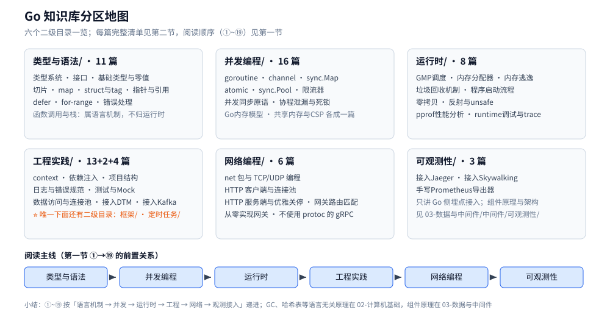

# Go 知识库

> 覆盖语言基础、并发编程、运行时原理、工程实践、网络编程与可观测性接入。
>
> 内容整理自个人学习笔记。**语言机制部分**参考《Go 语言核心编程》（李文塔），
> ⚠️ 该书基于 **Go 1.11 前后**，各篇均按 **Go 1.26.5** 补充新版本特性并标注引入版本；
> **运行时底层 / 框架 / 可观测性接入**等超出原书范围的内容为独立整理，各篇头部标注来源。
> 完整素材登记见 [素材清单.md](../../素材清单.md)。
>
> ⚠️ **两个版本口径别混**：语言特性的判据版本写 **Go 1.26.5**（本机宿主机工具链）；
> 各篇的**实测读数**一律来自容器 `golang:1.26-alpine`，即 **go1.26.8 linux/amd64**（补丁号不同，见各篇「校验口径」）。

---

## 一、按什么顺序读？

**本节要点**：这张表回答「从哪进、谁是谁的前置」。一行可能点名几篇，**每篇的完整清单在第二节**。

| 顺序 | 篇 | 视角 |
|------|-----|------|
| ① | [基础类型与零值.md](类型与语法/基础类型与零值.md) | 变量、常量、零值语义 |
| ② | [类型系统.md](类型与语法/类型系统.md) | 命名与未命名类型、方法集、组合 |
| ③ | [接口.md](类型与语法/接口.md) | iface / eface、断言、接口代价 |
| ④ | [切片.md](类型与语法/切片.md) + [map.md](类型与语法/map.md) + [struct与tag.md](类型与语法/struct与tag.md) | 三种核心数据结构 |
| ⑤ | [指针与引用.md](类型与语法/指针与引用.md) + [函数调用与栈.md](类型与语法/函数调用与栈.md) | 内存模型基础 |
| ⑥ | [defer.md](类型与语法/defer.md) + [for-range.md](类型与语法/for-range.md) + [错误处理.md](类型与语法/错误处理.md) | 语法陷阱与错误语义 |
| ⑦ | [goroutine.md](并发编程/goroutine.md) + [channel原理与底层实现.md](并发编程/channel原理与底层实现.md) + [协程与线程成本.md](并发编程/协程与线程成本.md) | 并发基石与成本 |
| ⑧ | [并发同步原语.md](并发编程/并发同步原语.md) + [并发控制实战.md](并发编程/并发控制实战.md) | 同步机制 |
| ⑨ | [sync.Map.md](并发编程/sync.Map.md) + [atomic操作.md](并发编程/atomic操作.md) + [sync.Pool.md](并发编程/sync.Pool.md) | 三个「要不要用」的原语 |
| ⑩ | [goroutine实战模式.md](并发编程/goroutine实战模式.md) + [channel实战模式.md](并发编程/channel实战模式.md) + [errgroup与pipeline.md](并发编程/errgroup与pipeline.md) | 并发怎么写 |
| ⑪ | [channel使用陷阱.md](并发编程/channel使用陷阱.md) + [共享内存与CSP.md](并发编程/共享内存与CSP.md) + [线程安全.md](并发编程/线程安全.md) + [Go内存模型.md](并发编程/Go内存模型.md) | 并发哲学与边界 |
| ⑫ | [协程泄漏与死锁.md](并发编程/协程泄漏与死锁.md) + [限流器.md](并发编程/限流器.md) | 生产问题 |
| ⑬ | [GMP调度.md](运行时/GMP调度.md) + [内存分配器.md](运行时/内存分配器.md) + [内存指标与文件映射.md](运行时/内存指标与文件映射.md) | 调度与内存 |
| ⑭ | [垃圾回收机制.md](运行时/垃圾回收机制.md) + [内存逃逸.md](运行时/内存逃逸.md) | GC |
| ⑮ | [程序启动流程.md](运行时/程序启动流程.md) + [零拷贝.md](运行时/零拷贝.md) + [反射与unsafe.md](运行时/反射与unsafe.md) + [runtime调试与trace.md](运行时/runtime调试与trace.md) | 底层机制与观测 |
| ⑯ | [context.md](工程实践/context.md) + [依赖注入.md](工程实践/依赖注入.md) + [项目结构.md](工程实践/项目结构.md) | 工程基础 |
| ⑰ | [日志与错误规范.md](工程实践/日志与错误规范.md) + [测试与Mock.md](工程实践/测试与Mock.md) + [子进程与外部命令.md](工程实践/子进程与外部命令.md) | 工程规范与系统交互 |
| ⑱ | [net包与TCP-UDP编程.md](网络编程/net包与TCP-UDP编程.md) + [HTTP客户端与连接池.md](网络编程/HTTP客户端与连接池.md) + [HTTP服务端与优雅关停.md](网络编程/HTTP服务端与优雅关停.md) + [反向代理接入.md](网络编程/反向代理接入.md) + [客户端IP接入.md](网络编程/客户端IP接入.md) + [网关路由匹配.md](网络编程/网关路由匹配.md) + [不使用protoc的gRPC.md](网络编程/不使用protoc的gRPC.md) + [从零实现网关.md](网络编程/从零实现网关.md) | 网络与综合实战 |
| ⑲ | [接入Jaeger.md](可观测性/接入Jaeger.md) + [接入Skywalking.md](可观测性/接入Skywalking.md) + [手写Prometheus导出器.md](可观测性/手写Prometheus导出器.md) | 链路追踪与指标 |

---

## 二、六个二级目录里有什么？

**本节要点**：`类型与语法` 讲语言机制，`并发编程` 讲 goroutine 与 channel，`运行时` 讲调度 / 内存 / GC / 反射，
`工程实践` 讲项目里怎么写，`网络编程` 讲 net 与网关实战，`可观测性` 讲 Go 侧埋点接入。
⭐ 只有 `工程实践/` 下面还有二级（`框架/`、`定时任务/`），其余五个目录**不再分层**。

### 2.1 类型与语法/（11 篇）

| 篇 | 讲什么 |
|---|---|
| [类型系统.md](类型与语法/类型系统.md) | 命名 / 未命名类型、类型同一性与赋值规则、方法集、组合、泛型与新版内建函数 |
| [接口.md](类型与语法/接口.md) | 静态与动态类型、断言与 type switch、iface / eface 两字布局、接口调用代价 |
| [基础类型与零值.md](类型与语法/基础类型与零值.md) | 声明形式与 `:=` 遮蔽、位宽选择、每种类型的零值能不能直接用、`nil` 的六类形态、`unsafe.Sizeof` 全表 |
| [struct与tag.md](类型与语法/struct与tag.md) | 内存布局与字段对齐、字段重排实测、`struct{}`、可比较规则、五家 tag 写法对照 |
| [指针与引用.md](类型与语法/指针与引用.md) | Go 没有引用类型、指针与值传参的拷贝形态、`uintptr` 断链、逃逸与失效指针 |
| [切片.md](类型与语法/切片.md) | 底层结构、`append` 扩容、预分配、母子切片共享与断链、子切片泄漏 |
| [map.md](类型与语法/map.md) | 底层结构、哈希冲突、扩容两条件两方式、nil map 与并发写、key 类型限制 |
| [defer.md](类型与语法/defer.md) | 三个特性、三个应用场景、LIFO 的执行顺序与源码原理 |
| [for-range.md](类型与语法/for-range.md) | 值变量是临时变量、哪些类型能借指针改原始数据、1.22 起的循环变量语义 |
| [错误处理.md](类型与语法/错误处理.md) | 错误是值不是异常、`%w` 包装链、`Is` / `As` / `Join` 判定、panic 与 recover 的闸门 |
| [函数调用与栈.md](类型与语法/函数调用与栈.md) | 调用过程、栈帧里有什么、栈扩容时旧指针怎么调整 |

### 2.2 并发编程/（17 篇）

| 篇 | 讲什么 |
|---|---|
| [goroutine.md](并发编程/goroutine.md) | 与线程的五维对照、`g` 结构与六态、`gopark` / `goready`、初始栈与增长、循环变量语义 |
| [协程与线程成本.md](并发编程/协程与线程成本.md) | 把「进程 / 线程 / 协程的创建成本」量出来：`BusyN` + `LockOSThread` 超订扫描、乒乓切换单次成本、阻塞协程栈内存、`GOMAXPROCS` 与并发 / 并行；⭐ 三条只有量过才讲得准的话（6000 : 25 : 1、核数处到顶、2KB 是初始栈而非内存账） |
| [goroutine实战模式.md](并发编程/goroutine实战模式.md) | 七个典型案例、项目里四种用法、端到端实例与对照实测 |
| [channel原理与底层实现.md](并发编程/channel原理与底层实现.md) | `hchan` 字段、收发流程、缓冲区的「总是新鲜的」、select 三轮检查 |
| [channel使用陷阱.md](并发编程/channel使用陷阱.md) | 能不能先判断阻塞再写、四个必踩点、死锁什么时候才报 |
| [channel实战模式.md](并发编程/channel实战模式.md) | 通信六案例、多生产者 + 单消费者的两个同步点 |
| [并发同步原语.md](并发编程/并发同步原语.md) | Mutex 与饥饿模式、RWMutex 相容矩阵、`sync.Once`、分段锁、WaitGroup 误用（⭐ `sync.Map` 与 atomic 已各成一篇） |
| [sync.Map.md](并发编程/sync.Map.md) | 不是「更快的 map」：read/dirty 双 map（1.9–1.25）与哈希前缀树（**1.26 起**）两代结构、三场景实测、选型判据 |
| [atomic操作.md](并发编程/atomic操作.md) | atomic 与锁的取舍、老函数族与 1.19 类型族、64 位对齐、伪共享实测、顺序一致语义 |
| [sync.Pool.md](并发编程/sync.Pool.md) | 不是缓存而是「减少分配」、victim cache、按 P 分片与偷取、必须重置 |
| [errgroup与pipeline.md](并发编程/errgroup与pipeline.md) | `errgroup` 的语义与硬约束、pipeline 的 stage 拆分与 channel 收口 |
| [并发控制实战.md](并发编程/并发控制实战.md) | 打印升序数字、交替打印奇偶数、获取协程返回值 |
| [共享内存与CSP.md](并发编程/共享内存与CSP.md) | 「不要通过共享内存来通信」到底在说什么、两条路线的边界 |
| [Go内存模型.md](并发编程/Go内存模型.md) | 三层重排、`happens-before` 边、数据竞争为何是未定义行为、atomic 的顺序一致立场、`-race` 能测什么、与 Java JMM 的逐条对照 |
| [线程安全.md](并发编程/线程安全.md) | 并发读写 map 的后果、线程安全的定义、三类线程安全类型 |
| [协程泄漏与死锁.md](并发编程/协程泄漏与死锁.md) | 泄漏四类成因与复现代码、pprof 排查、死锁四条件 |
| [限流器.md](并发编程/限流器.md) | `x/time/rate` 的三种接入骨架、把读数量出来的实测、三个必踩的坑 |

### 2.3 运行时/（10 篇）

| 篇 | 讲什么 |
|---|---|
| [GMP调度.md](运行时/GMP调度.md) | GMP 三元组、work stealing、切换时机、`GOMAXPROCS`、P 内部队列、异步抢占 |
| [内存分配器.md](运行时/内存分配器.md) | `mspan`、67 级 size class、mcache / mcentral / mheap 三级分配 |
| [内存逃逸.md](运行时/内存逃逸.md) | 定义与原因、`-gcflags=-m` 分析、五类场景、三条判定规则与代价 |
| [内存指标与文件映射.md](运行时/内存指标与文件映射.md) | `runtime.MemStats` 与内核视角的 RSS 为什么对不上（RSS 偏大的四种原因）、缓冲写 `Flush` 与 `Sync()` 的落盘边界、`syscall.Mmap` 把文件当 `[]byte` 用 |
| [垃圾回收机制.md](运行时/垃圾回收机制.md) | 并发三色标记 + 混合写屏障、目标堆公式、`gctrace` 逐字段、GOGC / GOMEMLIMIT |
| [程序启动流程.md](运行时/程序启动流程.md) | `_rt0` 入口、栈 / 分配器 / 调度器初始化、启动全景图 |
| [零拷贝.md](运行时/零拷贝.md) | Go 侧：`io.Copy` 的自动分发与静默失效、`net/http` 静态服务、`copy_file_range`、`string ↔ []byte` 视图 |
| [反射与unsafe.md](运行时/反射与unsafe.md) | 三条反射法则与 `CanSet`、tag 遍历、json 背后的反射、`unsafe` 分界、反射慢多少的实测区间 |
| [pprof性能分析.md](运行时/pprof性能分析.md) | 五种 profile 各测什么、三种采集入口、⭐ 无头环境（没有浏览器）下怎么读、`heap` 的 `alloc_space` 与 `inuse_space` 两种口径、`block` / `mutex` 要先开采样开关、一套能落地的优化闭环 |
| [runtime调试与trace.md](运行时/runtime调试与trace.md) | `GODEBUG` 旋钮体系、`schedtrace` / `gctrace` 逐字段、`runtime/trace` 的无头解析、MemStats 与 debug 包 |

### 2.4 工程实践/（19 篇直属 + 框架 2 篇 + 定时任务 4 篇）

| 篇 | 讲什么 |
|---|---|
| [context.md](工程实践/context.md) | 四个派生函数、链路超时预算与级联取消、四个反模式 |
| [依赖注入.md](工程实践/依赖注入.md) | 手动构造注入、wire 代码生成、dig / fx 反射方案、Kratos 实战 |
| [项目结构.md](工程实践/项目结构.md) | 三档目录布局、`internal` 的编译器级边界、循环依赖三解法、多模块与 `go.work`、MVS 与 vendor |
| [日志与错误规范.md](工程实践/日志与错误规范.md) | 老 `log` 的限制、`slog` 四件套与 handler、字段规范、轮转与 flush、团队硬约定 |
| [测试与Mock.md](工程实践/测试与Mock.md) | 四类测试函数与常用旗标、表驱动与子测试、覆盖率与基准、fuzz、Mock 三条路线、httptest |
| [编译与gcflags.md](工程实践/编译与gcflags.md) | 编译期旗标、内联与关闭、`-lang` 与版本门控 |
| [调试与IDE配置.md](工程实践/调试与IDE配置.md) | Delve、IDE 配置、可复现的调试环境 |
| [国际化.md](工程实践/国际化.md) | 语言包与本地化落地 |
| [配置热重载与快照.md](工程实践/配置热重载与快照.md) | 快照式配置、校验挡在启动前、热重载的原子替换 |
| [数据访问与连接池.md](工程实践/数据访问与连接池.md) | `sql.DB` 是池不是连接、`sql.Open` 惰性建连、四个旋钮的默认值陷阱、`rows` 生命周期与 `context` 打断、池开多大、与 GORM 的关系 |
| [代码生成与资源嵌入.md](工程实践/代码生成与资源嵌入.md) | `go:generate` 的约定与四类常见生成器、用 `go/ast` + `go/parser` + `go/format` 手写生成器、⭐ `//go:embed` 的三种形态与路径约束、生成代码的提交策略与 CI 校验 |
| [接入DTM.md](工程实践/接入DTM.md) | 分布式事务接入 DTM：服务端与两类表（屏障表 / 全局事务表）的准备、Saga / TCC / 二阶段消息 / XA 的 Go 骨架、子事务屏障的 `CallWithDB` 写法（含 gorm / go-zero 取 `*sql.Tx`）、⭐ **容器实测**跑通的 Saga 成功与 409 回滚两条路径；原理见 [分布式事务/README.md](../../04-架构与系统/分布式/分布式事务/README.md) |
| [接入Kafka.md](工程实践/接入Kafka.md) | Go 侧**接入手册**（12 节体例）：`kafka-go` / `sarama` / `confluent-kafka-go` 三选一、前提（⚠️ Topic 不预建报 `Unknown Topic Or Partition`）、⭐ **单例边界**（Writer 进程级 / Reader 非单例）、⭐ **初始化顺序**（判据「谁捕获了全局单例」）、`sync.OnceValue` 封装、`Balancer`（默认不哈希）与 `RequiredAcks`（默认不等确认）陷阱、⭐ **record headers Inject/Extract 跨进程传播**（实测完整往返）、优雅退出、校验口径；⭐ gofmt / vet / build 全过，三节点 KRaft 实测 |
| [接入RocketMQ.md](工程实践/接入RocketMQ.md) | Go 侧**接入手册**（12 节体例）：客户端二选一（`rocketmq-client-go/v2` / `rocketmq-clients/golang/v5`）、前提（⚠️ NameServer 必须是 **IP**，写主机名报 `new Namesrv failed.: IP addr error`；Topic 未建报 `No route info of this topic`）、⭐ **单例边界**（Producer 进程级 / Consumer 非单例）、⭐ **初始化顺序**（`Subscribe` 先于 `Start`；判据「谁捕获了全局单例」）、`sync.Once` 封装、各场景调用（普通 / 延迟 / 顺序 / Tag 过滤 / 定时任务）、⭐ **消息属性 Inject-Extract 跨进程传播**（实测完整往返）、⭐ **优雅退出**（Shutdown 顺序 / 位点无残留）、验证与故障速查；⭐ gofmt / vet / build 全过。组件本体在 [消息队列/RocketMQ/](../../03-数据与中间件/中间件/消息队列/RocketMQ/README.md) |
| [接入NATS.md](工程实践/接入NATS.md) | Go 侧**接入手册**（12 节体例）：`nats.go` 与 `jetstream` 两套 API 的取舍、前提（⚠️ 服务端不带 `-js` 时 JetStream 全部报错、`max_payload` 默认 1 MB）、⭐ **单例边界**（`*nats.Conn` 进程级 / Subscription 请求级）、⭐ **初始化顺序**（ErrorHandler 与 tracer 在被捕获前注册）、`sync.OnceValue` 封装、Core / 队列组 / Request-Reply / JetStream 推拉四种调用、Header 跨进程传播、`Drain` 与 `Close` 的退出顺序；⭐ gofmt / vet / build 全过，单机 `nats-lab` 实测（队列组 92/104/104、请求-应答均值 0.75 ms、重投 1/2/3）。组件本体在 [消息队列/NATS/](../../03-数据与中间件/中间件/消息队列/NATS/README.md) |
| [接入ActiveMQ.md](工程实践/接入ActiveMQ.md) | Go 侧**接入手册**（12 节体例）：⚠️ **无官方 Go 客户端**，路线只有 STOMP（`go-stomp/v3`）/ MQTT / AMQP 1.0 三选一（RabbitMQ 的 `amqp091-go` 连不上 5672）、前提（连接器端口、`schedulerSupport`、`simpleAuthenticationPlugin`）、⭐ **单例边界**（`stomp.Conn` 进程级）、初始化顺序、点对点 / selector / 请求-应答 / 延迟 / 事务 / 重投各场景、⭐ **STOMP 头名到 JMS 属性的映射**（中划线头名过滤 0 条的实测）、`Ack` / `Nack` / 断开重投三条出口的语义差异；⭐ gofmt / vet / build 全过，容器网络内真跑 STOMP 61613。组件本体在 [消息队列/ActiveMQ/](../../03-数据与中间件/中间件/消息队列/ActiveMQ/README.md) |
| [接入Pulsar.md](工程实践/接入Pulsar.md) | Go 侧**接入手册**（12 节体例）：官方 `pulsar-client-go v0.21.0`（纯 Go 实现 Protobuf 帧，⚠️ 无事务 API、管理类要调 REST）、前提（lookup 重定向、`persistent://` 全名、tenant/namespace）、⭐ **单例边界**（Client 与 Producer 进程级 / Consumer 与 Reader 按订阅与任务建）、初始化顺序、Producer 同步与异步 `Flush` / Shared 手动 ack / Key_Shared / Nack 与 DLQ / Reader 重放、⭐ **游标回拨只能 `Seek`，且非分区 topic 上 `Seek` 直接报错**（`invalid partition index -1` 实测）、优雅退出；⭐ gofmt / vet / build 全过，`pulsar-lab` standalone 实测。组件本体在 [消息队列/Pulsar/](../../03-数据与中间件/中间件/消息队列/Pulsar/README.md) |
| [接入etcd.md](工程实践/接入etcd.md) | Go 侧 **etcd 接入手册**（14 节体例）：客户端单例（不用 `sync.OnceValue` 的理由）、linearizable / serializable 两种读、Txn / CAS、Watch 的 `WithPrevKV` 与 revision 接缝、Election 单写者、租约注册与优雅下线；⭐ 单节点容器实测（读写 / 事务 / 选主交接 / 租约过期 / Watch 事件），三节点实验与生产排障另列 |
| [写冲突控制的Go落地.md](工程实践/写冲突控制的Go落地.md) | 同一份数据被并发写的四种写法：版本号乐观锁（`RowsAffected` 判冲突 + 退避抖动）、⭐ **条件更新**（`UPDATE ... WHERE stock >= ?`，含 `LAST_INSERT_ID(expr)` 的连接级坑）、悲观锁的 `FOR UPDATE` 三条硬规矩与 `SKIP LOCKED`、⭐ **唯一索引兜底**（`INSERT IGNORE` / `ON DUPLICATE KEY UPDATE` 的两个坑）；⚠️ 未做运行时验证（概念侧在 `03-数据与中间件/数据存储/并发控制/`）|
| [子进程与外部命令.md](工程实践/子进程与外部命令.md) | 执行外部命令的安全形态：⭐ **注入对照实测**、超时与进程树（300ms → 5.08s → 加 `WaitDelay` 800ms）、退出码三层判读、纯 Go 复刻 `grep\|sort\|uniq` 管道并与 shell 对拍（⭐ 拍出 `\|` 左起优先 vs 最长匹配）、端口探测 / `MkdirAll` / 流式读为什么不该起进程 |
| [服务注册与发现的Go实现.md](工程实践/服务注册与发现的Go实现.md) | 服务注册与发现的 Go 骨架：客户端单例、租约注册 + KeepAlive + 优雅下线、全量拉取 + Watch 增量（COW）；etcd 客户端行为与实验见 [接入etcd.md](工程实践/接入etcd.md) |
| [客户端负载均衡的Go实现.md](工程实践/客户端负载均衡的Go实现.md) | 客户端负载均衡的 Go 骨架：轮询 / 平滑加权 / 一致性哈希三策略与实测数字、重试必须区分「请求有没有发出去」 |
| [稳定性组件的Go实现.md](工程实践/稳定性组件的Go实现.md) | 稳定性组件：Sentinel / gobreaker / Redis+Lua 限流 / `x/time/rate` / 手写令牌桶·滑动窗口·三态熔断；含注入时钟的状态迁移实测 |
| [Kratos框架.md](工程实践/框架/微服务/Kratos框架.md) | 集成 ent / validate、注册发现与容器化、服务间鉴权与元数据传递 |
| [Eino框架.md](工程实践/框架/LLM应用/Eino框架.md) | 字节 Eino 大模型应用框架 |
| [定时任务/](工程实践/定时任务/README.md) 四篇 | 进程内与中心化调度四条路线：[标准库实现.md](工程实践/定时任务/标准库实现.md)、[go-cron实现.md](工程实践/定时任务/go-cron实现.md)、[go-job实现.md](工程实践/定时任务/go-job实现.md)、[xxl-job接入.md](工程实践/定时任务/xxl-job接入.md)，导读见 [README.md](工程实践/定时任务/README.md) |

### 2.5 网络编程/（8 篇）

| 篇 | 讲什么 |
|---|---|
| [net包与TCP-UDP编程.md](网络编程/net包与TCP-UDP编程.md) | `Listener` / `Conn` / `PacketConn` 三接口、粘包与拆包三解法、deadline 报错原文、双栈与选项、UDP 边界、Unix socket |
| [HTTP客户端与连接池.md](网络编程/HTTP客户端与连接池.md) | Client → Transport → 连接池三层、`MaxIdleConnsPerHost` 默认 2 的坑、超时三件套、Body 两条铁律、重试与真实报错原文 |
| [HTTP服务端与优雅关停.md](网络编程/HTTP服务端与优雅关停.md) | `http.Server` 五个超时各防什么、`Handler` 与中间件的装饰器写法、1.22 起的 `ServeMux` 路由增强、`Shutdown` 的排空语义与自己的超时 |
| [反向代理接入.md](网络编程/反向代理接入.md) | `ReverseProxy` 接入手册：Transport 单例、Director 里先存 `req.Host`、`StripPrefix` 段边界、XFF 不手写、`ErrorHandler` 的 502/504 映射 |
| [客户端IP接入.md](网络编程/客户端IP接入.md) | 可信代理链接入：`netip.Prefix` 校验、`atomic.Pointer` 热更新、入口解析一次经 `ctx` 复用、审计 / 限流 / 出口三处消费者、L4 PROXY protocol |
| [不使用protoc的gRPC.md](网络编程/不使用protoc的gRPC.md) | 没有 `protoc` 时怎么跑 gRPC：手写 pb、动态注册与实测 |
| [网关路由匹配.md](网络编程/网关路由匹配.md) | 路由树、通配与优先级、匹配性能实测 |
| [从零实现网关.md](网络编程/从零实现网关.md) | 综合实战：七模块流水线、一次请求的完整时序、熔断与一致性哈希 |

### 2.6 可观测性/（3 篇）

| 篇 | 讲什么 |
|---|---|
| [接入Jaeger.md](可观测性/接入Jaeger.md) | Go 侧**接入手册**（15 节体例）：OTel SDK 埋点与 TracerProvider 初始化、⭐ **单例边界**与⭐ **初始化顺序**（判据「谁捕获了全局单例」）、Gin / GORM / NATS / 定时任务四类埋点、context 传播三条铁律、trace_id 关联日志与响应、优雅退出、photography-server 落地映射与排障 |
| [接入Skywalking.md](可观测性/接入Skywalking.md) | Go 侧接入与编译期注入（`-toolexec` + `-a`）、`toolkit/trace` 手动埋点与跨协程快照、OTel SDK + OTLP 路线、⭐ **单例边界**与⭐ **初始化顺序**（判据「谁捕获了全局单例」）、Dockerfile 多阶段构建、四层验证与故障速查 |
| [手写Prometheus导出器.md](可观测性/手写Prometheus导出器.md) | `client_golang` 四类型与注册表、命名与基数红线、自定义 Collector、被真实抓到的证据 |

**图怎么读**：六个面板对应第二节的 2.1~2.6，面板里的篇数是各节标题的登记口径；底部蓝链是第一节的阅读主线（①→⑲ 归并到六个目录）：先语言机制，再并发、运行时，最后工程、网络与观测接入。

---

## 三、与其它目录怎么分工？

**本节要点**：本目录只讲「Go 这条线」，组件原理、跨语言数据结构与算法都不在这里重讲。

- 语言本身的机制在 `类型与语法/`、`并发编程/`、`运行时/`；项目级实践在 `工程实践/`；
  网络编程在 `网络编程/`；观测接入在 `可观测性/`。
- `可观测性/` 三篇是 **Go 侧接入实战**（OTel SDK 埋点、编译期注入、手写导出器）；
  组件原理、架构与选型见 `03-数据与中间件/中间件/可观测性/`
  （[README.md](../../03-数据与中间件/中间件/可观测性/Jaeger/README.md)（Jaeger 册导读）、[README.md](../../03-数据与中间件/中间件/可观测性/Skywalking/README.md)（SkyWalking 册导读）、
  [可观测性选型对比.md](../../03-数据与中间件/中间件/可观测性/可观测性选型对比.md)，⭐ 该目录**暂无 Prometheus 本体篇**，
  指标组件的选型口径写在选型篇里）。
- 限流算法、熔断、分布式一致性等**原理层**在 `02-计算机基础/` 与 `04-架构与系统/`，
  Go 侧只写「怎么落地 + 实测」；各篇与 `04-架构与系统/分布式/`、`03-数据与中间件/中间件/网关与代理/`
  形成「语言侧 ↔ 场景侧」对照。
- GC 的语言无关算法层在 `02-计算机基础/垃圾回收/`，Go 的实现只在 [垃圾回收机制.md](运行时/垃圾回收机制.md) 讲；
  哈希表、树、跳表等结构形态在 `02-计算机基础/数据结构/`，Go 的 `map` 实现见 [map.md](类型与语法/map.md)。
- Java 侧的对照阅读入口是 [Java 本目录导读.md](../java/README.md)：同一主题（锁、并发容器、内存模型）两边各一篇，互不重复。
