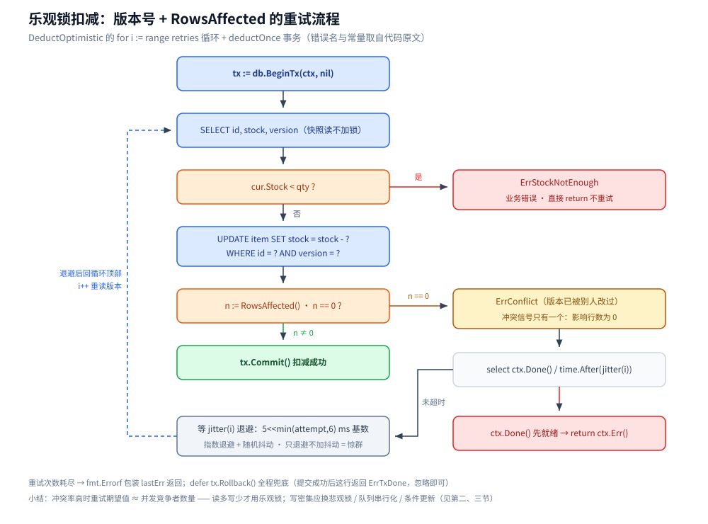
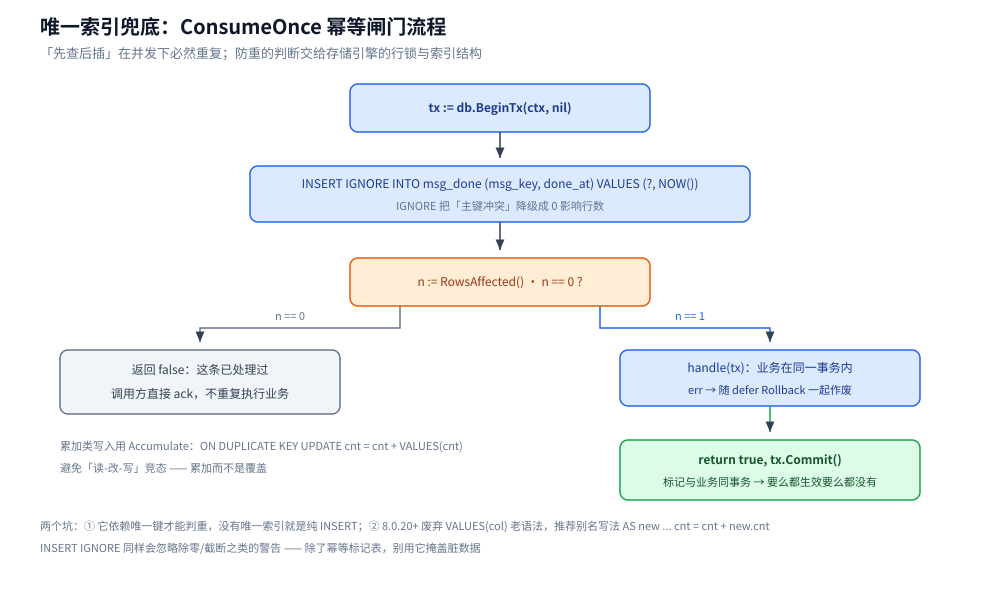

# 写冲突控制的 Go 落地

> Go 侧「同一份数据被并发写」的四种落地写法：版本号乐观锁、条件更新、`FOR UPDATE` 悲观锁、唯一索引兜底。
> **概念侧**（乐观锁与悲观锁怎么选、MVCC、快照读与当前读）见 [并发控制](../../../03-数据与中间件/数据存储/并发控制/README.md) 目录；本篇只讲代码。
> Java 侧对照见 [写冲突控制的Java落地.md](../../java/写冲突控制的Java落地.md)。
>
> 内容整理自个人学习笔记。素材见 [素材清单.md](../../../素材清单.md)。
>
> ⚠️ **未做运行时验证**：本篇 Go 代码在 `go-sql-driver/mysql v1.10` 下 `go build` + `go vet` + `gofmt` 通过，但本机无 MySQL 实例，**没有跑过真实并发**；各代码块同属包 `lockdemo`。
> 建表：
> `CREATE TABLE item (id BIGINT PRIMARY KEY, stock BIGINT NOT NULL, version BIGINT NOT NULL DEFAULT 0) ENGINE=InnoDB;`
> `CREATE TABLE msg_done (msg_key VARCHAR(128) PRIMARY KEY, done_at DATETIME NOT NULL) ENGINE=InnoDB;`

---

## 一、乐观锁：版本号 + `RowsAffected`

**本节要点**：冲突信号只有一个 —— **影响行数为 0**；不要先 `SELECT` 比对再无条件 `UPDATE`，那等于把竞态窗口重新打开。

`version` 机制的 SQL 关键在最后一行注释——「影响行数为 0」才是冲突信号。
Go 里对应的 API 是 `sql.Result.RowsAffected()`。

```go
package lockdemo

import (
	"context"
	"database/sql"
	"errors"
	"fmt"
	"math/rand"
	"time"
)

var (
	ErrConflict       = errors.New("lockdemo: version conflict, retry")
	ErrStockNotEnough = errors.New("lockdemo: stock not enough")
)

type Item struct {
	ID      int64
	Stock   int64
	Version int64
}

func GetItem(ctx context.Context, db *sql.DB, id int64) (Item, error) {
	var it Item
	// 这是快照读（普通 SELECT），不加锁
	err := db.QueryRowContext(ctx, `SELECT id, stock, version FROM item WHERE id = ?`, id).
		Scan(&it.ID, &it.Stock, &it.Version)
	return it, err
}

// DeductOptimistic 走完乐观锁的四步：读到版本 → 计算 → 带版本提交 → 影响行数 0 就重试。
func DeductOptimistic(ctx context.Context, db *sql.DB, id, qty int64, retries int) error {
	var lastErr error
	for i := range retries {
		lastErr = deductOnce(ctx, db, id, qty)
		if !errors.Is(lastErr, ErrConflict) {
			return lastErr // 成功、或"余额不足"这类业务错误都不用重试
		}
		select {
		case <-ctx.Done():
			return ctx.Err()
		case <-time.After(jitter(i)):
		}
	}
	return fmt.Errorf("lockdemo: %d retries exhausted: %w", retries, lastErr)
}

func deductOnce(ctx context.Context, db *sql.DB, id, qty int64) error {
	tx, err := db.BeginTx(ctx, nil)
	if err != nil {
		return err
	}
	defer func() { _ = tx.Rollback() }() // 提交成功后这行返回 ErrTxDone，忽略即可

	var cur Item
	if err := tx.QueryRowContext(ctx, `SELECT id, stock, version FROM item WHERE id = ?`, id).
		Scan(&cur.ID, &cur.Stock, &cur.Version); err != nil {
		return err
	}
	if cur.Stock < qty {
		return ErrStockNotEnough
	}

	res, err := tx.ExecContext(ctx,
		`UPDATE item SET stock = stock - ?, version = version + 1 WHERE id = ? AND version = ?`,
		qty, id, cur.Version)
	if err != nil {
		return err
	}
	n, err := res.RowsAffected()
	if err != nil {
		return err
	}
	if n == 0 {
		return ErrConflict // ← 版本已被别人改过
	}
	return tx.Commit()
}

// jitter：指数退避 + 随机抖动。
// ⚠️ 只退避不加抖动，会让同一批冲突者下一次仍然同时到达（惊群）。
func jitter(attempt int) time.Duration {
	base := time.Duration(5<<min(attempt, 6)) * time.Millisecond
	return base + time.Duration(rand.Int63n(int64(base)))
}
```



**两个必须能说清的边界**：

| 边界问题 | 结论 |
|---|---|
| **冲突率高时怎么办？** | 重试次数期望值 ≈ 并发竞争者数量，「冲突频繁 → 大量回滚」就是这里。读多写少才用乐观锁；秒杀这种写密集场景应换悲观锁 / 队列串行化 / 条件更新（见第二节） |
| **ABA 怎么防？** | **用单调递增的 `version` 而不是 `updated_at`** 就不会 ABA；用时间戳做版本时，同一毫秒内的改回原值会被误判通过 |

## 二、条件更新：把校验压进 `WHERE`

**本节要点**：不变式能写进 `WHERE` 时，一条 `UPDATE` 就是最省事的乐观锁 —— 不必加版本号列，也不必读回旧值。

版本号要加列、要维护、还要重试。**如果不变式可以写进 `WHERE`，一条 `UPDATE` 就是最省事的乐观锁**：
数据库在行锁内完成「判断 + 修改」，天然是原子的。

```go
package lockdemo

import (
	"context"
	"database/sql"
)

// DeductByCondition：把校验压进 WHERE。
// 返回剩余库存——利用 MySQL 的 LAST_INSERT_ID(expr) 技巧：
// 它把表达式结果记在**本连接**的 last_insert_id 上，于是省掉"扣完再读一次"的往返。
func DeductByCondition(ctx context.Context, db *sql.DB, id, qty int64) (int64, error) {
	res, err := db.ExecContext(ctx,
		`UPDATE item SET stock = LAST_INSERT_ID(stock - ?) WHERE id = ? AND stock >= ?`, qty, id, qty)
	if err != nil {
		return 0, err
	}
	n, err := res.RowsAffected()
	if err != nil {
		return 0, err
	}
	if n == 0 {
		return 0, ErrStockNotEnough // 行不存在 或 库存不足；要区分就再 SELECT 一次（低频路径）
	}
	return res.LastInsertId() // 拿到扣后的值
}
```

> ⚠️ `LAST_INSERT_ID(expr)` 是**连接级**状态：必须和那条 `UPDATE` 用**同一条连接**读回。
> 从连接池看，`res.LastInsertId()` 由驱动在同一物理连接的执行结果里带回，是安全的；
> 但如果换成「再 `db.QueryRow` 一次」，就可能落到另一条连接上读到别的请求的值——**这是真坑**。

## 三、悲观锁：`FOR UPDATE` 的三条硬规矩

**本节要点**：必须在事务里、条件必须走索引、持锁区间必须短 —— 三条里破一条，就会变成「更新一行、全表卡住」。

### 3.1 锁行后计算

```go
package lockdemo

import (
	"context"
	"database/sql"
	"time"
)

// ReservePessimistic 是悲观锁的代码化：先锁行，再算，再改。
//
// 三条硬规矩：
//  1. 必须在事务里——`FOR UPDATE` 在自动提交的单语句结束后就释放锁，等于白锁；
//  2. 条件必须走索引——`WHERE` 用了无索引列，InnoDB 会锁它扫过的**所有行**（RR 下还带间隙锁），
//     表现就是"更新一行、全表卡住"；没有合适索引时宁可退回条件更新；
//  3. 持锁区间要短——锁在 COMMIT/ROLLBACK 才释放，中间任何 RPC 都是延迟放大器
//     （见 事务与隔离级别.md 的「大事务拆分」）。
func ReservePessimistic(ctx context.Context, db *sql.DB, id, qty int64) error {
	tx, err := db.BeginTx(ctx, nil)
	if err != nil {
		return err
	}
	defer func() { _ = tx.Rollback() }()

	var stock int64
	// 当前读：读的是**最新版本**并加排他锁，而不是 MVCC 快照
	if err := tx.QueryRowContext(ctx, `SELECT stock FROM item WHERE id = ? FOR UPDATE`, id).Scan(&stock); err != nil {
		return err
	}
	if stock < qty {
		return ErrStockNotEnough
	}
	if _, err := tx.ExecContext(ctx, `UPDATE item SET stock = stock - ? WHERE id = ?`, qty, id); err != nil {
		return err
	}
	return tx.Commit()
}
```

### 3.2 队列型取任务：`SKIP LOCKED`

```go
// ScanAndReserve 秒杀/任务分发式的"跳过已被别人锁住的行"：
// SKIP LOCKED 让并发请求各自取不同的行，互不排队——这是队列型用法，不是通用改法。
func ScanAndReserve(ctx context.Context, db *sql.DB, n int) ([]int64, error) {
	tx, err := db.BeginTx(ctx, nil)
	if err != nil {
		return nil, err
	}
	defer func() { _ = tx.Rollback() }()

	rows, err := tx.QueryContext(ctx,
		`SELECT id FROM item WHERE stock > 0 ORDER BY id LIMIT ? FOR UPDATE SKIP LOCKED`, n)
	if err != nil {
		return nil, err // 5.7 之前不支持 SKIP LOCKED / NOWAIT，会直接语法报错
	}
	defer rows.Close()

	var ids []int64
	for rows.Next() {
		var id int64
		if err := rows.Scan(&id); err != nil {
			return nil, err
		}
		ids = append(ids, id)
	}
	return ids, rows.Err()
}
```

### 3.3 锁等待预算

```go
// LockWaitBudget 把"最多等多久"变成一层可预测的预算，而不是等默认 50s 把请求堆死。
// ⚠️ 别混两个参数：innodb_lock_wait_timeout 管**行锁**等待，
//
//	lock_wait_timeout 管**元数据锁（MDL）**等待——DDL 卡住业务通常是后者。
func LockWaitBudget(ctx context.Context, db *sql.DB, budget time.Duration) error {
	tx, err := db.BeginTx(ctx, nil)
	if err != nil {
		return err
	}
	defer func() { _ = tx.Rollback() }()

	// SET 是会话级，且只对这条连接生效——事务期间连接被固定，所以够用；
	// 退出事务后连接回池会残留该设置，需要在归还时还原或统一走 DSN/服务端配置。
	secs := max(int(budget.Seconds()), 1)
	if _, err := tx.ExecContext(ctx, `SET SESSION innodb_lock_wait_timeout = ?`, secs); err != nil {
		return err
	}
	return tx.Commit()
}
```

> 选型回到 [乐观锁与悲观锁.md](../../../03-数据与中间件/数据存储/并发控制/乐观锁与悲观锁.md) 第三节的表：**读多写少 → 乐观；写密集且要强一致 → 悲观**，
> 而**能用条件更新解决的，就不要引入版本号列或显式行锁**。
> 跨服务/跨库的「锁」只能靠 Redis 分布式锁，实现与坑见 [分布式锁.md](../../../03-数据与中间件/数据存储/NoSQL/Redis/分布式锁.md)。

## 四、唯一索引兜底

**本节要点**：「先查后插」在并发下必然重复；防重的正确工具是唯一索引，它把判断交给存储引擎的行锁与索引结构。

```go
package lockdemo

import (
	"context"
	"database/sql"
)

// ConsumeOnce 消息消费的幂等闸门。
// 返回 false 表示"这条已经处理过"，调用方直接 ack，不要重复执行业务。
func ConsumeOnce(ctx context.Context, db *sql.DB, msgKey string, handle func(*sql.Tx) error) (bool, error) {
	tx, err := db.BeginTx(ctx, nil)
	if err != nil {
		return false, err
	}
	defer func() { _ = tx.Rollback() }()

	// INSERT IGNORE 会把"主键冲突"从错误降级成 0 影响行数。
	// ⚠️ 它同样会忽略掉除零/截断之类的警告——除了幂等标记表，别用它掩盖脏数据。
	res, err := tx.ExecContext(ctx,
		`INSERT IGNORE INTO msg_done (msg_key, done_at) VALUES (?, NOW())`, msgKey)
	if err != nil {
		return false, err
	}
	n, err := res.RowsAffected()
	if err != nil {
		return false, err
	}
	if n == 0 {
		return false, nil // 已处理过
	}
	if err := handle(tx); err != nil {
		return false, err
	}
	return true, tx.Commit() // 标记与业务在同一事务里 → 要么都生效要么都没有
}

// Accumulate 计数类写入：累加而不是覆盖，避免"读-改-写"竞态。
func Accumulate(ctx context.Context, db *sql.DB, day string, delta int64) error {
	_, err := db.ExecContext(ctx,
		`INSERT INTO stat_day (day, cnt) VALUES (?, ?)
         ON DUPLICATE KEY UPDATE cnt = cnt + VALUES(cnt)`, day, delta)
	return err
}
```

> **`ON DUPLICATE KEY UPDATE` 的两个坑**：① 它依赖**唯一键**才能判重，没有唯一索引就是纯 `INSERT`；
> ② 主从架构下它写的是 **statement 相关的 binlog**，用 `VALUES(col)` 老语法在 8.0.20+ 已废弃，
> 推荐别名写法 `INSERT INTO t (...) VALUES (...) AS new ON DUPLICATE KEY UPDATE cnt = cnt + new.cnt`。



## 延伸追问

- **`FOR UPDATE` 能不能不加事务直接用？** → 语法可以，但语义上没意义：自动提交下锁在语句结束就释放，等于没锁。
- **乐观锁重试放在事务里还是事务外？** → **必须在事务外**：事务内重试时，之前读到的旧实体/旧版本不会刷新，重试等于白试。
- **条件更新怎么把「库存不足」和「行不存在」分开？** → 影响行数 0 时两种情况都有可能，低频路径再 `SELECT` 一次区分即可，不要为了这个把主路径变复杂。
- **`SKIP LOCKED` 能用在业务查询里吗？** → 不建议。它返回的是「当前没被锁住的那部分」，结果集不完整，只适合队列型「抢一条就走」的场景。
- **唯一索引和乐观锁该选哪个？** → 判重、去重、幂等标记用唯一索引（一次往返）；「读出来计算再改」这类必须比较旧值的场景才需要版本号。

## 关联

- [README.md](../../../03-数据与中间件/数据存储/并发控制/README.md) — 概念侧总纲
- [乐观锁与悲观锁.md](../../../03-数据与中间件/数据存储/并发控制/乐观锁与悲观锁.md) — 选型判据
- [快照读与当前读.md](../../../03-数据与中间件/数据存储/并发控制/快照读与当前读.md) — 为什么 `SELECT` 不加锁、`FOR UPDATE` 加锁
- [写冲突控制的Java落地.md](../../java/写冲突控制的Java落地.md) — Java 侧四条结论一一对应
- [数据访问与连接池.md](数据访问与连接池.md) — 事务期间连接被固定、长事务占用连接
- [atomic操作.md](../并发编程/atomic操作.md) — 单机内的 CAS 与 ABA
- [素材清单.md](../../../素材清单.md) — 素材来源登记
> 反向引用（本篇被下列文档引到）：[最终一致方案.md](../../../04-架构与系统/分布式/分布式事务/最终一致方案.md)
