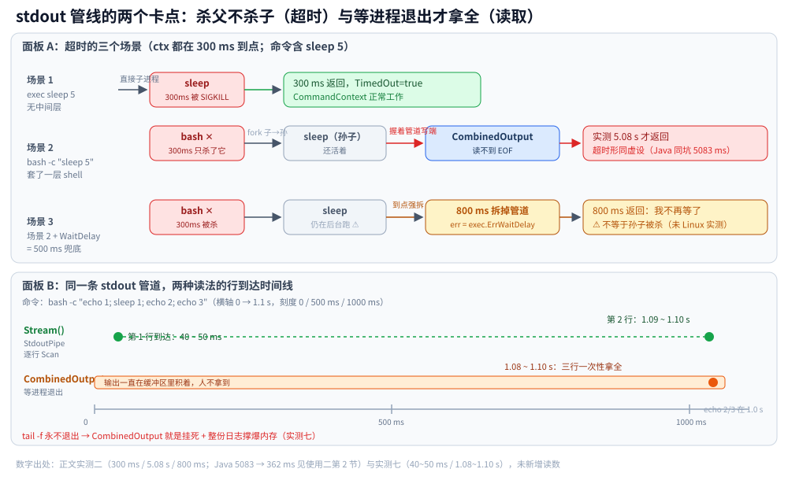

# 子进程与外部命令

> 覆盖：Go 里执行外部命令的安全形态（命令与参数分开、防注入）、超时与进程树、退出码语义、用标准库替代 shell（词频统计 / 端口探测 / 递归建目录 / 流式读日志），以及全部本机读数。
> 不覆盖：命令本身怎么敲见 [常用命令.md](../../../02-计算机基础/linux/常用命令.md)；进程 / 线程的创建成本与僵尸进程见 [协程与线程成本.md](../并发编程/协程与线程成本.md)；Java 侧同一批实验见 [子进程与外部命令.md](../../java/工程实践/子进程与外部命令.md)。
>
> 内容整理自个人学习笔记。本篇代码在 **go1.26.5（Windows 10 22631）** 下 `gofmt` / `go vet` / `go build` 三项全干净并跑通，读数见第一~四节的实测一~七。
> ⚠️ 涉及 `bash` / `grep` / `sort` / `uniq` 的几项用的是 **Git for Windows 的 GNU 工具**，所以「能不能跑起来」这一层已经比 Linux 脆弱——这本身就是第五节要说的现象之一；**本包没有在 Linux 上实测**，涉及进程组 / `kill(-pgid)` 的修正建议只写了方向、**没有验证过**。

---

## 一、为什么不要把用户输入拼成 shell 字符串？

**本节要点**：四条硬约定，每条都在下面有对应的实测——① 永远不要把用户输入拼成一条 shell 字符串；② 起外部命令必须带 context 超时；③ 退出码要从 `*exec.ExitError` 里取，不能把「非 0 退出」当「执行失败」；④ 能在标准库里做的，就别起进程。

```go
package cmd

import (
	"bufio"
	"context"
	"errors"
	"fmt"
	"io"
	"net"
	"os"
	"os/exec"
	"path/filepath"
	"regexp"
	"sort"
	"strconv"
	"strings"
	"time"
)

// 命令行的四个常见小问（查端口占用 / 看连接 / 递归建目录 / 关键词统计排序）
// 都是"命令行怎么敲"。这一包回答的是另一半问题：
//
//	**这些动作在代码里该怎么做，以及哪些绝对不该 shell out。**
//
// 四条硬约定，每条都在 meas_test.go 里有对应的实测：
//  1. 永远不要把用户输入拼成一条 shell 字符串（实测一会给出"注入成功"的证据）；
//  2. 起外部命令必须带 context 超时——但**光设超时还不够**，
//     中间隔一层 shell 时"杀父不杀子"会让超时形同虚设（实测二给出 300ms → 5.08s 的证据）；
//  3. 子进程的退出码要从 *exec.ExitError 里取，不能把"非 0 退出"当"执行失败"；
//  4. 能在标准库里做的（列目录、探测端口、统计词频）就别起进程——
//     起进程贵（一个进程 25ms 起），而且**能不能跑起来还看环境**。

// Run 是"跑一条外部命令"的安全形态：
// 命令与参数**分开传**，程序内部自己 execve，不经过 shell，
// 所以参数里的 ; | && $() 都只是普通字符。
//
// ⚠️ 返回的 error 有两种，**必须分开处理**：
//   - 连不上命令（找不到可执行文件、权限不够）→ *exec.Error；
//   - 命令跑了但退出码非 0 → *exec.ExitError（这不是异常，是业务结果）。
func Run(ctx context.Context, name string, args ...string) (string, error) {
	out, err := exec.CommandContext(ctx, name, args...).CombinedOutput()
	return string(out), err
}

// ExitCode 从 Run 的 error 里取退出码；取不到就返回 -1。
//
// ★ 典型误用：`if err != nil { 当作失败 }`。
// grep 找不到匹配时**退出码就是 1**（这是它的正常语义），
// 按上面的写法"没搜到"会被当成"命令执行出错"。
func ExitCode(err error) int {
	var ee *exec.ExitError
	if errors.As(err, &ee) {
		return ee.ExitCode()
	}
	return -1
}
```

**实测一：注入对照（这条最重要）**——用户输入是 `app.log; touch pwned`，两种写法各跑一遍，看**有没有凭空多出文件**：

| 写法 | 命令 | 结果 |
|---|---|---|
| **反例** | `exec.Command("bash", "-c", "grep ERROR "+输入)` | ✅ **`pwned` 文件被创建了**——注入成功 |
| **正例** | `exec.Command("grep", "ERROR", 输入)` | ❌ 没有创建任何文件，`; touch pwned` 只是「一个很长的文件名」 |

⚠️ 这个实验是在临时目录里做的，但它证明的事没有侥幸：**只要过了 shell，分号就是命令分隔符**，跟你拼了什么前缀无关。

顺手量的耗时（**不是选型依据**）：反例 70~96 ms/次，正例 28~30 ms/次。两边差这么多只是因为本机 `grep` 恰好是个 shell 脚本、两边都得先起 bash——**别拿这个差值当「少用 shell 能省 3 倍」的证据**。

## 二、结果表示：为什么不用 `(string, error)`？

**本节要点**：「跑成功了吗」其实是**三个不同的问题**——命令起来了吗 / 是不是被我超时杀了 / 它自己退出码是几。只返回一个 `error` 就会被迫用 `err != nil` 一刀切，而 `grep` 找不到东西**也是非 0 退出**。

```go
// Result 是一次外部命令的完整结果。
//
// ★ 为什么要把它做成结构体而不是 `(string, error)`：
// "跑成功了吗"其实是**三个不同的问题**——
// 命令起来了吗 / 是不是被我超时杀了 / 它自己退出码是几。
// 只返回一个 error 就会被迫用 `err != nil` 一刀切，而 grep 找不到东西**也是非 0 退出**。
type Result struct {
	Out      string
	Cost     time.Duration
	Err      error
	TimedOut bool // 只有 true 才说明"是超时把进程杀了"
	Code     int  // 取不到退出码时为 -1（命令根本没起来）
}

// RunWithTimeout 演示超时杀进程：timeout 到点时 context 被取消，
// CommandContext 会杀掉子进程（Linux 发 SIGKILL，Windows 调 TerminateProcess），
// 于是调用方最多等 timeout，而不是等子进程心情。
//
// ⚠️ **别用 err 的文字判断"是不是超时"**：本机实测（Windows）被 kill 的子进程
// 返回的是 `exit status 1`，Linux 上才是 `signal: killed` —— 平台不一样，字符串就不一样。
// 唯一可靠的依据是 **context 自己的 Err()**，所以这里把它一并带回来。
//
// ⚠️ 另一个坑：SIGKILL **不给子进程清理机会**（临时文件、锁都不释放）。
// 需要优雅退出就自己先发 SIGTERM，等一会儿再 KILL。
func RunWithTimeout(timeout time.Duration, name string, args ...string) Result {
	ctx, cancel := context.WithTimeout(context.Background(), timeout)
	defer cancel()
	start := time.Now()
	out, err := Run(ctx, name, args...)
	return Result{
		Out:      out,
		Cost:     time.Since(start),
		Err:      err,
		TimedOut: ctx.Err() == context.DeadlineExceeded,
		Code:     ExitCode(err),
	}
}

// RunBounded 是 RunWithTimeout 的**修正版**：多加一行 `WaitDelay`。
//
// 实测：`bash -c "sleep 5"` 配 300ms 超时，CommandContext 只杀掉 bash，
// 孙子进程 sleep 还活着并握着 stdout 管道，于是 CombinedOutput 照样白等 5.08s——
// **超时形同虚设**。
//
// `WaitDelay` 是 Go 1.20 给的兜底：Cancel 之后如果 I/O 还没结束，
// 到点就直接把管道拆掉并返回（err 是 exec.ErrWaitDelay）。
// ⚠️ 它只保证"**我不再等了**"，不保证"孙子进程被杀了"——
// 真要把整棵进程树杀掉，Unix 侧要 `SysProcAttr{Setpgid: true}` + `kill(-pgid, SIGKILL)`，
// Windows 侧要 `taskkill /T /F`。**那段代码在 Unix 上没实测过。**
func RunBounded(timeout time.Duration, name string, args ...string) Result {
	ctx, cancel := context.WithTimeout(context.Background(), timeout)
	defer cancel()
	cmd := exec.CommandContext(ctx, name, args...)
	cmd.WaitDelay = 500 * time.Millisecond // ★ 关键就这一行
	start := time.Now()
	out, err := cmd.CombinedOutput()
	return Result{
		Out:      string(out),
		Cost:     time.Since(start),
		Err:      err,
		TimedOut: ctx.Err() == context.DeadlineExceeded,
		Code:     ExitCode(err),
	}
}

// ShellInjected 是一个**反面例子的实现**：把用户输入直接拼进 shell 命令串。
// 这样写确实能跑，也正是这样写才会被注入。
func ShellInjected(workDir, userArg string) (string, error) {
	cmd := exec.Command("bash", "-c", "grep ERROR "+userArg) // ★ 反例：拼接 + 过 shell
	cmd.Dir = workDir
	out, err := cmd.CombinedOutput()
	return string(out), err
}

// SafeArgs 是同一个需求的正确写法：**参数不进 shell**。
// 于是 "; touch pwned" 整体被当成一个文件名，grep 报"没有这个文件"就结束了。
func SafeArgs(workDir, userArg string) (string, error) {
	cmd := exec.Command("grep", "ERROR", userArg) // ★ 正例：命令和参数分开
	cmd.Dir = workDir
	out, err := cmd.CombinedOutput()
	return string(out), err
}
```

**实测二：超时——「设了 timeout」和「真的按时返回」是两件事**：

| 场景 | 给的超时 | 实测返回时间 | 结论 |
|---|---|---|---|
| `exec sleep 5`（**没有中间层**） | 300 ms | **300 ms**，`TimedOut=true` | CommandContext 正常工作 |
| `bash -c "sleep 5"` | 300 ms | **5.08 s**，`TimedOut=true` | ⚠️ **超时形同虚设** |
| 同上 + `cmd.WaitDelay = 500ms` | 300 ms | **800 ms** | 修正生效 |

**为什么套一层 shell 就废了**：`CommandContext` 到点只杀**直接子进程**（bash），孙子进程 `sleep` 还活着，并且**还握着那根 stdout 管道**——于是 `CombinedOutput()` 读不到 EOF，只能等 `sleep` 自己跑完。

三条可记的结论：

1. **能不套 shell 就别套**（和实测一同一条根）；
2. Go 1.20+ 用 `cmd.WaitDelay` 兜底：到点直接把管道拆掉返回（`err` 是 `exec.ErrWaitDelay`）；
3. ⚠️ `WaitDelay` 只保证「**我不再等了**」，不保证「孙子进程被杀了」——那要 Unix 侧 `SysProcAttr{Setpgid: true}` + `kill(-pgid, SIGKILL)`，Windows 侧 `taskkill /T /F`。**这两条本机都没实测过，别当已验证结论用。**



图注：面板 A 是三个场景的进程树（谁被杀、谁还握着 stdout 管道的写端），面板 B 是第六节两种读法的行到达时间线——同一根管道在「超时」与「实时读」两个问题上的两副面孔。

**实测三：退出码不是「错误」**：

| 命令 | 含义 | 实测 |
|---|---|---|
| `grep ERROR 有匹配的文件`（没搜到） | **退出码 1 = 没找到**，是正常业务结果 | `err=exit status 1`，`Code=1` |
| `grep ERROR 不存在的文件` | 退出码 **2** = 用法 / 文件错误 | `Code=2` |
| 命令根本不存在 | **拿不到退出码** | `Code=-1`，`err=executable file not found in %PATH%` |

→ 所以代码里**不要 `if err != nil { 当失败 }`**：`grep` 最常见的「没搜到」会 100% 被误判成「命令挂了」。必须分三层看：**起来了吗 / 是不是超时 / 退出码是几**——这就是 `Result` 结构体存在的理由。

⚠️ 还有一条平台差异：**别用 `err.Error()` 的文字判断「是不是被超时杀掉的」**。本机（Windows）实测被 kill 的子进程返回 `exit status 1`，Linux 上才是 `signal: killed`。唯一可靠依据是 **`ctx.Err()`**，所以 `Result` 里带了 `TimedOut` 字段。

## 三、怎么用标准库替代一条 shell 管道？

**本节要点**：`grep -oE "A|B|C" file | sort | uniq -c | sort -rn` 四步在 Go 里是 `FindAllString` → （map 计数天然相邻，省掉 sort）→ `map[string]int` → `sort.Slice`；纯 Go 比真管道快约 **5 倍**，⭐ 但真正的收获是**对拍拍出的一个口径差异**：正则的 `|` 是「左起优先」不是「最长匹配」。

```go
// Count 是一条"关键词 → 次数"记录，对应 `uniq -c` 的那两列。
type Count struct {
	Word  string
	Times int
}

// KeywordCounts 用纯 Go 复刻：
//
//	grep -oE "A|B|C" file | sort | uniq -c | sort -rn
//
// 分四步，和管道一一对应（**能说出这四步，比背参数有用**）：
//
//	① -o：只取匹配片段，不整行输出     → FindAllString
//	② sort：让相同值相邻               → 这里用 map 计数，直接省掉
//	③ uniq -c：去重并计数              → map[string]int
//	④ sort -rn：按数值倒序             → sort.Slice + 次数相同按字典序（保证结果稳定）
//
// ★ 为什么不用 exec.Command 去跑真管道？
//  1. 要起 bash 进程（一个进程 ≈ 25ms 起），纯 Go 是同量级里的零头；
//     同一份 920 行日志实测：纯 Go 21~31ms，走管道 115~184ms，**差 5 倍左右**；
//  2. 真管道要处理 shell 引号，等于把注入面又开回来；
//  3. 结果拿回来还得再解析一遍文本；
//  4. ⚠️ 最坑的是**能不能跑起来都看环境**：同一份逻辑从 JVM 起这条管道，
//     本机实测一次 114s、几次直接卡死，而 Go 侧稳定 100~200ms。
//
// ⚠️ 口径提醒（实测过的真差异）：正则的 `|` 是**左起优先**，不是"最长匹配"。
// 关键词有包含关系时，`WARN|WARNING` 在 Go 里永远只命中 WARN，
// 而 `grep -oE "WARN|WARNING"` 命中的是 WARNING。
// → **把长词排在前面**（`WARNING|WARN`），Go 的行为才和 grep 对齐；
// 两边规则不同这件事，只有做对拍才会发现。
func KeywordCounts(path string, words []string) ([]Count, error) {
	alts := make([]string, len(words))
	for i, w := range words {
		alts[i] = regexp.QuoteMeta(w) // ★ 用户给的关键词不能直接当正则：. * [ 都是元字符
	}
	re, err := regexp.Compile(strings.Join(alts, "|"))
	if err != nil {
		return nil, err
	}

	f, err := os.Open(path)
	if err != nil {
		return nil, err
	}
	defer f.Close()

	times := map[string]int{}
	sc := bufio.NewScanner(f)
	sc.Buffer(make([]byte, 0, 64*1024), 4*1024*1024) // ⚠️ 默认 64KB 一行，日志里一行超长就会直接报错
	for sc.Scan() {
		for _, m := range re.FindAllString(sc.Text(), -1) { // ① 等价 grep -o
			times[m]++ // ②③ 等价 sort | uniq -c
		}
	}
	if err := sc.Err(); err != nil {
		return nil, err
	}

	out := make([]Count, 0, len(times))
	for w, n := range times {
		out = append(out, Count{w, n})
	}
	sort.Slice(out, func(i, j int) bool { // ④ 等价 sort -rn
		if out[i].Times != out[j].Times {
			return out[i].Times > out[j].Times
		}
		return out[i].Word < out[j].Word // ★ 次数相同时给个确定顺序，否则每次跑顺序都可能不同
	})
	return out, nil
}

// ShellCounts 跑**真管道**，只用来给 KeywordCounts 做**对拍**（证明复刻没走样）。
// 注意它把 pattern 也拼进了命令串——正因为这里拼的是**代码里写死的常量**才可接受，
// 换成用户输入就是上面 ShellInjected 的下场。
func ShellCounts(path string, pattern string) ([]Count, error) {
	ctx, cancel := context.WithTimeout(context.Background(), 10*time.Second)
	defer cancel()
	cmd := exec.CommandContext(ctx, "bash", "-c",
		`grep -oE "`+pattern+`" "$1" | sort | uniq -c | sort -rn`, "bash", path)
	out, err := cmd.Output()
	if err != nil {
		return nil, err
	}
	var res []Count
	sc := bufio.NewScanner(strings.NewReader(string(out)))
	for sc.Scan() {
		fields := strings.Fields(sc.Text()) // "  123 ERROR" → ["123","ERROR"]
		if len(fields) != 2 {
			return nil, fmt.Errorf("cmd: uniq -c 输出格式不认识：%q", sc.Text())
		}
		n, err := strconv.Atoi(fields[0])
		if err != nil {
			return nil, err
		}
		res = append(res, Count{fields[1], n})
	}
	return res, sc.Err()
}
```

**实测四：纯 Go 复刻那条管道，并与真管道对拍**。造一份 920 行日志（INFO 300 / ERROR 500 / WARNING 120），**同一份数据同时喂给纯 Go 实现和真 bash 管道**：

| | 结果 | 耗时（两轮） |
|---|---|---|
| 纯 Go `KeywordCounts` | `{ERROR 500} {INFO 300} {WARNING 120}` | **21 ~ 31 ms** |
| 真管道 `bash -c 'grep -oE … \| sort \| uniq -c \| sort -rn'` | **逐项一致** | **115 ~ 184 ms** |

→ **对拍通过**，说明复刻没走样；纯 Go 快 **5 倍左右**（真管道那侧含起进程）。

★ 但真正的收获是**对拍拍出来的一个口径差异**（只量数字是量不出来的）：

| 输入：100 行全是 `WARNING`，统计 `WARN\|WARNING` | 结果 |
|---|---|
| Go，`WARN` 写在前面 | `{WARN 100}` ← **和 grep 不一样** |
| Go，`WARNING` 写在前面 | `{WARNING 100}` |
| `grep -oE "WARN\|WARNING"` 管道 | `{WARNING 100}` |

原因：**正则的 `|` 是「左起优先」还是「左起最长」，两家规则不同**（Go / Java / PCRE = 左起优先；POSIX ERE / `grep -E` = 最长匹配）。→ **把长词排在前面**（`WARNING|WARN`）才能和 grep 对齐。凡是「我们用代码复刻了一条 shell 命令」的地方，都要做这种对拍，否则口径差异会安静地留在报表里。

⚠️ 另外：本机 `sort -rn` 在次数相同时的输出顺序**不稳定**，所以 Go 实现加了「次数相同按字典序」这一条——代码要**可复现**，不能像 shell 那样「人眼看顺序」。

## 四、端口探测、建目录与流式读：哪些能不起进程？

**本节要点**：「这个端口我能不能监听」这件事，**bind 一次就是确定答案**，不用去解析 `netstat` 的输出；`mkdir -p` 的对应物是 `os.MkdirAll`（同样幂等）；`tail -f` 必须**流式读**，用 `CombinedOutput` 会挂死并把整份日志吃进内存。

```go
// Listener 是"端口能不能用"的正确探测方式。
//
// ★ 代码里判断端口被占用，**不要去 shell 执行 netstat/lsof**：
//   - 要解析别人的输出格式，跨发行版、跨语言环境都会变；
//   - netstat -p 需要 root 才看得到别人的进程；
//   - 而"这个端口我能不能监听"这件事，bind 一次就有确定答案。
//
// 返回的 io.Closer 用完必须 Close，否则自己就成了占用者。
type Listener interface {
	Addr() string
	Close() error
}

type tcpListener struct {
	l net.Listener
}

func (t tcpListener) Addr() string { return t.l.Addr().String() }
func (t tcpListener) Close() error { return t.l.Close() }

// ProbeTCPPort 尝试监听 port。**port 传 0 = 让内核随便给一个空闲端口**，
// 这是写测试和"我要开一个临时服务"的标准做法，比在代码里猜 8080/8081 强。
func ProbeTCPPort(port int) (Listener, error) {
	l, err := net.Listen("tcp", fmt.Sprintf(":%d", port))
	if err != nil {
		return nil, err // "address already in use" 就在这里返回
	}
	return tcpListener{l}, nil
}

// PortInUse 只回答"占没占用"，把 bind 错误本身吞掉。
//
// ⚠️ 有竞态：探测到空闲，到你真正 Listen 之间可能被人抢走。
// 所以**生产代码要用 ProbeTCPPort 直接把端口拿在手里**，
// 而不是"先查空闲、再去监听"——后者是典型的 TOCTOU。
func PortInUse(port int) bool {
	l, err := ProbeTCPPort(port)
	if err != nil {
		return true
	}
	_ = l.Close()
	return false
}

// ConnectOK 对应"如何查看网络连接"：**代码里要的是"通不通"，不是连接表**。
// 用带超时的 Dial 直接判定，比解析 ss -an 可靠得多。
func ConnectOK(addr string, timeout time.Duration) bool {
	c, err := net.DialTimeout("tcp", addr, timeout)
	if err != nil {
		return false
	}
	_ = c.Close()
	return true
}

// MkdirAllFor 对应"递归创建文件夹"（mkdir -p）：Go 侧是 os.MkdirAll。
//
// ★ 两者一样都是**幂等**的：目录已存在不报错，缺的中间层自动补（实测连建 3 次不报错）。
// ⚠️ perm 会被 umask 吃掉一部分：Linux 上给 0777 常见只剩 0755，
// 而 Windows 上没有 umask，本机实测 0777 原样保留 —— **别假设权限位就是传进去的值**，
// 要精确控制就显式 os.Chmod。
func MkdirAllFor(root, rel string, perm os.FileMode) error {
	return os.MkdirAll(filepath.Join(root, rel), perm)
}

// DirExists 区分"不存在"和"存在但不是目录"——os.Stat 的 err 不能只判 nil。
func DirExists(path string) (exists bool, isDir bool, err error) {
	fi, err := os.Stat(path)
	if err != nil {
		if os.IsNotExist(err) { // 只有这个分支才是"确实不存在"
			return false, false, nil
		}
		return false, false, err // 权限、路径过长等，都该往外抛
	}
	return true, fi.IsDir(), nil
}

// Stream 对应"实时看日志"（tail -f）：**别用 CombinedOutput 等它结束**，
// tail -f 永远不结束，缓冲区还会把整份日志吃进内存。
// 正确姿势是拿到管道自己逐行读。
func Stream(ctx context.Context, w io.Writer, name string, args ...string) error {
	cmd := exec.CommandContext(ctx, name, args...)
	pipe, err := cmd.StdoutPipe()
	if err != nil {
		return err
	}
	if err := cmd.Start(); err != nil {
		return err
	}
	sc := bufio.NewScanner(pipe)
	for sc.Scan() {
		if _, err := fmt.Fprintln(w, sc.Text()); err != nil { // 边读边写出去
			if cmd.Process != nil {
				_ = cmd.Process.Kill() // 读的人不要了，就别让命令继续刷
			}
			return err
		}
	}
	err = sc.Err()
	_ = cmd.Wait() // ★ 依然要 Wait，否则留僵尸
	return err
}
```

**实测五：端口占用与连通性**：

| 动作 | 实测 |
|---|---|
| `ProbeTCPPort(0)` 让内核给端口 | 拿到 `[::]:60484` 这类空闲端口 |
| 紧接着探测同一端口 | `PortInUse=true`（bind 失败就是答案） |
| `ConnectOK(自己刚监听的地址, 1s)` | `true` |
| `ConnectOK("127.0.0.1:1", 200ms)` | `false` |
| 关闭后再探测 | `false`（⚠️ Linux 上可能因 `TIME_WAIT` 仍为 true） |

★ 关键点：**代码里不要用 `netstat` / `lsof` 判断端口能不能用**——解析别人的输出格式 = 把稳定性押在别人的文案上（本机实测连报错文案都是 Windows 版的）；`netstat -p` 还要 root；而「我能不能监听」这件事，**bind 一次就是确定答案**。⚠️ 另外 `PortInUse` 这种「先查后占」是 **TOCTOU**，生产代码要用 `ProbeTCPPort` 把端口直接拿在手里。

**实测六：`mkdir -p` 的 Go 对应**：

| 断言 | 实测 |
|---|---|
| `os.MkdirAll` 连建 3 次不报错、中间层自动补 | ✅ 通过（和 `mkdir -p` 一样幂等） |
| 中间层已存在且是**普通文件** | ✅ 报错（Windows 文案：`The system cannot find the path specified.`） |
| `MkdirAll(perm=0777)` 实际权限 | 本机 `-rwxrwxrwx`（**Windows 没有 umask**；Linux 上常见只剩 0755） |

→ 两条可记的：**报错文案跨平台完全不同**（又一次说明别解析命令输出）；**别假设权限位就是传进去的值**，要精确控制就显式 `os.Chmod`。

**实测七：`tail -f` 类场景必须流式读**：

| 写法 | 第 1 行到达时刻 | 第 2 行到达时刻 |
|---|---|---|
| `Stream()`（`StdoutPipe` + 逐行 `Scan`） | **40 ~ 50 ms** | **1.09 ~ 1.10 s** |
| `CombinedOutput()` | 1.08 ~ 1.10 s **一次性全拿到** | — |

命令是 `bash -c "echo 1; sleep 1; echo 2; echo 3"`。→ 流式读在第 1 行出现时（sleep 之前）就拿到了；`CombinedOutput` 只能等进程退出。`tail -f` 永不退出，用后者就是**挂死 + 内存被整份日志撑爆**。⚠️ `Stream` 结尾仍然调了 `Wait()`——不 `Wait` 就攒僵尸进程。

## 五、命令行 ↔ Go 对照表

**本节要点**：这张表是本篇的收口——每个常见运维动作，对应到该用什么、以及**别做什么**。

| 命令 | 代码里该用什么 | ⚠️ 别做什么 |
|---|---|---|
| `netstat -tunlp \| grep 3306` | `net.Listen` 拿住端口；`net.DialTimeout` 判连通 | 解析 netstat 输出 |
| `ss -an` / 看连接 | `DialTimeout`（要的是「通不通」） | 起进程查连接表 |
| `mkdir -p a/b/c` | `os.MkdirAll` | 拼 `mkdir -p` 字符串（实测六：中间层是文件时报错文案跨平台不同） |
| `grep -o … \| sort \| uniq -c \| sort -rn` | `regexp` + `map` + `sort.Slice`（`KeywordCounts`） | 过 shell（实测一）、假设口径一致（实测四） |
| `tail -f app.log` | `StdoutPipe` + `bufio.Scanner`（`Stream`） | `CombinedOutput`（实测七：永不返回） |
| 任何外部命令 | `exec.CommandContext` + `WaitDelay` + `ExitError` 取码 | 靠 `err != nil` 一刀切、靠 `err` 文字判因 |

## 延伸追问

- **`bash -c` 到底错在哪？** → 过了 shell，分号就是命令分隔符，用户输入里的 `; touch pwned` 会被当成第二条命令执行（实测一）。
- **设了超时为什么没按时返回？** → `CommandContext` 只杀**直接子进程**，孙子进程还活着并握着 stdout 管道，`CombinedOutput` 读不到 EOF 只能干等；Go 1.20+ 用 `cmd.WaitDelay` 兜底「我不再等了」（实测二）。
- **`grep` 没搜到为什么不是「命令失败」？** → 退出码 1 是 `grep` 的正常语义；必须分「起来了吗 / 是不是超时 / 退出码是几」三层看，这就是 `Result` 存在的理由（实测三）。
- **`tail -f` 为什么不能用 `CombinedOutput`？** → 它要等进程退出，而 `tail -f` 永不退出；同时会把整份日志吃进内存。要 `StdoutPipe` + 逐行读（实测七）。
- **自定义 `io.Reader` 包装器会不会影响这里？** → 会，但那是另一条线：任何包住 `*os.File` 的包装器都会打断 `io.Copy` 的零拷贝快路径，见 [零拷贝.md](../运行时/零拷贝.md)。

## 关联

- **上游/总纲**：[常用命令.md](../../../02-计算机基础/linux/常用命令.md) — 这些动作在命令行里怎么敲
- **上游/总纲**：[进程创建与退出.md](../../../02-计算机基础/操作系统/进程创建与退出.md) — `fork` / COW / `execve` 的内核侧代价，以及僵尸为什么默认会留下
- **对照/互补**：[子进程与外部命令.md](../../java/工程实践/子进程与外部命令.md) — Java 侧同一批实验（ProcessBuilder / 看门狗 / descendants）
- **对照/互补**：[协程与线程成本.md](../并发编程/协程与线程成本.md) — 为什么「起进程」是一件贵的事；僵尸进程怎么来
- **对照/互补**：[零拷贝.md](../运行时/零拷贝.md) — `io.Copy` 的能力探测与静默失效
- **下游机制**：[net包与TCP-UDP编程.md](../网络编程/net包与TCP-UDP编程.md) — `net.Listen` / `DialTimeout` 与 fd 生命周期
