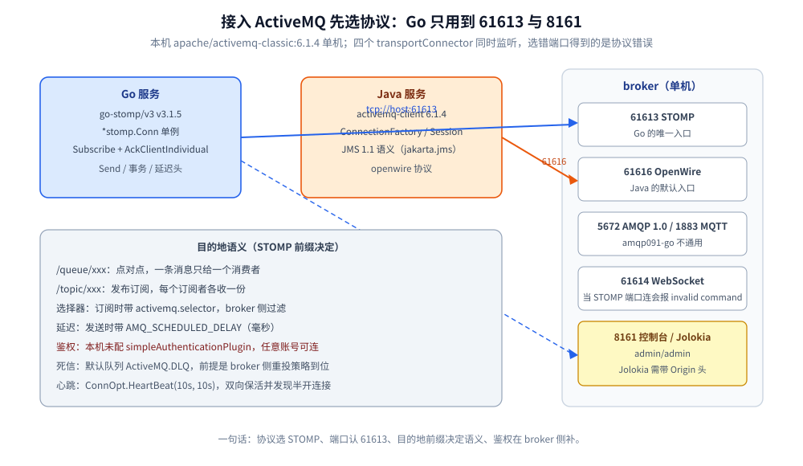
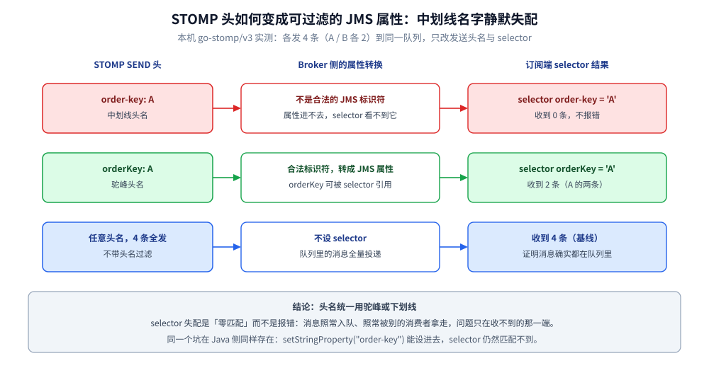
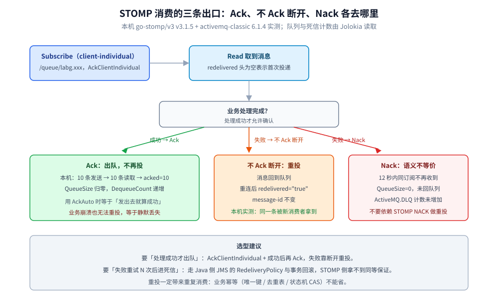

# Go 接入 ActiveMQ

> 覆盖：Go 侧接入 ActiveMQ Classic 的完整手册 —— 客户端选型、前提与端口、初始化、单例边界、初始化顺序、点对点 / 选择器 / 请求-应答 / 延迟 / 事务 / 重投各场景、Header 传播、优雅退出、验证与排障。
>
> 不覆盖：ActiveMQ 的 JMS 概念、KahaDB、重投与死信机制见 [ActiveMQ 目录导读](../../../03-数据与中间件/中间件/消息队列/ActiveMQ/README.md)（零件篇从 [核心概念与架构.md](../../../03-数据与中间件/中间件/消息队列/ActiveMQ/核心概念与架构.md) 起读）；Java 侧写法见 [接入ActiveMQ.md](../../java/工程实践/接入ActiveMQ.md)。
>
> 内容整理自个人学习笔记。本篇代码在 `golang:1.26-alpine`（Go 1.26.8）+ `github.com/go-stomp/stomp/v3 v3.1.5` 下 `gofmt` / `go vet` / `go build` 通过，并对本机 `apache/activemq-classic:6.1.4` 容器（STOMP 连接器 `61613`）实测，输出见第十节。

---

## 一、客户端选型与依赖

**本节要点**：ActiveMQ **没有官方 Go 客户端**；能选的其实是「走哪个协议」。

```bash
go get github.com/go-stomp/stomp/v3@v3.1.5
```

| 路线 | 客户端 | 用哪个端口 | 代价 |
| --- | --- | --- | --- |
| **STOMP** ⭐ | `github.com/go-stomp/stomp/v3` | `61613` | JMS 特性靠 STOMP 头表达：选择器用 `activemq.selector`、延迟用 `AMQ_SCHEDULED_*`、事务只覆盖同一连接的 SEND |
| MQTT（IoT） | `github.com/eclipse/paho.mqtt.golang` | `1883` | 只有发布订阅语义，没有 JMS 队列/事务 |
| AMQP 1.0 | `github.com/Azure/go-amqp` | `5672` | ⚠️ ActiveMQ 开的是 **AMQP 1.0**；RabbitMQ 生态的 `amqp091-go`（0-9-1）**不通用** |



读图要点：接入 ActiveMQ 先选协议再写代码；同一个 broker 上 openwire / STOMP / AMQP / MQTT 并存，Go 侧只用到 61613 与 8161 两个端口，选错端口得到的是协议级错误而不是连接错误。

⚠️ **常见误装 / 误判**：

- 拿 RabbitMQ 的 `github.com/rabbitmq/amqp091-go` 连 ActiveMQ 的 5672：协议版本不同，握手就失败；
- 以为换个协议就拿到完整 JMS：STOMP 没有 `JMSXGroupID` 的等价投递保证，也拿不到 `JMSXDeliveryCount` 这类属性；
- 照抄 `stomp.ConnOpt.Login(...)` 就以为鉴权生效——本机容器**没有配 `simpleAuthenticationPlugin`**，任何账号密码都能连（第十节实测），鉴权要在 broker 侧先配。

## 二、前提

**本节要点**：客户端不创建 broker 资源；协议端口、目的地语义、调度支持三件事要先在 broker 上成立。

| 依赖 | 要先准备好什么 | 漏了会怎样（本机实测） |
| --- | --- | --- |
| **Broker** | `activemq` 已起，`61613` 可达 | `WRONG-PORT: invalid command`（连到非 STOMP 端口时） |
| **STOMP 连接器** | `conf/activemq.xml` 里 `<transportConnector name="stomp" uri="stomp://0.0.0.0:61613"/>` | 端口不通，Dial 报连接失败 |
| **目的地语义** | `/queue/xxx` 是点对点，`/topic/xxx` 是发布订阅 | 写成 `/topic/` 却按「一条只给一人」预期，会全员各收一份 |
| **延迟投递** | broker 开 `schedulerSupport="true"` | `AMQ_SCHEDULED_DELAY` 被忽略，消息立即投递 |
| **鉴权** | `simpleAuthenticationPlugin` + 账号 | ⚠️ 不配时**任何账号都能连**，客户端侧看不出来 |
| **死信** | 默认队列 `ActiveMQ.DLQ`；重投策略在连接工厂 / broker 上配 | 不配策略时重投次数与去向都和预期不同 |

> ⚠️ 本机 `activemq-lab` 的 `activemq.xml` 里有 `schedulerSupport="true"` 与四个 transportConnector（openwire 61616 / amqp 5672 / stomp 61613 / mqtt 1883 / ws 61614），但**没有 `simpleAuthenticationPlugin`**。这意味着 `Login("admin","admin")` 只是形式，换成错密码照样连上——生产环境必须先补鉴权。

## 三、初始化

**本节要点**：`stomp.Dial` 是同步建连；`Host("/")` 与协议版本是 STOMP 1.1+ 的硬要求，心跳用来及时发现半开连接。

```go
import (
    "time"

    "github.com/go-stomp/stomp/v3"
)

c, err := stomp.Dial("tcp", "172.17.0.5:61613",
    stomp.ConnOpt.Login("admin", "admin"),
    stomp.ConnOpt.Host("/"), // STOMP 1.1+ 必带 host 头；ActiveMQ 不校验取值
    stomp.ConnOpt.AcceptVersion(stomp.V12),
    stomp.ConnOpt.HeartBeat(10*time.Second, 10*time.Second), // 双向心跳，保活 + 发现半开
)
if err != nil {
    panic(err)
}
defer c.Disconnect()
```

**在哪调**：进程启动阶段建一次。STOMP 连接是**带状态的长连接**（订阅、事务都挂在它上面），不要每条请求 Dial。

**本机实测的两种失败原文**：

```text
WRONG-PORT: invalid command          # 连到了 61614（WebSocket）端口
BAD-PASS: <nil>                      # 密码故意写错仍连上：broker 未配鉴权插件
```

## 四、单例边界 ⭐

**本节要点**：STOMP 的 `*stomp.Conn` 有长活资源（TCP + 读写协程 + 事务状态），必须进程级单例；`Subscription` 绑定一次消费，按业务各建一份。

| 对象 | 单例？ | 为什么 |
| --- | --- | --- |
| `*stomp.Conn` | ✅ 进程级 | 持有一条 TCP、读写协程与事务状态；反复 Dial = 连接数线性膨胀 |
| `*stomp.Subscription` | ❌ 按订阅 | 绑定目的地 + ack 模式；随业务消费生命周期创建/退订 |
| `*stomp.Transaction` | ❌ 请求级 | 一次业务事务一个，`Commit`/`Abort` 后即失效 |
| `*stomp.Message` | ❌ 请求级 | 每条消息独立；异步处理要先取走 `Body` |
| `context.Context` | ❌ 请求级 | 不存结构体字段 |

**写错的后果**：

- 每次请求 `Dial`：broker 侧连接数与线程数一起涨，`connector` 的 `maximumConnections` 很快触顶；
- 多个业务共用一条 `Subscription`：一条消息只会被其中一次 `Read` 取走，另一个业务永远收不到；
- 在单例 `Conn` 上并发 `Begin` 多个事务：`go-stomp` 的事务对象与连接绑定，交叉 `Commit` 会串。

> 一句话：**连接单例（省 TCP 与状态），Subscription / 事务按业务新建。**

## 五、初始化顺序 ⭐

**本节要点**：⭐ 判据是「谁在初始化时捕获了全局单例」；ActiveMQ 侧还有三条自己的实序。

1. **`Subscribe` 先于 `Send`**：队列里的消息会留存，但**订阅先建好**才能避免「第一轮读不到」（本机队列测试就是先订阅后发送）；
2. **延迟头依赖 broker 配置**：`AMQ_SCHEDULED_DELAY` 只有在 `schedulerSupport="true"` 时生效，客户端无感知；
3. **全局日志 / 链路设施先于 `Dial`**：`go-stomp` 的日志通过 `log` 包输出，全局 logger 换得晚，连接期错误会落到默认输出。

> ⭐ 跨组件的经典例子仍在链路追踪栈：**GORM 的 OTel 插件在 `Install` 时就捕获了当时的全局 `TracerProvider`**——`InitMySQL` 排在 `InitJaeger` 之前，SQL span 永远不上报且不报错。详见 [接入Jaeger.md](../可观测性/接入Jaeger.md)。

## 六、单例与依赖注入的封装

**本节要点**：连接用 `sync.OnceValue` 足够（失败直接 panic，进程起不来）；消费者用「构造 → 订阅 → 关闭」的生命周期封装。

```go
import (
    "sync"
    "time"

    "github.com/go-stomp/stomp/v3"
)

// 进程内只建一条 STOMP 连接；Dial 失败直接让进程起不来，别在请求里重试。
var conn = sync.OnceValue(func() *stomp.Conn {
    c, err := stomp.Dial("tcp", addrFromEnv(),
        stomp.ConnOpt.Login(userFromEnv(), passFromEnv()),
        stomp.ConnOpt.Host("/"),
        stomp.ConnOpt.AcceptVersion(stomp.V12),
        stomp.ConnOpt.HeartBeat(10*time.Second, 10*time.Second),
    )
    if err != nil {
        panic(err)
    }
    return c
})
```

消费者（非单例）：

```go
type OrderConsumer struct {
    conn *stomp.Conn
    sub  *stomp.Subscription
}

// 每个业务消费组建一个；订阅与 ack 一起封装，避免调用方漏 Ack。
func NewOrderConsumer(dest string) (*OrderConsumer, error) {
    c := conn()
    sub, err := c.Subscribe(dest, stomp.AckClientIndividual)
    if err != nil {
        return nil, err
    }
    return &OrderConsumer{conn: c, sub: sub}, nil
}

func (o *OrderConsumer) Close() error {
    return o.sub.Unsubscribe()
}
```

## 七、实际调用

**本节要点**：同一个连接，按场景换「目的地前缀 / STOMP 头 / ack 模式 / 事务」四样东西。

### 7.1 点对点：发送与手动确认

```go
sub, err := c.Subscribe("/queue/labg.orders", stomp.AckClientIndividual)
if err != nil {
    return
}
for i := 1; i <= 10; i++ {
    c.Send("/queue/labg.orders", "text/plain",
        []byte(fmt.Sprintf("go-order-%d", i)),
        stomp.SendOpt.Header("orderKey", fmt.Sprintf("ORDER_%d", i)))
}

for i := 0; i < 10; i++ {
    m, err := sub.Read() // 阻塞读
    if err != nil || m.Err != nil {
        break
    }
    // 业务处理成功后才有资格 Ack
    c.Ack(m)
}
```

本机实测：发送 10 条、读取 10 条、`acked=10`，`message-id` 形如 `ID:b821d91c7c67-...:5:1:-1:1:1`。

⭐ **ack 模式选哪个**：`AckAuto` 在消息**发出后**就算确认，业务崩溃会丢；生产用 `AckClientIndividual` 逐条确认，处理失败就**不 Ack**（见 7.6 的重投路径）。

### 7.2 选择器：头名必须能当 JMS 属性

```go
// broker 侧过滤：只收 orderKey = 'A' 的消息
sub, _ := c.Subscribe("/queue/labg.selector", stomp.AckAuto,
    stomp.SubscribeOpt.Header("activemq.selector", "orderKey = 'A'"))

for _, k := range []string{"A", "A", "B", "B"} {
    c.Send("/queue/labg.selector", "text/plain", []byte("m-"+k),
        stomp.SendOpt.Header("orderKey", k))
}
```

本机实测三种写法（各发 4 条、A/B 各 2）：

| 发送头名 | selector 表达式 | 收到条数 |
| --- | --- | --- |
| `order-key`（带中划线） | `order-key = 'A'` | **0** |
| `orderKey`（驼峰） | `orderKey = 'A'` | **2** |
| `orderKey` | 不设 selector | **4**（基线） |

⭐ ⚠️ **中划线头名不能用于 selector**：JMS 属性名不允许 `-`，带中划线的 STOMP 头不会变成可过滤属性，selector 也就不匹配任何消息——**不报错，只是永远收不到**。业务键统一用驼峰（`orderKey`）或下划线。



读图要点：broker 把 STOMP 头转成 JMS 属性时按标识符规则校验，含中划线的名字进不了可过滤属性；同样的发送逻辑只改头名 `order-key` → `orderKey`，匹配条数就从 0 变成 2。

### 7.3 请求-应答：reply-to + correlation-id

```go
reply := "/queue/labg.reply"
sub, _ := c.Subscribe(reply, stomp.AckAuto)

c.Send("/queue/labg.echo", "text/plain", []byte("go-query"),
    stomp.SendOpt.Header(stomp.ReplyToHeader, reply),
    stomp.SendOpt.Header("correlation-id", "req-1"))
```

服务端读到后 `c.Send(m.Header.Get("reply-to"), ...)` 并带回 `correlation-id`。本机实测：

```text
REQREP correlation-id=req-1 body=echo:go-query
```

⚠️ STOMP 没有 JMS 的「临时队列自动创建」：应答队列要**调用方先命名并订阅**，否则应答消息会落到一个没人消费的队列里。

### 7.4 延迟投递：靠 `AMQ_SCHEDULED_*` 头

```go
c.Send("/queue/labg.delay", "text/plain", []byte("delayed-3s"),
    stomp.SendOpt.Header("AMQ_SCHEDULED_DELAY", "3000")) // 毫秒
```

本机实测：设置 `3000`，实际收到 `3355 ms`（误差来自调度扫描与网络）。可配 `AMQ_SCHEDULED_PERIOD` / `AMQ_SCHEDULED_REPEAT` 做周期投递。

⭐ 这套头只在 `schedulerSupport="true"` 的 broker 上生效；不支持时消息会**立即投递**，且不会报错。这是最容易「以为配好了」的坑。

### 7.5 事务：只覆盖同一连接的 SEND

```go
t, err := c.BeginWithError()
if err != nil {
    return
}
for i := 0; i < 3; i++ {
    t.Send("/queue/labg.tx", "text/plain", []byte(fmt.Sprintf("aborted-%d", i)))
}
t.Abort() // 这 3 条不落地

t2, _ := c.BeginWithError()
for i := 0; i < 2; i++ {
    t2.Send("/queue/labg.tx", "text/plain", []byte(fmt.Sprintf("committed-%d", i)))
}
t2.Commit()
```

本机实测：abort 3 条 + commit 2 条后，消费端只读到 2 条（`TX got= 2`）。

⚠️ STOMP 事务**只覆盖 SEND/ACK**，不是 JMS 的跨资源事务；要做「本地库 + 发消息」的原子性，得看 [最终一致方案.md](../../../04-架构与系统/分布式/分布式事务/最终一致方案.md)。

### 7.6 重投与死信：STOMP 侧的实测边界

**可靠路径：不 Ack 就断开**。本机实测：消费者读到消息、**未 Ack** 直接 `Disconnect`，重连后的新消费者拿到同一条 `message-id`，且 `redelivered="true"`。

```text
INFLIGHT read id=ID:b821d91c7c67-...:5:12:-1:1:1 redelivered="" then disconnect WITHOUT ack
INFLIGHT redelivered id=ID:b821d91c7c67-...:5:12:-1:1:1 redelivered="true" body=unacked-1
```

**⚠️ `Nack` 不等于「立刻重投」**。本机用 `c.Nack(m)` 后：同一订阅 12 秒内没再收到，队列 `QueueSize=0`、`DequeueCount=1`，`ActiveMQ.DLQ` 的 `EnqueueCount` 也没增加——消息既没回到可投递队列，也没进死信。

> 结论：**STOMP 侧的 `Nack` 语义与 JMS 的 `rollback` / `CLIENT_ACKNOWLEDGE` 不保证等价**。需要重投就「不 Ack 断开」或改用 JMS 侧的事务回滚；要死信就按 Java 侧的重投策略配（见 [接入ActiveMQ.md](../../java/工程实践/接入ActiveMQ.md) 7.6），别指望 STOMP 的 NACK。



读图要点：只有 `AckClientIndividual` + 成功后再 `Ack` 能在「处理完成才出队」上站得住；不 Ack 断开会让同一条 `message-id` 以 `redelivered="true"` 重投，而 `Nack` 实测 12 秒内不重投、`QueueSize` 与 DLQ 计数都不变。

## 八、跨进程与跨协程传播

**本节要点**：STOMP 头会在 broker 侧转成 JMS 属性，业务头随消息走；trace 类头要按「能当 JMS 属性名」的规则命名。

```go
// 生产端：业务键 + 链路头一起放进 STOMP 头
c.Send("/queue/labg.headers", "text/plain", []byte("go-props"),
    stomp.SendOpt.Header("orderKey", "ORDER_GO_2001"),
    stomp.SendOpt.Header("xTraceId", "trace-go-abc123")) // ⚠️ 不要用 x-trace-id
```

```go
// 消费端：Header.Get 取值；取不到返回空串
fmt.Printf("biz=%s trace=%s body=%s\n",
    m.Header.Get("orderKey"), m.Header.Get("xTraceId"), string(m.Body))
```

本机实测：`orderKey` 与 `correlation-id` 均原样往返（7.1、7.3 的输出里可见）。⚠️ `x-trace-id` 这种带中划线的头能传值，但**不能用于 selector**（7.2 实测），所以统一用驼峰更稳。

**ctx 传参铁律**：

- `go-stomp` 的 `Read()` **没有超时参数**，要控制等待自己套 `goroutine + time.After`；注意超时后遗留的 `Read` 仍会消费下一条消息（本机踩过：重投测试里被前一轮的遗留读抢走）；
- 别把请求级 trace_id 存进单例 `Conn` 或共享闭包里——多协程立刻串数据。

## 九、优雅退出

**本节要点**：退出就是 `Disconnect`；**先停业务读取、再退订、最后断开**，让未确认的消息回到队列。

```go
// 顺序：停 HTTP 入口 → 停 Read 循环 → 退订 → 断开
sub.Unsubscribe()
if err := c.Disconnect(); err != nil {
    log.Printf("disconnect: %v", err)
}
```

本机实测：未 Ack 的消息在断开后被下一个消费者拿到，`redelivered="true"`——**不是丢，是重**。

| 退出方式 | 在途消息 | 订阅 | 适用 |
| --- | --- | --- | --- |
| `Unsubscribe` + `Disconnect` ⭐ | 回队列，下次重投 | 正常退订 | 正常停机 |
| 直接断 TCP | 回队列（未 Ack） | 由 broker 清理 | 进程崩溃 |
| 已 `Ack` 但业务失败 | **丢失** | — | 只能靠业务幂等与补偿 |

**漏了会怎样**：

- 不 `Disconnect` 直接退出：未 Ack 的消息仍会重投，但连接要等心跳超时才被 broker 清理，期间消息在 in-flight 挂着；
- 用 `AckAuto` 且业务失败：消息已被确认，重投不会发生，等于静默丢失。

## 十、验证与排查

**本节要点**：先确认「发得进、读得出、Ack 生效」，再用队列计数与故障表定位。

### 10.1 先确认生效

```bash
# 环境：golang:1.26-alpine（Go 1.26.8）+ go-stomp/v3 v3.1.5
gofmt -l .        # 无输出
go vet ./...      # 通过
go build -o /tmp/amqgo .
```

```text
SEND n=10
RECV dest=/queue/labg.orders message-id=ID:b821d91c7c67-...:5:1:-1:1:1 key=ORDER_1 body=go-order-1
QUEUE acked= 10
SEL labg.sel.dash    header=order-key  got=0
SEL labg.sel.camel   header=orderKey   got=2
SEL labg.sel.none    header=orderKey   got=4
TX got= 2 (期望 2：abort 的 3 条不落地)
DELAY recv body=delayed-3s elapsed=3355ms
REQREP correlation-id=req-1 body=echo:go-query
INFLIGHT redelivered redelivered="true" body=unacked-1
```

⭐ 读法：**`acked=10` 说明 ack 链路通**；**选择器 `0 / 2 / 4` 是三种写法的对照**，不是随机波动；**延迟 `3355 ms` 对应设置的 `3000`**；**`redelivered="true"` 是未 Ack 断开的预期结果**。

broker 侧用 Jolokia 复核队列计数（⚠️ 必须带 `Origin` 头，否则 403）：

```bash
curl -s --noproxy '*' -u admin:admin -H 'Origin: http://localhost' \
  "http://127.0.0.1:8161/api/jolokia/read/org.apache.activemq:brokerName=localhost,destinationName=labg.orders,destinationType=Queue,type=Broker/QueueSize,EnqueueCount,DequeueCount"
```

### 10.2 常见故障速查

| 症状 | 多半是 | 处置 |
| --- | --- | --- |
| `invalid command` | 连到了非 STOMP 端口（如 61614 ws） | 改成 `61613` |
| Dial 超时 / 连接拒绝 | 端口没映射、容器网络不通 | `docker port` + 容器内 `nc -z` |
| 登录随便写都能连 | broker **没配** `simpleAuthenticationPlugin` | 生产必须补鉴权，客户端侧无法补救 |
| 消息发出去但选择器收不到 | 头名带 `-`，不能当 JMS 属性 | 改驼峰（本机对照 `0` vs `2`） |
| 延迟头不生效、消息立即到 | broker 未开 `schedulerSupport` | `activemq.xml` 打开后重启 |
| `Nack` 后消息消失 | STOMP NACK 语义不等价 JMS 回滚 | 改成「不 Ack 断开」或走 JMS 事务 |
| 应答消息没人收 | 应答队列没先订阅 | 调用方先 `Subscribe(reply)` 再 `Send` |
| 读到一半卡住 | `Read()` 无超时 | 套 `goroutine + time.After`，并处理遗留读 |

| 排查项 | 命令 / 接口 |
| --- | --- |
| 队列积压 / 出队数 | Jolokia `QueueSize` / `EnqueueCount` / `DequeueCount` |
| 死信 | `destinationName=ActiveMQ.DLQ` 的计数 |
| 连接与消费者 | 管理台 `http://127.0.0.1:8161/admin`（`admin/admin`） |
| broker 日志 | 容器内 `data/activemq.log` |

## 十一、延伸追问

- **为什么密码写错还能连？** → 本机 broker 没配 `simpleAuthenticationPlugin`，任何账号都放行（实测 `BAD-PASS: <nil>`）；这不是客户端漏洞，是 broker 配置缺口。详见第二节、第十节。
- **`order-key` 这种头名有什么问题？** → JMS 属性名不允许中划线，selector 匹配不到；本机同一批消息用带中划线头名收到 0 条、驼峰收到 2 条，且全程不报错。详见 7.2。
- **`Nack` 之后消息去哪了？** → 本机实测：同订阅 12 秒内不再投、队列计数为 0、DLQ 计数不变；可靠重投用「不 Ack 断开」，需要死信就走 JMS 侧重投策略。详见 7.6。
- **STOMP 能做 JMS 那种事务吗？** → 只能把同一连接上的一批 SEND/ACK 原子化，跨数据库不成立；跨资源一致性看最终一致方案。详见 7.5。
- **心跳设多大合适？** → 双向 10s 只保证及时发现半开连接，不解决消费慢；消费慢要靠 prefetch 与并发，Java 侧的 prefetch 默认值见 [接入ActiveMQ.md](../../java/工程实践/接入ActiveMQ.md) 第四节。

## 十二、校验口径

> ✅ 本篇代码的校验方式与范围（`golang:1.26-alpine`，Go 1.26.8）：

- **真编译 + 运行通过**：第三节 `stomp.Dial`、第六节连接封装、7.1 点对点收发与 Ack、7.2 三种 selector 写法、7.3 请求-应答、7.4 延迟、7.5 事务 abort/commit、7.6 未 Ack 断开重投与 NACK 对照。
- **只编译、未独立运行**：第六节 `OrderConsumer` 的完整包封（等价逻辑已在 7.1 跑通）。
- **未实测**：`/topic` 持久订阅与虚拟主题；MQTT / AMQP 1.0 两条协议路线；故障转移（`failover:` 传输）；网络分区与主从。
- **实测环境**：`apache/activemq-classic:6.1.4` 单机（openwire 61616 / STOMP 61613 / 8161 控制台），`schedulerSupport="true"`，**未配鉴权插件**。
- **未伪造输出**：第十节读数来自本次容器运行；selector 的 `0 / 2 / 4` 是同一次实验的三组对照。

| 依赖 | 实际版本 |
| --- | --- |
| `github.com/go-stomp/stomp/v3` | v3.1.5 |
| ActiveMQ Classic（镜像） | 6.1.4 |
| `jakarta.jms-api` | 无（Go 侧不涉及） |

## 关联

- **上游/总纲**：[ActiveMQ 目录导读](../../../03-数据与中间件/中间件/消息队列/ActiveMQ/README.md) — 定位、阅读路线与实测坐标
- **对照/互补**：[接入ActiveMQ.md](../../java/工程实践/接入ActiveMQ.md) — Java 侧 JMS 写法与重投策略
- **对照/互补**：[接入NATS.md](接入NATS.md) — 另一套轻量 Pub/Sub 的接入对照
- **对照/互补**：[接入RocketMQ.md](接入RocketMQ.md) — 需要延迟级别 / 顺序 / 死信时的对照路线
- **下游机制**：[消息类型与消费语义.md](../../../03-数据与中间件/中间件/消息队列/ActiveMQ/消息类型与消费语义.md) — 队列 / 主题 / 选择器 / 消息组的 broker 侧机制
- **下游机制**：[消息可靠性.md](../../../03-数据与中间件/中间件/消息队列/ActiveMQ/消息可靠性.md) — 重投、死信与持久化
- **运维/配置**：[运维与排障.md](../../../03-数据与中间件/中间件/消息队列/ActiveMQ/运维与排障.md) — 控制台、Jolokia 与常见故障
- **运维/配置**：[部署与配置.md](../../../03-数据与中间件/中间件/消息队列/ActiveMQ/部署与配置.md) — `activemq.xml` 的连接器与鉴权
