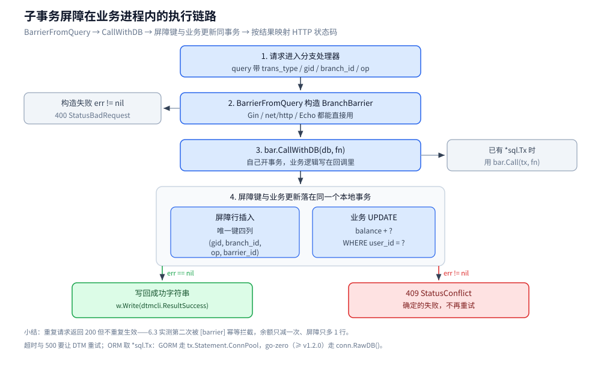
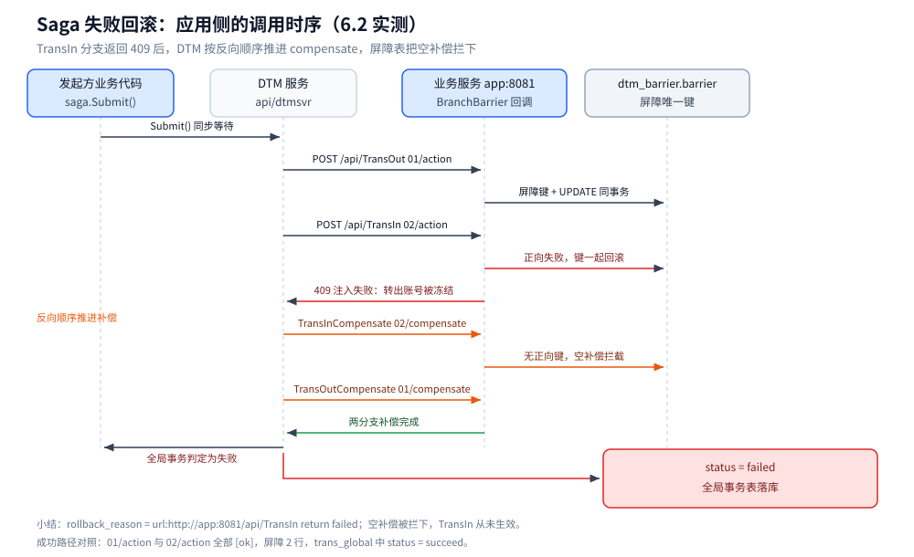

# 接入 DTM

> Go 侧接入 DTM 分布式事务：服务端与两类表的准备、子事务屏障的写法、Saga / TCC / 二阶段消息三套骨架，以及一组在容器里真实跑通的验证。
> DTM 的概念、架构与模式见 [原理与架构.md](../../../03-数据与中间件/中间件/分布式事务/DTM/原理与架构.md) 与 [事务模式.md](../../../03-数据与中间件/中间件/分布式事务/DTM/事务模式.md)，本篇只讲怎么写代码。
>
> 内容整理自个人学习笔记；接口与代码来自 DTM 官方文档与仓库。素材见 [素材清单.md](../../../素材清单.md)。

---

## 一、先决条件

**本节要点**：接入前要先把 DTM 服务跑起来，并建好两类表——业务侧的屏障表与 TM 侧的全局事务表；漏建屏障表会在第一次分支调用时直接报错。

| 准备项 | 说明 | 脚本 |
|---|---|---|
| **DTM 服务** | 默认 HTTP `36789`、gRPC `36790`；客户端地址形如 `http://host:36789/api/dtmsvr` | 见 [部署与运维.md](../../../03-数据与中间件/中间件/分布式事务/DTM/部署与运维.md) |
| **业务库** | 示例用 `dtm_busi.user_account`，实际业务表自建 | `sqls/busi.mysql.sql`（示例） |
| **子事务屏障表** | 库 `dtm_barrier`、表 `barrier`，唯一键 `(gid, branch_id, op, barrier_id)` | `sqls/dtmcli.barrier.mysql.sql` |
| **全局事务表** | 库 `dtm`：`trans_global` / `trans_branch_op` / `kv` | `sqls/dtmsvr.storage.mysql.sql`（仅数据库存储需要） |

依赖：

```bash
go get github.com/dtm-labs/client
go get github.com/go-sql-driver/mysql
```

`github.com/dtm-labs/client` 是官方主仓 `client/` 的同步副本，依赖更少；需要 gRPC 时改用 `client/dtmgrpc`。

## 二、子事务屏障怎么写

**本节要点**：屏障是把「幂等 / 空补偿 / 悬挂」收进框架的关键；用官方 helper 只需三步——从请求构造 `BranchBarrier`、用 `CallWithDB` 包住业务、把错误映射成 409。

```go
import (
    "database/sql"
    "github.com/dtm-labs/client/dtmcli"
)

func sagaAdjustBalance(tx *sql.Tx, uid int, delta int64) error {
    _, err := tx.Exec("UPDATE dtm_busi.user_account SET balance = balance + ? WHERE user_id = ?", delta, uid)
    return err
}

// 一个分支处理器：正向与补偿共用同一套屏障写法
func transOutHandler(w http.ResponseWriter, r *http.Request) {
    bar, err := dtmcli.BarrierFromQuery(r.URL.Query()) // 从 gid / branch_id / op / trans_type 构造
    if err != nil {
        w.WriteHeader(http.StatusBadRequest)
        return
    }
    amount := int64(30)
    err = bar.CallWithDB(db, func(tx *sql.Tx) error {
        return sagaAdjustBalance(tx, 1, -amount)
    })
    if err != nil {
        w.WriteHeader(http.StatusConflict) // 409：确定的失败，不再重试
        return
    }
    _, _ = w.Write([]byte(dtmcli.ResultSuccess))
}
```

要点：

- `BarrierFromQuery` 只吃 `url.Values`（`trans_type / gid / branch_id / op`），因此 Gin、`net/http`、Echo 都能直接用；Gin 侧官方示例另有 `MustBarrierFromGin(c)` 一类封装。
- `CallWithDB(db, fn)` 自己开事务；已有 `*sql.Tx` 时用 `bar.Call(tx, fn)`。
- **业务逻辑必须写在回调里**，屏障键与业务更新才会落在同一个本地事务；把它写在回调外就失去幂等保护。
- 返回错误代表「确定的失败」（HTTP 409 / gRPC `Aborted`）；超时、500 这类应让 DTM 重试。



**图怎么读**：从上到下就是 `transOutHandler` 的一次执行。第 4 步的灰框是本地事务边界——屏障键插入和业务 UPDATE 必须在同一个事务里，业务写在回调外就失去幂等保护；构造参数出错走 400，事务内返回错误走 409。屏障判定的完整流程在别的篇目，见 [原理与架构.md](../../../03-数据与中间件/中间件/分布式事务/DTM/原理与架构.md)。

### 2.1 ORM 场景怎么拿 `*sql.Tx`

| 场景 | 写法 |
|---|---|
| `database/sql` | 直接用 `CallWithDB(dbGet(), fn)` |
| **GORM** | `tx := gdb.Begin()` 后取 `tx.Statement.ConnPool.(*sql.Tx)` 传给 `Call` |
| **go-zero**（≥ v1.2.0） | `conn.RawDB()` 拿到 `*sql.DB`，再 `bar.CallWithDB(db, fn)` |
| XORM | `se.Begin()` 后用 `se.Tx().Tx` |

更多 ORM（goqu / ent）见 [实践与生态.md](../../../03-数据与中间件/中间件/分布式事务/DTM/实践与生态.md) 第三节。

## 三、Saga 骨架

**本节要点**：Saga 只需成对提供「正向 url + 补偿 url」，DTM 负责顺序推进与失败回滚。

```go
saga := dtmcli.NewSaga(dtmServer, gid).
    Add(busiAPI+"/TransOut", busiAPI+"/TransOutCompensate", &TransReq{Amount: 30}).
    Add(busiAPI+"/TransIn", busiAPI+"/TransInCompensate", &TransReq{Amount: 30})
if err := saga.Submit(); err != nil { // 同步等待全局事务结束
    return err
}
```

- `busiAPI` 必须是 **DTM 能回调到的地址**（容器里不要写容器自身的 `localhost`）。
- 需要「第三方很久才有结果」时，分支先返回 `ONGOING`（HTTP 425 / gRPC `FailedPrecondition`），DTM 会按固定间隔重试而不是指数退避。

## 四、TCC 骨架

**本节要点**：TCC 用一个 `Try/Confirm/Cancel` 三接口 + `CallBranch` 表达，三处都必须幂等，交给屏障处理。

```go
err := dtmcli.TccGlobalTransaction(dtmServer, gid, func(tcc *dtmcli.Tcc) (*resty.Response, error) {
    resp, err := tcc.CallBranch(req, busiAPI+"/TransOutTry", busiAPI+"/TransOutConfirm", busiAPI+"/TransOutCancel")
    if err != nil {
        return resp, err
    }
    return tcc.CallBranch(req, busiAPI+"/TransInTry", busiAPI+"/TransInConfirm", busiAPI+"/TransInCancel")
})
```

三个接口内部同样用 `bar.CallWithDB(...)` 包住：`Try` 冻结/预留、`Confirm` 消费预留、`Cancel` 释放预留。`Confirm` 与 `Cancel` 归属二阶段，**不允许返回业务失败**。

## 五、二阶段消息骨架

**本节要点**：`DoAndSubmitDB` 把「本地业务提交」与「消息 Prepare」放进同一个本地事务，回查接口直接复用屏障的 `QueryPrepared`。

```go
msg := dtmcli.NewMsg(dtmServer, gid).
    Add(busiAPI+"/TransIn", &TransReq{Amount: 30})
err := msg.DoAndSubmitDB(busiAPI+"/QueryPrepared", db, func(tx *sql.Tx) error {
    return sagaAdjustBalance(tx, 1, -30) // 与 Prepare 记录同事务提交
})
```

回查接口只需一行：

```go
func queryPrepared(w http.ResponseWriter, r *http.Request) {
    bar, err := dtmcli.BarrierFromQuery(r.URL.Query())
    if err == nil {
        err = bar.QueryPrepared(db) // 查屏障表：已提交返回成功，已回滚返回失败
    }
    if err != nil {
        w.WriteHeader(http.StatusConflict)
        return
    }
    _, _ = w.Write([]byte(dtmcli.ResultSuccess))
}
```

## 六、实测：两条路径都跑通

**本节要点**：下面这组读数来自本机容器实跑——DTM v1.19.0 + MySQL 8.0 + Go 1.26.8，业务程序在 `golang`/`alpine` 容器里以 `http://app:8081` 被 DTM 回调。

**✅ 实测口径**：镜像 `yedf/dtm:latest`（启动日志自报 `dtm version is: v1.19.0`）、`mysql:8.0`、`go1.26.8 linux/amd64`、客户端 `github.com/dtm-labs/client`；三个容器同处一个自定义 bridge 网络。
**⚠️ 未实测**：TCC / XA / Workflow / 二阶段消息只做了静态核对；XA 需要数据库与驱动支持 XA；本实验的屏障是按官方机制的**手写实现**（为了展示判定过程），官方 helper 的调用签名已核对源码但未单独跑一遍。

### 6.1 成功路径

发起着一个 Saga（TransOut 30 → TransIn 30），分支日志：

```text
[start] gid=saga-1791707150421181032 fail=false
[recv] POST /api/TransOut query="branch_id=01&gid=saga-1791707150421181032&op=action&trans_type=saga" body={"amount":30}
[ok] /api/TransOut
[recv] POST /api/TransIn  query="branch_id=02&gid=saga-1791707150421181032&op=action&trans_type=saga" body={"amount":30}
[ok] /api/TransIn
```

余额与状态：`user1 10000 → 9970`、`user2 10000 → 10030`；屏障 2 行（`01/action`、`02/action`）；`dtm.trans_global` 中该事务 `status = succeed`。

### 6.2 失败回滚路径

让 TransIn 分支注入失败（返回 409，代表「确定的失败」不重试）：

```text
[recv] POST /api/TransOut            query="…branch_id=01…op=action…"       → [ok]/api/TransOut
[recv] POST /api/TransIn             query="…branch_id=02…op=action…"       → [fail] /api/TransIn: 注入失败：转出账号被冻结
[recv] POST /api/TransInCompensate   query="…branch_id=02…op=compensate…"   → [barrier] 空补偿拦截… → [ok]
[recv] POST /api/TransOutCompensate  query="…branch_id=01…op=compensate…"   → [ok]
```

三个可复现的结论：

1. **TransOut 被补偿回滚**，`user1` 回到 9970（`-30` 后 `+30` 抵消）；TransIn 从未生效，`user2` 保持 10030。
2. **TransInCompensate 被「空补偿」拦下**：TransIn 的正向操作失败时，屏障键与业务更新在同一个本地事务里**一起回滚**，补偿到达时发现正向键不存在，直接判定为空补偿并跳过。
3. `dtm.trans_global` 中该事务 `status = failed`，`rollback_reason = url:http://app:8081/api/TransIn return failed:  FAILURE`。



**图怎么读**：四条泳道都在应用与 DTM 的调用边界上——橙色是 compensate 阶段，DTM 按 **反向顺序**先调 `TransInCompensate`（屏障查不到正向键，判为空补偿跳过），再调 `TransOutCompensate` 把 `-30` 抵掉；最后 `dtm.trans_global` 落 `status = failed`。服务端自身的状态推进不在本篇，见 [原理与架构.md](../../../03-数据与中间件/中间件/分布式事务/DTM/原理与架构.md)。

### 6.3 幂等验证

对同一 `(gid, branch, op)` 连发两次正向操作：

```text
第1次 HTTP=200     余额 user1 9970 → 9965   （执行）
第2次 HTTP=200     [barrier] 幂等拦截 gid=IDEM-DEMO branch=01 op=action   （未执行）
```

两次都返回 200，但余额只减了一次，屏障行数只增加 1 行——这正是「重复请求返回成功但不重复生效」的幂等语义。

> 对账：屏障表行数 2（成功场景）→ 6（失败场景，含补偿代插的 `02/action`）→ 7（幂等场景只新增 1 行），与上面每条日志逐条对得上。

## 七、常见错误

| 现象 | 原因 | 处理 |
|---|---|---|
| 分支第一次调用就报屏障表相关错误 | 业务库没建 `dtm_barrier.barrier` | 跑 `sqls/dtmcli.barrier.mysql.sql` |
| DTM 回调 404 / 连不上 | `Add` 里写的是容器自身不可达的地址 | 用 DTM 能解析到的服务名或宿主机可达地址 |
| 全局事务不按预期回滚 | 入口吞掉了异常，或分支把技术错误当成业务失败 | 业务失败才返回 409；超时/500 交给 DTM 重试 |
| 业务重复执行 | 业务逻辑写在 `CallWithDB` 回调外 | 把业务写进回调，与屏障键同事务 |
| 补偿把不该动的数据又动了一次 | 忘记用屏障，靠「先查后改」判重 | 一律走屏障，用唯一键裁决并发 |

## 延伸追问

- **`Call` 和 `CallWithDB` 有什么区别？** → `Call` 要求你自己传入 `*sql.Tx`（已在事务里时用），`CallWithDB` 内部用 `*sql.DB` 开事务；两者都保证屏障键与业务更新同事务。
- **为什么重复请求也返回成功？** → 幂等语义要求「重复调用结果一致」，返回失败会让 DTM 反复重试；返回成功表示「这件事已经办妥」。
- **失败的分支为什么补偿时会跳过？** → 业务失败会把屏障键一起回滚，补偿到达时看不到正向键，按规则判为「空补偿」直接返回。
- **Saga 的分支要并发怎么办？** → DTM 的 Saga 支持并发分支；并发时屏障的作用更关键，因为没有屏障就无法区分乱序。
- **容器里跑 DTM，回调地址怎么写？** → 让 DTM 与业务服务在同一网络里，用服务名（如 `http://app:8081`），不要写 `localhost`。

## 关联

- [原理与架构.md](../../../03-数据与中间件/中间件/分布式事务/DTM/原理与架构.md) — 子事务屏障的判定流程与分支结果语义
- [事务模式.md](../../../03-数据与中间件/中间件/分布式事务/DTM/事务模式.md) — Saga / TCC / 二阶段消息各自的边界
- [部署与运维.md](../../../03-数据与中间件/中间件/分布式事务/DTM/部署与运维.md) — 服务端部署与两类表
- [实践与生态.md](../../../03-数据与中间件/中间件/分布式事务/DTM/实践与生态.md) — ORM 与微服务框架集成
- [分布式事务.md](../../../04-架构与系统/分布式/理论/分布式事务.md) — 通用原理与方案选型
- [数据访问与连接池.md](数据访问与连接池.md) — `sql.DB` 是池不是连接，屏障回调里的事务边界
- [素材清单.md](../../../素材清单.md) — 素材来源登记
