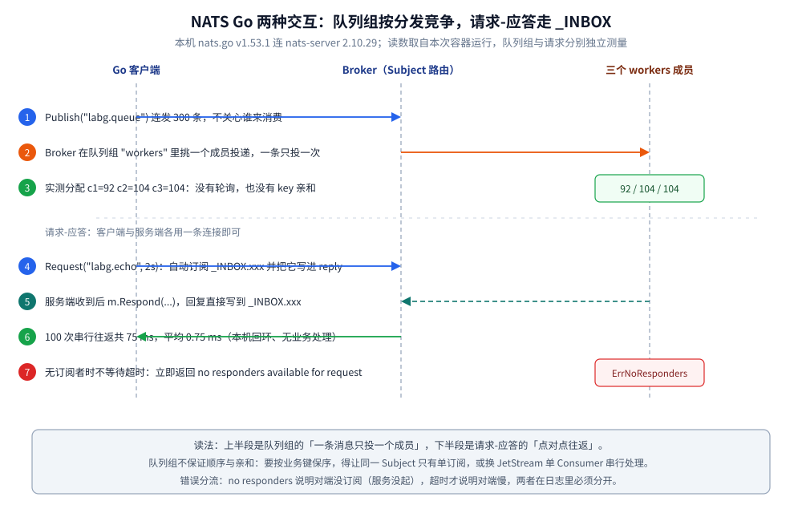
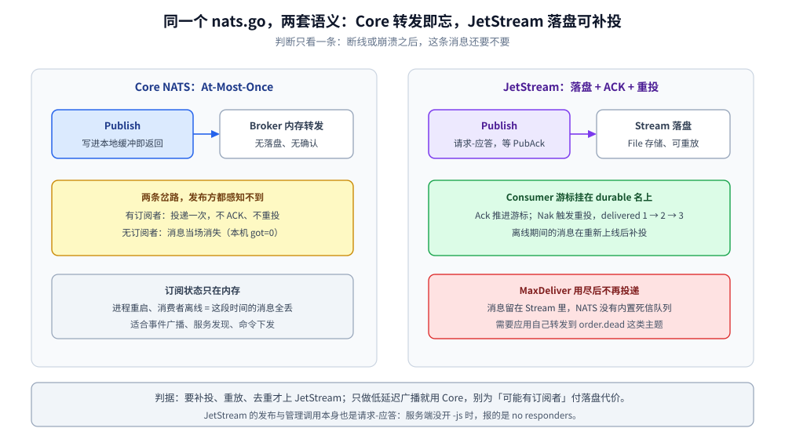
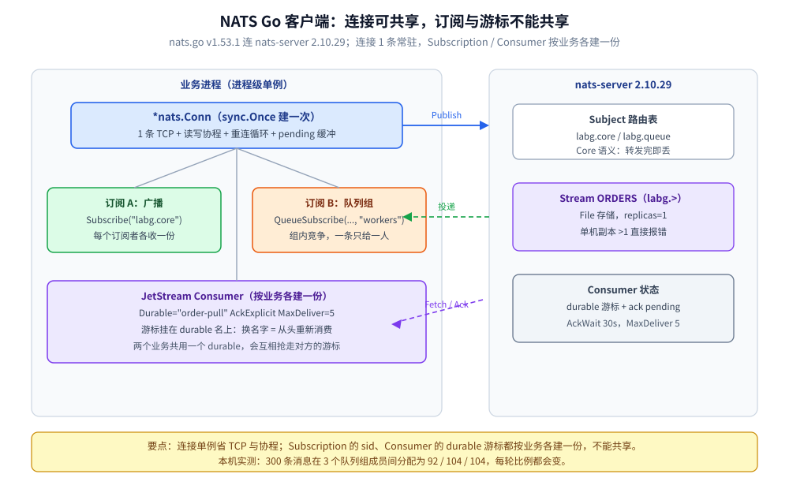

# Go 接入 NATS

> 覆盖：Go 侧接入 NATS 的完整手册 —— 客户端选型、前提与鉴权、初始化、单例边界、初始化顺序、Core / Queue / Request-Reply / JetStream 各场景调用、Header 跨进程传播、`Drain` 优雅退出、验证与排障。
>
> 不覆盖：NATS 的定位、Subject 通配符、队列组与 JetStream 的机制见 [NATS 目录导读](../../../03-数据与中间件/中间件/消息队列/NATS/README.md)（零件篇从 [核心概念与架构.md](../../../03-数据与中间件/中间件/消息队列/NATS/核心概念与架构.md) 起读）；Java 侧写法见 [接入NATS.md](../../java/工程实践/接入NATS.md)。
>
> 内容整理自个人学习笔记。本篇代码在 `golang:1.26-alpine`（Go 1.26.8）+ `github.com/nats-io/nats.go v1.53.1` 下 `gofmt` / `go vet` / `go build` 通过，并对本机 `nats:2.10-alpine`（nats-server **2.10.29**，开 JetStream、token 鉴权）容器实测，输出见第十节。

---

## 一、客户端选型与依赖

**本节要点**：Go 侧只有 `nats.go` 一条正路；要选的是「用 Core API 还是 JetStream API」，两者在同一个库里、两套语义。

```bash
go get github.com/nats-io/nats.go@v1.53.1
```

| 包 / 客户端 | 对应语义 | 适用场景 |
| --- | --- | --- |
| `nats`（根包） | Core NATS：At-Most-Once 转发 | 服务发现、事件广播、请求-应答、命令下发 |
| `nats/jetstream` ⭐ | JetStream：落盘 + ACK + 重投 + 重放 | 订单事件、需要补投或重放的任务 |
| `stan`（STAN） | 旧版流式 API | **已废弃**，新项目不要用；JetStream 是它的替代 |

⚠️ **常见误装**：

- 别把 `github.com/nats-io/stan.go` 当成 NATS 的流式客户端——那是已被 JetStream 取代的旧栈；
- JetStream 不是「换一个包」就有的：**服务端必须以 `-js` 启动**，否则 `CreateStream` 只会得到一句 `no responders`（见第十节），看不出是 JetStream 没开；
- 用 `nats.go` 连需要鉴权的服务端时，token / user-pass / NKey 都要在 URL 或 `Options` 里给全，缺了就是 `Authorization Violation`，不是超时。

## 二、前提

**本节要点**：客户端不会替你在服务端建好一切——JetStream 开关、鉴权、Subject 命名空间都得先就位。

| 依赖 | 要先准备好什么 | 漏了会报什么（本机原文） |
| --- | --- | --- |
| **服务端** | `nats-server` 已起，`4222` 可达 | `nats: no servers available for connection` |
| **鉴权** | 服务端 `authorization { token: ... }`，客户端 URL 带 token | `nats: Authorization Violation` |
| **JetStream** | 启动参数 `-js` 且配置 `store_dir` | `CreateStream` 返回 `nats: no responders available for request` |
| **Stream** | 可客户端 `CreateStream`，也可运维预建 | 未建就 `Publish` → `no responders`（JetStream 发布是请求-应答） |
| **Consumer** | 客户端 `CreateOrUpdateConsumer`，durable 名即消费进度 | 换 durable 名 = 从头重新消费 |
| **`max_payload`** | 默认 1 MB（本机 `/varz` 读数 `1048576`） | `nats: maximum payload exceeded`（客户端本地就拦） |

> ⚠️ 本机 `nats-lab` 的配置是 `authorization { token: "s3cret-token" }`，客户端 URL 写成 `nats://s3cret-token@172.17.0.2:4222`。token 直接拼进 URL 便于实验，生产应从环境变量读，别写进代码。

## 三、初始化

**本节要点**：`nats.Connect` 是**同步建连**，失败立刻返回错误；建连之后 Core 的发布/订阅都是内存操作，没有「再 Start 一次」的步骤。

```go
nc, err := nats.Connect("nats://s3cret-token@172.17.0.2:4222",
    nats.Timeout(5*time.Second),
    nats.MaxReconnects(10),
    nats.ReconnectWait(2*time.Second),
    nats.ErrorHandler(func(_ *nats.Conn, sub *nats.Subscription, e error) {
        if sub != nil { // 连接级错误时 sub 为 nil，直接取 Subject 会 panic
            log.Printf("nats async error sub=%s err=%v", sub.Subject, e) // 慢消费者走这里
        } else {
            log.Printf("nats async error err=%v", e)
        }
    }),
    nats.ReconnectHandler(func(c *nats.Conn) {
        log.Printf("reconnected: %s", c.ConnectedUrl()) // 重连后可能换了一台，排查用这个
    }),
)
if err != nil {
    log.Fatalf("connect nats: %v", err)
}
```

**在哪调**：进程启动阶段建一次。`nats.Connect` 内部已经起好读写协程与重连循环，**不要**在 HTTP handler 里每次 Connect——那等于每条请求开一条 TCP。

**与 Java 的第一个差异**：Go 的 `Connect` 建连失败**直接返回 error**；`jnats` 的 `Nats.connect` 也是同步的（见 [接入NATS.md](../../java/工程实践/接入NATS.md) 第三节），但 Java 侧常见的 `Options.maxReconnects` 语义里「重连」由后台线程负责，两边的**重连**行为一致、**首次建连**都由调用方处理。

## 四、单例边界 ⭐

**本节要点**：判据仍是「内部有没有长活资源」——`*nats.Conn` 有（TCP + 两个协程 + 重连状态），必须进程级单例；`jetstream.JetStream` 只是挂在 `Conn` 上的轻量视图，跟着 `Conn` 走。

| 对象 | 单例？ | 为什么 |
| --- | --- | --- |
| `*nats.Conn` | ✅ 进程级 | 持有一条 TCP、读写协程、重连与 pending 缓冲；反复建 = 连接数线性膨胀 |
| `jetstream.JetStream` | ✅ 跟随 Conn | 无独立资源，`jetstream.New(nc)` 只是取一个上下文句柄 |
| `jetstream.Consumer` | ❌ 按订阅 | 绑定 durable 名与 ACK 状态；一个业务消费组一份 |
| `*nats.Subscription` | ❌ 按订阅 | 持有 sid 与投递通道，随业务订阅生命周期创建/销毁 |
| `*nats.Msg` / `nats.Header` | ❌ 请求级 | 每条消息独立；跨请求复用会串内容 |

**写错的后果**：

- 每次请求 `nats.Connect`：连接数与 `connz` 里的客户端条目随 QPS 涨，服务端 `max_connections` 很快打满；
- 把 `Consumer` 做成全局单例、多个业务共用：durable 名只有一个，两个业务抢同一个游标，**A 消费掉的消息 B 永远看不到**；
- 把 `*nats.Msg` 存进结构体再异步处理：`Msg` 的数据缓冲在下次读取时可能被复用，必须 `copy` 出来。

> 一句话：**连接单例（省 TCP 与协程），订阅 / Consumer 非单例（一个消费语义一份游标）。**

## 五、初始化顺序 ⭐

**本节要点**：⭐ 判据仍是「谁在初始化时捕获了全局单例」；NATS 侧还有两条自己的实序。

1. **JetStream 相关的一切都必须在 `Connect` 成功之后**：`jetstream.New(nc)` 不建连，只取句柄；真正报错会推迟到第一次 `CreateStream` / `Publish`，报的是 `no responders`，很容易误判成订阅方没起。
2. **Core 的订阅必须先于发布**：Core NATS 没有存储，`Publish` 发出的那一刻没有订阅者，这条消息就消失了（本机实测 `LOSSY subscriber got=0`，见 7.1）。
3. **全局日志 / 链路设施先于 `nats.Connect`**：`nats.ErrorHandler`、`DisconnectErrHandler`、`ReconnectHandler` 在注册时捕获当时的 logger 与 tracer；注册晚了，启动期的连接抖动不会进你的日志。

> ⭐ 跨组件的经典例子仍是链路追踪栈：**GORM 的 OTel 插件在 `Install` 时就捕获了当时的全局 `TracerProvider`**——`InitMySQL` 排在 `InitJaeger` 之前，SQL span 永远不上报且不报错。详见 [接入Jaeger.md](../可观测性/接入Jaeger.md)。

## 六、单例与依赖注入的封装

**本节要点**：连接用 `sync.Once` + 包级变量，**建连失败要 fail-fast**；不要用 `sync.OnceValue` 把错误一起缓存下来。

```go
import (
    "sync"
    "time"

    "github.com/nats-io/nats.go"
    "github.com/nats-io/nats.go/jetstream"
)

var (
    ncOnce sync.Once
    ncInst *nats.Conn
    jsInst jetstream.JetStream
)

// Conn 进程内只建一条连接；建连失败直接让进程起不来，别把失败结果缓存成单例。
func Conn() *nats.Conn {
    ncOnce.Do(func() {
        c, err := nats.Connect(urlFromEnv(),
            nats.Timeout(5*time.Second),
            nats.MaxReconnects(10),
            nats.ReconnectWait(2*time.Second),
        )
        if err != nil {
            panic(err) // 启动期 fail-fast；要重试就在调用方循环，成功后再进来
        }
        ncInst = c
        jsInst, err = jetstream.New(c)
        if err != nil {
            panic(err)
        }
    })
    return ncInst
}

func JS() jetstream.JetStream { Conn(); return jsInst }
```

⚠️ **为什么不用 `sync.OnceValue(nats.Connect 那条路)`**：`sync.OnceValue` 会把**返回值一起记住**——第一次建连失败后，不管网络恢复没有，后续调用永远拿到同一个 error。它适合「无失败返回、纯本地构造」的对象，不适合网络连接。

消费者（非单例，交给生命周期方法管理）：

```go
type OrderConsumer struct {
    nc  *nats.Conn
    js  jetstream.JetStream
    con jetstream.Consumer
}

// 每个「业务 + 消费组」建一个；durable 名唯一，别和别的业务共用。
func NewOrderConsumer(durable string) (*OrderConsumer, error) {
    js := JS()
    ctx, cancel := context.WithTimeout(context.Background(), 10*time.Second)
    defer cancel()

    con, err := js.CreateOrUpdateConsumer(ctx, "ORDERS", jetstream.ConsumerConfig{
        Durable:       durable,
        AckPolicy:     jetstream.AckExplicitPolicy,
        AckWait:       30 * time.Second,
        MaxDeliver:    5,
        FilterSubject: "order.created",
    })
    if err != nil {
        return nil, err
    }
    return &OrderConsumer{nc: Conn(), js: js, con: con}, nil
}
```

## 七、实际调用

**本节要点**：同一个连接，按场景换 API：Core 三件套（Pub / Queue / Request），JetStream 两件套（Publish / Consumer）。

### 7.1 发布订阅与队列组

```go
// 广播：同一 Subject 的每个订阅者都收到一份
sub, err := nc.Subscribe("labg.core", func(m *nats.Msg) {
    fmt.Printf("SUB subject=%s data=%s\n", m.Subject, string(m.Data))
})
if err != nil {
    log.Fatal(err)
}
defer sub.Unsubscribe()

for i := 1; i <= 3; i++ {
    nc.Publish("labg.core", []byte(fmt.Sprintf("go-core-%d", i)))
}
nc.Flush() // ⭐ 等本地缓冲真正写进 TCP，再退出/断言
```

```go
// 竞争消费：同一 Subject + 同一队列组名，一条消息只投给组内一个成员
for i := 0; i < 3; i++ {
    c := counters[i]
    if _, err := nc.QueueSubscribe("labg.queue", "workers", func(m *nats.Msg) {
        c.Add(1)
    }); err != nil {
        log.Fatal(err)
    }
}
for i := 0; i < 300; i++ {
    nc.Publish("labg.queue", []byte(fmt.Sprintf("job-%d", i)))
}
nc.Flush()
time.Sleep(1 * time.Second) // 投递是异步的，断言前给一个观察窗
```

本机实测（300 条、3 个队列组成员）：`c1=92 c2=104 c3=104`，另一轮 `c1=101 c2=105 c3=94`——**每轮都在变，没有「轮流发」也没有 key 亲和**。要按业务键保序，NATS 的答案是「同一 Subject 单订阅」或上 JetStream 单消费者，而不是靠队列组。

⭐ **Core 不存**：本机先 `Publish` 一条、1 秒后再订阅，订阅方拿到 `got=0`。这不是延迟，是消息根本不存在——需要「上线后补投」就必须用 JetStream。

### 7.2 请求-应答

```go
// 服务端：处理完写回 m.Reply（客户端自动生成的 _INBOX.xxx）
nc.Subscribe("labg.echo", func(m *nats.Msg) {
    m.Respond([]byte("echo:" + string(m.Data)))
})

// 调用方：超时由 ctx/超时参数控制
resp, err := nc.Request("labg.echo", []byte("q-1"), 2*time.Second)
if err != nil {
    log.Printf("request: %v", err) // 无订阅者时是 nats.ErrNoResponders
    return
}
fmt.Printf("reply=%s\n", resp.Data)
```

本机实测：100 次串行请求共 `75 ms`，平均 `0.75 ms`（Go 侧；Java 侧同一台机器 `316 ms` / `3.16 ms`，差异主要来自 `jnats` 的 `Request` 实现与首次 JIT）。

⭐ 无订阅者时返回的是 `nats: no responders available for request`（`err == nats.ErrNoResponders`），**不是超时**——服务端 2.2+ 在无订阅者时立即回 503 状态。这一点让「服务没起」和「服务慢」在日志里能分开。



读图要点：上半段是队列组把 300 条消息按轮次分给三个成员（92/104/104），下半段是 `Request` 自动订阅 `_INBOX` 并等 `m.Respond` 写回；无订阅者时立即返回 `ErrNoResponders`，不会占满 2 秒超时。

### 7.3 JetStream：发布与拉取消费

```go
ctx := context.Background()
js, _ := jetstream.New(Conn())

_, err := js.CreateStream(ctx, jetstream.StreamConfig{
    Name: "ORDERS", Subjects: []string{"order.>"},
    Storage:   jetstream.FileStorage,   // 落盘；MemoryStorage 只适合压测
    Retention: jetstream.LimitsPolicy,  // 达限淘汰（WorkQueuePolicy 则 ack 即删）
    MaxMsgs:   -1, MaxBytes: -1,        // -1 = 不限
    MaxAge:    24 * time.Hour,          // 保留 24h，超期整段丢弃
    Duplicates: 2 * time.Minute,        // Msg-Id 去重窗口，只在窗口内生效
    Replicas:   1,                      // 单机只能 1，>1 会报 non-clustered
})
if err != nil {
    log.Printf("create stream: %v", err) // 已存在时用 CreateOrUpdateStream 或先 UpdateStream
}

// 发布到 JetStream 是「请求-应答」：同步等 ACK，返回 PubAck
ack, err := js.Publish(ctx, "order.created", []byte(`{"id":"ORDER_1"}`))
if err != nil {
    log.Printf("js publish: %v", err)
} else {
    fmt.Printf("seq=%d stream=%s\n", ack.Sequence, ack.Stream)
}
```

```go
// 拉取消费：durable 名即进度；Fetch 拉一批，逐条 Ack
cons, err := js.CreateOrUpdateConsumer(ctx, "ORDERS", jetstream.ConsumerConfig{
    Durable: "order-pull", AckPolicy: jetstream.AckExplicitPolicy,
    AckWait: 30 * time.Second, MaxDeliver: 5,
})
if err != nil {
    log.Fatal(err)
}

for {
    msgs, err := cons.Fetch(10, jetstream.FetchMaxWait(2*time.Second))
    if err != nil {
        log.Printf("fetch: %v", err) // 拉取超时不算致命，继续下一轮
        continue
    }
    for m := range msgs.Messages() {
        md, _ := m.Metadata()
        fmt.Printf("CONSUME subject=%s data=%s delivered=%d streamSeq=%d\n",
            m.Subject(), string(m.Data()), md.NumDelivered, md.Sequence.Stream)
        m.Ack() // 业务成功后再 Ack，顺序不能反
    }
}
```

本机实测：发 5 条、durable 拉取，5 条全部 `delivered=1` 并 `Ack`，`JS CONSUME DONE n=5`。

⭐ **重投与上限**：同一条消息只 `Nak()` 不 `Ack()`，`delivered` 依次为 `1 → 2 → 3`，第 4 轮拉不到消息（`maxDeliver=3`）。⚠️ **NATS 没有自动死信队列**：超过 `MaxDeliver` 后消息留在 Stream 里、不再投递，需要应用自己写「超限后转发到 `order.dead`」的补偿——这与 Pulsar / RocketMQ 的 `%DLQ%` 是两种设计（见 [消息可靠性.md](../../../03-数据与中间件/中间件/消息队列/NATS/消息可靠性.md) 第四节）。



读图要点：左边 Core 的两条岔路（有订阅者投一次、无订阅者当场消失）发布方都感知不到；右边 JetStream 用 PubAck 与 durable 游标换来补投能力，但 `MaxDeliver` 用尽后只停投、不自动进死信。

### 7.4 延迟与顺序：NATS 没有现成件

| 需求 | NATS 侧可行做法 | 代价 |
| --- | --- | --- |
| 延迟投递 | 应用层定时器 / 外部调度器再 `Publish`；或用 JetStream 的 `NakWithDelay` 做「延后重试」 | 没有 broker 级延迟队列；`NakWithDelay` 只适用于已在消费中的消息 |
| 严格顺序 | 同一 Subject 只挂一个订阅者，或用 JetStream 单 Consumer 串行处理 | 牺牲水平扩展；多分片要自己按 key 拆 Subject |
| 按 key 亲和 | 把 key 编进 Subject（`order.ORDER_1.created`），订阅方用通配符 | Subject 基数会爆炸，需要认真的命名规范 |

> 这一节是选型问题不是接入问题：需要 broker 级延迟 / 顺序，就该考虑 [RocketMQ 的延迟级别与顺序消息](接入RocketMQ.md) 或 Pulsar 的 Key_Shared，而不是在 NATS 上搭脚手架。



图中上半部分是进程内唯一的长连接，下半部分把「广播订阅 / 队列组订阅 / JetStream Consumer」三类句柄画成并列，读图要点是：连接可以共享，订阅状态与游标不能共享。

## 八、跨进程与跨协程传播

**本节要点**：跨进程用 **Header**（NATS 2.x 的 `HPUB`/`HMSG`）做 Inject / Extract；跨协程用 `ctx`，不要把请求数据挂到单例连接上。

```go
// 生产端：Header 是 map[string][]string，可放多个值
msg := &nats.Msg{
    Subject: "labg.headers",
    Header: nats.Header{
        "x-biz-id":   []string{"ORDER_GO_NATS_1"},
        "x-trace-id": []string{"trace-nats-go-abc"},
    },
    Data: []byte("go-nats-props"),
}
nc.PublishMsg(msg)
nc.Flush()
```

```go
// 消费端：Header.Get 取第一个值，取不到返回空串
nc.Subscribe("labg.headers", func(m *nats.Msg) {
    fmt.Printf("HDR biz=%s trace=%s data=%s\n",
        m.Header.Get("x-biz-id"), m.Header.Get("x-trace-id"), string(m.Data))
})
```

本机实测（属性完整往返）：

```text
HDR subject=labg.headers biz=ORDER_GO_NATS_1 trace=trace-nats-go-abc data=go-nats-props
HDR DONE got= 1
```

**ctx 传参铁律**：

- `nc.Request(subj, data, timeout)` 的等待由超时参数控制；要跟随上游取消就用 `nc.RequestWithContext(ctx, subj, data)`；
- `js.Publish(ctx, ...)` / `cons.Fetch(...)` 的 `ctx` 只控制**本次调用**，不控制后台重连与投递；
- ⚠️ **别把请求级数据存进单例 `Conn` 的 Handler 闭包里**——闭包会被所有消息共用，立刻串数据；Header 要随消息走。

## 九、优雅退出

**本节要点**：退出用 **`Drain`** 而不是直接 `Close`：`Drain` 先退订、把在途消息与本地缓冲发完，再关连接。

```go
// 顺序：停入口（HTTP）→ 停业务消费（退订 / 停 Fetch 循环）→ Drain 连接
fmt.Println("DRAIN begin")
if err := nc.Drain(); err != nil {
    log.Printf("drain: %v", err)
}
fmt.Println("DRAIN returned status=", nc.Status())
for i := 0; i < 30 && nc.Status() != nats.CLOSED; i++ {
    time.Sleep(100 * time.Millisecond)
}
fmt.Println("DRAIN final status=", nc.Status())
```

本机实测：

```text
DRAIN begin
CONSUME drain-1
CONSUME drain-2
DRAIN returned status= DRAINING_SUBS
DRAIN final status= CLOSED
```

⭐ 读法：`Drain()` **立刻返回**，状态先进 `DRAINING_SUBS`，排空后才变 `CLOSED`。所以「调用完 `Drain` 就退出进程」仍会丢在途消息——要像上面那样等状态，或在自己的关闭流程里留出宽限期。

| 退出方式 | 在途消息 | 订阅 | 适用 |
| --- | --- | --- | --- |
| `nc.Drain()` ⭐ | 发完再断 | 先退订，不再收新消息 | 正常停机 |
| `nc.Close()` | **丢弃本地缓冲** | 立即断 | 进程已崩、或明确要快停 |
| JetStream `Ack` 未提交就断 | 消息会按 `AckWait` 重投 | — | 会造成重复消费，业务要幂等 |

**漏了会丢什么**：

- 不 `Drain` 直接退出：本地 pending 里的 Publish 丢失（Core 无存储，丢了就是丢了）；
- JetStream 消费到一半被 `kill -9`：本次未 `Ack` 的消息在 `AckWait` 后重投，**不是丢，是重**；
- 只 `Drain` 连接、不停 Fetch 循环：循环会继续从已关闭的连接拿错误，日志刷屏。

## 十、验证与排查

**本节要点**：先确认「接入真的生效」（建连、队列组分发、JetStream ACK），再用故障速查表定位。

### 10.1 先确认生效

```bash
# 环境：golang:1.26-alpine（Go 1.26.8）+ nats.go v1.53.1
gofmt -l .        # 无输出
go vet ./...      # 通过
go build -o /tmp/natsgo .
```

```text
QUEUE total=300 c1=92 c2=104 c3=104
REQREP n=100 total=75ms avg=0.75ms last=echo:q-99
JS CONSUME subject=labg.orders data=js-5 delivered=1
JS CONSUME DONE n= 5
REDELIVER round=1 delivered=1 data=redeliver-1
REDELIVER round=2 delivered=2 data=redeliver-1
REDELIVER round=3 delivered=3 data=redeliver-1
REDELIVER round=4 nothing (maxDeliver reached)
LOSSY subscriber got=0 (core NATS 不补投)
```

⭐ 读法：**队列组总数恒等于 300**（分配比例会变）；**JetStream 的 `delivered` 从 1 开始递增**，到 `MaxDeliver` 后不再投；**`LOSSY got=0` 是正确行为**，不是 bug。

服务端侧可以用监控端口复核（宿主映射 `18222`）：

```bash
curl --noproxy '*' -s http://127.0.0.1:18222/varz | head -c 400
curl --noproxy '*' -s http://127.0.0.1:18222/jsz  | head -c 400
```

### 10.2 常见故障速查

| 症状 | 多半是 | 处置 |
| --- | --- | --- |
| `nats: Authorization Violation` | URL 里没带 token / user-pass | 补 `nats://token@host:4222`，或换 `nats.UserInfo` / `nats.Token` 选项 |
| `nats: no servers available for connection` | 地址、端口、容器网络不通 | 先 `nc -z` / 容器内 `telnet` 验端口 |
| `CreateStream` 报 `no responders` | **服务端没开 `-js`** | 启动加 `-js` 与 `store_dir`；别误判成订阅方没起 |
| `nats: no responders available for request` | 请求时无订阅者 | 检查订阅是否先于发布、Subject 是否拼错 |
| `nats: maximum payload exceeded` | 单条超过服务端 `max_payload`（默认 1 MB） | 拆包或调 `max_payload`，大文件走 Object Store |
| 发出去收不到，且无报错 | Core 语义 + 当时无订阅者 | 需要补投就上 JetStream |
| `nats: slow consumer` | 消费侧处理慢、pending 打满 | 提高 `PendingLimits`、加并发或改 JetStream 拉取 |
| `Drain` 之后进程仍活着 | 状态还在 `DRAINING_SUBS`，或自己 `select{}` 阻塞 | 轮询状态到 `CLOSED` 再返回 |

| 排查项 | 命令 / 接口 |
| --- | --- |
| 连接与吞吐 | `GET /varz`（`in_msgs`、`out_msgs`、`connections`） |
| 单连接订阅与 pending | `GET /connz?subs=1` |
| Stream / Consumer 积压 | `GET /jsz?streams=1&consumers=1` |
| 健康检查 | `GET /healthz?js-enabled-only=true` |

## 十一、延伸追问

- **`sync.OnceValue` 为什么不能包住 `nats.Connect`？** → 它会把第一次的错误一起缓存，网络恢复后也永远拿不到连接。连接用 `sync.Once` + fail-fast，或调用方重试成功后再进单例。详见第六节。
- **Core 的 `Publish` 会阻塞吗？** → 默认不阻塞，写进本地 pending 缓冲就返回；缓冲满了进入 slow consumer 处理。要确认「真的发出去了」必须 `Flush()` 或多个 `Publish` 后统一 `Flush`。详见 7.1 与第九节。
- **为什么 `CreateStream` 报的是 `no responders` 而不是「JetStream 未开启」？** → JetStream 的发布与管理调用在协议层都是请求-应答，服务端没开 `-js` 时根本没有订阅者，于是统一报无响应者。详见第十节故障表。
- **队列组能保证顺序吗？** → 不能。本机 300 条在 3 个成员间是 `92/104/104`，没有亲和也没有轮询；顺序要单订阅或 JetStream 单 Consumer。详见 7.1、7.4。
- **`Nak` 之后消息去哪了？** → 留在 Stream 里等待重投，`delivered` 递增；超过 `MaxDeliver` 后停在 Stream 中不再投递，**没有内置死信**，要自己转发。详见 7.3。

## 十二、校验口径

> ✅ 本篇代码的校验方式与范围（`golang:1.26-alpine`，Go 1.26.8）：

- **真编译 + 运行通过**：第三节 `nats.Connect` 选项、第六节 `Conn()` / `NewOrderConsumer`、7.1 广播与队列组、7.2 请求-应答、7.3 JetStream 建流 / 发布 / 拉取 / 重投、第八节 Header 往返、第九节 `Drain`。
- **只编译、未独立运行**：第六节 `NewOrderConsumer` 的完整业务形态（等价逻辑已在 7.3 跑通）。
- **未实测**：集群 / Leaf Node / Super Cluster（本机 `docker network create` 不可用）；NKey / JWT 鉴权；Object Store 与 KV；`js.Publish` 的批量与异步变体。
- **实测环境**：`nats:2.10-alpine`（nats-server 2.10.29），`nats-lab` 开 JetStream + token 鉴权（`s3cret-token`），`nats-lab-nojs` 作「未开 JetStream」对照。
- **未伪造输出**：第十节所有读数来自本次容器运行；队列组两轮读数（`92/104/104`、`101/105/94`）分轮记录，未混用。

| 依赖 | 实际版本 |
| --- | --- |
| `github.com/nats-io/nats.go` | v1.53.1 |
| `nats-server`（镜像内） | 2.10.29 |
| `github.com/go-stomp/stomp/v3` | 无（不涉及） |

## 关联

- **上游/总纲**：[NATS 目录导读](../../../03-数据与中间件/中间件/消息队列/NATS/README.md) — 定位、阅读路线与实测坐标
- **对照/互补**：[接入NATS.md](../../java/工程实践/接入NATS.md) — Java 侧同一组场景的写法与差异
- **对照/互补**：[接入Pulsar.md](接入Pulsar.md) — 同样有「订阅类型 + 重放」，但走存算分离与 broker 侧游标
- **对照/互补**：[接入RocketMQ.md](接入RocketMQ.md) — 需要 broker 级延迟 / 顺序 / 死信时的对照路线
- **下游机制**：[订阅与消费语义.md](../../../03-数据与中间件/中间件/消息队列/NATS/订阅与消费语义.md) — 队列组、Durable、Push 与 Pull
- **下游机制**：[消息可靠性.md](../../../03-数据与中间件/中间件/消息队列/NATS/消息可靠性.md) — ACK、重投、`MaxDeliver` 与死信缺口
- **运维/配置**：[运维与排障.md](../../../03-数据与中间件/中间件/消息队列/NATS/运维与排障.md) — `/varz` `/connz` `/jsz` 怎么读
- **运维/配置**：[部署与配置.md](../../../03-数据与中间件/中间件/消息队列/NATS/部署与配置.md) — 本机两套容器的启动参数与鉴权
