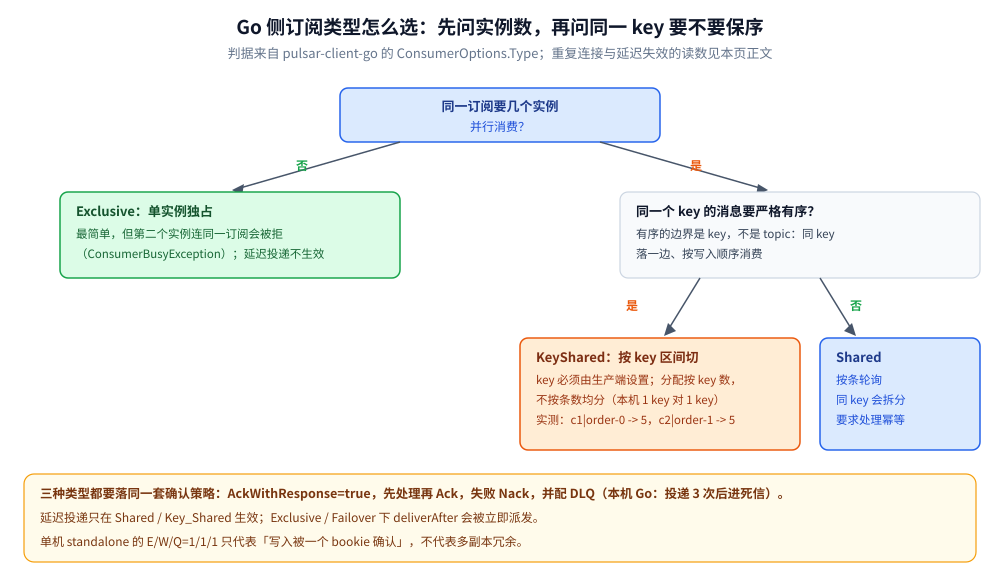
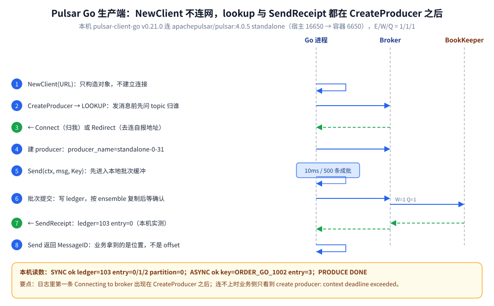
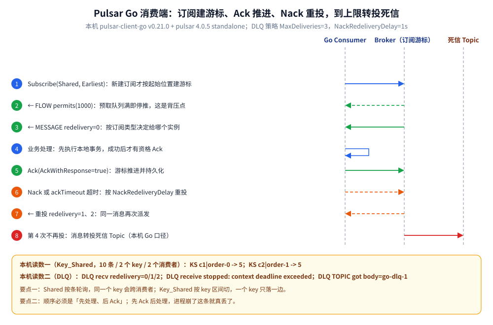

# Go 接入 Pulsar

> 覆盖：Go 侧接入 Pulsar 的完整手册 —— 客户端选型、初始化、单例边界、初始化顺序、生产与消费各场景、跨进程传播、优雅退出、验证与排障。
>
> 不覆盖：Pulsar 的存算分离、订阅语义、可靠性与协议机制见 [Pulsar 目录导读](../../../03-数据与中间件/中间件/消息队列/Pulsar/README.md)（零件篇从 [核心概念与架构.md](../../../03-数据与中间件/中间件/消息队列/Pulsar/核心概念与架构.md) 起读）；Java 侧写法见 [接入Pulsar.md](../../java/工程实践/接入Pulsar.md)。
>
> 内容整理自个人学习笔记。本篇代码在 Go 1.26.5（Windows amd64）+ `pulsar-client-go v0.21.0` 下 `gofmt` / `go vet` / `go build` 通过，并对本机 `apachepulsar/pulsar:4.0.5` **standalone** 容器（宿主 `16650` → 容器 `6650`）实测，输出见第十节。

---

## 一、客户端选型与依赖

**本节要点**：Pulsar 的 Go 侧只有一条正路——官方 `pulsar-client-go`，纯 Go 实现、无 cgo；选它不需要比较，需要知道的是它**比 Java 客户端少了什么**。

```bash
go get github.com/apache/pulsar-client-go@v0.21.0
```

| 客户端 | 实现方式 | 能力与边界 |
| --- | --- | --- |
| `github.com/apache/pulsar-client-go` ⭐ | 纯 Go 直接实现 Pulsar 的 Protobuf 帧 | 生产 / 消费 / Reader / Key_Shared / 延迟投递 / DLQ 齐全；**无事务 API**，管理类操作要调 REST（`pulsar-admin` 的 HTTP 接口） |
| Java `pulsar-client` | 官方参考实现 | 功能最全（事务、Schema、新订阅位置等）；跨语言时以它为语义基准 |
| Kafka 客户端（`kafka-go` / `sarama`） | 不同协议 | **不能直连 Pulsar**：Pulsar 原生协议不是 Kafka 协议，除非中间部署了 KoP |

⚠️ **常见误装**：

- 不要混用第三方 Go 实现（功能与修复都滞后），认准 `github.com/apache/pulsar-client-go`；
- 版本不要随手写 `@latest`：这个库在 0.x 阶段有过破坏性调整，本机锁定 `v0.21.0`；
- 不要指望它有 `pulsar-admin` 那套管理能力——建 namespace、改 retention、查订阅积压都走 REST/CLI，见 [运维与排障.md](../../../03-数据与中间件/中间件/消息队列/Pulsar/运维与排障.md) 第一节。

## 二、前提

**本节要点**：Go 客户端不创建 topic 之外的任何服务端资源；连上之前 Broker 那侧必须先齐全，缺一样都有对应报错。

| 依赖 | 要先准备好什么 | 漏了会怎样 |
| --- | --- | --- |
| **Broker** | `6650` 可达（本机宿主连 `127.0.0.1:16650`） | `create producer: context deadline exceeded`（实测，约 10s 后返回；日志先刷 `Failed to connect to broker.`） |
| **Topic** | 显式建，或 Broker 开 `allowAutoTopicCreation=true`（standalone 默认 true） | 建生产者失败；自动建仍受 namespace 配额与权限约束 |
| **订阅** | 不需要预建：第一次 `Subscribe` 就创建 | 已有订阅**不会**按客户端传的起始位置重置，见第五节 |
| **namespace 策略** | retention / 去重 / backlog quota 配在 namespace 上 | 回溯没数据（retention 默认 0）、去重不生效（默认 false），见 [消息可靠性.md](../../../03-数据与中间件/中间件/消息队列/Pulsar/消息可靠性.md) 第三、四节 |
| **`advertisedAddress`** | 单 Broker 且 lookup 返回 `Connect` 时可留空（本机从宿主实测可发） | 一旦 lookup 返回 `Redirect`，客户端会按 Broker 自报地址重连；自报 `localhost` 时跨机断连，见 [部署与配置.md](../../../03-数据与中间件/中间件/消息队列/Pulsar/部署与配置.md) 第二节 |
| **端口** | `6650` 收发、`8080` 管理 | 只开 8080 能看控制台，但发不了消息 |

## 三、初始化

**本节要点**：`NewClient` 只做参数校验与结构体构造，**不建立连接**；真正的连接在第一次 `CreateProducer` / `Subscribe` 时发生。

```go
var client = sync.OnceValue(func() pulsar.Client {
	c, err := pulsar.NewClient(pulsar.ClientOptions{
		URL:               "pulsar://127.0.0.1:16650", // ⚠️ 宿主端口；容器内是 6650
		OperationTimeout:  10 * time.Second,
		ConnectionTimeout: 5 * time.Second,
	})
	if err != nil {
		log.Fatalf("new pulsar client: %v", err)
	}
	return c
})
```

**在哪调**：进程启动阶段建一次，之后全局复用；**不要**在 HTTP handler 里 `NewClient`。

**初始化失败的报错原文**（本机把 URL 指到未监听的 `16651` 实测）：

```text
level=warning msg="Failed to connect to broker." error="dial tcp 127.0.0.1:16651: connectex: No connection could be made because the target machine actively refused it."
...
create producer: context deadline exceeded
```

—— 注意最后一行：**报的是创建生产者的超时**，不是「连接失败」。只看业务侧 error 会误判成 Broker 慢，得回看带 `Failed to connect to broker.` 的日志行。

## 四、单例边界 ⭐

**本节要点**：判「要不要单例」只看一件事——**这个对象内部有没有长活的资源（连接池、批次缓冲、IO 协程）**。有 → 进程级；绑定一次业务操作或一份订阅 → 不共享。

| 对象 | 单例？ | 为什么 |
| --- | --- | --- |
| `pulsar.Client` | ✅ 进程级 | 内部有连接池、lookup 缓存与 IO 协程；反复新建 = 连接数与协程线性膨胀 |
| `pulsar.Producer` | ✅ **按 topic** 单例 | 持有批次缓冲与在途队列；每请求新建会让批次永远凑不满（批处理形同关闭），连接也随 QPS 涨 |
| `pulsar.Consumer` | ❌ 一份订阅一个 | 订阅游标在 Broker 侧，实例绑定「订阅名 + 订阅类型」；要提并发应建**多个 Consumer**，而不是多协程共享一个 |
| `pulsar.Reader` | ❌ 按重放任务 | 自管游标位置，是「一次性任务」的对象，用完即关 |
| `*pulsar.ProducerMessage` | ❌ 请求级 | 每条消息独立；复用会串 payload 与 Properties |
| `ctx` | ❌ 请求级 | 随调用传入；存进单例字段会串请求 |

**写错的后果**：

- 生产者每请求新建 → 批次被拆碎、连接数随 QPS 线性增长，吞吐反而下降；
- 把 Consumer 挂成全局单例、多个 goroutine 抢同一个 `Receive` → 消息能收到，但「谁该 ack 哪条」失控，出错时无法定位到处理方；正确做法是**订阅不变、实例多建**；
- 把请求级 trace 写进单例 Producer 的字段 → 并发下消息头互相覆盖。

> 一句话：**Client 与 Producer 单例，Consumer 与 Reader 按「一份订阅 / 一个任务」建。**

## 五、初始化顺序 ⭐

**本节要点**：⭐ 判据是「**谁在初始化时捕获了全局单例**」——凡是有这个特征的下游组件，都必须排在被捕获者之后，否则它拿的是初始化那一刻的旧值，且不报错。

Pulsar 侧三条实序：

1. **`Client` 先于 `Producer` / `Consumer`**。这不只是依赖关系：`NewClient` 不连网（本机日志里第一条 `Connecting to broker` 出现在 `CreateProducer` 之后），所以「客户端建好了」不代表服务端可达，探活要放在第一次创建之后。
2. **订阅的起始位置只在「新建订阅」时生效**。`SubscriptionInitialPosition: Earliest` 对一个**已存在**的订阅无效——它的游标早已在 Broker 上，客户端传什么都不会回拨。要回拨只能用 `Seek`，而 `Seek` 在**非分区 topic** 上直接报错（实测）：

   ```text
   seek err: invalid partition index -1 expected a partition between [0-0]
   receive err: context deadline exceeded
   ```

   —— 这条错误的根因不是网络，而是 `pulsar.EarliestMessageID()` 带的分区下标 `-1`；非分区 topic 没有分区可寻址。新建订阅 + `SubscriptionInitialPosition` 才是在本机拿到历史消息的正路。
3. **MQ 客户端晚于日志 / 链路设施**。客户端起连接与 IO 协程、可能捕获全局 logger / TracerProvider；把全局设施先初始化，客户端再建，才能被它们接管。

> ⭐ 这个判据的经典例子在链路追踪栈：**GORM 的 OTel 插件在 `Install` 时就捕获了当时的全局 `TracerProvider`**——装插件若早于设全局 provider，插件拿到 noop，**SQL span 永远不上报且不报错**。详见 [接入Jaeger.md](../可观测性/接入Jaeger.md)。

## 六、单例与依赖注入的封装

**本节要点**：`Client` 与 `Producer` 都用 `sync.OnceValue` + 包级变量，是最不容易写错的形态；`Consumer` 不套单例，用「构造 → 运行 → 关闭」的生命周期方法封装。

```go
var (
	orderProducer = sync.OnceValue(func() pulsar.Producer {
		p, err := client().CreateProducer(pulsar.ProducerOptions{
			Topic:              "persistent://shop/default/order-events",
			Name:               "order-producer", // 开启去重时它参与「生产者名 + 序号」判重
			MaxPendingMessages: 1000,
			SendTimeout:        10 * time.Second,
		})
		if err != nil {
			log.Fatalf("create producer: %v", err)
		}
		return p
	})
)

// 消费者：一个订阅一份实例，随消费循环同生命周期。
func NewOrderConsumer(sub string) (pulsar.Consumer, error) {
	return client().Subscribe(pulsar.ConsumerOptions{
		Topic:                       "persistent://shop/default/order-events",
		SubscriptionName:            sub,
		Type:                        pulsar.Shared,
		SubscriptionInitialPosition: pulsar.SubscriptionPositionEarliest,
		ReceiverQueueSize:           1000, // 本地预取队列，也是背压点
		AckWithResponse:             true, // 能感知「以为 ack 了其实没提交」
	})
}
```

## 七、实际调用

**本节要点**：同一个 `Client`，按场景换 Producer 的发送形态、Consumer 的订阅类型与 ack 策略即可覆盖全部用法。



这张图回答的是「代码里 `Type` 该填哪个」：单实例选 Exclusive，多实例且同 key 要保序选 KeyShared，多实例且不要求顺序选 Shared；三条路的 ack 与 DLQ 兜底完全一样，差别只在分配方式。

### 7.1 生产者：同步 / 异步 / 延迟

```go
ctx := context.Background()
p := orderProducer()

// 同步：拿到 MessageID 才算 Broker（及 BookKeeper）已确认
id, err := p.Send(ctx, &pulsar.ProducerMessage{
	Key:     "ORDER_GO_1001", // 有 Key 时按 key 哈希路由，也是 Key_Shared 的分配依据
	Payload: []byte(`{"event":"created","seq":1}`),
})
fmt.Printf("SYNC ok ledger=%d entry=%d partition=%d\n", id.LedgerID(), id.EntryID(), id.PartitionIdx())

// 异步：回调必须判 err，否则等于「发出即忘」
p.SendAsync(ctx, &pulsar.ProducerMessage{
	Key:     "ORDER_GO_1002",
	Payload: []byte(`{"event":"paid"}`),
}, func(id pulsar.MessageID, msg *pulsar.ProducerMessage, err error) {
	if err != nil {
		log.Printf("async send failed: %v", err)
		return
	}
	fmt.Printf("ASYNC ok key=%s entry=%d\n", msg.Key, id.EntryID())
})
p.Flush() // 进程退出前必调：阻塞到在途请求全部落地

// 延迟：60 秒后才对订阅者可见——⚠️ 只在 Shared / Key_Shared 订阅生效
p.Send(ctx, &pulsar.ProducerMessage{
	Key:          "ORDER_GO_1003",
	Payload:      []byte(`{"event":"timeout-check"}`),
	DeliverAfter: 60 * time.Second,
})
```

本机实测（`lab-go` topic，同步 3 条 + 异步 1 条）：

```text
SYNC ok ledger=103 entry=0 partition=0
SYNC ok ledger=103 entry=1 partition=0
SYNC ok ledger=103 entry=2 partition=0
ASYNC ok key=ORDER_GO_1002 entry=3
PRODUCE DONE
```

⭐ 读法：`ledger=103` 是 BookKeeper 的 ledger 编号，`entry` 在同一 ledger 内递增——**两者一起**才是一条消息的位置，不是 Kafka 那种单调整数 offset（见 [核心概念与架构.md](../../../03-数据与中间件/中间件/消息队列/Pulsar/核心概念与架构.md) 第二节）。异步那条的 `entry=3` 说明它在 `Flush()` 前确实被批次带上了。



这张图把「`NewClient` 不连网」画成了时序事实：连接与 lookup 都发生在 `CreateProducer` 那一步，`Send` 之后要等 `SendReceipt` 才拿到 `ledger/entry`；本机 standalone 的 E/W/Q=1/1/1 意味着这次确认只覆盖一个 bookie。

### 7.2 消费者：Shared + 手动 ack

```go
consumer, err := c.Subscribe(pulsar.ConsumerOptions{
	Topic:                       "persistent://public/default/lab-go",
	SubscriptionName:            "sub-go-shared",
	Type:                        pulsar.Shared,
	SubscriptionInitialPosition: pulsar.SubscriptionPositionEarliest, // ⚠️ 只对新建订阅生效
	AckWithResponse:             true,
})
if err != nil {
	log.Fatalf("subscribe: %v", err)
}
defer consumer.Close()

for {
	msg, err := consumer.Receive(ctx)
	if err != nil {
		return // ctx 取消或 Close
	}
	if err := handle(msg); err != nil {
		consumer.Nack(msg) // 不提交：按 NackRedeliveryDelay 重投
		continue
	}
	if err := consumer.Ack(msg); err != nil {
		log.Printf("ack failed: %v", err) // ack 失败会让游标停在原地，重启后重投
	}
}
```

本机实测（同一 topic 取 4 条）：

```text
CONSUME id=103:0:0:0 key=ORDER_GO_1001 redelivery=0 body={"event":"created","seq":1}
CONSUME id=103:1:0:0 key=ORDER_GO_1001 redelivery=0 body={"event":"created","seq":2}
CONSUME id=103:2:0:0 key=ORDER_GO_1001 redelivery=0 body={"event":"created","seq":3}
CONSUME id=103:3:0:0 key=ORDER_GO_1002 redelivery=0 body={"event":"paid"}
CONSUME DONE n=4
```

⭐ 顺序是「**先处理、后 ack**」：`Ack` 之前进程崩了，消息会重投；反过来先 ack 再处理，崩了就真丢。这条顺序与 Kafka 的手动提交同理，重复靠业务幂等兜底（见 [消息可靠性.md](../../../03-数据与中间件/中间件/消息队列/Pulsar/消息可靠性.md) 第六节）。

### 7.3 同 key 有序：Key_Shared

```go
mk := func() pulsar.Consumer {
	c, err := client().Subscribe(pulsar.ConsumerOptions{
		Topic:                       "persistent://public/default/lab-go-ks",
		SubscriptionName:            "sub-go-keyshared",
		Type:                        pulsar.KeyShared, // ⭐ 同一订阅、多个实例按 key 区间分
		SubscriptionInitialPosition: pulsar.SubscriptionPositionEarliest,
	})
	if err != nil {
		log.Fatalf("subscribe: %v", err)
	}
	return c
}
c1, c2 := mk(), mk()
```

本机实测（10 条、2 个 key、同进程两个 Consumer）：

```text
KS c1|order-0 -> 5
KS c2|order-1 -> 5
```

⭐ 与 Shared 的差别：**Shared 按条轮询**，同一个 key 会被拆到两个消费者；Key_Shared 按 **key 区间**切，一个 key 只落一边。代价是 key 多且倾斜时分配不均——书里的 Java 实测是 `1 个 key（10 条）` vs `3 个 key（30 条）`，见 [订阅与消费语义.md](../../../03-数据与中间件/中间件/消息队列/Pulsar/订阅与消费语义.md) 第二、三节。

### 7.4 重投与死信

```go
consumer, err := c.Subscribe(pulsar.ConsumerOptions{
	Topic:                       src,
	SubscriptionName:            "sub-go-dlq",
	Type:                        pulsar.Shared,
	SubscriptionInitialPosition: pulsar.SubscriptionPositionEarliest,
	NackRedeliveryDelay:         time.Second,
	DLQ: &pulsar.DLQPolicy{
		MaxDeliveries:   3,
		DeadLetterTopic: src + "-dead",
	},
})
// 收到就 Nack，观察重投次数
fmt.Printf("DLQ recv redelivery=%d body=%s\n", msg.RedeliveryCount(), string(msg.Payload()))
consumer.Nack(msg)
```

本机实测（取 6 次 + 之后读死信 topic）：

```text
DLQ SENT
DLQ recv redelivery=0 body=go-dlq-1
DLQ recv redelivery=1 body=go-dlq-1
DLQ recv redelivery=2 body=go-dlq-1
DLQ receive stopped: context deadline exceeded
DLQ TOPIC got body=go-dlq-1
```

⭐ Go 客户端的口径是**投递 3 次（`redeliveryCount` 0/1/2）后第 4 次不再投**，消息落 `-dead` 主题；Java 侧同一配置的读数是 `0/1/2/3` 再到 DLQ。**不同语言客户端的计数起点不同，排障时别拿一个语言的读数去对另一个**。机制见 [消息可靠性.md](../../../03-数据与中间件/中间件/消息队列/Pulsar/消息可靠性.md) 第五节。



这张图把 7.2 到 7.4 串成一条时间线：第 2 步的 `FLOW` 许可决定了「预取队列满就停推」，第 4、5 步的顺序决定会不会丢消息，第 8 步是 Go 客户端「3 次投递后转死信」的实测出口。

### 7.5 Reader：重放一段历史

```go
reader, err := c.CreateReader(pulsar.ReaderOptions{
	Topic:                   "persistent://public/default/lab-go",
	StartMessageID:          pulsar.EarliestMessageID(),
	StartMessageIDInclusive: true,
})
if err != nil {
	log.Fatalf("create reader: %v", err)
}
defer reader.Close()

for reader.HasNext() {
	msg, err := reader.Next(ctx)
	if err != nil {
		break
	}
	fmt.Printf("REPLAY id=%s key=%s body=%s\n", msg.ID(), msg.Key(), string(msg.Payload()))
}
```

本机实测：

```text
REPLAY id=103:0:0:0 key=ORDER_GO_1001 body={"event":"created","seq":1}
REPLAY id=103:1:0:0 key=ORDER_GO_1001 body={"event":"created","seq":2}
REPLAY id=103:2:0:0 key=ORDER_GO_1001 body={"event":"created","seq":3}
REPLAY id=103:3:0:0 key=ORDER_GO_1002 body={"event":"paid"}
REPLAY DONE n=4
```

⭐ Reader **不建订阅、不动任何游标**，适合对账与离线补数；但能不能读到历史取决于 namespace 的 retention——本机 retention 默认 0，靠的是消息尚未被所有订阅 ack 完。见 [消息可靠性.md](../../../03-数据与中间件/中间件/消息队列/Pulsar/消息可靠性.md) 第三节。

## 八、跨进程与跨协程传播

**本节要点**：跨进程携带业务上下文用**消息 Properties** 做 Inject / Extract；跨协程用 `ctx` 传参，别存结构体字段。

```go
// 生产端：Inject
producer.Send(ctx, &pulsar.ProducerMessage{
	Key:     "ORDER_GO_2001",
	Payload: []byte("go-props-1"),
	Properties: map[string]string{
		"x-biz-id":   "ORDER_GO_2001",
		"x-trace-id": "trace-go-abc123",
	},
})

// 消费端：Extract
p := msg.Properties()
fmt.Printf("PROPS CONSUME key=%s biz=%s trace=%s body=%s\n",
	msg.Key(), p["x-biz-id"], p["x-trace-id"], string(msg.Payload()))
```

本机实测（属性完整往返）：

```text
PROPS PRODUCE ok
PROPS CONSUME key=ORDER_GO_2001 biz=ORDER_GO_2001 trace=trace-go-abc123 body=go-props-1
```

**ctx 传参铁律**：

- 生产端 `Send(ctx, ...)` 的 `ctx` 控制**发送超时**，请求进来就用请求的 ctx；
- 消费循环的 `ctx` 由本进程持有，**别塞进任何进程级结构体**；
- ⚠️ **别把请求级数据存进单例 Producer 的字段**（比如给 Producer 挂一个「当前 trace_id」）——单例被多个协程共享，立刻串数据。上下文要**随消息走**，不能随对象走。

## 九、优雅退出

**本节要点**：退出顺序 = 反初始化顺序：**先停止拉取 → 处理完在途消息 → 最后 `Close()`**；漏掉 `Close` 会让本次进度丢失。

```go
sig := make(chan os.Signal, 1)
signal.Notify(sig, syscall.SIGTERM, os.Interrupt)
go func() {
	<-sig
	cancel() // 1) 让消费循环退出拉取
}()

for {
	select {
	case msg := <-consumer.Chan():
		handle(msg) // 2) 在途消息处理完
		consumer.Ack(msg)
	case <-ctx.Done():
		consumer.Close() // 3) 关闭订阅；已 ack 的游标由 Broker 持久化
		client().Close() // 4) 关闭连接池与 IO 协程
		return
	}
}
```

本机实测（同一退出路径，用定时器触发，便于复现）：

```text
CONSUMER started
CONSUME id=103:0:0:0
CONSUME id=103:1:0:0
CONSUME id=103:2:0:0
CONSUME id=103:3:0:0
SHUTDOWN signal received
SHUTDOWN done
```

| 顺序 | 为什么 |
| --- | --- |
| 先停止拉取 | 避免退出过程中还在把新消息取进内存 |
| 处理完在途消息 | 否则「已收未 ack」的那批会在重启后重投（有幂等兜底才安全） |
| 关闭 Consumer | 停止投递并让 Broker 记录已有 ack；**不关闭**则本次进度可能丢失 |
| 关闭 Client | 释放连接池、lookup 缓存与 IO 协程 |

**漏了会丢什么**：`Producer` 不 `Flush` / `Close` → 批次里未发出的消息丢；`Consumer` 不 `Close` → 已处理但未提交的 ack 丢失，重启后重复消费。Go 与 Java 不同：`main` 返回进程即退出，把退出逻辑接到信号处理里、走完就返回即可。

## 十、验证与排查

**本节要点**：先确认「接入真的生效」（看编译检查与 MessageID / 消费读数），再用故障速查表定位。

### 10.1 先确认生效

```bash
gofmt -l .        # 无输出（格式干净）
go vet ./...      # 通过
go build -o go-lab.exe .
```

环境：Go 1.26.5（Windows amd64）+ `pulsar-client-go v0.21.0`；服务端 `apachepulsar/pulsar:4.0.5` standalone，客户端从宿主连 `pulsar://127.0.0.1:16650`。

```text
SYNC ok ledger=103 entry=0 partition=0
SYNC ok ledger=103 entry=1 partition=0
SYNC ok ledger=103 entry=2 partition=0
ASYNC ok key=ORDER_GO_1002 entry=3
PRODUCE DONE
CONSUME id=103:0:0:0 key=ORDER_GO_1001 redelivery=0 ...
CONSUME DONE n=4
KS c1|order-0 -> 5
KS c2|order-1 -> 5
PROPS CONSUME key=ORDER_GO_2001 biz=ORDER_GO_2001 trace=trace-go-abc123 body=go-props-1
DLQ recv redelivery=0/1/2 ... DLQ TOPIC got body=go-dlq-1
REPLAY id=103:0:0:0 ... REPLAY DONE n=4
SHUTDOWN done
```

⭐ 一次跑完能确认五件事：**同步发送拿到了 `ledger:entry`**、**异步批次被 `Flush` 带出**、**Key_Shared 同 key 不跨消费者**、**Properties 完整往返**、**Nack 到上限后进死信**。

服务端侧对照（本机 `pulsar-lab` 容器内）：

```bash
bin/pulsar-admin topics stats persistent://public/default/lab-go
bin/pulsar-admin topics subscriptions persistent://public/default/lab-go
```

### 10.2 常见故障速查

| 症状 | 多半是 | 处置 |
| --- | --- | --- |
| `create producer: context deadline exceeded` | Broker 不可达 | 先看同段日志有没有 `Failed to connect to broker.`；再查端口映射与 `advertisedAddress` |
| `seek err: invalid partition index -1 expected a partition between [0-0]` | 对**非分区 topic** 调 `Seek` | 新建订阅时用 `SubscriptionInitialPosition`；`Seek` 只用于分区 topic |
| `receive err: context deadline exceeded` | 订阅无新消息，或位置在 Latest | 确认订阅类型与起始位置；已有订阅要回拨只能 `Seek` |
| 消费「不投了」但进程还在 | 未 ack 数触顶，Broker 停推 `FLOW` | 查 `pulsar_subscription_blocked_on_unacked_messages`，见 [运维与排障.md](../../../03-数据与中间件/中间件/消息队列/Pulsar/运维与排障.md) 第三节 |
| 延迟消息立刻收到 | 订阅类型是 Exclusive / Failover | 换 Shared / Key_Shared；并确认 `enableBatching(false)` |
| Key_Shared 仍乱序 | 消息没带 `Key`（或 `OrderingKey`） | 生产端必须设 Key，否则按空 key 分配 |
| 死信 topic 收不到 | `MaxDeliveries` 未到，或没配 `DLQ` | 本机 Go：3 次投递后进 DLQ；注意语言间计数起点不同 |
| `-1:-1:-1` 这样的 MessageID | 去重窗口命中了「生产者名 + 序号」 | 不是错误：Broker 拒绝了重复写入，见 [消息可靠性.md](../../../03-数据与中间件/中间件/消息队列/Pulsar/消息可靠性.md) 第四节 |

| 排查项 | 命令（容器内） |
| --- | --- |
| Topic 吞吐 / 积压 | `bin/pulsar-admin topics stats <topic>` |
| 内部 ledger / 游标 | `bin/pulsar-admin topics stats-internal <topic>` |
| 有哪些订阅 | `bin/pulsar-admin topics subscriptions <topic>` |
| 看某订阅的头几条 | `bin/pulsar-admin topics peek-messages -s <sub> -n 2 <topic>`（⚠️ 会创建订阅，见运维篇） |

## 十一、延伸追问

- **`NewClient` 成功就代表能连吗？** → 不代表。它只构造对象，连接与 lookup 发生在第一次 `CreateProducer` / `Subscribe`；探活得放在那之后。详见第三节。
- **`SubscriptionInitialPosition` 为什么不生效？** → 它只在**新建订阅**时使用；已存在的订阅游标在 Broker 上，客户端改不了。回拨要 `Seek`，且 `Seek` 不能用于非分区 topic。详见第五节。
- **Producer 为什么也要单例？** → 它持有批次缓冲与在途队列；每请求新建会让批次凑不满、连接数随 QPS 涨。按 topic 一个即可。详见第四节。
- **Go 的死信计数为什么和 Java 差一次？** → 两套客户端的 `maxDeliveries` 计数起点不同：本机 Go 是 `0/1/2` 后进 DLQ，Java 是 `0/1/2/3`。排障时以本语言实测为准。详见 7.4。
- **能不能用 Kafka 客户端连 Pulsar？** → 不能直连（除非部署 KoP）。Pulsar 是独立协议，帧结构与 lookup 机制都不同，见 [Pulsar协议.md](../../../03-数据与中间件/中间件/消息队列/Pulsar/Pulsar协议.md)。

## 十二、校验口径

> ✅ 本篇代码的校验方式与范围（Go 1.26.5，Windows amd64）：

- **真编译 + 运行通过**：第三、六节客户端与生产者单例、7.1 同步 / 异步 `Flush`、7.2 Shared 手动 ack、7.3 Key_Shared、7.4 Nack 与 DLQ、7.5 Reader、第八节 Properties、第九节退出路径（定时器触发，与信号处理共用同一 `cancel`）。
- **只编译、未运行**：7.1 的 `DeliverAfter` 代码随包编译通过，但延迟投递的运行时读数引用书内 Java 实测，**Go 客户端未单独跑延迟场景**。
- **未独立编译**：第六节 `NewOrderConsumer` 与 7.1 的 60s 延迟在同一个包内编译通过，运行时走的是 `main` 里的直接构造。
- **实测环境**：`apachepulsar/pulsar:4.0.5` standalone 容器 `pulsar-lab`（宿主 16650 → 6650），客户端在 Windows 宿主直连。
- **未实测**：TLS / Token 认证、多 Broker 与 `Redirect` 路径、事务（客户端本身不支持）、分层存储、Schema。

| 依赖 | 实际版本 |
| --- | --- |
| `github.com/apache/pulsar-client-go` | v0.21.0 |
| Go（编译与运行） | go1.26.5 windows/amd64 |

## 关联

- **上游/总纲**：[Pulsar 目录导读](../../../03-数据与中间件/中间件/消息队列/Pulsar/README.md) — 组件本体（概念 / 订阅 / 可靠性 / 部署 / 排障 / 协议）
- **对照/互补**：[接入Pulsar.md](../../java/工程实践/接入Pulsar.md) — Java 侧同一组场景的写法与差异
- **对照/互补**：[接入Kafka.md](接入Kafka.md) — Go 接 Kafka 的对照手册
- **对照/互补**：[接入RocketMQ.md](接入RocketMQ.md) — Go 接 RocketMQ 的对照手册
- **下游机制**：[订阅与消费语义.md](../../../03-数据与中间件/中间件/消息队列/Pulsar/订阅与消费语义.md) — Shared 无序、Key_Shared 区间切分、延迟投递限制
- **下游机制**：[消息可靠性.md](../../../03-数据与中间件/中间件/消息队列/Pulsar/消息可靠性.md) — 发送确认、retention、去重、重投与死信
- **下游机制**：[Pulsar协议.md](../../../03-数据与中间件/中间件/消息队列/Pulsar/Pulsar协议.md) — Client 背后的 lookup 与 `FLOW` 流控
- **运维/配置**：[部署与配置.md](../../../03-数据与中间件/中间件/消息队列/Pulsar/部署与配置.md) — standalone 起法与端口映射
- **运维/配置**：[运维与排障.md](../../../03-数据与中间件/中间件/消息队列/Pulsar/运维与排障.md) — 积压、慢订阅与 `pulsar-admin` 命令
