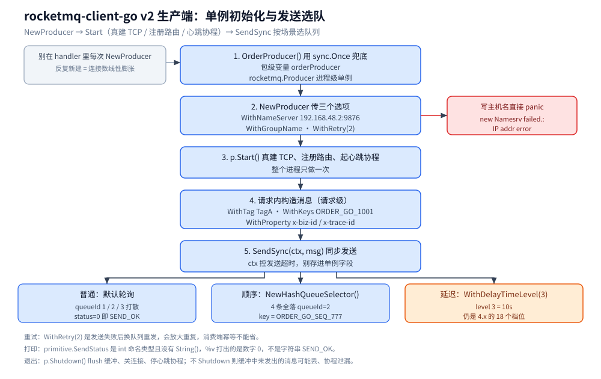
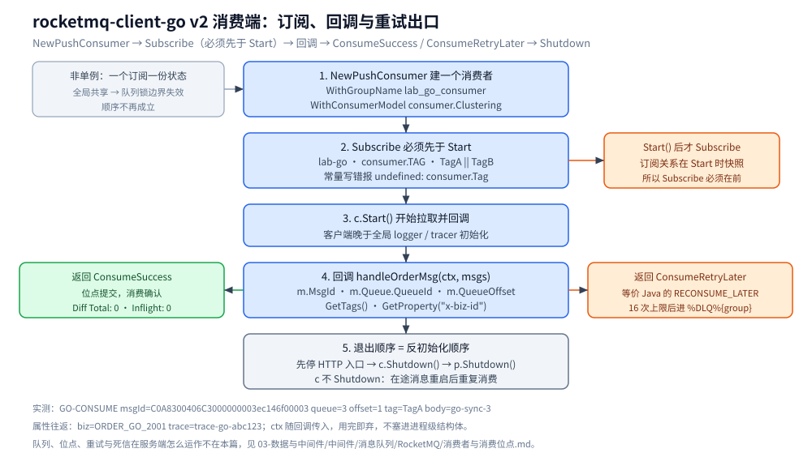

# Go 接入 RocketMQ

> 覆盖：Go 侧接入 RocketMQ 的完整手册 —— 客户端选型、初始化、单例边界、初始化顺序、各场景调用、跨进程传播、优雅退出、验证与排障。
>
> 不覆盖：RocketMQ 的概念、存储与可靠性机制见 [RocketMQ 目录导读](../../../03-数据与中间件/中间件/消息队列/RocketMQ/README.md)（零件篇从 [核心概念与架构.md](../../../03-数据与中间件/中间件/消息队列/RocketMQ/核心概念与架构.md) 起读）；Java 侧写法见 [接入RocketMQ.md](../../java/工程实践/接入RocketMQ.md)。
>
> 内容整理自个人学习笔记。本篇代码在 `golang:1.26-alpine`（Go 1.26.8）+ `rocketmq-client-go/v2` 下编译运行通过，对本机单机集群（`apache/rocketmq:5.3.1`，1 NameServer + 1 Broker）实测。

---

## 一、客户端选型与依赖

**本节要点**：Go 侧有两个官方客户端，先用「协议 + Broker 版本」定选型，再谈别的。

```bash
# 老版 remoting 协议客户端（对应 4.x Broker，社区最常用）
go get github.com/apache/rocketmq-client-go/v2@v2.1.2
# 5.x 官方新客户端（gRPC 协议，需 Broker/Proxy 开启 gRPC 端口，默认 8081）
go get github.com/apache/rocketmq-clients/golang/v5
```

| 客户端 | 协议 | 适用版本 | 能力边界 |
| --- | --- | --- | --- |
| `rocketmq-client-go/v2` | remoting（私有 TCP） | 4.x 完全匹配；5.x 兼容可用 | 普通 / 顺序 / 延迟级别消息可用；**无任意延迟**；v2.1.x 后基本停更 |
| `rocketmq-clients/golang/v5` | gRPC | 5.x（需 proxy） | 支持任意延迟等 5.x 新特性 |

⚠️ **常见误装**：

- 别 import `github.com/apache/rocketmq-client-go`（**v1**，路径里没有 `/v2`）——那是废弃的旧模块，编不过新版 API；
- 5.x 集群想用任意延迟，光换 `golang/v5` 不够，**还得让 Broker / Proxy 开 gRPC 端口**；只换客户端而不开端口会连不上；
- 用 `v2` 连 5.x 时，`WithDelayTimeLevel` 仍按 18 个固定档位生效，**不会**升级为任意延迟（见 [消息类型与语义.md](../../../03-数据与中间件/中间件/消息队列/RocketMQ/消息类型与语义.md) 第三节）。

## 二、前提

**本节要点**：Go 客户端不创建任何服务端资源，连上之前 Broker 那侧必须先齐全；缺一样都有对应的报错。

| 依赖 | 要先准备好什么 | 漏了会报什么 |
| --- | --- | --- |
| **NameServer** | `mqnamesrv` 已起、`9876` 可达 | 连接失败 / `new Namesrv failed`；⚠️ 见下条 |
| **NameServer 地址格式** | `v2` 客户端**要求 IP**，不接受纯主机名 | `panic: new Namesrv failed.: IP addr error`（构造 `Namesrv` 时直接崩） |
| **Broker** | `mqbroker` 已起、`10911` 可达；`brokerIP1` 必须是**客户端可达**的地址 | 元数据里 Broker 地址不可达 → 发送卡住 / `RemotingTimeout` |
| **Topic** | 已建（或 Broker 开 `autoCreateTopicEnable=true`）；建议显式建并定队列数 | `No route info of this topic: <topic>` |
| **消费组** | 通常可自动创建（`autoCreateSubscriptionGroup=true`） | 位点查不到 / 订阅不上报 |
| **端口** | `9876`（NS）、`10911`（Broker）；Java 还要 `10909` | 连接被拒 |

> ⚠️ 跨容器实测时把 NameServer 与 Broker 都固定成 IP 最省事（`v2` 客户端要求 NS 是 IP；`brokerIP1` 若写成容器内网 IP，宿主机直连会连不上）。`brokerIP1` 与容器网络的关系见 [部署与配置.md](../../../03-数据与中间件/中间件/消息队列/RocketMQ/部署与配置.md)。

## 三、初始化

**本节要点**：生产者的初始化只有「建 + `Start`」两步，且**整个进程只做一次**；在哪调很关键——放进程启动处，不要放请求处理里。

```go
p, err := rocketmq.NewProducer(
    producer.WithNameServer([]string{"192.168.48.2:9876"}), // ⚠️ IP，不是主机名
    producer.WithGroupName("lab_go_producer"),
    producer.WithRetry(2), // 发送失败重试次数
)
if err != nil {
    panic(err)
}
if err = p.Start(); err != nil { // 真正建立 TCP、注册路由、起心跳协程
    panic(err)
}
defer p.Shutdown()
```

**在哪调**：进程启动阶段（`main` 或依赖注入的初始化函数里）建一次，之后全局复用；**不要**在 HTTP handler 里每次 `NewProducer`。

**初始化失败的报错原文**（本机实测）：

```text
panic: new Namesrv failed.: IP addr error
```

—— NameServer 传了容器名（`rmq-namesrv:9876`）而不是 IP 时会直接 panic，`v2` 客户端构造 `Namesrv` 时要求地址能被解析成 IP。

## 四、单例边界 ⭐

**本节要点**：判「要不要单例」只看一件事——**这个对象内部有没有长活的资源（连接、协程、线程池）**。有 → 进程级单例；没有、且绑定一次业务操作的 → 请求级。

| 对象 | 单例？ | 为什么 |
| --- | --- | --- |
| `rocketmq.Producer` | ✅ 进程级 | 持有 TCP 连接与心跳协程，反复新建 = 连接数线性膨胀 |
| `rocketmq.PushConsumer` | ❌ 非单例 | 绑定「消费组 + 订阅关系」，一个订阅一份独立状态与消费线程池 |
| `*http.Client`（若同时有出站调用） | ✅ 进程级 | 内部是连接池，反复新建 = 端口耗尽 |
| `primitive.Message` | ❌ 请求级 | 每条消息独立；跨请求复用会串消息内容 |
| `ctx`（生产 / 消费回调里） | ❌ 请求级 | 随调用传入，别存进结构体字段 |

**写错的后果**：

- 生产者每次请求新建 → 连接数与心跳协程随 QPS 线性膨胀，最终打爆 Broker 连接上限；
- 消费者做成全局单例 → 「一个订阅一份状态」的边界失效，**顺序消费依赖的队列锁**跨订阅共享，顺序不再成立；同一消费组想提并发要的是**多副本各自独立 Consumer**，而不是在进程里共享一个。

> 一句话：**生产者单例（省连接），消费者非单例（一个订阅一份独立状态）。**

## 五、初始化顺序 ⭐

**本节要点**：⭐ 判据是「**谁在初始化时捕获了全局单例**」——凡是有这个特征的下游组件（各类 instrumentation、SDK 全局 hook），都必须排在被捕获者**之后**初始化，否则它拿到的是初始化那一刻的旧值（常常是 noop），且**不报错**。

RocketMQ 侧两条实序：

1. **消费者：`Subscribe` 必须先于 `Start`**。`Start()` 后才 `Subscribe` 订阅不生效（`PushConsumer` 在启动时会快照订阅关系）。
2. **MQ 客户端要晚于它依赖的全局设施**。客户端初始化会起心跳 / 长轮询协程、并可能捕获全局 logger 等；把全局配置 / 日志 / 链路追踪先初始化，客户端再起，才能被它们接管。

> ⭐ 这个判据的经典例子在链路追踪栈：**GORM 的 OTel 插件在 `Install` 时就捕获了当时的全局 `TracerProvider`**——若 `InitMySQL`（装插件）排在 `InitJaeger`（设全局 provider）之前，插件拿到 noop provider，**SQL span 永远不上报且不报错**。详见 [接入Jaeger.md](../可观测性/接入Jaeger.md)。

## 六、单例与依赖注入的封装

**本节要点**：生产者用 `sync.Once` + 包级变量兜底，是最不容易写错的形态；消费者不套单例，用「构造 → 订阅 → 启动 → 停止」的生命周期方法封装。

生产者（可直接抄）：

```go
import "sync"

var (
    orderProducer rocketmq.Producer
    producerOnce  sync.Once
)

// 整个进程只建一个 Producer 并 Start 一次；不要在请求里每次 NewProducer。
func OrderProducer() rocketmq.Producer {
    producerOnce.Do(func() {
        p, err := rocketmq.NewProducer(
            producer.WithNameServer([]string{"192.168.48.2:9876"}), // ⚠️ IP，不是主机名
            producer.WithGroupName("lab_go_producer"),
            producer.WithRetry(2),
        )
        if err != nil {
            panic(err)
        }
        if err = p.Start(); err != nil {
            panic(err)
        }
        orderProducer = p
    })
    return orderProducer
}
```

消费者（非单例，交给生命周期管理）：

```go
// 每个「消费组 / 订阅」建一个；随消费循环同生命周期，不共享。
func NewOrderConsumer() (rocketmq.PushConsumer, error) {
    c, err := rocketmq.NewPushConsumer(
        consumer.WithNameServer([]string{"192.168.48.2:9876"}),
        consumer.WithGroupName("lab_go_consumer"),
        consumer.WithConsumerModel(consumer.Clustering),
    )
    if err != nil {
        return nil, err
    }
    // ⚠️ Subscribe 必须在 Start 之前
    if err = c.Subscribe("lab-go",
        consumer.MessageSelector{Type: consumer.TAG, Expression: "TagA || TagB"},
        handleOrderMsg); err != nil {
        return nil, err
    }
    return c, nil
}

func handleOrderMsg(ctx context.Context, msgs ...*primitive.MessageExt) (consumer.ConsumeResult, error) {
    for i := range msgs {
        m := msgs[i]
        fmt.Printf("GO-CONSUME msgId=%s queue=%d offset=%d tag=%s body=%s\n",
            m.MsgId, m.Queue.QueueId, m.QueueOffset, m.GetTags(), string(m.Body))
    }
    return consumer.ConsumeSuccess, nil
}
```

## 七、实际调用

**本节要点**：同一个单例 Producer，按场景换「Tag / Key / 延迟级别 / 队列选择器」即可覆盖全部发送形态；消费侧按订阅写回调。

### 7.1 生产者：普通 / 延迟 / 顺序

```go
// HTTP 入口里发一条普通消息：业务 Key 必带，便于排查时按 Key 反查
msg := primitive.NewMessage("lab-go", []byte("go-sync-1"))
msg.WithTag("TagA")                                  // 用于消费端 Tag 过滤
msg.WithKeys([]string{"ORDER_GO_1001"})              // 业务键，mqadmin queryMsgByKey 用
res, err := OrderProducer().SendSync(context.Background(), msg)
if err != nil {
    fmt.Println("send error:", err)
    return
}
fmt.Printf("GO-SYNC status=%v queueId=%d msgId=%s\n", res.Status, res.MessageQueue.QueueId, res.MsgID)
```

```go
// 延迟消息：老客户端只有 4.x 的 18 个固定档位，level 3 = 10s
msg := primitive.NewMessage("lab-go-delay", []byte("go-delay-10s"))
msg.WithDelayTimeLevel(3)
```

```go
// 顺序消息：按 ShardingKey 哈希选队列，同一 Key 恒定落同一队列
p, _ := rocketmq.NewProducer(
    producer.WithNameServer([]string{"192.168.48.2:9876"}),
    producer.WithGroupName("lab_go_order_producer"),
    producer.WithQueueSelector(producer.NewHashQueueSelector()), // ⭐
)
```

⭐ 顺序要在**两端**成立：生产端同一 `ShardingKey` 落同一队列，消费端还要用 `consumer.WithConsumerOrder(true)` 按队列加锁消费（机制见 [消息类型与语义.md](../../../03-数据与中间件/中间件/消息队列/RocketMQ/消息类型与语义.md) 2.1 节）。



**图怎么读**：1→5 全在**业务进程内**发生——蓝框是单例的建与起（只做一次），第 4 步才是请求级对象；底部三张卡片是同一单例换选项后的三种出口，queueId 与 `level 3 = 10s` 都是 10.1 的实测读数。队列与 Broker 侧怎么存不归本篇，见 [核心概念与架构.md](../../../03-数据与中间件/中间件/消息队列/RocketMQ/核心概念与架构.md)。

### 7.2 消费者：Tag 过滤

```go
err = c.Subscribe("lab-go",
    consumer.MessageSelector{Type: consumer.TAG, Expression: "TagA || TagB"}, // ⚠️ 常量是 consumer.TAG
    func(ctx context.Context, msgs ...*primitive.MessageExt) (consumer.ConsumeResult, error) {
        for i := range msgs {
            m := msgs[i]
            fmt.Printf("GO-CONSUME msgId=%s queue=%d offset=%d tag=%s body=%s\n",
                m.MsgId, m.Queue.QueueId, m.QueueOffset, m.GetTags(), string(m.Body))
        }
        return consumer.ConsumeSuccess, nil
    })
```

⭐ 回调签名是 `func(context.Context, ...*primitive.MessageExt)`；返回 `consumer.ConsumeRetryLater` 等价 Java 的 `RECONSUME_LATER`，同样受 16 次重试上限约束，最终进 `%DLQ%{group}`。



**图怎么读**：主列就是 `NewOrderConsumer()` + `c.Start()` 的一次启动；橙色出口那条链是「重试 → 16 次上限 → `%DLQ%{group}`」的消费端视角，绿色出口对位点归零的读数（`Diff Total: 0`、`Inflight: 0`）。第 2 步右侧的橙框是本节最容易踩的顺序问题：`PushConsumer` 在 `Start()` 时快照订阅关系。

### 7.3 定时任务

定时任务里发消息复用同一个生产者单例即可；若只是「延迟投递某条消息」，优先用**延迟消息**（`WithDelayTimeLevel`）而不是再搭一套调度——省一个组件，但受 18 档位限制。

## 八、跨进程与跨协程传播

**本节要点**：跨进程携带业务上下文，用**消息属性（properties）**做 Inject / Extract；跨协程携带用 `ctx` 传参，别存结构体字段。

- **Inject（生产端）**：`msg.WithProperty(k, v)` 把 trace_id / 业务键写进消息属性；
- **Extract（消费端）**：`m.GetProperty(k)` 取出，接到本进程的链路 / 日志上下文里。

```go
// 生产端：把链路与业务头写进属性
msg := primitive.NewMessage("lab-go", []byte("go-props-1"))
msg.WithTag("TagA")
msg.WithProperty("x-biz-id", "ORDER_GO_2001")
msg.WithProperty("x-trace-id", "trace-go-abc123")
```

```go
// 消费端：Extract 出来
fmt.Printf("GO-PROPS-CONSUME msgId=%s tag=%s biz=%s trace=%s body=%s\n",
    m.MsgId, m.GetTags(), m.GetProperty("x-biz-id"), m.GetProperty("x-trace-id"), string(m.Body))
```

本机实测（属性完整往返）：

```text
GO-PROPS-PRODUCE status=0 queueId=1 msgId=C0A830040001000000004426c3180001
GO-PROPS-CONSUME msgId=C0A830040001000000004426c3180001 tag=TagA biz=ORDER_GO_2001 trace=trace-go-abc123 body=go-props-1
```

**ctx 传参铁律**：

- 生产端 `SendSync(ctx, msg)` 的 `ctx` 控制**发送超时**，请求进来就用请求的 ctx；
- 消费回调的 `ctx` 由客户端随回调传入，**用完即弃**，不要塞进任何进程级结构体；
- ⚠️ **别把请求级数据存进单例 Producer 的字段**（比如给 Producer 挂一个「当前 trace_id」）——单例被多个协程共享，立刻串数据。属性要随消息走，不能随对象走。

## 九、优雅退出

**本节要点**：退出顺序 = 反初始化顺序：**先停入口（HTTP）→ 再停消费者 → 最后停生产者**；漏掉 `Shutdown` 会丢消息或漏位点。

```go
// 收到信号后：先停 HTTP 入口，再停消费者，最后停生产者
c.Shutdown() // 消费者：停止拉取、等在途消费提交，位点不丢
p.Shutdown() // 生产者：flush 缓冲、关连接、停心跳协程
```

本机实测（`Shutdown` 前后打点，退出后位点无残留）：

```text
GO PROPS CONSUMER started, waiting 6s ...
GO SHUTDOWN begin
GO SHUTDOWN done
```

```text
Consume Diff Total: 0
Consume Inflight Total: 0
```

**漏了会丢什么**：

- **消费者不 `Shutdown`**：已拉取但未提交 offset 的在途消息，重启后会**重复消费**（不是丢，是重）；
- **生产者不 `Shutdown`**：缓冲中未发出的消息可能丢，心跳 / 长轮询协程泄漏；
- Go 不像 Java：`main` 返回进程即退出，**不需要** `System.exit(0)`；反过来说，`Shutdown` 之后若 `main` 还在 `select{}` 阻塞，进程也不会退——把「优雅退出」接到信号处理里，走完就返回。

## 十、验证与排查

**本节要点**：先确认「接入真的生效」（看成功码与位点），再用故障速查表定位。

### 10.1 先确认生效

```bash
# 环境：golang:1.26-alpine（Go 1.26.8）+ rocketmq-client-go/v2 v2.1.2
gofmt -l .        # 无输出
go vet ./...      # 通过
go build -o /tmp/rmqlab .
```

```text
GO-SYNC status=0 queueId=1 msgId=C0A8300406C3000000003ec146f00001
GO-SYNC status=0 queueId=2 msgId=C0A8300406C3000000003ec146f00002
GO-SYNC status=0 queueId=3 msgId=C0A8300406C3000000003ec146f00003
GO PRODUCE DONE
GO-DELAY status=0 queueId=0
GO DELAY DONE
GO-ORDER seq=1 queueId=2
GO-ORDER seq=2 queueId=2
GO-ORDER seq=3 queueId=2
GO-ORDER seq=4 queueId=2
GO ORDER DONE
GO-CONSUME msgId=C0A8300406C3000000003ec146f00003 queue=3 offset=1 tag=TagA body=go-sync-3
GO-CONSUME msgId=C0A8300406C3000000003ec146f00001 queue=1 offset=1 tag=TagA body=go-sync-1
GO-CONSUME msgId=C0A8300406C3000000003ec146f00002 queue=2 offset=1 tag=TagA body=go-sync-2
GO CONSUME DONE
```

⭐ 读法：

- **`status=0` 就是成功**。`primitive.SendStatus` 是 `int` 命名类型且没有 `String()`，`%v` 打出的是**数字**（`0 = SEND_OK`），不是字符串 `SEND_OK`——与 Java 侧打印观感不同，别误判成「状态异常」。
- **普通发送被轮询打散**到 `queueId 1/2/3`；**顺序消息的 4 条全落 `queueId=2`**（`HashQueueSelector` 对 `ORDER_GO_SEQ_777` 取哈希的结果）。
- **消费位点归零**：`mqadmin consumerProgress -g lab_go_consumer` 显示各队列 `Consumer Offset = 1`、`Diff Total = 0`、`Inflight = 0`。

### 10.2 常见故障速查

| 症状 | 多半是 | 处置 |
| --- | --- | --- |
| `panic: new Namesrv failed.: IP addr error` | NameServer 写了主机名 | 换成 IP（`v2` 客户端不支持纯主机名） |
| `No route info of this topic: xxx` | Topic 没建且未开自动创建 | 显式 `updateTopic` 或开 `autoCreateTopicEnable` |
| 发送卡住 / `RemotingTimeout` | `brokerIP1` 是容器内网 IP，客户端不可达 | 把 `brokerIP1` 设成客户端可达地址 |
| `undefined: consumer.Tag` | 常量名写错 | 全大写 `consumer.TAG` |
| `go vet` 报 `format %s has arg res.Status of wrong type` | `res.Status` 是命名类型 | 用 `%v` |
| 取输出只看到 `GO CONSUME DONE` | 客户端 logrus 日志写 stderr 把业务输出挤掉 | 取业务输出时 `2>/dev/null` |

| 排查项 | 命令 |
| --- | --- |
| 消费堆量 / 位点 | `mqadmin consumerProgress -n <ns> -g lab_go_consumer` |
| Topic 各队列位点 | `mqadmin topicStatus -n <ns> -t lab-go` |
| 按业务 Key 查消息 | `mqadmin queryMsgByKey -n <ns> -t lab-go -k ORDER_GO_1001` |

## 十一、延伸追问

- **为什么 Go 客户端写容器名会 panic？** → 它在构造 `Namesrv` 时要求地址能解析成 IP，传主机名直接 `panic`；Java 客户端没有这个限制，所以「Java 能连、Go 连不上」时先怀疑这里。详见第二节。
- **`WithRetry(2)` 和 Java 的 `setRetryTimesWhenSendFailed(2)` 一样吗？** → 都是发送侧「失败重试 N 次」且换队列重发；重试会放大重复，消费端幂等不能省。详见第一、三节。
- **`WithDelayTimeLevel(3)` 在 5.x 上是任意延迟吗？** → 不是，老客户端传的仍是 4.x 固定档位（level 3 = 10s）；任意延迟要换 `golang/v5`（gRPC）并开 gRPC 端口。详见第一节。
- **为什么消费者不套单例？** → 它绑定「消费组 + 订阅」，顺序消费的队列锁边界随订阅走；共享单例会让边界失效。详见第四节。
- **跨进程怎么带 trace_id？** → 用消息属性 `WithProperty` / `GetProperty` 做 Inject / Extract，别把 ctx 或请求数据存进单例字段。详见第八节。

## 十二、校验口径

> ✅ 本篇代码的校验方式与范围（`golang:1.26-alpine`，Go 1.26.8）：

- **真编译 + 运行通过**：第一、二节依赖安装、第六节 `OrderProducer()`、第六节 `NewOrderConsumer()` / `handleOrderMsg`、7.1 三种发送、7.2 Tag 过滤、第八节 `WithProperty` / `GetProperty`。
- **未独立编译**：7.3 定时任务只有说明、没有代码；顺序消息消费端 `WithConsumerOrder(true)` 只写了建议、没跑实测。
- **实测环境**：`apache/rocketmq:5.3.1`，1 NameServer + 1 Broker，容器间用 IP 通信。
- **未实测**：5.x gRPC 客户端（`rocketmq-clients/golang/v5`）的任意延迟；ACL 认证；多主多从 / DLedger 集群。

| 依赖 | 实际版本 |
| --- | --- |
| `github.com/apache/rocketmq-client-go/v2` | v2.1.2 |
| `github.com/go-sql-driver/mysql` | 无（不涉及） |

## 关联

- **上游/总纲**：[RocketMQ 目录导读](../../../03-数据与中间件/中间件/消息队列/RocketMQ/README.md) — 组件本体（概念 / 存储 / 可靠性 / 排障）
- **对照/互补**：[接入RocketMQ.md](../../java/工程实践/接入RocketMQ.md) — Java 侧同一组场景的写法与差异
- **对照/互补**：[接入Kafka.md](接入Kafka.md) — Go 接 Kafka 的对照手册
- **下游机制**：[消息类型与语义.md](../../../03-数据与中间件/中间件/消息队列/RocketMQ/消息类型与语义.md) — 顺序 / 延迟消息的机制与限制
- **下游机制**：[消费者与消费位点.md](../../../03-数据与中间件/中间件/消息队列/RocketMQ/消费者与消费位点.md) — 位点、重试与死信
- **运维/配置**：[部署与配置.md](../../../03-数据与中间件/中间件/消息队列/RocketMQ/部署与配置.md) — `brokerIP1` 与容器网络
- **运维/配置**：[运维与排障.md](../../../03-数据与中间件/中间件/消息队列/RocketMQ/运维与排障.md) — `mqadmin` 排障命令
> 反向引用（本篇被下列文档引到）：[最终一致方案.md](../../../04-架构与系统/分布式/分布式事务/最终一致方案.md)
