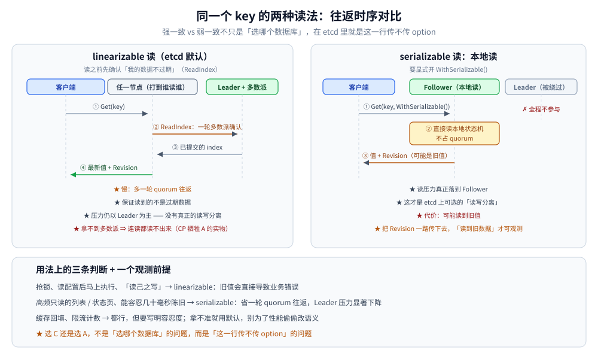
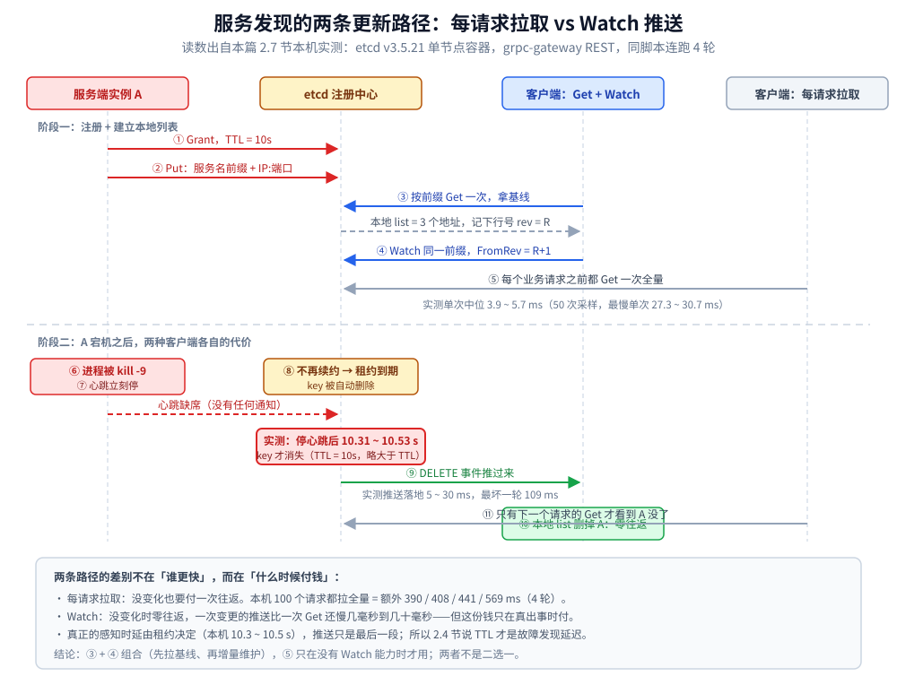

# 接入 etcd

> 覆盖：Go 客户端从选型、初始化、单例、两种读法、Txn / CAS、Watch、选主、租约注册到三节点实验与排障的完整接入手册。
>
> 不覆盖：Raft 的角色、日志复制与选主原理见 [Raft协议.md](../../../04-架构与系统/分布式/共识协议/Raft协议.md)；强 / 弱一致的取舍见 [一致性模型.md](../../../04-架构与系统/分布式/理论基础/一致性模型.md)；注册发现的机制见 [服务发现.md](../../../04-架构与系统/分布式/服务治理/服务发现.md)；租约注册 + COW Resolver 的完整封装见 [服务注册与发现的Go实现.md](服务注册与发现的Go实现.md)；Java 侧见 [接入etcd.md](../../java/工程实践/接入etcd.md)。
>
> 内容整理自个人学习笔记。本篇代码在 Go 1.26.5 + `go.etcd.io/etcd/client/v3 v3.7.2` 下 `gofmt` / `go vet` / `go build` 通过，并对 `quay.io/coreos/etcd:v3.5.21` 单节点容器实测，输出见第十二节。

---

## 一、客户端选型与依赖

**本节要点**：Go 侧只选官方 `client/v3`；`etcdctl` 用来运维观察，REST gateway 只适合临时脚本，都不适合做业务客户端。

| 方式 | 定位 | 不适合业务的原因 |
|---|---|---|
| **`go.etcd.io/etcd/client/v3`** | 官方 Go 客户端 | — |
| `etcdctl` | 运维命令行 | 每次进程启动、无法复用连接、输出要解析 |
| **gRPC gateway REST** | 调试 / 跨语言临时脚本 | 多一层 JSON + base64，延迟与错误码都被包了一层 |

```bash
go get go.etcd.io/etcd/client/v3@v3.7.2
```

**两个容易装错的包**：

- `go.etcd.io/etcd/client/v3` 是**客户端**；`go.etcd.io/etcd/server/v3` 是**服务端**，业务进程不需要。
- 客户端 v3.7 可以连 v3.5 / v3.6 服务端；反过来要确认服务端 API 是否包含客户端用到的特性。**版本以你实际部署的服务端为准，不要只跟客户端最新版**。

---

## 二、前提

**本节要点**：客户端不创建任何服务端资源；连上之前，etcd 那侧的监听地址、认证与端口必须先齐全。

| 要先准备 | 漏了的表现 |
|---|---|
| etcd 已启动并监听客户端端口 | `context deadline exceeded` / `connection refused` |
| `Endpoints` 至少给全集群成员 | 单点故障后客户端无处重连 |
| 开了 RBAC 时先建用户并授权 | `etcdserver: permission denied`；**注意先有 root 用户再开 Auth** |
| 开 TLS 时客户端配 CA / 证书 | `x509: certificate signed by unknown authority` |
| 本机时间大致同步 | 证书校验、日志排序、租约判断都会失真 |

```bash
export ETCDCTL_API=3
export ETCDCTL_ENDPOINTS=http://127.0.0.1:2379,http://127.0.0.1:2479,http://127.0.0.1:2579

etcdctl endpoint health -w table --cluster
etcdctl endpoint status -w table --cluster   # 看 IS LEADER / RAFT TERM / DB SIZE
```

---

## 三、初始化

**本节要点**：客户端是**进程级单例**；初始化只放在进程启动处，不放进请求处理函数。

```go
package etcddemo

import (
	"context"
	"fmt"
	"os"
	"strings"
	"sync"
	"time"

	clientv3 "go.etcd.io/etcd/client/v3"
)

var (
	mu     sync.Mutex
	client *clientv3.Client
)

// Client 是 etcd 客户端单例：clientv3.Client 内部是一条 gRPC 连接，
// 自带多端点故障转移与重连，每次请求 New 会把建连/认证摊到每个请求上。
//
// 这里刻意不用 sync.OnceValue：clientv3.New 可能失败，
// OnceValue 会把第一次的错误永久缓存，之后再也拿不到客户端。
func Client() (*clientv3.Client, error) {
	mu.Lock()
	defer mu.Unlock()
	if client != nil {
		return client, nil
	}
	endpoints := []string{"127.0.0.1:2379", "127.0.0.1:2479", "127.0.0.1:2579"}
	// 本机实验用环境变量覆盖；生产配置里应写全所有成员。
	if v := os.Getenv("ETCD_ENDPOINTS"); v != "" {
		endpoints = strings.Split(v, ",")
	}
	c, err := clientv3.New(clientv3.Config{
		Endpoints:   endpoints,
		DialTimeout: 3 * time.Second,
		// 生产还要配 Username/Password（RBAC）与 TLS。
		// 开 Auth 前先确认用户已存在，否则客户端会拿不到权限、排查成本极高。
	})
	if err != nil {
		return nil, err
	}
	client = c
	return client, nil
}

// Close 在进程退出时调用；它关闭后台重连与 gRPC 连接。
func Close() error {
	mu.Lock()
	defer mu.Unlock()
	if client == nil {
		return nil
	}
	err := client.Close()
	client = nil
	return err
}
```

> **`Endpoints` 要写全三个节点，不要只写一个**：客户端断线后是「换一个端点重连」，
> 只写一个地址等于把单点写进了配置——这与 etcd「保 CP、牺牲 A」的取舍正好相反。
> `*clientv3.Client` **必须按指针传递**，拷例会触发 `go vet: passes lock by value`。

---

## 四、单例边界

**本节要点**：判据只有一个——**这个对象内部有没有长活的资源**（gRPC 连接、后台续约协程、watch 流）。有就是进程级，没有就跟着一次业务操作走。

| 对象 | 是否单例 | 原因 |
|---|---|---|
| `*clientv3.Client` | ✅ 进程级 | 内部 gRPC 连接 + 重连 + 端点管理 |
| `concurrency.Session` | ⚠️ 按用途 | 选举 / 租约注册各持有一个；**一个 Session 对应一个租约** |
| `concurrency.Election` | ⚠️ 按选举名 | 同一个 name 共用一个对象即可，但别跨 name 混用 |
| `clientv3.Watcher` | ✅ 按前缀复用 | 由 Client 内部管理，**不要每个请求 `Watch` 一次** |
| `clientv3.LeaseID` | ❌ 不是资源 | 只是 ID；续约流才是资源 |
| `Txn` | ❌ 请求级 | 每次操作新建，提交后即结束 |

> 常见错误是「每个请求 `clientv3.New` 一次」——连接、TLS 握手、认证全部重复，
> 压测时先耗尽的是 fd，而不是 etcd。

---

## 五、初始化顺序

**本节要点**：凡是在初始化时**捕获了 etcd 客户端**的下游组件，都必须排在客户端之后；否则它拿到的是 `nil` 或旧值，而且往往不报错。

```text
读配置（endpoints / 认证 / TLS）
        ↓
初始化 etcd Client 单例
        ↓
初始化依赖它的组件：注册器 → Resolver / Watcher → 业务缓存
        ↓
启动 HTTP / gRPC 服务
        ↓
收到 SIGTERM：先摘除注册 → 再停服务 → 最后 Close 客户端
```

> 反例：先构造 Resolver 再初始化 Client，Resolver 里保存的是 `nil`；
> 之后每次调用都走「列表为空 → 回退静态地址」，看起来能用，实际发现机制从未生效。

---

## 六、单例与依赖注入的封装

**本节要点**：演示代码可以直接调包级 `Client()`；生产代码应把 `*clientv3.Client` **注入**到下游构造函数，便于替换与测试。

```go
package etcddemo

import (
	"context"

	clientv3 "go.etcd.io/etcd/client/v3"
)

// Store 是被注入的薄封装：它不自己创建客户端，只持有调用方给的实例。
// 这样单测可以传内存实现或 mock，不会被包级单例绑死。
type Store struct {
	cli *clientv3.Client
}

func NewStore(cli *clientv3.Client) *Store {
	return &Store{cli: cli}
}

func (s *Store) Get(ctx context.Context, key string) (string, error) {
	resp, err := s.cli.Get(ctx, key)
	if err != nil {
		return "", err
	}
	if len(resp.Kvs) == 0 {
		return "", nil
	}
	return string(resp.Kvs[0].Value), nil
}
```

> 单例只保留**一个**：`Client()`。其余对象（Store、Registry、Resolver）都由它派生，
> 不要在包内再写第二份全局客户端。

---

## 七、读的两种语义：linearizable 与 serializable

**本节要点**：etcd 的「读写分离」必须**主动放弃强一致**；传不传 `WithSerializable()`，就是 CAP 里 C 与 A 的分界。

| 读法 | etcd 默认？ | 要不要过 quorum | 能读到旧数据吗 | 谁在扛压力 |
|---|---|---|---|---|
| **linearizable 读**（默认） | ✅ | **要**（ReadIndex 一轮多数派确认） | **不能** | **还是 Leader 为主** |
| **serializable 读**（`WithSerializable()`） | ❌ 要显式开 | 不要 | **可能读到旧值** | 真正落到 Follower |

```go
package etcddemo

import (
	"context"

	clientv3 "go.etcd.io/etcd/client/v3"
)

// ReadLinearizable 是 etcd 的默认读：读之前要先向 Leader 确认数据不过期
// （ReadIndex，一轮多数派往返），所以慢，而且没有多数派就读不出来。
func ReadLinearizable(ctx context.Context, key string) (string, int64, error) {
	c, err := Client()
	if err != nil {
		return "", 0, err
	}
	resp, err := c.Get(ctx, key)
	if err != nil {
		return "", 0, err
	}
	if len(resp.Kvs) == 0 {
		return "", resp.Header.Revision, nil
	}
	return string(resp.Kvs[0].Value), resp.Header.Revision, nil
}

// ReadSerializable 走本地读：不经过 Leader、不占 quorum，
// 能把读压力分摊到 Follower 上，代价是可能读到旧值。
//
// 返回值里带上 Revision 是刻意的：只有把版本号一路传下去，
// 「读到旧数据」才可观测。
func ReadSerializable(ctx context.Context, key string) (string, int64, error) {
	c, err := Client()
	if err != nil {
		return "", 0, err
	}
	resp, err := c.Get(ctx, key, clientv3.WithSerializable())
	if err != nil {
		return "", 0, err
	}
	if len(resp.Kvs) == 0 {
		return "", resp.Header.Revision, nil
	}
	return string(resp.Kvs[0].Value), resp.Header.Revision, nil
}
```



| 场景 | 选哪个 | 原因 |
|---|---|---|
| 抢锁、读配置后马上执行、「读己之写」 | linearizable | 旧值会直接导致业务错误 |
| 高频只读的列表 / 状态页、能容忍几十毫秒陈旧 | serializable | 省一轮 quorum 往返，Leader 压力显著下降 |
| 缓存回填、限流计数 | 都行，但要写明容忍度 | 拿不准就用默认，别为了性能偷偷改语义 |

---

## 八、写与并发控制：Txn / CAS

**本节要点**：etcd 没有「加锁再改」的必要；**Compare + Then + Else 在 Leader 上作为一条日志提交**，本身就是原子的。

```go
package etcddemo

import (
	"context"

	clientv3 "go.etcd.io/etcd/client/v3"
)

// RegisterIfAbsent 用一条 Txn 实现「只创建一次」，这是服务注册的标准写法。
// Compare(ModRevision(key), "=", 0) 的含义是「这个 key 从未存在过」。
// leaseID 传 0 表示不挂租约；服务实例注册必须挂租约。
func RegisterIfAbsent(ctx context.Context, key, val string, leaseID clientv3.LeaseID) (bool, error) {
	c, err := Client()
	if err != nil {
		return false, err
	}
	var ops []clientv3.OpOption
	if leaseID != 0 {
		ops = append(ops, clientv3.WithLease(leaseID))
	}
	resp, err := c.Txn(ctx).
		If(clientv3.Compare(clientv3.ModRevision(key), "=", 0)).
		Then(clientv3.OpPut(key, val, ops...)).
		Else(clientv3.OpGet(key)).
		Commit()
	if err != nil {
		return false, err
	}
	return resp.Succeeded, nil
}

// CompareAndSwap 表达「同一时刻只有一个实例改得动」。
// CAS + 重试就够了，不需要先加锁。
func CompareAndSwap(ctx context.Context, key, want, next string) (bool, error) {
	c, err := Client()
	if err != nil {
		return false, err
	}
	resp, err := c.Txn(ctx).
		If(clientv3.Compare(clientv3.Value(key), "=", want)).
		Then(clientv3.OpPut(key, next)).
		Commit()
	if err != nil {
		return false, err
	}
	return resp.Succeeded, nil
}

// DeleteIfMatches 只删「值还是我自己」的那个 key。
// 少了这个 Compare 就会出现「租约刚过期、锁已被别人拿到，结果删了别人的锁」。
func DeleteIfMatches(ctx context.Context, key, owner string) (bool, error) {
	c, err := Client()
	if err != nil {
		return false, err
	}
	resp, err := c.Txn(ctx).
		If(clientv3.Compare(clientv3.Value(key), "=", owner)).
		Then(clientv3.OpDelete(key)).
		Commit()
	if err != nil {
		return false, err
	}
	return resp.Succeeded, nil
}
```

| 模式 | Compare 什么 | 典型用途 |
|---|---|---|
| **只创建一次** | `ModRevision == 0` | 服务注册、初始化配置 |
| **CAS 更新** | `Value == 期望值` | 状态机推进、配置发布 |
| **安全删除** | `Value == 自己` | 释放锁、摘除实例 |
| **按版本更新** | `ModRevision == 读到的版本` | 避免覆盖别人刚写的值 |

> ⚠️ **etcd 的「写成功」只保证日志被多数派接受并已提交**，不保证每个 Follower 都已 apply。
> 这正是「半数以上同步成功就返回」的准确含义——所以 linearizable 读才需要额外一轮确认。

---

## 九、Watch：服务发现最容易丢事件的地方

**本节要点**：正确形态只有一种——**先全量 Get 拿基线，再从 `Revision + 1` 起增量订阅**；任何「先 Watch 再 Get」或「从当前版本起订」都会留下缝隙。

```go
package etcddemo

import (
	"context"
	"errors"
	"fmt"

	"go.etcd.io/etcd/api/v3/mvccpb"
	"go.etcd.io/etcd/api/v3/v3rpc/rpctypes"
	clientv3 "go.etcd.io/etcd/client/v3"
)

// ErrCompacted 表示订阅的起点已经被 etcd 压缩掉了。
// 上层必须丢弃本地缓存、重新全量拉一次，再用新的 revision 续订。
var ErrCompacted = errors.New("etcddemo: watch start revision compacted")

// ChangeFunc 收到一次实例变化：PUT 是上线/更新，DELETE 是下线。
// DELETE 时 kv 只有 Key 有意义，要看 prevKV 才知道下线的那个实例的地址。
type ChangeFunc func(typ mvccpb.Event_EventType, kv, prevKV *mvccpb.KeyValue) error

// WatchInstances 是服务发现的入口：先全量拉一次，再增量订阅变化。
//
// 两条必须记住的细节：
//  1. 全量 Get 与建立 Watch 之间有窗口，必须用 WithRev(那次 Get 的 Revision+1) 起订，
//     否则这中间发生的创建/删除会永久丢失。
//  2. etcd 会周期性压缩历史版本，订阅者掉线太久会收到 ErrCompacted；
//     此时没有增量可补，只能重新全量拉。
func WatchInstances(ctx context.Context, prefix string, onChange ChangeFunc) error {
	c, err := Client()
	if err != nil {
		return err
	}

	// 1) 全量灌一次本地视图
	snap, err := c.Get(ctx, prefix, clientv3.WithPrefix())
	if err != nil {
		return err
	}
	for _, kv := range snap.Kvs {
		if err := onChange(mvccpb.PUT, kv, nil); err != nil {
			return err
		}
	}

	// 2) 从「全量之后的那一个 revision」开始订阅，中间不留缝隙
	wch := c.Watch(ctx, prefix,
		clientv3.WithPrefix(),
		clientv3.WithPrevKV(),         // 删除事件带上旧值
		clientv3.WithProgressNotify(), // 空闲时也推一次 revision，用来判断是否掉线
		clientv3.WithRev(snap.Header.Revision+1),
	)
	for wresp := range wch {
		if err := wresp.Err(); err != nil {
			if errors.Is(err, rpctypes.ErrCompacted) {
				return fmt.Errorf("%w: rev=%d", ErrCompacted, wresp.CompactRevision)
			}
			return err
		}
		for _, ev := range wresp.Events {
			if err := onChange(ev.Type, ev.Kv, ev.PrevKv); err != nil {
				return err
			}
		}
	}
	return ctx.Err()
}
```

### 9.1 四类「以为没问题」的坑

| 现象 | 根因 | 修法 |
|---|---|---|
| 实例已下线，本地还往它发请求 | 删除事件里只读 `kv.Value`（DELETE 时为空） | `WithPrevKV()`，读 `prevKV.Value` |
| 偶发「新实例上线了但没人知道」 | 全量与订阅之间有缝隙 | `WithRev(getResp.Header.Revision+1)` |
| 断网几分钟后永久失联、再无事件 | 起点被 compact，`wresp.Err()` 没处理 | 收到 `ErrCompacted` 就**重建整个流程** |
| channel 关闭后循环静默退出 | `for range wch` 结束没上报 | 退出前返回错误，外层要**重连**而不是忽略 |

### 9.2 本机实测：每请求拉全量 vs Watch 推送，到底谁更贵 ⭐

**环境**：Docker Desktop，`quay.io/coreos/etcd:v3.5.21` 单节点容器，前缀下挂 3 个实例 key；
观测端用宿主 Python 走 etcd 自带的 grpc-gateway REST（`127.0.0.1:22501`）。
同一脚本连跑 4 轮，下面给的是**这 4 轮的真实读数**（脚本与原始输出留在仓库外）。

| 观测项 | 4 轮真实读数 | 口径 |
|---|---|---|
| 单次按前缀 Get 全量的往返 | 中位 **3.90 / 4.08 / 4.41 / 5.69 ms**；最快单次 3.06 ~ 3.78 ms，最慢单次 27.3 ~ 30.7 ms | 每轮采 50 次，取中位与极值 |
| 100 个业务请求若每次都拉全量 | 额外 **390 / 408 / 441 / 569 ms** | 中位 RTT × 100 |
| Watch 推送落地（etcd 侧动作 → 客户端收到事件） | PUT **5.0 ~ 74.3 ms**、DELETE **5.1 ~ 109.2 ms**，多数落在 **5 ~ 30 ms** | 每轮 3 次写 + 3 次删，4 轮合并取范围 |
| 写一个 key 的往返（对照组） | **5.2 ~ 25.0 ms** | 单请求 |
| 租约到期摘除（停心跳 → key 消失，TTL=10s） | **10.31 / 10.46 / 10.53 s** | 3 轮（与 [服务发现.md](../../../04-架构与系统/分布式/服务治理/服务发现.md) 3.6 节「TTL ≈ 故障发现延迟」对上） |

**读出来的三件事**：

1. **每请求拉全量不是「贵得不能用」，而是「每笔都要付的固定税」**：本机 3 个 key 时中位只有 4 ms 上下，
   但 100 个请求就是 400 ms 上下——它随 QPS 线性增长，且 key 越多、客户端越多越吃亏。
2. **Watch 的推送比一次 Get 还慢**（5~30 ms 是常态，本机有一轮冲到 109 ms）——
   所以 Watch 的价值**不在「更快」**，而在**「没变化时零往返」**：钱只在真出事的那一次付。
3. **端到端感知时延由租约决定**：本机停心跳到 key 消失 10.3~10.5 s，推送只是最后十几毫秒。
   想缩短感知时延只能调小 TTL（代价是续约更频繁），把 Get 换成 Watch 一点用都没有。

**两条路径怎么配**：`Get 拿基线 → Watch 增量维护`是正解；
「每次请求前先 Get 一次」只在客户端拿不到 Watch 能力时才用，而且要配本地缓存与缓存时长。



> ⚠️ **别把这几个数字当 SLA**：REST 网关比原生 gRPC 客户端多一层 JSON + base64 序列化，
> 本机又跑在 Docker Desktop 的虚拟网络上，抖到 100 ms 的轮次就是它带来的。
> 有意义的是**量级与趋势**（Get ≈ 毫秒级、每请求都付；Watch ≈ 十几到几十毫秒、只在变更时付），换环境要重测。
>
> **未实测**：原生 gRPC 客户端下的推送延迟、多节点 etcd 集群里 Raft 提交对推送延迟与事件顺序的影响
> （本机只起了单节点容器，观察不到多数派提交这一段）。

---

## 十、选主：把强领导者用成应用层单写者

**本节要点**：定时任务、对账、清理这类「全局只想跑一份」的作业，用 etcd 选举，不要自己写锁。

```go
package etcddemo

import (
	"context"
	"fmt"
	"time"

	"go.etcd.io/etcd/client/v3/concurrency"
)

// CampaignLeader 把强领导者用成应用层的单写者：
// 定时任务、对账、清理这类「全局只想跑一份」的作业，应该用 etcd 选举。
//
// Resign 与只 Close 的差别很大：
//   - Resign：主动放弃，key 立刻消失，下一个候选者马上上位；
//   - 只 Close Session（或进程崩溃）：要等 lease TTL 才切换。
func CampaignLeader(ctx context.Context, name, payload string) (release func(), err error) {
	c, err := Client()
	if err != nil {
		return nil, err
	}
	sess, err := concurrency.NewSession(c, concurrency.WithTTL(15))
	if err != nil {
		return nil, err
	}
	el := concurrency.NewElection(sess, "/leader/"+name)
	callCtx, cancel := context.WithTimeout(ctx, 10*time.Second)
	defer cancel()
	if err := el.Campaign(callCtx, payload); err != nil {
		_ = sess.Close()
		return nil, err
	}
	return func() {
		// 释放路径不能复用 ctx：调用方往往已经把它 cancel 了。
		_ = el.Resign(context.Background())
		_ = sess.Close()
	}, nil
}

// CurrentLeader 读当前 Leader 的 payload。任何节点都能查。
func CurrentLeader(ctx context.Context, name string) (string, error) {
	c, err := Client()
	if err != nil {
		return "", err
	}
	sess, err := concurrency.NewSession(c, concurrency.WithTTL(5))
	if err != nil {
		return "", err
	}
	defer func() { _ = sess.Close() }()

	el := concurrency.NewElection(sess, "/leader/"+name)
	resp, err := el.Leader(ctx)
	if err != nil {
		return "", err
	}
	if len(resp.Kvs) == 0 {
		return "", nil
	}
	return fmt.Sprintf("key=%s rev=%d payload=%s",
		resp.Kvs[0].Key, resp.Kvs[0].ModRevision, resp.Kvs[0].Value), nil
}
```

> `NewSession` 已经帮你做了**租约 + 后台 KeepAlive**（`sess.Lease()` 就是 LeaseID）。
> 但**一个 Session 只能服务一个租约**：想给多个 key 挂同一个 TTL，就显式 `Grant` 一次再复用 LeaseID。

---

## 十一、租约注册与优雅下线

**本节要点**：注册 = 租约 + 挂 KV + 一条 KeepAlive 流；下线 = **主动 Revoke**，不要等 TTL。完整的注册器封装（含续约通道监听与 `Attach`）见 [服务注册与发现的Go实现.md](服务注册与发现的Go实现.md) 第二节。

```go
package etcddemo

import (
	"context"
	"fmt"

	clientv3 "go.etcd.io/etcd/client/v3"
)

// Register 创建租约、挂上 KV、再起一条 KeepAlive 流。
// 返回的 channel 必须被监听：续约失败不会 panic，只会往 channel 里塞错误或关闭。
func Register(ctx context.Context, key, val string, ttl int64) (clientv3.LeaseID, <-chan *clientv3.LeaseKeepAliveResponse, error) {
	c, err := Client()
	if err != nil {
		return 0, nil, err
	}
	grant, err := c.Grant(ctx, ttl)
	if err != nil {
		return 0, nil, err
	}
	if _, err := c.Put(ctx, key, val, clientv3.WithLease(grant.ID)); err != nil {
		_, _ = c.Revoke(ctx, grant.ID)
		return 0, nil, err
	}
	// 同一个 lease 只该有一个续约流；多条流互相抢会让 TTL 抖动。
	ch, err := c.KeepAlive(ctx, grant.ID)
	if err != nil {
		_, _ = c.Revoke(ctx, grant.ID)
		return 0, nil, err
	}
	return grant.ID, ch, nil
}

// Deregister 主动撤销租约：立刻下线，而不是等 TTL。
func Deregister(ctx context.Context, leaseID clientv3.LeaseID) error {
	c, err := Client()
	if err != nil {
		return err
	}
	_, err = c.Revoke(ctx, leaseID)
	return err
}

// WatchKeepAlive 把「续约失败」变成可观测事实。
func WatchKeepAlive(ch <-chan *clientv3.LeaseKeepAliveResponse, onBroken func()) {
	for resp := range ch {
		if resp == nil {
			break
		}
		fmt.Printf("keepalive: ttl=%d\n", resp.TTL)
	}
	onBroken()
}
```

| 场景 | 正确做法 | 下线耗时 |
|---|---|---|
| 优雅退出（SIGTERM） | 先 `Deregister()`，再关服务 | **亚秒级** |
| `kill -9` / 断电 | 无法 Revoke，只能等租约到期 | **≈ TTL** |
| 续约流断了但进程还活着 | 监听 channel，打点告警 | 仍会在 TTL 后被摘（这是对的） |

> 所以 **TTL 同时就是「故障摘除延迟」**：取值判据不是「越大越省」，而是「你能容忍死地址滞留多久」。

---

## 十二、本机验证与三节点实验

### 12.1 单节点验证（已实测）

**环境**：Go 1.26.5，`client/v3 v3.7.2`，`quay.io/coreos/etcd:v3.5.21` 单节点容器（宿主端口 `22379`）。
验证程序覆盖：单例连接、集群视图、两种读法、三种 Txn 模式、选举交接、租约过期与 Watch 事件。

```text
== cluster ==
127.0.0.1:22379      member=11417610130673999598 leader=11417610130673999598 term=2 index=5 v=3.5.21 dbsize=20480
read linearizable: value=10.0.0.1:8080 rev=2
read serializable: value=10.0.0.1:8080 rev=2
txn register-if-absent: first=true second=false
txn cas: matching=true stale=false
txn delete-if-matches: wrong-owner=false right-owner=true
leader while A holds: key=/leader/verify/1eeea152a5fbf511 rev=6 payload=node-A
keepalive: ttl=10
second candidate: blocked while node-A holds leadership
leader after A resigns: key=/leader/verify/1eeea152a5fbf519 rev=7 payload=node-B
keepalive: ttl=2
keepalive: ttl=10
lease expiry after 3s (ttl=2s): value=""
keepalive: closed
== watch events ==
PUT /p3/verify/a=10.0.0.1:8080
PUT /p3/verify/b=first
PUT /p3/verify/b=second
DELETE /p3/verify/b prev=second
PUT /p3/verify/expire=gone
DELETE /p3/verify/expire prev=gone
DELETE /p3/verify/a prev=10.0.0.1:8080
```

**读出来的四件事**：

1. **Txn 的判定可信**：第二个 `RegisterIfAbsent` 返回 `false`，过期的 CAS 返回 `false`，删别人的值返回 `false`——三者都是 Leader 上的原子判定。
2. **选主是「排队」不是「抢占」**：A 持有期间 B 阻塞；A `Resign` 后 B 在 1 秒内上位，Leader key 的 revision 从 6 涨到 7。
3. **租约到期就是摘除**：TTL=2s、停心跳后等 3s，key 读到空；Watch 收到带 `prev` 的 DELETE。
4. **KeepAlive 的 TTL 输出顺序会交错**：两条流（TTL=10 与 TTL=2）在 goroutine 里打印，先后不代表租约顺序；**生产上要以 key 是否存在为准，不要依赖日志顺序**。

> ⚠️ 单节点观察不到多数派提交与 Leader 切换；下节的三节点实验是另外一套环境。

### 12.2 起一个三节点集群（未实测）

> ⚠️ 本节命令**未在本机实测**（需要 3 个容器）；按 etcd v3.5 / v3.6 的公开参数书写，跑之前请核对 `--help`。

```yaml
# docker-compose.yml —— 三个节点同一台机器，用不同端口区分
services:
  etcd1:
    image: quay.io/coreos/etcd:v3.5.17
    command: >
      etcd
      --name=n1 --data-dir=/etcd
      --initial-advertise-peer-urls=http://etcd1:2380
      --listen-peer-urls=http://0.0.0.0:2380
      --advertise-client-urls=http://etcd1:2379
      --listen-client-urls=http://0.0.0.0:2379
      --initial-cluster=n1=http://etcd1:2380,n2=http://etcd2:2380,n3=http://etcd3:2380
      --initial-cluster-state=new
      --auto-compaction-retention=1h
    environment:
      ETCDCTL_API: "3"
  etcd2:
    image: quay.io/coreos/etcd:v3.5.17
    # 同上，把 n1/etcd1 全换成 n2/etcd2
  etcd3:
    image: quay.io/coreos/etcd:v3.5.17
    # 同上，换成 n3/etcd3
```

```bash
export ETCDCTL_API=3
export ETCDCTL_ENDPOINTS=http://127.0.0.1:2379,http://127.0.0.1:2479,http://127.0.0.1:2579

etcdctl endpoint status -w table --cluster   # 看 IS LEADER / RAFT TERM / DB SIZE
etcdctl endpoint health -w table --cluster
etcdctl member list -w table
```

### 12.3 四个实验，对应四条结论

| # | 结论 | 操作 | 该看到什么 |
|---|---|---|---|
| **A** | Leader 靠心跳维护地位 | `docker stop etcd1`（先记下谁是 leader） | 数百毫秒内另一台升为 leader；`IS LEADER` 换行 |
| **B** | 任期单调递增 | 反复 `docker stop` 当前 leader，前后各看一次 `endpoint status` | `RAFT TERM` 只增不减，经常一次跳好几格 |
| **C** | 存活不过半，集群无法工作 | `docker stop etcd2 etcd3`（只剩 1 台） | `put` 失败；**`get` 默认也失败**（linearizable 读要 quorum） |
| **D** | CP 牺牲的是 A | 实验 C 的同时，只连存活那台做本地读 | 读得到旧数据 → 同一套 etcd，C 与 A 的差别只在这个开关 |

```bash
# 实验 B：连续换主三次，观察 term 递增
for i in 1 2 3; do
  etcdctl endpoint status -w table --cluster
  etcdctl move-leader <另一个成员的ID>     # 主动换主，比 stop 更温和
done

# 实验 C/D：只剩 1/3 节点时的读写表现
etcdctl put foo bar                          # 预期失败：拿不到多数派
etcdctl get foo --consistency=s              # ⚠️ 该 flag 是否存在以 --help 为准
```

> ⭐ **修正一个常见口误**：**3 节点挂 1 台仍然可写**（2/3 依旧过半），
> 写不进去发生在**挂 ≥ 半数**时；`n` 台能容忍 `floor((n-1)/2)` 台，所以集群规模取奇数。

### 12.4 生产上最常撞的四件事

| 现象 / 报错 | 根因 | 处置 |
|---|---|---|
| `etcdserver: no leader` / `Unavailable`，且 `leader=0` | quorum 丢了 | 先恢复节点数，不要加重试风暴 |
| `etcdserver: mvcc: database space exceeded` | 超过 `--quota-backend-bytes` | `compact` → `defrag` → `alarm disarm`，顺序不能错 |
| 写入越来越慢、`DB SIZE` 一直涨 | 没开自动压缩，历史版本堆积 | 配 `--auto-compaction-retention` + 逐节点 `defrag` |
| watch 报 `ErrCompacted` 后本地视图永久错乱 | 压缩掉订阅起点，却没回退全量重拉 | 捕获 `ErrCompacted` → 丢弃缓存 → 重新 `Get` + `WithRev` |

---

## 十三、延伸追问

- **为什么客户端必须单例？** → `clientv3.Client` 内部是 gRPC 连接、端点列表与重连逻辑；每请求新建会把建连与认证成本摊到每次调用上，先耗尽的是 fd。见第四节。
- **为什么不用 `sync.OnceValue` 包 `clientv3.New`？** → 它会把第一次失败永久缓存，之后即使 etcd 恢复也拿不到客户端；初始化失败应当可重试。见第三节。
- **linearizable 和 serializable 怎么选？** → 读后马上依赖结果（抢锁、读己之写）必须 linearizable；能容忍陈旧的列表/状态页用 serializable 换吞吐。见第七节。
- **Txn 是不是分布式锁？** → 不是。Txn 是**一次原子比较并写入**；要「持有锁一段时间」还得把 key 挂到租约上，并处理租约过期与 fencing。见第八、十一节。
- **Watch 为什么会丢事件？** → 全量与订阅之间有窗口、删除事件没读 `PrevKV`、起点被 compact、channel 关闭未处理。四种都在 9.1 的表里。
- **三节点为什么能挂一台？** → 多数派是 2/3；写只需要多数派落盘，不需要全员在线。挂到 2 台就只剩 1/3，无法形成多数派。
- **etcd 能当配置中心吗？** → 能：KV + Watch + 版本号足够做配置发布；但它不提供控制台、灰度、审计，这些要自己补，或者直接用 Nacos / Apollo。
- **etcd 和 Redis 做注册中心的差别？** → Redis 的过期是 per-key TTL、没有 Watch 的一致性语义与多数派保证；etcd 的租约是容器、Watch 带 revision，主从切换不丢注册信息。

## 十四、校验口径

> ✅ 本篇代码的校验方式与范围（Go 1.26.5，`client/v3 v3.7.2`）：

- **真编译 + 运行通过**：第三节单例与 `Close`、第七节两种读法、第八节三种 Txn、第九节 Watch、第十节选举、第十一节租约注册；对 `quay.io/coreos/etcd:v3.5.21` 单节点容器运行，输出见 12.1。
- **只编译、未运行**：第六节 `Store` 薄封装（随同包 `go build` 通过，验证程序走的是包级函数）。
- **未独立编译**：无。
- **实测环境**：`quay.io/coreos/etcd:v3.5.21` 单节点容器，宿主端口 `22379`；验证程序通过 `ETCD_ENDPOINTS` 覆盖端点。
- **未实测**：三节点集群的选举 / 任期 / quorum 实验（12.2–12.3，需 3 个容器）；RBAC 与 TLS；原生 gRPC 下的 Watch 推送延迟；跨机房部署。

| 依赖 | 实际版本 |
| --- | --- |
| Go | 1.26.5 |
| `go.etcd.io/etcd/client/v3` | v3.7.2 |
| `quay.io/coreos/etcd`（服务端） | v3.5.21 |

## 关联

- **上游/总纲**：[README.md](../../../04-架构与系统/分布式/服务治理/README.md) — 服务治理四件事与阅读顺序
- **原理**：[Raft协议.md](../../../04-架构与系统/分布式/共识协议/Raft协议.md) — 角色、日志复制与选主
- **原理**：[一致性模型.md](../../../04-架构与系统/分布式/理论基础/一致性模型.md)、[CAP与PACELC.md](../../../04-架构与系统/分布式/理论基础/CAP与PACELC.md) — 强 / 弱一致与 CAP 取舍
- **机制**：[服务发现.md](../../../04-架构与系统/分布式/服务治理/服务发现.md) — 租约、Get + Watch 与注册中心选型
- **封装**：[服务注册与发现的Go实现.md](服务注册与发现的Go实现.md) — 注册器、优雅下线与 COW Resolver
- **对照**：[接入etcd.md](../../java/工程实践/接入etcd.md) — Java jetcd 与 Curator 的同一套语义
- **下游**：[客户端负载均衡的Go实现.md](客户端负载均衡的Go实现.md) — 从实例列表到选一台
- **运维/配置**：[数据访问与连接池.md](数据访问与连接池.md) — 同为「外部资源客户端」的生命周期与超时管理
