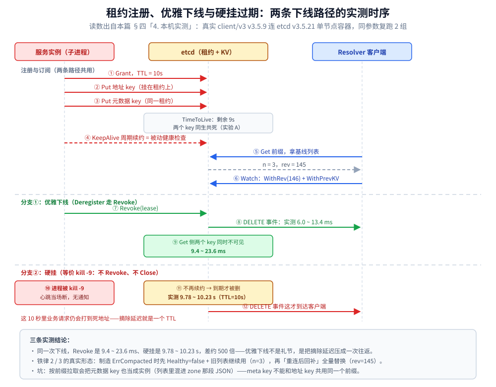
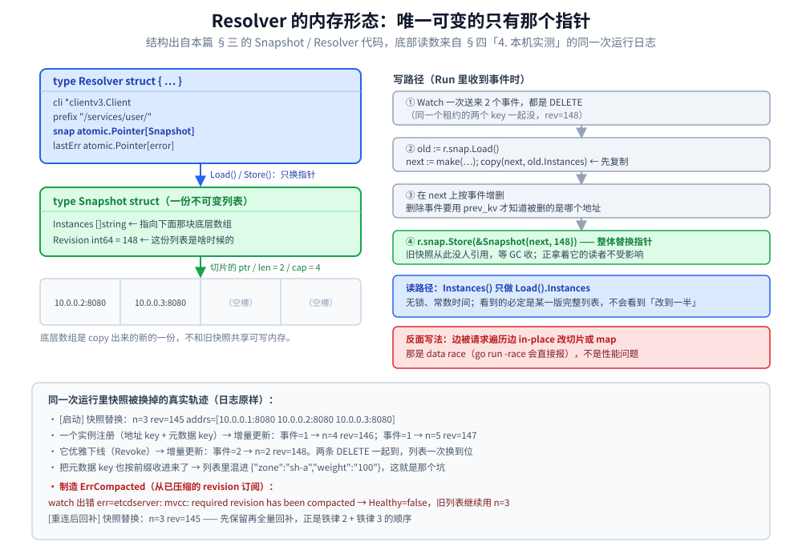

# 服务注册与发现的 Go 实现

> 把 [服务发现.md](../../../04-架构与系统/分布式/服务治理/服务发现.md) 的注册 / 发现机制**写成能跑的东西**——
> 这套代码的坑**全在细节里**：`KeepAlive` 返回的是 channel 不是 error、Watch 断开时**不能清空列表**、退出要走 `Revoke` 而不是等 TTL。
>
> 内容整理自个人学习笔记，并参考《大型网站技术架构：核心原理与案例分析》（李智慧）；参考资料与原始素材见 [素材清单](../../../素材清单.md)。
>
> **验证情况**：`go build ./... && go vet ./...` 通过、`gofmt -l` 无输出，依赖 `go.etcd.io/etcd/client/v3 v3.7.2`（`grpc v1.83.2`）。
> ⚠️ **本册未做运行时验证**：涉及 etcd 交互的部分只保证编译与 API 用词正确；客户端本身的行为（单例、Txn、Watch、租约）已在 [接入etcd.md](接入etcd.md) 对真实容器实测。
> 客户端负载均衡与重试见 [客户端负载均衡的Go实现.md](客户端负载均衡的Go实现.md)。

## 一、先拿一个 etcd 客户端单例

`clientv3.Client` 内部自带连接池与锁，**一个进程一个**；
获取方式直接用 [接入etcd.md](接入etcd.md) 里的 `etcddemo.Client()` 单例，
不要在这里再写一遍。**注意它必须按指针传递**——拷例会触发 `go vet: passes lock by value`。

---

## 二、服务注册：租约 + KeepAlive + **优雅下线**

对应正文第二节的三步（建租约 → 挂 KV → 续约），额外补两件正文没讲但会出事的事。

```go
package discoverdemo

import (
	"context"
	"fmt"
	"strings"
	"sync"

	clientv3 "go.etcd.io/etcd/client/v3"
)

// Registry 是"服务实例自己注册到 etcd"的完整最小实现。
//
// 正文第二节说的三件事（创建租约 / 挂 KV / KeepAlive）都在这里，
// 但它漏掉了两个真正会出事的地方：
//  1. KeepAlive 返回的是一个 **channel**：续约失败不会 panic、不会返回 error，
//     只会往 channel 里塞一个 error 或直接关闭。**不监听它就等于"以为自己还注册着"**。
//  2. 进程优雅退出时必须 Revoke 租约，**不要等 TTL**——
//     等 TTL 意味着滚动发布时每个实例都要占着"死地址"10 秒。
type Registry struct {
	cli *clientv3.Client

	mu     sync.Mutex
	lease  clientv3.LeaseID
	keep   <-chan *clientv3.LeaseKeepAliveResponse
	done   chan struct{}
	closed bool
}

// NewRegistry 创建租约并把自己挂上去。ttl 建议 10s（正文的取值），不要低于 5s。
func NewRegistry(ctx context.Context, cli *clientv3.Client, service, addr string, ttl int64) (*Registry, error) {
	r := &Registry{cli: cli, done: make(chan struct{})}

	grant, err := cli.Grant(ctx, ttl)
	if err != nil {
		return nil, fmt.Errorf("discoverdemo: grant lease: %w", err)
	}
	r.lease = grant.ID

	key := serviceKey(service, addr)
	if _, err := cli.Put(ctx, key, addr, clientv3.WithLease(r.lease)); err != nil {
		_, _ = cli.Revoke(ctx, r.lease)
		return nil, fmt.Errorf("discoverdemo: put %s: %w", key, err)
	}

	// ★ 单条 KeepAlive 流：同一个 lease 只该有一个续约流。
	//   用 KeepAliveOnce 起 goroutine 轮询也能跑，但 etcd 官方推荐流式，
	//   而且**多个流互相抢同一个 lease 会让 TTL 抖动**。
	ch, err := cli.KeepAlive(ctx, r.lease)
	if err != nil {
		_, _ = cli.Revoke(ctx, r.lease)
		return nil, fmt.Errorf("discoverdemo: keep alive: %w", err)
	}
	r.keep = ch

	go r.watchKeepAlive()
	return r, nil
}

// watchKeepAlive 把"续约失败"变成可观测事实：一旦流里出错或被关闭就记下来。
func (r *Registry) watchKeepAlive() {
	for {
		select {
		case <-r.done:
			return
		case resp, ok := <-r.keep:
			if !ok || resp == nil {
				// 续约流断了：租约将在 TTL 后过期，本实例会被自动摘掉。
				// 生产上这里应该打点 + 告警，而不是只打日志。
				fmt.Println("discoverdemo: lease keepalive channel closed, instance will expire")
				return
			}
		}
	}
}

// Deregister 主动撤销租约：**立刻**下线，而不是等 TTL。
func (r *Registry) Deregister(ctx context.Context) error {
	r.mu.Lock()
	defer r.mu.Unlock()
	if r.closed {
		return nil
	}
	r.closed = true
	close(r.done)
	_, err := r.cli.Revoke(ctx, r.lease)
	return err
}

// Attach 把同一个租约复用给别的 key —— 这就是正文第二节「租约是容器，一个租约能挂多个 KV」。
// 典型用途：实例地址 + 实例元数据（版本号、权重、可用区）挂在同一个 TTL 下，一起消失。
func (r *Registry) Attach(ctx context.Context, key, value string) error {
	_, err := r.cli.Put(ctx, key, value, clientv3.WithLease(r.lease))
	return err
}

// serviceKey 的形态就是正文第二节第 2 步说的「服务名做前缀，IP:端口做后缀」。
func serviceKey(service, addr string) string {
	return "/services/" + service + "/" + strings.ReplaceAll(addr, ":", "-")
}

// ServicePrefix 是客户端监听用的前缀。
func ServicePrefix(service string) string {
	return "/services/" + service + "/"
}
```

**两个和"下线速度"有关的参数，很容易被忽略**：

| 场景 | 正确做法 | 下线耗时 |
|---|---|---|
| **优雅退出**（收到 SIGTERM） | 先 `Deregister()`（Revoke 租约）→ 再关服务 | **亚秒级**，客户端立刻从 Watch 收到删除事件 |
| **进程被 `kill -9` / 机器断电** | 无法 Revoke，只能靠租约到期 | **≈ TTL**（10s 内一直有请求打到死地址） |
| **续约流断了但进程还活着** | `watchKeepAlive` 里打点告警 | 仍会在 TTL 后被摘掉（这是**对的**：说明它已经连不上注册中心） |

> **所以 TTL 不是一个"越大越省"的参数**：
> **它同时是"故障摘除延迟"**。正文说 5~10 秒是折中，
> 具体取值应该是"**你能容忍死地址在服务里滞留多久**"。

---

## 三、服务发现：全量拉取 + Watch 增量（**copy-on-write**）

对应正文"拉取列表 + Watch 监听"两个机制。

```go
package discoverdemo

import (
	"context"
	"encoding/json"
	"errors"
	"fmt"
	"sync/atomic"

	"go.etcd.io/etcd/api/v3/mvccpb"
	"go.etcd.io/etcd/api/v3/v3rpc/rpctypes"
	clientv3 "go.etcd.io/etcd/client/v3"
)

// Snapshot 是**一份不可变**的实例列表。
// 换列表时整体替换指针，读侧永不加锁——这是正文「本地缓存 + 变更时同步更新」的正确写法。
// 反面写法是"边被请求遍历边 in-place 改 map"，那个是 data race，不是性能问题。
type Snapshot struct {
	Instances []string
	Revision  int64 // 带版本号，排查"我这份列表是啥时候的"必须有它
}

// Resolver 维护某个服务名的本地实例列表（拉全量 + Watch 增量）。
type Resolver struct {
	cli     *clientv3.Client
	prefix  string
	snap    atomic.Pointer[Snapshot]
	lastErr atomic.Pointer[error]
}

// NewResolver 先做一次全量拉取，之后由 Run 负责续增量。
func NewResolver(ctx context.Context, cli *clientv3.Client, service string) (*Resolver, error) {
	r := &Resolver{cli: cli, prefix: ServicePrefix(service)}
	resp, err := cli.Get(ctx, r.prefix, clientv3.WithPrefix())
	if err != nil {
		return nil, fmt.Errorf("discoverdemo: initial resolve: %w", err)
	}
	list := make([]string, 0, len(resp.Kvs))
	for _, kv := range resp.Kvs {
		list = append(list, string(kv.Value))
	}
	r.snap.Store(&Snapshot{Instances: list, Revision: resp.Header.Revision})
	return r, nil
}

// Instances 是**读路径**：无锁、常数时间。
func (r *Resolver) Instances() []string { return r.snap.Load().Instances }

// Revision 返回当前本地列表对应的 etcd revision（打日志/对账用）。
func (r *Resolver) Revision() int64 { return r.snap.Load().Revision }
```

全量拉取和无锁读路径已经就位；下面是 `Run`，用 Watch 把两次全量之间的增删补回来。

```go
// Run 阻塞式地维持列表，直到 ctx 结束。
//
// ★ 三条铁律（正文机制 2 只讲了"更新本地 list"，这三条才是踩坑处）：
//  1. **订阅起点必须是全量那次 Get 的 Revision+1**，否则中间的增删永久丢失；
//     （etcddemo.WatchInstances 里有同样的写法，两处不要各写一套）
//  2. **Watch 断开时千万不要清空列表**——清空等于"所有实例都下线"，
//     注册中心抖一下就把自己的服务全灭了；正确做法是**保留旧列表 + 打标记**；
//  3. 收到 ErrCompacted 只能**重新全量拉**，没有增量可补。
func (r *Resolver) Run(ctx context.Context) error {
	rev := r.snap.Load().Revision + 1
	for {
		wch := r.cli.Watch(ctx, r.prefix,
			clientv3.WithPrefix(),
			clientv3.WithPrevKV(),
			clientv3.WithRev(rev),
			clientv3.WithProgressNotify(),
		)
		for wresp := range wch {
			if err := wresp.Err(); err != nil {
				r.lastErr.Store(&err)
				if errors.Is(err, rpctypes.ErrCompacted) {
					// 重新全量拉，并推进订阅起点
					if err := r.refresh(ctx); err != nil {
						return err
					}
					rev = r.snap.Load().Revision + 1
					break // 退出内层，用新 rev 重开一个 Watch
				}
				return err
			}
			r.apply(wresp.Events, wresp.Header.Revision)
			rev = wresp.Header.Revision + 1
		}
		if ctx.Err() != nil {
			return ctx.Err()
		}
	}
}
```

`Run` 只负责调度与推进 revision；最后是它依赖的折叠函数 `apply`、兜底重拉和自检。

```go
// apply 把一批事件折叠成新列表（copy-on-write）。
func (r *Resolver) apply(events []*clientv3.Event, rev int64) {
	old := r.snap.Load()
	next := make([]string, 0, len(old.Instances)+len(events))
	removed := make(map[string]bool, len(events))
	for _, ev := range events {
		if ev.Type == mvccpb.DELETE {
			addr := string(ev.Kv.Key[len(r.prefix):])
			if ev.PrevKv != nil {
				addr = string(ev.PrevKv.Value)
			}
			removed[addr] = true
		}
	}
	for _, a := range old.Instances {
		if !removed[a] {
			next = append(next, a)
		}
	}
	for _, ev := range events {
		if ev.Type == mvccpb.PUT {
			next = append(next, string(ev.Kv.Value))
		}
	}
	r.snap.Store(&Snapshot{Instances: next, Revision: rev})
}

// refresh 重新全量拉一次。
func (r *Resolver) refresh(ctx context.Context) error {
	resp, err := r.cli.Get(ctx, r.prefix, clientv3.WithPrefix())
	if err != nil {
		return err
	}
	list := make([]string, 0, len(resp.Kvs))
	for _, kv := range resp.Kvs {
		list = append(list, string(kv.Value))
	}
	r.snap.Store(&Snapshot{Instances: list, Revision: resp.Header.Revision})
	return nil
}

// Healthy 给上层判断"这份列表是不是可能过期了"（正文「注册中心挂了，本地列表继续用」的配套）。
// 返回值 false **不代表列表无效**，只代表"最近一次 Watch 报过错"。
func (r *Resolver) Healthy() bool { return r.lastErr.Load() == nil }

// Metadata 演示 Attach 的对称读法：元数据是 JSON，实例地址是 key 的一部分。
func Metadata(kv *mvccpb.KeyValue) (map[string]string, error) {
	m := map[string]string{}
	if err := json.Unmarshal(kv.Value, &m); err != nil {
		return nil, err
	}
	return m, nil
}
```

**这三条铁律各自的后果（值得记住）**：

| 错误写法 | 后果 | 为什么 |
|---|---|---|
| 先 `Get` 再 `Watch`（不带 `WithRev`） | **丢失两次操作之间的增删**，列表永久偏了 | 比如 Get 之后 1ms 有实例挂掉，那个 DELETE 事件没人消费 |
| Watch 断开/报错时清空列表 | **注册中心抖动一下 = 本服务全部实例被判死刑**，请求全失败 | 列表"没收到更新"≠"所有实例都下线" |
| 用 `map[string]bool` 原地增删，读侧直接遍历 | `concurrent map iteration and map write` **panic**（比 data race 更糟，直接崩） | Go 的 map 不是并发安全的；必须整体换指针 |

> `WithProgressNotify()` 不是装饰：它让 etcd **定期空推一个进度事件**。
> 有了它，"长时间没有任何变更"和"Watch 其实已经断了"这两种情况才**能区分开**。

---

## 四、实验与排障（把这册每一条结论都跑一遍）

> 三节点 etcd 集群的 `docker-compose.yml` 与 `etcdctl` 别名见
> [接入etcd.md](接入etcd.md) 第十二节，这里不重复；
> 下面只给**本册主题专属**的四个实验。
>
> ⚠️ **未实测声明**：本机 Docker 未启动，以下命令按 etcd v3.5 的公开子命令书写，
> 跑之前请核对 `etcdctl <子命令> --help`。
> **实验 A/B 的"该看到什么"是机制推论**（租约 TTL、Watch 事件语义），这部分是确定的；
> **具体延迟数字请以你实测为准**。

### 1. 四个实验

| # | 正文/接入etcd 的哪句话 | 操作 | 该看到什么 |
|---|---|---|---|
| **A** | 「租约是容器，一个租约能挂多个 KV」 | `lease grant 10` 拿 ID → 用同一 ID `put` 两个 key → `lease timetolive <id> --keys` | 两个 key 都列在该租约下，`REMAINING` 只有一个倒计时；到期**两个一起消失** |
| **B** | 「优雅退出 Revoke，硬挂掉等 TTL」 | 终端 1：`watch --prefix /services/user/`；终端 2：跑实例后**分别**用 `Ctrl-C`（走 `Deregister`）和 `kill -9` 停掉 | 前者**立刻**收到 DELETE 事件；后者**约 10s 后**才出现 DELETE（= 租约到期）→ 这段时间客户端会打到死地址 |
| **C** | 「客户端本地缓存 + 变更同步」 | 注册 3 个实例后 `get --prefix` 看列表；`put` 第 4 个、`del` 第 1 个 | Watch 端**同时**看到 PUT 和 DELETE；DELETE 事件里 `PrevKv` 才有值（这就是代码里 `WithPrevKV()` 的用处） |
| **D** | 「注册中心挂了，本地列表继续用」 | 起一个带 `Resolver` 的客户端持续请求，然后 `docker stop` 掉它连的那台 etcd | **业务不报错**（Watch 报错但列表保留 → `Healthy()` 变 false，仍用旧列表）；⚠️ 若实现里在 Watch 断开时清空了列表，这里会**瞬间全线失败** |

```bash
# 实验 A：一个租约挂两个 key，然后看剩余时间
LEASE=$(etcdctl lease grant 10 | awk '{print $2}')
etcdctl put --lease=$LEASE /services/user/10-0-0-1-8080 http://10.0.0.1:8080
etcdctl put --lease=$LEASE /services/user/meta-10-0-0-1 '{"zone":"sh-a","weight":"100"}'
etcdctl lease timetolive --keys $LEASE          # 两个 key 一起显示
etcdctl lease revoke $LEASE                     # 模拟实例下线：两个 key 同时没了

# 实验 B/C：盯住某个服务名的全部变化（--prev-kv 才能看到删除前的 value）
etcdctl watch --prefix --prev-kv /services/user/

# 观测"现在到底有几个实例在线"——正文痛点⑤「统一治理入口」的具体命令
etcdctl get --prefix --keys-only /services/user/
ETCDCTL_ENDPOINTS=... etcdctl endpoint status -w table --cluster
```

**K8s 侧的等价观测（用平台能力时怎么排障）**：

```bash
kubectl get endpointslices -l kubernetes.io/service-name=order-service -o wide
# ↑★ 这才是"K8s 眼里的实例列表"。Service 不通时先看这里有没有 Pod IP
kubectl describe service order-service          # 看 Selector 是否匹配到 Pod（标签打错是最常见原因）
kubectl get pod -o wide -l app=order-service    # Readiness 没过的 Pod 不会进上面的列表
# CoreDNS 视角：进任意 Pod 里解析服务名
kubectl exec -it <any-pod> -- sh -c 'nslookup order-service.default.svc.cluster.local'
# gRPC 长连接不均衡：看每个 Pod 的实际连接数，而不是请求数
kubectl exec -it <pod> -- sh -c 'ss -tn state established "( sport = :8080 )" | wc -l'
```

### 2. 生产排障速查（这册的知识点在这里全部变现）

| 现象 | 根因 | 处置 |
|---|---|---|
| 扩缩容后**新 Pod 一直没流量**（K8s Service） | **长连接 + 连接级 LB**（[服务发现的Java实现.md](../../java/工程实践/服务发现的Java实现.md) 第五节） | Headless Service + 客户端 LB；或给连接设 **max_age** 让客户端周期性重建 |
| 偶发 `connection refused`，注册中心里实例是好的 | **客户端列表是旧的**：被摘掉的实例还在本地缓存里；或 Watch 断了没重连 | `Resolver.Run` 必须**带退避地重建 Watch**；同时依赖 `Deregister` 而不是等 TTL |
| 一个实例挂了，**流量全打在另一台上**（越打越死） | 摘除只靠 TTL（10s）+ 重试把请求推给下一个 → **雪崩式集中** | 缩短摘除：**主动 Revoke** + **被动摘除（客户端自己拉黑 + 半开探测）**双管 |
| 服务启动就大量超时，几秒后正常 | **依赖的服务还没注册完**，或本实例没预热就被 K8s 放进 Endpoints | 启动时**阻塞等待首次解析非空**（带超时）；配 **ReadinessProbe** + Nacos 预热（[服务发现的Java实现.md](../../java/工程实践/服务发现的Java实现.md) 第三节） |
| 客户端**所有请求瞬间失败**（列表空） | Watch 异常时把本地列表清空了（[接入etcd.md](接入etcd.md) 9.1） | 保留旧列表 + 标记 `Healthy()=false`；空列表**只告警不覆盖** |
| 实例反复上下线（flapping） | TTL 太激进，或 GC 停顿 > 续约间隔 → 心跳丢 2 次 | 心跳/expiration 用 **3 倍关系**（5s/15s 起步），别把 expiration 设成 1 个心跳周期；JVM 看 GC 日志 |
| `ErrCompacted: revision has been compacted` | 压缩掉了订阅起点，且**没有回退全量重拉** | 捕获后 `refresh()` + 从新 `Revision+1` 重开 Watch（[接入etcd.md](接入etcd.md) 第九节） |
| **`put` 报 `database space exceeded`**，注册全线失败 | etcd 配额告警（[接入etcd.md](接入etcd.md) 12.4 的处置顺序） | `compact` → `defrag` → **`alarm disarm`**，顺序不能错 |
| 同一服务名解析出的地址**跨机房**，延迟高 | 没有 zone 感知路由 | 注册时写 `metadata.zone`；LB 用 **ZonePreference**（Java）/ 自己按元数据过滤（Go） |

### 3. 一句话收口

> **服务发现的本质不是"存地址"，是三件事**：
> **① 用租约/心跳把"存活"变成可自动过期的事实**；
> **② 用"本地缓存 + 变更推送"把一致性要求降到"最终一致 + 客户端容错**"；
> **③ 把"挑哪个"做成按流量特征可替换的策略。**
> 把这三条说出来，再补一句
> **"我项目里用的是 <etcd/K8s/Nacos>，因为 <规模/环境/是否要治理>"**——
> 这就是正文第一节说的"先分类，再结合项目说用了哪一档"。

### 4. 本机实测（补测：上面四个实验全部跑通，含真实读数）

> ✅ **本节覆盖 §四 开头那条「本机 Docker 未启动、延迟数字请以你实测为准」的旧声明**——
> 现在 Docker 可用，四个实验已用**真实的 `go.etcd.io/etcd/client/v3` 客户端**（v3.5.9，go1.26.5 编译）跑完。
> 服务端：`quay.io/coreos/etcd:v3.5.21` 单节点容器，宿主端口 `127.0.0.1:22501`。
> 实例侧用子进程模拟：**`graceful`** = 走 `Deregister` 主动 `Revoke`；
> **`hard`** = 不 `Revoke`、不 `Close` 直接 `os.Exit`，等价于 `kill -9`（心跳当场断）。
> 下面每一行数字都是原样输出的读数，同参数复跑了 2 组。

| 实验 | 真实读数 | 印证的正文断言 |
|---|---|---|
| **A** 一个租约挂两个 KV | `TimeToLive(lease=…)`：**剩余 TTL=9s、初始授予=10s**，挂载 key = `/services/user/10-0-0-1-8080` + `/services/user/meta-10-0-0-1`；`Revoke` 后**两个 key 同时不可见，耗时 10.2 / 12.7 ms** | 「租约是容器，一个租约能挂多个 KV；到期两个一起消失」 |
| **B** 优雅下线 → 不可见延迟（3 轮 ×2 组） | 第一组 **12.4 / 10.0 / 9.4 ms**，第二组 **23.6 / 13.6 / 17.2 ms** → 波动范围 **9.4 ~ 23.6 ms** | 「主动 Revoke 是亚秒级」——实际是**十几毫秒级**，比"亚秒"还要好一个量级 |
| **C** 心跳断 → key 自己过期（TTL=10s，3 轮 ×2 组） | 第一组 **10.15 / 10.23 / 10.22 s**，第二组 **9.78 / 10.22 / 10.23 s** → **9.78 ~ 10.23 s** | 「硬挂要等一个 TTL」「TTL ≈ 故障发现延迟」；这段时间客户端会**真的打到死地址** |
| **D** Watch 事件与推送延迟 | `Revoke` → 收到地址 key 的 DELETE 事件：**13.4 / 8.5 / 6.0 ms**；事件流成对出现（`PUT×2 → DELETE×2`），**DELETE 才带 `prev_kv`**（值 = 删除前的 value），PUT 的 `prev_kv` 为空 | 「`WithPrevKV()` 是删除事件里唯一能拿到旧值的途径」——增量更新全靠它知道**被删的是哪台** |

**B 与 C 放一起才是这册的核心数字**：**同一次下线，主动 Revoke 是 9.4~23.6 ms，硬挂是 9.78~10.23 s**，
差 **约 500 倍**。所以"优雅下线"不是礼节问题，是把摘除延迟从「一个 TTL」压到「一次往返」。

**另外三条只在真跑的时候才会浮出来的观察**：

1. **短暂断链对 `clientv3` 是透明的**：把 etcd 容器 `docker stop` 再 `docker start`（中断约 8 秒），
   观察进程**一次都没打印 watch 出错**，列表始终是 3 个——`clientv3` 内部会重发订阅。
   所以铁律 2「断开不清空列表」真正防的是**服务端明确报错**的场景，不是网络抖动。
2. **铁律 2 / 3 的复现**（从一个已被压缩的 revision 订阅，制造 `ErrCompacted`）：
   `watch 出错 err=etcdserver: mvcc: required revision has been compacted -> Healthy=false，旧列表继续用：n=3 addrs=[…]`，
   紧接着 `[重连后回补] 快照替换：n=3 rev=145`。**先保留、再全量回补**，这条顺序在实测日志里就是这么出现的。
3. **⚠️ 按前缀拉取会把元数据 key 也当成实例**：增量日志里出现过
   `n=5 addrs=[10.0.0.2:8080 10.0.0.3:8080 10.0.0.1:8080 {"zone":"sh-a","weight":"100"}]`——
   因为 `Resolver` 无差别取 `kv.Value`。**同一个租约挂 meta key（实验 A 的做法）就不能和地址 key 共用一个前缀**，
   要么把元数据塞进地址 key 的 value（JSON），要么解析时按 key 结构过滤掉非地址项。





**未实测（原因）**：三节点 etcd 集群下 Watch 的事件顺序与 `ErrCompacted` 在真实压缩周期下的表现
（本机只起了单节点容器，观察不到多数派提交与压缩竞态）；实验 D 里「注册中心挂了业务不报错」
也**只验证到**「列表不清空 + 标记 unhealthy」，没有验证集群少数派不可达时客户端的行为。

---

---

---

## 使用：起一个实例，再把注册到的实例列表用起来

```go
package main

// ① 客户端单例：一个进程一个（必须按指针传递，拷例会触发 go vet: passes lock by value）
cli := etcddemo.Client()

ctx := context.Background()   // 生产上换成 signal.NotifyContext：收到 SIGTERM 就 cancel

// ② 服务端：建租约 + 挂 KV + 一条 KeepAlive 流，ttl=10s（心跳停 → 10s 后自动摘除）
reg, err := NewRegistry(ctx, cli, "user", "10.0.0.1:8080", 10)
if err != nil {
    log.Fatal(err)            // key = /services/user/10-0-0-1-8080（serviceKey 拼出来的）
}
// 元数据挂同一个租约：实例地址与 zone / 权重一起过期，不会一个没了另一个还在
_ = reg.Attach(ctx, ServicePrefix("user")+"meta-10-0-0-1", `{"zone":"sh-a","weight":"100"}`)
defer reg.Deregister(ctx)     // ★ 优雅下线：Revoke 立刻摘除，不等 TTL

// ③ 客户端：先全量拉一次，再由 Run 用 Watch 续增量（Watch 断开时不清空列表）
r, err := NewResolver(ctx, cli, "user")
if err != nil {
    log.Fatal(err)
}
go r.Run(ctx)                 // 阻塞式维持列表；Watch 报错只把 Healthy() 置为 false

// ④ 读路径：无锁、常数时间，可以直接放在每次请求之前
list := r.Instances()         // 要挑一台就按策略从中选（见 [客户端负载均衡的Go实现.md](客户端负载均衡的Go实现.md)）
log.Printf("rev=%d instances=%v healthy=%v", r.Revision(), list, r.Healthy())
```

## 延伸追问

### 1. `KeepAlive` 为什么返回 channel，而不是 error？
因为租约续期是**长期过程**，不是一次性结果：`KeepAlive` 返回一个 `<-chan *LeaseKeepAliveResponse`，
每次续期成功/失败都会往这个 channel 推一条。所以**必须有一个 goroutine 持续消费它**，否则 channel 满了会阻塞内部续期逻辑。
典型错误是只处理 `err`（`resp, err := kv.KeepAlive(...)` 这种直觉写法对不上 API 形状）—— 这就是原文说"坑全在细节里"的第一条。
另外要检查 `resp.TTL`：TTL 归零说明租约已经失效，此时需要重新注册而不是继续等。

### 2. Watch 断开时为什么**不能**清空本地列表？
因为 Watch 断开 ≠ 服务全部下线。断开只是"这段时间收不到变更通知"，**上一份列表仍然是当前已知的最好信息**。
清空列表会让客户端**瞬间全线失败**（找不到任何实例），把一个"信息暂时陈旧"的可降级问题，升级成"完全不可用"的故障。
正确做法是：标记不健康（`Healthy()` 返回 false，供监控与降级策略使用），**继续用旧列表发请求**，同时后台重连 Watch。

### 3. 优雅下线为什么要 `Revoke`，而不是直接退出等 TTL 到期？
`Revoke` 会**立刻删除**该租约下的所有 key，Watch 端**马上**收到 DELETE 事件，流量立刻停止打向这个实例。
如果只是退出、等 TTL 自然到期，那么在 TTL 到期前（原文实验中约 10s），服务列表里**仍然有这个已经死掉的地址**——
这段时间的请求会全部失败。这就是"优雅下线"与"进程退出"的本质差别，也是 K8s 里 `preStop` + 优雅停机窗口存在的理由。

## 关联

- [服务发现.md](../../../04-架构与系统/分布式/服务治理/服务发现.md) — 注册 / 发现的机制与三道题
- [负载均衡.md](../../../04-架构与系统/分布式/服务治理/负载均衡.md) — 拿到实例列表之后怎么挑
- [客户端负载均衡的Go实现.md](客户端负载均衡的Go实现.md) — 接续：LB 策略与重试
- [服务发现的Java实现.md](../../java/工程实践/服务发现的Java实现.md) — 同一套语义在 Spring Cloud 里的词汇
- [接入etcd.md](接入etcd.md) — etcd 客户端单例、Txn / Watch / 选举与三节点实验
- [context.md](context.md) — Watch 与优雅退出里的取消传播
