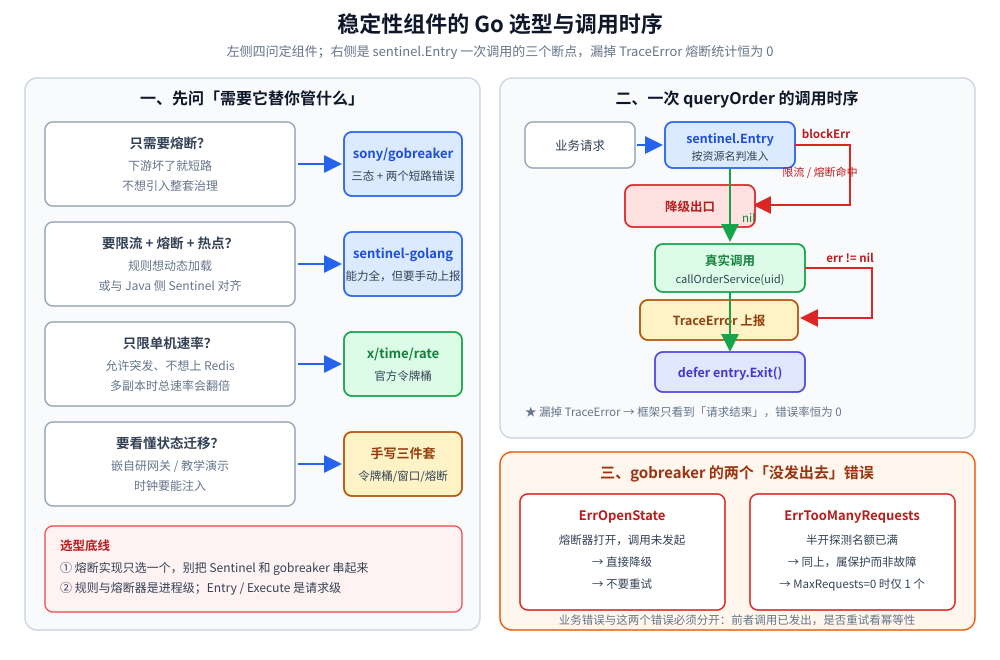

# 稳定性组件的 Go 实现

> 覆盖：Go 侧把限流、熔断接进调用链的四条路——`sentinel-golang`（限流 + 熔断 + 热点）、`sony/gobreaker`（只做熔断）、Redis + Lua（分布式限流）、手写令牌桶 / 滑动窗口 / 三态熔断（理解机制）；以及资源名、规则加载、错误上报、单例边界与降级分支。
>
> 不覆盖：稳定性各机制的原理与参数取舍见 [稳定性/README.md](../../../04-架构与系统/分布式/稳定性/README.md) 与 [限流算法.md](../../../04-架构与系统/分布式/稳定性/限流算法.md)、[熔断器.md](../../../04-架构与系统/分布式/稳定性/熔断器.md)、[重试与超时.md](../../../04-架构与系统/分布式/稳定性/重试与超时.md)、[降级.md](../../../04-架构与系统/分布式/稳定性/降级.md)；Java 侧同一套语义见 [稳定性组件的Java实现.md](../../java/工程实践/稳定性组件的Java实现.md)；`x/time/rate` 的源码结构与三个坑见 [限流器.md](../并发编程/限流器.md)。
>
> 内容整理自个人学习笔记，并参考《大型网站技术架构：核心原理与案例分析》（李智慧），素材见 [素材清单](../../../素材清单.md)。
>
> **验证情况**：第七节手写三件套的实测输出按原文 `go1.26.5`、注入时钟运行的结果原样迁移（输出确定、可复现）；第一至第六节的 Sentinel / gobreaker / Redis 示例**未在本机重新编译运行**（依赖第三方模块与 Redis 实例），API 名称按各自公开接口书写，落地前以所用版本源码为准。

---

## 一、选型：先决定「要框架还是要看得见的状态机」

**本节要点**：四个选项不是按「谁更强大」排，而是按「你需要它替你管什么」排——只要熔断、要全套治理、只要单机限流、或者要看清状态机，答案各不相同。

| 选项 | 管什么 | 适用场景 | 代价 |
| --- | --- | --- | --- |
| **`sentinel-golang`** | 限流 + 熔断 + 热点参数 + 系统自适应，规则可动态加载 | 需要一整套治理能力，或要与 Java 侧 Sentinel 对齐 | 依赖重、概念多；**错误必须手动上报** |
| **`sony/gobreaker`** | 只做三态熔断 | 只需要「下游坏了就短路」这一件事 | 限流要另配；**最小请求数要自己写在 `ReadyToTrip` 里** |
| **`x/time/rate`** | 单机令牌桶 | 单进程限速、允许突发 | 只限单机；多副本时总速率 = 实例数 × `Limit` |
| **手写三件套** | 令牌桶 + 滑动窗口 + 三态熔断 | 理解机制、嵌进自研网关、面试讲清状态迁移 | 并发与时钟要自己处理，**生产不建议直接替代框架** |



```bash
go get github.com/alibaba/sentinel-golang
go get github.com/sony/gobreaker
go get github.com/redis/go-redis/v9
go get golang.org/x/time/rate
```

## 二、前提：资源名、规则和降级出口先定好

**本节要点**：框架只负责「判」，不负责「判完之后返回什么」。接入前先把三样东西定下来，否则规则加载了也不会生效。

| 先准备什么 | 漏了会怎样 |
| --- | --- |
| **统一的资源名**（如 `order:query`） | 规则按资源名匹配；`Entry` 与规则里的名字不一致时，规则永远不命中，表现为「配了限流但完全不生效」 |
| **降级出口**（缓存、默认值、空对象） | `blockErr != nil` 时没有可返回的值，只能把限流变成 500 |
| **最小请求数** | 低流量下 1 次失败就是 100% 错误率，熔断会被误触发 |

⭐ 资源名建议按「服务:动作」命名，并在常量里只定义一次；调用点与规则加载共用同一个常量，避免字符串写错。

## 三、初始化：规则加载与单例边界

**本节要点**：规则和熔断器都是**进程级**对象，在启动阶段构造一次；`Entry` 与 `Execute` 是**请求级**的，不能把它们的返回值存进全局变量。

### 3.1 sentinel-golang：规则在启动时加载

```go
package main

import (
	sentinel "github.com/alibaba/sentinel-golang/api"
	"github.com/alibaba/sentinel-golang/core/base"
	"github.com/alibaba/sentinel-golang/core/circuitbreaker"
	"github.com/alibaba/sentinel-golang/core/flow"
)

const res = "order:query"

func initRules() error {
	// 1) QPS 限流：单机 100 QPS，超出直接拒绝
	_, err := flow.LoadRules([]*flow.Rule{{
		Resource:               res,
		TokenCalculateStrategy: flow.Direct, // Direct=按 Threshold 计数；WarmUp=预热/冷启动
		ControlBehavior:        flow.Reject, // Reject=直接拒绝；Throttling=匀速排队（漏桶效果）
		Threshold:              100,         // QPS 阈值
		StatIntervalInMs:       1000,
	}})
	if err != nil {
		return err
	}
	// 2) 熔断：错误率 50% 触发，熔断 3s 后进入半开
	_, err = circuitbreaker.LoadRules([]*circuitbreaker.Rule{{
		Resource:         res,
		Strategy:         circuitbreaker.ErrorRatio, // ErrorRatio / SlowRequestRatio / ErrorCount
		Threshold:        0.5,                       // 错误率阈值（慢调用比例模式下为比例）
		MinRequestAmount: 20,                        // ⚠️ 最小请求数，太少不熔断
		StatIntervalMs:   10000,                     // 统计窗口 10s
		RetryTimeoutMs:   3000,                      // 熔断时长，到期转 Half-Open
	}})
	return err
}
```

⭐ 两个策略字段要分开看：`TokenCalculateStrategy` 决定**阈值怎么算**（直接计数还是预热），`ControlBehavior` 决定**超限后怎么处理**（拒绝还是匀速排队）。用 `Throttling` 时，请求会被排队而不是立刻失败，效果接近漏桶。

### 3.2 gobreaker：熔断器是包级单例

```go
package main

import (
	"errors"
	"log"
	"time"

	"github.com/sony/gobreaker"
)

var cb = gobreaker.NewCircuitBreaker(gobreaker.Settings{
	Name:        "userService",
	MaxRequests: 3,                // ⭐ Half-Open 允许的最大并发试探请求数（0 = 仅 1 个）
	Interval:    60 * time.Second, // Closed 状态下计数清零周期（0 = 不清零）
	Timeout:     10 * time.Second, // Open 持续时长，到期转 Half-Open
	ReadyToTrip: func(counts gobreaker.Counts) bool {
		// ⚠️ 必须先判断请求数，否则低流量下 1 次失败就熔断
		return counts.Requests >= 10 &&
			float64(counts.TotalFailures)/float64(counts.Requests) >= 0.5
	},
	OnStateChange: func(name string, from, to gobreaker.State) {
		log.Printf("cb=%s %v -> %v", name, from, to) // ⭐ 这里接告警
	},
	IsSuccessful: func(err error) bool { // 自定义哪些错误算成功（如 404 不算失败）
		return err == nil || errors.Is(err, ErrNotFound)
	},
})
```

| 字段 | 含义 |
| --- | --- |
| `MaxRequests` | Half-Open 时允许的并发试探请求数（超出返回 `ErrTooManyRequests`）；设为 0 时只允许 1 个 |
| `Interval` | Closed 状态下统计周期，周期性清零计数；设为 0 则累计不清零 |
| `Timeout` | Open 状态持续时间 |
| `ReadyToTrip` | ⭐ 是否跳变的判定函数（**必须自己做最小请求数保护**） |
| `OnStateChange` | 状态迁移回调——**告警和打点接在这里** |
| `IsSuccessful` | 自定义失败判定；默认只有 `err == nil` 算成功 |

### 3.3 哪些对象是单例

| 对象 | 边界 | 为什么 |
| --- | --- | --- |
| Sentinel 规则（`flow.Rule` / `circuitbreaker.Rule`） | 进程级 | 规则是全局表，按资源名匹配；每次请求重新 `LoadRules` 会不断覆盖并丢失统计 |
| `gobreaker.CircuitBreaker` | 进程级（**每个下游一个**） | 内部持有窗口计数与状态；按请求新建等于每次从 CLOSED 开始，永远不会熔断 |
| `redis.Client` | 进程级 | 内部有连接池，见 [数据访问与连接池.md](数据访问与连接池.md) |
| `sentinel.Entry` | 请求级 | 一次 `Entry` 对应一次调用，必须 `defer entry.Exit()` 配对；存进全局会漏统计、泄漏 |
| `TokenBucket` / `SlideWindow` / `Breaker`（手写） | 按限流维度 / 按下游一个 | 内部保存令牌、窗口槽和状态，跨请求共享才有意义 |

## 四、实际调用：入口、错误上报与降级

**本节要点**：接入 Sentinel 的调用只有三步——`Entry` 拿准入、真实调用后 `TraceError` 上报结果、`Exit` 归还；漏掉 `TraceError`，熔断器的错误率永远是 0。

```go
func queryOrder(uid int64) (string, error) {
	entry, blockErr := sentinel.Entry(res, sentinel.WithTrafficType(base.Inbound), sentinel.WithArgs(uid))
	if blockErr != nil { // 被限流 或 被熔断：走降级
		return cachedOrder(uid), nil
	}
	defer entry.Exit()

	order, err := callOrderService(uid)
	if err != nil {
		sentinel.TraceError(entry, err) // ⭐ 必须上报，否则错误率统计永远是 0
		return "", err
	}
	return order, nil
}
```

> ⚠️ `sentinel.TraceError(entry, err)` 容易被漏掉：不主动上报，熔断器的错误率永远是 0，熔断规则形同虚设。慢调用同理，需要 `entry.Exit(base.WithError(err))` 或保证 RT 被统计。

`gobreaker` 把「状态判定 + 执行 + 统计」合成一个 `Execute`，短路错误要单独识别：

```go
func GetUser(uid int64) (*User, error) {
	v, err := cb.Execute(func() (interface{}, error) { return callUserRPC(uid) })
	if err != nil {
		// ErrOpenState = 熔断中；ErrTooManyRequests = 半开试探已满
		if errors.Is(err, gobreaker.ErrOpenState) || errors.Is(err, gobreaker.ErrTooManyRequests) {
			return defaultUser(), nil // 降级兜底
		}
		return nil, err
	}
	return v.(*User), nil
}
```

| 返回 | 含义 | 该做什么 |
| --- | --- | --- |
| `ErrOpenState` | 熔断器已打开，本次调用**没有发出去** | 直接走降级，不要重试 |
| `ErrTooManyRequests` | 半开试探名额已满 | 同上；这是保护刚恢复的下游，不是故障 |
| 业务错误 | 调用发出去了并失败 | 上报给上层；是否重试由调用方按幂等性决定 |

## 五、分布式限流：Redis + Lua

**本节要点**：多副本下每个进程各限 100 QPS，总量就是 `副本数 × 100`；要卡总量，必须把「读令牌—算补充—扣减—写回」放进一段 Lua 里原子执行。

```go
package ratelimit

import (
	"context"
	"time"

	"github.com/redis/go-redis/v9"
)

const tokenBucketLua = `-- 完整脚本见 2.3 节（此处为同一份，可直接落地）
local key, burst = KEYS[1], tonumber(ARGV[1])
local rate, now, cost = tonumber(ARGV[2]), tonumber(ARGV[3]), tonumber(ARGV[4])
local data   = redis.call('HMGET', key, 'tokens', 'ts')
local tokens = tonumber(data[1])
local ts     = tonumber(data[2])
if tokens == nil then tokens = burst; ts = now end
local delta  = math.max(0, now - ts)
local filled = math.min(burst, tokens + delta * rate)
local ttl    = math.ceil(burst / rate * 1000) + 1000
if filled < cost then
  redis.call('HSET', key, 'tokens', filled, 'ts', now)
  redis.call('PEXPIRE', key, ttl)
  return 0
end
redis.call('HSET', key, 'tokens', filled - cost, 'ts', now)
redis.call('PEXPIRE', key, ttl)
return 1`

type RedisLimiter struct {
	rdb   *redis.Client
	rate  float64 // 每秒生成令牌数
	burst int     // 桶容量
}

func NewRedisLimiter(rdb *redis.Client, rate float64, burst int) *RedisLimiter {
	return &RedisLimiter{rdb: rdb, rate: rate, burst: burst}
}

// Allow 判断 key 维度的请求是否放行；cost 为本次消耗的令牌数（一般 1）
func (l *RedisLimiter) Allow(ctx context.Context, key string, cost int) (bool, error) {
	// ⭐ now 由客户端传入：避免依赖 Redis 机器时钟，也规避 Lua 中 TIME 命令的复制语义问题
	now := float64(time.Now().UnixNano()) / 1e9
	res, err := l.rdb.Eval(ctx, tokenBucketLua, []string{key}, l.burst, l.rate, now, cost).Int()
	if err != nil {
		// ⚠️ Redis 故障策略：fail-open 放行（保自身可用）/ fail-close 拒绝（保护共享下游）
		return true, err
	}
	return res == 1, nil
}

// 使用：limiter := NewRedisLimiter(rdb, 100, 200) // 100 QPS，允许 200 突发
// ok, err := limiter.Allow(ctx, fmt.Sprintf("rl:api:%d", uid), 1) // !ok → 返回 429 + Retry-After
```

⭐ 四个必须一起看的点：

1. **`now` 由客户端传入**：不要依赖 Redis 服务器时间，主从 / 集群模式下的时钟与复制语义都会带来偏差。
2. **`math.max(0, now-ts)`**：时钟回拨会让时间差变负，不夹住就会「倒扣令牌」。
3. **`cost` 参数**：默认 1；批量接口或按权重计费时传更大的值，避免一次请求消耗固定 1 个令牌。
4. **错误分支返回 `true`**：这是示例选择的 **fail-open**；如果限流是为了保护一个不能被打垮的共享下游，应改成 fail-close（返回 `false`）。

> Lua 脚本与「取巧方案 / 限流维度 / 四个生产坑」的完整讨论见 [限流算法.md](../../../04-架构与系统/分布式/稳定性/限流算法.md) 第 9.1、9.2、9.3、9.4 节。

## 六、单机令牌桶：优先用标准库

> `golang.org/x/time/rate` 是 Go 官方的**单机令牌桶**实现（`Limit` 为补充速率、`Burst` 为桶容量，令牌按时间平滑生成，允许突发），**参数含义与漏桶对照**见 [限流算法.md](../../../04-架构与系统/分布式/稳定性/限流算法.md)、**源码结构与用法**见 [限流器.md](../并发编程/限流器.md)，本篇不重复。

⭐ 但「**不用框架怎么实现**」是绕不开的一问，所以下面手写一套最小实现——**令牌桶 + 滑动窗口 + 三态熔断器**。关键设计：**把「时钟」做成可注入参数**（`nowMs int64`），这样测试与文档里的输出都是**确定的**，而不是依赖真实时间——这也是生产代码该有的可测试性。

## 七、手写三件套：令牌桶、滑动窗口、三态熔断

**本节要点**：三段代码都很短，难点不在算法，而在两个地方——**时钟必须从外部传进来**，以及**半开状态只能放一个探测**。

### 7.1 令牌桶

```go
type TokenBucket struct {
	capacity float64 // 桶容量（允许的突发量）
	rate     float64 // 每秒补充的令牌数（= 限流速率）
	tokens   float64
	lastMs   int64
}

// Allow 每次调用传入「当前时间」，使行为可复现（生产上换 time.Now() 即可）
func (b *TokenBucket) Allow(nowMs int64) bool {
	elapsedSec := float64(nowMs-b.lastMs) / 1000.0
	b.tokens += elapsedSec * b.rate // 按流逝时间补令牌
	if b.tokens > b.capacity {
		b.tokens = b.capacity // 桶容量是上限，多余令牌不累积
	}
	b.lastMs = nowMs
	if b.tokens >= 1 {
		b.tokens--
		return true
	}
	return false
}
```

⭐ 三个关键点：①**初始即满桶**才允许突发（`tokens = capacity`）；②**补令牌按流逝时间连续计算**，不是定时任务往桶里加；③**桶容量是硬上限**，长时间空闲不会攒出无限令牌。

> 标准库的用法与三个坑（初始满桶、`Burst` 才是并发上限、`Wait` 的三种报错）见 [限流器.md](../并发编程/限流器.md) 的「使用」一节——手写版的价值是**能讲清机制**，生产仍应优先用标准库。两者是同一条机制的两种写法：**这里的「初始即满桶」就是那里的坑 1**。

### 7.2 滑动窗口

滑动窗口统计（熔断的判据来源）同样简单：把窗口切成 N 个槽，按时间取模定位当前槽并累加，统计时汇总整窗。

```go
func (w *SlideWindow) idx(nowMs int64) int {
	return int(nowMs / (w.windowMs / int64(w.slots)) % int64(w.slots))
}

func (w *SlideWindow) Add(nowMs int64, fail bool) {
	i := w.idx(nowMs)
	w.counts[i]++
	if fail {
		w.fails[i]++
	}
}
```

⭐ 槽位只按时间取模定位，**不主动清零**——旧数据靠「下一轮写到同一个槽」覆盖。因此统计时必须只汇总当前窗口覆盖到的槽，否则会把上一轮残留算进来。

### 7.3 三态熔断器

```go
// Allow 判断是否放行本次调用
func (b *Breaker) Allow(nowMs int64) bool {
	switch b.state {
	case Open:
		if nowMs-b.openedAtMs >= b.openMs {
			b.state = HalfOpen // 冷却结束 → 进入半开，放一个探测请求
			return true
		}
		return false // 熔断中：快速失败，不发起真实调用
	case HalfOpen:
		return false // 半开只放一个，其余继续快速失败
	default:
		return true
	}
}

// Report 上报调用结果，驱动状态迁移
func (b *Breaker) Report(nowMs int64, ok bool) {
	switch b.state {
	case HalfOpen:
		if ok {
			b.state = Closed // ⭐ 探测成功 → 关闭并清零
			b.consecFails = 0
		} else {
			b.state = Open // ⭐ 探测失败 → 重新熔断，重新计时
			b.openedAtMs = nowMs
		}
	default:
		if ok {
			b.consecFails = 0
			return
		}
		b.consecFails++
		if b.consecFails >= b.failThreshold {
			b.state = Open
			b.openedAtMs = nowMs
		}
	}
}
```

⭐⭐ 两个最容易写错的地方：①**半开状态只放一个探测请求**（`case HalfOpen: return false`）——如果半开时放行全部流量，等于「下游刚恢复就被打满」，会立刻再次熔断；②**探测失败要重新计时**（`openedAtMs = nowMs`），否则冷却期一过就又能探测，半开会变成持续冲击。

## 八、实测：把状态机跑给你看

**本节要点**：注入时钟后，熔断的每一次状态迁移都能被确定地观察——失败到阈值的那一刻就变 OPEN，冷却期满放行一个探测，探测失败马上重新计时。

**实测（go1.26.5，时钟注入，输出确定）：**

```text
===== 1. 令牌桶：容量 3、速率 2/s =====
  时间  结果    剩余令牌
  0     第1次    通过    2.00
  0     第2次    通过    1.00
  0     第3次    通过    0.00
  0     第4次    拒绝    0.00
  500   等500ms后 通过    0.00
  1000  再等500ms 通过    0.00
  1000  立刻再取   拒绝    0.00
   → 前三发用掉桶内预存（允许突发），之后按 2 令牌/秒匀速补充

===== 2. 熔断器：连续失败 3 次触发、冷却 1000ms =====
  t=0     初始状态 CLOSED
  t=0     第1次调用 allowed=true  连续失败=1 状态=CLOSED
  t=0     第2次调用 allowed=true  连续失败=2 状态=CLOSED
  t=0     第3次调用 allowed=true  连续失败=3 状态=OPEN
  t=0     熔断中再调用 allowed=false 状态=OPEN（快速失败，不发起真实调用）
  t=500   冷却期内调用   allowed=false 状态=OPEN
  t=1000  冷却期满调用   allowed=true  状态=HALF_OPEN（放行一个探测请求）
  t=1000  探测成功后         状态=CLOSED 连续失败=0（恢复）

===== 3. 半开探测失败 → 重新熔断 =====
  连续失败 2 次后 状态=OPEN
  冷却期满后      状态=HALF_OPEN（放行探测）
  探测失败后      状态=OPEN（重新计时，避免半开被反复冲击）

===== 4. 滑动窗口统计（1s 分 2 槽）=====
  写入：成功 5 次（t=100ms）、失败 3 次（t=600ms）
  统计：总数=8 失败=3 失败率=37.5%
   → 熔断判定用的是「窗口内的失败率/慢调用比例」而非累计值，这样才能随流量下降自动恢复
```

⭐ 这份输出的价值在于**把状态机跑给你看**：第 3 次失败的同时状态就变成 OPEN（不是下次请求才发现）；冷却期 500ms 时仍拒绝、1000ms 时放行一个探测——**熔断的全部行为都被可复现地观察到了**，这比读框架文档更直观。

## 九、排障速查

**本节要点**：接入后「看起来配了但不生效」基本都是三个断点之一——规则没匹配上、结果没上报、对象不是单例。

| 症状 | 先查什么 |
| --- | --- |
| 配了限流但完全不拒绝 | `Entry` 的资源名与规则里的 `Resource` 是否一致；`LoadRules` 的返回值是否被忽略 |
| 熔断永远不打开 | 是否漏了 `sentinel.TraceError`；`gobreaker` 的 `IsSuccessful` 是否把所有错误都算成了成功 |
| 熔断反复打开又恢复 | `MinRequestAmount` 是否太小；半开是否放行了多个探测（`MaxRequests` / 手写 `HalfOpen` 分支） |
| 多副本后总量超标 | 每个副本各限一份；要么按 `副本数` 折算阈值，要么改 Redis 共享限流 |
| Redis 限流全部放行 | 示例是 fail-open：先看 `Allow` 返回的 `err`，Redis 连不上时它仍然返回 `true` |
| 低流量下频繁误熔断 | `ReadyToTrip` 是否先判断 `counts.Requests >= N` |

## 十、校验口径

> ✅ 本篇代码的校验方式与范围（go1.26.5）：

- **实测输出已迁移**：第八节四组读数来自注入时钟的手写实现运行结果，输出确定；本篇迁移未改动数字。
- **未重新编译运行**：第三节的 `sentinel-golang`、`gobreaker` 示例与第五节 Redis 限流示例依赖第三方模块 / Redis 实例，本次只做 API 与参数核对。
- **未独立编译**：第七节为片段（`Breaker`、`SlideWindow` 的结构体定义与前序章节共用），不能单独成文件运行。
- **同场景对照**：Java 侧的等价实现与逐行一致的输出说明见 [稳定性组件的Java实现.md](../../java/工程实践/稳定性组件的Java实现.md)。

| 依赖 | 实际版本 |
| --- | --- |
| Go | go1.26.5（实测输出） |
| `github.com/alibaba/sentinel-golang` | 未编译（见上） |
| `github.com/sony/gobreaker` | 未编译（见上） |
| `github.com/redis/go-redis/v9` | 未编译（见上） |
| `golang.org/x/time/rate` | 未编译（用法见限流器篇） |

## 延伸追问

- **`sentinel.TraceError` 为什么不能省？** → Sentinel 的错误率来自 `Entry` 上记录的结果；不调用它，框架只看到「请求结束了」，看不到失败，错误率恒为 0，熔断规则永远不会触发。
- **`gobreaker` 的 `MaxRequests=0` 是什么语义？** → 半开时只允许 1 个探测；设成正数才是「允许 N 个并发探测」。别把它当成「不限」。
- **为什么手写实现要把时钟作为参数？** → 让状态迁移与令牌补充可复现：测试里可以精确走到 t=500、t=1000，而不是靠 `sleep` 等真实时间；生产替换成 `time.Now()` 即可。
- **手写实现能直接用于生产吗？** → 通常不建议。状态机本身不难，难的是并发保护、时钟回拨、补令牌竞态；框架已经替你处理了这些。
- **`x/time/rate` 和手写令牌桶是什么关系？** → 同一条机制：按时间差惰性补令牌、桶容量封顶。标准库多做了 `Wait`、预留令牌和并发安全，生产优先用它。
- **什么情况下该同时用 Sentinel 和 gobreaker？** → 一般不要。两者都维护熔断状态，串在一起会出现两套阈值与两套半开逻辑；选一个作为熔断实现，另一个能力用别的组件补。

## 关联

- **上游/总纲**：[稳定性/README.md](../../../04-架构与系统/分布式/稳定性/README.md) — 稳定性防线的分层、分工与上线顺序
- **对照/互补**：[稳定性组件的Java实现.md](../../java/工程实践/稳定性组件的Java实现.md) — Sentinel / Resilience4j 与手写三件套的 Java 写法
- **下游机制**：[限流算法.md](../../../04-架构与系统/分布式/稳定性/限流算法.md) — 令牌桶 / 漏桶模型、Redis 分布式限流与限流维度
- **下游机制**：[熔断器.md](../../../04-架构与系统/分布式/稳定性/熔断器.md) — 三态机、滑动窗口与五个参数怎么互相牵制
- **下游机制**：[重试与超时.md](../../../04-架构与系统/分布式/稳定性/重试与超时.md) — 重试为什么必须包在熔断内部，以及退避、预算与超时
- **对照/互补**：[限流器.md](../并发编程/限流器.md) — `x/time/rate` 的源码结构、用法与三个坑
- **对照/互补**：[降级.md](../../../04-架构与系统/分布式/稳定性/降级.md) — `blockErr` 之后返回什么
- **运维/配置**：[从零实现网关.md](../网络编程/从零实现网关.md) — 熔断器在网关流水线里的位置

> 反向引用（本篇被下列文档引到）：[并发限制器.md](../../../04-架构与系统/分布式/稳定性/并发限制器.md)
