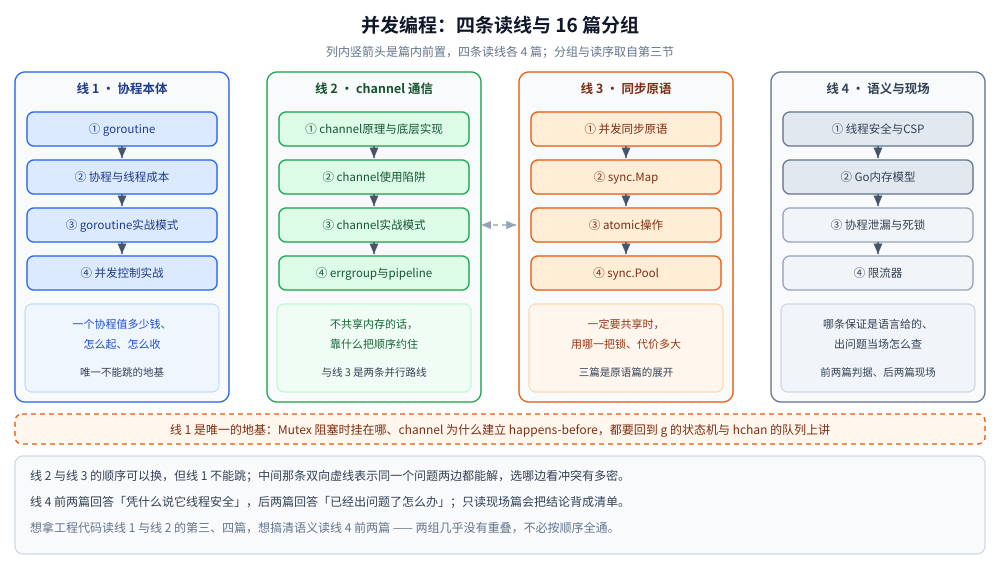

# 并发编程

> 覆盖：本目录 16 篇的分工表、阅读路线与篇间依赖 —— 判据是「这个 API / 原语怎么用」，从 goroutine 起手，经 channel 与同步原语，收到内存模型与生产问题。
>
> 不覆盖：调度器怎么排 G/M/P、内存怎么分、GC 怎么跑见 [运行时/README.md](../运行时/README.md)；切片 / map / 接口这些语言机制见 [类型与语法/](../类型与语法/)；`context`、连接池、定时任务这些项目级写法见 [工程实践/](../工程实践/)。
>
> 内容整理自个人学习笔记；素材见 [素材清单](../../../素材清单.md)。

---

## 一、一句话定位与它凭什么

**本节要点**：`并发编程/` 与 `运行时/` 的分界只有一条 —— **换个问题就问换本目录**。写「`Mutex` 该怎么用、`sync.Map` 什么时候别用」在这层；写「`Mutex` 的排队字段长什么样、P 的本地队列怎么被偷」在那层。

| 这个问题在问 | 归哪层 | 本目录对应篇 |
|---|---|---|
| 这个原语 / API 怎么用、什么时候不该用 | `并发编程/` | [并发同步原语.md](并发同步原语.md)、[sync.Map.md](sync.Map.md)、[限流器.md](限流器.md) |
| 起了协程之后代码怎么写才不收口就泄漏 | `并发编程/` | [goroutine实战模式.md](goroutine实战模式.md)、[协程泄漏与死锁.md](协程泄漏与死锁.md) |
| 这个语义到底是不是语言保证的 | `并发编程/` | [Go内存模型.md](Go内存模型.md)、[线程安全与CSP.md](线程安全与CSP.md) |
| 运行时内部怎么排程、怎么分配、怎么回收 | `运行时/` | 见 [运行时/README.md](../运行时/README.md) |

⭐ 这条分界与 Java 侧一致：`java/并发编程/` 与 `java/运行时/` 用同一把尺子切，所以两边可以逐篇对照读（见第五节末行）。

---

## 二、分工表：16 篇各讲什么

**本节要点**：一张表说清每篇的独有能力 —— **同一张表只在这里维护一份**，[go/README.md](../README.md) 只留指向本节的入口。

| 篇 | 讲什么 |
|---|---|
| [goroutine.md](goroutine.md) | 与线程的五维对照、`g` 结构与六态、`gopark` / `goready`、初始栈与增长、循环变量语义 |
| [协程与线程成本.md](协程与线程成本.md) | 把「进程 / 线程 / 协程的创建成本」量出来：`BusyN` + `LockOSThread` 超订扫描、乒乓切换单次成本、阻塞协程栈内存、`GOMAXPROCS` 与并发 / 并行；⭐ 三条只有量过才讲得准的话（6000 : 25 : 1、核数处到顶、2KB 是初始栈而非内存账） |
| [goroutine实战模式.md](goroutine实战模式.md) | 七个典型案例、项目里四种用法、端到端实例与对照实测 |
| [channel原理与底层实现.md](channel原理与底层实现.md) | `hchan` 字段、收发流程、缓冲区的「总是新鲜的」、select 三轮检查 |
| [channel使用陷阱.md](channel使用陷阱.md) | 能不能先判断阻塞再写、四个必踩点、死锁什么时候才报 |
| [channel实战模式.md](channel实战模式.md) | 通信六案例、多生产者 + 单消费者的两个同步点 |
| [并发同步原语.md](并发同步原语.md) | Mutex 与饥饿模式、RWMutex 相容矩阵、`sync.Once`、分段锁、WaitGroup 误用（⭐ `sync.Map` 与 atomic 已各成一篇） |
| [sync.Map.md](sync.Map.md) | 不是「更快的 map」：read/dirty 双 map（1.9–1.25）与哈希前缀树（**1.26 起**）两代结构、三场景实测、选型判据 |
| [atomic操作.md](atomic操作.md) | atomic 与锁的取舍、老函数族与 1.19 类型族、64 位对齐、伪共享实测、顺序一致语义 |
| [sync.Pool.md](sync.Pool.md) | 不是缓存而是「减少分配」、victim cache、按 P 分片与偷取、必须重置 |
| [errgroup与pipeline.md](errgroup与pipeline.md) | `errgroup` 的语义与硬约束、pipeline 的 stage 拆分与 channel 收口 |
| [并发控制实战.md](并发控制实战.md) | 打印升序数字、交替打印奇偶数、获取协程返回值 |
| [线程安全与CSP.md](线程安全与CSP.md) | ⭐ **并发安全的判据 + 两条路线**：值传递与引用语义（拷贝结构体不等于隔离数据）、两种坏法（`a++` 静默丢更新 975≠1000 / map 并发写 `fatal error` 不可 recover）、三类线程安全类型与「安全」的边界（单方法安全≠复合操作原子）、共享内存 vs CSP 的失败模式（静默出错且退出码 0 vs 当场死锁并指出行号）、代价实测（atomic 4ms / Mutex 31ms / channel 73ms）、选型口诀 |
| [Go内存模型.md](Go内存模型.md) | 三层重排、`happens-before` 边、数据竞争为何是未定义行为、atomic 的顺序一致立场、`-race` 能测什么、与 Java JMM 的逐条对照 |
| [协程泄漏与死锁.md](协程泄漏与死锁.md) | 泄漏四类成因与复现代码、pprof 排查、死锁四条件 |
| [限流器.md](限流器.md) | `x/time/rate` 的三种接入骨架、把读数量出来的实测、三个必踩的坑 |

---

## 三、阅读路线

**本节要点**：16 篇按四条读线走，**线 1 是唯一的地基**，线 2 与线 3 是同一件事的两条路线（通信 vs 共享），线 4 把前面所有取舍钉成规范与现场问题。

| 读线 | 篇（按序） | 这条线在回答什么 |
|---|---|---|
| **线 1 · 协程本体**（4 篇） | goroutine → 协程与线程成本 → goroutine实战模式 → 并发控制实战 | 「一个协程值多少钱、怎么起、怎么收」 |
| **线 2 · channel 通信**（4 篇） | channel原理与底层实现 → channel使用陷阱 → channel实战模式 → errgroup与pipeline | 「不共享内存的话，靠什么把顺序约住」 |
| **线 3 · 同步原语**（4 篇） | 并发同步原语 → sync.Map → atomic操作 → sync.Pool | 「一定要共享时，用哪一把锁、代价多大」 |
| **线 4 · 语义边界与现场**（4 篇） | 线程安全与CSP → Go内存模型 → 协程泄漏与死锁 → 限流器 | 「哪条保证是语言给的、出问题当场怎么查」 |

⭐ **线 2 与线 3 的顺序可以换，但线 1 不能跳**：`sync.Mutex` 阻塞时挂在哪、channel 收发为什么会建立 `happens-before`，都要回到 `g` 的状态机与 `hchan` 的队列上讲。

⭐ **线 4 前两篇是「判据篇」，后两篇是「现场篇」**：前者回答「凭什么说它线程安全」，后者回答「已经出问题了怎么办」。只读现场篇会把结论背成清单，读不出为什么 `map` 并发写是 `fatal error` 而不是 `panic`。

⭐ **想拿工程代码，读线 1 与线 2 的第三、四篇；想搞清语义，读线 4 的前两篇** —— 这两组几乎没有重叠内容，不必按顺序全通。

看图时抓住三点：四列自左向右是四条读线，**列内的 ①–④ 只在本线内计位次**，竖箭头是篇内前置；线 2 与线 3 之间那条双向虚线表示「同一个问题两边都能解，选哪边看冲突有多密」；紧贴在四列下方、横贯整幅的那条虚线带写的是「线 1 是唯一的地基」，它不属于任何一列。

---

## 四、篇间依赖（谁是谁的前置）

**本节要点**：「硬前置」是没有它就读不懂本篇的篇目，「强关联」是读完该马上对照的篇 —— 两栏都取各篇文末 `## 关联` 里已有的互引，不另立新关系。

| 篇目 | 硬前置 | 强关联 |
|---|---|---|
| [goroutine.md](goroutine.md) | —（会写 `go f()` 即可） | [GMP调度.md](../运行时/GMP调度.md)（被谁调度）、[函数调用与栈.md](../类型与语法/函数调用与栈.md)（`gobuf` 里的 sp/pc/bp）、[协程与线程成本.md](协程与线程成本.md) |
| [协程与线程成本.md](协程与线程成本.md) | goroutine | [GMP调度.md](../运行时/GMP调度.md)、[线程与进程开销.md](../../java/并发编程/线程与进程开销.md)（Java 侧同批实验）、[GODEBUG与运行时观测.md](../运行时/GODEBUG与运行时观测.md)（`schedtrace` 验证「核数处到顶」） |
| [goroutine实战模式.md](goroutine实战模式.md) | goroutine | [错误处理.md](../类型与语法/错误处理.md)（常驻 worker 的 recover 兜底）、[net包与TCP-UDP编程.md](../网络编程/net包与TCP-UDP编程.md)（每连接一协程）、[线程池.md](../../java/并发编程/线程池.md)（worker 池对照） |
| [channel原理与底层实现.md](channel原理与底层实现.md) | goroutine（阻塞挂到哪个队列） | [channel使用陷阱.md](channel使用陷阱.md)、[并发同步原语.md](并发同步原语.md)、[线程安全与CSP.md](线程安全与CSP.md) |
| [channel使用陷阱.md](channel使用陷阱.md) | channel原理与底层实现 | [协程泄漏与死锁.md](协程泄漏与死锁.md)（死锁判据与关闭语义）、[并发控制实战.md](并发控制实战.md)、[Go内存模型.md](Go内存模型.md)（收发建立了哪些边） |
| [channel实战模式.md](channel实战模式.md) | channel原理与底层实现 | [goroutine实战模式.md](goroutine实战模式.md)（同一批模式的 goroutine 侧）、[并发限制器.md](../../../04-架构与系统/分布式/稳定性/并发限制器.md)（信号量式并发控制的上层用法） |
| [并发同步原语.md](并发同步原语.md) | goroutine、channel使用陷阱（阻塞语义） | [sync.Map.md](sync.Map.md)、[atomic操作.md](atomic操作.md)、[sync.Pool.md](sync.Pool.md)（三篇是它的展开）、[GMP调度.md](../运行时/GMP调度.md)（抢不到锁时协程被怎么处理） |
| [sync.Map.md](sync.Map.md) | 并发同步原语、[map.md](../类型与语法/map.md)（为什么不能并发写） | [线程安全与CSP.md](线程安全与CSP.md)、[sync.Pool.md](sync.Pool.md)、[限流器.md](限流器.md) |
| [atomic操作.md](atomic操作.md) | 并发同步原语（阻塞 vs 不阻塞） | [Go内存模型.md](Go内存模型.md)（顺序一致立场）、[配置热重载与快照.md](../工程实践/配置热重载与快照.md)（`atomic.Pointer` 发布快照）、[线程安全与CSP.md](线程安全与CSP.md) |
| [sync.Pool.md](sync.Pool.md) | 并发同步原语 | [内存分配器.md](../运行时/内存分配器.md)（不用 Pool 时小对象走哪条路径）、[垃圾回收机制.md](../运行时/垃圾回收机制.md)、[接口.md](../类型与语法/接口.md)（`any` 装箱成本） |
| [errgroup与pipeline.md](errgroup与pipeline.md) | channel实战模式、[context.md](../工程实践/context.md) | [协程泄漏与死锁.md](协程泄漏与死锁.md)（取消传不下去就泄漏）、[限流器.md](限流器.md)（`SetLimit` 限在飞数，不是速率） |
| [并发控制实战.md](并发控制实战.md) | channel实战模式 或 并发同步原语（两条路任选一条即可） | [goroutine实战模式.md](goroutine实战模式.md)、[context.md](../工程实践/context.md) |
| [线程安全与CSP.md](线程安全与CSP.md) | 并发同步原语、atomic操作、channel原理与底层实现 | [Go内存模型.md](Go内存模型.md)（规范依据）、[JMM与内存屏障.md](../../java/并发编程/JMM与内存屏障.md)（Java 侧路线对照） |
| [Go内存模型.md](Go内存模型.md) | 线程安全与CSP、atomic操作 | [测试与Mock.md](../工程实践/测试与Mock.md)（`-race` 的容器口径）、[JMM与内存屏障.md](../../java/并发编程/JMM与内存屏障.md) |
| [协程泄漏与死锁.md](协程泄漏与死锁.md) | goroutine、channel使用陷阱 | [pprof性能分析.md](../运行时/pprof性能分析.md)（线上抓堆积）、[trace与运行时指标.md](../运行时/trace与运行时指标.md)（`NumGoroutine` 的陷阱）、[错误处理.md](../类型与语法/错误处理.md)（谁能拦住谁拦不住） |
| [限流器.md](限流器.md) | 并发同步原语、[context.md](../工程实践/context.md)（等待令牌时的取消） | [限流算法.md](../../../04-架构与系统/分布式/稳定性/限流算法.md)（算法底座）、[稳定性组件的Go实现.md](../工程实践/稳定性组件的Go实现.md)、[并发限制器.md](../../../04-架构与系统/分布式/稳定性/并发限制器.md)（速率 vs 在途数） |

---

## 五、本轮实测坐标

**本节要点**：并发类读数**一半在宿主机、一半在容器**，两个口径不能混用 —— 各篇篇首各自写明自己那一组数字来自哪边。

- **本机宿主机**：`go1.26.5 windows/amd64`，`GOMAXPROCS=8`（8 逻辑核）。
  [goroutine.md](goroutine.md)、[协程与线程成本.md](协程与线程成本.md)、[goroutine实战模式.md](goroutine实战模式.md)、[并发控制实战.md](并发控制实战.md)、[channel原理与底层实现.md](channel原理与底层实现.md)、[channel使用陷阱.md](channel使用陷阱.md)、[channel实战模式.md](channel实战模式.md)、[并发同步原语.md](并发同步原语.md)、[sync.Pool.md](sync.Pool.md)、[线程安全与CSP.md](线程安全与CSP.md)、[协程泄漏与死锁.md](协程泄漏与死锁.md)、[限流器.md](限流器.md) 的读数取这里；[并发控制实战.md](并发控制实战.md) 还专门写了一段「口径与本仓其他篇不同」，就是这个原因。
- **容器**：`golang:1.26-alpine`（容器内 `go1.26.8 linux/amd64`，可见 4 逻辑核，`BenchmarkXxx-4`）。
  [sync.Map.md](sync.Map.md)、[atomic操作.md](atomic操作.md)、[errgroup与pipeline.md](errgroup与pipeline.md)、[Go内存模型.md](Go内存模型.md) 取这里；绝对值因核数偏低而偏乐观，只看相对趋势。
- ⚠️ **`-race` 这一档本轮基本是空的**：默认 `golang:1.26-alpine` **没有 gcc**，而 race 检测器需要 cgo（`CGO_ENABLED=0`），直接跑会报 `-race requires cgo`。要跑得 `apk add gcc musl-dev` 或换 `golang:1.26-bookworm`。因此 [线程安全与CSP.md](线程安全与CSP.md) 里 race 那一行明确标注**未实测**（描述取自文档），[errgroup与pipeline.md](errgroup与pipeline.md) 也不给 race 报告；`fatal error` 与死锁的复现是本机真跑，与 race 无关。
- ⚠️ **时序类读数连跑 3～5 次取波动区间**，只断言趋势；跨语言对照（Java 侧 `线程与进程开销.md`）两边在各自容器里跑，绝对值不可直接比。

---

## 六、本目录的边界

**本节要点**：本目录只管 Go 侧的并发写法与语义；原理层的算法、平台层的稳定性组件与 Java 侧的对应篇都不在这里重讲。

- **算法与数据结构层**（令牌桶怎么推导、LRU 怎么淘汰）在 `04-架构与系统/分布式/稳定性/`，本目录的 [限流器.md](限流器.md) 只写 `x/time/rate` 的接入骨架与实测。
- **工程接入层**（`context` 怎么派生、配置快照怎么发）在 [工程实践/](../工程实践/)；本目录只在原语层面给出「为什么必须这么用」。
- **JVM 线程侧**在 `../../java/并发编程/`：`锁与AQS.md` ↔ [并发同步原语.md](并发同步原语.md)、`JMM与内存屏障.md` ↔ [Go内存模型.md](Go内存模型.md)、`线程与进程开销.md` ↔ [协程与线程成本.md](协程与线程成本.md)、`线程池.md` ↔ [goroutine实战模式.md](goroutine实战模式.md)。
- **本项目不写的内容**：cgo 与外部线程的交互、`runtime.SetFinalizer` 的语义、`sync/atomic` 之外的第三方锁 —— 它们要么超出语言侧口径，要么已在别的目录有一篇。

---

## 延伸追问

- **16 篇里哪几篇是「只读一次」的？** → [goroutine.md](goroutine.md) 与 [channel原理与底层实现.md](channel原理与底层实现.md)：它们是其余十四篇的前提；其余各篇都能按现场需要单独进。
- **为什么 `sync.Map`、`atomic`、`sync.Pool` 各占一篇，而不是并回 [并发同步原语.md](并发同步原语.md)？** → 三篇各有独立的判据与实测（双 map 换结构、伪共享、victim cache），并回去会让原语篇变成六千字清单。原语篇只留「Mutex / RWMutex / Once / WaitGroup」这条主干。
- **只想解决线上一个 goroutine 堆积问题，从哪进？** → [协程泄漏与死锁.md](协程泄漏与死锁.md)，再用 [pprof性能分析.md](../运行时/pprof性能分析.md) 与 [trace与运行时指标.md](../运行时/trace与运行时指标.md) 把现场坐实。
- **本目录的分工表会不会和 `go/README.md` 打架？** → 不会。表只在本篇维护一份，`go/README.md` 第二节的 2.2 已改成指向本篇的入口。

---

## 关联

- **上游/总纲**：[go/README.md](../README.md) — Go 知识库六个二级目录的顺序与版本口径
- **同层另一目录**：[运行时/README.md](../运行时/README.md) — 「怎么用」之外的「怎么跑」
- **对照/互补**：[java/并发编程/README.md](../../java/并发编程/README.md) — 同一把尺子切出来的 Java 并发线（13 篇）
- **对照/互补**：[java/运行时/README.md](../../java/运行时/README.md) — JVM 侧的对照线
- **下层原理**：[进程与线程.md](../../../02-计算机基础/linux/进程与线程.md) — 协程与线程成本的内核侧概念
- **上层场景**：[稳定性/README.md](../../../04-架构与系统/分布式/稳定性/README.md) — 限流与并发控制落到服务治理时的口径
- **素材**：[素材清单.md](../../../素材清单.md) — 来源登记
