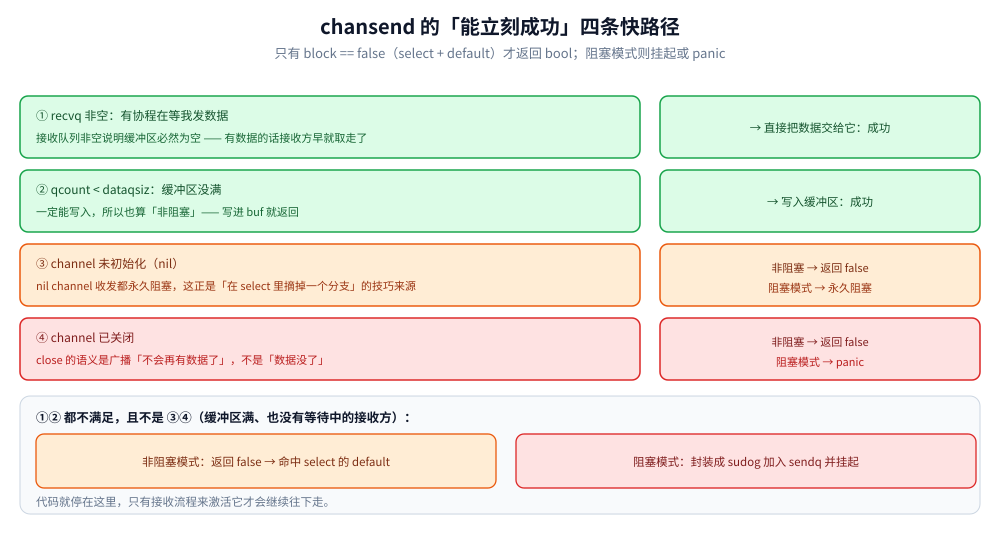

# channel 使用陷阱

> 四个坑、一个误判、三个 `select` 误用——每个坑都给一个能直接跑的最小复现，先看现象，再解释为什么，最后给判据。
>
> 实测口径：本篇所有 `text` 块都是**本机真跑**（go1.26.5 / windows-amd64），两个 `deadlock` 复现各自单独成程序（`fatal error` 无法 recover，跑完进程即退出）。
>
> 内容整理自个人学习笔记，并按《Go 语言核心编程》（李文塔）5.1.5 select 的相关章节补充了机制分析；参考资料与原始素材见 [素材清单](../../../素材清单.md)。

---

## 一、能不能先判断 channel 是否阻塞，再写入数据？

### 1.1 结论先行

> **不能。** `channel` 只有「写成功 / 写失败」两种结果，**没有「事前判断是否阻塞」的 API**。
> 唯一的擦边球是 `select` + `default`——它是「尝试写入，写不进去就走 default」的**非阻塞模式**。

### 1.2 为什么没有「事前判断」

直觉上想要的是 `if canSend(ch) { ch <- v }` 这样的接口。但即使有，也没用：

```text
if canSend(ch) {   // 判断结果为 true
    // ← 就在这行，别的协程可能把缓冲占满了
    ch <- v        // 于是仍然阻塞
}
```

**「判断」和「写入」之间不是原子的**。要让它原子，判断就必须顺带把位置占住——那本身就是一次发送。所以标准库干脆不提供这个 API，只提供「带超时/带 default 的发送」。

### 1.3 唯一的例外：`select` + `default`

```go
select {
case ch <- v: // 有空位就直接写进去
default:      // 写不进去立刻走这里，不阻塞
}
```

它是「**尝试**写入」而不是「**判断能否**写入」：写成功就是真的写进去了，不是只返回一个 bool 让你再去写一次。

反例——**没有 `default` 就是阻塞的**：

```go
select {
case ch <- v: // 没有 default → 写不进去就永久阻塞
}
```

### 1.4 从底层 `chansend` 看「能立刻成功」的四条快路径

`runtime` 的 `chansend` 返回一个 **bool**，表示本次发送是否成功。只有 **`block == false`（非阻塞模式，即 `select` + `default`）** 才会返回 `false`；阻塞模式下直接挂起。

非阻塞模式下的四条「能立刻成功」的快路径：

| # | 判断条件 | 结果 |
|---|---|---|
| ① | `recvq` 非空（有协程在等我发数据） | 直接把数据交给它 → **成功**。注意：接收队列非空说明缓冲区必然为空——有数据的话接收协程早就取走了 |
| ② | `qcount < dataqsiz`（缓冲区没满） | 直接写入缓冲区 → **成功** |
| ③ | channel 未初始化（nil） | 非阻塞 → 返回 `false`；阻塞 → 阻塞 |
| ④ | channel 已关闭 | 非阻塞 → 返回 `false`；阻塞 → **panic** |

**①② 都不满足、且不是 ③④**（缓冲区满、也没有等待的接收方）：

- **非阻塞模式** → 返回 `false`，命中 `select` 的 `default`；
- **阻塞模式** → 当前协程包装成 `sudog` 加入 `sendq` 并挂起，代码停在这里，**只有接收流程来激活它才会继续**。



读法：先看左边四条快路径哪一条命中 —— 任何一条命中都不会把协程挂起，只有全部落空才轮到右边的阻塞与否分叉。

---

## 二、四个坑，每个都给你一个能跑的最小复现

**本节要点**：[channel原理与底层实现.md](channel原理与底层实现.md) 讲「结构怎么工作」，这一节站在使用者角度——**语义边界在哪、哪些操作合法但反直觉**。四个坑分别踩在 channel 生命周期的四步上。

### 2.1 先定住用途：channel 只干一件事

> **channel 是用于协程间通信的。**（「用通信来共享内存」）

判断一个场景该不该用 channel，只需问一句：**「这里是不是两个或更多协程之间要传数据 / 传信号？」** 是 → 可以用；只是单纯保护一块共享数据 → `sync.Mutex` / `atomic` 更合适。


读法：横轴是 channel 从 `make` 到废弃的四步，每个坑挂在它被触发的那一步；前两个会 panic 出来，后两个不会。

### 2.2 坑一：收发必须成对，否则一定死锁

```go
package main

import "fmt"

func main() {
	ch := make(chan int)
	fmt.Println("准备发送，没有接收方")
	ch <- 1 // 无缓冲、没人接收
	fmt.Println("这行永远到不了")
}
```

```text
准备发送，没有接收方
fatal error: all goroutines are asleep - deadlock!

goroutine 1 [chan send]:
main.main()
	D:/.../p1_nopair/main.go:9 +0x76
exit status 2
```

**怎么读这个报错**：第一行是结论，第二行告诉你**唯一活着的协程卡在哪儿**——`[chan send]` 就是「卡在发送」。如果是 `[chan receive]`，说明卡在接收。

**为什么是「一定」**：无缓冲 channel 的发送要求**收发同时就绪**（[channel原理与底层实现.md](channel原理与底层实现.md) 1.3 实测发送方等了 100ms）。单协程既发又收做不到同时，所以必然死锁。

### 2.3 坑二：`close` 是「广播」，不是「发一个值」

很多资料说「close 一下通知退出」，但没说清它和「发 N 次值」的区别。4 个 worker 等退出信号：

```go
// A：发 3 次值
quit1 := make(chan struct{})
var exited atomic.Int32
for i := 0; i < 4; i++ {
	go func(id int) { <-quit1; exited.Add(1) }(i)
}
for i := 0; i < 3; i++ {
	quit1 <- struct{}{}
}
```

```text
== 坑二 A：4 个 worker，发 3 次值 ==
   发了 3 次值 → 退出 3 个，剩余 1 个永久阻塞
== 坑二 B：同样 4 个 worker，close 一次 ==
   close 一次 → 退出 4 个
```

**根因**：channel 的一个值只能被**一个**接收者取走（单播）；而「已关闭」这个**状态**对每个接收者都成立，所以 `close` 一次等于广播。

| 做法 | 效果 | 问题 |
|---|---|---|
| 发 N 次值 | 唤醒 N 个 | **必须知道 N**，算错了就漏；多发了还会阻塞 |
| `close(quit)` | 唤醒所有等待者 | 只能关一次，重复 close 会 panic |

结论：**想广播必须用 `close`，想点对点投递才用发送。**

### 2.4 坑三：关闭之后，**仍然可以读取**

```go
ch := make(chan int, 3)
ch <- 7
ch <- 8
close(ch)
for v := range ch {
	fmt.Printf("   range 读到 %d\n", v)
}
v, ok := <-ch
```

```text
== 坑三：close 之后读缓冲区 ==
   range 读到 7
   range 读到 8
   再读一次 → v=0 ok=false（零值 + false，不阻塞）
```

**「关闭」的真实含义是「不会再有新数据了」，不是「数据没了」**。所以：

- 缓冲区里剩的会先读完，`range` 读完之后才退出；
- 读空之后再读，永远返回**零值 + `false`**，且**不阻塞**；
- 但**写**会 panic（2d）。

这条也解释了 `range ch` 为什么能自然退出：它的退出条件正是「已关闭 **且** 缓冲区为空」。

### 2.5 坑四：会不会阻塞，取决于「有没有缓冲 + 有没有对手方」

两个程序，cap 都是 2，都发 3 个，结果完全不同：

```go
// A：单协程，没人接收
ch := make(chan int, 2)
ch <- 1
ch <- 2
ch <- 3 // 卡在这里
```

```text
== 坑四 A：cap=2，单协程连发 3 个 ==
   前 2 个进去了
fatal error: all goroutines are asleep - deadlock!

goroutine 1 [chan send]:
```

```go
// B：同样 cap=2，但有一个协程会在 50ms 后来取
go func() {
	time.Sleep(50 * time.Millisecond)
	a, b := <-ch, <-ch
}()
ch <- 1
ch <- 2
ch <- 3
```

```text
   接收方取走 1 2
   第 3 个也进去了，耗时 50ms（缓冲区满，但有人在取）
```

**同一个 `cap`，同样的三次发送**：A 死锁，B 只是等了 50ms。差别只有一个——**有没有人在取**。

所以「缓冲区大小」决定的是**能积压多少**，「对手方」决定的是**要不要等**。这和 1.4 的四条快路径是同一件事的两种说法：①有接收方在等、②缓冲区有空位，任何一条成立就不阻塞。

---

## 三、channel 的死锁到底什么时候报？——四条判据

### 3.1 四条判据

死锁不是「只要有协程阻塞就报」，`runtime` 的判据是**全部**满足：

| # | 判据 | 说明 |
|---|---|---|
| 1 | 所有协程都阻塞 | 有一个还在跑就不报 |
| 2 | 没有外部事件能让它解开 | 定时器、网络 IO、信号都算外部事件 |
| 3 | **`main` 也阻塞了** | `main` 退出时程序就结束了，不算死锁 |
| 4 | 没有任何非阻塞的 goroutine | 包括后台协程 |

**第 1、2 条合起来**就是那句报错的字面意思：`all goroutines are asleep`。加了定时器就不算 asleep：

```go
select {
case v := <-ch:      // 永远等不到
case <-time.After(time.Second): // 有了这个，1 秒后会醒来 → 不报死锁
}
```


读法：从左往右逐条判 —— 任何一条不满足就直接返回「不是死锁」，四条全过才 throw；所以「有协程阻塞」远不等于「会报死锁」。

### 3.2 判据 4 的验证：普通协程阻塞，程序静默退出（不报错）

这条最容易被误解。`main` 结束了，程序就走了，**不会等后台协程**：

```go
go func() { <-ch }() // 起个协程永远阻塞
// main 直接返回
```

此时 `main` 没有阻塞（判据 3 不满足），所以**不报错**，进程静默退出，那个协程连同它的等待一起消失。这也是「泄漏」和「死锁」的分界：**泄漏是某个协程永远等不到，但程序还活着**。

### 3.3 判据 3 的验证：`for range` 忘了 `close`，`main` 直接死锁

```go
ch := make(chan int)
go func() {
	for i := 0; i < 3; i++ {
		ch <- i
	}
	// 忘了 close(ch)
}()
for v := range ch { // range 等 close，永远等不到
	fmt.Println(v)
}
```

`main` 卡在 `range` 上不退出（判据 3 满足），发送方也早已退出，没有任何外部事件（判据 2 满足）→ 报 `fatal error: all goroutines are asleep - deadlock!`。

**注意这和第 2.3 节的坑二是同一件事的两面**：那里说「close 是广播」，这里说「不 close，range 就不退出」。

### 3.4 为什么必须「全阻塞」才报

因为 `runtime` 只能判断「**现在**有没有任何可运行的东西」。它没法知道「未来会不会有网络包到达」「定时器会不会触发」——所以只要还存在任何可能推进的协程或外部事件，它就不能断言死锁。

**推论（最危险的一条）**：只要还有一个协程在跑（哪怕是 `for {}` 空转），**死锁就永远不报**，变成**静默卡死**。线上表现为「进程活着、CPU 有占用、但业务全停」——比 panic 难查得多。

判据落到排查上：**看到卡死但没 panic，先找那个还在跑的协程**。

---

## 四、`select` 的三个高频误用

### 4.1 误用 ①：以为 `select` 会按「书写顺序」挑 case

```go
for i := 0; i < 1000; i++ {
	a <- 1
	b <- 1
	select {
	case <-a: // 写在前面
		nA++
	case <-b:
		nB++
	}
	// 清掉另一个残留值
}
```

```text
   1000 次 select：A=504 B=496（近似均匀 → 随机，不是按书写顺序）

> 五次连跑 A 落在 473 ~ 532 之间，没有一次稳定偏向前面的 case。
```

底层是 `pollorder` 的**随机洗牌**（[channel原理与底层实现.md](channel原理与底层实现.md) 5.1）：随机化是**故意的**，避免某个 case 因为顺序靠前而饿死其它分支。

| 结论 | 说明 |
|---|---|
| 两个都就绪 → 各约一半 | 不是「谁写在前面谁优先」 |
| 想表达**优先级** | 只能自己嵌套：先 `select` 探高优先级的（配 `default` 立即返回），没有再探低优先级的 |
| 与「公平性」的关系 | 随机化就是为了避免顺序靠前的饿死别人 |

### 4.2 误用 ②：用 `default` 做「不阻塞」，结果忙轮询烧 CPU

```go
empty := make(chan int) // 无缓冲且没人发 → 永不就绪
deadline := time.Now().Add(100 * time.Millisecond)
for time.Now().Before(deadline) {
	select {
	case <-empty:
	default:
		spin++
	}
}
```

```text
== 误用：select + default 做「不阻塞」==
   100ms 内空转了 490 万 ~ 594 万次（烧掉的是整个 CPU 核）
```

**`default` 不会让协程「等一会儿」**，它只是让 `select` 立刻返回。于是 `for + select + default` 变成一个**纯 CPU 空转的循环**——100ms 烧掉将近 500 万次（五次连跑 490 万 ~ 594 万）。

正确姿势：

| 需求 | 写法 |
|---|---|
| 真的不阻塞，取不到就走 | `select` + `default`，但**不要放在 `for` 里反复跑** |
| 想等一会儿再看 | `select` + `time.After(d)`，让它挂起 |
| 想在没活时让出 CPU | 在 `default` 里 `runtime.Gosched()` 或 `time.Sleep(1ms)` |

### 4.3 误用 ③：`select` 不会自己退出，忘了加退出分支就是死循环

```go
go func() {
	for {
		select {
		case <-data: // 只等数据
		}
	}
	// close(done) 永远到不了
}()
close(quit) // 以为「通知退出」就够了
```

```text
   100ms 后仍未退出：quit 关了也没人看它
```

**`quit` 关了也白关**——`select` 的分支里根本没有它。这是「优雅退出」最典型的一类 bug：**通知发了，但接收方的 `select` 没监听那个通道**。

正确的循环至少要两支：

```go
for {
	select {
	case v := <-data:
		handle(v)
	case <-quit: // ← 少了这一支，前面的 close 就形同虚设
		return
	}
}
```

---

## 五、应用场景：线上 channel 问题按什么顺序查

**本节要点**：channel 的故障只有两大类——**panic 出来的**和**静默卡住的**。后者占绝大多数，也最难查，所以顺序是「先看是不是静默卡死，再确认是不是泄漏，最后才看性能」。

### 5.1 三步定位

| 顺序 | 现象 | 手段 |
|---|---|---|
| ① | 进程活着但业务全停 | 拿全量栈（`SIGQUIT` / `pprof/goroutine?debug=2`），数一数有多少 goroutine 卡在 `chan receive` / `chan send`。**卡死但没 panic，说明还有协程在跑**（3.4） |
| ② | goroutine 数单调上涨 | 隔 1 分钟抓两次栈，**对比同一批协程还在不在**；在同一个位置不动就是泄漏 |
| ③ | 延迟高、CPU 高 | 看是不是 `for + select + default` 空转（4.2），或 `cap` 太小导致频繁阻塞唤醒 |

### 5.2 症状速查

| 症状 | 先查什么 |
|---|---|
| `fatal error: all goroutines are asleep - deadlock!` | 看报错下面的 `[chan send]` / `[chan receive]`，那是卡点（2.2、2.5） |
| `panic: send on closed channel` | 谁在 close 之后还发：多发送方各自 close，或接收方 close 了（[channel原理与底层实现.md](channel原理与底层实现.md) 6.3） |
| `panic: close of closed channel` | 有两处 close 同一个 channel |
| `panic: close of nil channel` | channel 没初始化就被关了 |
| 程序静默卡住，没有 panic | 有协程还在跑，死锁判据不成立（3.4） |
| `for range ch` 永不退出 | 忘了 `close`，或 close 在另一条不会走到的分支上（3.3） |
| 退出信号发了但没退 | 接收方的 `select` 没监听那个通道（4.3） |
| 唤醒个数少于 worker 数 | 用「发 N 次值」代替了 `close`（2.3） |
| CPU 高但吞吐不涨 | `select` + `default` 空转（4.2） |
| `select` 总是命中同一支 | 以为是书写顺序，实际是 `pollorder` 随机（4.1） |
| goroutine 数只涨不降 | 接收方提前返回，发送方永久阻塞在 `sendq` 上 |

### 5.3 三条判据

1. **凡是要「通知退出」，一律用 `close`，不用发值**——发 N 次值要求你知道 N，而 N 会变。
2. **凡是 `for range` 读 channel，发送方必须有人负责 `close`**——通常是「等所有发送方 `wg.Wait()` 后由单一协程 close」。
3. **凡是 `select` 循环，必须先有退出分支**——`quit` 或 `ctx.Done()`，否则前面所有关闭动作都是无效的。

---

## 延伸追问

- **有缓冲和无缓冲的区别？** → 无缓冲（`dataqsiz = 0`）要求收发**同时就绪**，有缓冲允许发送方写进 `buf` 就返回。实测见 2.5 的 A/B 对照。
- **「向已关闭的 channel 发送」和「重复关闭」分别什么后果？** → 都是 panic，报错原文见 5.2。
- **怎么优雅地关闭多个生产者共享的 channel？** → 生产方统一用 `sync.WaitGroup` 收敛后由**单一协程**关闭，消费方只负责 `range` 读空（2.3）。
- **多个 case 同时就绪时，顺序是随机的吗？** → 是，靠 `pollorder` 的随机洗牌，这是刻意设计，避免某个 case 被饿死（4.1）。
- **`select` 会死锁吗？** → 会，但前提是**没有 `default`**：所有 case 都不可用 → 当前协程挂起；如果所有协程都挂在 channel 上、没人能推动，就报 `fatal error: all goroutines are asleep`（第三节）。

## 关联

- [channel原理与底层实现.md](channel原理与底层实现.md) — 本篇讲「怎么用错」，它讲「为什么是这样」：`hchan` 字段、四条快路径的底层、`select` 的三轮检查
- [channel实战模式.md](channel实战模式.md) — 把机制用对时的六种写法
- [协程泄漏与死锁.md](协程泄漏与死锁.md) — 泄漏的四类成因与 pprof 排查，死锁的五种典型形态
- [并发控制实战.md](并发控制实战.md) — 交替打印、令牌传递等经典题的坑
- [Go内存模型.md](Go内存模型.md) — channel 的收发建立了哪些 happens-before 边

> 反向引用（本篇被下列文档引到）：[channel原理与底层实现.md](channel原理与底层实现.md)、[并发控制实战.md](并发控制实战.md)、[for-range.md](../类型与语法/for-range.md)、[编排与落库.md](../../../04-架构与系统/系统设计/弹幕系统/编排与落库.md)
