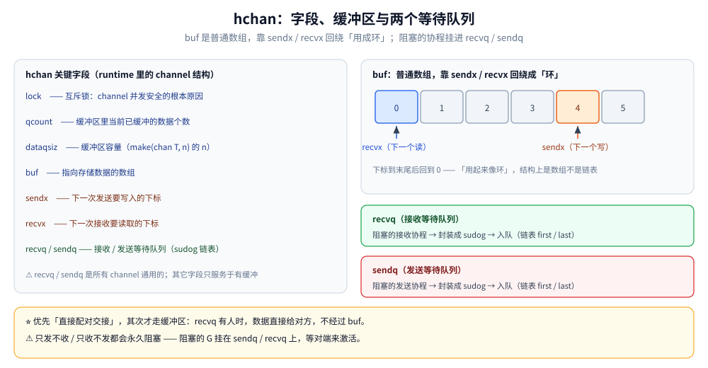
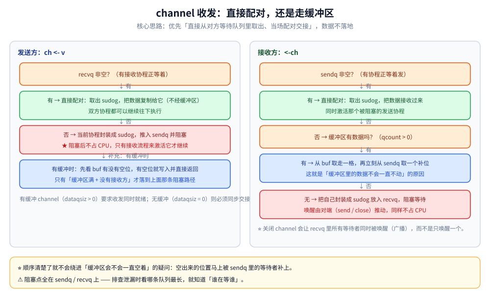
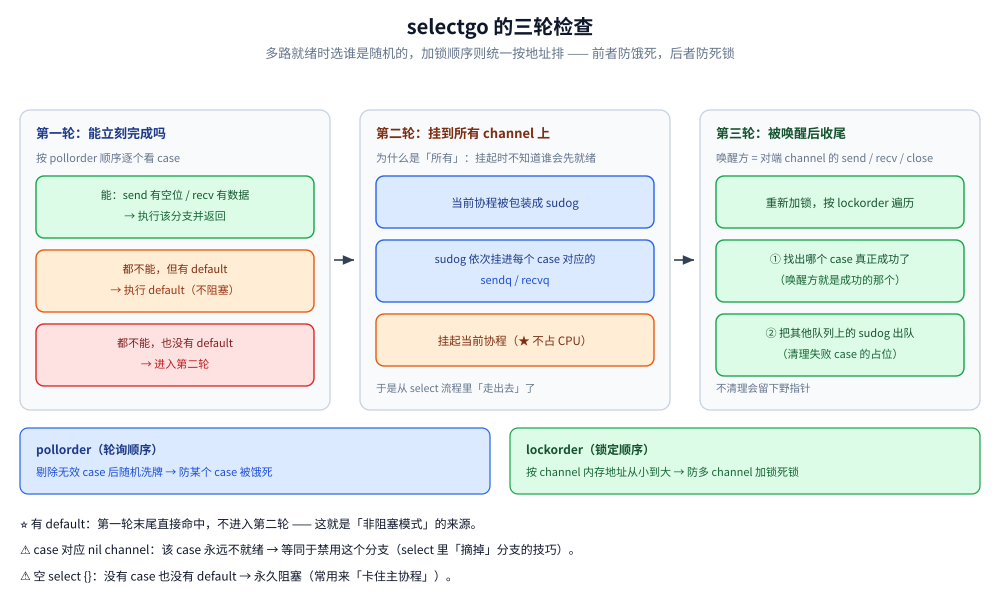
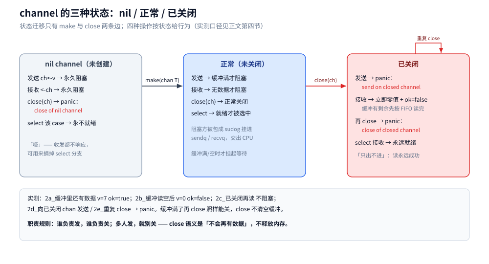

# channel 原理与底层实现

> 先用 55 行把 channel 自己写一遍，再拿它对照 `hchan`：字段为什么是这几个、一次收发走哪条路、并发安全靠什么、`select` 怎么在多个 case 里选。
>
> 实测口径：第 1.2 节的自实现与第 1.3 节的五组行为为**本机真跑**（go1.26.5 / windows-amd64）；第 6.1 节的行为矩阵（1a~1c、2a~2e）同为真跑；第 2 至 5 节的字段与流程来自运行时源码，读数标注在各处。未做的是高并发下的队列长度观测。
>
> 内容整理自个人学习笔记，并按《Go 语言核心编程》（李文塔）5.1.3 chan 的相关章节**补充了机制分析与实测**；参考资料与原始素材见 [素材清单](../../../素材清单.md)。

---

## 一、从零实现：一个 channel 需要几个零件？

**本节要点**：channel 听起来玄，拆开只有四样东西——一块存数据的数组、两个下标、一把锁、两个等待队列。写一遍这四样，`hchan` 的字段表就不用背了。

### 1.1 把需求缩成一句话

channel 要保证的事只有一句：**发送方不被丢、接收方不空转、先来的先出去**。翻译成可执行的三条：

| 要求 | 需要什么 |
|---|---|
| 缓冲区满了不能再写、空了不能读 | 一个数组 + 已用计数 |
| 写满/读空时要等，不能占 CPU | 两个等待队列 + 挂起/唤醒 |
| 多协程同时读写不能乱 | 一把锁 |

对应到实现里就是：`buf`、`count`、`head`/`tail`（回绕成环）、`notFull`/`notEmpty`（两个等待队列）、`mu`（锁）。

### 1.2 完整实现

```go
package main

import "sync"

type MyChan[T any] struct {
	mu       sync.Mutex
	buf      []T // 环形数组；cap=0 时为 nil，走交接槽
	head     int // 下一个读的位置
	tail     int // 下一个写的位置
	count    int // 已缓冲个数
	slot     *T  // 无缓冲时的交接槽
	closed   bool
	notEmpty *sync.Cond // 接收方的等待队列
	notFull  *sync.Cond // 发送方的等待队列
}

func NewMyChan[T any](capacity int) *MyChan[T] {
	c := &MyChan[T]{buf: make([]T, capacity)}
	c.notEmpty = sync.NewCond(&c.mu)
	c.notFull = sync.NewCond(&c.mu)
	return c
}

func (c *MyChan[T]) Send(v T) {
	c.mu.Lock()
	defer c.mu.Unlock()
	if c.closed {
		panic("send on closed channel")
	}
	if len(c.buf) == 0 {
		// 无缓冲：把值放进交接槽，等接收方取走才能返回
		for c.slot != nil {
			c.notFull.Wait()
		}
		c.slot = &v
		c.notEmpty.Signal()
		for c.slot != nil {
			c.notFull.Wait()
		}
		return
	}
	for c.count == len(c.buf) { // 缓冲区满 → 阻塞
		c.notFull.Wait()
	}
	c.buf[c.tail] = v
	c.tail = (c.tail + 1) % len(c.buf)
	c.count++
	c.notEmpty.Signal()
}

func (c *MyChan[T]) Recv() (T, bool) {
	c.mu.Lock()
	defer c.mu.Unlock()
	if len(c.buf) == 0 {
		for c.slot == nil && !c.closed {
			c.notEmpty.Wait()
		}
		if c.slot == nil {
			var zero T
			return zero, false
		}
		v := *c.slot
		c.slot = nil
		c.notFull.Broadcast()
		return v, true
	}
	for c.count == 0 && !c.closed { // 缓冲区空 → 阻塞
		c.notEmpty.Wait()
	}
	if c.count == 0 {
		var zero T
		return zero, false
	}
	v := c.buf[c.head]
	var zero T
	c.buf[c.head] = zero // 清掉引用，避免挡住 GC
	c.head = (c.head + 1) % len(c.buf)
	c.count--
	c.notFull.Signal()
	return v, true
}

func (c *MyChan[T]) Close() {
	c.mu.Lock()
	defer c.mu.Unlock()
	c.closed = true
	// close 是广播：唤醒所有等待者，而不是只叫醒一个
	c.notEmpty.Broadcast()
	c.notFull.Broadcast()
}
```

三个细节值得停一下：

- **`count` 是必需的第 4 个量**。只有 `head`/`tail` 分不清「空」和「满」——两者都满足 `head == tail`。加一个 `count` 就消掉了这个二义性。
- **`Signal` 与 `Broadcast` 不能混用**。取走一个数据只唤醒**一个**发送方（`Signal`），因为只空出一个位置；而 `Close` 必须唤醒**所有**等待者（`Broadcast`），因为「不会再有数据了」这件事对每个人都成立。
- **`c.buf[c.head] = zero`** 是为 GC：出队的槽位不清零，泛型为指针时那个对象永远可达，整块缓冲区就成了隐式缓存。

### 1.3 五组行为，与真 channel 逐条对齐

```go
c := NewMyChan[int](2)
c.Send(1)
c.Send(2)
go func() { c.Send(3) }() // 第 3 个必须阻塞
```

```text
== 1. 有缓冲 cap=2：发 3 个，第 3 个必须阻塞 ==
   [ok] 第 3 个阻塞住了（count == dataqsiz）
   取走 1 之后，被阻塞的第 3 个才进得去
   依次取出 2 3，FIFO 成立

== 2. close 之后 range 能自然退出 ==
   读到总和 3 后退出（closed && count==0 是退出条件）

== 3. 已关闭的 channel 再发送 ==
   panic: send on closed channel

== 4. 无缓冲 cap=0：收发必须同时就绪 ==
   发送耗时 100ms（接收方 100ms 后才来，发送方就得等这么久）
   收到了 7

== 5. close 是广播：一次 close 唤醒全部等待者 ==
   一次 Close 唤醒了 3 个等待者
```

这五条就是 channel 的全部外在语义。第 4 组最能说明「无缓冲」到底是什么：发送方先到，就必须**原地等到接收方来**——耗时正好等于接收方迟到的那 100ms。这不是「缓冲区容量为 0」，而是**根本没有缓冲区，数据只能从一只手交到另一只手**。

### 1.4 与 `hchan` 的唯一关键差别：为什么不用 `sync.Cond`

自实现和 `hchan` 的字段是一一对应的：

| 自实现 | `hchan` | 作用 |
|---|---|---|
| `buf` + `len(buf)` | `buf` + `dataqsiz` | 环形数组与容量 |
| `tail` | `sendx` | 下一个写的位置 |
| `head` | `recvx` | 下一个读的位置 |
| `count` | `qcount` | 已缓冲个数 |
| `notFull` 的等待队列 | `sendq` | 阻塞的发送方 |
| `notEmpty` 的等待队列 | `recvq` | 阻塞的接收方 |
| `mu` | `lock` | 同一把互斥锁 |
| `closed` | `closed` | 关闭标记 |

**唯一的结构性差别是等待队列的形态**：`sync.Cond` 内部是一个**单一的**等待队列，而 `hchan` 用 `sudog` 链表。原因不在性能，在能力——**`select` 需要「同一个协程同时挂在多个 channel 的队列上」**：

```text
select {
case v := <-ch1:   // 我要挂在 ch1.recvq 上
case ch2 <- x:     // 同时挂在 ch2.sendq 上
case <-ctx.Done(): // 还挂在 ctx 的内部 channel 上
}
```

`sync.Cond.Wait()` 只能挂在**一个**条件变量上，做不到「挂三个、谁先来都行」。所以 runtime 必须自己实现一套可多挂的等待节点——那就是 `sudog`，名字取自 "pseudo-g"，它不是 goroutine，只是 goroutine 在某个等待队列上的**占位符**。

一句话：**`sync.Cond` 能实现「等一个」，`hchan` 必须能实现「等多个」**，这就是 `sudog` 存在的理由。

---

## 二、`hchan` 的字段为什么是这几个？

**本节要点**：字段不是随便加的，三组字段对应三件事——存数据、记位置、排队伍。搞清分组，剩下都是细节。

### 2.1 字段表：三组

| 字段 | 含义 | 分组 | 是否只服务有缓冲 |
|---|---|---|---|
| `qcount` | 缓冲区中当前已缓冲的数据个数 | 位置 | 是 |
| `dataqsiz` | 缓冲区容量（`make(chan T, n)` 的 `n`） | 位置 | 是 |
| `buf` | 指向缓冲区数组 | 存储 | 是 |
| `sendx` | 下一次发送要写入的下标 | 位置 | 是 |
| `recvx` | 下一次接收要读取的下标 | 位置 | 是 |
| `sendq` | 发送等待队列（阻塞的发送协程） | 队伍 | 否 |
| `recvq` | 接收等待队列（阻塞的接收协程） | 队伍 | 否 |
| `lock` | 互斥锁 | 同步 | 否 |



读法：字段分三组 —— 缓冲区（buf / dataqsiz / sendx / recvx）、等待队列（recvq / sendq）、一把互斥锁；收发流程只在这三组之间打转。

### 2.2 `buf` 是数组，不是环形链表

很多资料把 `buf` 说成「环形队列」，容易让人以为是**首尾相接的链表**。实际是：

> `buf` 就是一个**普通数组**，只是在使用上通过下标回绕构成环——`sendx++` 到末尾后回到 `0`。

**下标怎么回绕**：channel 为空时发送，`sendx` 指向 `0`；发送完成后 `sendx++`；到达 `len(buf)` 后归零。`recvx` 同理。真正判断「空/满」的不是这两个下标，而是 `qcount`——这和 1.2 节里加 `count` 的理由完全一致。

**⚠️ `sendx` / `recvx` 只对有缓冲的 channel 有意义**。无缓冲时 `dataqsiz = 0`、`buf` 为空，收发走的是 1.2 节里那条「交接槽」路径，两个下标全程为 0。

### 2.3 阻塞的协程去了哪里：`sendq` / `recvq` + `sudog`

**什么时候阻塞**：

- **发送**时缓冲区没空间，且没有等待中的接收方 → 发送协程阻塞；
- **接收**时缓冲区没数据，且没有正在发送的协程 → 接收协程阻塞。

**阻塞后**：协程被封装成 `sudog`，放进对应队列——发送阻塞进 `sendq`，接收阻塞进 `recvq`。两个队列都是链表（`first` / `last`），条件就绪时按 `sudog` 找到并激活对应协程。

`sudog` 里存的不只是「谁在等」，还有**要传的值放在哪**。所以无缓冲时发送方可以直接把数据抄进接收方的目标地址，全程不经过 `buf`——这就是下一节的「直接配对」。

---

## 三、一次收发走哪条路？

**本节要点**：收发有两条路，**先试直接配对，不行才退回缓冲区**。判定顺序收发并不对称，这是读源码最容易看错的地方。

### 3.1 优先直接配对，其次才走缓冲区

```text
发送 ch <- v：
  ① recvq 有等待者？ → 直接把 v 复制给它，双方继续（不碰 buf）
  ② 缓冲区有空位？   → 写进 buf[sendx]，sendx++，qcount++
  ③ 都不行           → 自己封装成 sudog 进 sendq，挂起

接收 v := <-ch：
  ① sendq 有等待者？ → 直接从它手里取（不碰 buf）
  ② qcount > 0？     → 从 buf[recvx] 取，recvx++，qcount--
  ③ 都不行           → 自己封装成 sudog 进 recvq，挂起
```



读法：发送先看 recvq 有没有人在等（有就直接对拷、不碰缓冲区），接收先看 sendq 再查缓冲区 —— 两条路的判定顺序并不对称。

### 3.2 两条路的具体步骤

**情况 A：发送时 `recvq` 里有等待者**——最省事，数据不落地：

```text
1. 从 recvq 取出一个 sudog
2. 直接把要发送的数据复制到它的目标地址（不经缓冲区）
3. 唤醒接收方，发送方继续
```

**情况 B：发送时 `recvq` 为空**——要么进缓冲区，要么自己排队：

```text
1. 缓冲区有空位 → 写进 buf，返回
2. 缓冲区满   → 当前协程封装成 sudog 进 sendq，挂起
3. 后续接收方来取：
   - 它先看自己的 recvq（空）
   - 于是从 sendq 取出一个 sudog
   - 把 sudog 里的数据交给它，并激活那个发送协程
```

**核心思路**：**优先「直接配对交接」，其次才走缓冲区**。这也是 Go「用通信共享内存」在实现层面的体现——发送方和接收方直接对接，数据不落地。

---

## 四、并发安全从哪来，缓冲区为什么总是新鲜的？

**本节要点**：安全来自 `hchan.lock`，没有魔法；「缓冲区总是新鲜的」则是直接配对与补位共同保证的。

### 4.1 就靠那把锁

`hchan` 里有一个 `lock`。channel 可以被多个协程并发访问，但**同一时刻只有一个协程在操作它**——不管读还是写。

所以「channel 是并发安全的」这句话，准确的展开是：**它对 channel 内部状态的修改是串行的**。它保护的是 `buf`、`qcount`、`sendx`、`recvx` 和两个队列，**不保护你传进去的值**——传一个指针进去，指针指向的结构照样可以并发出问题。

> 这也解释了为什么 channel 和 `sync.Mutex` 一样「内部都有锁」，而 `atomic` 是无锁的。三种做法（共享内存加锁 / channel / atomic）的对照见 [并发同步原语.md](并发同步原语.md) 第十节。

### 4.2 空出来的位置立刻被填补

有缓冲时，**优先用缓冲区**（发送看有没有空位，接收看有没有数据），缓冲区满/空才退回「阻塞 + 排队」。而一旦有协程在队列里等，事情就变成接力：

```text
接收方从缓冲区取走一个 → 空出一个位置
        ↓
立刻从 sendq 取出一个等待的发送方，把它的数据填进这个位置
```

**效果**：缓冲区不会「老数据占着位置而新数据进不来」。FIFO 由此成立——先到的数据先被取走，后到的补位。

这也是为什么「缓冲区大小」不等于「并发度」：只要有人等，队列和缓冲区是连着传的，`cap(ch)` 只决定**能积压多少**，不决定**能同时处理多少**。

---

## 五、`select` 在底层怎么选 case？

**本节要点**：`select` 不是「按书写顺序依次尝试」，它先生成两张顺序表，再走三轮检查。[channel使用陷阱.md](channel使用陷阱.md) 讲的是用法层面的坑，这里讲 `selectgo` 的调度。

### 5.1 两张顺序表：`pollorder` 与 `lockorder`

| 顺序表 | 生成方式 | 作用 |
|---|---|---|
| `pollorder` | 剔除无效 case 后**随机洗牌** | 决定「先检查哪一个 case」 |
| `lockorder` | 按 channel 的**内存地址从小到大排序** | 决定「按什么顺序加锁」 |

**为什么要随机化 `pollorder`**：如果按源码书写顺序检查，`select` 就永远偏向排在前面的 case，后面的 channel 可能**永远轮不到**（饿死）。所以 runtime 打乱顺序，保证「多个 case 同时就绪时，选中的是随机、不可预测的」。

**为什么要按地址排 `lockorder`**：`select` 会同时操作多个 channel。若按书写顺序抢锁，两个协程可能用相反顺序加锁（A 拿住 ch1 等 ch2、B 拿住 ch2 等 ch1）→ **死锁**。统一按地址排序，所有协程加锁顺序一致，死锁不可能发生。

### 5.2 三轮检查

```text
【第一轮】按 pollorder 逐个看 case 能不能立刻完成
   ├─ 能（send 有空位 / recv 有数据 / 已关闭可读）→ 执行该分支，返回
   └─ 都不能 → 有 default 就走 default；没有则进第二轮
【第二轮】把当前协程挂到所有 case 的 channel 队列上
   ├─ 协程被包装成 sudog
   ├─ sudog 依次挂进每个 case 对应的 sendq / recvq
   └─ 挂起（不占 CPU）——从 select 流程里「走出去」了
【第三轮】被某个 channel 唤醒后，重新加锁、按 lockorder 遍历
   ├─ ① 找出是哪个 case 真正成功了（唤醒方 = 成功的那个）
   └─ ② 把挂在其他 channel 队列上的 sudog 全部出队
```

**三个必须理解的点**：

1. **第二轮为什么挂到「所有」channel 上？** 挂起时不知道哪个先就绪；任何一个就绪都要能唤醒我，所以每个 case 的队列里都要留占位——这正是 1.4 节说的「`sync.Cond` 做不到」的那件事。
2. **第三轮为什么重新检查？** 唤醒只说明「某个 sudog 被激活了」，并发下可能别人先抢走了数据，所以必须重新验证哪个 case 真的成功，并把其余失败 case 上的 sudog 清理干净（否则队列里会留野指针）。
3. **唤醒是谁做的？** 不是 `select` 自己，而是**对端 channel 的底层逻辑**（`send` / `recv` / `close` 激活队列里的 sudog）。所以「挂起之后」那段代码要等对端来推动。



读法：三轮各做一件事 —— 找「现在就能完成」的 case、把当前协程挂到所有 channel 的等待队列、被唤醒后收尾；没有 case 就绪时的阻塞发生在第二轮之后。

### 5.3 `default`、nil channel 与空 `select`

| 写法 | 在流程里的表现 |
|---|---|
| 有 `default` | **第一轮**末尾直接命中，**不进第二轮**（不挂起）——这就是「非阻塞模式」 |
| case 对应 **nil channel** | 该 case **永远不就绪** → 等同于**禁用这个分支** |
| **空 `select {}`** | 没有 case 也没有 default → **永久阻塞**（常用「卡住主协程」） |

---

## 六、三种状态下的四种操作

**本节要点**：前五节讲「怎么实现」，这节回答第一性问题——**它在三种状态下分别是什么行为**。记两张脸就够：nil 是「哑」的，已关闭是「只出不进」的。

### 6.1 行为矩阵

| 操作 | **nil channel** | 正常（未关闭） | **已关闭** |
|---|---|---|---|
| 发送 `ch <- v` | **永久阻塞** | 缓冲满则阻塞 | **panic**：`send on closed channel` |
| 接收 `<-ch` | **永久阻塞** | 无数据则阻塞 | **立即返回零值 + `ok=false`**（缓冲里还有数据时先取完） |
| `close(ch)` | **panic**：`close of nil channel` | 正常关闭 | **panic**：`close of closed channel` |
| `select` 里的该 case | **永不就绪** | 就绪才选中 | **永远就绪**（接收侧） |

实测（每一条都是本机跑出来的）：

```text
1a_读 nil chan : select 里的 default 被选中 → 该分支永不就绪
1b_写 nil chan : default 被选中 → 同样永不就绪
1c_直接读 nil chan : 20ms 后仍未返回 → 永久阻塞（goroutine 泄漏）
```

```text
2a_缓冲里还有数据 : v=7 ok=true
2b_缓冲读空后     : v=0 ok=false （零值 + false，不阻塞）
2c_已关闭再读     : v=0 ok=false （依然不阻塞）
2d_向已关闭 chan 发送 → panic: send on closed channel
2e_重复 close → panic: close of closed channel
```

> ⭐ **记两张脸**：
> - **nil channel** 是「**哑**」的 —— 收发**都永久阻塞**，`select` 里那一支**永不就绪**；
> - **已关闭 channel** 是「**只出不进**」的 —— **读永远成功**（先取完缓冲，再一直给零值），**写直接 panic**。



读法：三种状态横向排开、四种操作纵向排列，交叉格就是行为；最值得注意的是「已关闭」那一列的读 —— 它不 panic，只返回零值加 ok=false。

### 6.2 一个实用技巧：用 nil 摘掉分支

「nil channel 在 select 里永不就绪」不是冷知识，是可用技巧：

```go
var disabled <-chan int // nil
select {
case v := <-disabled: // 永不就绪，等于这一支不存在
	fmt.Println("不会走到这里", v)
case v := <-active:
	fmt.Println("只在 active 上等", v)
}
```

典型场景是状态机：某个阶段只关心 A、B 两个来源，进入下一阶段后把 A 置 nil、把 C 接上——**不用改 select 的结构，只改通道变量**。

### 6.3 一条职责规则：只有发送方该 close

| 场景 | 谁该 close | 原因 |
|---|---|---|
| 单发送方 → 单/多接收方 | **发送方**，发完就 close | 接收方靠 `ok=false` 判断「数据发完了」；只有发送方知道自己发完了 |
| **多发送方** | **谁都不该直接 close** | 任一发送方 close 后，其余发送方再发就 **panic** |
| 接收方 | **绝对不该 close** | 它无法知道还有没有别的发送者在发 |

多发送方的两种正确收尾：

```go
// 做法一：协调者等所有发送方结束再 close
var wg sync.WaitGroup
done := make(chan struct{})
for _, src := range sources {
	wg.Add(1)
	go func(s Source) { defer wg.Done(); for x := range s { ch <- x } }(src)
}
go func() { wg.Wait(); close(ch) }() // 等所有发送者退出，再关
```

> ⭐ 一句话规则：**「谁负责发，谁负责关；多人发，就别关」**。
> `close` 的语义是**广播「不会再有数据了」**，不是「释放资源」——把它当资源释放用，就会踩到 2d（向已关闭 channel 发送 panic）。

---

## 七、应用场景：什么现象值得翻 `hchan`

**本节要点**：这一节的用途是**把现象翻译成字段**。看到下面这些症状，知道该去查 `qcount`、`sendq` 还是 `closed`，比背字段表有用。

| 现象 | 对应机制 | 该动什么 |
|---|---|---|
| 协程数持续上涨，CPU 却不高 | 全卡在 `sendq` / `recvq`（挂起不占 CPU） | 查有没有人收；看 `cap` 是否太小 |
| 程序静默卡死（不 panic） | 部分协程阻塞但仍有协程在跑 → 触发不了 `all goroutines are asleep` | 打全量栈 dump，找阻塞点的队列 |
| `select` 总是选中同一支 | 误以为是书写顺序；实际由 `pollorder` 随机决定 | 如果依赖顺序，说明设计错了 |
| `select` 里某一支从不触发 | 该 case 的 channel 可能是 nil | 查这个 channel 有没有被初始化 |
| 关闭时 panic `send on closed channel` | close 职责错位（多发送方各自 close，或接收方 close） | 改成「协调者等 `wg.Wait()` 后统一 close」 |
| 关闭后消费方还在读到零值 | 未判 `ok` | 用 `v, ok := <-ch` 或 `for range` |
| 缓冲区似乎没起作用 | 有接收方在等时，发送走「直接配对」，根本不用 `buf` | 想要积压，得让接收方暂时不在等 |

第一、二条最值得记：**阻塞的协程不占 CPU**，所以「泄漏」和「卡死」在 CPU 曲线上看起来都像健康状态，只能靠 `pprof` 的 goroutine 数和栈 dump 抓（见 [协程泄漏与死锁.md](协程泄漏与死锁.md)）。

---

## 八、具体使用：把机制用在三处

**本节要点**：机制本身不会直接用，落到代码里只有三种形态。每种的正确性都能从上文的字段找到依据。

### 8.1 用 `close` 做广播（不是发 N 次值）

```go
done := make(chan struct{})
for i := 0; i < 5; i++ {
	go func() {
		<-done // 全部阻塞在 recvq
	}()
}
close(done) // 一次 Broadcast 唤醒全部
```

依据：6.1 节「已关闭的 channel 接收永远就绪」。实测一次 `Close` 唤醒了 3 个等待者（1.3 节第 5 组）。发 N 次值只能唤醒 N 个，而且必须知道 N——这就是两者不可互换的原因。

### 8.2 用 `select` + `default` 做非阻塞探测

```go
select {
case v := <-ch:
	// 有数据，处理
default:
	// 没数据，立刻返回（不进第二轮，不挂起）
}
```

依据：5.3 节「有 `default` 就不进第二轮」。注意这不是「判断 channel 是否阻塞」的通用手段——见 [channel使用陷阱.md](channel使用陷阱.md) 第一节。

### 8.3 用 nil 做分支开关

见 6.2 节。把「关掉某个来源」从「改 select 结构」变成「把通道变量置 nil」，状态机切换时代码不用重排。

---

## 延伸追问

- **有缓冲和无缓冲的区别？** → 无缓冲（`dataqsiz = 0`）要求收发**同时就绪**才能完成，实测发送方等了整整 100ms（1.3 节第 4 组）；有缓冲允许发送方写进 `buf` 就返回。
- **`close` 一个 channel 会释放内存吗？** → 不会。它只置 `closed` 标记并唤醒等待者，`buf` 里的数据仍会被读完（6.1 节 2a）。
- **怎么判断一个 channel 已经关闭？** → 没有 `IsClosed()` 这类 API，只能靠接收时的 `ok=false`，或用 `select` + `default` 探测。
- **channel 是「无锁」的吗？** → 不是，`hchan` 里有 `lock`；只是无竞争时开销很低。它保护的只是 channel 内部状态，不保护你传进去的值（4.1 节）。
- **`select` 的加锁顺序和书写顺序一致吗？** → 不一致，统一按**地址排序**（`lockorder`），这正是防死锁的关键（5.1 节）。

## 关联

- [channel使用陷阱.md](channel使用陷阱.md) — 用法层面的坑：非阻塞模式、关闭后的读写、死锁判据
- [channel实战模式.md](channel实战模式.md) — 把这些机制用起来的典型写法
- [并发同步原语.md](并发同步原语.md) — Mutex / RWMutex / sync.Once 的对照
- [线程安全与CSP.md](线程安全与CSP.md) — 为什么这条通信路径被 Go 官方推荐
- [GC基础算法.md](../../../02-计算机基础/垃圾回收/GC基础算法.md) — 挂起与唤醒背后的调度与 GC 协作
- [goroutine.md](goroutine.md) — 阻塞的 goroutine 挂到哪里去了

> 反向引用（本篇被下列文档引到）：[context.md](../工程实践/context.md)、[Go内存模型.md](Go内存模型.md)、[errgroup与pipeline.md](errgroup与pipeline.md)、[for-range.md](../类型与语法/for-range.md)、[IO多路复用.md](../../../02-计算机基础/操作系统/IO多路复用.md)、[接入与推送.md](../../../04-架构与系统/系统设计/弹幕系统/接入与推送.md)
