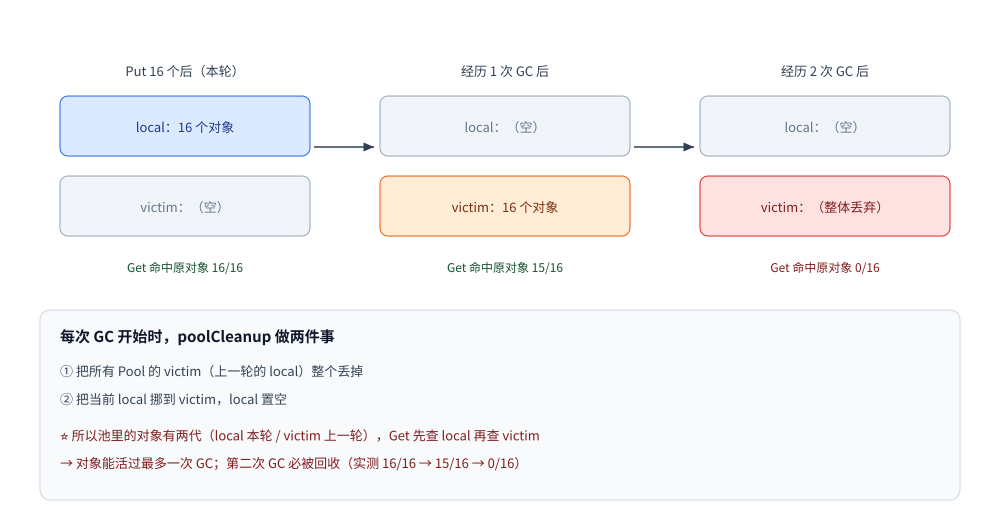
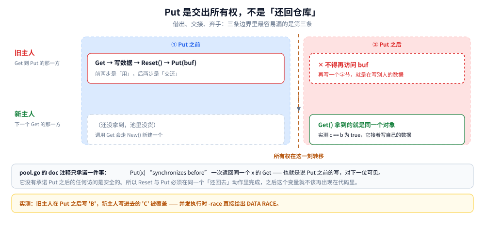
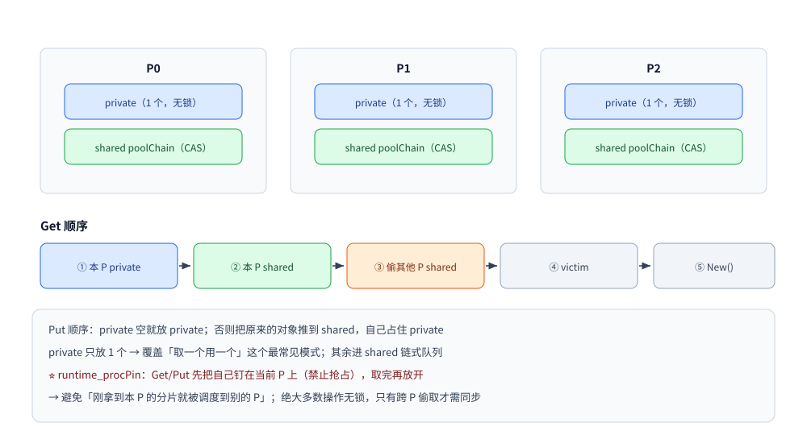

# sync.Pool

> 临时对象复用的正确姿势：与 GC 的交互（victim cache）、按 P 分片与偷取、必须重置、Put 即交出所有权、以及"不要把它当缓存"
>
> 内容整理自大厂 Go 后端面试真题，参考资料与原始素材见 [素材清单](../../../素材清单.md)。
>
> 池化只是"减少分配"的一种手段，减少 GC 压力的全貌（GOGC / GOMEMLIMIT / 指针密度）见 [垃圾回收机制.md](../运行时/垃圾回收机制.md)。

---

## 一、`sync.Pool` 是什么？它和"缓存"是一回事吗？

**本节要点**：这题的分水岭就是这一句 —— **"Pool 不是缓存"**。答成缓存，后面全错。

### 1.1 一句话定位

| | `sync.Pool` | 缓存（如 LRU / Redis） |
|---|---|---|
| 存什么 | **临时对象**，持有者不关心它是不是原来的那一个 | **有价值的数据**，必须能按 key 找回来 |
| 对象何时消失 | **随时可能被 GC 清掉**（下一节实测） | 只受容量/过期策略控制 |
| 命中率是目标吗 | ❌ 不是，**"取不到就新建"是设计预期** | ✅ 是 |
| 解决什么 | **减少分配 → 减少 GC 压力** | 减少对下游（DB/服务）的访问 |

> ⭐ 一句话：**`sync.Pool` 是"减少分配次数的垃圾桶"，不是"保证能取回数据的仓库"。**

### 1.2 它真正解决的问题

分配一个新对象（尤其是**带切片的缓冲区**）有三层代价：向分配器要内存、初始化、**以及最贵的——让 GC 多扫一份垃圾**。
Pool 的作用是把"用完就扔"改成"用完还回去，下次接着用"，直接把**分配次数与 GC 扫描量**压下来。

⚠️ **先想清楚"值不值得池化"**：如果对象很小（比如一个 `int`），分配器处理它只需几纳秒，
而进出 Pool 要走**按 P 分片 + 接口装箱**，反而更慢（实测见第三节）。

---

## 二、池里的对象会被 GC 清掉吗？⭐

**本节要点**：这题直接考"你有没有读过 `sync/pool.go`"。正确答案是**会，而且有个"缓刑一轮"的 victim cache**。

### 2.1 实测：连续三次测量

```go
p := &sync.Pool{New: func() any { seq++; return &Buf{id: 1000 + seq} }}
orig := make(map[*Buf]bool)
var bufs []*Buf
for i := 0; i < 16; i++ {
    seq++
    b := &Buf{id: seq}
    orig[b] = true
    bufs = append(bufs, b)
}
putAll := func() { for _, b := range bufs { p.Put(b) } }
countHits := func() int {
    hit := 0
    for i := 0; i < 16; i++ {
        if v, ok := p.Get().(*Buf); ok && orig[v] { hit++ }
    }
    return hit
}

putAll()
fmt.Printf("Put 16 个后立刻 Get 16 次：命中原对象 %d/16\n", countHits())
putAll()
runtime.GC()
fmt.Printf("经历 1 次 GC 后 Get 16 次：命中原对象 %d/16\n", countHits())
putAll()
runtime.GC()
runtime.GC()
fmt.Printf("经历 2 次 GC 后 Get 16 次：命中原对象 %d/16\n", countHits())
```

```text
Put 16 个后立刻 Get 16 次：命中原对象 16/16
经历 1 次 GC 后 Get 16 次：命中原对象 15/16 —— 从 victim cache 里捡回来
经历 2 次 GC 后 Get 16 次：命中原对象 0/16 —— victim 被丢弃，全是新建的
```

### 2.2 为什么会"缓刑一轮"

每次 GC 开始时，运行时执行 `poolCleanup`：

```text
① 把所有 Pool 的 victim（上一轮的 local）整个丢掉
② 把当前 local 挪到 victim，local 置空
```



所以池里的对象有**两代**：`local`（本轮）和 `victim`（上一轮）。
`Get` 先查 local，查不到再查 victim —— **对象能活过最多一次 GC，第二次必被回收**。

### 2.3 ⚠️ 顺带解释"为什么是 15/16 而不是 16/16"

差的那一个是 `Put` 落在某个 P 的 `private` 槽里，而 `Get` 时**当前 P 变了** ——
`getSlow` 找 victim 时，`private` 只查**当前 P 对应的那一片**，其他 P 的 private 不查（只查它们的 `shared`）。
所以池里的对象在**跨 P 之后**命中率会掉一点。这不是 bug，是"分片 + 无锁"的必然代价。

---

## 三、Pool 到底能省多少？

**本节要点**：不能只说「更快」。要能说出**省的是分配次数**（`allocs/op`、`B/op`），并解释「为什么存 slice 会多出 24 字节」。

### 3.1 实测（4 KB 缓冲区，反复借还）

```text
BenchmarkAlloc4K-8       809912    1701 ns/op    4096 B/op    1 allocs/op
BenchmarkPool4K-8      15337658      72.48 ns/op    24 B/op    1 allocs/op
BenchmarkNewBuffer-8     811857    1719 ns/op    4096 B/op    1 allocs/op
BenchmarkPoolBuffer-8  44528149      25.09 ns/op     0 B/op    0 allocs/op
```

| 做法 | 耗时 | 每次分配 | 结论 |
|---|---|---|---|
| 每次 `make([]byte, 0, 4096)` | 1701 ns | 4096 B | 基线 |
| 走 Pool 借 `[]byte` | **72.5 ns（23×）** | **24 B** | 快很多，但**还剩 24 B** |
| 每次 `bytes.NewBuffer` | 1719 ns | 4096 B | 基线 |
| 走 Pool 借 `*bytes.Buffer` | **25.1 ns（68×）** | **0 B** | 完全零分配 |

### 3.2 ⭐ 那 24 B 是哪来的？—— 接口装箱

Put/Get 的签名是 `any`，而 `[]byte` 是 **24 字节的 slice header**（指针 + len + cap），
比一个机器字（8 字节）大 —— **装不进接口的数据字里，必须额外分配 24 字节把它拷进去**。

```go
// ❌ 每次 Put 都要装箱 24 字节
p.Put(buf[:0])                       // []byte → any：分配 24 B

// ✅ 存指针，指针正好一个机器字，装箱零成本
p.Put(bufPtr)                        // *bytes.Buffer → any：不分配
```

> ⭐ **实践结论**：**Pool 里存指针，不要存大结构体或 slice**。
> 这也是标准库的做法 —— `fmt` 的 `ppFree` 存 `*pp`、`encoding/json` 的 encoder cache 存指针。
>
> 一个能直接对着源码核的例子：`net/http` 的拷贝缓冲区池存的是 `*[32768]byte` 而不是 `[]byte`
> （`var copyBufPool = sync.Pool{New: func() any { return new([copyBufPoolSize]byte) }}`，`server.go:834`），
> 取出来时转成切片用、放回去时再转回数组指针（`server.go:837` / `:844`）。

### 3.3 省下的不只是时间：GC 次数与暂停

`allocs/op` 只回答「这一次调用有没有分配」，而 Pool 想改善的是一件全局的事：**整个进程少扫多少垃圾**。这一节把它测出来。

同一份工作量（200 万次「取一块 4 KB 缓冲、写 15 字节、丢掉」），两组各跑独立进程，交替三轮：

| 轮 | 做法 | 耗时 | GC 次数 | GC 暂停合计 | 累计分配 |
|---|---|---|---:|---:|---:|
| 1 | 每次 `NewBuffer` | 7976.2 ms | 2127 | 896.4 ms | 7904.087 MB |
| 1 | 走 Pool | 102.6 ms | **0** | **0 ms** | **0.004 MB** |
| 2 | 每次 `NewBuffer` | 7466.2 ms | 2111 | 840.7 ms | 7904.092 MB |
| 2 | 走 Pool | 92.2 ms | **0** | **0 ms** | **0.009 MB** |
| 3 | 每次 `NewBuffer` | 6068.2 ms | 2427 | 850.8 ms | 7904.088 MB |
| 3 | 走 Pool | 88.8 ms | **0** | **0 ms** | **0.004 MB** |

读数取自 `runtime.MemStats` 的 `NumGC` / `PauseTotalNs` / `TotalAlloc` 前后差（`go1.26.8 linux/amd64`，容器 4 核）。

三条读数：

1. **累计分配 7904 MB 三轮一字不差**——200 万 × 4 KB 是个常数，这一列可对账，说明两组跑的是同一份工作。
2. **GC 次数 2111~2427、暂停合计 0.84~0.90 s**。这两个数才是 Pool 的靶子：不是「这一次快了多少」，而是「整个进程醒了多少次、统共停了多少秒」。
3. **Pool 侧 GC 0 次、累计分配 4~9 KB**（只有首次 `New` 那一块加上池自身的少量簿记），因为根本没有垃圾需要收。

⚠️ 耗时那一列不能拿来排名：6068~7976 ms 抖了 1.3 倍，GC 密集的负载在同机抢核时就这样。**站得住的只有 GC 次数、暂停与累计分配三列**——它们三轮稳定。

⚠️ 这个实验第一版是错的，值得记：只用 `runtime.KeepAlive` 不强制逃逸，读数出来是 `TotalAlloc +0.0 MB`、`NumGC +0`——编译器把每轮的 4 KB 缓冲摊在栈上复用了，两组其实都没分配。加一个包级 `sink` 变量接住，才看到 7904 MB。**先确认拿到的是那份代码，再信读数。**

---

## 四、为什么 `Get` 出来的对象必须重置？

**本节要点**：核心是实际踩过没有。脏数据不只是正确性问题——**带敏感数据时是跨请求泄漏的安全问题**。

### 4.1 实测：不重置就会拿到脏数据

```go
p2 := &sync.Pool{New: func() any { return bytes.NewBuffer(make([]byte, 0, 64)) }}
buf := p2.Get().(*bytes.Buffer)
buf.WriteString("上一次的脏数据")
p2.Put(buf)
reused := p2.Get().(*bytes.Buffer)
fmt.Printf("复用到未重置的 Buffer，里面已经有 %d 字节：%q\n", reused.Len(), reused.String())
```

```text
复用到未重置的 Buffer，里面已经有 21 字节："上一次的脏数据"
```

### 4.2 两条铁律

1. **还回去之前先清干净**（`buf.Reset()`、`slice[:0]`、把字段归零）——否则下一个人拿到脏数据；
2. **借出来之后不要假设它是干净的**——你无法保证上一个使用者按规矩做了。

⚠️ **更危险的是"带敏感数据"的缓冲区**：复用没清干净的 buffer 会导致**跨请求数据泄漏**（另一个用户的 token
残留在同一个 buffer 里）。所以"用完即清"不仅是正确性问题，还是**安全问题**。

### 4.3 `Put` 之后还能不能用它？

**不能。`Put` 是交出所有权，不是「还回仓库」。**

`pool.go` 的文档注释只承诺一件事：

> In the terminology of [the Go memory model], a call to Put(x) "synchronizes before" a call to Pool.Get returning that same value x.

也就是说：**`Put` 之前的写，对拿到同一个 `x` 的那位可见**。它没有、也不可能承诺「`Put` 之后你还能碰它」——因为从那一刻起，对象随时可能被下一个人取走。



图怎么读：左列是 `Put` 之前、右列是 `Put` 之后，两行分别是旧主人与新主人。要读出的是**交界那一下**——从 `Put` 返回开始，同一个对象已经归下一位，旧主人手里的变量只是一个悬着的名字。

确定性复现（`GOMAXPROCS(1)` 让 `Get` 落回同一个 P，保证拿回同一个对象）：

```go
b := p.Get().(*buf)
b.data[0] = 'A'
p.Put(b)                        // ① 交出所有权

got := make(chan *buf, 1)
written := make(chan struct{})
release := make(chan struct{})
read := make(chan byte, 1)
go func() {
	c := p.Get().(*buf)         // ② 新主人拿到的就是 b
	c.data[0] = 'C'             // ③ 新主人写
	got <- c
	close(written)
	<-release
	read <- c.data[0]           // ⑥ 新主人再读
}()

c := <-got
<-written
b.data[0] = 'B'                 // ④ 旧主人 Put 之后还在写
close(release)

fmt.Printf("同一个对象: %v\n", c == b)
fmt.Printf("旧主人在 Put 之后写了 'B'，新主人再读到的却是 %q\n", <-read)
```

```text
同一个对象: true
旧主人在 Put 之后写了 'B'，新主人再读到的却是 'B'
```

新主人写进去的 `'C'` 被静默改掉了——**没有报错、没有 panic，值就是变了**。

真正并发时 `-race` 会直接定性：

```text
==================
WARNING: DATA RACE
Write at 0x00c0000180a0 by goroutine 10:
  main.main.func4()
Previous write at 0x00c0000180a0 by goroutine 9:
  main.main.func3()
==================
Found 1 data race(s)
exit status 66
```

⚠️ 用 `-race` 复现这类问题要留一个心眼：**race 构建下 `Put` 会主动丢弃约 1/4 的对象**，源码里就写着

```go
if race.Enabled {
	if runtime_randn(4) == 0 {
		// Randomly drop x on floor.
		return
	}
	...
}
```

所以复现脚本必须允许重试（本次连跑 5 次都第 1 轮命中，但那是运气，不是保证）。反过来的推论更实用：**带 `-race` 跑的压测，池命中率天然比正式构建低**，别拿它的数字去调容量。

两条规则的分工要分清：**4.2 管 `Put` 之前（清干净），4.3 管 `Put` 之后（不再碰）**。代码上的写法只有一种：把「重置 + 归还」压进同一个 `defer` 闭包，之后这个变量就不该再出现在函数里。

---

## 五、内部结构：为什么 Pool 是无锁的？

**本节要点**：Pool 常被追问"高并发下会不会成为瓶颈"——答案是不会，因为它是**按 P 分片**的。

```text
每个 P 一份 poolLocal：
  ├─ private  any         ← 只属于这个 P，无锁，容量 1
  └─ shared   poolChain   ← 这个 P 的链式队列，pushHead / popHead 无锁（CAS），跨 P 偷取时才有锁

Get 顺序：本 P 的 private → 本 P 的 shared → 偷其他 P 的 shared → victim → New()
Put 顺序：private 空就放 private；否则把它原来的对象推到 shared，自己占住 private
```



读法：Get 的查找顺序是有代价阶梯的 —— 私有槽最便宜、偷别的 P 最贵，所以真正决定命中率的是「对象有没有落回同一个 P」，而不是池有多大。

| 设计 | 解决的问题 |
|---|---|
| **按 P 分片** | 绝大多数场景下**根本不用加锁**，不成为并发瓶颈 |
| **private 只放 1 个** | 最常见的使用模式是"取一个用一个"，1 个槽就覆盖了大部分请求 |
| **其余进 shared** | 一个请求要拿多个对象时（如嵌套编解码），后面的走链式队列 |
| **偷其他 P** | 负载不均时（某个 P 被抢占）也能拿到对象，避免"本地为空却全局有货" |

⭐ **`runtime_procPin` 的作用**：`Get`/`Put` 会先把自己**钉在当前 P 上**（禁止抢占），
取完再放开 —— 避免"刚拿到本 P 的分片就被调度到别的 P"。

还有四条只在源码里能看到、任何配置文档都不写的事实：

| 事实 | 依据 | 实践含义 |
|---|---|---|
| **Pool 不可复制** | 结构体第一行就是 `noCopy noCopy`（`pool.go:52`） | 复制会被 `go vet` 拦下：`assignment copies lock value to b: sync.Pool contains sync.noCopy`。别把 `sync.Pool` 当值传，要传指针 |
| **`Put(nil)` 是静默忽略** | `func (p *Pool) Put(x any)` 开头 `if x == nil { return }`（`pool.go:99`） | 「`New` 返回了 nil、又被原样 `Put` 回去」不会报错，只会让池子悄悄不再复用 |
| **victim 是 1.13 才有的** | 1.13 release notes：*Pool no longer needs to be completely repopulated after every GC* | 更早的版本上「两次 GC 清空」不成立；同一句还解释了当年「大 Pool 会拉长 STW」的问题 |
| **没有 GC 就没有清理** | `poolCleanup` 挂在 GC 起点（`pool.go:257`） | `GOGC=off` 的进程里，池退化成「永不回收的缓存」——这时它掩盖的是泄漏，而不是省了分配 |

---

## 六、哪些场景**不该**用 Pool？

**本节要点**：知道「什么时候不用」比知道「怎么用」更能说明你真的理解它——Pool 的开销在某些场景会大于收益。

| 场景 | 为什么不该用 |
|---|---|
| 对象很小（几个字节，如 `int`） | 分片 + 接口装箱的开销**大于**分配本身 |
| 对象存活时间很长（会被长期持有） | 不会被归还 → Pool 形同虚设，还白占内存 |
| 有状态、需要严格生命周期管理的对象 | 复用会让状态串味，容易出隐蔽 bug |
| 想当缓存用（要求"Put 了就能 Get 回来"） | **契约不成立**（第二节实测：两次 GC 后 0/16） |
| 对象大小差异极大 | Pool 不区分大小，大对象占着槽，反而浪费内存 |

⭐ 反过来，**最适合 Pool 的三类**：**固定大小的缓冲区**（`bytes.Buffer`、`[]byte`）、
**开销大的编解码中间对象**（JSON/Protobuf 的 encoder/decoder）、**高频分配的小结构体**（但要用指针）。

---

## 七、对象池、连接池、任务池、协程池：它们不是一回事

**本节要点**：这四个东西名字里都有「池」，管的却是四种不同的资源。混用的事故很典型：拿 `sync.Pool` 当连接池（连接永远不会被关），或者拿连接池当对象池（为了复用一个 100 字节的结构体去占一条 TCP）。

| | 复用什么 | 丢掉时发生什么 | 谁负责关闭 | 本仓落点 |
|---|---|---|---|---|
| **对象池**（`sync.Pool`） | 一块内存 / 一个结构体 | 对象被 GC 回收，**外部资源不受影响** | 没有「关闭」这回事 | 本篇 |
| **连接池**（`database/sql`、`http.Transport`） | 一条已握手的连接 | 空闲超时被关；**泄漏的是会被耗尽的上游配额** | 池（要配空闲上限与生命周期） | [数据访问与连接池.md](../工程实践/数据访问与连接池.md)、[HTTP客户端与连接池.md](../网络编程/HTTP客户端与连接池.md) |
| **任务池**（线程池 / 协程池） | 执行任务的线程或协程 | 已提交未执行的任务**要么跑完要么被拒**，不能悄悄消失 | 池的关闭流程 | [任务池.md](../../../02-计算机基础/并发/任务池.md) |
| **名额池**（协程池、信号量） | 并发度名额 | 名额不还不报错，只是永久少一个 | 使用者（`defer`） | [goroutine实战模式.md](goroutine实战模式.md) |

一条判据就够区分：**池里的东西有没有外部句柄（socket、文件、锁、订阅）**。

- 有句柄 → 丢弃路径上必须显式关闭。这正是 [并发数据结构.md](../../../02-计算机基础/并发/并发数据结构.md) 6.2 那条「池的语义是丢弃，不是释放」；
- 没句柄（本片讲的 `sync.Pool`）→ 池只负责「丢掉引用」，所以它**天生当不了连接池**：连接池要的是「归还后仍可复用且能被主动关闭」，`sync.Pool` 两样都不保证。

---

## 使用：把 Pool 用对的三条规则

### 规则一：只存指针，不存大对象

```go
// ✅ 推荐：存指针（装箱零成本、归还的是同一个对象）
var bufPool = sync.Pool{
	New: func() any { return bytes.NewBuffer(make([]byte, 0, 4096)) },
}

func handleJSON(data []byte) error {
	buf := bufPool.Get().(*bytes.Buffer)
	defer func() {
		buf.Reset()      // ⭐ 归还前必须清干净
		bufPool.Put(buf)
	}()
	return json.NewEncoder(buf).Encode(data)
}
```

### 规则二：`defer` 归还，但要先重置

```go
// ❌ 忘记重置：下一个人拿到脏数据（实测会残留 21 字节）
buf := pool.Get().(*bytes.Buffer)
buf.WriteString(resp)
pool.Put(buf)

// ✅ 先 Reset 再 Put
buf.Reset()
pool.Put(buf)
```

### 规则三：`New` 一定要给，避免空指针判断

```go
var p = sync.Pool{New: func() any { return &Item{} }}   // ⭐ 有 New，Get 永远不返回 nil
item := p.Get().(*Item)                                 // 不用判空

// 没有 New 时 Get 可能返回 nil，每个调用点都得判 —— 容易漏
```

### 附：三个可直接抄进项目的池模板

```go
// ① 缓冲区池（编解码、拼 SQL、日志格式化）
var bufPool = sync.Pool{New: func() any { return bytes.NewBuffer(make([]byte, 0, 4096)) }}

// ② 定长字节池（网络收发、压缩）
var bytePool = sync.Pool{New: func() any { b := make([]byte, 32<<10); return &b }}

// ③ JSON 编解码器池（避免反复反射初始化）
var encPool = sync.Pool{New: func() any { return json.NewEncoder(io.Discard) }}
```

### 怎么验证"池化真的有用"

```bash
go test -bench=. -benchmem -run=^$ ./...     # 看 allocs/op 与 B/op 是否真的降下来
```

⭐ **判据不是"更快"，而是 `allocs/op` 与 `B/op` 降下来** —— 单次 ns 只说明这一台机器，
而分配次数下降才意味着**GC 压力真的变小了**（全局收益）。

---

## 延伸追问

- **`sync.Pool` 是缓存吗？** → 不是。它是"减少分配次数的池"，**不保证 Put 进去还能 Get 回来**（两次 GC 后实测 0/16）；要能按 key 取回数据请用 LRU/Redis。
- **池里的对象什么时候会被回收？** → **每次 GC 都会清**；但因为有 **victim cache**（上一轮的 local 会挪到 victim），对象能"活过一轮"，所以实测"1 次 GC 后仍能命中 15/16、2 次后 0/16"。
- **为什么对象能活过一轮 GC？** → `poolCleanup` 在 GC 开始时把 local 挪到 victim，`Get` 会兜底查 victim；第二次 GC 时 victim 被整体丢弃。
- **`Get` 一定返回同一个对象吗？** → 不保证。可能拿到别的 P 的对象，也可能拿到 `New()` 新建的 —— **代码不能依赖对象身份**。
- **`Get` 出来的对象需要重置吗？** → **必须**。实测复用未重置的 `bytes.Buffer` 会带回 21 字节脏数据；带敏感数据时会**跨请求泄漏**。
- **Pool 为什么并发性能好？** → **按 P 分片**：每 P 有 `private` + 链式 `shared`，绝大多数操作**无锁**（`runtime_procPin` 钉住 P），只有跨 P 偷取时才需要同步。
- **Pool 里存 slice 和存指针有区别吗？** → 有，而且很大。`[]byte` 是 24 字节的 header，比机器字大 → **每次 Put 都要额外分配 24 B 装箱**；存指针 `*bytes.Buffer` 则是 **0 B/op**（实测 24 B/op vs 0 B/op）。
- **什么时候不该用 Pool？** → 小对象（开销大于分配）、长生命周期对象（不会归还）、有严格生命周期的状态对象、把它当缓存用。
- **Pool 化一定更快吗？** → 不一定。判据是 **`allocs/op` 与 `B/op` 降下来**；单次 ns 受机器影响，而分配次数下降才真正减轻 GC。
- **`Put` 之后还能不能用那个对象？** → 不能。`Put` 是交出所有权，不是「还回仓库」；`pool.go` 的注释只保证 Put **之前**的写对下一位可见（4.3 实测：新主人写进去的值被旧主人改掉，`-race` 报 DATA RACE）。
- **为什么带 `-race` 跑，池的命中率变低了？** → race 构建下 `Put` 有约 1/4 概率直接丢弃（`if race.Enabled { if runtime_randn(4) == 0 { return } }`），所以复现要允许重试、压测数字也别拿来调容量。
- **`sync.Pool` 能当连接池用吗？** → 不能。它只丢引用、不关闭外部句柄，也不保证 Put 了还能取回；连接池要的两件事它一件都不担保（第七节有四方对照）。
- **`GOGC=off` 的时候 Pool 会怎样？** → 不再清理。`poolCleanup` 挂在 GC 起点，没有 GC 就没有清理，池退化成「永不回收的缓存」——它掩盖的是泄漏。
- **Pool 能被复制吗？** → 不能。结构体里带 `noCopy`，`go vet` 会报 `copylocks`；要传就传指针。

---

## 关联

- [goroutine实战模式.md](goroutine实战模式.md) — 「用协程池还是信号量」的实测取舍
- [垃圾回收机制.md](../运行时/垃圾回收机制.md) — Pool 服务的对象：GOGC / GOMEMLIMIT / 分配压力
- [接口.md](../类型与语法/接口.md) — Put/Get 的 `any` 装箱成本与 24 字节分配从哪来
- [并发同步原语.md](并发同步原语.md) — Mutex / RWMutex / Once / WaitGroup / atomic 的取舍
- [内存分配器.md](../运行时/内存分配器.md) — 不用 Pool 时，小对象走哪条分配路径
- [goroutine.md](goroutine.md) — 每个 goroutine 的成本，以及"用协程池还是信号量"的取舍
- [并发数据结构.md](../../../02-计算机基础/并发/并发数据结构.md) — 6.1/6.2：对象池不是同一类问题、「池的语义是丢弃，不是释放」（原理侧唯一宿主）
- [任务池.md](../../../02-计算机基础/并发/任务池.md) — 另一种「池」：复用的是执行体而不是内存，关闭语义与拒绝策略都不同
- [数据访问与连接池.md](../工程实践/数据访问与连接池.md) — 有外部句柄的那种池：空闲上限、生命周期与泄漏后果
- [HTTP客户端与连接池.md](../网络编程/HTTP客户端与连接池.md) — 标准库自己怎么用 `sync.Pool` 管 `bufio.Reader`（`bufioReaderPool`）与 32 KB 拷贝缓冲（`copyBufPool` 存的是 `*[32768]byte`）
> 反向引用（本篇被下列文档引到）：[sync.Map.md](sync.Map.md)、[指针与引用.md](../类型与语法/指针与引用.md)、[反射.md](../运行时/反射.md)
