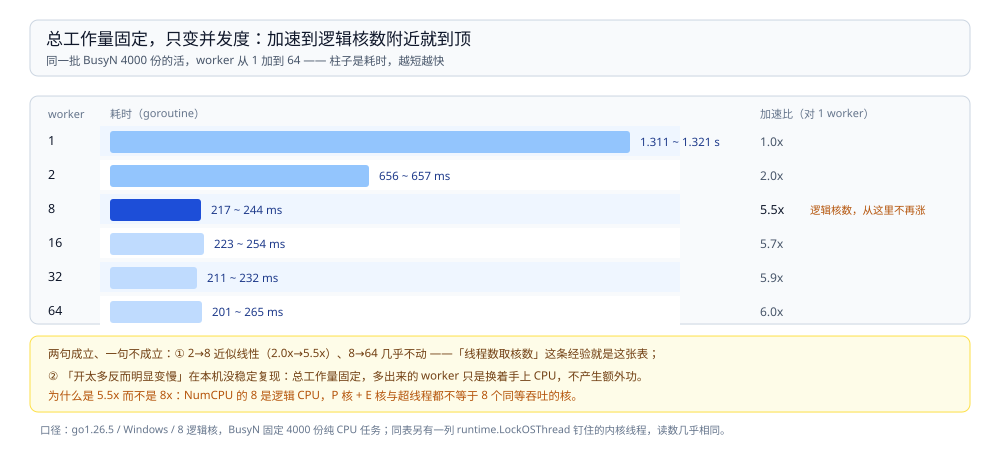

# 协程与线程成本

> 覆盖：Go 侧把「进程 / 线程 / 协程的创建成本」「协程栈内存」「上下文切换」「线程数与核数的关系」量出来的测量原语、跑法与本机读数，以及三条只有量过才讲得准的话。
> 不覆盖：Linux 侧的进程定义、五状态、上下文切换与线程三种实现方式见 [进程与线程.md](../../../02-计算机基础/linux/进程与线程.md)；Go 调度器的结构（G/M/P、work stealing）见 [GMP调度.md](../运行时/GMP调度.md)；协程泄漏的排查见 [协程泄漏与死锁.md](协程泄漏与死锁.md)；Java 侧的同一批实验见 [线程与进程开销.md](../../java/并发/线程与进程开销.md)。
>
> 内容整理自个人学习笔记。本篇代码在 **go1.26.5（Windows 10 22631，`runtime.NumCPU()` = 8 逻辑 CPU）** 下 `gofmt` / `go vet` / `go build` 三项全干净并跑通，读数见第二~六节；带 `//go:build unix` 的部分本机跑不了，只做了 `GOOS=linux go build ./... && GOOS=linux go vet ./proc/` 的**交叉编译校验**，**未在 Linux 实例上实测**。

---

## 一、这套测量是怎么搭起来的？

**本节要点**：把正文里「线程创建比进程轻得多」「线程数与核数相近时性能最好」「上下文切换有额外开销」这些说法，用一组**不依赖时钟、可复跑**的原语量出来。跨平台部分与 Unix 部分分开，因为 `fork` / `wait` / `/proc` 在 Windows 上根本没有。

### 1.1 测量原语（`proc/proc_1.go`）

```go
package proc

import (
	"context"
	"os"
	"os/exec"
	"runtime"
	"sync"
	"sync/atomic"
	"time"
)

// 本册把 Linux 侧「进程是资源分配单位、线程才是调度单位」这类说法
// **变成能在自己机器上量出来的数字**：
//   - "线程创建比进程轻得多"     → 各起 N 个，比耗时
//   - "线程数与核数相近时性能最好" → CPU 密集型 worker 数扫描
//   - "上下文切换有额外开销"     → 乒乓切换的单次成本
//   - "goroutine 初始栈仅 2KB"  → 起一批阻塞协程，量栈内存的跳档
//
// 跨平台部分在 Windows/Linux/macOS 都能跑；
// 依赖 fork/wait、/proc 与信号的部分单独放在 proc_2.go（//go:build unix）。

// BusyN 做 n 轮固定工作量。不依赖时钟，用来做 worker 数扫描：
// 总工作量固定，才能比较"不同并发度下多久做完"。
func BusyN(n int) float64 {
	x := 0.0
	for r := 0; r < n; r++ {
		for i := 0; i < 200000; i++ {
			x += float64(i) * 1.000001
		}
	}
	return x
}

// Scaling 用 g 个 goroutine 分摊 total 份工作量，返回总耗时。
//
// ★ "线程数与 CPU 核心数相近时性能最好"的测法：
// 把 g 从 1 一路扫到 8×核数，看加速比在哪一段**停住**。
// 用 goroutine 测**看不到"开太多反而变慢"**——Go 的调度器会让空闲的 G 主动让出；
// 想看那个效应要用 ScalingOSThreads。
func Scaling(g, total int) time.Duration {
	return runScaled(g, total, false)
}

// ScalingOSThreads 同上，但每个 worker 用 LockOSThread **钉住一个内核线程**。
// 这才是"线程数远大于 CPU 数"的场景：线程是真存在的，
// 超订之后就要靠内核抢占来轮流上 CPU。
func ScalingOSThreads(g, total int) time.Duration {
	return runScaled(g, total, true)
}

func runScaled(g, total int, pin bool) time.Duration {
	chunk := total/g + 1
	sums := make([]float64, g) // **每个 worker 写自己的格子**
	start := time.Now()
	var wg sync.WaitGroup
	for i := 0; i < g; i++ {
		wg.Add(1)
		go func(i int) {
			defer wg.Done()
			if pin {
				runtime.LockOSThread() // 这个 goroutine 独占一个 M（内核线程）
				defer runtime.UnlockOSThread()
			}
			sums[i] = BusyN(chunk)
		}(i)
	}
	wg.Wait()
	var s float64
	for _, v := range sums {
		s += v
	}
	sink = s
	return time.Since(start)
}

// sink 只在最后收一次，避免 worker 之间争用同一个变量。
var sink float64
```

接着量「切换一次」的成本：`PingPong` 测两个执行流之间倒一手的开销，`GoroutineStacks` 量阻塞协程的栈占用。

```go
// PingPong 量"两个执行流之间切换一次"的成本：一个发、一个回，共 rounds 个来回。
//
// ⚠️ 这测的是**用户态调度 + 唤醒**，不等于内核线程切换的开销
// （后者要陷入内核，量不了这么干净）。
// 但它是"每处理一条消息要在两个执行流之间倒一手"这件事的量级参考。
func PingPong(rounds int) time.Duration {
	a, b := make(chan int), make(chan int)
	go func() {
		for v := range a {
			b <- v
		}
	}()
	start := time.Now()
	for i := 0; i < rounds; i++ {
		a <- i
		<-b
	}
	return time.Since(start)
}

// GoroutineStacks 起 n 个**阻塞**的 goroutine，返回它们的栈占用（字节）。
// 对应"goroutine 初始栈仅 2KB 且可增长"——这里量的就是那句话的代价。
//
// ★ 必须等 n 个都真的跑起来再测：只是 `go func()` 提交而未调度时，
//   栈可能还没实际分配，测出来会偏小。
//
// withDefer 是**对照组**：如果 StackInuse 随闭包深浅变化，说明量的是真实用量；
// 若不变化（实测就是不变化），说明量到的是栈 span 的**分配粒度**（8KB）。
// 这个对照是必要的——否则会把"8KB/个"错当成"每个协程真的用了 8KB 栈"，
// 也会把"初始栈 2KB"讲成精确的内存数字。
func GoroutineStacks(n int, withDefer bool) uint64 {
	gate := make(chan struct{})
	var started atomic.Int64
	var wg sync.WaitGroup

	runtime.GC()
	var base runtime.MemStats
	runtime.ReadMemStats(&base)

	for i := 0; i < n; i++ {
		wg.Add(1)
		if withDefer {
			go func() {
				defer wg.Done()
				defer func() { _ = recover() }() // 对照组：故意多加一层 defer
				started.Add(1)
				<-gate
			}()
			continue
		}
		go func() {
			defer wg.Done()
			started.Add(1)
			<-gate // 全部阻塞在这里，只花栈的内存
		}()
	}
	for int(started.Load()) < n {
		runtime.Gosched()
	}
	runtime.GC()
	var peak runtime.MemStats
	runtime.ReadMemStats(&peak)

	close(gate)
	wg.Wait()
	if peak.StackInuse <= base.StackInuse {
		return 0
	}
	return peak.StackInuse - base.StackInuse
}
```

最后是与进程打交道的几个原语：跨平台测进程创建成本、判断自己是不是子进程、读写 GOMAXPROCS。

```go
// helperMode 标记"我是被当作子进程拉起来的"。
// go test 编译出的二进制本身就是可执行文件，用它跑一次"立刻退出"，
// 就能在**任何平台**测进程创建成本，不依赖 /bin/true 这类 Unix 才有的程序。
const helperMode = "PROC_HELPER_EXIT"

// SpawnProcesses 串行起 n 个子进程并各自等它退出，返回总耗时。
//
// ★ 每次 Wait 都是必需的：**只 Start 不 Wait 就会留下僵尸进程**：
// 子进程已经退出，但它的退出状态还没被父进程取走，PCB 就一直占着。
// 用 CommandContext 是为了"父进程被取消时顺带 kill 掉子进程"，不留孤儿。
func SpawnProcesses(ctx context.Context, n int) (time.Duration, error) {
	start := time.Now()
	for i := 0; i < n; i++ {
		cmd := exec.CommandContext(ctx, os.Args[0], "-test.run=TestHelperExit", "-test.v=true")
		cmd.Env = append(os.Environ(), helperMode+"=1")
		if err := cmd.Run(); err != nil {
			return time.Since(start), err
		}
	}
	return time.Since(start), nil
}

// IsHelper 供 TestHelperExit 判断自己是不是子进程模式。
func IsHelper() bool { return os.Getenv(helperMode) == "1" }

// NumCPU 与 SetGOMAXPROCS："一个进程只能在一个 CPU 上运行"这句话，
// 在 Go 里对应的准确表述是 **GOMAXPROCS 决定同时有几个 M（内核线程）参与调度**。
func NumCPU() int { return runtime.NumCPU() }

// SetGOMAXPROCS 改并返回原值。
func SetGOMAXPROCS(n int) int { return runtime.GOMAXPROCS(n) }
```

### 1.2 只在 Unix 上编译的部分（`proc/proc_2.go`）

```go
//go:build unix

package proc

import (
	"bufio"
	"context"
	"fmt"
	"os"
	"os/exec"
	"strconv"
	"strings"
	"syscall"
	"time"
)

// 本文件只在 Unix（Linux/macOS）上编译：内容是 fork/wait、信号与 /proc。
// 在 Windows 上跑不到这些语义，所以本文件的校验方式是交叉编译：
//
//	GOOS=linux go build ./... && GOOS=linux go vet ./proc/
//
// ⚠️ **没有在 Linux 实例上实测过**（本机是 Windows），
// 下面的数字请自己在 Linux 机器上取；**代码里的行为约定（必须 Wait、先 TERM 后 KILL）是通用的**。

// RunChild 起子进程拿输出。**CombinedOutput 内部已经做了 Wait**，
// 所以不会留僵尸——这是最推荐的默认写法。
func RunChild(ctx context.Context, name string, args ...string) (string, error) {
	cmd := exec.CommandContext(ctx, name, args...)
	out, err := cmd.CombinedOutput()
	return string(out), err
}

// SpawnDetached 异步起一个子进程，并**用后台协程兜底 Wait**。
//
// ★ "僵尸进程怎么产生"：就是 `cmd.Start()` 之后再也不 `Wait()`——
//   子进程退出了，退出状态没人取，内核里的 PCB 一直留着，`ps` 里显示 <defunct>。
//   要么同步 Wait，要么像这样后台 Wait；**不能两者都不做**。
func SpawnDetached(name string, args ...string) (int, error) {
	cmd := exec.Command(name, args...)
	cmd.Stdout, cmd.Stderr = os.Stdout, os.Stderr
	if err := cmd.Start(); err != nil {
		return 0, err
	}
	go func() { _ = cmd.Wait() }() // 回收 = 让内核释放 PCB
	return cmd.Process.Pid, nil
}

// StopGracefully 优雅停子进程：**先 SIGTERM 给它收尾的机会，超时才 SIGKILL**。
//
// 直接 Kill 会丢正在写的数据（子进程可能正在 flush）。
// Go 1.20+ 也可以只设 `cmd.WaitDelay`，让标准库在超时后代劳。
func StopGracefully(cmd *exec.Cmd, grace time.Duration) error {
	if cmd.Process == nil {
		return fmt.Errorf("proc: 子进程还没 Start")
	}
	if err := cmd.Process.Signal(syscall.SIGTERM); err != nil {
		return err
	}
	done := make(chan error, 1)
	go func() { done <- cmd.Wait() }()
	select {
	case err := <-done:
		return err // 正常退出：err 可能是 nil，也可能是它自己的退出码
	case <-time.After(grace):
		_ = cmd.Process.Kill() // SIGKILL：不可捕获、不可忽略，内核直接回收
		return <-done
	}
}

// ContextSwitches 读 /proc/<pid>/status 里的两个计数：
//
//	voluntary_ctxt_switches    ：主动让出（等 IO、等锁、时间片没用完就睡了）
//	nonvoluntary_ctxt_switches ：被动抢占（**时间片用完被赶走** = "运行 → 就绪"）
//
// ★ 这两个数是"上下文切换开销"最直接的证据：
// 一个 CPU 密集型进程如果 nonvoluntary 涨得飞快，说明线程数已经远超可用核数。
// ⚠️ /proc 是 **Linux 专有**（macOS 没有），这段在 macOS 上会返回错误。
func ContextSwitches(pid int) (voluntary, nonvoluntary uint64, err error) {
	f, err := os.Open(fmt.Sprintf("/proc/%d/status", pid))
	if err != nil {
		return 0, 0, err
	}
	defer f.Close()
	sc := bufio.NewScanner(f)
	for sc.Scan() {
		line := sc.Text()
		if !strings.Contains(line, "ctxt_switches") {
			continue
		}
		k, v, ok := strings.Cut(line, ":")
		if !ok {
			continue
		}
		n, err := strconv.ParseUint(strings.TrimSpace(v), 10, 64)
		if err != nil {
			return 0, 0, err
		}
		if strings.HasPrefix(k, "voluntary") {
			voluntary = n
		} else {
			nonvoluntary = n
		}
	}
	return voluntary, nonvoluntary, sc.Err()
}

// Nice 调整优先级（Linux 侧"PCB 里保存优先级"的可操作对应物）。
// 需要权限；线上一般用 systemd 的 Nice= 而不是代码里调。
// ⚠️ Linux/macOS 语义不完全一致，未实测。
func Nice(delta int) error { return syscall.Setpriority(syscall.PRIO_PROCESS, 0, delta) }
```

### 1.3 跑法

```bash
go test -count=1 ./proc/ -v                              # 实测一~五（跨平台那几项）
RACE_DEMO=1 go test -count=1 ./proc/ -run TestRaceDemo   # 实测六（默认跳过）
GOOS=linux go build ./... && GOOS=linux go vet ./proc/   # 骨架二只能这样校验
```

⚠️ **`-count=1` 不是可选项**：`go test` 会缓存结果，不加它第二轮起会把上一轮的输出**原样重放**，「三轮数据」其实是一轮的三个副本。

## 二、创建一个进程比一个协程贵多少？

**本节要点**：进程的创建+回收是**毫秒级**、协程是**微秒级**，差约 **4500 倍**；但这里的「进程」含「跑完 + 被回收」的全周期，**只 `Start()` 不 `Wait()` 会把成本变成僵尸进程**。

| 执行流 | 单个成本 | 样本量 |
|---|---|---|
| **进程**（起子进程并等它退出） | ≈ **25.3 ~ 25.9 ms** | 串行 20 个，共 506 ~ 518 ms |
| **goroutine** | ≈ **5.0 ~ 5.7 µs** | 1 万个，共 50 ~ 57 ms |
| **比值** | ≈ **4500 ~ 5000 倍** | |

三点要讲准：

- 进程那一项**包含「跑完 + 被回收」的全周期**（`cmd.Run()` 内含 `Wait`）。只 `Start()` 不等它，数字会小很多——但那是在攒僵尸进程（见 1.2 的 `SpawnDetached`）。
- 测的是「进程 vs **协程**」，不是「进程 vs 线程」。线程的数字在 [线程与进程开销.md](../../java/并发/线程与进程开销.md) 里，三者放一起是 进程 : 线程 : 协程 ≈ **6000 : 25 : 1**。
- 这里的「进程」是本机编译出来的测试二进制（启动即退出，什么都没干）；Java 侧起的是 `cmd.exe`，所以两边的绝对值不同（25ms vs 35ms），**别横向比这两个数**。


三个维度要分开看才不会混：进程那一项量的是「跑完 + 被回收」的全周期，协程那一项是启动到退出，切换那一项只在用户态、不陷内核；空着的格是本篇没测的，不是「一样」。

## 三、线程数和 CPU 核数是什么关系？

**本节要点**：总工作量固定、只变并发度，「到核数为止有加速、之后没有加速」成立；但「开太多反而明显变慢」在这台机器上**没有稳定复现**——因为总工作量不变时，多出来的线程只是换着手上 CPU，**贵的是切换次数与排队延迟，不是墙钟时间**。

总工作量固定（`BusyN` 4000 份），只变并发度。两列分别是普通 goroutine 和 `runtime.LockOSThread()` 钉住的内核线程——后者才是「真线程」：

| worker | goroutine | 钉住的内核线程 | 加速比（对 1 worker） |
|---|---|---|---|
| 1 | 1.311 ~ 1.321 s | 1.316 s | 1.0x |
| 2 | 656 ~ 657 ms | 655 ~ 659 ms | 2.0x |
| **8（= 逻辑核数）** | 217 ~ 244 ms | 243 ~ 259 ms | **≈ 5.5x** |
| 16 | 223 ~ 254 ms | 226 ~ 246 ms | ≈ 5.7x |
| 32 | 211 ~ 232 ms | 213 ~ 241 ms | ≈ 5.9x |
| 64 | 201 ~ 265 ms | 204 ~ 239 ms | ≈ 6.0x |

★ **这里有一处和常识说法对不上，而它正是要讲的点**：

1. **「核数附近就到顶」成立** —— 2→8 近似线性，8→64 几乎不再变快。「CPU 密集型线程数取核数」这条经验就是这张表。
2. **但「开太多反而明显变慢」在这台机器上没稳定复现**。原因是**总工作量不变**：多出来的线程只是让同一批活换着手上 CPU，墙钟时间基本不变，变贵的是**切换次数**和**单条任务的排队延迟**。（有一轮测到 64 线程 697 ms ≈ 3 倍劣化，复测两次都没再现——与其当结论，不如当成「这台机器当时有别的东西在吃 CPU」。）⚠️ 所以别笼统地说「线程开多了吞吐会掉」，要说：**吞吐不一定掉，但延迟会变差、CPU 会浪费在切换上**——对延迟敏感的服务这才是问题。
3. 为什么加速比只有 5.5x 而不是 8x：`NumCPU()` 的 8 是**逻辑** CPU，笔记本的 P 核 + E 核 / 超线程不等于 8 个同等吞吐的核，再加上后台进程抢占。



加速在 8 之后就停了，而 8 正是本机的逻辑核数；但「开太多反而变慢」这一条在总工作量固定的前提下没有稳定复现 —— 这就是「CPU 密集型线程数取核数」这条经验的实测依据与边界。

## 四、切换一次和开一个协程各要多少成本？

**本节要点**：协程乒乓切换单次约 **1 µs**，这是「别把每个小操作都拆成一个 goroutine」的量化理由；而「每个协程 2KB」那是**初始栈大小**，不是内存账——**记账粒度实测 8KB/个**。

```text
协程乒乓切换 200000 次：166 ~ 201 ms → 单次 ≈ 830 ns ~ 1.0 µs
```

口径必须说清楚：这测的是 **Go 用户态调度 + 唤醒**，不陷入内核，所以**不等于**内核线程切换的开销（后者还要陷入内核、可能刷 TLB 与 cache，量不干净）。正确用法是把它当**下限**：连最便宜的「两个执行流倒一手」都要约 1 µs，一条消息处理链上倒十手就是 10 µs。

栈内存对照（go1.26.5 / Windows）：

| 项 | 实测 |
|---|---|
| 10 万个阻塞 goroutine 的 `StackInuse` | **7.96 KB/个** |
| 同样的协程、闭包里多一层 `defer` | **7.97 KB/个**（**没变**） |
| 换算 100 万个协程 | ≈ **7.6 GB** |
| 100 万个内核线程（Linux 默认栈 8MB 是**预留**） | = **7812 GB** 地址空间 |

★ 这张表纠正一个流传很广的说法：**「每个协程 2KB」推不出「100 万个协程只要 2GB」**。

- 加 defer 数字不动 → 说明 8KB 是**栈 span 的分配粒度**（记账口径），不是「每个协程真的用掉 8KB 栈」。2KB 讲的是**栈的初始大小**（可增长的起点）。
- 结论仍然成立，只是别用错量级：**协程按 KB 计、线程按 MB 计，差三个数量级**——所以「百万协程」可行，「百万线程」连地址空间都开不出来。
- 反过来也别拿 2KB 做容量规划：真要开 100 万协程，**按 8 GB 这个粒度估内存**。

想在 Linux 上量**真**的切换次数，用 1.2 的 `ContextSwitches(pid)` 读 `/proc/<pid>/status`，或者 `pidstat -w -p <pid> 1`。⚠️ 本文件全部代码都没在 Linux 上实跑过（本机是 Windows），这两项请自己取数。

## 五、GOMAXPROCS 改了会发生什么？

**本节要点**：同样的 CPU 密集型代码，只改一个环境变量，就从「看起来同时」变成「真的同时」——这正是「并发 vs 并行」的可复现版本。

8 个 CPU 密集型 goroutine，只改一个环境变量：

| GOMAXPROCS | 耗时 | 加速比 |
|---|---|---|
| 1 | 654 ~ 665 ms | 1.0x |
| 8 | 127 ~ 146 ms | **4.5 ~ 5.2x** |

`GOMAXPROCS=1` 时多个 goroutine **仍然并发**（一个让出另一个上），但**不并行**——进程只在一个 CPU 上跑，对应 Linux 侧「进程是资源分配单位、线程才是调度单位」那句：在 Go 里就是 **GOMAXPROCS 决定同时有几个 M 参与调度**。

## 六、为什么「跑一遍没问题」不能排除竞态？

**本节要点**：8 个 goroutine 各加 1000 次、`counter++` 不加同步，五轮里**有两轮恰好正确**——这就是竞态最难查的地方：**测试通过不等于没有竞态**，压力一上来它就冒出来。

| 轮 | 不加锁 | `sync.Mutex` 对照组 |
|---|---|---|
| 1 | 8000 | 8000 |
| 2 | **7194** | 8000 |
| 3 | **7482** | 8000 |
| 4 | **6050** | 8000 |
| 5 | 8000 | 8000 |

加对照组（同样工作量、加锁）是为了确认「数字变小」是竞态造成的，而不是工作量变了。有 GCC 的机器上换成 `RACE_DEMO=1 go test -race ./proc/ -run TestRaceDemo`，它还能直接指出**哪一行在读、哪一行在写**（本机 `-race` 需要 cgo，没有 C 编译器，起不来）。


两轮恰好正确、三轮不同程度丢失，这就是「跑一遍没问题」为什么不能当证据；加锁的对照组五轮都是 8000，说明数字变小不是工作量变了，而是竞态吃掉的。

## 七、三条只有量过才讲得准的话

1. **「线程创建比进程轻」** → 量到的是**进程 vs 协程**差 ~4500 倍；进程 : 线程 : 协程 ≈ **6000 : 25 : 1**（线程数据在 [线程与进程开销.md](../../java/并发/线程与进程开销.md)）。
2. **「线程数 = 核数最好」** → 准确说法是「**到核数为止有加速，之后没有加速**」，而不是「超过就变慢」（第三节第 2 条）。
3. **「协程 2KB」** → 那是**初始栈大小**，不是内存账；记账粒度实测 **8KB/个**（测量方法见第一节的 `GoroutineStacks`）。

## 延伸追问

- **为什么用 goroutine 扫描看不到「开太多反而变慢」？** → Go 调度器会让空闲的 G 主动让出，多出来的 G 不占内核线程；要看超订效应得用 `LockOSThread` 把每个 worker 钉成真内核线程（1.1 的 `ScalingOSThreads`）。
- **`-count=1` 到底防的是什么？** → `go test` 的结果缓存：不加它，「同机连跑三轮」拿到的是一轮输出的三个副本（1.3）。
- **协程的栈是可增长的吗？线程呢？** → goroutine 栈从 2KB 起、按需倍增与收缩；内核线程栈由 `-Xss`（Java）/ `ulimit -s` 决定且**是预留不是驻留**。记账口径见第四节。
- **为什么 `GOMAXPROCS=1` 还会「并发」？** → 并发是「交替使用同一个 CPU」，并行才是「同时用多个 CPU」；GOMAXPROCS=1 只是把同时参与调度的 M 限成 1 个（第五节）。
- **Java 侧的同一批实验怎么对照？** → 见 [线程与进程开销.md](../../java/并发/线程与进程开销.md)：`new Thread()` 就是一对一内核线程，不用 `LockOSThread` 就能量到超订。

## 关联

- **上游/总纲**：[GMP调度.md](../运行时/GMP调度.md) — G / M / P 三元组、work stealing 与切换时机
- **对照/互补**：[线程与进程开销.md](../../java/并发/线程与进程开销.md) — Java 侧同一批实验（真内核线程的超订扫描）
- **对照/互补**：[进程与线程.md](../../../02-计算机基础/linux/进程与线程.md) — 进程 / 线程 / 协程的概念与三种线程实现方式
- **下游问题**：[协程泄漏与死锁.md](协程泄漏与死锁.md) — 创建便宜的反面：泄漏起来也快
- **对照/互补**：[goroutine.md](goroutine.md) — goroutine 与线程的五维对照、g 结构与六态
- **对照/互补**：[runtime调试与trace.md](../运行时/runtime调试与trace.md) — `schedtrace` 与 `MemStats` 的观测入口
> 反向引用（本篇被下列文档引到）：[子进程与外部命令.md](../工程实践/子进程与外部命令.md)、[共享内存与CSP.md](共享内存与CSP.md)、[02-进程模型与基础架构.md](../../../02-计算机基础/linux/深入理解Nginx/02-进程模型与基础架构.md)

