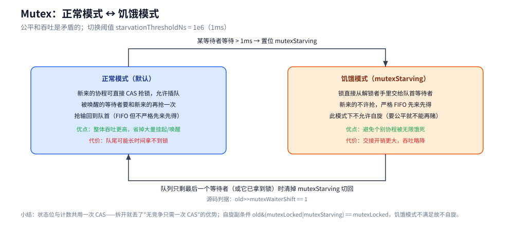
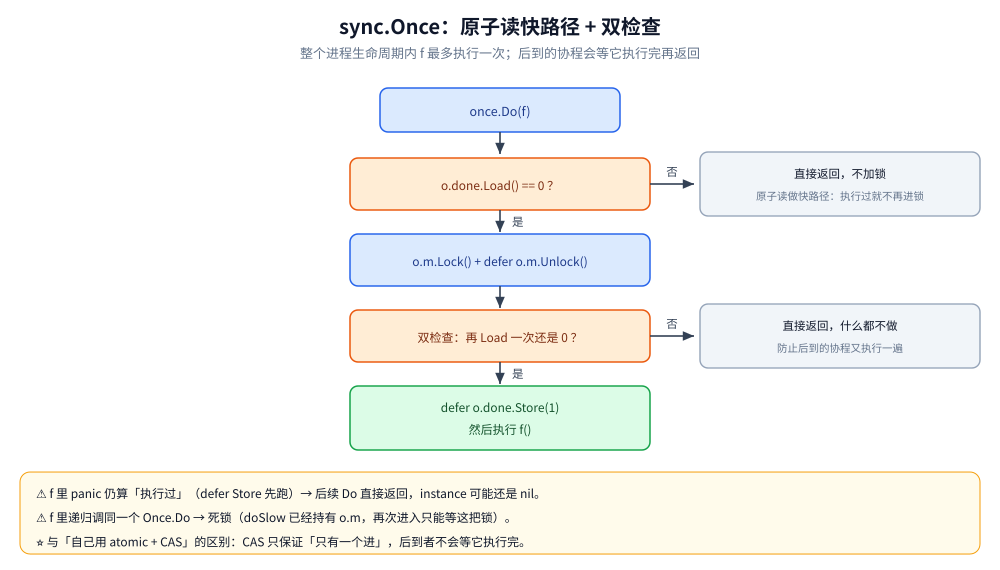

# Go 并发同步原语

> 先手写一把锁（原子自旋 / channel / 条件变量三种写法）并量出代价，再看标准库为什么不这么写；然后逐个过 Mutex / RWMutex / Once / WaitGroup 的语义与致命误用，最后落到「出问题按什么顺序查」。
>
> 实测环境：**go1.26.5 / windows-amd64 / 8 核**，`go test -bench -benchtime 200000x -count=2`，核数扫描用 `-cpu 1,2,4,8,16`。`sync.Map` 与 `sync/atomic` 的机制与实测已各成一篇，见 [sync.Map.md](sync.Map.md) 与 [atomic操作.md](atomic操作.md)。
>
> 内容整理自大厂 Go 后端面试真题，并按《Go 语言核心编程》（李文塔）5.1.4 WaitGroup、5.1.5 select 的相关章节**补充了机制分析与实测**；参考资料与原始素材见 [素材清单](../../../素材清单.md)。

---

## 一、从零实现：一把锁最少需要什么？

**本节要点**：锁的全部功能是「让一段代码同时只有一个人进」。实现它只需要一个能被原子读写的标志，外加一种「等不到时干什么」的策略——**自旋、挂起、还是交给 channel 排队**。三种策略就是三种锁。

### 1.1 四种实现，同一个接口

`sync.Locker` 只有 `Lock()` 和 `Unlock()` 两个方法，所以四种实现可以互换着塞进同一个计数器：

| 实现 | 抢不到时怎么办 | 靠什么 |
|---|---|---|
| `SpinLock` | **空转重试** | `atomic.Bool.CompareAndSwap` + `runtime.Gosched` |
| `ChanMutex` | 往 channel 里塞，塞不进就**挂起** | 容量 1 的 channel |
| `CondMutex` | 挂起，等 `Signal` 唤醒 | `sync.Cond` |
| `sync.Mutex` | 先自旋几轮，输了挂起 | 自旋 + 信号量（混合） |

第四种是标准库，前三种是自己写的。**注意 `ChanMutex` 和 `CondMutex` 内部各自还有锁**——这不是作弊，而是这类「等待」必须靠一个更底层的东西实现，最后都要落到 1.1 节那个原子标志上。

### 1.2 三种自己写的锁

```go
// 自旋锁：一个布尔 + CAS
type SpinLock struct{ f atomic.Bool }

func (s *SpinLock) Lock() {
	for !s.f.CompareAndSwap(false, true) {
		runtime.Gosched() // 抢不到就主动让出，否则单核下会把别人饿死
	}
}
func (s *SpinLock) Unlock() { s.f.Store(false) }

// channel 锁：容量 1 的 channel，塞满即持锁
type ChanMutex struct{ ch chan struct{} }

func NewChanMutex() *ChanMutex    { return &ChanMutex{ch: make(chan struct{}, 1)} }
func (m *ChanMutex) Lock()        { m.ch <- struct{}{} }
func (m *ChanMutex) Unlock()      { <-m.ch }

// 条件变量锁：抢不到就挂起，靠 Signal 唤醒
type CondMutex struct {
	mu   sync.Mutex
	cond *sync.Cond
	held bool
}

func NewCondMutex() *CondMutex {
	m := &CondMutex{}
	m.cond = sync.NewCond(&m.mu)
	return m
}

func (m *CondMutex) Lock() {
	m.mu.Lock()
	for m.held {
		m.cond.Wait() // Wait 内部会先释放 m.mu 再挂起
	}
	m.held = true
	m.mu.Unlock()
}

func (m *CondMutex) Unlock() {
	m.mu.Lock()
	m.held = false
	m.cond.Signal()
	m.mu.Unlock()
}
```

三个细节决定了它们的行为差异：

- **`runtime.Gosched()` 不能省**。没有它，`GOMAXPROCS=1` 时自旋的那个协程会一直占着 CPU，持锁的协程根本没机会跑——这是自旋锁在单核上的经典死法。
- **`ChanMutex` 的 `Lock` 是一次发送**。channel 满了（有人持锁）就阻塞，这刚好就是「排队」。`Unlock` 是一次接收，把槽位空出来。代价是每次加解都走一遍 channel 的完整收发路径。
- **`CondMutex` 是「锁里套锁」**。`Lock` 里要先拿 `m.mu`，`cond.Wait()` 会先释放它再挂起，醒来后再重新拿。所以它比 `sync.Mutex` 多了一次锁的开销——`sync.Mutex` 自己内部就干这件事，不需要外面再包一层。

### 1.3 读数：按核数扫一遍

同一个计数器，临界区里只有一行 `n++`，用 `b.RunParallel` 起 N 个协程抢同一把锁：

| 并行度 | `sync.Mutex` | `SpinLock` | `ChanMutex` | `CondMutex` |
|---|---|---|---|---|
| 1 | **30.7** | 32.8 | 76.7 | 69.3 |
| 2 | 33.4 | 36.4 | 273.9 | 88.3 |
| 4 | 51.0 | 38.0 | 509.2 | 133.7 |
| 8 | 84.1 | 41.5 | 621.0 | 232.9 |
| 16 | 115.6 | **46.6** | 753.4 | 433.0 |

单位 ns/op，`go test -bench -cpu 1,2,4,8,16 -benchtime 100000x`。


读法：条形越长，说明这种实现越难把并行度变成收益。自旋锁几乎不涨，但它的「等」是空转；另外三种的「等」是挂起，省 CPU 但要付唤醒的代价。

三条能直接读出来的结论：

- **单核时标准库最快**（30.7 对 32.8）。因为无竞争时 `sync.Mutex` 的快路径就是一条 CAS，而 `SpinLock` 多了一次方法调用和 `Gosched` 的判断。
- **`ChanMutex` 从 2 核开始就崩**（76.7 → 273.9，3.6 倍跳变）。channel 的收发本身要走锁 + 队列判定，两次操作下来双倍代价，争用一上来还要排两条队。
- **`CondMutex` 随并行度涨得最快**（6.2 倍）。它的 `Wait` 要「释放内锁 → 挂起 → 醒来重拿内锁」，三次操作都在竞争路径上。

### 1.4 为什么标准库不纯自旋

上表里 `SpinLock` 看起来最好——16 核才 46.6ns，比 `sync.Mutex` 快一倍多。但这个数字有个陷阱：

> **`ns/op` 只计墙钟延迟，不计被烧掉的 CPU。**
> 16 个协程抢一把锁、临界区只有一行自增时，**15 个协程在空转**。它们烧的 CPU 不进这个数，但会实实在在地抢走别的线程的核。

所以标准库的选择是**混合策略**，而不是纯自旋：

```text
快速路径：CAS(state, 0, mutexLocked) 成功 → 直接持锁返回
慢速路径：自旋几轮（runtime_canSpin 有次数上限）
          → 还抢不到 → runtime_Semacquire(&m.sema) 挂起
```

**自旋的意义**是「用几轮空转赌不用做上下文切换」，赌赢了省一次挂起+唤醒，赌输了立刻退化成排队。所以它两头的好处都要，也两头都不极端。

判据落到一行：

> **只有「临界区极短（几十纳秒）+ 并发者少于核数」才值得考虑自旋**；其余场景交给 `sync.Mutex`——它内部已经自旋过了。

还有一条副条件：`sync.Mutex` **在饥饿模式下禁止自旋**（`old&(mutexLocked|mutexStarving) == mutexLocked`）。要公平就不能再赌，这条逻辑见第二节。

---

## 二、Mutex 的一个 `int32` 里装了什么？

**本节要点**：从「最多多少个协程排队」一路问到 `state` 的位布局——为什么状态和排队人数要挤在同一个 `int32` 里，以及「公平 vs 吞吐」这对矛盾怎么落地。

### 2.1 一句话答案与两个字段

> **理论上 2²⁸ − 1 个等待者，再加 1 个持锁者。** 这个数不是设计出来的，而是「`state` 是 `int32`、低 3 位又被状态位占掉」的必然结果。

```go
type Mutex struct {
	state int32  // 状态位 + 等待者计数，位复用
	sema  uint32 // 供 runtime 挂起/唤醒的信号量标识
}
```

Go 把「锁状态」和「排队人数」**塞进了同一个 `int32`**，靠位来切分——这就是所有「排队上限」问题的源头。

### 2.2 低 3 位：状态位

```go
const (
	mutexLocked      = 1 << iota // 1 → 001 已加锁
	mutexWoken                   // 2 → 010 有等待者被唤醒
	mutexStarving                // 4 → 100 饥饿模式
	mutexWaiterShift = iota      // 3 → 等待者计数从第 3 位开始
)
```

三个位互不冲突，所以状态可以**按位或叠加**——三种状态全占就是 `001|010|100 = 111 = 7`。

### 2.3 高位：等待者计数与排队上限

每多一个协程排队，`state` 就 `+= 1 << mutexWaiterShift`，也就是 **`+8`**。所以 `state >> 3` 就是当前排队人数——源码判「有没有人在排队」用的正是 `old>>mutexWaiterShift != 0`。

模拟「第一个协程持锁后一直不解锁，后面的不断来排队」：

| 场景 | `state`（二进制） | 值 |
|---|---|---|
| 第 1 个协程持锁 | `001` | 1 |
| 第 2 个协程排队 | `1001` | 9 |
| 第 3 个协程排队 | `10001` | 17 |
| 第 N 个协程排队 | 低 3 位不变，高位每次 +8 | — |


读法：一个 32 位字被切成两段用 —— 低 3 位存三个标志、高位每 +8 记一个等待者；所以等待者计数要 state>>3 才有意义，排队上限也由这几位决定。

**上限怎么算出来的**：

```text
state 是 int32
  → 32 位里有 1 位符号位，只剩 31 位有效
  → 低 3 位被状态位占掉（Locked / Woken / Starving）
  → 留给等待者计数的只有 31 − 3 = 28 位
  → 最多 2²⁸（约 2.68 亿）个排队协程，再加当前持锁的那 1 个
```

超过了会怎样：

| 后果 | 说明 |
|---|---|
| 计数推进到符号位 | `state` 变负数，`state>>3` 的语义失效（算出的排队人数是负的） |
| CAS 逻辑被污染 | 状态位与计数字段互相串味，快路径 `CompareAndSwapInt32(&state, 0, mutexLocked)` 不再可信 |
| 但工程上永远到不了 | 一个 goroutine 初始栈 2KB，2²⁸ 个等待协程光栈就数百 GB，早就 OOM |

> 所以标准库在这条路径上**没有做排队溢出的显式检查**——它是「理论存在、工程不可触及」的边界。对比 `sync.RWMutex` 就有显式常量 `rwmutexMaxReaders = 1 << 30`，因为那边必须把「读者计数」和「有写者等待」塞进同一个 `readerCount int32`，越界会直接 `fatal`。
>
> **一句话**：上限来自**位宽复用**，不是来自设计约束；真正会先撞到的墙是内存。

### 2.4 正常模式与饥饿模式

**为什么需要两种模式**：公平和吞吐是矛盾的。

| | 正常模式（默认） | 饥饿模式 |
|---|---|---|
| 谁能拿到锁 | 被唤醒的等待者要和新来的再抢一次；新协程已在 CPU 上跑着、天然占优 → **允许插队** | 锁**直接从解锁者手里交给队首**，新来的不许抢 |
| 队列行为 | FIFO，但被唤醒者抢输就回队首 | 严格 FIFO，先来先得 |
| 优点 | 整体吞吐更高（省掉大量挂起/唤醒） | 避免个别协程被无限饿死 |
| 代价 | 极端情况下队尾可能长时间拿不到锁 | 交接开销更大，吞吐略降 |

**切换阈值**：`starvationThresholdNs = 1e6`（**1ms**）。等待超过 1ms 还没拿到锁 → 该等待者置位 `mutexStarving`，锁进入饥饿模式；等队列里只剩最后一个等待者（`old>>mutexWaiterShift == 1`）时清掉该位，切回正常模式。



读法：两个模式之间的边只由「等待是否超过 1ms」触发，不由「有没有新协程来」触发 —— 这就是饥饿模式只解决「老等待者被饿死」、不解决吞吐的原因。

### 2.5 加锁的快慢两条路径

```text
快速路径：CAS(state, 0, mutexLocked) 成功 → 直接持锁返回（无竞争时只有一条原子指令）
慢速路径 lockSlow()：自旋几轮 → 抢置 mutexWoken → 等待计数 +1（饥饿模式同时置位）
                  → CAS 写入成功后 runtime_Semacquire(&m.sema) 挂起自己
```

**慢在哪**：不在锁本身，而在**挂起 + 唤醒的上下文切换**。自旋就是用几轮空转赌不用做这次切换，临界区极短时很划算（第一节的读数就是这么来的）。

**`Mutex` 还是 `RWMutex`**：

| 场景 | 选择 | 原因 |
|---|---|---|
| 读远多于写（读:写 几十倍以上） | `RWMutex` | 读之间不互斥，并发读能真正并行 |
| 其余情况 | `Mutex` | `RWMutex` 内部仍持有一把 `w Mutex` 外加两个信号量，读侧还要多做原子计数 → **无竞争时反而比 Mutex 慢** |

> **一句话**：读多写少才用 `RWMutex`，否则 `Mutex` 更快——`RWMutex` 本质是「用一把更贵的锁，换取读的并行度」。

---

## 三、Mutex 是乐观锁还是悲观锁？

**本节要点**：一箭双雕——既考锁的定位，又考**乐观/悲观的取舍判断**。

### 3.1 一句话答案

> **`sync.Mutex` 是悲观锁。**

### 3.2 用「性本善 / 性本恶」理解两者

| | 悲观锁 | 乐观锁 |
|---|---|---|
| 人性假设 | 性本恶 | 性本善 |
| 信念 | 认为数据在任何情况下都可能被别的协程改 | 认为数据不太可能被改 |
| 行为 | 对身边任何人都设防 → 一开始就加锁 | 对陌生人不设防 → 先操作，出问题再补救 |

**关键在「取决于场景」**，不是谁绝对更好：

| 场景 | 更适合 | 原因 |
|---|---|---|
| 写操作多 | 悲观锁 | 绝大多数情况都会冲突 → 加锁反而更划算 |
| 读多写少 | 乐观锁 | 典型如缓存：写一次、读很多次 |

### 3.3 两种写法

```go
// 悲观锁：不管有没有人抢，先独占
mu.Lock()
defer mu.Unlock()
version.Add(1)

// 乐观锁：先读再比，失败了重来
for {
	v := version.Load()
	if version.CompareAndSwap(v, v+1) {
		break
	}
}
```

### 3.4 核心结论：取决于冲突概率

> **乐观锁不一定比悲观锁性能更好。**

| 场景 | 乐观锁的实际表现 |
|---|---|
| 读多写少 | 绝大多数情况一次 CAS 就成功，无锁开销 |
| 写多读少 | 每次判断大概率不通过，只能不断自旋重试，**可能比悲观锁更差** |

**用错场景的乐观锁，不但没优势，反而更糟。** 这也解释了第一节为什么自旋锁在 16 核下仍然「更快」——那是临界区只有一行自增，冲突窗口极短；一旦临界区变长、写变多，自旋就会变成纯烧 CPU。

### 3.5 对比表

| 维度 | 悲观锁（Mutex） | 乐观锁（CAS） |
|---|---|---|
| 加锁时机 | 操作前就加锁 | 不加锁，操作后靠 CAS 校验 |
| 适用场景 | 写多、冲突概率高 | 读多写少、冲突概率低 |
| 性能开销 | 加锁/解锁 + 可能的阻塞等待 | 无锁，但冲突时自旋重试 |
| 实现复杂度 | 简单（Lock/Unlock） | 较复杂（需要循环重试） |
| 典型实现 | `sync.Mutex`、`sync.RWMutex` | `sync/atomic` 的 CAS、`sync.Map` |

---

## 四、`sync.RWMutex` 的读锁和写锁怎么相容？

**本节要点**：素材里花了很长一段讲「读锁能共存、写锁不能」——真正要一次说清的是**相容矩阵**，以及 **Go 的 RWMutex 不是「读优先」**。

### 4.1 相容矩阵

> **写锁排他：和谁都不能共存；读锁共享：读锁之间可以共存。**
> **有读锁时写锁上不了，有写锁时读锁也上不了。**

| 已持有 \ 有人申请 | 写锁 `Lock` | 读锁 `RLock` |
|---|---|---|
| 无 | ✅ | ✅ |
| 读锁 | ❌ 阻塞 | ✅ |
| 写锁 | ❌ 阻塞 | ❌ 阻塞 |

### 4.2 三条必须知道的规范

1. **读写必须配对**：`Lock`/`Unlock`、`RLock`/`RUnlock`，用 `defer` 最稳。
2. **不要在持读锁时改数据**：读锁只保证「没有写者」，多个读者之间照样互相踩。
3. **不要拷贝**：`RWMutex` 同样含 `noCopy`，`go vet` 会拦。

### 4.3 ⚠️ 写者一开始排队，后面的读者也得等

这是 Go `RWMutex` 最反直觉的一条：**它不是读优先**。

```text
有读者正在读  →  写者来 Lock，被挡在门外（此时它还没拿到锁）
              →  又来一个读者 RLock，它也会被挡住
```

原因是内部有个 `readerWait` 计数：写者一旦开始等，后续的 `RLock` 会被拦下，否则写者永远等不到「读者归零」的那一刻——读者源源不断，写者就饿死了。这条和第二节的「饥饿模式」是同一个问题的两种解法：**Mutex 用模式切换，RWMutex 用排队拦截**。

---

## 五、`sync.Once` 怎么保证「只执行一次」？

**本节要点**：API 一分钟讲完，拉开差距的是三件事——**多个协程同时 `Do` 会怎样**、**`f` 里 panic 算不算执行过**、**能不能用 CAS 自己替代**。

### 5.1 一句话答案与源码骨架

> `once.Do(f)` 保证 `f` 在**整个进程生命周期内最多执行一次**：并发调用时只有一个协程真正进入 `f`，其余在 `Do` 里等它执行完再返回，之后再来的直接返回。

```go
func (o *Once) Do(f func()) {
	if o.done.Load() == 0 { // 快路径：原子读，执行过就直接返回，不加锁
		o.doSlow(f)
	}
}

func (o *Once) doSlow(f func()) {
	o.m.Lock()
	defer o.m.Unlock()
	if o.done.Load() == 0 { // 双检查：抢到锁后必须再确认一次
		defer o.done.Store(1) // ★ defer：f 即使 panic，也已被标记为「执行过」
		f()
	}
}
```



读法：两道关 —— 先原子读绕过锁，抢到锁的还要再确认一遍；标脏用的是 defer，所以它一定先于 panic 传播执行。

三个细节：**原子读做快路径**（执行过之后 `Do` 不再加锁）、**双检查**（防止后到的又执行一遍）、**`defer Store`**（决定了下面第 1 个坑）。

### 5.2 单例：最经典的用法

```go
var (
	once     sync.Once
	instance *Config
)

func GetConfig() *Config {
	once.Do(func() {
		instance = &Config{Name: "app"} // 只有这一处创建，整个进程只创建一次
	})
	return instance
}
```

### 5.3 三个容易翻车的点

1. **`f` 里 panic，仍然算「执行过」**——`defer o.done.Store(1)` 会先执行。于是后续 `Do` 直接返回，`instance` 可能还是 `nil`。所以要让 `f` 自己不 panic（必要时内部 recover）。
2. **`f` 里递归调用同一个 `Once.Do` → 死锁**：`doSlow` 已持有 `o.m`，再进只能等这把锁。
3. **`Do` 没有返回值**，结果要靠闭包写进外层变量。但可见性有保证——`Once` 规定「`f` 返回 happens-before 任意一次 `Do` 返回」，所以并发调用者不会读到半成品。

---

## 六、`WaitGroup` 靠什么等？

**来源**：本节为补充内容 —— 按《Go 语言核心编程》（李文塔）5.1.4 WaitGroup 整理，配套本机实测。

**本节要点**：`WaitGroup` 是并发编排最常用的原语，但它有两个「编译期查不出、运行期才炸」的误用，一旦被问到就是筛选点。

### 6.1 一个计数器 + 一个信号量

书里用一句话概括过：`WaitGroup` 就是**「计数归零才放行」**。源码只有两个字段：

| 字段 | 作用 |
|---|---|
| `state`（`atomic.Uint64`） | 高 32 位是 **counter**（待完成数），低 32 位是 **waiter**（等待者数） |
| `sema`（`uint32`） | 信号量：`Wait` 在 counter 不为 0 时睡在它上面，最后一个 `Done` 把它唤醒 |

三件事都能解释：

- `Add(n)` 就是 `counter += n`；`Done()` 就是 `Add(-1)`；
- **counter 归零的那个 `Done`** 负责唤醒所有 waiter（不是 `Wait` 自己轮询）；
- `waiters` 计数是为了避免「最后一个 Done 唤醒时已经没有等待者」的竞态。

### 6.2 误用 ①：`Done()` 多于 `Add()` —— 直接 panic

```go
var wg sync.WaitGroup
wg.Done() // 没有对应的 Add
```

```text
3a_Done 多于 Add → panic: sync: negative WaitGroup counter
```

> ⚠️ 这个 panic **不是「计数变成负数继续跑」，而是运行时主动中止**——负数说明逻辑已经错乱，继续跑只会让「等到的时机」彻底失去意义。典型来源：同一个 `Done` 被调用两次（例如 defer 了 `Done` 又手动调一次）。

### 6.3 误用 ②：`Add` 与 `Wait` 并发 —— 也会 panic

如果 `Wait` 已经开始（counter 已是 0、马上返回），此时另一个 goroutine 又 `Add`，运行时报 `sync: WaitGroup misuse: Add called concurrently with Wait`。

| 写法 | 是否合法 |
|---|---|
| `Add` → 起 goroutine → `Wait` | ✅ 标准用法 |
| `Wait` 返回后，再 `Add` 复用 | ✅ 合法（复用前必须确保上一轮 `Wait` 已返回） |
| `Wait` 还没返回时，另一处 `Add` | ❌ panic |

```text
3b_Wait 之后复用    : 合法（重用时 Add 要在 Wait 返回后）
```

> ⭐ 更稳的两种写法：**① `Add` 紧贴着 `go` 写**（别在 goroutine 内部 `Add`）；**② Go 1.25+ 直接用 `wg.Go(func(){...})`**——它把 `Add` 与 `go` 合并成一个调用，从 API 上消灭了「忘 Add / Add 晚了」。

### 6.4 还有一条：不可拷贝

`WaitGroup` 结构体里含信号量，拷贝会导致两个副本各等各的。`go vet` 的 `copylocks` 检查会拦：

```text
$ go vet ./...
assignment copies lock value to wg2: sync.WaitGroup contains sync.noCopy
```

> 一律 `*sync.WaitGroup` 传递，方法接收者用指针。（这条与 [线程安全与CSP.md](线程安全与CSP.md) 1.3「带锁的结构体不能被拷贝」是同一个坑。）

---

## 七、`map` 并发读写：三种方案怎么选？

**本节要点**：这一节把原来分散的「`sync.Map` 判据」和「分段锁」合成一条线——**问题只有一个（map 的锁粒度只能到整张表），答案有三个**。`sync.Map` 的内部结构与实测见 [sync.Map.md](sync.Map.md)，这里只留判据。

### 7.1 先划清「哪些容器能并发改」

| 容器 | 并发改**不同的**元素 / 字段 | 并发改**同一个**元素 / 整体 |
|---|---|---|
| 数组 / 切片 | ✅ 安全（互不相干） | ⚠️ 不 panic，但结果不可预期；`append` 触发扩容时更危险 |
| struct | ✅ 安全（不同 field 互不相干） | ⚠️ 同上 |
| **map** | ❌ **不允许**：并发读写直接 panic | ❌ 同左 |

> 由此有个值得记的技巧：两个协程分别只改 index 为奇数 / 偶数的元素，职责互不相交，既拿到并发效率又没脏写（前提：不扩容，见 [线程安全与CSP.md](线程安全与CSP.md) 第三节）。
>
> 而 map 的问题是**加锁粒度只能到整张表**——那就换个思路：既然不同协程碰不同 key 本来就不冲突，**能不能让它们去碰不同的表？**

### 7.2 方案一：`Mutex` / `RWMutex` + 原生 map

最直接。读多写少时用 `RWMutex`，读之间不互斥。代价是**全局一把锁，连读都要抢**。

### 7.3 方案二：`sync.Map`（只留判据）

> **一句话**：手动加锁是**悲观锁**（先设防再操作），`sync.Map` 是**乐观锁的用法**（先假设不冲突、冲突了 CAS 重试）。
> ⚠️ 严格说 `sync.Map` 底层**同时包含互斥锁和原子变量**，「纯乐观锁」只是使用方式上的比喻，不是实现描述。

| 场景 | 选择 | 原因 |
|---|---|---|
| 读多写少、key 稳定、各协程碰**不同** key | **`sync.Map`** | 多数读走只读侧的原子读，不加锁 |
| 多协程碰**同一** key、写多、key 频繁增删 | **`Mutex` + 原生 map** | 乐观锁的自旋会反复空转烧 CPU |
| 要**一致快照**（统计全表、整份迁移） | **`Mutex`** 或分段锁 | `sync.Map` 给不了整表快照 |

### 7.4 方案三：分段锁 map

```go
const shardCount = 16 // 取 2 的幂，取模就能换成更快的按位与

type shard struct {
	mu sync.RWMutex
	m  map[string]int
}

type ShardedMap struct{ shards [shardCount]*shard }

func NewShardedMap() *ShardedMap {
	sm := &ShardedMap{}
	for i := range sm.shards {
		sm.shards[i] = &shard{m: make(map[string]int)}
	}
	return sm
}

// 同一个 key 必须永远落到同一个分片，所以只做哈希、不能加随机
func (s *ShardedMap) shardOf(key string) *shard {
	h := 0
	for i := 0; i < len(key); i++ {
		h = h*31 + int(key[i])
	}
	return s.shards[h&(shardCount-1)]
}

func (s *ShardedMap) Set(key string, val int) {
	sh := s.shardOf(key) // 先定位分片，再只锁这一片
	sh.mu.Lock()
	sh.m[key] = val
	sh.mu.Unlock()
}
```


**核心一句话**：不同分片之间没有任何共享状态，所以天然无竞争；只有落到同一分片时才真正抢锁。

### 7.5 三方案对照

| 方案 | 适合 | 代价 |
|---|---|---|
| `RWMutex` + 普通 map | 读多写少、逻辑复杂 | 全局一把锁，读也要抢 |
| `sync.Map` | 读多写少、key 稳定 | 写多 / key 频繁增删时更慢，内存占用高 |
| 分段锁 map | 读写都多、key 分散 | 实现复杂；**遍历 / 统计总数要跨全部段分别加锁** |

---

## 八、`sync/atomic` 能替代 Mutex 吗？

**本节要点**：前面几节的原语都靠**阻塞**，这一节补另一半：**不阻塞的同步**。这里只留边界判据，两套 API、对齐与伪共享、CAS 与 ABA、内存序、快照发布都在 [atomic操作.md](atomic操作.md)。

> ⭐ **一句话**：原子操作是「给**一个变量**上保险」，锁是「给**一段代码**上保险」。
> 需要「读-改-写多个字段都不被插队」时，原子操作救不了你——那必须用锁。

| 场景 | 选择 | 为什么 |
|---|---|---|
| 单个计数器 / 指标 | `atomic.Int64` | 单条 CPU 原子指令，抢不到也不挂起 |
| 单个标志位 | `atomic.Bool` | 读多写少，读侧零成本 |
| 一次性发布（配置、路由表、连接） | `atomic.Pointer[T]` / `sync.Once` | 指针替换是原子的，读者要么旧要么新 |
| **多字段必须一起变** | **Mutex** | 原子操作保不住复合不变量 |
| 临界区里有 IO / 调别的函数 / 代码较长 | **Mutex** | 无锁重试会空转烧 CPU |
| 需要读写锁语义 | `sync.RWMutex` | 见第四节 |
| 需要「等到某个条件成立」 | `sync.Cond` / channel | 原子操作不会等你 |

⚠️ **最常见的坑**：用 `atomic.Load` 读完标志位再去做一堆事情——**「读到」和「做」之间状态可能已经变了**。原子操作只保证这一次读写是原子的，**它不提供临界区语义**，要多步检查必须上锁。

去 [atomic操作.md](atomic操作.md) 看的细节：两套 API 与「`atomic.CAS64` 在 go1.26 查无此符号」的更正、64 位对齐与伪共享、CAS 循环与 ABA、内存序（Go 的 atomic 是顺序一致）、快照发布的两条硬限制。

---

## 九、`singleflight` 怎么合并并发窗口内的重复请求？

**本节要点**：`singleflight` 不是缓存、也不是 `sync.Once`。它只做一件事：同一时刻多个 goroutine 要同一个 key 时，只让第一个真的执行，其余等它并共享结果。典型战场是**缓存击穿**——热点 key 过期那一瞬间，成百上千个请求同时回源。

### 9.1 它解决什么，不解决什么

| | 是不是 singleflight |
|---|---|
| 防止热点 key 过期时并发回源 | ✅ 它正是为此设计的 |
| 当缓存用（第二次直接命中） | ❌ 跑完就散，第二次照样回源 |
| 保证整个进程只执行一次 | ❌ 那是 `sync.Once`（第五节） |
| 限制总并发数 | ❌ 那是限流器（见 [限流器.md](限流器.md)） |
| 防止不同 key 的请求互相合并 | ❌ key 是合并的单位 |

### 9.2 五组实测

容器 go1.26.8，用 `golang.org/x/sync/singleflight`：

```text
=========== 实验一：10 个并发请求同一个 key ===========
  10 个并发同 key → 底层实际回源 1 次
  → 只有第一个真正执行，其余 9 个共享它的结果

=========== 实验二：不同 key 不合并 ===========
  3 个并发不同 key → 底层实际回源 3 次

=========== 实验三：串行两次同 key（不在同一并发窗口）===========
  先跑完再跑一次 → 底层实际回源 2 次
  → ⭐ 它只合并「同一时刻正在等的请求」，不是缓存

=========== 实验四：Forget 主动失效 ===========
  Do → Forget(k) → Do → 底层实际回源 2 次

=========== 实验五：fn 里 panic 会怎样 ===========
  10 个并发共享同一次执行，执行者 panic → 10 个调用者捕获到 panic
  → ⭐ panic 会传播给所有共享者
```

三个最该记住的点：

1. **它合并的是「并发窗口」，不是「时间窗口」**——前一次跑完了，下一次就是新的执行（实验三）；
2. **`Forget(key)` 是唯一的主动失效手段**（实验四）；
3. **panic 会传播给所有共享者**——所以 `fn` 内部必须自己兜住错误（实验五）。

### 9.3 与 `sync.Once` / 缓存的界线

| | `singleflight` | `sync.Once` | 缓存（+TTL） |
|---|---|---|---|
| 生效范围 | 一次并发窗口 | 进程内永久一次 | 直到过期 |
| 第二次请求 | 重新执行 | 直接返回旧值 | 命中则直接返回 |
| 失败会怎样 | 同窗口内都拿到同一个失败 | 也算「执行过」（第五节） | 通常不缓存失败 |
| 典型用途 | 防击穿 | 单例 / 一次性初始化 | 提速 |

```text
要「整个进程只做一次」  → sync.Once（第五节）
要「防止并发打穿下游」   → singleflight
要「第二次也别去下游」   → 缓存
```

### 9.4 三个坑

| # | 坑 | 后果 | 正确做法 |
|---|---|---|---|
| 1 | 当成缓存用 | 以为能省第二、第三次请求，实际并没有 | 想要缓存就真的加缓存 |
| 2 | `fn` 里 panic | 所有共享者一起收到 panic（实测 10/10） | `fn` 内部 `recover` 并转成 `error` |
| 3 | 拷贝 `singleflight.Group` | 它内含 mutex，不可拷贝 | 始终以指针传 |

⚠️ 还有一条姿势提醒：**`Do` 的 `fn` 里不要再嵌套调用同一个 `Group` 的同一个 key**——会自己等自己。

---

## 十、Go 中协程间通信有哪些方法？

**本节要点**：核心是对 Go 并发工具的**全局认知**——能不能一次性列出全部手段，并说清各自的适用场景。这一节放在最后，因为它要把前九节的东西收进一张表。

### 10.1 先背下这句话

> **「通过通信去共享内存，而不是通过内存去通信。」**

这就是 Go 推崇的 **CSP 模型**（对应官方格言 *Do not communicate by sharing memory; instead, share memory by communicating.*）。

### 10.2 五种方式

**① CSP 模型：通过 channel 通信**——最符合 Go 哲学，也是首选。

```go
ch := make(chan int)
go func() { ch <- 42 }()
v := <-ch
```

**② 共享内存 + 互斥锁 / 读写锁**——读多写少用 `RWMutex`（读之间不互斥），否则 `Mutex`。

```go
mu.Lock()
m["k"] = 1
mu.Unlock()
```

**③ 原子操作（`sync/atomic`）**——计数器、标志位。

```go
atomic.AddInt64(&counter, 1)
```

> ⭐ 为什么值得单独列：channel 和「内存 + 锁」内部**都是有锁的**（`hchan` 有互斥锁，`Mutex` 本身就是锁），而原子操作是**无锁化**的，靠 CPU 的 CAS 指令完成。所以纯计数场景用原子操作更高效。

**④ context 上下文**——两个用途：在父子协程间携带请求级数据（trace id、身份），以及控制子协程生命周期（超时、取消）。

```go
ctx, cancel := context.WithTimeout(context.Background(), time.Second)
defer cancel()
```

> 为什么 context 也算通信：它本质上是通过内部的 `Done()` channel 传信号——父协程取消时所有派生子协程都能收到通知，正是「一对多广播」的典型应用。

**⑤ `sync.Cond`（条件变量）**——等一个条件成立，而不是等一次数据到达。

```go
// 等待方
cond.L.Lock()
for !ready { // ★ 必须用 for，防止虚假唤醒
	cond.Wait()
}
cond.L.Unlock()

// 通知方
cond.L.Lock()
ready = true
cond.Broadcast() // 唤醒所有；Signal 只唤醒一个
cond.L.Unlock()
```

典型场景：连接池等待可用连接。

### 10.3 汇总表

| 方式 | 适用场景 | 是否有锁 |
|---|---|---|
| channel | 协程间传递数据/信号，CSP 首选 | 内部有互斥锁 |
| Mutex / RWMutex | 保护共享数据结构（map、slice） | 有锁 |
| atomic | 计数器、标志位等单值操作 | 无锁（CAS） |
| context | 父子协程间传值 + 超时/取消 | 内部基于 channel |
| sync.Cond | 等待条件成立后继续（广播唤醒） | 有锁 |

---

## 十一、应用场景：锁出问题按什么顺序查

**本节要点**：这一节是排障顺序，不是知识清单。锁的问题分三类——**卡死、数据错、性能差**，三类的排查入口完全不同，顺序反了会白查。

### 11.1 三步定位

| 顺序 | 判断 | 手段 |
|---|---|---|
| ① 先看是不是**卡死** | 进程还在但不动，CPU 接近 0 | 发 `SIGQUIT` 或 `pprof` 拿全量栈，看有没有多个 goroutine 停在 `sync.(*Mutex).Lock` / `chan receive` |
| ② 再看是不是**数据错** | 结果不对但不 panic | `go test -race` / `go run -race`，它直接指出哪一行读、哪一行写 |
| ③ 最后才看**性能** | 功能对但 QPS 上不去 | `pprof` 的 mutex/block profile，确认是锁等待而不是别的 |

顺序不能反：**卡死时性能数据全是假的**，数据错时调性能没有意义。

### 11.2 症状速查

| 症状 | 先查什么 |
|---|---|
| 程序卡住不动，CPU 0% | 死锁。栈里找环形等待：两个 goroutine 各持一把锁、各等对方那把 |
| CPU 飙高但吞吐不涨 | 有人在自旋。查 `for` 里有没有 CAS 重试、或用的是不是自写自旋锁 |
| `panic: sync: negative WaitGroup counter` | `Done` 多于 `Add`（6.2） |
| `panic: sync: WaitGroup misuse` | `Wait` 未返回时另一处 `Add`（6.3） |
| `panic: send on closed channel` | close 职责错位（见 [channel原理与底层实现.md](channel原理与底层实现.md) 6.3） |
| `go vet` 报 `copylocks` | 结构体里带锁被值拷贝，改成指针传（6.4） |
| 加了锁还错乱 | 锁没覆盖全部读写路径，或锁的是副本（最常见：`for _, v := range` 拿到副本再加锁） |
| 压测 QPS 上不去，锁等待高 | 锁粒度太粗 → 分段锁（7.4）；临界区太长 → 缩小到只包住共享状态 |
| 同一 goroutine 里二次 `Lock` 卡死 | Go 的 Mutex **不可重入**，会永久阻塞自己 |

### 11.3 三条判据

1. **死锁要占满条件才成立**：互斥、持有并等待、不可剥夺、循环等待，四个都齐才会死；去掉任一条就活。最常见的破法是**统一加锁顺序**（`select` 的 `lockorder` 按地址排序就是这个思路）。
2. **「跑一遍没问题」不是证据**：竞态十轮里可能有好几轮恰好正确（见 [Go内存模型.md](Go内存模型.md) 5.2）。
3. **锁的开销不在锁本身**：在挂起和唤醒。所以缩小临界区比换锁更有效（第一节的读数：临界区加 50 次累加，`sync.Mutex` 从 115ns 涨到 245ns，涨的全是临界区时间）。

---

## 延伸追问

- **Go 的 Mutex 是公平锁吗？** → 有正常模式和饥饿模式：正常模式允许新来的插队，等待超过 1ms 切到饥饿模式，锁直接交给队首。见 2.4。
- **`sync.Map` 属于哪种锁？** → 使用方式上是乐观锁，但底层同时用了互斥锁和原子变量，不能说是纯乐观锁（7.3 与 [sync.Map.md](sync.Map.md)）。
- **`sync.Cond` 为什么必须用 `for` 而不是 `if` 判断条件？** → 防止虚假唤醒（spurious wakeup），以及被唤醒后发现条件又不成立了。
- **能做「写锁降级为读锁」吗？** → 标准库没有这个能力，也没有对应 API；真有需求得自己用 `Mutex` + 条件变量拼。
- **`WaitGroup` 的计数器为什么不直接用普通 int？** → 它被多个 goroutine 并发读写（`Add`/`Done`/`Wait` 都会碰），必须原子操作——这就是 `state` 用 `atomic.Uint64` 的原因（6.1）。
- **`singleflight` 能当缓存用吗？** → 不能。串行两次同 key 会执行 2 次（9.2 实验三）——它只合并同一时刻正在等的请求。

## 关联

- [channel原理与底层实现.md](channel原理与底层实现.md) — 协程间通信的另一条路
- [线程安全与CSP.md](线程安全与CSP.md) — 两条路线的适用边界
- [线程安全与CSP.md](线程安全与CSP.md) — map 并发读写的后果
- [map.md](../类型与语法/map.md) — sync.Map 与原生 map 的取舍
- [sync.Map.md](sync.Map.md) — 7.3 的判据背后：两代内部结构、API 坑与三种场景实测
- [atomic操作.md](atomic操作.md) — 第八节的判据背后：两套 API、对齐与伪共享、CAS/ABA、内存序与快照发布
- [sync.Pool.md](sync.Pool.md) — 另一种「不阻塞的共享」：按 P 分片的对象池
- [GMP调度.md](../运行时/GMP调度.md) — 抢不到锁/被抢占时，goroutine 被怎么处理

- [原子操作与互斥的实现.md](../../../02-计算机基础/计算机底层原理/原子操作与互斥的实现.md) — `Mutex` 快路径为什么只有两条原子指令、200 万次加锁里为什么只有 124 次进 futex，在它的第 4、5 节

> 反向引用（本篇被下列文档引到）：[客户端负载均衡的Go实现.md](../工程实践/客户端负载均衡的Go实现.md)、[Go内存模型.md](Go内存模型.md)、[goroutine.md](goroutine.md)、[goroutine实战模式.md](goroutine实战模式.md)、[协程泄漏与死锁.md](协程泄漏与死锁.md)、[并发控制实战.md](并发控制实战.md)、[JMM与内存屏障.md](../../java/并发编程/JMM与内存屏障.md)、[原子类与无锁.md](../../java/并发编程/原子类与无锁.md)、[并发容器.md](../../java/并发编程/并发容器.md)、[锁与AQS.md](../../java/并发编程/锁与AQS.md)、[并发限制器.md](../../../04-架构与系统/分布式/稳定性/并发限制器.md)
