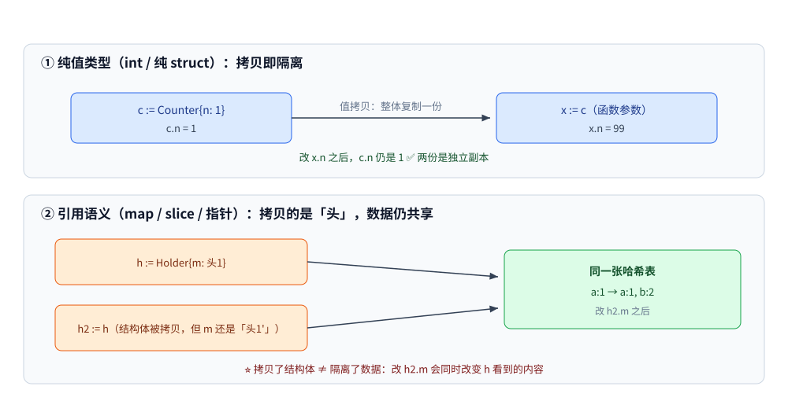
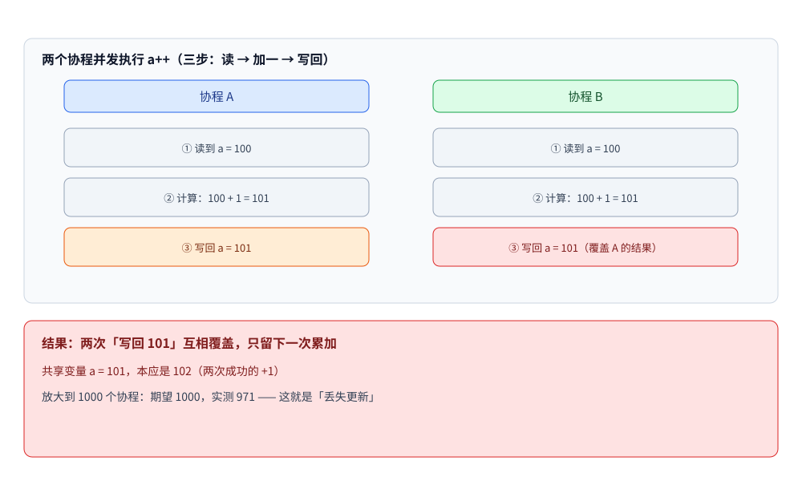
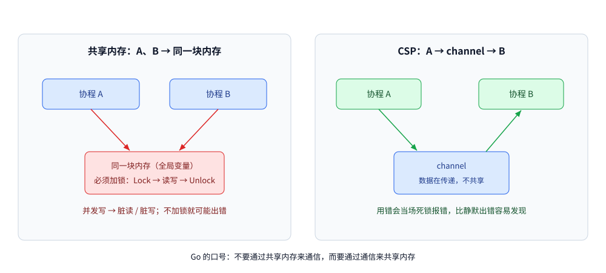
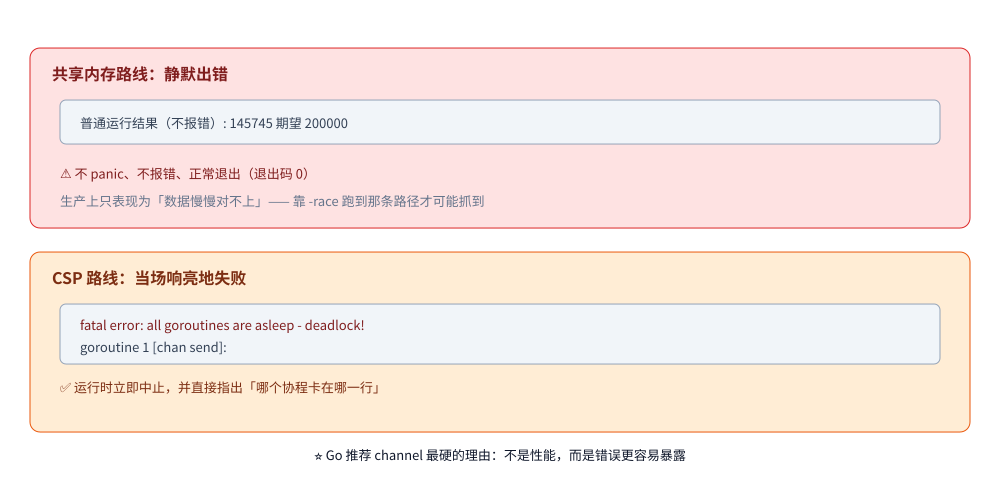

# 线程安全与 CSP

> 覆盖：并发下数据为什么会坏 —— Go 只有值传递，「共享」到底是怎么发生的；共享错了的两种坏法（静默丢更新 / 直接崩进程）；哪些类型天生并发安全；以及两条路线（共享内存 vs CSP）各自的失败模式、代价与选型。
>
> 不覆盖：具体原语的实现见 [并发同步原语.md](并发同步原语.md)、[atomic操作.md](atomic操作.md)、[sync.Map.md](sync.Map.md)；内存序规范与 `-race` 的能力边界见 [Go内存模型.md](Go内存模型.md)；channel 自身的机制见 [channel原理与底层实现.md](channel原理与底层实现.md)。
>
> 内容整理自大厂 Go 后端面试真题，并按《Go 语言核心编程》（李文塔）5.1 并发基础、5.4.1 CSP 简介、5.4.2/5.4.3 调度模型、7.5 值、指针和引用 的相关章节**补充了机制分析与实测**；参考资料与原始素材见 [素材清单](../../../素材清单.md)。

---

## 一、Go 只有值传递，那「共享」是怎么发生的？

**来源**：本节为补充内容 —— 按《Go 语言核心编程》（李文塔）7.5 值、指针和引用 整理，配套本机实测。

**本节要点**：后面所有问题（map 崩、`a++` 丢、锁被拷贝）都源于同一个前提：**两个协程拿到了同一份底层数据**。Go 只有值传递，所以「共享」不是语法给的，而是**值里面藏着指向同一份数据的头**。能不能一眼看出「这段代码会不会有竞态」，就取决于你是否清楚哪些东西在传递后仍然指向同一份数据。

### 1.1 四条实测：值传递 vs 引用语义

```go
type Counter struct{ n int }            // 纯值类型字段
type Holder struct{ m map[string]int }  // 内含引用类型字段

c := Counter{n: 1}
func(x Counter) { x.n = 99 }(c)         // 改不动外面

h := Holder{m: map[string]int{"a": 1}}
h2 := h                                 // 结构体被拷贝了……
h2.m["b"] = 2                           // ……但 map 字段仍指向同一张表

s := []int{1, 2, 3}
func(x []int) { x[0] = 99 }(s)          // 改得动

bad := 0
for i := 0; i < 1000; i++ {
    go func() { bad++ }()               // 裸 int 并发累加
}
```

```text
1_传 struct 进函数改字段   : 1 （没变——Go 只有值传递）
2_拷贝 struct 后改 map 字段: map[a:1 b:2] （变了——map 是引用语义）
3_传 slice 进函数改元素    : [99 2 3] （变了——三个字段拷贝，但指向同一数组）
4_裸 int 并发累加          : 975 （大概率 < 1000，丢更新）
5_加 Mutex 之后            : 1000 （结果确定）
```



这条说明段要读出的结论是：**「拷贝了结构体」不等于「隔离了数据」** —— 第 2 行 `h2 := h` 明明发生了结构体拷贝，改 `h2.m` 却影响到了 `h`，因为拷贝的只是那个 map 头，它和原件指向同一张哈希表，这就是「误以为安全」的来源。

> 第 4 行是「值类型字段 + 并发」的标准翻车现场：`bad++` 是「读-改-写」三步，不是原子操作，两个协程交替执行就会互相覆盖（实测 975 ≠ 1000）。第 5 行加上锁之后结果才确定 —— 丢更新的机制见下一节 2.1。

### 1.2 由此得到一张判断表

| 传的是 | 改元素会影响调用方吗 | 并发改它安全吗 |
|---|---|---|
| `int` / `string` / 纯值 `struct` | ❌ 不会 | ✅ 安全（各持有副本） |
| **指针** | ✅ 会 | ❌ 不安全（指向同一份数据） |
| **`slice`** | ✅ 会（改元素；改长度不影响） | ❌ 不安全 |
| **`map`** | ✅ 会（增删改都影响） | ❌ 不安全，且**写会触发 `fatal error`**（不可 recover） |
| **`chan`** | 不适用（本身就是通信机制） | ✅ **收发本身是并发安全的**（但关闭时机要自己保证） |
| 含 `slice` / `map` / 指针字段的 `struct` | ✅ 会（**结构体拷贝不隔离内部引用**） | ❌ 不安全 |

> ⭐ 一句话判据：**「值传递」只保证「变量的拷贝独立」，不保证「变量指向的数据独立」**。
> 看到 `map` / `slice` / 指针 / 内嵌它们的结构体被多个协程共用，就要考虑锁或所有权收口 —— 这就是第四节两条路线要做的选择。

### 1.3 ⚠️ 带锁的结构体绝对不能被拷贝

既然结构体拷贝是常态，那**含 `sync.Mutex` 的结构体**就要特别小心 —— 拷贝会让锁「劈成两把」，保护直接失效。编译器不管，但 `go vet` 管：

```go
type WithLock struct {
    mu sync.Mutex
    n  int
}

x := WithLock{}
y := x   // ← 拷贝了锁
```

```text
$ go vet ./...
main.go:58:7: assignment copies lock value to y: sample.WithLock contains sync.Mutex
```

| 要点 | 说明 |
|---|---|
| 编译能过吗 | ✅ **能过** —— 这不是编译错误，是**静态检查项**（`copylocks`） |
| 危害 | 拷贝出来的是一把**新锁**，两个副本各锁各的 → 临界区**形同没加锁**，且不报任何错 |
| 怎么防 | 含锁的结构体**一律用指针传递**（`*WithLock`）；`go vet ./...` 纳入 CI；方法接收者用 `*T` |
| 同理 | `sync.WaitGroup`、`sync.Cond` 等同步原语**都属于不可拷贝类型** |

> ⚠️ 这条和第三节的「三类线程安全类型」是一体两面：**「安全」的前提是那个保护机制没有被无意拷贝掉**。
> 所以标准做法是 —— **要么全值类型 + 靠锁包在外面，要么把锁和状态封进一个只以指针流转的结构体**。

---

## 二、共享错了会怎样？两种坏法

**本节要点**：共享出错的后果**不是一种**，而是两类 —— 一类**静默**（结果对不上，程序照常退出），一类**当场崩**（运行时检测到，`recover` 救不回来）。分清这两类，才知道什么时候必须上 `-race`、什么时候会立刻暴露。

### 2.1 静默丢更新：`a++` 不是一步

**本节要点**：看起来只有一条语句，但 **`a++` 实际是三步非原子操作**。

```text
① 从寄存器/内存把值读出来
② 加一
③ 写回
```

**并发下发生了什么**（1000 个协程为例）：

```text
多个协程同时读到同一个值（比如都读到 100）
→ 各自加一，都得到 101
→ 各自写回，结果都是 101
→ 本应累加多次，实际上大量重复累加被「互相覆盖」
```



从这张时序图上要读出的结论是：两次 `+1` 只有一次真正生效，**结果比预期少**（1.1 实测少了 25，另一次同样负载实测得到 971），这就是**丢失更新**；而且它**不报错、不 panic、退出码为 0**。

> 这也再次印证了 [并发控制实战.md](并发控制实战.md) 第一节的结论：**「取号 + 写回」必须处于同一个互斥区间**。

**map 的写操作也是「先查找可写位置，再赋值」**，所以并发写的竞态形态相同。假设两个协程要对同一个 key 先后写入 `value1`、`value2`：

```text
协程 A：查找位置 → ...（被打断）
协程 B：查找位置 → 写入 value1 → ...
协程 A：继续 → 写入 value2
```

原计划是「写 value1 → 做些操作 → 写 value2」，但并发下最终结果**可能是 value1，也可能是 value2**，**无法保证数据一致性** —— 这就是非线程安全。

### 2.2 直接崩：map 的并发写是零容忍

**本节要点**：与 `a++` 不同，`map` 的并发写**不是数据错乱，而是运行时主动中止进程**，且**不可 recover**。

多个协程并发读写同一个全局变量（数组、`map`、结构体都算）→ 可能出现**脏读 / 脏写**；
经典解法是加锁：**加锁 → 读写 → 解锁**，锁区间内的代码只会被串行执行，不会并发。这一节讲**不加**会怎样。

先记住两种最简结论，再往下看机制：

| 操作组合 | 结果 |
|---|---|
| 多协程**并发读** map | ✅ 安全 |
| 多协程**并发读写** / 并发写 | ❌ **直接 panic**（`fatal error: concurrent map read and map write`） |

Go 的 map 在结构上有一个标记位 **`hashWriting`**：

> 当某个协程正在对 map 执行**写操作**时，`hashWriting` 会被置位。
> 此时**任何其它操作——无论是读还是写——都会被拒绝**，直接 panic。

```go
var m = map[int]int{}
for i := 0; i < 4; i++ {
    go func(k int) { m[k] = k * k }(i) // ❌ 并发写原生 map
}
// fatal error: concurrent map writes —— 运行时直接中止，recover 也救不回来
```

三种常见容器的并发行为完全不同：

| 类型 | 多协程并发读写的结果 |
|---|---|
| **数组 / slice** | **不报错**，但结果**不可预期**（每次跑都可能不一样，形态同 2.1） |
| **原生 `map`** | **直接 `fatal error`，进程崩溃**（运行时会检测到并发写） |
| **`sync.Map`** | 原生支持并发读写，并发场景可以直接用它 |

**结论**：Go 对 `map` 的并发写是**零容忍**的 —— 不是数据错乱，而是**直接崩进程**。
「多个协程随便读写全局 `map`」是最典型的错误写法；严格来说，**并发读没问题**（多个协程执行的都是同一套「查找」逻辑，不修改任何数据），**只要涉及写就必然有问题**（另一个协程可能在算哈希、查 topHash、比对 key、写入元素的任意阶段被打断）。

---

## 三、Go 里哪些类型是线程安全的？

**本节要点**：先把「线程安全」这个词定义清楚，再识破「切片和集合哪个安全」这个误导性问法，最后给出系统性的判断方法。

### 3.1 什么才算「线程安全」

> **线程安全 = 你写的代码能按照你的预期执行。**

即：当多个线程/协程同时访问同一段代码、同一份数据或同一个资源时，
**仍然能保持正确的行为**，按预期执行并得到预期结果。

注意它不是「加了锁」—— 加锁只是手段之一（还有原子操作、单协程独占所有权）。判据落在**结果是否可预期**上：
map 是非线程安全的，就是因为**多协程读写时，产生的结果可能和预期不一样**（2.1 的 `975 ≠ 1000` 就是这种「不一样」）。

### 3.2 先识破题目的陷阱

> **「切片和集合哪个是线程安全的？」** —— **两者都不是线程安全的。**

切片（slice）和集合（map）**都不支持并发写**。
面试官真正想听的是：**你怎么判断一个类型是否线程安全**，以及**Go 里哪些类型是安全的**。

### 3.3 怎么判断「非线程安全」？两种表现

| 表现 | 说明 | 例子 |
|---|---|---|
| **表现 1：并发调用直接报错** | 程序 panic | **map 并发读写** → `fatal error: concurrent map read and map write` |
| **表现 2：并发调用不报错，但结果不可预测** | 结果每次都不一样 | **切片某元素并发累加**：预期 1000，实际得到 **971**（且每次运行可能不同，落在 1~1000 之间的任意值） |

> **⚠️ 实验注意**：**并发协程数一定要足够多**。
> 因为操作很快时，100 个协程**有可能「恰到好处」地没触发并发** ——
> 所以 100 个未必报错，起上万个概率就很大了。

这两种表现对应第二节的两类坏法：表现 2 的机制见 2.1，表现 1 的机制见 2.2。

### 3.4 Go 里三类线程安全的类型（本题的核心答案）

#### 第 1 类：Channel

> **Channel 是线程安全的** —— 查看 `runtime` 包里的数据结构就能看到，
> **它内部有互斥锁**来保证类型安全。
>
> 它也是 **CSP 编程模型的核心组件**，主要用于**协程间通信**。

**典型用法**：启动 1 个协程从 channel 读数据打印，2 个协程分别发送 0~9 和 10~19，
发送完关闭 channel。结果：20 个数**全部打印出来**，
两个发送协程的内容**穿插出现**（因为是并发发送，顺序不严格）——
这正是 channel 协调**生产者-消费者**的体现。

#### 第 2 类：`sync` 包下的类型

> Go **原生支持并发**。而并发就一定需要**同步手段** ——
> 因为有些操作本身不支持并发，必须借助工具来协调。
> **`sync` 包就是专门用来解决 Go 原生支持并发所带来的问题的**，
> 所以**它下面的类型都是线程安全的**。

| 类型 | 用途 |
|---|---|
| `sync.WaitGroup` | 等待多个协程完成 |
| `sync.Mutex` / `sync.RWMutex` | 互斥锁 / 读写锁 |
| `sync.Map` | 并发安全的 map |
| `sync.Once` | 只执行一次 |
| `sync.Pool` | 对象复用池 |
| `sync.Cond` | 条件变量 |

**对比例子**：同样是「几百个协程并发读写一个 map」——
**不加锁会直接 panic**；**加上 `sync.Mutex` 后就能得到完整正确的内容**。
这就是用 `sync` 包保护临界资源的效果。

#### 第 3 类：原子操作类型（`sync/atomic`）

> 专门解决 2.1 那种**累加不安全**的问题。

```go
var s0 int64
for i := 0; i < 1000; i++ {
    go func() {
        atomic.AddInt64(&s0, 1)      // ✅ 保证原子性
    }()
}
// 结果稳定为 1000（每次运行都是 1000）
```

**重要细节**：原子类型**不支持 `+=` 这种运算符**，
必须**调用专门的方法**：

| 方法 | 作用 |
|---|---|
| `Add` | 原子加 |
| `Load` | 原子读 |
| `Store` | 原子写 |
| `Swap` | 原子交换 |
| `CompareAndSwap` | 原子比较并交换（CAS） |

**记忆点**：正是因为**这些方法是原子语义的**，才保证了整个操作不被中途打断。

### 3.5 一张表总结

| 类别 | 具体类型 | 为什么安全 |
|---|---|---|
| **① Channel** | `chan T` | runtime 内部结构自带**互斥锁** |
| **② sync 包** | `WaitGroup`、`Mutex`、`RWMutex`、`Map`、`Once`、`Pool`、`Cond` | 这个包**本身就是为并发同步而生** |
| **③ 原子操作** | `atomic.Int64`、`atomic.Int32` 等及 `atomic.*` 方法 | 通过 **`Add`/`Load`/`Store`/`Swap`/`CAS`** 保证单次操作原子性 |

> **反之，下面的都是非线程安全的**：`map`、`slice`、
> 以及其他**未做同步保护的普通内置类型和结构体**。
>
> ⭐ 注意「安全」的边界：`chan` 的**收发**是安全的，但**关闭时机**要自己保证（重复 close 会 panic）；
> `sync.Map` 的**单个方法**是安全的，但**「先读再写」的复合操作**不原子 —— 细节见 [sync.Map.md](sync.Map.md)。

至于「已经共享了，具体有哪三种修法」—— 加读写锁、换 `sync.Map`、分片 map —— 展开见 [并发同步原语.md](并发同步原语.md) 第七节的三种方案对照。

---

## 四、共享内存 vs CSP：两条路线的失败模式差在哪？

**本节要点**：既然 `chan` 也是「加了锁的队列」，那 Go 为什么反复推荐它？答案不是性能，而是**两条路线出错时的样子完全不同**。

### 4.1 CSP：换一种共享数据的方式

CSP（Communicating Sequential Processes，通信顺序进程）说白了就一句话：

> **多个协程之间总得共享数据 —— 除了「共同读写一个全局变量」，还可以「通过管道把数据传过去」。**

即：**共享内存**是 `A、B → 同一块内存（必须加锁）`；**CSP** 是 `A → channel → B`（数据在传递，不共享）。

**所以 Go 的口号是「不要通过共享内存来通信，而要通过通信来共享内存」**——
channel 就是这句话的载体，[channel实战模式.md](channel实战模式.md) 的「生产者-消费者 / 协程池」就是它的落地形态。



读法：差别在中间那条边 —— 共享内存是两头都指向同一块内存，CSP 是数据经 channel 传递所有权；前者要自己保证互斥，后者由 channel 保证。

### 4.2 CSP 不是 Go 发明的：Hoare 1978

| 要点 | 内容 |
|---|---|
| 出处 | **Tony Hoare 1978 年的论文《Communicating Sequential Processes》** |
| 作者是谁 | 就是**快速排序的发明者**、后来的图灵奖得主 —— 他提出把「进程」和「通信」作为语言的一等概念 |
| 核心观点 | 顺序进程之间**不通过共享变量交互，只通过消息传递**同步与交换数据 |
| Go 的位置 | Go **不是它的第一个实现**（Occam、Erlang、Limbo 都更早），但 Go 让 CSP 进入了主流工程语言 |

> ⭐ 能顺口说出「CSP 是 Hoare 1978 年的论文提出的，比 Go 早 30 多年」，
> 效果远好于只重复那句口号 —— 说明你知道这是**一种并发模型**，而不是 Go 的语法糖。

### 4.3 Go 的取舍：并发是「一等公民」，但并没有排斥锁

Go 把并发做进了语言层（`go` 关键字、`chan` 内置类型、`select` 语句），这是它和 Java / C++ 最直观的差别。但要注意 Go 的取舍是 **「提供两条路」**：

| 层面 | 共享内存路线 | CSP 路线 |
|---|---|---|
| 语言语法 | 无关键字，靠库 | `go` / `chan` / `select` **是语言的一部分** |
| 标准库 | `sync.Mutex`、`sync.Map`、`sync/atomic` | channel 本身 |
| 官方立场 | 标准库 `sync` 包一直在演进（`sync.OnceValue`、`sync.WaitGroup.Go` 等新 API 不断加入） | ⭐ **两者都正式推荐** —— `go` / `chan` / `select` 是语言原语 |

> ⭐ 顺着这条线可以自然接上另一个高频题：**Go 的调度模型（G/M/P）正是为 CSP 服务的** ——
> 每个 goroutine 相当于一个「顺序进程」，调度器负责在它们之间切换、并在 channel 收发时挂起与唤醒（见 [GMP调度.md](../运行时/GMP调度.md)）。
> 书 5.4.2 / 5.4.3 讲的「调度模型」放在并发这一章，就是这个原因。

### 4.4 ⭐ 选型的真正依据：两种路线的**失败模式**不同

这是前面表格之外、更值得记住的一层。实测同一件事的两条路出错时的样子：

```go
// 共享内存路线：两个协程各 +100000，无保护
var shared int
for i := 0; i < 2; i++ {
    go func() { for j := 0; j < 100000; j++ { shared++ } }()
}
fmt.Println("普通运行结果（不报错）:", shared, "期望 200000")
```

```text
普通运行结果（不报错）: 145745 期望 200000
fatal error: all goroutines are asleep - deadlock!

goroutine 1 [chan send]:
```

| 路线 | 出错时的表现 | 被发现的方式 |
|---|---|---|
| **共享内存** | 结果**静默出错**（`145745` 而不是 `200000`）—— **不 panic、不报错、正常退出** | 靠 `-race` 在测试里跑到那条路径才报；**生产上只会表现为「数据慢慢对不上」** |
| **CSP** | **死锁**：`fatal error: all goroutines are asleep - deadlock!`，还会打印**哪个协程卡在哪**（`goroutine 1 [chan send]`） | 运行时**立即**中止并指出位置 |



这张对照图要读出的是：左边那条路**退出码是 0**、什么提示都没有，右边那条路会在 stderr 上直接告诉你卡在 `chan send`——**「错了能立刻发现」才是它被推荐的核心原因，而不是性能**。

> ⭐ **这才是「Go 推荐用 channel」最硬的理由 —— 不是性能，而是错误更容易暴露。**
> channel 每次收发都有调度与内存屏障开销，纯性能上不如 atomic；但共享内存的错**是静默的**（上面那行输出连退出码都是 0），
> 而 CSP 用错时会**当场响亮地失败**。工程上「错了能立刻发现」往往比「快一点」更重要。
>
> ⚠️ **本项 `-race` 未做实测**：本机未装 gcc，`go run -race` 直接报 `-race requires cgo`。
> 上表关于 race 的描述来自文档与工具行为，**不是本机跑出来的**。（第一行「静默出错」与死锁那两行是本机实测。）

> 📖 顺带一条实践建议：无论选哪条路线，**测试都加 `-race` 跑**，跨协程的代码尤其要。
> 但要清楚它的局限 —— 它只在**实际执行到的路径**上检测，没跑到的竞争它一样看不见（见 [Go内存模型.md](Go内存模型.md)）。

---

## 五、代价：三种同步写法正确性等价，代价差一个数量级

**本节要点**：这一节给第四节「失败模式」补上数。**正确性上三条路是等价的** ——
真正的差别在代价，而且**channel 并不是免费的**。

### 5.1 场景与四种写法

同一个需求：**8 个 goroutine 各把计数器加 50000 次，期望值 400000**。

| 写法 | 路线 |
|---|---|
| ① 共享变量、**无同步** | 共享内存（错的那一种） |
| ② 共享变量 + `Mutex` | 共享内存 + 锁 |
| ③ 共享变量 + `atomic` | 共享内存 + 原子操作 |
| ④ 把「加 1」这件事**交给一个 goroutine** | **CSP**（channel 交接） |

### 5.2 正确性实测

```text
=========== 三种同步写法的结果 ===========
  ② 共享内存 + Mutex   → 400000，等于期望？ true
  ③ 共享内存 + atomic  → 400000，等于期望？ true
  ④ CSP（channel 交接）→ 400000，等于期望？ true
  → 三种写法在正确性上等价 —— 差别在代价，见 timing/
```

⭐ 结论一：**只要建立了正确的同步，「用共享内存还是用 channel」在正确性上没区别** ——
选型的依据只能是**代价与可读性**，不是「哪个更安全」。

### 5.3 关于「无同步」那一版

```text
无同步共享变量，期望 400000；连跑 10 轮：
  第  1 轮：  226185  缺失   173815（43.45%）
  第  2 轮：  400000  缺失        0（0.00%）
  第  3 轮：  400000  缺失        0（0.00%）
  第  4 轮：  219455  缺失   180545（45.14%）
  第  5 轮：  263817  缺失   136183（34.05%）
  第  6 轮：  292878  缺失   107122（26.78%）
  第  7 轮：  298266  缺失   101734（25.43%）
  第  8 轮：  261368  缺失   138632（34.66%）
  第  9 轮：  240339  缺失   159661（39.92%）
  第 10 轮：  400000  缺失        0（0.00%）
→ 10 轮里恰好等于期望的有 3 轮
```

⭐⭐ 这 10 轮里**有 3 轮完全正确** —— 它证明的不是「会丢多少」，而是
**结果不可预测**：既可能丢掉 45%，也可能恰好一次不丢。

⚠️ 因此：**「我跑了一遍是对的」不能作为「这段代码是对的」的证据**。
这也解释了为什么「无同步」的错误最难查 —— 它在测试环境可能一直「对」。
（机制解释见 [Go内存模型.md](Go内存模型.md)）

### 5.4 代价：含计时，只主张量级

同一份负载，每种写法跑 5 轮取最快一轮：

```text
  atomic                 最快一轮 4ms
  Mutex                  最快一轮 31ms
  channel（CSP 交接）        最快一轮 73ms
```

⚠️ **这两组数字含计时，随机器负载波动，不要当性能指标用**。
稳定的是**量级关系**：**为了「改一个整数」而走 channel，代价是数量级的**
（这里 channel 约为 atomic 的十几倍）。

⭐ 结论二（这才是选型的真正依据）：

| 场景 | 该用 |
|---|---|
| 状态就是一个整数 / 一个指针，操作是单次读写 | **`atomic`**（最轻） |
| 状态是一组字段、要「一起改」 | **`Mutex`** |
| 状态需要**跨 goroutine 交接所有权**（谁生产、谁消费） | **channel** |
| 需要在多个 worker 之间**分发任务 / 收集结果** | **channel**（这是它的主场） |

### 5.5 ⭐ 什么时候**不该**用 channel

这是本节最实用的一条。以下三种情况用 channel 是**过度设计**：

1. **只是要保护一个计数器 / 一个标志位** → `atomic`（实测：4ms vs 73ms，差一个数量级）；
2. **只是要保护一组字段的一致性** → `Mutex`（实测：31ms vs 73ms）；
3. **状态只有一个 goroutine 会碰** → **什么都不用**（不需要任何同步）。

⚠️ 反过来也成立：**下面这些才是 channel 真正的主场**，用锁反而绕：
扇出分发任务、扇入收集结果、流水线（pipeline）分阶段、把「所有权」从 A 交给 B、
用 select 做多路复用与超时。

## 使用：同一需求的两种写法，怎么选

两种风格解决的是同一件事（多协程安全地共享一个状态），差别在**同步发生在哪一层**：

| 维度 | 共享内存（Mutex / atomic / sync.Map） | CSP（channel） |
|---|---|---|
| 状态在哪 | 就在结构体里，**直接读** | 被某个协程独占，别人只能通过管道问它 |
| 同步点 | 每次读写都要过锁/原子操作 | 只在收发消息时同步 |
| 谁保证正确 | 调用方自己（忘加锁就出错，且**可能不带检测**） | 语言机制保证，越界使用会直接死锁报错 |
| 适合的场景 | 读多写少、临界区极小（计数器、开关、缓存命中统计） | 有明确的数据流与所有权移交（任务队列、流水线、扇入扇出） |
| 不适合的场景 | 复杂状态机（锁的粒度会失控） | 高频小消息（每次收发都是一次调度 + 内存屏障） |
| 出错时的表现 | 数据竞争（`-race` 才能抓到） | 死锁 / 协程泄漏 |

**选型口诀**：

- 「一块状态、多个读，偶尔写」→ **共享内存 + `RWMutex` 或 `atomic`**；
- 「一条数据从 A 流到 B，所有权随之转移」→ **channel**；
- 「不确定」→ 先用锁把正确性做出来，再用 `-race` 与压测判断是否值得改成管道；**不要为了「Go 味」硬把简单状态改成 channel**。

> ⭐ Go 那句名言后半句常被忽略：**「不要通过共享内存来通信」针对的是「用锁保护复杂数据流」这种写法**，而不是禁止使用锁。`sync.Mutex`、`atomic` 本身就在标准库里，官方从没说要取代它们。

---

## 延伸追问

- **并发写原生 `map` 会怎样？** → `fatal error: concurrent map writes`，
  进程直接崩溃；**它不是数据错乱，而是运行时主动中止，无法 recover**（机制见 2.2）。
- **那怎么安全地并发使用 map？** → 三种方案，按「读多写少程度」挑：

  | 方案 | 适用场景 | 代价 |
  |---|---|---|
  | `sync.RWMutex` + 普通 map | 读多写少，逻辑复杂 | 加锁开销，读之间也要走 RWMutex |
  | `sync.Map` | **读多写少**且 key 相对稳定 | 写性能差，内存占用高 |
  | 分片 map（sharding） | 高并发读写 | 实现复杂 |

  展开见 [并发同步原语.md](并发同步原语.md) 第七节与 [sync.Map.md](sync.Map.md) 第六节的选型判据。
- **`sync.Map` 为什么读快？** → 内部是 read/dirty 双 map + 原子读，读路径无锁；代价是写要走 dirty 并可能触发晋升，所以只在「读多写少且 key 稳定」时划算（结构见 [sync.Map.md](sync.Map.md)）。
- **slice / 数组并发读写安全吗？** → **不崩，但结果不可预期**，
  比崩更隐蔽——必须自己加锁，或用 channel 把读写收口到单一协程。
- **切片并发读安全吗？** → 并发**只读**是安全的；
  **只要有写就有问题**（且 slice 的写还可能触发扩容、替换底层数组，风险更大）。
- **只给某几个元素加锁能解决切片并发吗？** → 不能完全解决——
  底层数组的**扩容/替换**是整体性的，仍需要整体加锁或改用 chan 传递所有权。
- **channel 能代替锁吗？** → 不能一概而论：**协程间传数据 / 传信号**用 channel；
  单纯**保护一块共享数据**用 `sync.Mutex` / `atomic`（对应 [channel使用陷阱.md](channel使用陷阱.md)「先定住用途」）。
- **用 channel 是不是比用锁「更安全」？** → **不是**。实测三种同步写法在正确性上完全等价（5.2）。
  差别在**代价与表达力**，所以「为了安全而用 channel」是个错误的理由。
- **那为什么 Go 说「不要通过共享内存来通信」？** → 它讲的是**表达力**：
  交接所有权、分发任务、流水线这些场景用 channel 写起来直白得多。
  但这条口号**不是**「禁止用锁」（见 4.3）。
- **无同步到底会不会出错？** → **不可预测**。实测 10 轮里 3 轮完全正确、7 轮最多丢 45%（5.3）。
  所以「跑一遍是对的」不能当证据。
- **我只是改一个计数，用 channel 行不行？** → 能跑，但**代价是数量级的**
  （实测 atomic 4ms vs channel 73ms，5.4）。这种场合用 `atomic`。
- **什么时候连锁都不需要？** → **状态只有一个 goroutine 会碰时**（5.5 第 3 条）——
  这时候加任何同步都是纯粹的多余开销。
- **Go 推荐的并发姿势是什么？** → **「用通信来共享内存，而不是用共享内存来通信」**——
  优先用 channel 传递数据所有权，把共享状态限制在单个协程里（理由见 4.4：**错得更显眼**）。
- **Go 是值传递还是引用传递？** → **只有值传递**。所谓「引用语义」指的是 `slice`/`map`/`chan` 拷贝后**仍指向同一份底层数据**，不是「传了引用」（1.1）。
- **结构体里有 slice 字段，传参会不会拷贝底层数组？** → **不会**。只拷贝结构体本身（含 slice 的三个字段），底层数组仍是共享的。
- **`atomic` 能替代锁吗？** → 对**单个**变量的「读-改-写」可以（`atomic.AddInt64`）；**跨越多个变量的一致性**做不到，仍需 `Mutex`（展开见 [atomic操作.md](atomic操作.md)）。

## 关联

- **路线对照**：[channel原理与底层实现.md](channel原理与底层实现.md) — CSP 路线在本项目里的实现载体
- **路线对照**：[channel使用陷阱.md](channel使用陷阱.md) — 使用 channel 的代价与常见反模式
- **路线对照**：[并发同步原语.md](并发同步原语.md) — 共享内存路线的原语（Mutex / atomic / sync.Map）
- **下游细节**：[sync.Map.md](sync.Map.md) — 「安全」的边界：单方法安全、复合操作不原子
- **下游细节**：[Go内存模型.md](Go内存模型.md) — 为什么无同步是未定义行为、`-race` 能测什么
- **量级参考**：[协程与线程成本.md](协程与线程成本.md) — 协程轻量化的量化对照
- **量级参考**：[goroutine.md](goroutine.md) — 被调度的实体本身：栈、创建成本与生命周期
- **语言机制**：[指针与引用.md](../类型与语法/指针与引用.md) — 含锁结构体为什么禁止值拷贝
- **语言机制**：[map.md](../类型与语法/map.md) — map 为什么不能并发写
- **语言机制**：[切片.md](../类型与语法/切片.md) — 切片的「部分线程安全」
- **语言机制**：[类型系统.md](../类型与语法/类型系统.md) — 值接收者 / 指针接收者与值语义、指针语义
> 反向引用（本篇被下列文档引到）：[atomic操作.md](atomic操作.md)、[接口.md](../类型与语法/接口.md)、[错误处理.md](../类型与语法/错误处理.md)、[JMM与内存屏障.md](../../java/并发编程/JMM与内存屏障.md)、[ThreadLocal与上下文传递.md](../../java/并发编程/ThreadLocal与上下文传递.md)
