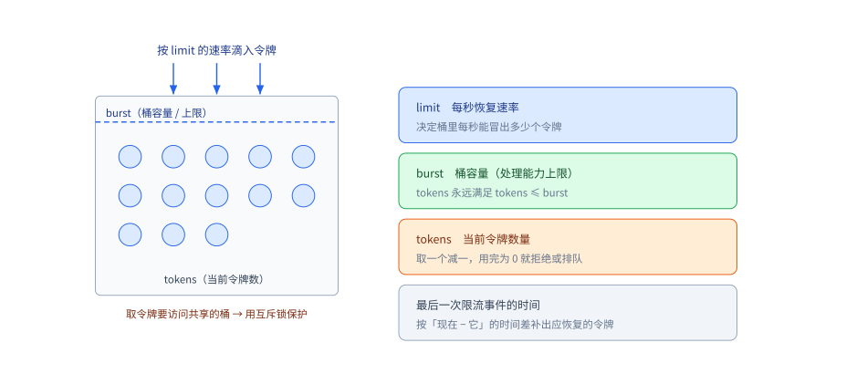
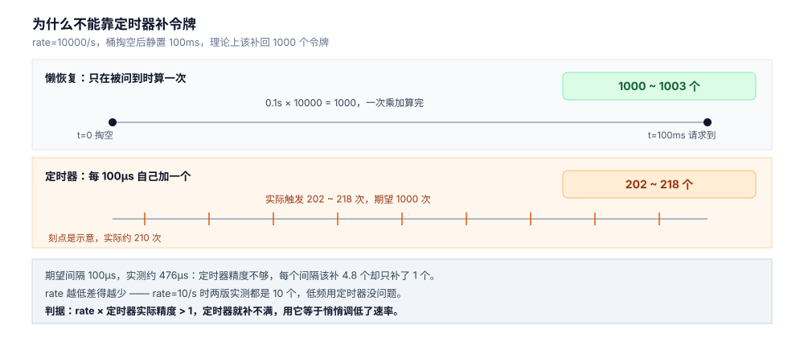
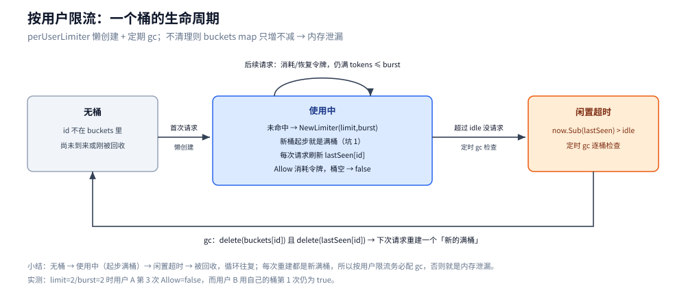
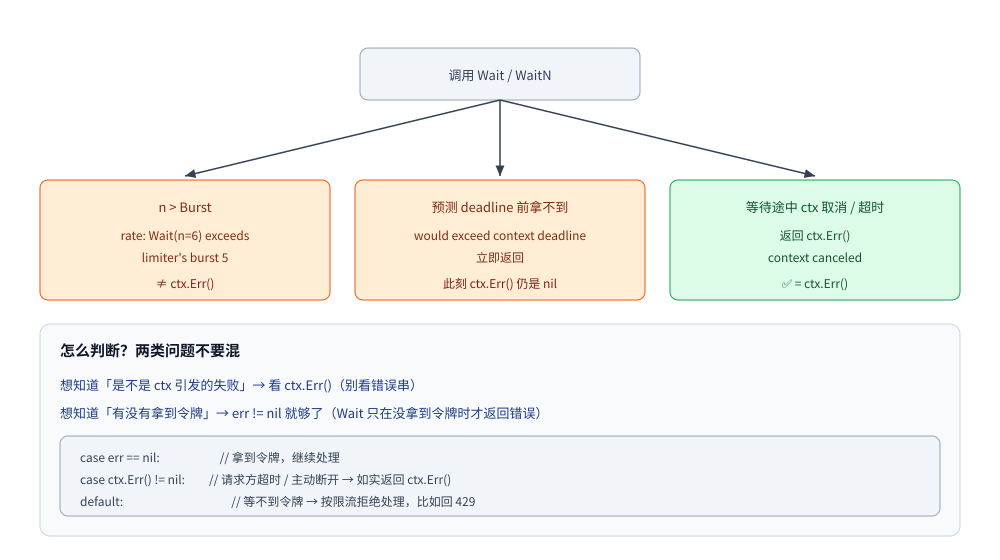

# Go 限流器

> 从零写一个令牌桶，再把它和 `golang.org/x/time/rate` 放进同一个程序里逐条对拍：读数完全一致，唯一差别在「令牌什么时候增加」。这条差别决定了它能不能撑住高频速率。
>
> 实测环境：**go1.26.5 / windows-amd64 / `golang.org/x/time` v0.16.0**，纯标准库 + 一个外部依赖，单文件 `main.go`，三次连跑取区间。输出见第一节与第五节。
>
> 内容整理自个人学习笔记，参考资料与原始素材见 [素材清单](../../../素材清单.md)。
> 令牌桶与漏桶的**算法原理、参数语义与选择口径**见 [限流算法.md](../../../04-架构与系统/分布式/稳定性/限流算法.md)。

---

## 一、从零实现：一个能用的令牌桶

**本节要点**：一个能用的令牌桶只有四个字段、四个方法。把它们写出来，再看官方库就不是「黑盒 API」，而是同一套东西加了几个便捷方法。

### 1.1 三个字段定死语义

限流器要回答的只有一个问题：**此刻能不能放行 n 个请求**。回答它需要三个量：

| 字段 | 语义 | 设错了会怎样 |
|---|---|---|
| `rate` | 每秒补多少个令牌 | 设成平均 QPS，突发全被拒 |
| `burst` | 桶容量，一次最多放多少个 | 设成 1，接口退化成串行 |
| `tokens` | 当前令牌数，恒满足 `tokens ≤ burst` | 必须用浮点：按时间差补，常常不足 1 个 |

外加一个时间戳 `last`：**上次结算时刻**。它不是「上次请求时刻」，而是「上次把令牌算清楚的那一刻」——这个区别就是第二节的全部内容。



读法：`burst` 与 `rate` 是两个独立维度——`burst` 管「一次能放多少」，`rate` 管「每秒补多少」。补令牌按时间差算，所以空闲再久也只补到 `burst` 为止，不会攒成无限突发额度。

### 1.2 完整实现

```go
package main

import (
	"sync"
	"time"
)

type Bucket struct {
	mu     sync.Mutex
	rate   float64   // 每秒补多少个
	burst  float64   // 桶容量：一次最多放多少个
	tokens float64   // 当前令牌数，float64 是因为按时间差补常常不足 1 个
	last   time.Time // 上次结算时刻
}

func NewBucket(rate, burst float64) *Bucket {
	return &Bucket{rate: rate, burst: burst, tokens: burst, last: time.Now()}
}

// refill 把「上次结算到现在」该补的令牌一次加上，并把 last 推进到 now
func (b *Bucket) refill(now time.Time) {
	if now.After(b.last) {
		b.tokens += now.Sub(b.last).Seconds() * b.rate
		if b.tokens > b.burst {
			b.tokens = b.burst
		}
		b.last = now
	}
}

// AllowN 回答「现在能拿 n 个吗」
func (b *Bucket) AllowN(n float64) bool {
	b.mu.Lock()
	defer b.mu.Unlock()
	b.refill(time.Now())
	if b.tokens >= n {
		b.tokens -= n
		return true
	}
	return false
}

// DelayAt 回答「从 base 算起，第 n 个要等多久」；负数表示永远等不到
func (b *Bucket) DelayAt(base time.Time, n float64) time.Duration {
	b.mu.Lock()
	defer b.mu.Unlock()
	b.refill(base)
	if b.tokens >= n {
		return 0
	}
	if n > b.burst {
		return -1
	}
	return time.Duration((n - b.tokens) / b.rate * float64(time.Second))
}

// TokensAt 读当前令牌数，排查时看它是不是在 0 ~ burst 之间波动（见 6.1）
func (b *Bucket) TokensAt(now time.Time) float64 {
	b.mu.Lock()
	defer b.mu.Unlock()
	b.refill(now)
	return b.tokens
}
```

三处值得停下来看的地方：

- **`refill` 是幂等的**：同一个时刻调两次，第二次 `now.Sub(b.last) == 0`，什么都不加。所以 `AllowN`、`DelayAt` 都可以放心各自先补一次。
- **`tokens` 必须是 `float64`**：`rate=10/s` 时，隔 50ms 只该补 0.5 个。用 `int` 就只能二选一——要么补 1 个（速率翻倍），要么补 0 个（永远补不上）。
- **`n > burst` 直接判死**：桶容量是硬上限，等多久都凑不够。这一条后面会变成官方的 `exceeds limiter's burst` 报错。

### 1.3 跑起来：五组读数

把上面这段和一个验证程序放进同一个文件，配 `rate=10, burst=100`：

```go
b := NewBucket(10, 100)
pass, reject := 0, 0
for i := 0; i < 101; i++ {
	if b.AllowN(1) {
		pass++
	} else {
		reject++
	}
}
fmt.Printf("通过 %d / 拒绝 %d，剩余 tokens=%.0f\n", pass, reject, b.TokensAt(time.Now()))
```

```text
[A1] rate=10/s burst=100，起步连打 101 次
     通过 100 / 拒绝 1，剩余 tokens=0

[B1] 掏空后，同一基准取第 1/2/3/100/101 个的 Delay
     第 1   个 → 100ms
     第 2   个 → 200ms
     第 3   个 → 300ms
     第 100 个 → 10s
     第 101 个 → 等不到（n > burst）

[C1] rate=10000/s burst=10000，掏空后静置 100ms，理论应补 1000 个
     实际静置 100ms → 理论 1003 个
     懒恢复版 1003 个

[D1] rate=10/s burst=100，掏空后静置 1s，理论应补 10 个
     懒恢复版 10 个

[E1] rate=10/s burst=5，空桶静置 2s（理论应补 20 个，但桶只有 5）
     tokens=5
```

A 组说明 `burst` 是硬上限：桶满 100 个，第 101 个必然被拒。B 组说明补令牌是**按时间线性**的：第 n 个要等 `n / rate` 秒，所以第 100 个正好 10 秒。E 组说明空闲时间不会「攒额度」——2 秒本该补 20 个，桶只有 5 个，就停在 5。

C 组是第二节的伏笔：0.1 秒 × 10000/s = 1000，实现里一次乘加就得到了。**这行代码的代价与 `rate` 无关**，后面会看到另一种写法为什么做不到。

---

## 二、原理：令牌什么时候增加，决定实现的上限

**本节要点**：令牌桶有两种实现路线——「定时器持续加」和「被问到时按时间差补」。两者在小速率下读数一样，速率一高就分道扬镳，原因是**定时器的精度赶不上令牌的增长速率**。

### 2.1 两种实现只差一件事

| | 定时器版 | 懒恢复版（上一节） |
|---|---|---|
| 令牌什么时候加 | 后台协程每 `1/rate` 秒 `+1` | 每次被问到时，按 `now - last` 一次补齐 |
| 需要几个协程 | 2 个（调用方 + 补令牌） | 1 个 |
| 单次操作代价 | 加锁 + 判断 + `+1` | 加锁 + 一次浮点乘加 |
| 空闲时 | 定时器照样触发，白跑 | 完全不做事 |
| 精度上限 | 受系统定时器分辨率限制 | 只受 `time.Now()` 精度限制 |

定时器版的写法很直白，直觉上也最像「桶在滴水」：

```go
func NewTickerBucket(rate, burst float64) *TickerBucket {
	tb := &TickerBucket{burst: burst, tokens: burst}
	interval := time.Duration(float64(time.Second) / rate)
	go func() {
		t := time.NewTicker(interval)
		defer t.Stop()
		for range t.C {
			tb.mu.Lock()
			if tb.tokens < tb.burst {
				tb.tokens++
			}
			tb.mu.Unlock()
		}
	}()
	return tb
}
```

问题出在 `interval` 这个数上。`rate=10000/s` 时它是 **100µs**，而 Go 的定时器做不到 100µs 的稳定间隔。

### 2.2 实测：高频下定时器只补到五分之一

同一个程序里跑两版，`rate=10000/s`、`burst=10000`，掏空后静置 100ms：

| 版本 | 补到的令牌数 | tick 实际触发 |
|---|---|---|
| 懒恢复版 | **1000 ~ 1003** | — |
| 定时器版 | **202 ~ 218** | 202 ~ 218 次（期望 1000 次） |
| 官方 `x/time/rate` | **1000 ~ 1005** | — |

懒恢复版与官方逐条吻合，定时器版只有五分之一。原因是算得出来的：期望间隔 100µs，实测平均 **476µs**，而每个 tick 只加 1 个令牌——补令牌的实际速率成了 `1 / 476µs ≈ 2100/s`，只有标称 `rate` 的 21%。



读法：上下两条时间轴覆盖同一段时间，区别在上轴的令牌只在右端点算一次，下轴要靠一根根刻度去累加——刻度不够密，累出来的数就不够。

这个偏差不是「定时器不准」这么简单，它能用一个判据写死：

> **`rate × 定时器实际精度 > 1`，定时器就补不满**。
> 本例 10000 × 476µs ≈ 4.8，也就是每个间隔本该补 4.8 个，实际只补了 1 个。

反过来看 `rate=10/s`：间隔 100ms，理论精度绰绰有余，实测**两版都是 10 个**——低频场景用定时器没有任何问题。所以这不是「定时器一律不能用」，而是**速率一高就必须换路线**。

### 2.3 懒恢复不是「优化」，是把速率变成一次乘法

定时器版还有一个隐含代价：**补令牌的频率与 `rate` 成正比**。`rate=1e6/s` 意味着每秒一百万次定时器触发、一百万次加锁，即便定时器精度够，CPU 也先烧完了。懒恢复版无论 `rate` 多大，每次请求都只是「乘一次、比一次」。

这条性质带来三个副作用，都是白拿的：

- **空闲不耗资源**：没有请求就没有 `refill`，后台不需要常驻协程。
- **精度随 `rate` 提升**：`rate` 越大，同一个时间差乘出来的令牌越多，反而越准。
- **天然可重放**：`refill(now)` 只依赖 `last` 和 `now`，把 `last` 存下来就能在另一台机器上恢复桶的状态（分布式限流要的正是这个性质）。

---

## 三、官方实现：`x/time/rate` 与从零版的字段对应

**本节要点**：官方库没有换模型，只是把「三个字段 + 一个时间戳」换了个名字，再补了几个便捷方法。

### 3.1 字段一一对上

`rate.Limiter` 的内部状态与上一节的 `Bucket` 是同一个东西：

| `x/time/rate` | 从零版 | 说明 |
|---|---|---|
| `lim.limit` | `b.rate` | 每秒补充速率 |
| `lim.burst` | `b.burst` | 桶容量 |
| `lim.tokens` | `b.tokens` | 当前令牌数 |
| `lim.last` | `b.last` | 上次结算时刻 |
| `lim.lastEvent` | 无 | 上一次「实际取到令牌」的时刻，只用于 `Reserve` 推算排队位置 |

`lastEvent` 是官方多出来的一个字段，也是从零版要补的最后一课：`Reserve` 需要知道「队列里已经排了多少人」，才能算出你排第几。它记录的不是结算时刻，而是最后一次成功取令牌的时刻，`Delay` 就是从这里往后推。

三族 API 对应从零版的三个方法：

| API | 对应从零版 | 行为 |
|---|---|---|
| `Allow()` / `AllowN(now, n)` | `AllowN` | 立即返回能不能放行 |
| `Wait(ctx)` / `WaitN(ctx, n)` | `AllowN` + 阻塞 | 等不到就挂起，直到拿到或 ctx 结束 |
| `Reserve()` / `ReserveN(now, n)` | `DelayAt` | 返回一个预约，可读 `Delay`、可 `Cancel` |

### 3.2 `Reserve` 的三段语义

`ReserveN` 返回的 `*Reservation` 是个「预支」——它先把你排进队，再告诉你排多久：

```go
rv := lim.ReserveN(base, 1)
if !rv.OK() {
	// n > burst，永远轮不到
}
d := rv.DelayFrom(base)  // 要等多久
rv.CancelAt(base)        // 后悔了：撤回这次预约，把令牌还回去
```

三段语义分别是：

- **`OK()`**：这次预约有没有可能成功。`n > burst` 时为 `false`，等价于从零版返回负数。
- **`DelayFrom(base)`**：从 `base` 这一刻起算要等多久。**必须传基准时刻**，否则每次调用都拿新的 `now`，读数会随打印耗时漂移。
- **`CancelAt(base)`**：撤回预约。实测里连续 `ReserveN` 三次读 `Delay`，如果不撤回，后一次会把前一次的预约算进去，读到的不是「第 n 个令牌」而是「第 n+1、n+2 个」。

实测三个 `Delay` 与从零版逐条相同：

```text
[B2] 掏空后，同一基准 ReserveN 第 1/2/3/100 个的 DelayFrom
     第 1   个 → 100ms
     第 2   个 → 200ms
     第 3   个 → 300ms
     第 100 个 → 10s
```

---

## 四、接入：三种用法的边界

**本节要点**：选 `Allow` 还是 `Wait`，取决于「拒绝的代价」和「排队的代价」哪个更小。三种形态对应三类入口，不要混用。

### 4.1 网关入口：`Allow` 快速拒绝

对外接口的标准姿势：立刻判断，不给排队的机会。

```go
var apiLimiter = rate.NewLimiter(10, 100)

func gateway(next http.Handler) http.Handler {
	return http.HandlerFunc(func(w http.ResponseWriter, r *http.Request) {
		if !apiLimiter.Allow() {
			http.Error(w, "too many requests", http.StatusTooManyRequests)
			return
		}
		next.ServeHTTP(w, r)
	})
}
```

`Allow` 的代价是一次加锁，不占协程、不产生等待。**外部流量必须用这一档**：让请求排队只会把超时从「立刻 429」变成「30 秒后 504」，对调用方更糟，对自己的协程数也更糟。

### 4.2 后台任务：`Wait` 排队形成背压

内部任务方向相反——不该丢，该排队。

```go
func consume(ctx context.Context, job func() error) error {
	if err := apiLimiter.Wait(ctx); err != nil {
		return err // 三种失败形态见 5.3
	}
	return job()
}
```

`Wait` 阻塞到拿到令牌才返回，天然把上游压力挡在限流器前面，形成背压。前提是**调用方有 ctx 超时**，否则排队会变成泄漏。

### 4.3 按用户分桶与回收

单机单桶只防总量，防不住「一个用户打满全站」。按 key 分桶的骨架：

```go
type perUserLimiter struct {
	mu       sync.Mutex
	buckets  map[string]*rate.Limiter
	lastSeen map[string]time.Time
	limit    rate.Limit
	burst    int
	idle     time.Duration // 超过这个时长没请求就回收
}

func (u *perUserLimiter) Allow(id string) bool {
	u.mu.Lock()
	defer u.mu.Unlock()
	l, ok := u.buckets[id]
	if !ok {
		l = rate.NewLimiter(u.limit, u.burst)
		u.buckets[id] = l
	}
	u.lastSeen[id] = time.Now()
	return l.Allow()
}

func (u *perUserLimiter) gc(now time.Time) {
	u.mu.Lock()
	defer u.mu.Unlock()
	for id, t := range u.lastSeen {
		if now.Sub(t) > u.idle {
			delete(u.buckets, id)
			delete(u.lastSeen, id)
		}
	}
}
```

两个必须写对的点：

- **锁要包住 map 的全部读写**。`rate.Limiter` 自身并发安全，`map` 不是——只锁 `buckets` 不锁 `lastSeen` 等于没锁。
- **一定要有 `gc`**。桶按用户懒创建，不清理就是典型的「只增不减」，一个爬虫换着 ID 打就能把内存打满。



读法：四个状态里只有「使用中」会刷新 `lastSeen`，所以清理线程判的是「多久没来」而不是「桶里还剩多少令牌」——后者是限流状态，不是活跃度。

实测（`limit=2, burst=2`）：

```text
用户 A 第 1 次 → true
用户 A 第 2 次 → true
用户 A 第 3 次 → false
用户 B 第 1 次 → true（自己的桶，不受 A 影响）
清理后剩余桶数=2（A、B 还在，C 被收走）
```

---

## 五、参数语义与四个坑

**本节要点**：四个参数各自管一件事，但坑都出在「它们互相咬」的地方。每一条都配了可复现的读数。

### 5.1 突发与平滑：`Delay` 线性递增

`AllowN` 只回答「放不放」，`Delay` 才暴露节奏。掏空后连取三个令牌，`Delay` 是**等差**的：

| 取第几个 | `Delay` |
|---|---|
| 1 | 100ms |
| 2 | 200ms |
| 3 | 300ms |
| 100 | 10s |

所以「`rate=10/s`」不是「每 100ms 放 1 个」也不是「每 1s 放 10 个」，而是**平均 10 个/秒、无突发时严格按 100ms 间隔匀速放行**。想让它一次放 10 个，得把 `burst` 调大——这就是 `burst` 与 `rate` 的分工。

### 5.2 `Burst` 是硬上限，`Limit` 再大也救不了

```text
[G] rate=10/s burst=1，连续 Wait 4 次
     总耗时 300ms（Limit=10/s 形同虚设）
```

`burst=1` 时桶里最多存 1 个令牌，每次 `Wait` 都得现等一个间隔，接口被串行化。`rate` 设成 10 还是 10000 都改变不了这一点——**`burst` 决定「能同时过几个」，`rate` 只决定「补得多快」**。

设 `burst` 的口径：按「这个接口允许的瞬时并发」来定，通常取「峰值 QPS × 容许的突发时长」。设成 1 等于给自己加了一把串行锁。

### 5.3 `Wait` 的三种失败，只有一种等于 `ctx.Err()`

这一条最容易写错判断逻辑。实测三种情况：

```text
[F1] n > Burst：WaitN(6) 而 burst=5
     err=rate: Wait(n=6) exceeds limiter's burst 5
     errors.Is(DeadlineExceeded)=false

[F2] 预测 deadline 前拿不到：令牌 1s 后才有，ctx 只给 50ms
     err=rate: Wait(n=1) would exceed context deadline
     用时 0s，ctx.Err()=<nil>，errors.Is(DeadlineExceeded)=false

[F3] 等待途中被 cancel：300ms 时取消
     err=context canceled
     用时 300ms，errors.Is(Canceled)=true
```

| 情况 | 返回的错误 | 等于 `ctx.Err()` 吗 |
|---|---|---|
| `n > burst` | `rate: Wait(n=6) exceeds limiter's burst 5` | 否 |
| 预测 deadline 前拿不到 | `rate: Wait(n=1) would exceed context deadline`，**立即返回** | 否（此刻 `ctx.Err()` 还是 `nil`） |
| 等待途中被取消 | `context canceled` | 是 |



读法：F2 那一条最反直觉——错误文案里写着 `deadline`，但 `ctx` 此刻还没到期，所以 `errors.Is(err, context.DeadlineExceeded)` 是 `false`。**判断用哪条路径，看 `ctx.Err()`，不要看错误串。**

```go
err := apiLimiter.Wait(ctx)
switch {
case err == nil: // 拿到令牌，继续
case ctx.Err() != nil: // 请求方超时或主动断开 → 原样返回
	return ctx.Err()
default: // 等不到令牌 → 按限流拒绝处理，回 429
	return err
}
```

### 5.4 起步是满桶，不是空桶

```text
新建即 Tokens=100，Allow()=true
先掏空：Tokens=0，Allow()=false
150ms 后（应恢复约 1.5 个）Allow()=true
```

`NewLimiter` 用满桶初始化——服务刚启动就能放一整个 `burst` 的突发。这在多数场景是对的（冷启动本来就该接住流量），但如果下游对「启动瞬间」特别敏感，先手动掏空：

```go
lim.AllowN(time.Now(), lim.Burst())
```

### 5.5 `rate.Inf` 与热更新

```text
rate.Inf, burst=0 → Allow()=true AllowN(10)=true
WaitN(1000) 耗时 0s（不限流）
热更新后 Limit=1000/s Burst=2000
```

- **`rate.Inf` 是「不限流」的开关**，连 `burst=0` 都放行一切。用它做灰度放流比删代码干净。
- **`SetLimit` / `SetBurst` 可以热更新**，配置中心推下来不用重建实例。注意 `SetLimit` 不会重置 `tokens`，调小 `limit` 后已攒的令牌仍在桶里，要立刻生效就配合掏空。

---

## 六、验证与排查

**本节要点**：限流器的故障几乎都是「静默」的——它不生效时不会报错，只是 QPS 数字好看。所以第一步永远是确认它真的在限流。

### 6.1 先确认限流真的生效

三个动作，按顺序做：

1. **打满 `burst + 1` 次，看有没有第 `burst + 1` 个被拒**。这是唯一能证明桶存在的读数。用 `rate=10, burst=100` 连打 101 次，必须是 `100 通过 / 1 拒绝`。
2. **看 `Limiter.Tokens()`**。稳定运行时它应该在 `0 ~ burst` 之间波动；恒等于 `burst` 说明令牌没被消耗（限流器没接进链路），恒等于 0 说明一直被打满。
3. **确认实例数**。`rate` 是**单机**速率，N 个实例的总量是 `N × rate`。压测看到 QPS 是 `Limit` 的 N 倍，多半不是 bug，是算法没折算。

### 6.2 常见故障速查

| 症状 | 先查什么 |
|---|---|
| 限流完全不生效，QPS 远超 `Limit` | ① `rate.NewLimiter` 是不是写在了 handler 里（每个请求新建一个桶等于不限流）② 是不是某处用了 `rate.Inf` ③ 多实例时是否按实例数折算 |
| 服务一启动就被打穿 | 起步满桶：`AllowN(now, Burst())` 先掏空，或把 `burst` 调小 |
| 接口吞吐掉到个位数 QPS | `burst=1`：每个请求都要等一个令牌间隔，接口被串行化 |
| 大量 429，但下游明明很闲 | `burst` 按平均 QPS 设的，接不住峰值突发；按峰值 × 突发时长重设 |
| `Wait` 返回错误，但客户端没超时 | 是 `exceeds limiter's burst` 或 `would exceed context deadline`，不是取消。判断看 `ctx.Err()`，别看错误串 |
| 进程内存持续上涨 | 按用户/按 IP 分桶没有 `gc`，map 只增不减 |
| 调小 `limit` 后没立刻生效 | `SetLimit` 不重置 `tokens`，已攒的令牌还在；要立刻生效就 `AllowN(now, Burst())` 掏空 |

---

## 七、校验口径

> ✅ 本篇代码的校验方式与范围（go1.26.5 / windows-amd64，单机 8 核）：

- **真编译 + 运行通过**：第 1.2 节的从零版 `Bucket`、第 2.1 节的 `TickerBucket`、第 3.2 节的 `ReserveN` 三段语义、第 4.3 节的按用户分桶、第 5 节全部五组读数——都在同一个 `main.go` 里，三次连跑取区间。
- **对拍口径**：从零版与 `golang.org/x/time v0.16.0` 在同一个进程、同一轮内先后执行，`rate`/`burst` 参数完全相同。
- **只编译、未运行**：无。
- **未独立编译**：无。
- **实测环境**：go1.26.5 windows/amd64；`golang.org/x/time` v0.16.0；`GOMAXPROCS` 取默认值（8）。
- **未实测**：多实例部署下的**全局**速率（Redis 令牌桶）、网关真实压测下的 P99、`rate.Inf` 在高并发下的行为。

| 依赖 | 实际版本 |
|---|---|
| Go | go1.26.5 |
| `golang.org/x/time` | v0.16.0 |

> ⚠️ 定时器精度那组读数（期望 100µs / 实测 476µs）**强依赖平台**。Windows 的系统定时器分辨率较差，Linux 上会接近但达不到 100µs。判据 `rate × 实际精度 > 1` 与平台无关，但具体倍数要以目标平台的实测为准。

## 延伸追问

- **怎么实现「每用户限流」？** → 按用户维度维护独立的限流器（`map[userID]*rate.Limiter`），关键是**清理不活跃用户**，否则 map 只增不减（骨架与实测见 4.3）。
- **`Wait` 和 `Allow` 的区别？** → `Wait` 阻塞到能取到令牌，适合内部任务排队；`Allow` 立即返回是否允许，适合对外 quick-reject。`Wait` 的三种失败里有两种**不等于** `ctx.Err()`（见 5.3）。
- **`rate` 是单机限流，多实例部署怎么算总量？** → 全局速率 = **实例数 × `Limit`**。要么按实例数均分，要么把桶挪到 Redis 做全局限流（见 [限流算法.md](../../../04-架构与系统/分布式/稳定性/限流算法.md) 第九节）。
- **调参需要重建限流器吗？** → 不需要，`SetLimit` / `SetBurst` 可热更新；但 `SetLimit` 不重置 `tokens`，要立刻生效得先掏空（见 5.5）。

## 关联

- [从零实现网关.md](../网络编程/从零实现网关.md) — 限流器挂在网关的哪个位置（为什么必须在鉴权之后、以及令牌桶在多维限流下的键设计）
- [限流算法.md](../../../04-架构与系统/分布式/稳定性/限流算法.md) — 令牌桶与漏桶的**算法原理与选择口径**（本篇的算法底座）
- [稳定性组件的Go实现.md](../工程实践/稳定性组件的Go实现.md) — 限流 / 熔断 / 降级的整体视角，含**手写**令牌桶与三态熔断器（不依赖框架的写法）
- [缓存问题与方案.md](../../../03-数据与中间件/数据存储/缓存/缓存问题与方案.md) — 缓存层兜底与限流的配合
- [context.md](../工程实践/context.md) — 等待令牌时的取消
- [并发限制器.md](../../../04-架构与系统/分布式/稳定性/并发限制器.md) — 与 `x/time/rate` 互补的另一层：本篇限**速率**，它限**在途数**（含自适应算法与四个实测）
- [net包与TCP-UDP编程.md](../网络编程/net包与TCP-UDP编程.md) — 限流在此，被限的那条连接怎么读、背压在哪一层在彼
- [HTTP客户端与连接池.md](../网络编程/HTTP客户端与连接池.md) — 限流管请求速率，连接池管并发连接数；两者的默认值会互相咬在彼

> 反向引用（本篇被下列文档引到）：[atomic操作.md](atomic操作.md)、[errgroup与pipeline.md](errgroup与pipeline.md)、[goroutine实战模式.md](goroutine实战模式.md)、[sync.Map.md](sync.Map.md)、[网关路由匹配.md](../网络编程/网关路由匹配.md)、[线程池.md](../../java/并发/线程池.md)、[缓存应用场景.md](../../../03-数据与中间件/数据存储/缓存/缓存应用场景.md)
