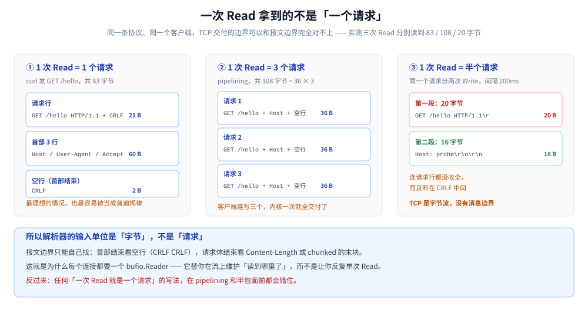
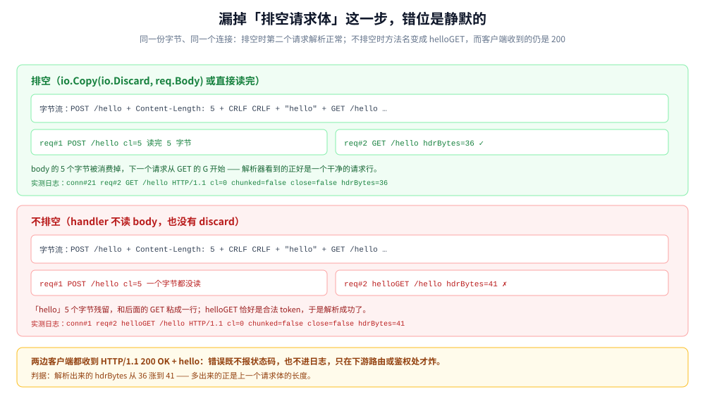

# 从零实现 HTTP 服务端（Go）

> 用 Go 从零写一个**能跑的 HTTP/1.1 服务端**：不 `import` `net/http`，从 `net.Listen` 起手，
> 自己解析请求行与首部、自己处理三种请求体定界、自己拼响应、自己维护 keep-alive 循环。
>
> 目的不是造轮子，而是把标准库替你挡掉的东西**一件件摊开**：哪些字节必须解析、哪些形状必须拒绝、
> 哪些顺序错了会静默失效。每一处判断都有实测对照——同一个请求同时打给手写实现和 `net/http`，
> 看两边在什么地方选了不同的边。
>
> 内容整理自个人学习笔记。代码在容器 `golang:1.26-bookworm`（`go1.26.8 linux/amd64`）内
> `gofmt` / `go vet` / `go build` 通过并真跑，客户端为 `curl 7.88.1` 与自写探针；
> **实测版本 5 个程序 898 行**（服务端 478 + 探针 192 + 抓包 75 + 对照组 45 + 压测 108），
> 源码与实验脚本随本篇发布在同目录的 `httpdemo/` 下，clone 后可直接 `go build` 复现全部读数。
> 读数散在各节，集中在第三节（首部两道闸门）、第六节（排空与串味）与第七节（与 `net/http` 的对照）；
> 命令见文末「使用」。
>
> ⚠️ 本篇只做 **HTTP/1.1**。HTTP/2 的帧层、HPACK 与流控见
> [HTTP1.1与HTTP2的区别.md](../../../02-计算机基础/网络/应用层/HTTP1.1与HTTP2的区别.md)，
> 字节级的 HTTP/2 机制见 [HTTP2机制.md](../../../03-数据与中间件/中间件/RPC框架/gRPC/HTTP2机制.md)。
>
> ⭐ **三篇的分工**：`net/http` 的工程用法（超时、中间件、`Shutdown`）见
> [HTTP服务端与优雅关停.md](HTTP服务端与优雅关停.md)；裸 TCP 的粘包、`bufio`、deadline 见
> [net包与TCP-UDP编程.md](net包与TCP-UDP编程.md)；**本篇是这两篇之间那一层**——
> 从「TCP 交付的字节」到「一个 `Handler` 能拿到的请求」，中间到底发生了什么。

---

## 一、一个 HTTP 服务端最少要解析哪几段字节？

**本节要点**：HTTP/1.1 的报文是**文本行 + CRLF** 堆起来的，**没有长度前缀**。所以服务端要做的第一件事不是「取请求」，而是在字节流上**找到报文边界**。

### 1.1 先把线上字节原样打出来

写一个什么都不解析的程序：`Accept` 之后只 `Read` 一次，把读到的字节按十六进制 dump 出来。用 `curl` 打它：

```go
// raw/main.go：读完一次就打印，不做任何解析
n, rerr := c.Read(buf)
fmt.Printf("===== conn read=%d err=%v =====\n", n, rerr)
fmt.Print(hexdump(buf[:n]))
```

```text
===== conn#1 from 127.0.0.1:47806  read=83 err=<nil> =====
00000000  47 45 54 20 2f 68 65 6c  6c 6f 20 48 54 54 50 2f  |GET /hello HTTP/|
00000010  31 2e 31 0d 0a 48 6f 73  74 3a 20 31 32 37 2e 30  |1.1..Host: 127.0|
00000020  2e 30 2e 31 3a 39 30 30  31 0d 0a 55 73 65 72 2d  |.0.1:9001..User-|
00000030  41 67 65 6e 74 3a 20 63  75 72 6c 2f 37 2e 38 38  |Agent: curl/7.88|
00000040  2e 31 0d 0a 41 63 63 65  70 74 3a 20 2a 2f 2a 0d  |.1..Accept: */*.|
00000050  0a 0d 0a                                          |...|
```

`0d 0a` 就是 CRLF，出现了 5 次；最后 `0d 0a 0d 0a` 连着两组，是**空行**，标记首部结束。逐段数一遍：

| 段 | 内容 | 字节数 |
|---|---|---|
| 请求行 | `GET /hello HTTP/1.1` + CRLF | 21 |
| 首部 | `Host: 127.0.0.1:9001`(22) + `User-Agent: curl/7.88.1`(25) + `Accept: */*`(13) | 60 |
| 空行 | CRLF | 2 |
| 合计 | — | **83** |

⭐ 这段字节把整件事讲完了：**请求是「行」组成的，行以 CRLF 结束，首部区以空行结束**。没有长度前缀、没有魔数、没有帧头。所谓「解析 HTTP」，就是在字节流上按这个规则切。

### 1.2 一次 `Read` 拿到的不是一个请求

上面那次 `Read` 正好拿到了一个完整请求，这最容易让人误以为「一次 Read = 一个请求」。改两个条件就能推翻它——同一个程序，只换发送方：

```text
===== conn#2 from 127.0.0.1:59880  read=108 err=<nil> =====
00000000  47 45 54 20 2f 68 65 6c  6c 6f 20 48 54 54 50 2f  |GET /hello HTTP/|
00000010  31 2e 31 0d 0a 48 6f 73  74 3a 20 70 72 6f 62 65  |1.1..Host: probe|
00000020  0d 0a 0d 0a 47 45 54 20  2f 68 65 6c 6c 6f 20 48  |....GET /hello H|
00000030  54 54 50 2f 31 2e 31 0d  0a 48 6f 73 74 3a 20 70  |TTP/1.1..Host: p|
00000040  72 6f 62 65 0d 0a 0d 0a  47 45 54 20 2f 68 65 6c  |robe....GET /hel|
00000050  6c 6f 20 48 54 54 50 2f  31 2e 31 0d 0a 48 6f 73  |lo HTTP/1.1..Hos|
00000060  74 3a 20 70 72 6f 62 65  0d 0a 0d 0a              |t: probe....|

===== conn#3 from 127.0.0.1:59884  read=20 err=<nil> =====
00000000  47 45 54 20 2f 68 65 6c  6c 6f 20 48 54 54 50 2f  |GET /hello HTTP/|
00000010  31 2e 31 0d                                       |1.1.|
```

三个读数放在一起，就是 TCP 字节流的全部不确定性：

| 次 | 字节数 | 里面是什么 | 形态 |
|---|---|---|---|
| conn#1 | **83** | 恰好一个完整请求 | 一请求一读 |
| conn#2 | **108** | **三个**完整请求（36 × 3） | 粘包 |
| conn#3 | **20** | **半个**请求，断在 `HTTP/1.1\r` 中间 | 半包 |

conn#2 是客户端连写三个请求（pipelining 或单纯连续写）；conn#3 是同一个请求分两次 `Write`、中间隔 200ms。**两次都在服务端产生了完全合法的 TCP 交付**——内核不关心你的报文边界。

### 1.3 所以核心是一个「在流上找边界」的状态机



上图三栏的差别不在服务端代码，而在发送方：**83** 是 `curl` 发一个请求的正常形态；**108 与 20** 则是同一个探针只改 `Write` 的次数与间隔得到的两种极端——前者把三个请求塞进一次交付，后者连一个请求都没发完。也就是说，`Read` 返回什么，取决于对端怎么切，而不取决于你想收什么。这决定了下面所有实现细节都必须围绕「流」而不是「报文」来写。

结论有两条，后面每一节都建立在它们上面：

- **请求边界只能从内容里找**：首部区看空行（`\r\n\r\n`），请求体看 `Content-Length` 或 chunked 的末块（`0\r\n\r\n`）。
- **状态必须跨 `Read` 保留**：这和 [net包与TCP-UDP编程.md](net包与TCP-UDP编程.md) 第四节讲的粘包是同一件事，只是 HTTP 的「长度前缀」藏在了首部里。标准库的做法是给每条连接套一个 `bufio.Reader`，让它记住「读到哪了」。

---

## 二、请求行怎么拆，哪些写法必须拒绝？

**本节要点**：请求行是三段，用 `strings.SplitN(line, " ", 3)` 拆而不是 `strings.Fields`——**后者会把连续空格当成一个分隔符**，等于默许了一批畸形请求。拆完还要逐段校验，否则畸形请求会带着不合法的名字进到路由层。

### 2.1 三段：method、target、version

```go
// 请求行：method SP request-target SP HTTP-version
parts := strings.SplitN(line, " ", 3)
if len(parts) != 3 {
	return nil, errBadRequest
}
req := &Request{Method: parts[0], Target: parts[1], Proto: parts[2], ...}
```

拆完是三件事，一件都不能省：

| 校验 | 判据 | 不校验的后果 |
|---|---|---|
| method 是 token | 只含字母数字与几个符号（全集见下方代码块） | `GET\t/` 这类畸形值进到路由，方法匹配永远不命中 |
| version 形如 `HTTP/x.y` | 前缀 + 两个整数 | 后面按 `ProtoMinor` 判连接语义时读到 0，静默变成「按 1.0 处理」 |
| 版本是 1.x | `ProtoMajor == 1` | 0.9 的请求没有首部区，按 1.1 解析会一直等到超时 |

```go
// RFC 9110 的 token 字符集：字母数字，再加上这 15 个符号
// ! # $ % & ' * + - . ^ _ ` | ~
```

⭐ 这个字符集之所以要背下来，是因为它**排除**的东西比包含的更重要：空格、冒号、逗号、括号、斜杠都不在 token 里。请求行靠空格分段、首部靠冒号分名值，正是同一条约束的两面。

### 2.2 为什么用 `SplitN(3)` 而不是 `Fields`

`strings.Fields` 把**任意连续空白**当一个分隔符，于是下面这些都「拆得出来」：

```text
GET  /hello  HTTP/1.1        <- 中间两个空格
GET\t/hello HTTP/1.1         <- 用 tab 分隔
```

它们都不是合法请求行（RFC 9112 要求单个 SP），但在 `Fields` 眼里完全正常。`SplitN(line, " ", 3)` 则要求第一个和第二十字符必须正好是空格，多一个少一个都拆不出三段。

⭐ 这里有个取舍值得说清：**严格拒绝 ⊂ 宽容接受**。`net/http` 在这件事上是**宽松**的（它容忍多个空格），因为它要面对浏览器、老旧客户端和各种中间设备。手写实现按 RFC 严格来更容易讲清规则，但接入真实流量前要先想清楚：你能不能承受「某个客户端就是因为多打了一个空格而被 400」。

### 2.3 `request-target` 有三种形态，都要认

| 形态 | 例子 | 谁发的 |
|---|---|---|
| origin-form | `/hello?x=1` | 直连的普通客户端 |
| absolute-form | `http://probe/hello` | **正向代理**转发的请求 |
| asterisk-form | `*` | `OPTIONS *` |

只处理 origin-form 的服务端，一旦被放到代理后面就会全线 404——因为代理转发的是 absolute-form。所以拆 target 时要先剥掉 `scheme://authority`：

```go
target := req.Target
if i := strings.Index(target, "://"); i >= 0 {
	rest := target[i+3:]
	if j := strings.IndexByte(rest, '/'); j >= 0 {
		target = rest[j:]
	} else {
		target = "/" // http://host 后面没有路径
	}
}
if k := strings.IndexByte(target, '?'); k >= 0 {
	req.Path, req.Query = target[:k], target[k+1:]
} else {
	req.Path = target
}
```

实测：`GET http://probe/hello HTTP/1.1` 打进来，`Path` 解析成 `/hello`，正常命中路由（见第五节 #10）。

⚠️ 这里刻意**没有做 URL 解码**。`%2F` 要不要解成 `/`、`..%2f` 要不要规范化，是**代理与应用必须取得一致**的事——两边不一致就是路径穿越。这条属于 [反向代理接入.md](反向代理接入.md) 的范围，本篇不碰。

### 2.4 三种必须当场拒绝的形状

```go
if !isToken(req.Method) { return nil, errBadRequest }        // 方法名不是 token
if !strings.HasPrefix(req.Proto, "HTTP/") { return nil, errBadRequest }
if _, err := fmt.Sscanf(req.Proto, "HTTP/%d.%d", &req.ProtoMajor, &req.ProtoMinor); err != nil {
	return nil, errBadRequest                                 // 形如 HTTP/abc
}
if req.ProtoMajor != 1 { return nil, errBadRequest }          // HTTP/0.9、HTTP/3
```

`fmt.Sscanf` 那句看着随意，实际在防一类具体的畸形：`HTTP/1.x`、`HTTP/`、`HTTP/1` 都会被它拒绝，而如果用 `strings.Split(proto, "/")` 再 `Atoi`，`HTTP/1.x` 会得到 `ProtoMinor=0`——请求被当成 HTTP/1.0 处理，连接语义全错。

---

## 三、首部区为什么要「循环读 + 两道闸门」？

**本节要点**：首部区的循环终止条件是**空行**，这是唯一可靠的终止信号；而「读到空行为止」意味着**长度由对端决定**——所以必须有上限，而且要有**两道**：单行上限与总量上限，它们卡的不是同一件事。

### 3.1 逐行读到空行

```go
consumed := len(line) + 2                     // 请求行已经吃掉的字节也要算进去
for {
	line, err := readLine(br)
	if errors.Is(err, errLineTooLong) {
		return nil, errHeaderLineTooLong
	}
	if err != nil {
		return nil, err
	}
	consumed += len(line) + 2
	if consumed > maxHeader {
		return nil, errHeaderTooLarge
	}
	if line == "" {
		break                                  // 空行 = 首部结束
	}
	i := strings.IndexByte(line, ':')
	if i <= 0 {
		return nil, errBadRequest              // 没有冒号，或者冒号在行首
	}
	name := line[:i]
	if !isToken(name) {
		return nil, errBadRequest              // 名字与冒号之间有空格会落在这里
	}
	val := strings.Trim(line[i+1:], " \t")     // 只裁首尾 OWS，值内部的空格要留
	key := strings.ToLower(name)
	req.Header[key] = append(req.Header[key], val)
}
```

`readLine` 本身也有讲究。它用 `bufio.Reader.ReadSlice('\n')`，而不是 `ReadString`：

```go
func readLine(br *bufio.Reader) (string, error) {
	line, err := br.ReadSlice('\n')
	if errors.Is(err, bufio.ErrBufferFull) {
		return "", errLineTooLong              // 单行超过缓冲
	}
	if err != nil {
		return "", err
	}
	n := len(line)
	if n < 2 || line[n-2] != '\r' {
		return "", errBadRequest               // 严格模式：只认 CRLF
	}
	return string(line[:n-2]), nil
}
```

⚠️ `ReadSlice` 返回的切片**指向 `bufio.Reader` 的内部缓冲**，下一次读就被覆盖。所以必须立刻 `string(...)` 复制一份——这是这类代码最常见的隐蔽错误，症状是「偶发的、与并发无关的乱码」。

### 3.2 同名首部必须 `append`，不能覆盖

```go
req.Header[key] = append(req.Header[key], val)   // 不是 req.Header[key] = val
```

HTTP 允许同一个名字出现多次，而且**合并语义不一样**：

| 首部 | 多次出现时 | 合并成一行可以吗 |
|---|---|---|
| `Set-Cookie` | 每个都是独立的一条 | 不行，合并后 Cookie 值里的逗号无法区分 |
| `Cookie` | 用 `; ` 连接 | 可以 |
| `Accept` / `Cache-Control` | 用 `, ` 连接 | 可以 |
| `Content-Length` | 值必须完全相同，否则拒绝 | 见第四节 |

所以内部表示只能是 `map[string][]string`，合并成单值是在**取用**时按各自规则做，不能在解析时做。标准库把这件事拆成 `Header.Values` / `Header.Get` 两个方法，正是这个原因。

### 3.3 两道闸门：单行与总量

这是实测才看清的一处：**一个 20 KB 的首部，在我手里的第一版返回 400，改完才返回 431**。

```text
########## 6. 20 KB 首部（默认上限 16 KB）
HTTP/1.1 431 Request Header Fields Too Large      <- 修好之后
```

第一版的错误在于：单行太长时 `ReadSlice` 返回 `bufio.ErrBufferFull`，我把它映射成了一个笼统的 `errLineTooLong`，最后落进兜底的 400。而「首部区太大」和「请求格式错误」是两件事，状态码也应该分开：

| 闸门 | 卡什么 | 触发条件 | 该回什么 |
|---|---|---|---|
| 单行上限 | 一行的长度 | `bufio` 缓冲（本篇 8 KB）被一行填满 | 请求行超长 → **414**；首部行超长 → **431** |
| 总量上限 | 整个首部区 | 累计字节超过 `maxHeader`（本篇 16 KB） | **431** |

两道都要有，因为它们漏的不是同一类攻击：**单行闸门**挡不住「一万行很小的首部」（每行都不超限，但加起来能把内存吃光，这是 Slowloris 的变体）；**总量闸门**挡不住「一行就有 8 MB」（这一行还没读完，累计判断根本没机会执行）。

`net/http` 的门槛要高得多，实测同一条 20 KB 请求它直接放行：

| 首部大小 | minihttp（16 KB） | net/http（默认） |
|---|---|---|
| 20 KB | **431** | 200 |
| 1.1 MB | — | **431**（108 字节响应，无 `Content-Length`） |

`net/http` 的默认值是 `MaxHeaderBytes = 1 << 20`（1 MB）。这个值不是随手定的：它要容纳浏览器的 Cookie 头，而真实场景里 3 KB 的 Cookie 很常见。⚠️ 代价是**每条恶意连接可以让你先分配 1 MB 才拒绝**——抗攻击场景要把它调小，这也是为什么它的 `Server.MaxHeaderBytes` 是可配的。

### 3.4 慢速首部：`ReadHeaderTimeout` 防的不是慢，是「不结束」

上面两道闸门都假设「首部区总会结束」。但攻击者可以**一个字节一个字节地发**，让首部区永远不结束——这就是 Slowloris。防御手段不是限制大小，而是**限制时间**：

```go
c.SetReadDeadline(time.Now().Add(readHeaderTO))   // 解析首部前
req, err := parseRequest(br, maxHeader)
c.SetReadDeadline(time.Time{})                    // 解析成功后清掉
```

实测（每 800ms 发 1 字节，超时设 5 秒）：

```text
---- timeout request (1 bytes) ----
G[write rest] write tcp 127.0.0.1:42286->127.0.0.1:9002: write: broken pipe
---- response #1 (148 bytes, err=<nil>) ----
HTTP/1.1 408 Request Timeout\r\n
```

⭐ 注意 `broken pipe`：服务端在 5 秒到点时**已经关了连接并回了 408**，客户端在那一瞬间还在往里写。这个报错是服务端的防御**生效**的证据，不是故障。端口每次运行随机，其余逐字。

⚠️ 清 deadline 这一步容易漏。`SetReadDeadline` 是粘在连接的 fd 上的，不清掉就会一直生效——现象是「大请求体传到一半莫名 408」。标准库对应的是 `ReadHeaderTimeout` 与 `ReadTimeout` 两个独立字段，就是为了分开这两段时间。

### 3.5 为什么不支持 obs-fold（续行）

老版 RFC 2616 允许首部值折行，续行以空格或 tab 开头：

```text
X-Long: first part
 second part
```

RFC 7230 已把它标记为废弃；RFC 9112 §5.2 给收件方两条路：**拒绝（400）**，或**把每个折行替换成一个空格**再解释字段值。两条路都行，唯独不能按原样保留——`200 OK` 里那个空格到底是折行还是新首部的开头，不同实现的判断不一致，而转发链上两边不一致就是请求走私的另一条路径。

所以本篇的实现里，行首是空格的行会走到 `strings.IndexByte(line, ':')` 返回 -1 的分支，被 400 拒绝（走第一条路）。这看起来「不够兼容」，但兼容的成本是**接受一个歧义**，不值得。


上面这条线是**全文的路线图**：① 请求行在第二节、② 首部循环在本节、③ 请求体定界在第四节、④ 写响应在第五节、⑤ 连接是否复用在第六节。每一格的「拒绝条件」都对应一个真实的畸形请求，也都对应一个必须与状态码匹配的返回——这也是为什么 3.3 里那两处状态码写错，我更愿意把它当成 bug 而不是措辞问题。

---

## 四、请求体有多长：三种定界的判序错一次就放走走私

**本节要点**：请求体没有「结束标记」，长度只能由首部声明。三种声明方式里，**`Transfer-Encoding` 与 `Content-Length` 同时出现必须直接拒绝**——而这条判断必须写在「解析 `Content-Length`」之前，否则它永远不成立。

### 4.1 三种定界

| 声明 | 长度怎么算 | 结束标志 |
|---|---|---|
| `Content-Length: N` | 已知，N 字节 | 读满 N 字节 |
| `Transfer-Encoding: chunked` | 未知，分块 | 尺寸为 `0` 的末块 + trailer 空行 |
| 两者都没有 | **0** | 请求没有 body |

第三种经常被误解：一个 `POST` 请求如果既没有 `CL` 也没有 `TE`，那么它的 body 长度就是 **0**，不是「读到连接关闭」。这是 HTTP 与「裸 TCP 靠关闭定界」最大的区别——**请求不能靠关闭定界**，因为关了就没法发下一个请求了。

### 4.2 判序：为什么「两者同给」必须先判

这是本次实测抓到的第一个 bug。第一版代码长这样：

```go
// ❌ 错的：先判 TE，但此时 ContentLength 还没解析
if te := req.Header["transfer-encoding"]; len(te) > 0 {
	if req.ContentLength >= 0 {          // 永远是 -1，条件永不成立
		return nil, errBadRequest
	}
	...
}
if cls := req.Header["content-length"]; len(cls) > 0 { ... }
```

`req.ContentLength` 的初始值是 `-1`（表示未知），要等**下面那段**解析 `Content-Length` 才会变成具体数字。于是这个判断在自己的位置上永远为假——**走私样例被当成正常 chunked 请求放行了**：

```text
########## 4. Transfer-Encoding 与 Content-Length 同时给
HTTP/1.1 200 OK            <- 修好之前，200，cl=-1 chunked=true bytes=0
```

改成先判「两者是否同时存在」，再分别解析：

```go
hasTE := len(req.Header["transfer-encoding"]) > 0
hasCL := len(req.Header["content-length"]) > 0
if hasTE && hasCL {
	// 两者同给是请求走私的经典入口，RFC 7230 §3.3.3 要求当错误处理
	return nil, errBadRequest
}
if hasTE { ... chunked ... }
if hasCL { ... Content-Length ... }
```

```text
HTTP/1.1 400 Bad Request   <- 修好之后
```

⭐ 这类 bug 的共同形状是**判断依赖了一个还没算出来的值**。它不会编译失败、不会 `go vet` 报警、单元测试如果只测「正常请求」也不会发现——只有把畸形请求真的发一遍才看得见。

### 4.3 chunked 的四段结构

chunked 的报文不是「一整块」，而是若干块拼起来的：

```text
5\r\n             <- 块 1：尺寸（十六进制）
hello\r\n         <- 块 1 数据 + CRLF（⚠️ 这个 CRLF 不属于数据）
6\r\n             <- 块 2
 world\r\n
0\r\n             <- 末块：尺寸 0
\r\n              <- trailer 区结束（这里没有 trailer 首部，直接空行）
```

解码器要处理的四个细节：

| 细节 | 处理 | 漏掉的后果 |
|---|---|---|
| 尺寸是 **16 进制** | `strconv.ParseInt(s, 16, 64)` | 把 `a` 当十进制解析失败 |
| 尺寸后可跟 `;name=value` | 先按 `;` 截断 | 解析失败，或把扩展当尺寸 |
| 每块数据后有一个 **CRLF** | 读完这块要吃掉它 | **下一块的尺寸解析错位**，全盘乱掉 |
| 末块后有 trailer 首部 | 读到空行为止 | 把 trailer 当成下一个请求的开头 |

第三行是最容易漏的一条，因为它不在数据里、也不在尺寸里，而是「两者之间」。本篇的实现：

```go
n, err := c.br.Read(p)
c.remain -= int64(n)
if c.remain == 0 {
	// ⚠️ 每块数据后面还有一个 CRLF，漏吃会让下一块尺寸解析错位
	if _, e := readLine(c.br); e != nil && e != io.EOF {
		return n, e
	}
}
```

实测两块的 chunked（`5 hello` + `6 " world"`）：

```text
---- chunked request (90 bytes) ----
---- response #1 (210 bytes, err=<nil>) ----
method=POST path=/echo query= cl=-1 chunked=true bytes=11
hello world
```

`cl=-1 chunked=true bytes=11`——11 = 5 + 6，两块都解出来了，且中间那个空格没丢。

### 4.4 `Content-Length` 自身的三种畸形

```go
if cls := req.Header["content-length"]; len(cls) > 0 {
	for _, v := range cls[1:] {
		if v != cls[0] {              // ① 多个 CL 且值不同
			return nil, errBadRequest
		}
	}
	n, err := strconv.ParseInt(cls[0], 10, 64)
	if err != nil || n < 0 {          // ② 非数字、③ 负数
		return nil, errBadRequest
	}
	req.ContentLength = n
	req.Body = io.LimitReader(br, n)
}
```

| 畸形 | 例子 | 为什么要拒 |
|---|---|---|
| 多个 `Content-Length` 值不同 | `CL: 5` + `CL: 6` | 前后端各取一个 → 走私 |
| 非十进制 | `Content-Length: 0x5` | 有的解析成 5，有的报错 |
| 负数 | `Content-Length: -1` | `-1` 在内部表示里恰好是「未知」，会变成读到连接关闭 |

⚠️ 最后一条尤其阴——`-1` 是很多实现里「长度未知」的哨兵值，一个负的 `Content-Length` 会把「已知长度」变成「读到 EOF」，于是请求永远不结束。

---

## 五、响应要怎么拼才算合法？

**本节要点**：响应首部里有**一样东西不能用 `Content-Length` 表达**——「有没有 body」。`HEAD`、`204`、`304` 三种情况都带长度声明却**不能写 body**，靠的是一条约定：方法或状态码自己说明「别读」。实现里把这个判断放在写 body 的那一行，而不是放在长度计算里。

### 5.1 五件套

```go
fmt.Fprintf(bw, "%s %d %s\r\n", r.Proto, resp.status, resp.reason)
fmt.Fprintf(bw, "Date: %s\r\n", time.Now().UTC().Format(dateFormat))
if resp.ctype != "" {
	fmt.Fprintf(bw, "Content-Type: %s\r\n", resp.ctype)
}
fmt.Fprintf(bw, "Content-Length: %d\r\n", len(resp.body))
if keepAlive {
	io.WriteString(bw, "Connection: keep-alive\r\n")
} else {
	io.WriteString(bw, "Connection: close\r\n")
}
io.WriteString(bw, "\r\n")
if !headOnly {
	bw.Write(resp.body)
}
return bw.Flush()
```

实测一个 200 响应的全文（146 字节）：

```text
---- get request (36 bytes) ----
GET /hello HTTP/1.1\r\n
Host: probe\r\n
\r\n
---- response #1 (146 bytes, err=<nil>) ----
HTTP/1.1 200 OK\r\n
Date: Fri, 23 Oct 2026 13:44:58 GMT\r\n
Content-Type: text/plain; charset=utf-8\r\n
Content-Length: 6\r\n
Connection: keep-alive\r\n
\r\n
hello
```

| 首部 | 必需性 | 写错的后果 |
|---|---|---|
| 状态行 | 必需 | 版本回错（对 1.0 客户端回 1.1）会让老客户端解析失败 |
| `Date` | 强烈建议 | 缓存与日志的时间基准；⚠️ 格式是 IMF-fixdate，**必须是 GMT 且两位日期** |
| `Content-Type` | 有 body 时必需 | 客户端靠它决定怎么解，缺了就只能猜 |
| `Content-Length` | 三种定界选一种 | 与 body 实际长度不符 → 客户端一直等或读到下一个响应 |
| `Connection` | 可选 | 1.1 默认持久，不写也行；但**要关连接必须显式写 `close`** |

⚠️ `Date` 那个格式连标准库的常量都用不了——因为我们不能 `import net/http`。所以这里写死字面量 `"Mon, 02 Jan 2006 15:04:05 GMT"`。这正好说明「从零」的边界在哪：**格式本身是 RFC 定的，不是 Go 定的**。

### 5.2 三个特例：`HEAD`、`204`、`304`

```go
headOnly := r.Method == "HEAD"
```

`HEAD` 的语义是「要首部，不要 body」：响应**必须带与 `GET` 完全相同的 `Content-Length`**，但**一个字都不能发**。实测：

```text
---- head request (37 bytes) ----
HEAD /hello HTTP/1.1\r\n
Host: probe\r\n
\r\n
---- response #1 (140 bytes, err=<nil>) ----
HTTP/1.1 200 OK\r\n
Date: Fri, 23 Oct 2026 13:44:58 GMT\r\n
Content-Type: text/plain; charset=utf-8\r\n
Content-Length: 6\r\n
Connection: keep-alive\r\n
\r\n
```

140 字节 = 146 − 6，body 一个字节都没发，但 `Content-Length: 6` 还在。⚠️ 客户端如果按 `Content-Length` 去读 `HEAD` 的响应，就会一直等到超时——本篇的探针程序第一版就犯了这个错，日志里出现一条误导性的 `i/o timeout`。

| 状态码 / 方法 | 有 `Content-Length` | 有 body |
|---|---|---|
| `GET` 200 | 有 | 有 |
| `HEAD` 200 | **有（与 GET 一致）** | **无** |
| `204 No Content` | 无（或 `0`） | 无 |
| `304 Not Modified` | 可以有（表示实体的长度） | 无 |

这张表的共同点是：**「消息结束」信号与「有没有 body」是两件独立的事**。`Content-Length` 说的是「如果这是 GET，body 会有多长」，不是「后面跟着多长」。

### 5.3 首部必须在第一次 `Write` 之前全部拼好

HTTP 的首部在 body 之前，这个顺序看着显然，但实现上有个陷阱：`http.ResponseWriter` 那套「`WriteHeader` 之后不能改首部」的规则，在手写实现里表现为——**你一旦开始写 body，就没法回头补首部了**。

本篇的做法是先把整个响应拼进 `bufio.Writer`，最后一次 `Flush`。这样即使路由层中间发现要改成 500，也还能重来（前提是没 `Flush` 过）。

### 5.4 `bufio.Writer` 不 `Flush`，响应就卡在用户态

```go
return bw.Flush()   // 这一行不能省
```

这个坑的症状极其典型：**服务端日志显示「已响应 200」，客户端却在等**。因为 `fmt.Fprintf` 只是把字节写进了 4 KB 的用户态缓冲，没进内核。

⚠️ 反过来也有坑：**每个请求都 `Flush` 会让小响应变成一次 syscall**，而批量写能合并。标准库的 `ResponseWriter` 是「首部一次、body 攒够 2 KB 或 handler 返回时再刷」，就是在这两者之间取的平衡。

---

## 六、keep-alive 循环里最容易漏的一步是什么？

**本节要点**：读下一个请求之前，**必须把上一个请求的 body 从流里消费干净**。漏了不会报错——残留字节会与下一个请求行粘在一起，而粘出来的畸形方法名往往恰好是合法 token，于是「解析成功、语义全错」。

### 6.1 结构：一个 `for` 套在连接上

```go
for n := 1; ; n++ {
	c.SetReadDeadline(time.Now().Add(readHeaderTO))
	req, err := parseRequest(br, maxHeader)
	...
	c.SetReadDeadline(time.Time{})

	body, rerr := io.ReadAll(req.Body)     // ← 关键一步
	...
	resp := route(req, body)
	keepAlive := !req.Close
	if err := writeResponse(bw, req, resp, keepAlive); err != nil {
		return
	}
	if !keepAlive {
		return
	}
}
```

`io.ReadAll(req.Body)` 同时干了两件事：取到 body 内容、把流消费到 body 的边界。如果 handler 不需要 body（比如 404），也必须读掉它——生产实现里那一行通常写成 `io.Copy(io.Discard, req.Body)`。

### 6.2 实测：不排空会发生什么

给服务端加一个 `-drain=false` 开关，故意跳过那一步，然后用完全相同的字节打两个实例：

```text
POST /hello HTTP/1.1\r\nHost: probe\r\nContent-Length: 5\r\n\r\nhelloGET /hello HTTP/1.1\r\nHost: probe\r\n\r\n
```

| 实例 | 第二个请求解析成 | `hdrBytes` | 客户端收到 |
|---|---|---|---|
| `-drain=true`（正常） | `GET /hello` | **36** | `200 OK` + `hello` |
| `-drain=false`（漏排空） | **`helloGET /hello`** | **41** | `200 OK` + `hello` |

服务端日志原文：

```text
# 正常
conn#21 req#2 GET /hello HTTP/1.1 cl=0 chunked=false close=false hdrBytes=36
conn#21 req#2 GET /hello -> 200 (6 B)

# 漏排空
conn#1 req#2 helloGET /hello HTTP/1.1 cl=0 chunked=false close=false hdrBytes=41
conn#1 req#2 helloGET /hello -> 200 (6 B)
```

⭐ 注意三点，它们一起构成了「静默」：**① 客户端拿到的响应完全正常**（`/hello` 还是匹配上了）；**② 没有日志级别上的异常**（两条都是普通 access log）；**③ 唯一的差别是一个数字——`hdrBytes` 从 36 变成 41，多出来的 5 正是上一个请求体的长度**。



上面这张图把两条路径并排放，差别只有一个：body 那 5 个字节有没有被消费掉。右边那条路径上，「hello」与「GET」粘成的 `helloGET` 通过了 token 校验，于是错误被推迟到下游——路由不命中、鉴权拿不到方法、审计日志里出现一个不存在的方法名。

**判据**：如果你在线上看到 access log 里的方法名出现了拼接痕迹（`GETPOST`、`helloGET`），几乎可以确定是某处的 `body` 没读完。

### 6.3 连接语义：1.0 与 1.1 的默认值相反

```go
if req.ProtoMinor >= 1 {
	req.Close = req.HasToken("Connection", "close")          // 1.1：默认持久
} else {
	req.Close = !req.HasToken("Connection", "keep-alive")    // 1.0：默认关闭
}
```

两个易错点：

- **`Connection` 的值是逗号列表**，可能是 `keep-alive, Upgrade`。所以必须按 `,` 切开逐项比较，不能整串比。
- **`HTTP/1.0 + Connection: keep-alive` 是合法的**，服务端可以同意。实测：

```text
# 只节选状态行与 Connection 两行，其余首部相同
########## B. HTTP/1.0，不给 Connection
HTTP/1.0 200 OK\r\n
Connection: close\r\n

########## C. HTTP/1.0 + Connection: keep-alive
HTTP/1.0 200 OK\r\n
Connection: keep-alive\r\n
```

⚠️ 状态行里的版本回的是 `r.Proto`（`HTTP/1.0`），不是写死的 `HTTP/1.1`。对一个 1.0 客户端回 1.1 的响应，某些老实现会直接断开。

### 6.4 pipelining：一次收到三个请求，就得回三个响应

`conn#2` 那次 108 字节里是三个完整请求。服务端不需要特殊处理——**循环读三次就自然回三个响应**，只要每个响应都带正确的 `Content-Length`，客户端就能按顺序切开。实测：

```text
########## 9. pipelining：一次 Write 发 3 个请求
---- pipe request (108 bytes) ----
---- response #1 (146 bytes, err=<nil>) ----
---- response #2 (146 bytes, err=<nil>) ----
---- response #3 (146 bytes, err=<nil>) ----
```

⭐ 但 pipelining 有个隐含约束：**响应必须按请求顺序返回**。一旦有并发处理，就得在响应侧排队。这也是 HTTP/1.1 在实际中很少真正用 pipelining 的原因（队头阻塞），浏览器干脆不启用它——相关分析见 [HTTP1.1与HTTP2的区别.md](../../../02-计算机基础/网络/应用层/HTTP1.1与HTTP2的区别.md)。

---

## 七、手写实现与 `net/http` 差在哪八处？

**本节要点**：同一个请求同时打给两个实现，八项里有六项一致、**四项选了不同的边**。这些分歧不是「谁对谁错」，而是标准库在**兼容性、安全性、内存**三者之间替你做了取舍——知道它选了哪边，才知道什么时候需要覆盖它。

### 7.1 八项对照（同一条请求打两个服务）

| # | 场景 | minihttp | net/http | 说明 |
|---|---|---|---|---|
| 1 | 200 响应首部 | 显式 `Connection: keep-alive` | **不写** | 1.1 默认持久，写了是冗余 |
| 2 | 404 响应 | 无 `X-Content-Type-Options` | **`nosniff`** | 标准库默认防 MIME 嗅探 |
| 3 | 裸 LF（`\n` 结尾） | **400** | **200** | 严格 vs 宽容 |
| 4 | 20 KB 首部 | **431** | **200** | 门槛不同（16 KB vs 1 MB） |
| 5 | 1.1 MB 首部 | — | **431**（108 字节） | 标准库的门槛在这 |
| 6 | `TE` + `CL` 同给 | **400** | **200**（TE 优先） | 拒绝 vs 覆盖 |
| 7 | chunked 两块 | 200，`bytes=11` | 200，`bytes=11` | 一致 |
| 8 | 半包（分两次写） | 200 | 200 | 一致 |

两个 404 的原文，差别就在一行：

```text
# minihttp
HTTP/1.1 404 Not Found
Date: Fri, 23 Oct 2026 13:45:25 GMT
Content-Type: text/plain; charset=utf-8
Content-Length: 19
Connection: keep-alive

# net/http
HTTP/1.1 404 Not Found
Content-Type: text/plain; charset=utf-8
X-Content-Type-Options: nosniff
Date: Fri, 23 Oct 2026 13:45:25 GMT
Content-Length: 19
```

### 7.2 为什么 `net/http` 接受裸 LF

RFC 9112 §2.2 的原文允许收件方「识别单个 LF 并忽略前面的 CR」。所以这**不是违规**，而是规范留的兼容余地：现实里有大量嵌入式客户端、老的 CGI 程序发裸 LF，全部拒绝会让 Go 服务端「对接不上」。

⭐ 但代价是**歧义面变大**：收件方既然能接受 `\n`，那么「一行到底在哪结束」就有了多个答案。在**代理**场景里，如果前端收 `\n`、后端只认 `\r\n`，同一个字节流在两边被切成不同的消息 —— 这就是请求走私的一类成因。所以：

- **应用服务端**：宽容一点没坏处（`net/http` 的选择）。
- **代理 / 网关**：必须与上下游**约定同一套**行结束规则，或干脆按 RFC 严格拒绝（本篇的选择）。

### 7.3 为什么 `net/http` 接受 `TE` + `CL`

RFC 9112 §6.3 给了两条路：「`Transfer-Encoding` 覆盖 `Content-Length`」和「这种消息可能被用于走私，**应当**拒绝」。`net/http` 选了前者——实测它把 `CL: 5` 丢掉、按 chunked 处理，回 200。

⚠️ 关键约束：如果这台服务是**代理**，转发前**必须删掉 `Content-Length`**，否则下游可能按 CL 处理，而上游按 chunked 处理——两份消息、两个长度，走私成立。`net/http` 的 `ReverseProxy` 会处理这件事，自己拿 `http.Request` 转发时要留意。

手写实现选「直接拒绝」的理由：**这个服务端不承担兼容历史客户端的责任**，拒绝是更小的攻击面。如果哪天要放在代理后面，就要改成「以 TE 为准 + 删除 CL」，与上下游保持一致。

### 7.4 吞吐：差多少？

同一台容器（4 核、无 CPU 配额）里，客户端与服务端同机，keep-alive 复用连接，各跑 5 轮交替：

| 并发 | 实例 | 5 轮 QPS | 中位数 |
|---|---|---|---|
| 8 | minihttp | 17883 / 22260 / 24715 / 29219 / 29888 | 24 715 |
| 8 | net/http | 13066 / 21378 / 21403 / 22610 / 32069 | 21 403 |
| 4 | minihttp | 9779 / 12037 / 13102 / 13789 / 14257 | 13 102 |
| 4 | net/http | 11603 / 12015 / 13028 / 13563 / 14159 | 13 028 |

⚠️ **这组数不能用来排名**。理由：① 客户端与服务端在同一容器里抢同一批核，`min` 到 `max` 相差 1.5~2.4 倍，**两个实现的区间完全重叠**；② 两组并发的方向还不一致（8 并发时 mini 略高，4 并发时基本持平）。本机能支持的结论只有一条：

> **手写实现没有数量级的性能劣势。** HTTP/1.1 的解析不是这类服务的瓶颈——瓶颈在 syscall 与内存分配上，两者都在同一水平。

⚠️ 未实测：`-race` 下的行为、每请求的分配次数（`-benchmem`）、TLS 与 HTTP/2、真实跨机网络下的表现。要拿可信的性能对比，应该把客户端放到另一台机、服务端各跑独占容器、用 `wrk` 固定连接数与时长。

---

## 八、什么时候该自己写、什么时候绝对不该？

**本节要点**：判断标准不是「能不能写出来」——898 行就能跑通——而是**你能不能承担那些没写进来的部分**。下面三档从「不要写」排到「值得写」。

### 8.1 不该自己写（九成场景）

| 场景 | 为什么 |
|---|---|
| 普通业务 API | `net/http` + 一个路由库就够；自写等于放弃 `Shutdown`、`httptest`、`pprof` 的免费集成 |
| 需要 TLS / HTTP/2 | 自写要接 TLS 记录层、ALPN、h2 帧层与 HPACK——这是另一个数量级的工作量 |
| 需要经受公网流量 | 本篇故意没做的：请求体速率限制、慢速 body 攻击、header 数量上限、连接数上限、超时分级、trailer、`Expect: 100-continue`，每一个都是安全事故的入口 |
| 需要反向代理 | `httputil.ReverseProxy` 已经处理了 hop-by-hop 头、XFF、`Upgrade` 透传 |

### 8.2 值得自己写（少数场景）

| 场景 | 为什么 |
|---|---|
| **教学 / 排障** | 知道 431 是哪个闸门触发的、`helloGET` 是怎么来的，比记住结论有用 |
| **极端资源受限** | 嵌入式、initramfs 里的健康检查端点：`net/http` 的二进制约 5 MB，自写可以做到几百 KB |
| **协议子集 / 特殊定界** | 只支持 `GET` 的健康检查、只处理一种 chunked 变体的采集器 |
| **要做「非标准」行为** | 比如故意接受某种畸形请求以兼容遗留设备——用标准库反而要先绕过它的校验 |

### 8.3 中间地带：网关与代理的 HTTP 层

真正常见的落点是这里：**不自己解析，但要理解每一个判断**。因为网关要做的正是「在标准库的选择之上再加一层策略」：

| 网关要处理的 | 对应本篇哪一节 | 对应 `net/http` 的哪个开关 |
|---|---|---|
| 首部大小上限按租户收紧 | 3.3 两道闸门 | `Server.MaxHeaderBytes` |
| 慢速攻击防护 | 3.4 读超时 | `Server.ReadHeaderTimeout` |
| 拒绝走私形态 | 4.2 TE + CL | 需自己在中间件里查 `r.Header` |
| 响应体压缩 / 改写 | 5.1 五件套 | `ResponseWriter` 包装 |
| 连接复用与空闲回收 | 六节 | `Server.IdleTimeout` |

⭐ 判据可以简化成一句：**如果你的改动能在 `Handler` 或 `RoundTripper` 里表达，就别碰解析层**。需要碰解析层的场景，通常也会连带需要处理上面「8.1」里那一整列。

---

## 使用：怎么跑起来

**本节要点**：五个程序、五个脚本，全部在容器里真跑。服务端不依赖任何第三方库，`go build` 不需要网络。

### 文件结构

源码随本篇一起发布，就在同目录的 `httpdemo/` 下（共 898 行）：

```text
01-编程语言/go/网络编程/httpdemo/
├── go.mod              # module httpdemo / go 1.26
├── raw/main.go         # ① 只 Read 一次 + hexdump，看清线上字节（75 行）
├── mini/main.go        # ② 手写 HTTP/1.1 服务端，不 import net/http（478 行）
├── std/main.go         # ③ 同样路由的 net/http 版，做对照（45 行）
├── probe/main.go       # ④ 手工构造请求字节的探针，容器里没有 nc（192 行）
├── bench/main.go       # ⑤ keep-alive 压测客户端（108 行）
├── run_probe.sh        # 13 组协议行为实验
├── run_cmp.sh          # 与 net/http 的逐项对照
├── run_edge.sh         # 首部上限 / 连接语义 / 不排空串味
├── run_bench.sh        # 5 轮交替压测（8 并发）
├── run_bench2.sh       # 同上，4 并发复核
└── .gitignore          # 忽略 bin/ 与 logs/
```

`bin/`（编译产物）与 `logs/`（实验日志）是运行后生成的，已被 `.gitignore` 排除——**要发布的是源码与脚本，不是二进制**。

### 编译

```bash
cd 01-编程语言/go/网络编程/httpdemo
MSYS_NO_PATHCONV=1 docker run --rm -v "$(pwd -W):/src" -w /src \
  golang:1.26-bookworm sh -c 'gofmt -l . && go vet ./... && mkdir -p bin && \
  go build -o bin/raw ./raw && go build -o bin/mini ./mini && \
  go build -o bin/std ./std && go build -o bin/probe ./probe && go build -o bin/bench ./bench'
```

⚠️ `$(pwd -W)` 是 Git Bash 的写法（把 `/d/www/...` 转成 `D:/www/...`，含中文路径也能正常挂载，已实测）；Linux / macOS 用 `"$PWD"` 即可，`MSYS_NO_PATHCONV=1` 也可去掉。`gofmt -l .` 无输出即格式合规，`go vet ./...` 无输出即通过。

⚠️ 五个程序都是 `package main`，**必须分目录**——放同一个目录 `go build` 会报重复的 `main`。`go run x.go` 单文件模式能绕开这个限制，但拿不到 `go vet ./...` 的检查。

### 起服务

以下命令都在**容器内的 `/src`**（即挂载进来的 `httpdemo/`）下执行，`./bin/` 相对该目录：

```bash
# 手写实现，详细日志
./bin/mini -addr 127.0.0.1:9002 -maxhdr 16384
# 对照用的 net/http 版
./bin/std  -addr 127.0.0.1:9003
# 故意不排空请求体（第五节 6.2 的实验）
./bin/mini -addr 127.0.0.1:9005 -drain=false
# 压测用的安静实例（关日志）
./bin/mini -addr 127.0.0.1:9004 -v=false -log=false
```

### 五组实验

五个脚本都 `cd /src` 后执行，同样在容器内跑：

```bash
sh run_probe.sh      # 13 组：三种定界、首部超限、keep-alive、pipelining、半包、慢速首部
sh run_cmp.sh        # 同一请求分别打 9002 与 9003，逐项对比
sh run_edge.sh       # 1.1 MB 首部、HTTP/1.0 连接语义、不排空导致的 helloGET
sh run_bench.sh      # 5 轮交替压测（8 并发）
sh run_bench2.sh     # 同上，4 并发复核（压测客户端与服务端抢同一批核时用这组）
```

### 探针的用法

容器里没有 `nc`，`curl` 又表达不了「分两次发」「用裸 LF」「首部 20 KB」，所以探针是自己写的：

```bash
./bin/probe -addr 127.0.0.1:9002 -mode get                    # 普通 GET
./bin/probe -addr 127.0.0.1:9002 -mode chunked                # 两块 chunked
./bin/probe -addr 127.0.0.1:9002 -mode tecl                   # TE + CL 同给
./bin/probe -addr 127.0.0.1:9002 -mode lf                     # 裸 LF
./bin/probe -addr 127.0.0.1:9002 -mode huge -size 20000       # 20 KB 首部
./bin/probe -addr 127.0.0.1:9002 -mode split -split 20 \
  -data "GET /hello HTTP/1.1\r\nHost: probe\r\n\r\n"           # 半包
./bin/probe -addr 127.0.0.1:9002 -mode pipe -n 3              # 一次发三个请求
./bin/probe -addr 127.0.0.1:9002 -mode timeout                # 慢速首部
```

`-data` 里写 `\r\n` 字面量，探针会做一次 `strconv.Unquote` 还原成真实字节——这样命令里能直接看出报文的形状。

### 实测环境与未测项

| 项 | 值 |
|---|---|
| 运行时 | `golang:1.26-bookworm`，`go1.26.8 linux/amd64` |
| 宿主机工具链 | `go1.26.5 windows/amd64`（仅用于 `gofmt` 检查） |
| 容器 | Docker 29.7.2，4 核，无 CPU 配额，6 GB |
| 客户端 | `curl 7.88.1` + 自写探针 |
| 静态检查 | `gofmt -l .` 无输出、`go vet ./...` 无告警 |

⚠️ **未实测**：超时设为 5 秒（`readHeaderTO`），若设为 30 秒需重跑实测而不是直接引用读数。

⚠️ 未实测：HTTP/2 与 h2c 升级、TLS、`Expect: 100-continue`、请求体速率限制、trailer 的非空场景、`-race`、跨机网络下的性能。

---

## 延伸追问

- **为什么不直接用 `net/http` 的 `ReadRequest`？** → 它是导出的，可以直接 `http.ReadRequest(bufio.NewReader(conn))` 拿到 `*http.Request`。但那样一来「解析」这层就被跳过了，本篇想看的就是这一层。
- **`bufio.Reader` 的缓冲要开多大？** → 它决定**单行上限**。太小（如 512 B）会让正常的 `Cookie` 头都被判超长；太大（如 64 KB）则每条连接先占 64 KB。标准库用 4 KB 初始、按需扩容到 `MaxHeaderBytes`。本篇直接给 8 KB，简单但固定。
- **为什么不用 `textproto.Reader`？** → `net/textproto` 的 `ReadMIMEHeader` 已经把「读到空行 + 折行处理 + 同名合并」做完了。用它写出来的 server 只有真正实现的 1/3 长度——但那也就没什么可学的了。
- **`Content-Length` 会不会和实际 body 长度不一致？** → 会，而且是常见错误。声明 10 实发 5：服务端会一直等剩下 5 字节（直到超时）；声明 5 实发 10：多出的 5 字节会被当成下一个请求的开头，**这正是 6.2 那个 `helloGET` 的另一种成因**。
- **为什么 `431` 的响应没有 `Content-Length`？** → 实测 `net/http` 回 431 时只发了 108 字节（状态行 + `Content-Type` + `Connection: close`），没写 `Content-Length`。因为它还在解析首部阶段，不知道 body 该多长；此时靠 `Connection: close` 定界（第八节那条「关闭连接定界」的唯一合法场景）。
- **`HEAD` 请求的 `Content-Length` 到底该不该有？** → 该有，且必须与同一 URI 的 `GET` 一致。它的用途是让客户端在**不下载内容**的前提下知道大小与是否变化。`curl -I` 就是靠这个工作的。
- **手写实现要不要支持 `Expect: 100-continue`？** → 要，如果客户端会发大 body。客户端先发 `Expect: 100-continue` 等确认，服务端要先回一行 `HTTP/1.1 100 Continue\r\n\r\n` 再读 body；不回的话客户端会等约 1 秒再硬发。本篇没实现（`100-continue` 是「先于最终响应的一条中间响应」，控制流比看起来复杂）。
- **为什么不能靠「读到 EOF」定界请求体？** → 因为 keep-alive 下连接不关。请求只能靠 `CL` / `chunked` 定界；只有**响应**在既无 `CL` 也无 `chunked` 时才用「关闭连接」定界。
- **`Connection: close` 之后还能不能继续收？** → 不能。服务端写完响应就该 `Close`；客户端看到 `close` 也不该复用。实测见第六节 6.3。

## 关联

- [HTTP服务端与优雅关停.md](HTTP服务端与优雅关停.md) — **上一层的工程用法**：`http.Server` 五个超时、中间件、1.22 路由、`Shutdown` 排空；本篇是它底下那一层
- [net包与TCP-UDP编程.md](net包与TCP-UDP编程.md) — **下一层**：`Listener` / `Conn` 抽象、粘包的三种解法、`bufio.Scanner` 上限、deadline 报错原文
- [HTTP客户端与连接池.md](HTTP客户端与连接池.md) — 同一条协议的另一侧：`Client` / `Transport` / 连接池与超时三件套
- [从零实现网关.md](从零实现网关.md) — 同样「从零」，但那一篇站在 `net/http` 之上做七模块流水线
- [反向代理接入.md](反向代理接入.md) — `ReverseProxy` 如何处理 hop-by-hop 头、XFF 与 `Upgrade` 透传
- [HTTP1.1与HTTP2的区别.md](../../../02-计算机基础/网络/应用层/HTTP1.1与HTTP2的区别.md) — **版本差异的唯一详解源**：消息定界的三种方式、请求走私、队头阻塞的两层边界
- [HTTP2机制.md](../../../03-数据与中间件/中间件/RPC框架/gRPC/HTTP2机制.md) — 帧层与 HPACK 的字节级机制
- [自定义协议设计.md](../../../02-计算机基础/网络/应用层/自定义协议设计.md) — **反过来**：如果四种标准协议都不合适，自己定一套要定哪十件事
- [跨城传输全链路-HTTP篇.md](../../../02-计算机基础/网络/跨城传输全链路-HTTP篇.md) — 把一个请求放到真实链路上，看首部占比与中间设备的影响
- [网络分层与数据包旅程.md](../../../02-计算机基础/网络/网络分层与数据包旅程.md) — HTTP 报文在封装中的位置
- [README.md](../README.md) — 本目录导读
- [素材清单.md](../../../素材清单.md) — 素材来源登记

