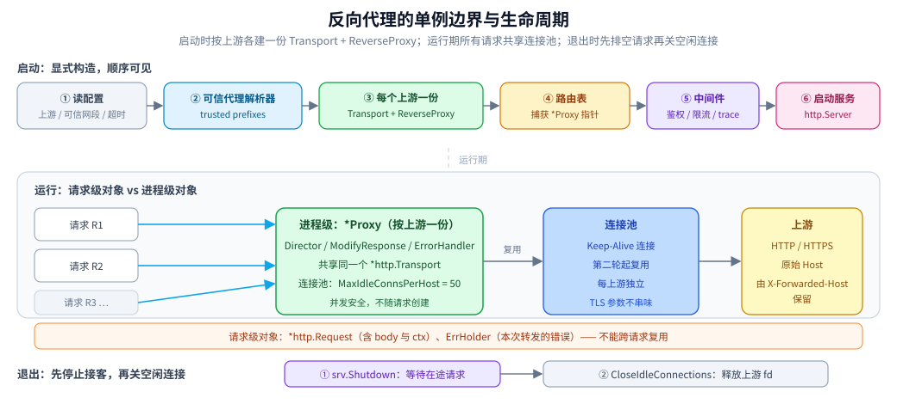

# 反向代理接入

> 覆盖：在 Go 服务里接入 `httputil.ReverseProxy` 的完整步骤 —— 选型 / 前提 / 初始化 / 单例边界 / 初始化顺序 / 封装 / 实际调用 / 跨进程传播 / 优雅退出 / 校验口径。
>
> 不覆盖：正向与反向代理的差别、逐跳头与重新分帧的实测、头部治理口径、`Clone` 可见性、`Transport` 参数原理见 [反向代理原理.md](../../../02-计算机基础/网络/代理与网关/反向代理原理.md)；可信代理链解析见 [客户端真实IP与可信代理.md](../../../02-计算机基础/网络/代理与网关/客户端真实IP与可信代理.md)。
>
> 内容整理自个人学习笔记；代码取自自研网关项目 [gateway](https://github.com/Eleven-26/gateway)（module `gwlab`，Go 1.26.5）的 `internal/proxy/`，相关实验在 `golang:1.26-alpine`（`go1.26.8 linux/amd64`）容器中跑通，输出见 [反向代理原理.md](../../../02-计算机基础/网络/代理与网关/反向代理原理.md) 第 2、4、6 节与本文第十节。

---

## 一、客户端选型与依赖

**本节要点**：先在「标准库 / 手写 / 独立代理」三者之间做选择，判据是**转发逻辑要不要和业务代码共享进程与上下文**。

| 方案 | 适合 | 不适合 | 代价 |
|---|---|---|---|
| **`net/http/httputil.ReverseProxy`** | 网关、BFF、需要按路由鉴权/改写头的场景 | 纯静态转发且已有成熟代理 | 逐跳头、流式、Upgrade 都已处理好，只需写 `Director` |
| 手写 `http.Client` 转发 | 只做一次性的协议转换 | 要支持 WebSocket / 流式 / 连接池 | 逐跳头、body 流式、`Hijack` 三件事几乎必然写错 |
| Nginx / APISIX / Envoy | 基础设施层统一入口、团队没有 Go 网关 | 需要读取业务上下文做细粒度改写 | 多一个组件与一套配置语言 |

⭐ 硬约束是「**要不要在转发前拿到业务身份**」：需要从 `context` 取用户、租户、trace 时，标准库方案最直接；只需要按 Host/Path 转发时，独立代理更省事。

依赖只有标准库，无需 `go get`：

```go
import (
    "context"
    "crypto/tls"
    "errors"
    "fmt"
    "net"
    "os"
    "net/http"
    "net/http/httputil"
    "net/url"
    "strings"
    "time"
)
```

> ⚠️ 常见误装：为了「性能」引入第三方反向代理库，最后仍要自己补逐跳头与 `X-Forwarded-*`。先把标准库这条路走通，再谈替换。

## 二、前提

**本节要点**：客户端（这里是网关）不创建上游资源，连上之前上游那侧必须先齐全；缺一样都有对应报错。

| 要先准备什么 | 漏了会报什么 |
|---|---|
| 上游地址可解析、端口在监听 | `dial tcp ...: connect: connection refused` → 502 |
| 上游 TLS 证书链完整、SNI 对得上 | `x509: certificate signed by unknown authority` / `certificate is valid for ...` |
| 网关的可信代理网段已配置 | 不报错，但 `X-Real-IP` 写成 LB 地址（静默失效） |
| 请求体上限已确定 | 超大请求在上游才失败，错误码落成 502 而不是 413 |
| `HTTP_PROXY` 等环境变量已确认 | 上游流量被悄悄导去代理（不报错） |

⭐ 最后两条是「不报错但结果错」的典型：**能连上不等于接对了**，第十节要专门验证。

## 三、初始化

**本节要点**：一个上游一份 `Transport` + 一份 `ReverseProxy`，在进程启动时构造，构造失败直接退出。

```go
type Upstream struct {
    Name        string
    Addr        string        // 例：http://127.0.0.1:9001
    StripPrefix string        // 例：/api
    TLS         *tls.Config   // nil 表示走系统根证书做默认校验
}

type Proxy struct {
    name   string
    target *url.URL
    rp     *httputil.ReverseProxy
    tr     *http.Transport
}

func New(u Upstream) (*Proxy, error) {
    target, err := url.Parse(u.Addr)
    if err != nil {
        return nil, err
    }
    if target.Scheme == "" || target.Host == "" {
        return nil, errors.New("upstream addr must include scheme and host")
    }

    tr := &http.Transport{
        Proxy:               nil, // 网关不受部署机 HTTP_PROXY 影响
        MaxIdleConns:        200,
        MaxIdleConnsPerHost: 50,  // 默认 2，网关场景必须调大
        IdleConnTimeout:     90 * time.Second,
        TLSHandshakeTimeout: 5 * time.Second,
        DialContext: (&net.Dialer{
            Timeout:   2 * time.Second,
            KeepAlive: 30 * time.Second,
        }).DialContext,
        TLSClientConfig: u.TLS,
    }

    p := &Proxy{name: u.Name, target: target, tr: tr}
    p.rp = &httputil.ReverseProxy{
        Director:       p.director(u.StripPrefix),
        Transport:      tr,
        FlushInterval:  100 * time.Millisecond,
        ErrorHandler:   p.errorHandler,
        ModifyResponse: p.modifyResponse,
    }
    return p, nil
}
```

三条初始化纪律：

| 纪律 | 原因 |
|---|---|
| **`Proxy: nil`** | 不显式置空会继承环境变量，某台机器上的代理配置会让上游流量改道 |
| **每个上游独立 `Transport`** | TLS 参数（自定义 CA / mTLS）按节点配，共用会串味；连接池也自然按节点隔离 |
| **TLS 配置失败必须硬失败** | 绝不能静默降级成跳过校验或明文，否则「以为在用 HTTPS」会一直骗到有人抓包 |

## 四、单例边界 ⭐

**本节要点**：判「要不要单例」只看一件事——这个对象内部有没有**长活的资源**（连接池、后台协程、心跳循环）。

| 对象 | 是否单例 | 为什么 |
|---|---|---|
| `*http.Transport` | **进程级，按上游一份** | 内部是连接池；每请求新建等于每次重付 TCP/TLS 握手 |
| `*httputil.ReverseProxy` | **进程级，按上游一份** | 持有 `Transport` 与回调，本身可并发使用 |
| **上游注册表** `map[string]*Proxy` | **进程级一份** | 路由表在启动时捕获指针，运行期只读 |
| `*http.Request` | **请求级** | 带 body 与 context，不能跨请求复用 |
| `ErrHolder`（转发错误记录） | **请求级** | 只描述本次请求的上游错误 |
| `*http.Client`（若另建） | 进程级 | 同样因为内部持有 `Transport` |

写错的后果：

```text
每个请求 new 一个 ReverseProxy + Transport
  → 连接池永远是空的，每个请求都新建 TCP 连接
  → 上游看到的连接数随 QPS 线性上涨，端口与 fd 很快耗尽
  → 现象是「上游没挂，但网关报 connection refused / too many open files」
```



图注：反向代理的单例边界与生命周期：启动时按上游各建一份 Transport 与 ReverseProxy，运行期所有请求共享连接池，请求级只保留 Request 与 ErrHolder，退出时先排空再关空闲连接。

## 五、初始化顺序 ⭐

**本节要点**：判据是「**谁在初始化时捕获了全局单例**」——凡是有这个特征的下游组件，必须排在被捕获者之后初始化。

```text
① 读配置（上游列表、可信代理网段、超时）
② 构造可信代理解析器（clientip.Resolve 的前置数据）
③ 逐个上游构造 Transport + ReverseProxy
④ 构造路由表（捕获 *Proxy 指针）
⑤ 构造鉴权 / 限流 / 观测中间件
⑥ 启动 http.Server
```

| 顺序反了会怎样 | 为什么 |
|---|---|
| 先建路由表、后建代理 | 路由表里存的是 `nil` 或旧代理，运行期不报错但转发不到 |
| 先建代理、后加载可信网段 | `Director` 拿到的可信列表是空切片，`X-Real-IP` 在 LB 后面全部写错 |
| 用 `sync.OnceValue` 取配置 | 第一次调用时就把配置固化下来，后续热更新读不到新值 |

⭐ 本项目用「启动时显式构造 + 只读注册表」，而不是在 `Director` 里懒加载，就是为了让顺序在编译期可见、运行期不可变。

## 六、单例与依赖注入的封装

**本节要点**：多上游用「启动时构造注册表」；单上游可以用 `sync.OnceValue` 兜底，但不要让懒加载掩盖初始化顺序。

多上游注册表：

```go
type Registry struct {
    proxies map[string]*Proxy
}

func Build(ups []Upstream) (*Registry, error) {
    r := &Registry{proxies: make(map[string]*Proxy, len(ups))}
    for _, u := range ups {
        p, err := New(u)
        if err != nil {
            return nil, fmt.Errorf("upstream %s: %w", u.Name, err)
        }
        r.proxies[u.Name] = p
    }
    return r, nil
}

func (r *Registry) Get(name string) (*Proxy, bool) {
    p, ok := r.proxies[name]
    return p, ok
}

func (r *Registry) ServeHTTP(name string, w http.ResponseWriter, req *http.Request) {
    p, ok := r.Get(name)
    if !ok {
        http.Error(w, "unknown upstream", http.StatusBadGateway)
        return
    }
    p.rp.ServeHTTP(w, req)
}
```

单上游（适用于只有一个固定后端的 BFF）：

```go
var defaultProxy = sync.OnceValue(func() *Proxy {
    p, err := New(Upstream{Name: "default", Addr: "http://127.0.0.1:9001"})
    if err != nil {
        panic(err) // 启动期失败优于运行期 502
    }
    return p
})
```

> ⚠️ `sync.OnceValue` 的代价是**第一次调用前不可观测**：配置写错会在首个请求时才炸。能用显式 `Build` 时优先用显式构造。

## 七、实际调用

**本节要点**：`ReverseProxy` 的可定制点只有三处——`Director`（改出站请求）、`ModifyResponse`（改入站响应）、`ErrorHandler`（改错误出口）。

### 7.1 Director：改写目标 + 按段边界剥前缀

```go
func (p *Proxy) director(stripPrefix string) func(*http.Request) {
    return func(req *http.Request) {
        origHost := req.Host // ⭐ 必须在改 req.Host 之前保存

        req.URL.Scheme = p.target.Scheme
        req.URL.Host = p.target.Host
        req.Host = p.target.Host

        // 只在路径段边界上剥：/api 或 /api/...，不剥 /apifoo
        if stripPrefix != "" && (req.URL.Path == stripPrefix ||
            strings.HasPrefix(req.URL.Path, stripPrefix+"/")) {
            req.URL.Path = strings.TrimPrefix(req.URL.Path, stripPrefix)
            if req.URL.Path == "" {
                req.URL.Path = "/"
            }
        }

        req.Header.Set("X-Forwarded-Host", origHost)
        req.Header.Set("X-Forwarded-Proto", schemeOf(req))
        req.Header.Set("X-Real-IP", clientIPOf(req))
        // ⚠️ X-Forwarded-For 不要手写，ReverseProxy 会在 Director 返回后追加

        for _, h := range internalHeaders {
            req.Header.Del(h)
        }
        if id := auth.FromContext(req.Context()); id != nil {
            req.Header.Set("X-Forwarded-User", id.Subject)
        }
    }
}
```

| 写法 | 现象 | 判定 |
|---|---|---|
| 裸 `strings.HasPrefix(path, "/api")` | `/apifoo` 被剥成 `foo` | 加段边界判断 |
| Director 里也 `Set("X-Forwarded-For", ...)` | 上游看到同一 IP 两次 | XFF 交给标准库 |
| 先改 `req.Host`，再写 `X-Forwarded-Host` | 上游收到的原始 Host 变成上游地址 | 先存 `origHost` |
| 先写可信身份、后剥内部头 | 网关写入的身份被一并删掉 | **先 `Del` 全部，再 `Set` 可信值** |

### 7.2 流式响应：`FlushInterval`

```go
p.rp.FlushInterval = 100 * time.Millisecond // SSE / 逐块进度场景
// -1：每次写入都立即 flush（延迟最低，系统调用最多）
//  0：不主动 flush，依赖底层缓冲（普通 JSON 响应足够）
```

⚠️ 反向代理会**重新决定分块边界**（实测见 [反向代理原理.md](../../../02-计算机基础/网络/代理与网关/反向代理原理.md) 2.2）：
上游一次写完时，客户端可能只收到一个大块。**按块到达做流式消费的代码不能假设边界与上游一致**。

### 7.3 ErrorHandler：区分超时、连不上与体积超限

```go
func (p *Proxy) errorHandler(w http.ResponseWriter, r *http.Request, err error) {
    status, msg := http.StatusBadGateway, "upstream error"
    switch {
    case errors.Is(err, context.DeadlineExceeded), os.IsTimeout(err):
        status, msg = http.StatusGatewayTimeout, "upstream timeout" // 504
    case isConnRefused(err):
        status, msg = http.StatusBadGateway, "upstream refused"     // 502
    default:
        var mbe *http.MaxBytesError
        if errors.As(err, &mbe) {
            status, msg = http.StatusRequestEntityTooLarge, "request body too large" // 413
        }
    }
    markErr(r, msg) // ⚠️ 写 context，不写 Header
    http.Error(w, msg, status)
}
```

`413` 容易漏：`MaxBytesReader` 的错误只在真正读取 body 时才暴露，会以「上游错误」的形式出现在这里；不识别就会把「文件太大」报成 502。

## 八、跨进程与跨协程传播

**本节要点**：跨进程用请求头传业务上下文；跨协程用 `ctx` 传参，别塞进结构体字段。

| 数据 | 载体 | 注意 |
|---|---|---|
| trace id / `traceparent` | 入站头 → `ctx` → 出站头 | 复用客户端的值，缺失才新生成 |
| 客户端 IP | 入口解析一次 → `ctx` → `X-Real-IP` / gRPC metadata | 出站**不要**再从 `RemoteAddr` 推 |
| 鉴权身份 | 入口中间件 → `ctx` → `X-Forwarded-User` | 先剥客户端伪造的同名头 |
| 转发错误 | `ErrorHandler` → `ctx` 里的 `*ErrHolder` | `Header` 是深拷贝，改了主流程读不到 |

```go
type ErrHolder struct {
    mu  sync.Mutex
    msg string
}

type errHolderKey struct{}

func markErr(r *http.Request, msg string) {
    if h, ok := r.Context().Value(errHolderKey{}).(*ErrHolder); ok {
        h.mu.Lock()
        h.msg = msg
        h.mu.Unlock()
    }
}

func ErrFrom(r *http.Request) string {
    if h, ok := r.Context().Value(errHolderKey{}).(*ErrHolder); ok {
        h.mu.Lock()
        defer h.mu.Unlock()
        return h.msg
    }
    return ""
}
```

⭐ 判据：**凡是要「在库的回调里写、在主流程里读」的数据，先确认那条路径上有没有发生拷贝**。标准库会 `Clone` 出站请求，`Header` 是引用类型，一旦深拷贝就只影响副本。

## 九、优雅退出

**本节要点**：退出顺序 = 反初始化顺序；先停止接客、等在途请求用完连接池，再关空闲连接。

```go
func (r *Registry) Close() {
    for _, p := range r.proxies {
        p.tr.CloseIdleConnections()
    }
}

// main
srv := &http.Server{Addr: ":8080", Handler: mux}
go srv.ListenAndServe()

<-sigCh
ctx, cancel := context.WithTimeout(context.Background(), 15*time.Second)
defer cancel()
_ = srv.Shutdown(ctx) // ① 停止 accept，等待在途请求结束
registry.Close()      // ② 关空闲连接，释放上游 fd
```

| 顺序 | 作用 | 反了会怎样 |
|---|---|---|
| ① `srv.Shutdown` | 停止接收新请求，在途请求继续跑完 | 先关连接池会让在途请求拿到已关闭的连接 |
| ② `CloseIdleConnections` | 释放上游空闲连接 | 不关也能退出，但容器滚动时上游连接数会短暂堆积 |

⚠️ `Shutdown` 不会等**被 `Hijack` 的 WebSocket 连接**：长连接需要业务侧自己维护注册表并在退出时逐个关闭。

## 十、验证与排查

**本节要点**：先确认「接入真的生效」，再用故障速查表定位。

### 10.1 先确认生效

```bash
# 上游回显服务（示例）
curl -s http://127.0.0.1:9001/echo -H 'X-Demo: 1'

# 经网关
curl -si http://127.0.0.1:8080/api/order/list
```

| 检查项 | 期望 | 不符合说明 |
|---|---|---|
| 状态码 | 200 / 上游自己的业务码 | 502 看上游是否监听，504 看超时 |
| `X-Forwarded-For` | **只有一个**网关看到的对端地址 | 出现两个说明 Director 里手写了 XFF |
| `X-Real-IP` | 入口解析出的客户端 IP | 等于 LB 地址说明出口又从 `RemoteAddr` 推了一遍 |
| `X-Forwarded-Host` | 客户端原始 Host | 等于上游地址说明赋值顺序反了 |
| 上游收到 path | 剥掉前缀后的路径 | `/apifoo` 被误剥说明段边界判断缺失 |
| 连接复用 | 第二轮并发请求上游新建连接接近 0 | 每轮都新建说明 `MaxIdleConnsPerHost` 仍是默认 2 |

### 10.2 常见故障速查

| 症状 | 先查什么 |
|---|---|
| 上游说路径不对 | 网关原始 path 与上游实际收到的 path 是否只差前缀 |
| 上游读不到租户 | 请求里是否还有客户端伪造的 `X-Company-Id`（有就是剥离没生效） |
| 上游说客户端 IP 是网关 | 上游读的是 XFF 还是 `X-Real-IP`；网关出口取值来源是否正确 |
| 502 与 504 混杂 | 分别对应「没监听」与「太慢」，看访问日志里的 `err=` |
| 流式响应卡住 | `FlushInterval` 是否为 0；中间代理是否开了响应缓冲 |
| 上游连接数异常高 | `MaxIdleConnsPerHost` 是否调大；是否每请求新建 Transport |

## 十一、校验口径

> ✅ 本篇代码的校验方式与范围（`golang:1.26-alpine`，`go1.26.8 linux/amd64`）：

- **真编译 + 运行通过**：`Director` 的段边界与 XFF 行为、逐跳头剔除、`Transfer-Encoding` 重新分帧、`MaxIdleConnsPerHost` 对照、四容器 TLS 卸载链路 —— 取自项目 `internal/proxy/` 的已编译代码，实验脚本与读数见 [反向代理原理.md](../../../02-计算机基础/网络/代理与网关/反向代理原理.md) 第 2.1、2.2、4.2、6.1 节。
- **只编译、未运行**：`Registry` / `Build` 的封装形态（项目内以等价结构存在，未单独起服务跑）。
- **未独立编译**：本文合并后的单文件示例依赖项目内 `auth` / `clientip` / `internalHeaders` 类型，未在本机单独 `go build`；各段落均来自上述已编译项目。
- **实测环境**：Docker Desktop，`golang:1.26-alpine`，上游回显服务与四容器（nginx + Go 代理 ×2 + 后端）拓扑。
- **未实测**：其他语言/框架的 `ReverseProxy` 行为、HTTP/3 上游、mTLS 双向认证的完整链路。

| 依赖 | 实际版本 |
|---|---|
| Go | go1.26.8 linux/amd64（容器） |
| `net/http/httputil` | 标准库，随 Go 版本 |

## 延伸追问

- **为什么不用 `http.Client` 自己转发？** → 逐跳头、流式 body、WebSocket `Hijack` 三件事都要自己写，且极易写错；标准库已经处理好。
- **`ReverseProxy` 可以并发使用吗？** → 可以。它本身无请求级可变状态，`Transport` 也保证并发安全；不要每个请求 new 一个。
- **`FlushInterval = -1` 什么时候用？** → SSE、逐块进度、长轮询等对首字节延迟敏感的场景；普通 JSON 用 0 即可。
- **上游是 HTTPS 但证书是自签的怎么办？** → 每个上游单独配 `TLSClientConfig` 注入 CA；**不要**用 `InsecureSkipVerify` 图省事。
- **网关要不要改写 `req.Host`？** → 取决于上游是否按 Host 做虚拟主机；无论改不改，都要用 `X-Forwarded-Host` 保留原始值。
- **为什么 `ErrorHandler` 里的 `Header` 改不回来？** → 出站请求是 `Clone` 出来的，`Header` 被深拷贝；改用 `context` 传递。

## 关联

- **上游/总纲**：[反向代理原理.md](../../../02-计算机基础/网络/代理与网关/反向代理原理.md) — 代理的定位、逐跳头与头部治理口径
- **对照/互补**：[客户端IP接入.md](客户端IP接入.md) — 同一套入口解析结果如何供代理出口复用
- **对照/互补**：[客户端真实IP与可信代理.md](../../../02-计算机基础/网络/代理与网关/客户端真实IP与可信代理.md) — 可信代理链的解析规则
- **下游机制**：[从零实现网关.md](从零实现网关.md) — 反向代理在网关七模块流水线里的位置
- **对照/互补**：[HTTP客户端与连接池.md](HTTP客户端与连接池.md) — `Transport` 连接池的另一侧视角
- **运维/配置**：[网关选型对比.md](../../../03-数据与中间件/中间件/网关与代理/网关选型对比.md) — Nginx / APISIX / Kong 的能力对照
