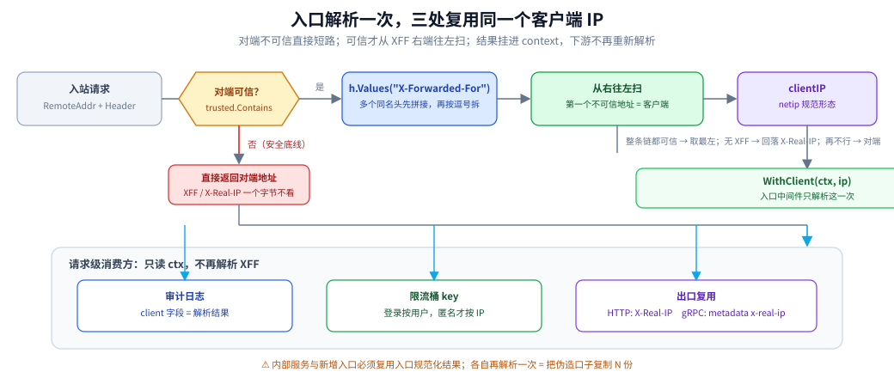

# 客户端 IP 接入

> 覆盖：在 Go 网关里接入「可信代理链解析」的完整步骤 —— 选型 / 前提 / 初始化 / 单例边界 / 初始化顺序 / 封装 / 实际调用 / 跨进程传播 / 优雅退出 / 校验口径。
>
> 不覆盖：`RemoteAddr` 为什么不可用、XFF 为什么是一条链、五条解析规则与十个实测用例的原理推导见 [客户端真实IP与可信代理.md](../../../02-计算机基础/网络/代理与网关/客户端真实IP与可信代理.md)；代理出口如何写 `X-Real-IP` 见 [反向代理接入.md](反向代理接入.md)。
>
> 内容整理自个人学习笔记；代码取自自研网关项目 [gateway](https://github.com/Eleven-26/gateway)（module `gwlab`，Go 1.26.5）的 `internal/clientip/`，单元测试与端到端用例在 `golang:1.26-alpine`（`go1.26.8 linux/amd64`）容器中跑通，解析用例的完整输出见 [客户端真实IP与可信代理.md](../../../02-计算机基础/网络/代理与网关/客户端真实IP与可信代理.md) 第 3.2、5 节与本文第十节。

---

## 一、客户端选型与依赖

**本节要点**：这件事没有第三方库能替你做决定——**可信网段必须按自己的拓扑配**，能复用的只是解析算法。

| 方案 | 适合 | 不适合 | 代价 |
|---|---|---|---|
| **自己实现 `Resolve`**（`net/netip`） | 网关、入口服务、需要与限流/审计共用同一口径 | 只在一个边缘函数里用一次 | 约 80 行代码，规则要自己钉测试 |
| 框架自带（如 `gin.ClientIP()`） | 快速原型 | 多跳可信链、需要自定义可信网段 | 默认行为常常是「信任所有代理」或「取最左」 |
| 反向代理层解决（nginx `realip`） | 已有 nginx 入口且只此一跳 | 网关还要做业务级限流/审计 | 只解决入口，进程内仍需拿到结果 |

⭐ 硬约束是「**全链路只有一个口径**」：限流桶、审计日志、出站头、gRPC metadata 必须用**同一个解析结果**。自己实现一个纯函数最容易保证这一点。

依赖只有标准库：

```go
import (
    "context"
    "fmt"
    "net"
    "net/http"
    "net/netip"
    "strings"
)
```

## 二、前提

**本节要点**：解析结果对不对，**首先取决于拓扑画得对不对**；代码只能执行你配置的信任边界。

| 要先准备什么 | 漏了会怎样 |
|---|---|
| 画出完整拓扑：客户端 → CDN → SLB → 网关 | 少配一跳，解析出的「客户端」其实是代理节点 |
| 列出**自己能控制配置与网段**的每一跳 | 把第三方 CDN 网段写进 trusted，等于把伪造能力交给它 |
| 确认入口是 L7 还是 L4 | L4 转发没有 XFF，必须走 PROXY protocol 或保持对端地址 |
| 确认网关是否直接面对客户端 | 是则 trusted 必须为空，任何 XFF 都是伪造 |

⭐ 最安全的默认值是 **`trusted` 为空**：此时 `Resolve` 只返回 `RemoteAddr`，完全不看转发头。先让它安全，再按拓扑逐步放开。

## 三、初始化

**本节要点**：启动时把配置解析成**不可变的前缀集合**，运行期只调用纯函数 `Resolve`；配置错误必须在启动时报出来。

```go
package clientip

import (
    "context"
    "fmt"
    "net"
    "net/http"
    "net/netip"
    "strings"
)

type contextKey struct{}

func WithClient(ctx context.Context, ip string) context.Context {
    return context.WithValue(ctx, contextKey{}, ip)
}

func FromClient(ctx context.Context) (string, bool) {
    ip, ok := ctx.Value(contextKey{}).(string)
    return ip, ok && ip != ""
}

// ParseTrusted 把 CIDR 或裸 IP 解析成前缀集合；空白项跳过，非法项报错。
func ParseTrusted(raw []string) ([]netip.Prefix, error) {
    out := make([]netip.Prefix, 0, len(raw))
    for i, s := range raw {
        s = strings.TrimSpace(s)
        if s == "" {
            continue
        }
        if p, err := netip.ParsePrefix(s); err == nil {
            out = append(out, p.Masked())
            continue
        }
        if addr, err := netip.ParseAddr(s); err == nil {
            addr = addr.Unmap()
            out = append(out, netip.PrefixFrom(addr, addr.BitLen()))
            continue
        }
        return nil, fmt.Errorf("clientip: 第 %d 个可信代理 %q 既不是 CIDR 也不是 IP", i+1, s)
    }
    return out, nil
}
```

`ParseTrusted` 的容错口径：

| 输入 | 结果 | 为什么 |
|---|---|---|
| `10.0.0.0/8` | `10.0.0.0/8` | 正常 CIDR |
| `192.168.0.1` | `192.168.0.1/32` | 便利：单机放行 |
| `10.0.0.1/8` | `10.0.0.0/8` | `Masked()` 规范化 |
| `""` | 跳过 | 尾随逗号不该让网关起不来 |
| `not-an-ip` | **报错** | 安全配置错误不能静默吞掉 |

⚠️ 空列表是合法结果（= 不信任任何代理）。**不要在启动时把空列表回退成 `0.0.0.0/0`** —— 那等于信任所有人。

## 四、单例边界 ⭐

**本节要点**：这个组件**没有长活资源**，所以不需要连接池式单例；它是「进程级不可变配置 + 请求级 `ctx` 值」。

| 对象 | 是否单例 | 为什么 |
|---|---|---|
| `[]netip.Prefix`（可信列表） | **进程级一份**（可热更新快照） | 只读，所有请求共用 |
| `Resolve` 函数 | 无状态 | 纯函数，不缓存、不共享可变状态 |
| 客户端 IP 字符串 | **请求级** | 每次请求各自解析，挂在 `ctx` 里 |
| `contextKey` 类型 | 包级 | 避免与其他包的 key 冲突 |

⭐ **为什么不做缓存**：`Resolve` 是纯函数，结果只依赖入参与配置；缓存既无收益（一次解析是微秒级），又会引入「同一 IP 在配置热更新后仍返回旧结果」的一致性问题。

## 五、初始化顺序 ⭐

**本节要点**：可信列表必须在**任何会读取 `ctx` 的组件**之前就绪；配置热更新则用快照替换，而不是原地修改切片。

```text
① 读配置（trusted_proxies）
② ParseTrusted → 失败直接退出
③ 构造入口中间件（闭包持有当前快照）
④ 构造限流 / 审计 / 代理等下游组件
⑤ 启动 http.Server
```

| 顺序反了会怎样 | 为什么 |
|---|---|
| 中间件先建、配置后加载 | 闭包捕获的是空列表，全部请求只信 `RemoteAddr` |
| 下游组件各自解析 XFF | 同一请求在限流与日志里得到两个值 |
| 热更新时原地改切片 | 在途请求可能读到「改了一半」的列表（数据竞争） |

热更新用 `atomic.Pointer` 换整份快照：

```go
type Rules struct {
    Trusted []netip.Prefix
}

var current atomic.Pointer[Rules]

func Snapshot() *Rules { return current.Load() }

func Reload(raw []string) error {
    trusted, err := ParseTrusted(raw)
    if err != nil {
        return err
    }
    current.Store(&Rules{Trusted: trusted})
    return nil
}
```

## 六、单例与依赖注入的封装

**本节要点**：把「读哪个头、信哪些跳」收进一个包，入口只调用一次；下游只消费 `ctx` 里的结果。

```go
func Resolve(remoteAddr string, h http.Header, trusted []netip.Prefix) string {
    host := hostOnly(remoteAddr)
    peer, ok := parseIP(host)
    if !ok {
        return host
    }

    // ① 对端不可信：转发头一个字节都不看
    if !trustedHas(trusted, peer) {
        return peer.String()
    }

    // ② 从右往左扫，第一个不可信地址就是真实客户端
    chain := parseChain(h.Values("X-Forwarded-For"))
    for i := len(chain) - 1; i >= 0; i-- {
        if !trustedHas(trusted, chain[i]) {
            return chain[i].String()
        }
    }

    // ③ 整条链都可信：取最左
    if len(chain) > 0 {
        return chain[0].String()
    }

    // ④ 没有 XFF：回落 X-Real-IP
    if ip, ok := parseIP(hostOnly(h.Get("X-Real-IP"))); ok {
        return ip.String()
    }

    // ⑤ 兜底：对端自己
    return peer.String()
}

func hostOnly(addr string) string {
    if host, _, err := net.SplitHostPort(addr); err == nil {
        return host
    }
    return strings.TrimSuffix(strings.TrimPrefix(addr, "["), "]")
}

func parseIP(s string) (netip.Addr, bool) {
    addr, err := netip.ParseAddr(strings.TrimSpace(s))
    if err != nil {
        return netip.Addr{}, false
    }
    return addr.Unmap(), true
}

func parseChain(values []string) []netip.Addr {
    var out []netip.Addr
    for _, v := range values {
        for _, seg := range strings.Split(v, ",") {
            ip, ok := parseIP(hostOnly(strings.TrimSpace(seg)))
            if !ok {
                continue // 非法条目跳过，不能因此放弃整条链
            }
            out = append(out, ip)
        }
    }
    return out
}

func trustedHas(list []netip.Prefix, addr netip.Addr) bool {
    addr = addr.Unmap()
    for _, p := range list {
        if p.Contains(addr) {
            return true
        }
    }
    return false
}
```

入口中间件：

```go
func Middleware(rules *Rules) func(http.Handler) http.Handler {
    return func(next http.Handler) http.Handler {
        return http.HandlerFunc(func(w http.ResponseWriter, r *http.Request) {
            ip := Resolve(r.RemoteAddr, r.Header, rules.Trusted)
            next.ServeHTTP(w, r.WithContext(WithClient(r.Context(), ip)))
        })
    }
}
```

⭐ 三个实现细节值得钉住：

| 细节 | 原因 |
|---|---|
| 用 `h.Values` 而不是 `h.Get` | 多个同名 XFF 头会被 `Get` 截断成一条，真实 IP 丢失 |
| 用 `netip.Addr.Unmap()` | `::ffff:10.1.1.1` 不归一就匹配不上 IPv4 前缀 |
| `hostOnly` 用 `net.SplitHostPort` | IPv6 的方括号与端口只有它能正确剥 |

## 七、实际调用

**本节要点**：同一个解析结果要同时供给限流、审计与出口；**入口解析一次，出口复用**。

### 7.1 入口中间件挂在最外层

```go
mux := http.NewServeMux()
// ... 注册路由
handler := clientip.Middleware(clientip.Snapshot())(auth(ratelimit(mux)))
```

⚠️ 中间件必须在鉴权/限流之前：限流要用 IP 做桶 key，鉴权失败也要记审计日志。

### 7.2 三处消费者

```go
func handle(w http.ResponseWriter, r *http.Request) {
    ip, _ := clientip.FromClient(r.Context()) // ① 不重新解析

    entry.ClientIP = ip                                  // 审计
    allowed := limiter.Allow(ratelimit.Key("order", subject, ip)) // 限流
    hashKey := ip                                        // 一致性哈希兜底
    _ = allowed
    _ = hashKey
}
```

限流 key 的设计决定了 IP 坍缩的影响面：

```go
func Key(route, subject, ip string) string {
    if subject != "" && subject != "anonymous" {
        return "route:" + route + "|user:" + subject // 登录用户按用户
    }
    return "route:" + route + "|ip:" + ip            // 匿名才按 IP
}
```

⭐ 所以「LB 后所有匿名流量共用一个桶」这个问题常常迟迟发现不了：登录接口一切正常，只有匿名接口悄悄坍缩。



图注：客户端 IP 的入口解析与三处复用：对端不可信直接短路，可信才从 XFF 右端往左扫，结果挂进 context 后供审计、限流与出口共用。

### 7.3 出口复用

```go
func clientIPOf(req *http.Request) string {
    if ip, ok := clientip.FromClient(req.Context()); ok {
        return ip
    }
    if host, _, err := net.SplitHostPort(req.RemoteAddr); err == nil {
        return host
    }
    return req.RemoteAddr
}
```

⚠️ 回落分支不是可选项：直接调用代理包或单测手工构造请求时 `ctx` 里没有值；旧写法 `net.SplitHostPort` 忽略错误，`RemoteAddr` 不带端口时会写出**空的 `X-Real-IP`**。

HTTP → gRPC 转码走 metadata，值仍取同一个：

```go
ip, _ := clientip.FromClient(ctx)
ctx = metadata.AppendToOutgoingContext(ctx, "x-real-ip", ip)
```

### 7.4 L4 入口：没有 HTTP 头可解析

| 方案 | 条件 | 取到的值 |
|---|---|---|
| PROXY protocol v1/v2 | LB 与网关两端都显式开启 | 原始客户端地址 |
| 保持对端地址（DSR / IP 透传） | 网络设备支持 | `RemoteAddr` 就是客户端 |
| 什么都不做 | — | 只能拿到 LB 地址 |

⚠️ 开了 PROXY protocol 就**不能再按普通 HTTP 解析首字节**：必须先读那行前缀，再交给 HTTP server。

## 八、跨进程与跨协程传播

**本节要点**：跨进程传「已规范化的结果」，不是传原始 XFF；跨协程用 `ctx` 传参，不塞结构体字段。

| 场景 | 做法 | 反例 |
|---|---|---|
| 网关 → 上游 HTTP | 入口解析结果写入 `X-Real-IP`，XFF 由 `ReverseProxy` 追加 | Director 里重新从 XFF 解析 |
| 网关 → 上游 gRPC | metadata `x-real-ip` | 不传，上游拿不到 |
| 网关 → 内部服务 | 内部服务只信任入口结果，不再解析外部头 | 每个服务各自解析 XFF，伪造口子复制 N 份 |
| 同进程 goroutine | `ctx` 随调用链传递 | 存进全局变量或结构体字段 |

⭐ 纪律：**新增任何一个「能接收外部流量的入口」时，必须同步确认它做了同样的规范化**，否则那条路径就是绕过整套判定的后门。

## 九、优雅退出

**本节要点**：解析组件本身没有需要关闭的资源；要处理的是「热更新与在途请求的一致性」。

```go
// 退出时不需要 Close：没有连接池、后台协程或心跳
// 只需保证在途请求持有的是同一份快照
```

| 动作 | 是否必要 | 说明 |
|---|---|---|
| 关闭连接池 | ❌ | 本组件不持有连接 |
| 停止热更新 goroutine | ✅（如果有） | 监听配置变更的循环要随主 `ctx` 取消退出 |
| 等待在途请求 | 由 `http.Server.Shutdown` 负责 | 在途请求继续使用它启动时读到的那份快照，语义一致 |

## 十、验证与排查

**本节要点**：解析规则必须用**表驱动测试**钉住；线上排查先确认「对端是否在可信网段内」。

### 10.1 表驱动用例（本机实测）

可信列表：`10.0.0.0/8`、`127.0.0.1`、`::1`。

```text
① 对端不可信 + 伪造 XFF    remote=203.0.113.9:5000   XFF=1.2.3.4                    → 203.0.113.9
② 对端可信 + XFF 单跳      remote=127.0.0.1:5000     XFF=9.9.9.9                    → 9.9.9.9
③ 对端可信 + XFF 多跳      remote=127.0.0.1:5000     XFF=9.9.9.9, 10.1.1.1          → 9.9.9.9
④ XFF 最左是伪造值         remote=127.0.0.1:5000     XFF=1.1.1.1, 9.9.9.9, 10.1.1.1 → 9.9.9.9
⑤ XFF 含非法条目           remote=127.0.0.1:5000     XFF=garbage, 9.9.9.9           → 9.9.9.9
⑥ XFF 全是可信跳           remote=127.0.0.1:5000     XFF=10.7.7.7, 10.8.8.8         → 10.7.7.7
⑦ XFF 缺失 → X-Real-IP     remote=127.0.0.1:5000     XFF=(无)                       → 9.9.9.9
⑧ IPv4-mapped IPv6 归一    remote=127.0.0.1:5000     XFF=::ffff:9.9.9.9             → 9.9.9.9
⑨ IPv6 对端方括号形式        remote=[::1]:5000         XFF=2001:db8::1                → 2001:db8::1
⑩ 全部不可解析              remote=127.0.0.1:5000     XFF=garbage                    → 127.0.0.1
```

⭐ 端到端用例有两条，必须配套跑：

```text
TestRealIPReachesUpstreamThroughContext
   入站 RemoteAddr=127.0.0.1:5000（可信）、XFF=9.9.9.9  → 上游 X-Real-IP=9.9.9.9       ✅
TestRealIPUntrustedPeerIgnoresXFF
   入站 RemoteAddr=203.0.113.9:5000（不可信）、XFF=9.9.9.9 → 上游 X-Real-IP=203.0.113.9 ✅
```

### 10.2 常见故障速查

| 症状 | 先查什么 |
|---|---|
| 所有客户端都是同一个 IP | trusted 是否为空 / 少配了 CDN 那跳 |
| 解析结果是内网地址 | 只扫到可信跳；检查是否用了 `h.Get` 截断链 |
| 伪造 XFF 生效了 | 对端是否被误配进 trusted；`0.0.0.0/0` 是否被写进去 |
| IPv6 客户端匹配不上网段 | 是否忘了 `Unmap()`，或 trusted 里写的是 IPv4 前缀 |
| 上游 `X-Real-IP` 是 LB 地址 | 出口是否又从 `RemoteAddr` 推了一遍 |
| `X-Real-IP` 为空 | `SplitHostPort` 的错误被忽略，`RemoteAddr` 不带端口 |

## 十一、校验口径

> ✅ 本篇代码的校验方式与范围（`golang:1.26-alpine`，`go1.26.8 linux/amd64`）：

- **真编译 + 运行通过**：`Resolve`、`ParseTrusted`、`parseChain`、`hostOnly` 与十个表驱动用例 —— 取自项目 `internal/clientip/` 的已编译代码，`go test ./internal/clientip/` 通过；完整输出见 [客户端真实IP与可信代理.md](../../../02-计算机基础/网络/代理与网关/客户端真实IP与可信代理.md) 第 3.2、5 节。
- **真编译 + 端到端运行通过**：`Middleware` + `WithClient` / `FromClient` 的出入站闭环、两条 `httptest` 用例（见第 10.1 节），项目内 `go test ./internal/gateway/` 通过。
- **只编译、未运行**：`atomic.Pointer` 热更新快照（项目内为等价结构，未单独压测并发替换）。
- **未独立编译**：本文合并后的单文件示例依赖项目内 `auth` / `ratelimit` 类型，未单独 `go build`。
- **实测环境**：Docker Desktop，`golang:1.26-alpine`；多跳场景用三容器（客户端 + 前置代理 + 网关）验证 XFF 逐跳追加。
- **未实测**：PROXY protocol 的真实 LB 接入、第三方 CDN 的 XFF 写法差异。

| 依赖 | 实际版本 |
|---|---|
| Go | go1.26.8 linux/amd64（容器） |
| `net/netip` | 标准库，随 Go 版本 |
| `google.golang.org/grpc/metadata` | 项目内已引入（转码示例使用） |

## 延伸追问

- **为什么不用 `net.ParseIP`？** → 它保留 `::ffff:` 形态，且返回 `IP` 切片，规范化与比较都要额外处理；`net/netip` 的 `Addr` 是值类型，`Unmap()` 直接归一。
- **`X-Real-IP` 和 XFF 该信哪个？** → 先看对端可不可信；可信时优先用 XFF 的链（能表达多跳），没有 XFF 才回落 `X-Real-IP`。
- **为什么要跳过非法条目而不是拒绝整条链？** → 拒绝整条链等于给攻击者一个「塞垃圾就让保护失效」的开关。
- **trusted 能不能写成 `0.0.0.0/0`？** → 不能。那等于信任所有对端，XFF 完全可伪造。
- **内部服务为什么还要再解析一次？** → **不该**。内部服务应只消费入口规范化的结果；再解析一次等于复制伪造入口。
- **限流为什么优先按用户而不是 IP？** → 同一出口 IP 后可能有大量用户（NAT、办公网），按 IP 会让无关用户共用一个桶。

## 关联

- **上游/总纲**：[客户端真实IP与可信代理.md](../../../02-计算机基础/网络/代理与网关/客户端真实IP与可信代理.md) — 规则推导与十个解析用例
- **对照/互补**：[反向代理接入.md](反向代理接入.md) — 代理出口如何复用这里解析出的结果
- **对照/互补**：[反向代理原理.md](../../../02-计算机基础/网络/代理与网关/反向代理原理.md) — `X-Forwarded-*` 在代理边界的治理口径
- **下游机制**：[从零实现网关.md](从零实现网关.md) — 客户端 IP 在网关七模块流水线里的位置
- **对照/互补**：[网络通信链路详解.md](../../../02-计算机基础/网络/网络通信链路详解.md) — NAT 与多跳转发对源地址的改写
