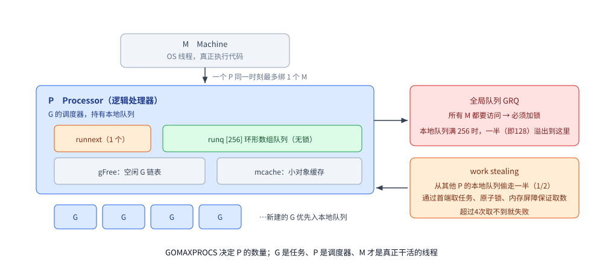
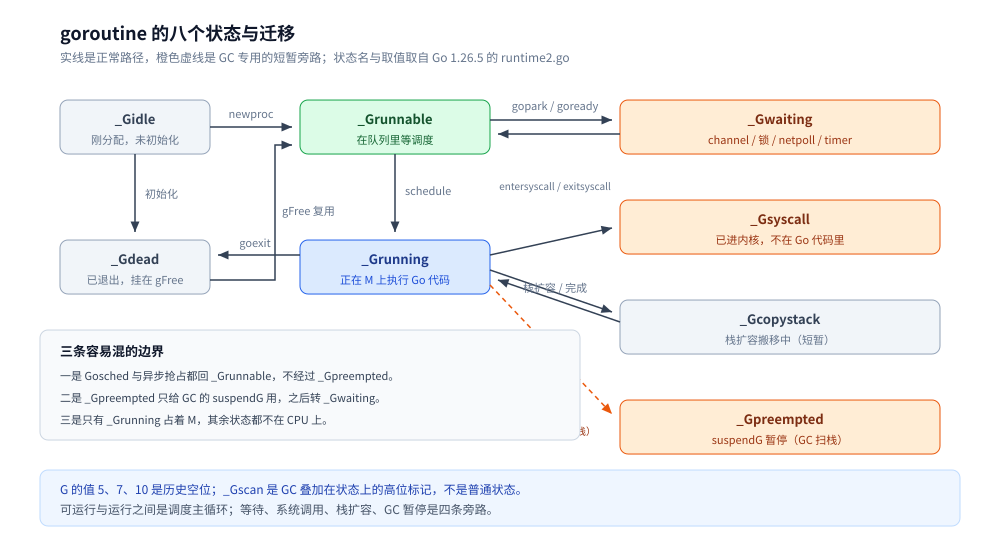
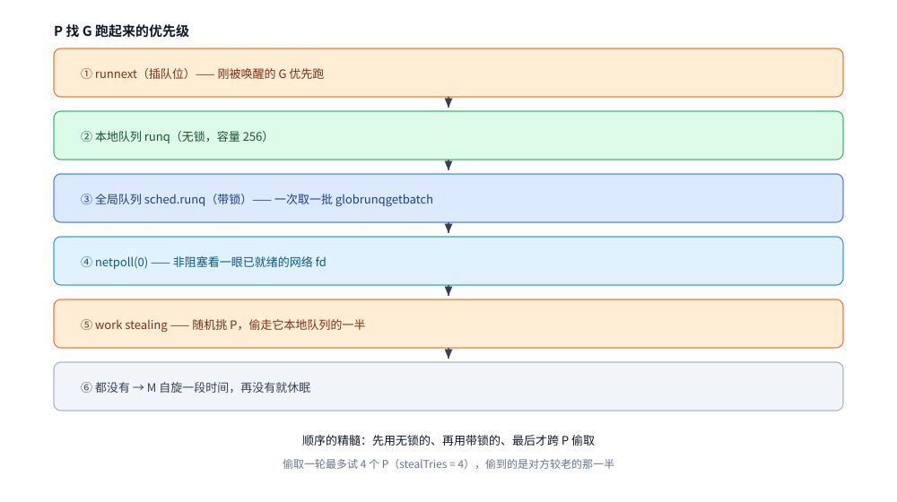
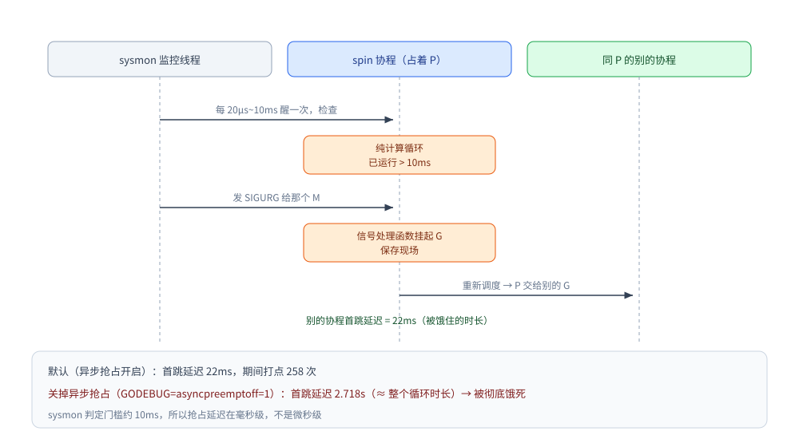

# Go GMP 调度模型

> 覆盖：Go 运行时怎么把几十万个 goroutine 排到有限的核上 —— G / M / P 三元组、goroutine 的状态流转、三级运行队列与 work stealing、四种让出 CPU 的时机、系统调用时的 P 交接、Go 1.14 起的异步抢占，以及 `GOMAXPROCS` 的真实含义。
>
> 不覆盖：goroutine 的栈怎么长、内存怎么算见 [goroutine.md](../并发编程/goroutine.md)；网络阻塞怎么挂起与唤醒见 [网络IO与netpoll.md](网络IO与netpoll.md)；定时器怎么和调度器配合见 [定时器与超时.md](定时器与超时.md)；`GODEBUG` 的全部旋钮见 [GODEBUG与运行时观测.md](GODEBUG与运行时观测.md)。
>
> 内容整理自个人学习笔记，并按《Go 语言核心编程》（李文塔）5.4.2 调度模型、5.4.3 并发和调度 的相关章节补充了机制分析与实测；参考资料与原始素材见 [素材清单](../../../素材清单.md)。本篇读数取自宿主机 `go1.26.5 windows/amd64`（8 P）；状态、队列与交接规则按同版本 `runtime` 源码核对，未运行的部分在 `## 校验口径` 中逐条标注。

---

## 一、为什么 Go 要自己写一个调度器？

**本节要点**：goroutine 之所以「轻」，一半在栈和创建成本，另一半在**调度发生在用户态**。先把「不用自己的调度器会怎样」讲清楚，GMP 三个字母才有落点。

### 1.1 一个任务一个线程，账算不过来

操作系统调度的基本单位是线程。每创建一个线程，内核要给它一套调度实体与一个内核栈，用户态还要准备一个栈；线程切换要陷入内核、保存寄存器、换栈，必要时还要换地址空间。

把这笔账放到 Go 的目标场景里：

- 一个 HTTP 服务同时有上万个连接，每个连接一个处理任务；
- 一个爬虫同时抓取几千个页面，大部分时间在等网络；
- 一个批处理要并发跑几十万个短任务。

如果每个任务都对应一个线程，内存先被栈吃光，内核调度器也会被大量线程拖慢。更麻烦的是：**操作系统只看得见线程，不知道一个线程里还排着多少任务**，因此无法替你把「线程里其他可运行的任务」拿出来执行。

### 1.2 把任务做小，把调度搬进用户态

Go 的答案是两层拆分：

| 层 | 做法 | 收益 |
|---|---|---|
| 任务层 | goroutine：用户态任务，初始栈 2 KB，按需增长（见 [goroutine.md](../并发编程/goroutine.md)） | 创建不需要陷入内核，几十万个也不稀奇 |
| 调度层 | 运行时自己实现调度器，把大量 G 复用到少量 OS 线程上 | 切换只保存少量寄存器，不换页表 |

代价是：**操作系统不再替你调度这些任务**。一个 goroutine 阻塞了，内核不会自动把同一个线程上的其他 goroutine 拿出来跑；运行时必须自己判断「谁该让出、谁该接上、P 要不要交给别的线程」。

### 1.3 调度器要同时满足四个目标

| 目标 | 要解决的问题 | Go 的手段 |
|---|---|---|
| **吃满多核** | 多个 G 要能真正同时跑 | P 的数量 = `GOMAXPROCS`，每个 P 同一时刻绑一个 M |
| **阻塞时不浪费核** | 一个 G 等 IO，不能把整条线程拖住 | 阻塞时释放 P，交给其他 M；M 可以比 P 多 |
| **排队开销要低** | 几十万 G 的入队/出队不能都抢一把锁 | 每 P 一个无锁本地队列，全局队列只做兜底，空闲 P 去偷 |
| **不能饿死** | 纯计算循环也要能被换下来 | Go 1.14 起基于信号的异步抢占 |

后面七节，就是把这四条逐一拆开。

### 1.4 GMP 三元组：任务、调度上下文、执行者

| 角色 | 含义 | 关键点 |
|---|---|---|
| **G** | goroutine，一次函数执行的上下文 | 保存栈、程序计数器与状态；本身不绑定线程 |
| **M** | Machine，操作系统线程 | 真正在 CPU 上执行代码的实体；同一时刻最多绑一个 P |
| **P** | Processor，逻辑处理器 | **G 的调度上下文**：持有本地队列、`runnext`、`mcache`；数量 = `GOMAXPROCS` |



图里三者的分工是「G 描述要做什么、P 决定下一个做谁、M 真正动手做」：G 只是栈和状态，P 是调度上下文，M 才是内核线程；本地队列满 256 格时，一半的 G 会被送到右侧带锁的全局队列。

一个 G 的一生会在这几个位置之间移动，先建立整体印象：

```text
入队：当前 P 的 runnext / 本地队列 → 本地满 256 → 一半进全局队列
出队：runnext → 本地队列 → 全局队列（一批）→ netpoll → 偷其他 P 的一半 → 自旋/休眠
```

**为什么要有 P 这一层，而不是让 G 直接挂在 M 上？**

- **解耦**：M 阻塞在系统调用里时，可以把 P 交给别的 M，让新的线程接着跑这个 P 上的 G；没有 P，M 一阻塞，绑在它身上的调度状态就一起停摆。
- **本地性**：P 持有本地队列和 `mcache`，绝大多数入队/出队只操作自己这一份数据，不用抢全局锁。
- **数量可控**：P 的数量就是并行度上限，调 `GOMAXPROCS` 调的是它，不是 M。

---

## 二、一个 goroutine 从创建到销毁要经过哪些状态？

**本节要点**：G 不是「运行 / 不运行」两态，而是六个常驻状态加两个短暂状态；把状态迁移和「谁占着 M」对上，后面「什么时候切换」就不用背。

### 2.1 `go f()` 之后发生了什么

编译器会把 `go f(args)` 改写成对 `runtime.newproc` 的调用。运行时的动作可以拆成五步：

1. 把参数复制到新 goroutine 的栈上（不是共享调用者的栈）；
2. 先从当前 P 的 `gFree` 链表取一个已退出的 G 复用；取不到才真正分配一个新的；
3. 初始化 `sched`：栈指针、程序计数器指向 `f`，返回地址指向 `goexit`；
4. 把状态置为 `_Grunnable`；
5. 调用 `runqput(pp, newg, true)` 入队，`true` 表示优先放进 `runnext`。

所以 **`go` 语句返回不等于函数开始执行**。它只是把 G 放进队列；真正执行要等某个 P 在调度循环里选中它，而且完全可能落到另一个 P 上。

### 2.2 八个状态

Go 1.26.5 的 `runtime2.go` 里，G 的常驻状态有六个，另有两条短暂路径：

| 状态 | 值 | 含义 | 是否占着 M |
|---|---|---|---|
| `_Gidle` | 0 | 刚分配，尚未初始化 | 否 |
| `_Grunnable` | 1 | 在运行队列里，等待被调度 | 否 |
| `_Grunning` | 2 | 正在某个 M 上执行 Go 代码 | **是** |
| `_Gsyscall` | 3 | 正在执行系统调用，已离开 Go 代码 | 否 |
| `_Gwaiting` | 4 | 被运行时挂起（channel、锁、netpoll、定时器） | 否 |
| `_Gdead` | 6 | 已退出，挂在 `gFree` 上等待复用 | 否 |
| `_Gcopystack` | 8 | 栈正在被搬移 | 否（短暂） |
| `_Gpreempted` | 9 | 被 `suspendG` 暂停，供 GC 扫描栈 | 否（短暂） |

⚠️ 两个容易看错的点：

- 值 5、7、10 是历史空位；`_Gscan` 不是普通状态，而是 GC 期间叠加在状态上的高位标记（`0x1000`），所以源码里会出现 `_Gscanrunnable`、`_Gscanrunning` 这类组合值。
- **`_Gpreempted` 不是普通异步抢占的落点**。异步抢占走 `gopreempt_m` → `goschedImpl(gp, true)`，G 直接变回 `_Grunnable` 并被放进全局队列；`_Gpreempted` 只用于 GC 的 `suspendG` 暂停。两者不要混。

### 2.3 状态之间怎么走



图里把主循环和旁路分开：左侧是「新建 / 复用」，中间是「可运行 ⇄ 运行」，右侧四个旁路分别是等待、系统调用、栈扩容和 GC 暂停。只有 `_Grunning` 占着 M，其余状态都不在 CPU 上。

按触发点逐条看：

| 从 | 到 | 触发 | 说明 |
|---|---|---|---|
| `_Gidle` | `_Gdead` → `_Grunnable` | `newproc` | 新分配的 G 先初始化成 `_Gdead`，再变成可运行；复用路径直接从 `_Gdead` 开始 |
| `_Grunnable` | `_Grunning` | `schedule` | P 从队列取出 G，绑定到当前的 M |
| `_Grunning` | `_Gwaiting` | `gopark` | channel 收发、锁等待、netpoll、`time.Sleep` |
| `_Gwaiting` | `_Grunnable` | `goready` | 对端写入、锁释放、fd 就绪、定时器到期 |
| `_Grunning` | `_Gsyscall` | `entersyscall` | 进入系统调用；P 是否立刻交接见第五节 |
| `_Gsyscall` | `_Grunnable` / `_Grunning` | `exitsyscall` | 抢回 P 就直接运行，没抢到就入全局队列 |
| `_Grunning` | `_Gdead` | `goexit` | 函数返回后由 `goexit` 收尾，G 进 `gFree` |
| `_Grunning` | `_Grunnable` | `Gosched` / 抢占 | 让出后重新入队；异步抢占也走这条 |
| `_Grunning` | `_Gcopystack` | 栈扩容 | 搬完栈回到 `_Grunning` |
| `_Grunning` | `_Gpreempted` | `suspendG` | GC 扫描栈时的暂停；之后转到 `_Gwaiting` |

### 2.4 这里的「切换」和线程切换不是一回事

Go 的协程切换只做三件事：保存当前 G 的 SP / PC / BP 到 `g.sched`，切到 M 的 `g0` 栈，然后由 `schedule` 选下一个 G 并 `gogo` 过去。整个过程在用户态完成：

- 不陷入内核，不经过操作系统调度器；
- 不换地址空间、不刷 TLB；
- 栈很小且可增长，保存的寄存器数量有限。

这也是「协程比线程便宜」的落点。具体差多少、怎么量，见 [协程与线程成本.md](../并发编程/协程与线程成本.md)。

---

## 三、G 排在哪个队列、按什么顺序被取走？

**本节要点**：每个 P 有一份无锁本地队列和一个只放 1 个 G 的 `runnext`；本地满了才溢出到全局队列，取的时候按「自己 → 全局 → 别人」的顺序，偷的时候拿一半。

### 3.1 P 的内部结构

| 字段 | 作用 |
|---|---|
| `status` | P 的状态：`_Pidle` / `_Prunning` / `_Pgcstop` / `_Pdead`；`_Psyscall` 在 1.26 已退役，源码里只剩 `_Psyscall_unused` 占位 |
| `m` | 当前绑在这个 P 上的 M（同一时刻最多一个） |
| `runqhead` / `runqtail` / `runq [256]` | **本地运行队列**：环形缓冲，无锁，容量 256 |
| `runnext` | **插队位**：只放 1 个 G，下一个一定先跑它 |
| `gFree` | 空闲 G（`_Gdead`）的链表，创建 goroutine 时优先复用 |
| `mcache` | 每个 P 一份的小对象缓存（见 [内存分配器.md](内存分配器.md)） |

⭐ **为什么容量取 256**：调度上的理由是「环形缓冲留一半余量、偷取时取一半」，编译上还有一条——256 = 2⁸ 是**编译期常量**，`runq[(h+1)%256]` 会被换成掩码（实测 9 条指令、不含 `DIV`），容量一旦改成变量就退回 `DIVL`（25 条）。所以「256」这个数字同时满足两个约束：足够大、且是 2 的幂。逐条指令对照见 [位运算.md](../../../02-计算机基础/计算机底层原理/微架构/位运算.md) 2.4。

⚠️ **系统调用期间 P 的状态**：Go 1.26 里 P 不再进入 `_Psyscall`，进入系统调用后它仍显示为 `_Prunning`；P 要不要交接，由 sysmon 的 `retake` 判断（见第五节）。旧资料里那张「`_Psyscall` 表示 P 在系统调用中」的表已经不适用于这个版本。

### 3.2 G 怎么入队

入队分两种：

- **`runqput(pp, gp, true)`**：给「刚被唤醒」的 G 用，优先放 `runnext`。如果 `runnext` 原来有 G，旧的那个会被挤到本地队列尾部。
- **`runqput(pp, gp, false)`**：普通入队，放到本地队列尾部。

本地队列满 256 时，`runqputslow` 会做一次批量转移：

```text
本地队列 256 个（head..tail）
  ├─ 取前一半 128 个，加上刚到的这个 G（共 129 个）
  ├─ 一起放进全局队列 sched.runq（持 sched.lock）
  └─ 本地队列剩下 128 个
```

所以「满了才进全局」这句话要补精确：**不是只把新来的 G 扔进全局，而是一次搬走一半再加它自己**。全局队列所有 P 都可能访问，必须加锁，这就是本地队列存在的意义。

### 3.3 G 怎么出队

`schedule` 调 `findRunnable`，按下面的顺序找活：

```text
① runnext（1 个，插队位）
② 本地队列 runq（无锁）
③ 全局队列 sched.runq（带锁）—— 一次取一批 globrunqgetbatch
④ netpoll(0) —— 非阻塞地看一眼有没有网络 fd 已就绪
⑤ work stealing —— 随机挑 P，偷走它本地队列的一半
⑥ 都没有 → 自旋一段时间，再没有就休眠
```



顺序的设计意图是「先拿自己无锁的，再拿全局带锁的，最后才跨 P 偷」：`runnext` 只放一个刚被唤醒的 G，全局队列一次只取一批，偷取则在别的 P 队列里拿一半。

两处细节值得单独记住：

- **全局队列一次取多少**：请求量是本地队列的一半（128），实际取 `min(128, 全局大小, 全局大小/GOMAXPROCS + 1)`。后面那一项是公平性约束，防止一个 P 把全局队列一次掏空，别的 P 永远只能偷。
- **偷的时候拿哪一半**：`runqgrab` 取 `n - n/2`，也就是向上取整的一半，并且从队头开始拿，把较老的一半拿走、给被偷的 P 留下较新的一半。如果对方本地队列为空，还可能偷它的 `runnext`，但会先短暂退避，避免两个 P 把同一个 G 来回抢。

### 3.4 为什么偷一半，而不是偷一个或全偷

偷一个：每次本地队列一空就要再偷一次，跨 P 的同步操作太频繁。
全偷：对方立刻从「有活」变成「没活」，下一次它又得反过来偷你，两个 P 乒乓。
**偷一半**：双方都还有一段工作可做，迁移次数少，负载又能快速拉平。

`stealWork` 一轮最多试 `stealTries = 4` 个 P，随机顺序，避免所有空闲 P 同时扑向同一个目标。

### 3.5 队列空了会怎样：M 的自旋与休眠

P 找不到 G 时，M 不会立刻睡：

1. 先**自旋**一段时间，占着 CPU 空转找活；这样刚睡下就有新 G 时不用唤醒线程。
2. 自旋也找不到，才把 P 放回空闲列表，M 休眠。

自旋的 M 数量有上限（大约是有活 P 的一半），否则空闲线程会白烧 CPU。`schedtrace` 里的 `spinningthreads` / `idlethreads` 就是这两个数。

### 3.6 实测：队列真的会积压（`GODEBUG=schedtrace`）

`schedtrace=150` 每 150 ms 打一行汇总。这一行能直接回答三个问题：**并行度够不够**（`idleprocs=0` 就是打满）、**积压在谁身上**（`runqueue` 长期非零，方括号里是各 P 的本地队列长度）、**线程为什么比 P 多**（`threads > gomaxprocs`）。

宿主机 8 P 上，短时间内创建大量 goroutine 的那一轮读到：

| 观察 | 结论 |
|---|---|
| P0 的本地队列最长（170 / 151），全局队列涨到 355 / 374 | goroutine 是在主协程（P0）上创建的，**新建的 G 优先进「当前 P」的本地队列**，满 256 才溢出到全局队列 |
| `threads=10 > gomaxprocs=8` | M 不受 `GOMAXPROCS` 限制，除了 8 个干活的外还有 sysmon 等系统线程 |

另一轮把 8 个 P 全部占满、再创建 600 个「立刻 sleep」的 goroutine，同一台机器读到的是另一个形状：

| 负载 | `gomaxprocs` | `threads` | `runqueue` | 说明 |
|---|---|---|---|---|
| 创建风暴（上一行） | 8 | 10 | 355 / 374 | 本地队列先涨，溢出到全局，全局长期非零 |
| 8 P 占满 + 600 个立即 sleep | 8 | 11~12 | 0~1 | 线程多来自自旋 / 系统线程，不是队列积压 |

两行合起来给出一条判据：**`threads` 大于 `gomaxprocs` 只说明线程多，不代表有活排队；要看 `runqueue` 和方括号里的本地队列长度**。

⚠️ **踩坑记录**：`GODEBUG` 会同时作用在 `go run` 工具自身进程上，所以 `GODEBUG=schedtrace=150 go run .` 的输出里会混进 `go` 工具的调度器采样（时间戳非单调、`0ms` 反复出现，容易看成「队列一直是 0」）。**一定要先 `go build` 再运行二进制**。

逐字段的读法、`scheddetail=1` 把 P / M / G 摊开后的三段，见 [GODEBUG与运行时观测.md](GODEBUG与运行时观测.md) 第二、三节；`runtime/trace` 与 `MemStats` 见 [trace与运行时指标.md](trace与运行时指标.md) 第二节。⚠️ 那边是容器 4 P 的同款实验（全局队列 395~430），本篇是宿主机 8 P（355 / 374）——**同一份代码、不同 CPU 数，绝对值不可比**，趋势一致（本地队列涨 → 溢出到全局 → 全局长期非零）。

---

## 四、一个正在运行的 goroutine 在哪些点会让出 CPU？

**本节要点**：让出的根本原因是「CPU 要空出来了」或「有更该跑的任务」。四种触发点分别对应 G 的不同状态，记住状态就记住了答案。

### 4.1 先看目的：为什么需要切换

| 目的 | 说明 |
|---|---|
| **少量资源执行超额任务** | 一个 CPU 同一时刻只能执行一个任务。把 CPU 切成时间片，让任务交替执行——这是**并发（交替）**，不是**并行（同时）** |
| **高效利用 CPU** | 一个任务用不到那么多 CPU。例如文件读写时大量时间在等磁盘、找数据，只有少量时间需要 CPU——把这段空闲时间交出去 |

第一种（时间片用完）操作系统本来就会做；第二种才是 Go 调度器要主动处理的：**协程因为「等」而让出 CPU**。

### 4.2 系统调用导致阻塞

文件读写、网络读写等系统调用：

> 这类操作大部分时间在等待外部设备——等磁盘 IO 返回、等网络另一端把数据传过来。等待期间 CPU 是空闲的，所以当前协程进入 `_Gsyscall`，CPU 交给其他协程。

系统调用还有一层「P 要不要交出去」的细节，见第五节；这里先记住：**G 不在 Go 代码里了，但 M 可能还占着 P，也可能已经交出去了**。

### 4.3 锁竞争

多个协程竞争同一个互斥锁 / 读写锁时：

> 只有一个协程能拿到锁，其余协程在 `gopark` 里进入 `_Gwaiting`。等待期间不需要 CPU，P 继续跑本地队列里的下一个 G。

### 4.4 channel 的收发操作

> 无缓冲 channel 的收发，只要无法立即完成，当前协程就会被封装成 `sudog`，加入 channel 的等待队列并挂起（`_Gwaiting`）。
>
> 有缓冲 channel 在缓冲区满/空时同理；能立即完成时不会挂起。

### 4.5 主动让出：`Gosched` 与 `Sleep`

| 手段 | G 的状态 | P 是否跟着交出去 | 说明 |
|---|---|---|---|
| `runtime.Gosched()` | `_Grunnable` | 否 | 把当前 G 放回**全局队列**，然后 `schedule` 选下一个；P 仍归当前 M |
| `time.Sleep(n > 0)` | `_Gwaiting` | 否 | 挂到定时器上，到期后 `goready`；期间不参与 CPU 分配 |
| `time.Sleep(0)` | 不变 | 否 | **立即返回，不让出**；源码里 `timeSleep` 的第一行就是 `if ns <= 0 { return }` |
| 异步抢占（Go 1.14+） | `_Grunnable` | 否 | sysmon 发信号，G 回到全局队列；见第六节 |

⚠️ 这里有一个流传很广的错误说法：**`time.Sleep(0)` 会主动让出 CPU**。在 Go 1.26.5 的 `runtime/time.go` 里，`timeSleep` 对 `ns <= 0` 直接返回，连 `gopark` 都不会走。要让出请用 `runtime.Gosched()`。

`Gosched` 也不是「一定切到某个特定协程」：它只是把当前 G 重新入队并调用 `schedule`，如果队列里只有它自己，调度器可能又把它选回来。

### 4.6 用 `time.Sleep` 做精确定时是不可靠的

> **原因**：CPU 调度的耗时可能比你的 sleep 时间还长。
>
> 现象：在循环里大量 sleep 时，虽然每次 sleep 很短，但调度过程消耗了看不见的时间，导致整体耗时比理论值长得多。
>
> **实践中**：需要高精度定时不要依赖 `Sleep`；做压测时，要给这类「隐性调度开销」留出余量。定时器的过冲还和「P 忙到下一个检查点」有关，见 [定时器与超时.md](定时器与超时.md)。

### 4.7 四种触发点对照

| 触发点 | G 状态 | P 是否交给别的 M | 谁负责唤醒 |
|---|---|---|---|
| 系统调用（快速返回） | `_Gsyscall` | 通常不交，长时间阻塞才交 | 系统调用返回后 `exitsyscall` |
| 系统调用（确定阻塞） | `_Gsyscall` | `entersyscallblock` 立即交 | 同上 |
| 锁 / channel / netpoll | `_Gwaiting` | 不交，P 继续跑队里下一个 | 对端 `goready` |
| `Gosched` / 异步抢占 | `_Grunnable` | 不交，P 继续用 | 调度器自己重新选中 |

---

## 五、系统调用为什么没有拖垮整个程序？

**本节要点**：关键不是「M 阻塞了怎么办」，而是「**P 能不能从阻塞的 M 上摘下来**」。Go 用两条入口路径加一个 sysmon 线程完成这件事。

### 5.1 两条进入系统调用的路径

| 路径 | 行为 | 适用 |
|---|---|---|
| `entersyscall`（非阻塞式） | 把 G 标成 `_Gsyscall`，**P 仍归当前 M**；如果调用很快返回，不需要任何交接 | 大多数短系统调用 |
| `entersyscallblock`（确定阻塞） | 先把 P 交出去（`handoffp(releasep())`），再进入 `_Gsyscall` | 明确知道会阻塞较久的调用 |

第一条路径的风险是：如果调用实际阻塞了很久，P 就被一条睡着的 M 占着。兜底的是 sysmon。

### 5.2 sysmon 的 `retake`：10 ms 门槛

sysmon 是一个不绑定 P 的后台线程，每 20 µs 到 10 ms 醒一次，做几件事：回收长时间系统调用的 P、给运行太久的 G 发抢占信号、触发 netpoll、推进定时器。

对系统调用的处理在 `retake` 里：

```text
遍历所有 P（只关心状态为 _Prunning 的）
  ├─ 同一个 schedtick 上待了超过 forcePreemptNS = 10ms
  │    ├─ preemptone(pp)：给 G 发抢占请求
  │    └─ sysretake = true：如果它在系统调用里，preemptone 没用，直接拿 P
  ├─ 如果线程确实在系统调用里：
  │    ├─ 本地队列有活、又没有空闲/自旋的 P → 不必等满 10ms，可以更早拿
  │    └─ 否则再看 syscallwhen + 10ms
  └─ 拿 P：thread.takeP() + handoffp(pp)
```

两个关键点：

- **10 ms 是硬门槛**：`forcePreemptNS = 10 * 1000 * 1000`。一个 G 在同一个时间片里连续跑超过 10 ms，或者一条 M 在系统调用里待太久，sysmon 就会介入。
- **不一定等满 10 ms**：如果这个 P 的本地队列里还有活，而系统里没有空闲 P，sysmon 可以更早把 P 拿走，避免「有活没人干、有 P 在睡觉」。

### 5.3 `exitsyscall`：回来时怎么找 P

系统调用返回后，G 从 `_Gsyscall` 出来，按顺序尝试：

1. **抢回原来的 P**（`oldp`）：缓存最热，优先；
2. 抢不到，找一个**空闲 P**；
3. 都没有，把 G 放进**全局队列**，当前 M 休眠，等别的 M 来取。

所以「系统调用返回后一定回到原来的线程」是错的：可能换 M、换 P，甚至先排队。

### 5.4 M 可以比 P 多

M 是 OS 线程，数量**不受 `GOMAXPROCS` 限制**。默认上限是 **10000** 条，`runtime/debug.SetMaxThreads` 可以调。只有一种情况会新建 M：**有 G 可运行，但现有 M 全都阻塞在系统调用、cgo 或 `LockOSThread` 上**。

这就是 `schedtrace` 里 `threads=10 > gomaxprocs=8` 的来源：8 个 P 在干活，另外还有 sysmon、以及正卡在系统调用/自旋里的 M。线程多不等于并行度高，也不等于队列积压。

### 5.5 cgo 与 `LockOSThread`

- **cgo 调用**：一旦进入 C 代码，就离开了 Go 调度器。C 函数阻塞时，这条 M 被占住，Go 只能再开一条 M 来跑其他 G；被占住的 M 不会响应 Go 的抢占。
- **`runtime.LockOSThread`**：把当前 G 钉在一条 M 上，两者一起退出。适合需要线程局部状态的场景（如某些图形库、信号处理），代价是这条 M 不能被复用。

---

## 六、Go 1.14 的异步抢占解决了什么？

**本节要点**：Go 的调度在 1.14 之前是**协作式**的——只在函数调用的栈检查点让出；1.14 起用信号实现**异步抢占**。差别可以用一个环境变量量出来：22 ms 对 2.7 s。

### 6.1 1.14 之前：只在栈检查点让出

Go 1.14 之前，抢占只发生在函数调用的栈检查点上：

```text
每次函数调用 → 检查栈是否要扩容 → 顺手检查「我是不是该让出了」（preempt 标志）
→ 所以：只要代码里有函数调用，就不会饿死别人
```

漏洞是下面这种纯算术循环：没有函数调用、也不增长栈，老版本里谁也抢不走它的 CPU：

```go
func spin(n int64) int64 {
    var x int64
    for i := int64(0); i < n; i++ {
        x += i // 没有函数调用 → 老版本无法被抢占
    }
    return x
}
```

在 `GOMAXPROCS=1` 时，这个循环会让同一个 P 上的其他 goroutine 全部饿死，直到它自己结束。具体表现之一是「GC 卡住」：GC 需要所有 G 到达安全点才能开始 STW，而它一直不到。

### 6.2 1.14 起：基于信号的异步抢占

运行时用 sysmon 定期检查，发现某个 G 连续运行超过 10 ms，就给它所在的 M 发一个信号，在信号处理函数里把 G 挂起、重新入队：

```text
sysmon（每 20µs ~ 10ms 醒一次）
   ├─ 发现某个 G 运行超过 10ms
   ├─ 发 SIGURG（Unix）/ 特定异常（Windows）给那个 M
   ├─ 信号处理函数把 G 挂起（保存现场）
   └─ 重新调度，别的 G 上
```



图里三条竖线分别是 sysmon、占着 P 的 spin 协程和同 P 的其他协程：默认配置下别的协程最多等 22 ms 就能拿到 CPU；关掉异步抢占后，它要等 spin 整个循环跑完。

### 6.3 实测：同一个程序，只差一个环境变量

`GOMAXPROCS=1`，一个 `spin` 占住 P，另一个协程每 2 ms 打点；记录**打点协程从 spin 开始到自己第一次被调度**的延迟：

```bash
GOMAXPROCS=1 ./spin.exe                            # A：默认（异步抢占开启）
GOMAXPROCS=1 GODEBUG=asyncpreemptoff=1 ./spin.exe  # B：关掉异步抢占
```

本轮复跑（`go1.26.5` 宿主机，3,000,000,000 次加法）：

```text
$ ./spin.exe
纯计算循环结果 4499999998500000000，耗时 1.0194263s
打点协程首跳延迟 = 21.696ms
期间共打点 53 次

$ GODEBUG=asyncpreemptoff=1 ./spin.exe
纯计算循环结果 4499999998500000000，耗时 993.6513ms
打点协程首跳延迟 = 1.0014601s
期间共打点 1 次
```

早前同一台机器上循环更长的一轮：

```text
$ GOMAXPROCS=1 ./gmp.exe spin
纯计算循环耗时 2.749s
打点协程首跳延迟 = 22ms
期间共打点 258 次（2ms 一次的话应约 1374 次）

$ GOMAXPROCS=1 GODEBUG=asyncpreemptoff=1 ./gmp.exe spin
纯计算循环耗时 2.716s
打点协程首跳延迟 = 2.718s
期间共打点 125 次（2ms 一次的话应约 1357 次）
```

| 轮次 | 配置 | 首跳延迟 | 循环耗时 | 期间打点 |
|---|---|---|---|---|
| 本轮（3e9 次） | 默认 | **21.7 ms** | 1.019 s | 53 次 |
| 本轮（3e9 次） | `asyncpreemptoff=1` | **1.001 s** | 0.994 s | 1 次 |
| 早前（更长循环） | 默认 | **22 ms** | 2.749 s | 258 次 |
| 早前（更长循环） | `asyncpreemptoff=1` | **2.718 s** | 2.716 s | 125 次 |

两轮的绝对值不同（循环长度不同），但趋势完全一致：

- 默认配置下，别的协程最多等一个抢占周期（约 20 ms）就能跑；
- 关掉异步抢占后，它要等 spin 自己结束——**等于整个循环的时长**，也就是被彻底饿死；
- 关闭后那句「期间打点 1 次」是 spin 结束后补偿式打出来的，所以次数反而更少。

### 6.4 异步抢占也被 GC 用上

GC 做 STW 时，需要所有 goroutine 都到达安全点。老版本遇到纯计算循环会一直等它跑到函数调用为止（表现为「STW 时间不可控地长」）；有了异步抢占，运行时可以直接把它停下来。这也是 Go 1.14 之后 STW 能稳定在亚毫秒的前提之一，详见 [垃圾回收机制.md](垃圾回收机制.md)。

### 6.5 现在还有没有「抢不走」的情况

| 情况 | 会不会被抢占 |
|---|---|
| 普通 Go 代码（含纯计算循环） | 异步抢占生效 |
| 汇编函数 / `//go:nosplit` 代码块内 | 可能延迟，运行时有专门处理 |
| cgo 调用中 | 不能——进 cgo 就离开 Go 调度器了 |
| 长时间的系统调用 | 不算「抢占」，走第五节的 P 交接机制 |

---

## 七、`GOMAXPROCS` 到底限制了什么？

**本节要点**：`GOMAXPROCS` 是 **P 的数量**，也就是「同一时刻有多少个 G 能真正并行执行」的上限；它不限制你能创建多少 goroutine，也不限制 M 的数量。

### 7.1 三个参数的含义（实测）

在宿主机 `go1.26.5`（8 逻辑核）上运行：

```text
$ go run probe.go
5a_GOMAXPROCS=8  NumCPU=8  NumGoroutine=1
```

| 调用 | 含义 |
|---|---|
| `runtime.GOMAXPROCS(0)` | **查询**当前值（传 0 = 只看不改），这就是 P 的数量 |
| `runtime.NumCPU()` | 逻辑 CPU 数（`GOMAXPROCS` 默认值的来源之一；看逻辑 CPU 与亲和性，不看 cgroup 配额） |
| `runtime.NumGoroutine()` | 当前存活的 goroutine 数（排查泄漏的常用手段） |

`NumGoroutine=1` 是因为当时只有 `main` 一个协程；再起一个后台协程就会读到 2（早前一轮就是 `NumGoroutine=2`）。

### 7.2 默认值的历史：从 1 到 NumCPU，再到容器感知

| 阶段 | 默认 `GOMAXPROCS` | 说明 |
|---|---|---|
| Go 1.5 之前 | **1** | 必须手动设置才有真正的多核并行 |
| Go 1.5 起 | **`NumCPU()`** | 自动吃满多核；但在容器里长期等于「**宿主机**的核数」 |
| Go 1.25 起 + 模块 `go` ≥ 1.25 | **min(逻辑 CPU, 亲和性掩码, cgroup CPU 配额)** | 容器感知；不低于 2（除非 CPU/亲和性本身小于 2）；配额不是整数时向上取整；最多每秒更新一次 |
| Go 1.25 起 + 模块 `go` ≤ 1.24 | 仍是 **`NumCPU()`** | `GODEBUG=containermaxprocs=0` 与 `updatemaxprocs=0` 是这两个语言版本的默认值 |

⭐ 最后一行是最容易漏的版本细节：**容器感知不只看工具链版本，还看模块 `go` 指令声明的语言版本**。工具链是 1.26，但 `go.mod` 写 `go 1.24`，默认行为仍按老规则走（`NumCPU` + 不自动更新）。

> ⚠️ 容器里真实踩过的坑：CPU 限额 2 核、`GOMAXPROCS` 却是 64，结果运行时开出了 64 个 P，线程疯狂抢占、上下文切换飙升、延迟抖动。这就是「容器里要不要显式设置 `GOMAXPROCS`」的来历。

### 7.3 它限制的是「并行执行」，不是「创建」

| 问题 | 答案 |
|---|---|
| `GOMAXPROCS=1` 时还能创建 10 万个 goroutine 吗？ | **能**——创建不受限制 |
| 同一时刻有多少个在 CPU 上真并行？ | 最多 **`GOMAXPROCS` 个**（= P 的数量） |
| 那其余的在哪？ | 在 P 的本地队列 / 全局队列里排队，或在 syscall / channel 上阻塞 |

⭐ 所以 **`GOMAXPROCS=1` 的程序照样能有几十万 goroutine**，只是「并行度 = 1、只剩并发」。「goroutine 廉价」说的是创建成本，与 `GOMAXPROCS` 无关。

### 7.4 该不该调它

| 场景 | 建议 |
|---|---|
| 默认情况（模块 `go` ≥ 1.25） | **不要动**，运行时已经按逻辑 CPU / 亲和性 / cgroup 配额取最小值 |
| 老版本，或模块 `go` ≤ 1.24，且容器限制了 CPU | 显式 `GOMAXPROCS=<限额>`，或引入 `automaxprocs` 这类库 |
| 进程内还有其它 CPU 消耗大户（如 cgo 密集） | 适度压低，给别的部分留核 |
| 以为调大就更快 | 超过物理核数只会增加调度开销，不会更快；`GOMAXPROCS > NumCPU` 只对 IO 阻塞型场景有意义 |

设置方式与优先级：

- 启动时读环境变量 `GOMAXPROCS=n`；
- 代码里 `runtime.GOMAXPROCS(n)` 会覆盖它，并**关闭自动更新**；
- 想恢复默认与自动更新，调用 `runtime/debug.SetDefaultGOMAXPROCS()`。

### 7.5 `GOMAXPROCS=1` 时到底会发生什么

- 所有 G 在同一个 P 上轮流跑，仍能并发（阻塞时切换），但没有真并行；
- 如果某个 G 是纯 CPU 死循环，Go 1.14 之前会卡住整个程序，1.14 起会被异步抢占；
- M 的数量不受它限制：需要阻塞式系统调用时可以创建新 M，默认上限 10000 条。

---

## 八、七组结论

**本节要点**：把前面七节压缩成七句话，能复述这七句，GMP 的主干就立住了。

1. **GMP 是三层分工**：G 是任务，P 是调度上下文（数量 = `GOMAXPROCS`），M 是真正执行的 OS 线程；一个 P 同一时刻最多绑一个 M。
2. **G 有六个常驻状态加两个短暂状态**，只有 `_Grunning` 占着 M；阻塞要么进 `_Gwaiting`（等运行时事件），要么进 `_Gsyscall`（进内核）。
3. **队列是三级 + 一个插队位**：`runnext` → 本地队列（256，无锁）→ 全局队列（带锁，一次取一批）→ netpoll → 偷一半 → 自旋/休眠。
4. **本地满了不是只把新 G 扔全局**：`runqputslow` 一次搬走一半（128）再加新 G，共 129 个进全局；偷取也拿一半，`stealTries = 4`。
5. **四种让出点**：系统调用、锁竞争、channel 收发、主动让出；`time.Sleep(0)` **不让出**，要主动让出用 `runtime.Gosched()`。
6. **系统调用不拖垮程序靠 P 交接**：快速调用保留 P，长时间阻塞由 sysmon 在 10 ms 门槛（或更早）`handoffp`；M 可以比 P 多，默认上限 10000。
7. **1.14 起是异步抢占**：sysmon 每 20 µs~10 ms 检查，超过 10 ms 发信号；实测首跳延迟 21.7 ms 对 1.0 s（早前一轮 22 ms 对 2.718 s）。`GOMAXPROCS` 只限制并行度，不限制创建数量。

---

## 应用场景

| 场景 | 调度器里发生什么 | 该关注什么 |
|---|---|---|
| Web 服务 / API 网关（`net/http`） | 每个请求一个 G；等网络时进 `_Gwaiting`，P 被别的 G 复用 | 连接数不等于线程数；大量连接时看 `threads` 与 `runqueue` |
| 计算密集型批处理 | G 长期 `_Grunning`，靠 10 ms 异步抢占保证公平 | `GOMAXPROCS` 按核数，不要超配；避免单 G 长时间不调用函数 |
| IO 密集型爬虫 / 采集 | 大量 G 在 `_Gwaiting` / `_Gsyscall`，M 可能多于 P | 普通文件阻塞会占 M；看 `threads`、fd 与 syscall 耗时 |
| 容器部署 | 默认 P 数受 cgroup 配额影响（1.25+ 且模块 `go` ≥ 1.25） | 老版本或旧语言版本要显式设置 `GOMAXPROCS` |
| 定时任务 / 超时控制 | G 挂到定时器上，到期由 `goready` 唤醒 | P 忙会推迟定时器检查点，见 [定时器与超时.md](定时器与超时.md) |
| 高竞争锁 / 信号量 | 拿不到锁的 G 进 `_Gwaiting`，P 继续跑其他 G | 锁竞争严重时，先看临界区长度，而不是先调 `GOMAXPROCS` |
| 协程泄漏排查 | `NumGoroutine` 持续上涨，大量 G 卡在同一个 `_Gwaiting` 栈 | 用 pprof goroutine 看栈，见 [协程泄漏与死锁.md](../并发编程/协程泄漏与死锁.md) |
| 延迟抖动定位 | P 被长任务占住，其他 G 等待调度 | `schedtrace` 看 `idleprocs` / `runqueue`，`trace` 看调度延迟 |

---

## 具体使用

### 运行环境

宿主机 `go1.26.5 windows/amd64`，8 逻辑核（`GOMAXPROCS=8`）。对照读数来自容器 `golang:1.26-alpine`（`go1.26.8`，4 P），只用于说明趋势，不与宿主机绝对值混用。

### 程序一：先量清楚三个参数

```go
package main

import (
	"fmt"
	"runtime"
)

func main() {
	fmt.Printf("5a_GOMAXPROCS=%d  NumCPU=%d  NumGoroutine=%d\n",
		runtime.GOMAXPROCS(0), runtime.NumCPU(), runtime.NumGoroutine())
}
```

```text
$ go run probe.go
5a_GOMAXPROCS=8  NumCPU=8  NumGoroutine=1
```

三个数的分工：`GOMAXPROCS(0)` 是 P 的数量，`NumCPU()` 是逻辑 CPU 数，`NumGoroutine()` 是当前存活协程数。`NumGoroutine` 在 `main` 里单独测是 1；起一个后台协程后是 2。

### 程序二：用 `schedtrace` 看队列

```bash
go build -o app.exe .
GODEBUG=schedtrace=150 ./app.exe
```

⚠️ 先 `go build`，不要用 `go run`：`GODEBUG` 也会作用在 `go` 工具进程上，输出会混入工具的调度器采样。

一行里的关键字段：

| 字段 | 读法 |
|---|---|
| `gomaxprocs` | P 的数量 |
| `idleprocs` | 空闲 P 数；长期为 0 说明并行度打满 |
| `threads` | OS 线程总数；大于 `gomaxprocs` 是正常的 |
| `spinningthreads` | 正在自旋找活的 M 数 |
| `needspinning` | 是否还有活没人干 |
| `idlethreads` | 已休眠的 M 数 |
| `runqueue` | 全局队列长度；长期非零说明有积压 |
| `[ ... ]` | 各 P 的本地队列长度，按 P 编号排列 |

判据：**`idleprocs=0` 且 `needspinning=1` 表示并行度已打满**；`runqueue` 长期非零说明积压；`threads` 大于 `gomaxprocs` 只说明线程多，不说明积压。

### 程序三：A/B 验证异步抢占

```go
package main

import (
	"fmt"
	"runtime"
	"sync/atomic"
	"time"
)

func spin(n int64) int64 {
	var x int64
	for i := int64(0); i < n; i++ {
		x += i
	}
	return x
}

func main() {
	runtime.GOMAXPROCS(1)
	start := time.Now()
	var ticks atomic.Int64
	var first atomic.Int64

	done := make(chan struct{})
	tickerDone := make(chan struct{})
	go func() {
		defer close(tickerDone)
		for {
			time.Sleep(2 * time.Millisecond)
			if n := ticks.Add(1); n == 1 {
				first.Store(int64(time.Since(start)))
			}
			select {
			case <-done:
				return
			default:
			}
		}
	}()

	x := spin(3_000_000_000)
	elapsed := time.Since(start)
	time.Sleep(5 * time.Millisecond) // 让 spin 结束后挂起的那一拍跑完
	close(done)
	<-tickerDone

	fmt.Printf("纯计算循环结果 %d，耗时 %v\n", x, elapsed)
	fmt.Printf("打点协程首跳延迟 = %v\n", time.Duration(first.Load()))
	fmt.Printf("期间共打点 %d 次\n", ticks.Load())
}
```

```bash
go build -o spin.exe spin.go
GOMAXPROCS=1 ./spin.exe
GOMAXPROCS=1 GODEBUG=asyncpreemptoff=1 ./spin.exe
```

前一节的两组输出就是这两条命令跑出来的：默认 21.7 ms 对关闭后的 1.001 s，差两个数量级。

### 排查清单

| 现象 | 先看什么 | 判据 |
|---|---|---|
| goroutine 数持续上涨 | `runtime.NumGoroutine()`、`pprof` 的 goroutine | 数量只增不减，且大量栈停在同一个 `_Gwaiting` 点 |
| CPU 没打满但延迟高 | `schedtrace` 的 `idleprocs` / `runqueue` | `idleprocs=0` 说明 P 都忙；`runqueue` 长期非零说明排队 |
| 线程数异常高 | `schedtrace` 的 `threads`、`/proc/<pid>/status` | 大量 M 卡在阻塞系统调用或 cgo，不是 `GOMAXPROCS` 的问题 |
| 单核 100%、其他核闲 | `GOMAXPROCS`、代码里有没有纯计算长循环 | 先确认不是 `GOMAXPROCS=1`，再确认循环里有没有函数调用（1.14+ 可抢占） |
| 定时器普遍晚到 | P 是否被长任务占住 | 见 [定时器与超时.md](定时器与超时.md) 的四个检查点 |
| 容器里 P 数等于宿主机核数 | 工具链版本、`go.mod` 语言版本、cgroup 配额 | 1.25+ 且模块 `go` ≥ 1.25 才默认容器感知 |

### 三条反模式

| 反模式 | 为什么错 | 改成 |
|---|---|---|
| 以为 `GOMAXPROCS` 越大越快 | 超过物理核数只增加调度开销 | 默认不动；容器按配额设置 |
| 用 `time.Sleep(0)` 让出 CPU | `timeSleep` 对 `ns <= 0` 直接返回，不让出 | 用 `runtime.Gosched()` |
| 容器里不设 `GOMAXPROCS` 又用老版本 | P 数按宿主机核数开，和 CPU 配额脱节 | 显式设置，或升级到默认容器感知的版本与语言版本 |

---

## 校验口径

> ✅ **实测**（宿主机 `go1.26.5 windows/amd64`，8 P）：

- **三个参数（7.1）**：`probe.go` 输出 `GOMAXPROCS=8  NumCPU=8  NumGoroutine=1`。
- **异步抢占 A/B（6.3）**：`spin.go`，`GOMAXPROCS=1`，3,000,000,000 次加法。默认首跳 21.696 ms、循环 1.019 s、打点 53 次；`GODEBUG=asyncpreemptoff=1` 首跳 1.001 s、循环 0.994 s、打点 1 次。
- **`schedtrace`（3.6）**：创建风暴一轮读到 P0 本地队列 170 / 151、全局队列 355 / 374、`threads=10 > gomaxprocs=8`；8 P 占满 + 600 个立即 sleep 一轮读到 `threads=11~12`、`runqueue=0~1`。
- **早前一轮异步抢占**：2.749 s / 22 ms / 258 次与 2.716 s / 2.718 s / 125 次，循环更长，绝对值与本轮不可直接比较。

> ✅ **源码核对**（同版本 `runtime`）：

- G 状态：`_Gidle=0`、`_Grunnable=1`、`_Grunning=2`、`_Gsyscall=3`、`_Gwaiting=4`、`_Gdead=6`、`_Gcopystack=8`、`_Gpreempted=9`；`_Gscan` 为高位标记。
- P 状态：`_Pidle`、`_Prunning`、`_Pgcstop`、`_Pdead`；`_Psyscall_unused` 为退役占位。
- 队列：`runq [256]`、`runnext`；`runqputslow` 搬 `128 + 1 = 129` 个到全局；`globrunqgetbatch` 取 `min(n, size, size/gomaxprocs+1)`；`stealTries = 4`；`runqgrab` 取 `n - n/2`。
- 系统调用：`entersyscall` 保留 P，`entersyscallblock` 立即 `handoffp(releasep())`；`retake` 的 `forcePreemptNS = 10ms`；`exitsyscall` 先试 `oldp`，再找空闲 P，最后入全局队列。
- 主动让出：`Gosched` 把 G 变回 `_Grunnable` 并 `globrunqput`；`timeSleep` 对 `ns <= 0` 直接返回。
- 上限与默认值：`sched.maxmcount = 10000`；`GOMAXPROCS` 默认值取逻辑 CPU / 亲和性 / cgroup 配额的最小值，不低于 2、向上取整、最多每秒更新一次；`containermaxprocs=0` 与 `updatemaxprocs=0` 是语言版本 ≤1.24 的默认值。
- 信号：Unix 上 `sigPreempt = SIGURG`。

> ⚠️ **未实测 / 边界**：

- **容器 cgroup 感知的默认值**：本机是非容器环境，只核对了 `runtime/debug.go` 的规则，没有在 2 核配额容器里读到实际的 `GOMAXPROCS`。
- **Go 1.14 之前的行为**：没有旧版本工具链，纯计算循环「完全抢不走」是按设计文档与源码推断，未在本机复现。
- **cgo / `LockOSThread` 的线程增长**：没有写 cgo 实验，只按源码与文档描述；线程上限 10000 是默认值，未压到上限。
- **Windows 抢占信号的具体实现**：本轮在 Windows 上跑通了 A/B，但没有对照 Unix 的 `SIGURG` 路径。
- **两轮异步抢占的绝对值不可混用**：循环长度不同，只能比「默认 vs 关闭」的比值与数量级。

---

## 延伸追问

- **为什么需要 P 这一层？** → 解耦 G 与 M。M 阻塞（如系统调用）时可以释放 P 给其他 M 使用，避免线程被浪费；本地队列也减少了全局锁竞争。
- **G 被阻塞（如 channel 等待）时怎么办？** → G 从 P 上摘下挂到等待队列（`_Gwaiting`），P 继续执行本地队列中的下一个 G——这就是「协程比线程轻」的关键之一。
- **什么时候一定会发生线程（M）上下文切换？** → 系统调用阻塞、异步抢占、P 上可运行的 G 太少导致 M 休眠、cgo 调用、`LockOSThread`。
- **协程上下文切换比线程切换便宜在哪？** → 在用户态完成（不陷入内核）、只需保存少量寄存器、栈很小且可增长、不需要切换地址空间/页表。
- **系统调用阻塞会让 M 也阻塞吗？** → 会。但运行时会通过 `handoffp` 把 P 从阻塞的 M 上摘下来交给其他 M；被阻塞的 M 在系统调用返回后走 `exitsyscall`，抢回原 P 或找一个空闲 P，抢不到就让 G 入全局队列。
- **`runtime.Gosched()` 和 `time.Sleep(0)` 的区别？** → `Gosched` 把当前 G 放回全局队列并调用 `schedule`；`time.Sleep(0)` 在 `timeSleep` 里直接返回，**不让出**。两者都不保证「一定切到某个特定协程」。
- **`GOMAXPROCS=1` 会发生什么？** → 并行度变 1：所有 goroutine 在同一个 P 上轮流跑，仍能并发，但没有真并行；纯 CPU 死循环在 1.14 之前会卡住整个程序，1.14 起会被异步抢占。
- **怎么改 P 的数量？** → 环境变量 `GOMAXPROCS=n` 在启动时决定默认值；`runtime.GOMAXPROCS(n)` 会覆盖它并关闭自动更新；`runtime/debug.SetDefaultGOMAXPROCS()` 恢复默认与自动更新。
- **M 的数量受 `GOMAXPROCS` 限制吗？** → 不受。M 是 OS 线程，需要阻塞式系统调用时可以创建新的 M（默认上限 10000，`runtime/debug.SetMaxThreads` 可调），P 才受 `GOMAXPROCS` 限制。
- **本地队列多大？满了怎么办？** → 256（`runq [256]guintptr`）；满了由 `runqputslow` 把一半（128）加新 G 一起送进全局队列，本地留 128。
- **`runnext` 是什么？** → 一个只放 1 个 G 的「插队位」，让刚被唤醒的 G 优先于本地队列里的老 G 执行，改善局部性。
- **P 取 G 的顺序？** → `runnext` → 本地队列 → 全局队列（一次取一批）→ netpoll → 偷其他 P 的一半 → 自旋/休眠。
- **为什么 `threads` 会大于 `gomaxprocs`？** → M 不受 `GOMAXPROCS` 限制；除了干活的 M，还有 sysmon、以及正处于阻塞系统调用 / 自旋 / cgo 的 M。
- **`idleprocs=0` 且 `needspinning=1` 说明什么？** → 所有 P 都在忙，而且还有活没人干——可以理解为「并行度已打满」，此时再加机器核心才会更快。
- **Go 是抢占式调度吗？** → 1.14 起是（基于信号的异步抢占）；1.14 之前是协作式，只在函数调用的栈检查点让出。
- **为什么纯计算循环会成为一个问题？** → 没有函数调用就没有检查点，老版本抢不走它，同一个 P 上的其他 G 被饿死，GC 也只能干等。
- **怎么验证异步抢占真的生效？** → `GODEBUG=asyncpreemptoff=1` 对比：本机实测首跳延迟 **21.7 ms ↔ 1.001 s**（早前一轮 22 ms ↔ 2.718 s），差两个数量级。
- **抢占的粒度是多少？** → sysmon 的检查周期是 20 µs~10 ms，判定「运行过久」的门槛是约 10 ms；所以被抢占的延迟通常在毫秒级，不是微秒级。
- **哪些代码抢不走？** → cgo 调用中（已离开 Go 调度器）、部分汇编 / `nosplit` 代码块，以及阻塞式系统调用（走 P 交接而不是抢占）。
- **`_Gpreempted` 和异步抢占是一回事吗？** → 不是。异步抢占让 G 回到 `_Grunnable` 并入全局队列；`_Gpreempted` 只用于 GC 的 `suspendG` 暂停，之后转到 `_Gwaiting`。

---

## 关联

- [程序启动流程.md](程序启动流程.md) — `schedinit` 里调度器怎么初始化
- [内存分配器.md](内存分配器.md) — P 上的 mcache 与无锁分配
- [协程泄漏与死锁.md](../并发编程/协程泄漏与死锁.md) — 协程堆积的现场
- [goroutine.md](../并发编程/goroutine.md) — goroutine 本身有多轻、栈怎么长、怎么排查泄漏
- [垃圾回收机制.md](垃圾回收机制.md) — 抢占式调度为什么是 STW 能稳定在亚毫秒的前提
- [协程与线程成本.md](../并发编程/协程与线程成本.md) — 线程与协程的创建成本对照
- [定时器与超时.md](定时器与超时.md) — 定时器的四个检查点与 P 忙时的过冲
- [网络IO与netpoll.md](网络IO与netpoll.md) — `gopark` / `goready` 在网络阻塞上的用法
- [GODEBUG与运行时观测.md](GODEBUG与运行时观测.md) — `schedtrace` 单行与 `scheddetail` 三段的逐字段读法、`gctrace` / `scavtrace`（本篇只留结论）
- [trace与运行时指标.md](trace与运行时指标.md) — `runtime/trace` 的无头解析与 `runtime/metrics` 里的调度指标

> 反向引用（本篇被下列文档引到）：[goroutine实战模式.md](../并发编程/goroutine实战模式.md)、[sync.Map.md](../并发编程/sync.Map.md)、[并发同步原语.md](../并发编程/并发同步原语.md)、[pprof性能分析.md](pprof性能分析.md)、[反射.md](反射.md)、[进程与线程.md](../../../02-计算机基础/linux/进程与线程.md)
