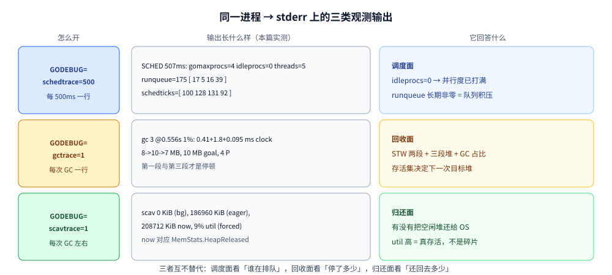
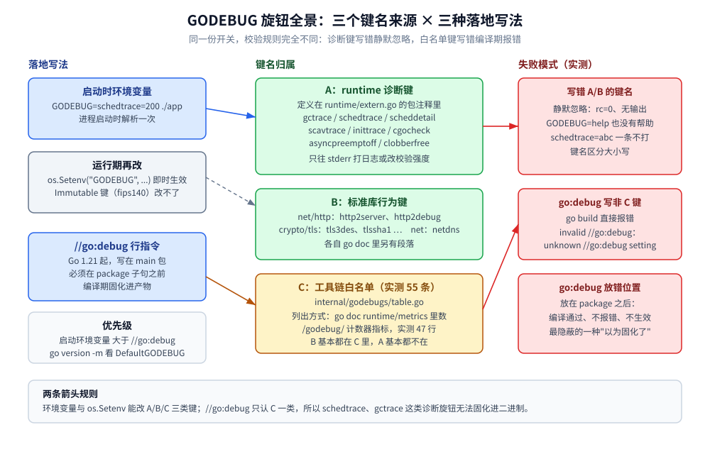
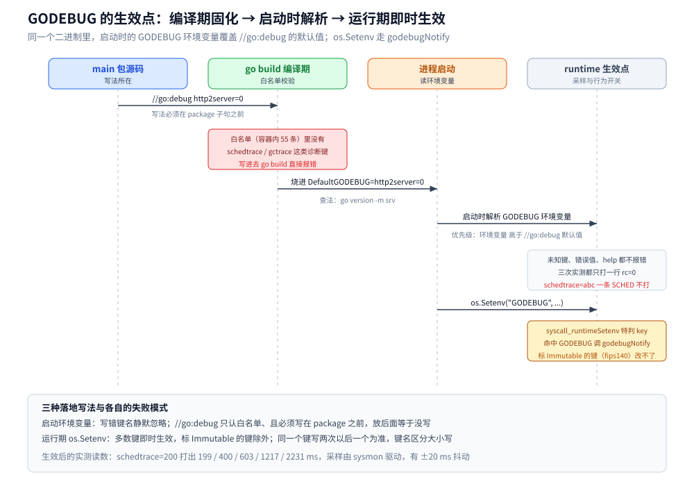

# GODEBUG 与运行时观测

> 覆盖：`GODEBUG` 到底是什么、键名从哪来、写错了会怎样、`//go:debug` 怎么把默认值烧进二进制；`schedtrace` / `scheddetail` 每一列读什么；`gctrace` / `scavtrace` 每一行读什么。三样合起来就是「不装任何工具、只看 stderr 上的一行日志」的运行时观测手段。
>
> 不覆盖：`runtime/trace` 的无头解析、`MemStats` / `debug.GCStats` / `runtime/metrics` 三套指标口径、`runtime/debug` 的 `Set*` 旋钮与 `NumGoroutine` 的计数口径，在 [trace与运行时指标.md](trace与运行时指标.md)；调度器本身的结构（G/M/P、work stealing、抢占）见 [GMP调度.md](GMP调度.md)；GC 算法与 `GOGC` / `GOMEMLIMIT` 的调参见 [垃圾回收机制.md](垃圾回收机制.md)。
>
> 内容整理自个人学习笔记，素材见 [素材清单.md](../../../素材清单.md)。
>
> ⚠️ **实测口径**：本篇全部读数来自容器 `golang:1.26-alpine`（`go version go1.26.8 linux/amd64`，容器内 `NumCPU=4`、`GOMAXPROCS=4`）真跑；实验代码在 `.workbuddy/tmp/exp/runtime-trace/` 与 `.workbuddy/tmp/exp/rtopen/a/`。`GMP调度.md`、`垃圾回收机制.md` 里的读数是宿主机 8 P 环境测的，**与本篇的数字不可混用**。

---

## 一、GODEBUG 到底是什么？从一段能跑的最小闭环开始

**本节要点**：`GODEBUG` 不是"一个调试模式"，而是**一堆互相独立的 `name=val` 旋钮**，跨进程、跨协程都能开。最小闭环只有两步：`go build` 出二进制、启动时带环境变量。先看清它长什么样，再谈键名从哪来、写错会怎样。

### 1.1 最小闭环：一个程序 + 一个环境变量

500 个协程，每个分配 64 KiB、再跑一段纯计算 —— 分配制造 GC，计算制造调度排队，一行命令同时点亮两类输出：

```go
package main

import (
	"runtime"
	"sync"
)

var sink uint64

//go:noinline
func makeBuf() []byte { return make([]byte, 64<<10) }

func work() {
	buf := makeBuf() // ⭐ 不 noinline 挡一下，64 KiB 会被放进栈，一个 GC 都不触发
	var sum uint64
	for i := 0; i < len(buf); i += 64 {
		buf[i] = byte(i)
		sum += uint64(buf[i])
	}
	x := sum + 1
	for i := 0; i < 8_000_000; i++ { // 纯计算，把 P 占满
		x = x*6364136223846793005 + 1442695040888963407
	}
	sink += x
}

func main() {
	var wg sync.WaitGroup
	for i := 0; i < 500; i++ {
		wg.Add(1)
		go func() { defer wg.Done(); work() }()
	}
	wg.Wait()
	var ms runtime.MemStats
	runtime.ReadMemStats(&ms)
	println("done TotalAlloc(MiB)=", int(ms.TotalAlloc>>20), "NumGC=", int(ms.NumGC))
}
```

```bash
go build -o rta main.go
GODEBUG=schedtrace=500,gctrace=1 ./rta      # 每 500ms 一行调度快照 + 每次 GC 一行
```

```text
SCHED 0ms: gomaxprocs=4 idleprocs=3 threads=2 spinningthreads=0 needspinning=0 idlethreads=0 runqueue=0 [ 0 0 0 0 ] schedticks=[ 0 0 0 0 ]
gc 1 @0.188s 0%: 0.68+3.9+0.21 ms clock, 2.7+0.68/3.2/0+0.87 ms cpu, 3->4->2 MB, 4 MB goal, 0 MB stacks, 0 MB globals, 4 P
gc 2 @0.293s 1%: 1.3+19+0.077 ms clock, 5.2+4.3/8.0/0+0.31 ms cpu, 4->5->5 MB, 4 MB goal, 0 MB stacks, 0 MB globals, 4 P
SCHED 507ms: gomaxprocs=4 idleprocs=0 threads=5 spinningthreads=0 needspinning=1 idlethreads=0 runqueue=175 [ 17 5 16 39 ] schedticks=[ 100 128 131 92 ]
gc 3 @0.556s 1%: 0.41+1.8+0.095 ms clock, 1.6+0.45/1.6/0+0.38 ms cpu, 8->10->7 MB, 10 MB goal, 0 MB stacks, 0 MB globals, 4 P
SCHED 2528ms: gomaxprocs=4 idleprocs=0 threads=5 spinningthreads=0 needspinning=1 idlethreads=0 runqueue=144 [ 3 8 8 14 ] schedticks=[ 305 230 220 316 ]
done TotalAlloc(MiB)= 31 NumGC= 5
```

两类输出都在 **stderr** 上；`done` 是程序自己打的。结尾的 `TotalAlloc=31 MiB` 恰好对上「500 × 64 KiB」，`NumGC=5` 对上 `gc 1..5` —— **读数能自洽，才说明开关真的生效了**。



这张图是全篇的地图：第二节读调度面、第三节读回收面与归还面；`scavtrace` 与 `gctrace` 是同一族开关，读法见 3.4。

⚠️ **别用 `go run`**：环境变量会**同时作用在 `go` 工具进程**上，而 `go run` 先得编译，于是输出里混进工具自己的采样 —— 实测 `@0.240s` 就出现 `gc 1`、堆只有 `3->4->0 MB`，那不是你的程序；`SCHED` 的时间戳也会变得不单调。**先 build 再跑**（原因与做法见 2.1）。

### 1.2 键名有三个来源，效力完全不同

| 来源 | 谁定义 | 列出来靠什么 | 写错键名会怎样 |
|---|---|---|---|
| runtime 自己的诊断键 | `runtime/extern.go` 的包注释（`gctrace`、`schedtrace`、`scheddetail`、`scavtrace`、`inittrace`、`asyncpreemptoff`、`cgocheck`、`invalidptr`、`clobberfree`、`gccheckmark`、`gcpacertrace`、`harddecommit`、`madvdontneed`、`memprofilerate`、`profstackdepth`、`tracebackancestors`、`tracefpunwindoff`、`panicnil`、`efence`、`sbrk`、`gcstoptheworld`、`gcshrinkstackoff`、`dontfreezetheworld`、`checkfinalizers`、`disablethp`、`decoratemappings`、`cpu.*` 等） | `sed -n '35,233p' /usr/local/go/src/runtime/extern.go`，或看 Go 安装目录里那份注释 | **静默忽略**（见 1.3） |
| 标准库借用的行为键 | `net/http`、`crypto/tls`、`net`、`time`、`go/types` 等包各自读 `GODEBUG` | `go doc net/http`、`go doc crypto/tls` 里各自有段落 | 静默忽略 |
| 工具链白名单（影响 `//go:debug` 与 `runtime/metrics`） | `internal/godebugs/table.go`（Go 1.26 容器内 **55 条**，另有 1 条已移除的 `x509sha1`） | `go doc runtime/metrics \| grep -c "/godebug/"` → **47 行**（非 Opaque 的键各导出一个计数器指标） | **`go build` 直接报错**（见 1.4） |

⭐ 一句话区分：**诊断类旋钮（trace/日志）走第一行，行为兼容类旋钮（改语义、能触发"混用版本"告警）走第三行**，两套清单只有少量交集（`panicnil` 既在 extern.go 也在白名单）。

### 1.3 实测：写错键名、写错值、甚至 `GODEBUG=help` 都不报错

```bash
go build -o rt .                                  # 先编译（见 2.1 为什么必须这样）
GODEBUG=nosuchkey=1 ./rt sched                    # 编不存在的键
GODEBUG=help ./rt sched                           # 想求 help
GODEBUG=schedtrace=abc ./rt sched                 # 值不是数字
```

容器实测（三次都只有一行业务输出，`rc=0`）：

```text
sched done
sched done
sched done
```

`GODEBUG` **没有 help**，`schedtrace=abc` 解析失败后**一条 SCHED 都不打**，也不告诉你为什么。所以：

- 加完开关先确认"该有的输出有没有"，**没有输出 ≠ 没问题**，很可能是键名或值写错了；
- 键名**区分大小写**（`schedTrace=150` 同样静默失效）；
- 多个键用逗号分隔，同一个键写两次以**后一个**为准。

### 1.4 `//go:debug`：把默认值烧进二进制，但只认白名单、且位置有讲究

Go 1.21 起可以在 `main` 包里写 `//go:debug` 行指令，让程序**不依赖启动环境变量**就带上默认值。实测三种写法，结果完全不同：

```bash
# 写法 A：放在 package 子句之前 + 非白名单键 → 编译期报错
GOCACHE=/tmp/c go build -o gdb ./godebugdir
```

```text
# rt/godebugdir
godebugdir/main.go:1:1: invalid //go:debug: unknown //go:debug setting "schedtrace"
```

```bash
# 写法 B：同一个键改放到 package 之后 → 编译通过，指令等于没写
# （文件形态：package main / 空行 / //go:debug schedtrace=500 / import ...）
GOCACHE=/tmp/c go build -o gdb ./godebugdir && ./gdb | head -2
```

```text
go:debug demo done
```

`go vet` 也会报写法 A 的错（`invalid //go:debug: unknown //go:debug setting`），所以**白名单校验只认写在 `package` 子句之前的行**。写法 B 连报错都没有，是最容易踩的一种"以为固化了"。

```go
//go:debug http2server=0

package main
```

白名单内的键才合法（`http2server` 在表里，`schedtrace` / `gctrace` 都不在 —— 诊断类旋钮**不能**用 `//go:debug` 固化）。烧进去的默认值可以在产物里查出来：

```bash
go version -m srv | tail -6        # srv 是上面带 //go:debug http2server=0 的程序
```

```text
	build	-compiler=gc
	build	DefaultGODEBUG=http2server=0
	build	CGO_ENABLED=0
	build	GOARCH=amd64
	build	GOOS=linux
	build	GOAMD64=v1
```

优先级实测（同一个二进制）：**启动时的 `GODEBUG` 环境变量 > `//go:debug` 默认值**。

```bash
GODEBUG=http2server=1 ./mtt | head -1   # 环境变量覆盖 go:debug
```

```text
GODEBUG env="http2server=1" (build-time default from //go:debug http2server=0)
```

而 runtime 侧还有第三种改法：`os.Setenv("GODEBUG", ...)` 之后 runtime 会收到通知并即时生效（源码 `runtime/runtime.go` 里 `syscall_runtimeSetenv` 对 `key == "GODEBUG"` 特判后调用 `godebugNotify(true)`）；个别键（表里标 `Immutable`，例如 `fips140`）**启动后改不了**。



图怎么读：中间一列是"键名归属"，左边一列是三种落地写法（启动环境变量 / `//go:debug` 行指令 / 运行期 `os.Setenv`），右边标了各自的失败模式。图上「白名单 55 条」「metrics 导出 47 个计数器」「`schedtrace` 不在白名单」三个数字来自容器实测；其余为结构示意。



图怎么读：横向三条时间线分别对应编译期、启动期、运行期；只有「键名不存在」这一种错在编译期就被拦住，另外两种错（键名拼错、值非法）全程不报，只能靠"该有的输出有没有出现"反推（1.3）。

---

## 二、`schedtrace` 与 `scheddetail` 的每一列是什么意思？

**本节要点**：这一节从 [GMP调度.md](GMP调度.md) 第四节的调度器背景里独立出来，专讲**输出怎么读**。`schedtrace` 一行只有十来个字段，但每一列都能直接指向一个结论：并行度够不够、队列积压在谁身上、线程数为什么会超。

### 2.1 前置动作：先 `go build` 再跑二进制

`GODEBUG` 会**同时作用在 `go run` 的工具进程**上，`GODEBUG=schedtrace=150 go run .` 的输出里会混进 `go` 命令自己的调度器采样（时间戳非单调、`0ms` 反复出现，很容易看成"队列一直是 0"）。正确做法：

```bash
GOCACHE=/tmp/c go build -o rt .
GODEBUG=schedtrace=200 ./rt sched      # 1000 个 goroutine，每个约 10ms 纯计算
```

### 2.2 实测单行与逐字段读法（容器 4 P）

```text
SCHED 0ms: gomaxprocs=4 idleprocs=3 threads=2 spinningthreads=0 needspinning=0 idlethreads=0 runqueue=0 [ 0 0 0 0 ] schedticks=[ 0 0 0 0 ]
SCHED 199ms: gomaxprocs=4 idleprocs=0 threads=5 spinningthreads=0 needspinning=1 idlethreads=0 runqueue=395 [ 114 113 114 129 ] schedticks=[ 17 16 16 11 ]
SCHED 603ms: gomaxprocs=4 idleprocs=0 threads=5 spinningthreads=0 needspinning=1 idlethreads=0 runqueue=418 [ 86 79 82 97 ] schedticks=[ 45 50 48 43 ]
SCHED 1217ms: gomaxprocs=4 idleprocs=0 threads=5 spinningthreads=0 needspinning=1 idlethreads=0 runqueue=430 [ 30 30 27 40 ] schedticks=[ 102 100 104 101 ]
SCHED 2231ms: gomaxprocs=4 idleprocs=0 threads=5 spinningthreads=0 needspinning=1 idlethreads=0 runqueue=159 [ 26 9 50 0 ] schedticks=[ 190 183 192 189 ]
```

| 字段 | 本次例子 | 含义与判据 |
|---|---|---|
| `SCHED 199ms` | 199ms | 距进程启动的时间；**间隔不等于设定值**（`schedtrace=200` 打出 199/400/603/807…，采样由 sysmon 驱动，有 ±20 ms 抖动） |
| `gomaxprocs=4` | 4 | P 的数量（容器 `NumCPU=4`） |
| `idleprocs=0` | 0 | 空闲 P 数。**为 0 = 并行度已打满**，此时加协程不会更快 |
| `threads=5` | 5 | M（OS 线程）总数，**可以大于 `gomaxprocs`**：sysmon、阻塞在系统调用里的 M、自旋找活的 M 都不占 P |
| `spinningthreads=0` / `needspinning=1` | 0 / 1 | 正在自旋找活的 M 数 / 是否有 M 该被唤醒来自旋。`needspinning=1` 且 `spinningthreads=0` 通常意味着"活多、但还没轮到接力" |
| `idlethreads=0` | 0 | 休眠中的 M 数 |
| `runqueue=395` | 395 | **全局队列**长度（带锁那一条） |
| `[ 114 113 114 129 ]` | —— | **每个 P 的本地队列长度**，顺序固定 P0~P3 |
| `schedticks=[ 17 16 16 11 ]` | —— | 每个 P 累计调度次数（较新版本 runtime 才打的这个字段，Go 1.26 实测存在），**相邻两行相减**才是这段时间的调度频率 |

⭐ 两个能直接对照的点（本次实测）：

1. **全局队列长期 400 左右、四个本地队列各 100 上下** —— 本地队列容量 256，`1000` 个协程一次全丢出来，溢出到全局队列是必然；`runqueue` 一直不降到 0，就是"积压"的直接证据；
2. **`threads=5 > gomaxprocs=4`** —— 多出来的那 1 个是 sysmon 之类的系统线程，不是"又起了一个干活的线程"。

对比宿主机 8 P 的读数（[GMP调度.md](GMP调度.md) 第四节，P0 本地队列 170/151 最长）：那次是 `gomaxprocs=8`、全局队列 355/374，**同一份代码、不同 CPU 数，绝对值不可比**，趋势一致（本地队列涨→溢出到全局→全局长期非零）。

### 2.3 `scheddetail=1`：把每一行的信息摊开成 P / M / G 三段

`schedtrace` 只给一行汇总，`scheddetail=1` 会在每次采样后打印**每个 P、每个 M、每个 G** 的状态（量很大，只在复现环境开）：

```bash
GODEBUG=schedtrace=400,scheddetail=1 ./rt sched 2>&1 | head -30
```

```text
SCHED 408ms: gomaxprocs=4 idleprocs=0 threads=6 spinningthreads=0 needspinning=1 idlethreads=1 runqueue=424 gcwaiting=false nmidlelocked=0 stopwait=0 sysmonwait=false
  P0: status=1 schedtick=34 syscalltick=0 m=4 runqsize=98 gfreecnt=21 timerslen=0
  P1: status=1 schedtick=32 syscalltick=0 m=5 runqsize=100 gfreecnt=22 timerslen=0
  P2: status=1 schedtick=33 syscalltick=0 m=0 runqsize=190 gfreecnt=24 timerslen=0
  P3: status=1 schedtick=24 syscalltick=0 m=3 runqsize=106 gfreecnt=11 timerslen=0
  M5: p=1 curg=322 mallocing=0 throwing=0 preemptoff= locks=0 dying=0 spinning=false blocked=false lockedg=nil
  M2: p=nil curg=nil mallocing=0 throwing=0 preemptoff= locks=0 dying=0 spinning=false blocked=true lockedg=nil
  M0: p=2 curg=nil mallocing=0 throwing=0 preemptoff= locks=1 dying=0 spinning=false blocked=false lockedg=nil
  G1: status=4(sync.WaitGroup.Wait) m=nil lockedm=nil
  G17: status=4(force gc (idle)) m=nil lockedm=nil
  G18: status=4(GC sweep wait) m=nil lockedm=nil
  G19: status=4(GC scavenge wait) m=nil lockedm=nil
  G33: status=4(GOMAXPROCS updater (idle)) m=nil lockedm=nil
  G34: status=4(finalizer wait) m=nil lockedm=nil
  G35: status=4(GC worker (idle)) m=nil lockedm=nil
```

| 段 | 字段 | 怎么读 |
|---|---|---|
| 汇总行新增 | `gcwaiting=false` | 有没有 P 正在为 GC 的 STW 而等待；**持续 true = 停顿在堆积** |
| | `stopwait=0` / `nmidlelocked=0` | 等待 STW 结束的 M 数 / 被锁住且空闲的 M 数；非零持续出现多半和 `LockOSThread`、cgo 有关 |
| | `sysmonwait=false` | sysmon 是否在休眠（它在睡 = 这些采样也不会按时打） |
| P 行 | `status=1` | Go 1.26 的 P 状态常量顺序：`_Pidle=0`、`_Prunning=1`、`_Pgcstop=3`、`_Pdead=4`（中间的 `2` 是已废弃的 `_Psyscall_unused` 占位，`runtime/runtime2.go`）；本次实测四个 P 全是 `status=1` |
| | `runqsize` / `gfreecnt` / `timerslen` | 本地队列长度 / 缓存的空 G 结构数 / 该 P 上挂的 timer 数（**timers 多会让这个 P 的调度延迟变大**） |
| M 行 | `p=` / `curg=` | 这个 M 绑着哪个 P、正在跑哪个 G；`p=nil curg=nil` 的 M 就是"多出来的线程" |
| | `locks` / `blocked=true` / `lockedg` | 持有 runtime 锁的层数 / 是否阻塞在系统调用 / 是否被 `LockOSThread` 独占 |
| G 行 | `status=4(名字)` | 括号里是**等待原因**。G 状态码：`_Gidle=0`、`_Grunnable=1`、`_Grunning=2`、`_Gsyscall=3`、`_Gwaiting=4`、`_Gdead=6`、`_Gcopystack=8`、`_Gpreempted=9`、`_Gleaked=10`、`_Gdeadextra=11`（`runtime/runtime2.go` 的常量注释，**核验方式：`docker run --rm golang:1.26-alpine sed -n '12,120p' /usr/local/go/src/runtime/runtime2.go`**） |

⭐ `G17 force gc (idle)`、`G18 GC sweep wait`、`G19 GC scavenge wait`、`G33 GOMAXPROCS updater`、`G34 finalizer wait`、`G35.. GC worker` 这几行**很重要**：它们是 runtime 自己的协程，是排查 `NumGoroutine` 与 `runtime/metrics` 数不一致时唯一的"底牌清单"（口径差见 [trace与运行时指标.md](trace与运行时指标.md) 第五节）。

### 2.4 抢占类问题：一个协程把 P 占死时，`schedtrace` 长什么样

`GODEBUG=asyncpreemptoff=1` 关掉基于信号的 asynchronous preemption，是**验证"某段循环到底能不能被抢占"的唯一开关**。`extern.go` 原文（核验方式：`docker run --rm golang:1.26-alpine sed -n '228,234p' /usr/local/go/src/runtime/extern.go`）：

```text
	asyncpreemptoff: asyncpreemptoff=1 disables signal-based
	asynchronous goroutine preemption. This makes some loops
	non-preemptible for long periods, which may delay GC and
	goroutine scheduling. This is useful for debugging GC issues
	because it also disables the conservative stack scanning used
	for asynchronously preempted goroutines.
```

**量化对照不在本篇复现**：同一份"打点协程首跳延迟"实验在宿主机测的是 **22 ms（开）vs 2.718 s（关）**，差两个数量级，读数和结论都在 [GMP调度.md](GMP调度.md) 第五节。这里补的是**怎么在 `schedtrace` 层看出"一个协程把 P 占死了"** —— 单协程烧 3 秒 CPU 时开 `schedtrace`，其余 P 全程空闲：

```bash
GODEBUG=schedtrace=1000,asyncpreemptoff=1 ./apib spin
```

```text
start
SCHED 1003ms: gomaxprocs=4 idleprocs=3 threads=6 spinningthreads=0 needspinning=0 idlethreads=4 runqueue=0 [ 0 0 0 0 ] schedticks=[ 9 33 11 3 ]
SCHED 2009ms: gomaxprocs=4 idleprocs=3 threads=6 spinningthreads=0 needspinning=0 idlethreads=4 runqueue=0 [ 0 0 0 0 ] schedticks=[ 9 83 11 3 ]
end
```

`runqueue=0` 但 `idleprocs=3`、`idlethreads=4`：**不是队列积压，是并发度没用满** —— 和 2.2 那种"全局队列 400、`idleprocs=0`"是两种完全相反的病灶，读 `schedtrace` 时先把这两组对照起来。

---

## 三、`gctrace` 的每一行怎么读？

**本节要点**：这一节从 [垃圾回收机制.md](垃圾回收机制.md) 第三节搬过来并按容器实测重做了一遍 —— `gctrace` 一行里塞了**两段时间、三段堆、一个百分比**，读错顺序会把"并发标记时长"当成"STW 停顿"。

### 3.1 实测输出（一次运行，节选 gc 1~9 中的 7 行）

```bash
GODEBUG=gctrace=1 ./rt gc        # 240 MB 分配压力，一半留在存活集
```

```text
gc 1 @0.038s 1%: 0.82+1.4+0.11 ms clock, 3.3+0/1.0/0.67+0.44 ms cpu, 4->4->3 MB, 4 MB goal, 0 MB stacks, 0 MB globals, 4 P
gc 2 @0.049s 1%: 0.25+1.9+0.090 ms clock, 1.0+0/0.28/0.048+0.36 ms cpu, 7->7->5 MB, 7 MB goal, 0 MB stacks, 0 MB globals, 4 P
gc 3 @0.060s 1%: 0.071+1.8+0.005 ms clock, 0.28+0.005/0.11/0.23+0.022 ms cpu, 10->10->7 MB, 10 MB goal, 0 MB stacks, 0 MB globals, 4 P
gc 5 @0.098s 1%: 0.032+9.9+0.045 ms clock, 0.12+0/1.4/0.90+0.18 ms cpu, 22->23->17 MB, 22 MB goal, 0 MB stacks, 0 MB globals, 4 P
gc 6 @0.130s 1%: 0.17+1.0+0.068 ms clock, 0.70+0/0.17/0.034+0.27 ms cpu, 34->34->25 MB, 34 MB goal, 0 MB stacks, 0 MB globals, 4 P
gc 8 @0.240s 1%: 0.059+3.3+0.72 ms clock, 0.23+0/0.22/0.035+2.9 ms cpu, 75->76->57 MB, 76 MB goal, 0 MB stacks, 0 MB globals, 4 P
gc 9 @0.343s 0%: 0.075+0.81+0.10 ms clock, 0.30+0/0.039/0.40+0.40 ms cpu, 112->112->84 MB, 114 MB goal, 0 MB stacks, 0 MB globals, 4 P
keep buckets: 120
```

### 3.2 逐字段对照表

| 字段 | 例子 | 含义 |
|---|---|---|
| `gc 9` | 第 9 次 | 自进程启动的 GC 序号 |
| `@0.343s` | 0.343s | 进程启动到**本次 GC 开始**的时间 |
| `0%` | 0%~3% | **到目前为止 GC 占用的 CPU 比例**（与 `MemStats.GCCPUFraction` 同一个量）；长期偏高 = 分配太猛 |
| `0.075+0.81+0.10 ms clock` | 三段墙钟 | **STW(setup) + 并发标记 + STW(termination)**；只有第 1、3 段是真正的"全局停顿" |
| `0.30+0/0.039/0.40+0.40 ms cpu` | 四段 CPU | setup + **assist/后台标记/idle** + termination；中间三段是标记工作量的来源分布 |
| `112->112->84 MB` | 三段堆 | 标记开始时的堆 → 标记结束时的堆 → **标记结束后存活堆** |
| `114 MB goal` | 目标堆 | 本次触发时的目标堆大小（由存活集 × `GOGC` 或 `GOMEMLIMIT` 算出） |
| `0 MB stacks / 0 MB globals` | 扫描量 | 栈与全局变量的扫描量；很大说明栈深或全局变量多 |
| `4 P` | 参与数 | 参与标记的 P 数量（= `GOMAXPROCS`） |

### 3.3 连跑 3 次的波动区间（同一份程序）

时序类数字必须带区间。第 8、9 次 GC 的三段墙钟，三次运行分别读到：

```text
run1  gc 8: 0.059+3.3+0.72 ms clock    gc 9: 0.075+0.81+0.10 ms clock
run2  gc 8: 0.21+3.0+0.075 ms clock    gc 9: 0.30+9.9+0.037 ms clock
run3  gc 8: 0.061+0.72+0.53 ms clock   gc 9: 0.075+4.7+0.095 ms clock
```

只能断言趋势：**两段 STW 稳定在亚毫秒级（0.03~0.82 ms），并发标记段在 0.5~10 ms 之间大幅波动**；存活集单调上涨（`4 → 112 MB`）导致 GC 间隔越拉越长（`@0.038s → @0.343s`）。**不同运行的数字不可混用**，写结论时同一次运行内比较。

⭐ 三个最该盯的数：`clock` 的第 1、3 段（停顿）、三段堆的**第 3 个**（存活集，它决定下一次目标堆）、开头的**百分比**（>20~30% 就该减少分配而不是调 GC）。

### 3.4 `scavtrace`：GC 之外还想知道"内存有没有还给操作系统"

`gctrace` 只讲回收，不讲归还。`GODEBUG=scavtrace=1` 每次 GC 左右打一行：

```bash
GODEBUG=scavtrace=1 ./rt scavenge      # 200 MB 存活 → 置 nil → runtime.GC() → debug.FreeOSMemory()
```

```text
scav 0 KiB work (bg), 0 KiB work (eager), 4344 KiB now, 99% util
peak: HeapAlloc=200 MB HeapSys=207 MB HeapIdle=7 MB
after runtime.GC(): HeapAlloc=0 MB HeapSys=207 MB HeapIdle=207 MB
scav 0 KiB work (bg), 186960 KiB work (eager), 208712 KiB now, 9% util (forced)
after debug.FreeOSMemory(): HeapAlloc=0 MB HeapSys=207 MB HeapIdle=207 MB HeapReleased=203 MB
```

- `work (bg)` / `work (eager)`：这段时间**后台归还**量 / **主动（eager）归还**量；
- `now`：当前已归还 OS 的总量（对应 `MemStats.HeapReleased`）；
- `util`：未归还堆里"真在用着"的比例 —— **`HeapIdle` 很大但 `util` 很高，说明不是碎片而是真存活**；
- 结尾带 `(forced)` 的就是被 `debug.FreeOSMemory()` 逼出来的那一次。

`HeapReleased` 与 `HeapSys` 为什么一个涨一个不动，见 [trace与运行时指标.md](trace与运行时指标.md) 3.1 与 3.5。

---

## 延伸追问

- **`GODEBUG=help` 能列出所有开关吗？** → 不能，runtime 对未知键、错误值**全部静默忽略**（实测 `rc=0` 且无任何输出）。列键要分三路：`runtime/extern.go` 的注释块（诊断键）、各标准库包的 doc（行为键）、`internal/godebugs/table.go`（白名单，可用 `go doc runtime/metrics | grep -c "/godebug/"` 数出 47 个导出计数器的键）。
- **`//go:debug` 和 `GODEBUG` 环境变量谁优先？** → **启动时的环境变量优先**；`//go:debug` 是编译期固化的默认值，能用 `go version -m` 在产物的 `DefaultGODEBUG` 里查到。但 `//go:debug` **只接受白名单里的键**，写 `schedtrace` 会编译失败。
- **`schedtrace` 里 `threads` 比 `gomaxprocs` 大就是线程泄漏？** → 不一定。sysmon、阻塞系统调用的 M、自旋的 M 都不占 P；先确认 `idleprocs` 和 `idlethreads`，再看有没有 `blocked=true` 的 M（`scheddetail` 里能看到）。
- **`runqueue` 一直是 0，是不是调度很健康？** → 要分两种病灶看：`runqueue=0` 且 `idleprocs` 接近 `gomaxprocs` 是"没活干/并发度没用满"（2.4 的 spin 例子）；`runqueue` 长期几千上万、`idleprocs=0` 才是积压。
- **`gctrace` 的 `clock` 三段哪一段才是停顿？** → 第 1 段（setup STW）和第 3 段（termination STW）；中间那段是**并发标记**的墙钟时长，不是全局停顿。
- **`gctrace` 里的百分比多少算高？** → 实测空载服务在 `0%~3%`，压力下会明显抬头；**长期 >20%~30% 说明分配太猛**，该做的是减少分配（[内存逃逸.md](内存逃逸.md)），不是调 `GOGC`。
- **`GODEBUG=asyncpreemptoff=1` 现在还有效吗？** → 有效（Go 1.26 的 `extern.go` 仍列出并实测可开），关掉后**基于信号的异步抢占与保守栈扫描一起失效**，长循环会变成不可抢占；量化对照见 [GMP调度.md](GMP调度.md) 第五节。
- **开关开了却没有任何输出，先怀疑什么？** → 先怀疑键名/值写错（三个来源里只有白名单那一路会报错，见 1.2/1.3），再怀疑程序太快没跑到采样点 —— `schedtrace=500` 配一个 200ms 就跑完的程序，只会看到 `SCHED 0ms` 一行。

## 关联

- **上游/机制**：[GMP调度.md](GMP调度.md) — G/M/P 与 work stealing 的结构；本篇 2.2 的 `schedtrace` 读数与它的 8 P 宿主机读数不可混用
- **上游/机制**：[垃圾回收机制.md](垃圾回收机制.md) — `GOGC` / `GOMEMLIMIT` 的调参实测；本篇 3.1 的 `gctrace` 逐字段搬自其第三节
- **对照/互补**：[trace与运行时指标.md](trace与运行时指标.md) — 窗口制的事件采样（trace）与三套指标口径；本篇只管「常驻可开的旋钮 + 逐列读法」
- **对照/互补**：[pprof性能分析.md](pprof性能分析.md) — pprof 给"量"、GODEBUG 给"实时行为"；两篇的采样成本分档口径一致
- **对照/互补**：[编译与gcflags.md](../工程实践/编译与gcflags.md) — 编译期旗标（`-N -l`、`-gcflags`）与运行期 `GODEBUG` 是两套体系
- **对照/互补**：[调试与IDE配置.md](../工程实践/调试与IDE配置.md) — dlv 断点式调试；本篇全是"不停顿"的观测手段
- **下游应用**：[trace与运行时指标.md](trace与运行时指标.md) — `//go:debug` 只能放行为兼容键，诊断键要做成启动参数或 HTTP 开关
> 反向引用（本篇被下列文档引到）：[goroutine.md](../并发编程/goroutine.md)、[协程与线程成本.md](../并发编程/协程与线程成本.md)、[协程泄漏与死锁.md](../并发编程/协程泄漏与死锁.md)、[内存分配器.md](内存分配器.md)
