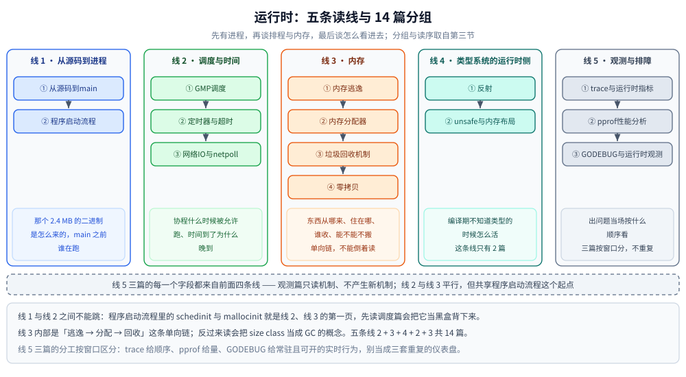

# 运行时

> 覆盖：本目录 14 篇的分工表、阅读路线与篇间依赖 —— 判据是「运行时自己怎么干活」：怎么从源码变成二进制、怎么排程、怎么分内存、怎么回收、怎么看进去。
>
> 不覆盖：原语与 API 怎么用见 [并发编程/README.md](../并发编程/README.md)；语言机制（类型、切片、map、接口）见 [类型与语法/](../类型与语法/)；`GODEBUG` 之外的编译旗标见 [编译与gcflags.md](../工程实践/编译与gcflags.md)。
>
> 内容整理自个人学习笔记；素材见 [素材清单](../../../素材清单.md)。

---

## 一、一句话定位与它凭什么

**本节要点**：`运行时/` 回答的是「**你没写的那些代码在干什么**」—— 协程怎么被排、对象怎么被分、垃圾怎么被标、时间怎么被记、这些又怎么被看见。判据一句话：**换成库作者写的代码，这段话还成立吗？成立就属于这里**。

| 这个问题在问 | 归哪层 | 本目录对应篇 |
|---|---|---|
| 二进制是怎么产出来的、`main` 之前跑了什么 | `运行时/` | [从源码到main.md](从源码到main.md)、[程序启动流程.md](程序启动流程.md) |
| 协程排在哪个 P 上、被谁抢占 | `运行时/` | [GMP调度.md](GMP调度.md) |
| 对象落在哪一级分配器、什么时候被回收 | `运行时/` | [内存分配器.md](内存分配器.md)、[内存逃逸.md](内存逃逸.md)、[垃圾回收机制.md](垃圾回收机制.md) |
| `time.After` 到期为什么晚、阻塞的 `Read` 睡在哪 | `运行时/` | [定时器与超时.md](定时器与超时.md)、[网络IO与netpoll.md](网络IO与netpoll.md) |
| 这个 API 该怎么用、选锁还是选 channel | `并发编程/` | 见 [并发编程/README.md](../并发编程/README.md) |

⭐ 与 Java 侧的对应关系是逐篇的：`从源码到main.md` ↔ `java/运行时/类文件与字节码.md`（一个讲 AOT 的构建链，一个讲 JIT 的输入）、`GMP调度.md` ↔ `java/并发/线程基础与生命周期.md`、`垃圾回收机制.md` ↔ `java/运行时/垃圾回收原理与收集器.md`。

---

## 二、分工表：14 篇各讲什么

**本节要点**：一张表说清每篇的独有能力 —— **同一张表只在这里维护一份**，[go/README.md](../README.md) 只留指向本节的入口。

| 篇 | 讲什么 |
|---|---|
| [GMP调度.md](GMP调度.md) | GMP 三元组、work stealing、切换时机、`GOMAXPROCS`、P 内部队列、异步抢占 |
| [内存分配器.md](内存分配器.md) | `mspan`、67 级 size class、mcache / mcentral / mheap 三级分配 |
| [内存逃逸.md](内存逃逸.md) | 定义与原因、`-gcflags=-m` 分析、五类场景、三条判定规则与代价 |
| [trace与运行时指标.md](trace与运行时指标.md) | `runtime/trace` 的无头解析（`-pprof` 四类等待 / `-d=parsed`）、`MemStats` / `debug.GCStats` / `runtime/metrics` 三套数的分工与代价、⭐ **`MemStats` 与内核 RSS 为什么对不上（三层口径）**、`runtime/debug` 的 `Set*`、`NumGoroutine` / `Stack` / `Gosched` 的陷阱、出问题时按什么顺序看 |
| [垃圾回收机制.md](垃圾回收机制.md) | 并发三色标记 + 混合写屏障、目标堆公式、`gctrace` 逐字段、GOGC / GOMEMLIMIT |
| [程序启动流程.md](程序启动流程.md) | `_rt0` 入口、栈 / 分配器 / 调度器初始化、启动全景图 |
| [从源码到main.md](从源码到main.md) | 构建期怎么产出那个二进制：62 次 asm / 61 次 compile / 1 次 link、61 个 `.a` 共 32.7 MB 如何变成 2.4 MB、⭐ `.gopclntab` 比 `.text` 还大且 `-s -w` 裁不掉、入口三跳与 `runtime.mainPC` 那个间接层 |
| [零拷贝.md](零拷贝.md) | Go 侧：`io.Copy` 的自动分发与静默失效、`net/http` 静态服务、`copy_file_range`、`string ↔ []byte` 视图 |
| [网络IO与netpoll.md](网络IO与netpoll.md) | ⭐ 一次「阻塞 Read」的三段拆解（注册 / 挂起 / 唤醒）、`pollDesc` 四种取值与「存款」语义、边缘触发为什么在 Go 里安全、`SetReadDeadline` 的定时器路径、哪些 fd 退回阻塞（四行 `F_GETFL` 实测与 `Fd()` 坑） |
| [定时器与超时.md](定时器与超时.md) | ⭐ 1.26 的每 P 四叉堆与三个状态位（`timerHeaped` / `timerModified` / `timerZombie`）、四个检查点里哪个真跑 `f`、过冲来自「P 忙到下一个检查点」、1.23 起同步 channel 让 `Stop` / `Reset` 返回值反直觉、超时怎么并进 `epoll_wait` 的超时 |
| [反射.md](反射.md) | 三条反射法则与 `CanSet`、tag 遍历、json 背后的反射、反射慢多少的实测区间、什么时候不该用反射 |
| [unsafe与内存布局.md](unsafe与内存布局.md) | 三种能力与五种合法模式、`Sizeof` / `Alignof` / `Offsetof`、string / slice 头布局、内存视图的指针判据与四类失效、`go vet` 与 `checkptr` 两道闸门、copy 与 view 的实测差价 |
| [pprof性能分析.md](pprof性能分析.md) | 五种 profile 各测什么、三种采集入口、⭐ 无头环境（没有浏览器）下怎么读、`heap` 的 `alloc_space` 与 `inuse_space` 两种口径、`block` / `mutex` 要先开采样开关、一套能落地的优化闭环 |
| [GODEBUG与运行时观测.md](GODEBUG与运行时观测.md) | ⭐ `GODEBUG` 旋钮体系（键名三个来源、写错为什么静默失效、`//go:debug` 白名单与位置坑）、`schedtrace` / `scheddetail` / `gctrace` / `scavtrace` 逐字段读法、抢占类问题怎么用 `asyncpreemptoff` 定位 |

---

## 三、阅读路线

**本节要点**：14 篇按五条线走，**顺序是「先有进程，再谈排程与内存，最后谈怎么看进去」** —— 观测类三篇放在最后，因为它们的全部字段都来自前面那几套机制。

| 读线 | 篇（按序） | 这条线在回答什么 |
|---|---|---|
| **线 1 · 从源码到进程**（2 篇） | 从源码到main → 程序启动流程 | 「那个 2.4 MB 的二进制是怎么来的，`main` 之前谁在跑」 |
| **线 2 · 调度与时间**（3 篇） | GMP调度 → 定时器与超时 → 网络IO与netpoll | 「协程什么时候被允许跑、时间到了为什么晚到」 |
| **线 3 · 内存**（4 篇） | 内存逃逸 → 内存分配器 → 垃圾回收机制 → 零拷贝 | 「东西从哪来、住在哪、谁收、能不能不搬」 |
| **线 4 · 类型系统的运行时侧**（2 篇） | 反射 → unsafe与内存布局 | 「编译期不知道类型的时候怎么活」 |
| **线 5 · 观测与排障**（3 篇） | trace与运行时指标 → pprof性能分析 → GODEBUG与运行时观测 | 「出问题当场按什么顺序看」 |

⭐ **线 1 与线 2 之间不能跳**：`程序启动流程.md` 里的 `schedinit` / `mallocinit` 就是线 2 与线 3 第一页，先读调度篇会把它当黑盒背下来。

⭐ **线 3 内部是「逃逸 → 分配 → 回收」这条单向链**：逃逸决定堆上要长多少东西，分配决定它长在哪，回收决定它怎么走。反过来读（先 GC 再分配）会把 size class 当成 GC 的概念。

⭐ **线 5 三篇的分工看「窗口」区分**：trace 给**顺序**（一段时间里发生了什么的完整事件流）、pprof 给**量**（采样归因，谁占了 CPU / 谁分配了内存）、GODEBUG 给**常驻且可开的实时行为**（不需要 attach、不需要浏览器）。三篇的采样成本口径一致，别把它们当三套重复的仪表盘。

看图时抓住三点：五列自左向右是五条读线，列高分别是 2、3、4、2、3 篇（合计 14 篇），列内竖箭头是篇内前置；四列下方那条横贯整幅的虚线带写的是「线 5 三篇的每一个字段都来自前面四条线」，同时点明线 2 与线 3 平行、但共享 `程序启动流程.md` 这个起点；观测篇不产生新机制，所以排在最后。

---

## 四、篇间依赖（谁是谁的前置）

**本节要点**：「硬前置」是没有它就读不懂本篇的篇目，「强关联」是读完该马上对照的篇 —— 两栏都取各篇文末 `## 关联` 里已有的互引，不另立新关系。

| 篇目 | 硬前置 | 强关联 |
|---|---|---|
| [从源码到main.md](从源码到main.md) | —（会写 `go build` 即可） | [从可执行文件到第一条指令.md](../../../02-计算机基础/编译原理/从可执行文件到第一条指令.md)（本篇终点是 `e_entry`）、[AOT、JIT与解释执行.md](../../../02-计算机基础/编译原理/AOT、JIT与解释执行.md)、[执行链路.md](../../php/执行链路.md)（PHP 对照） |
| [程序启动流程.md](程序启动流程.md) | 从源码到main（`rt0_go` 的七步时间序） | [GMP调度.md](GMP调度.md)（`schedinit`）、[内存分配器.md](内存分配器.md)（`mallocinit`）、[类加载机制.md](../../java/运行时/类加载机制.md)（另一种语言的初始化顺序） |
| [GMP调度.md](GMP调度.md) | [goroutine.md](../并发编程/goroutine.md)（被排的那个 `g`） | [内存分配器.md](内存分配器.md)（P 上的 mcache）、[垃圾回收机制.md](垃圾回收机制.md)（抢占与 STW 的前提）、[协程与线程成本.md](../并发编程/协程与线程成本.md) |
| [定时器与超时.md](定时器与超时.md) | GMP调度（`schedule` / `findrunnable` / `sysmon` 三个检查点） | [网络IO与netpoll.md](网络IO与netpoll.md)（`pollUntil` 与 `epoll_wait` 共用一条 M）、[context.md](../工程实践/context.md)、[堆与优先队列.md](../../../02-计算机基础/数据结构/堆/堆与优先队列.md) |
| [网络IO与netpoll.md](网络IO与netpoll.md) | GMP调度（`gopark` / `goready`、M 的 handoff） | [IO多路复用.md](../../../02-计算机基础/网络/传输层/IO多路复用.md)（内核侧）、[定时器与超时.md](定时器与超时.md)、[net包与TCP-UDP编程.md](../网络编程/net包与TCP-UDP编程.md)、[零拷贝.md](零拷贝.md) |
| [内存逃逸.md](内存逃逸.md) | [指针与引用.md](../类型与语法/指针与引用.md)、[编译与gcflags.md](../工程实践/编译与gcflags.md)（`-m` 的判读） | [内存分配器.md](内存分配器.md)、[垃圾回收机制.md](垃圾回收机制.md)、[反射.md](反射.md)（反射装箱的逃逸）、[接口.md](../类型与语法/接口.md) |
| [内存分配器.md](内存分配器.md) | 内存逃逸（谁决定走堆） | [垃圾回收机制.md](垃圾回收机制.md)、[trace与运行时指标.md](trace与运行时指标.md)（`XSys` 字段背后）、[内存管理.md](../../../02-计算机基础/linux/内存管理.md)、[GODEBUG与运行时观测.md](GODEBUG与运行时观测.md)（`scavtrace`） |
| [垃圾回收机制.md](垃圾回收机制.md) | 内存分配器、内存逃逸 | [GC基础算法.md](../../../02-计算机基础/垃圾回收/GC基础算法.md)、[并发标记与写屏障.md](../../../02-计算机基础/垃圾回收/并发标记与写屏障.md)、[sync.Pool.md](../并发编程/sync.Pool.md)、[垃圾回收原理与收集器.md](../../java/运行时/垃圾回收原理与收集器.md) |
| [零拷贝.md](零拷贝.md) | [内存管理.md](../../../02-计算机基础/linux/内存管理.md)、[文件系统与IO.md](../../../02-计算机基础/linux/文件系统与IO.md)（内核侧的四条路径） | [unsafe与内存布局.md](unsafe与内存布局.md)（内存视图三件套的红线）、[反射.md](反射.md)、[基础类型与零值.md](../类型与语法/基础类型与零值.md) |
| [反射.md](反射.md) | [接口.md](../类型与语法/接口.md)（eface/iface 两字布局）、[struct与tag.md](../类型与语法/struct与tag.md)、[指针与引用.md](../类型与语法/指针与引用.md) | [unsafe与内存布局.md](unsafe与内存布局.md)、[零拷贝.md](零拷贝.md)、[类型系统.md](../类型与语法/类型系统.md)（泛型能替代哪些反射） |
| [unsafe与内存布局.md](unsafe与内存布局.md) | [指针与引用.md](../类型与语法/指针与引用.md)、[struct与tag.md](../类型与语法/struct与tag.md)、[切片.md](../类型与语法/切片.md)、[接口.md](../类型与语法/接口.md) | [反射.md](反射.md)、[内存逃逸.md](内存逃逸.md)（`checkptr=2` 强制堆分配）、[零拷贝.md](零拷贝.md)、[map.md](../类型与语法/map.md) |
| [trace与运行时指标.md](trace与运行时指标.md) | GMP调度、垃圾回收机制、内存分配器（三套数的字段都来自它们） | [GODEBUG与运行时观测.md](GODEBUG与运行时观测.md)、[pprof性能分析.md](pprof性能分析.md)、[协程泄漏与死锁.md](../并发编程/协程泄漏与死锁.md) |
| [pprof性能分析.md](pprof性能分析.md) | 内存分配器与垃圾回收机制（`heap` 的两种口径）、GMP调度（`block` 里「阻塞」停在哪一步） | [GODEBUG与运行时观测.md](GODEBUG与运行时观测.md)、[trace与运行时指标.md](trace与运行时指标.md)、[协程泄漏与死锁.md](../并发编程/协程泄漏与死锁.md)、[测试与Mock.md](../工程实践/测试与Mock.md) |
| [GODEBUG与运行时观测.md](GODEBUG与运行时观测.md) | GMP调度（`schedtrace` 的列）、垃圾回收机制（`gctrace` 的字段搬自其第三节） | [trace与运行时指标.md](trace与运行时指标.md)、[pprof性能分析.md](pprof性能分析.md)、[编译与gcflags.md](../工程实践/编译与gcflags.md)、[调试与IDE配置.md](../工程实践/调试与IDE配置.md) |

---

## 五、本轮实测坐标

**本节要点**：本目录的读数**以容器为主**，因为运行时行为大量依赖 Linux 与 P 的数量；两个口径之间绝对值不可混用。

- **容器**：`golang:1.26-alpine`（`go1.26.8 linux/amd64`，4 P）。
  [反射.md](反射.md)、[unsafe与内存布局.md](unsafe与内存布局.md)、[trace与运行时指标.md](trace与运行时指标.md)、[定时器与超时.md](定时器与超时.md)、[网络IO与netpoll.md](网络IO与netpoll.md)、[GODEBUG与运行时观测.md](GODEBUG与运行时观测.md)、[pprof性能分析.md](pprof性能分析.md) 与 [从源码到main.md](从源码到main.md)（构建计数走 `golang:1.26-bookworm`）的读数取这里。
- **本机宿主机**：`go1.26.5 windows/amd64`，`GOMAXPROCS=8`。
  [GMP调度.md](GMP调度.md) 的 `schedtrace` 8 P 读数、[垃圾回收机制.md](垃圾回收机制.md) 第四节 GOGC / GOMEMLIMIT 实测（堆峰值 39842 KB）取这里；pprof 的火焰图页面另在宿主机浏览器补测。
- ⚠️ **跨口径的两条硬规矩**：同一结论不能拿容器 4 P 的数去证宿主机 8 P 的话（[GODEBUG与运行时观测.md](GODEBUG与运行时观测.md) 的 `schedtrace` 段专门写了这条）；`GOMAXPROCS` 在容器里的「感知 cgroup 限额」是 **Go 1.25 起**的行为，本机非容器环境**未做实测**（[GMP调度.md](GMP调度.md) 3.2）。

---

## 六、本目录的边界

**本节要点**：本目录只讲 Go 运行时的实现与观测；语言无关的算法、内核机制与项目级接入都在别的目录，各篇都只留「Go 这一份」。

- **算法层**：GC 的三色 / 写屏障 / 分代在 `02-计算机基础/垃圾回收/`，内核侧内存与 IO 在 `02-计算机基础/linux/`，本目录只讲 Go 的实现与实测。
- **接入层**：`-gcflags` 与内联在 [编译与gcflags.md](../工程实践/编译与gcflags.md)，`net/http` 与网关实战在 `../网络编程/`，定时任务的四条实现路线在 [定时任务/README.md](../工程实践/定时任务/README.md)。
- **对照线**：`../../java/运行时/` 12 篇讲 JVM 的同一批问题（类文件、类加载、运行时数据区、对象布局、JIT、参数、GC、日志、诊断、排查），两边互引不重复。
- **本项目不写的内容**：`runtime/cgo` 与外部线程、`plugin` 动态加载、WASM 目标下的运行时差异 —— 均超出本机口径，无实测不写。

---

## 延伸追问

- **为什么观测三篇排在最后，而不是第 0 篇先教怎么看？** → 观测的每个字段都是一个机制的读数。先学 `gctrace` 会把「扫描根的时间」当成一串数字，而它其实是线 2 与线 3 的交界处。
- **反射与 unsafe 为什么属于运行时而不属于类型与语法？** → 它们靠的是运行期才存在的东西：`reflect.TypeOf` 读的是 itab，`unsafe.Sizeof` 读的是对齐规则落地的真实偏移。语言机制部分（类型、tag、对齐规则本身）在 [类型与语法/](../类型与语法/)。
- **只想解决一个「定时器为什么晚了几十毫秒」的问题，从哪进？** → [定时器与超时.md](定时器与超时.md) 的四个检查点，再回 [GMP调度.md](GMP调度.md) 看那个 P 为什么忙。
- **本目录的分工表会不会和 `go/README.md` 打架？** → 不会。表只在本篇维护一份，`go/README.md` 第二节的 2.3 已改成指向本篇的入口。

---

## 关联

- **上游/总纲**：[go/README.md](../README.md) — Go 知识库六个二级目录的顺序与版本口径
- **同层另一目录**：[并发编程/README.md](../并发编程/README.md) — 「怎么跑」之外的「怎么用」
- **对照/互补**：[java/运行时/README.md](../../java/运行时/README.md) — JVM 侧同一批问题（12 篇）
- **对照/互补**：[java/并发编程/README.md](../../java/并发编程/README.md) — Java 线程与锁的对照线
- **下层原理**：[垃圾回收/](../../../02-计算机基础/垃圾回收/) — 语言无关的算法层
- **上层场景**：[定时任务/README.md](../工程实践/定时任务/README.md) — 调度语义在应用层的四条实现路线
- **素材**：[素材清单.md](../../../素材清单.md) — 来源登记
