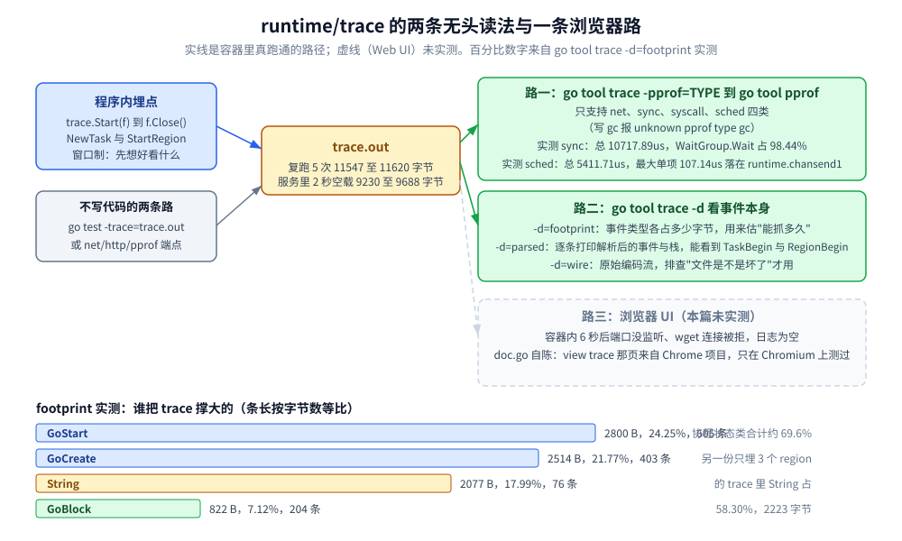
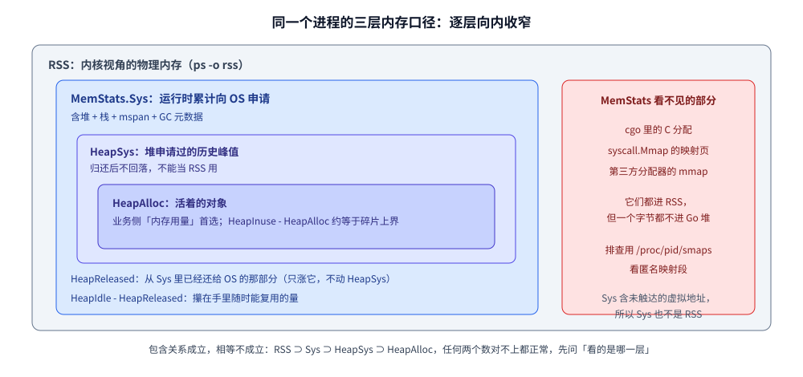
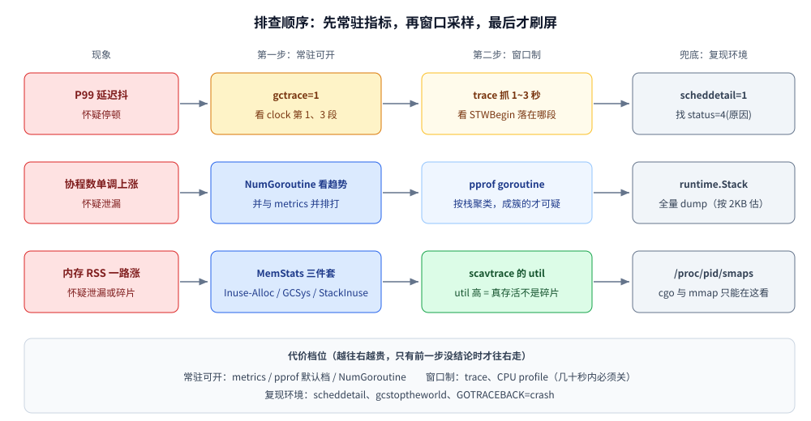

# trace 与运行时指标

> 覆盖：`runtime/trace` 抓的是什么、没有浏览器怎么解析、region 怎么埋；`MemStats` / `debug.GCStats` / `runtime/metrics` 三套指标为什么互相对不上（含 `MemStats` 与内核 RSS 的边界）；`runtime/debug` 的 `Set*` 旋钮；`NumGoroutine` / `runtime.Stack` / `Gosched` 的计数与用法陷阱；出事时的观测顺序与采样成本分档。
>
> 不覆盖：`GODEBUG` 旋钮体系、`schedtrace` / `scheddetail` / `gctrace` / `scavtrace` 的逐列读法，在 [GODEBUG与运行时观测.md](GODEBUG与运行时观测.md)；schedule 与 GC 的机制本身见 [GMP调度.md](GMP调度.md)、[垃圾回收机制.md](垃圾回收机制.md)；profile 采样的动线见 [pprof性能分析.md](pprof性能分析.md)。
>
> 内容整理自个人学习笔记，素材见 [素材清单.md](../../../素材清单.md)。
>
> ⚠️ **实测口径**：本篇全部读数来自容器 `golang:1.26-alpine`（`go version go1.26.8 linux/amd64`，容器内 `NumCPU=4`、`GOMAXPROCS=4`）真跑；实验代码在 `.workbuddy/tmp/exp/runtime-trace/` 与 `.workbuddy/tmp/exp/rtopen/b/`。`GMP调度.md`、`垃圾回收机制.md` 里的读数是宿主机 8 P 环境测的，**与本篇的数字不可混用**。

---

## 一、先拿到数：三行代码读出三套口径

**本节要点**：想看清一个正在跑的 Go 进程，最低成本的不是 trace，而是**读指标** —— `runtime.MemStats` / `runtime/metrics` / `runtime.NumGoroutine` 都只要几行代码，代价却各不相同。先跑通这个最小闭环，再分辨三套口径为什么互相对不上。

### 1.1 最小闭环：一次分配 + 三个读数

```go
package main

import (
	"fmt"
	"runtime"
	"runtime/metrics"
)

func main() {
	_ = make([]byte, 8<<20) // 8 MiB，制造一点堆
	var ms runtime.MemStats
	runtime.ReadMemStats(&ms) // ⚠️ 一次 STW
	s := []metrics.Sample{{Name: "/sched/goroutines:goroutines"}}
	metrics.Read(s) // 无 STW
	fmt.Printf("HeapAlloc=%d KiB NumGC=%d NumGoroutine=%d metrics:/sched/goroutines=%d\n",
		ms.HeapAlloc>>10, ms.NumGC, runtime.NumGoroutine(), s[0].Value.Uint64())
}
```

```bash
go build -o rtb main.go && ./rtb
```

```text
HeapAlloc=8307 KiB NumGC=0 NumGoroutine=1 metrics:/sched/goroutines=10
```

连跑三次，`HeapAlloc` 是 8307 / 8307 / 8313 KiB，后两列**恒定**为 `1` 与 `10`。

⚠️ 这一行就已经把本篇最容易误读的坑摆出来了，两条都要记住：

1. **同一个进程，`NumGoroutine()` 报 1，`/sched/goroutines` 报 10** —— 差的 9 个是 runtime 自己的协程（GC worker、sysmon、finalizer 等）。两个数都不错，**口径不同**（见 5.1）；
2. **`NumGC=0` 不代表"没产生垃圾"** —— GC 由后续分配推动，这个程序只做了一次大对象分配就退出；要判断"有没有 GC"看的是这条命令跑多久、分配了多少，不是单看 `NumGC`（触发条件见 [垃圾回收机制.md](垃圾回收机制.md) 第一节）。

### 1.2 三套读数的代价不一样

| 读数 | 代价 | 适合 |
|---|---|---|
| `runtime.NumGoroutine()` | 读几个原子变量，几乎免费 | 高频打点、看趋势 |
| `runtime/metrics.Read` | 无 STW，走稳定命名 | 常驻暴露给 Prometheus |
| `runtime.ReadMemStats` | **一次 STW**，字段最全 | 低频诊断、一次性拿全 |
| `debug.ReadGCStats` | 无 STW，直接给分位数 | 只看停顿分布 |

「便宜的高频打点、贵的低频诊断」这条分工，决定了下一节到第三节的选型（3.4 给出完整判据表）。

---

## 二、`runtime/trace` 抓的是什么？没有浏览器怎么看？

**本节要点**：trace 记的是**事件**（谁在什么时候从什么状态变成什么状态），pprof 记的是**采样归因**。所以"协程为什么没立刻被调度""这段耗时卡在等锁还是等系统调用"这类**先后顺序**问题必须用 trace。

### 2.1 三种生成方式

```go
f, err := os.Create("trace.out")
if err != nil {
	panic(err)
}
if err := trace.Start(f); err != nil { // 同一进程同时只能有一个 trace
	panic(err)
}
doWork()
trace.Stop() // 必须先 Stop 再 Close，否则尾部事件丢在缓冲区里
f.Close()
```

另外两条不写代码的路：**`go test -trace=trace.out ./pkg`**（测试态抓），和 **`net/http/pprof` 自带端点** `http://host/debug/pprof/trace?seconds=5`（线上按需抓，抓完再拿回本机看）。

实测生成：`./rt trace` 写出约 **11.5 KB** 的 `trace.out`（200 个协程、含 channel 往返与互斥锁）——
同一份代码复跑 5 次的文件字节数是 11547 / 11558 / 11567 / 11586 / 11620，
**±0.6% 的浮动来自时间戳与批事件编码，别当成规格**。服务侧同理：`GET /debug/trace?s=2`
空载复跑三次是 9230 / 9234 / 9470 字节（「使用」那一轮量到的是 9688 字节），
而同一服务先打一次 `/work`（8 MiB 堆 + 200 个睡 10ms 的协程）再抓同样的 2 秒窗口，
直接涨到 **14759 字节** —— **体积由窗口里发生了多少事件决定**，不是由 `seconds` 参数决定。

### 2.2 无头实测：`-pprof` 与 `-d` 两条不依赖浏览器的路

`go tool trace` 默认要开浏览器，但**它自带两种纯命令行输出**（`go tool trace -h` 原文，核验方式 `docker run --rm golang:1.26-alpine go tool trace -h`）：

```text
Supported profile types are:
    - net: network blocking profile
    - sync: synchronization blocking profile
    - syscall: syscall blocking profile
    - sched: scheduler latency profile

-pprof=type: print a pprof-like profile instead
-d=mode: print debug info and exit (modes: wire, parsed, footprint)
```

**路一：把 trace 里的四类"等待"倒成 pprof 再看。** 只有 `net / sync / syscall / sched` 四种，写 `gc` 会直接失败：

```bash
go tool trace -pprof=sched trace.out > /tmp/sched.pprof   # rc=0, 369 字节
go tool trace -pprof=sync  trace.out > /tmp/sync.pprof    # rc=0, 359 字节
go tool trace -pprof=gc    trace.out                      # rc=1: unknown pprof type gc
go tool pprof -top -nodecount=5 /tmp/sync.pprof
```

```text
Main binary filename not available.
Type: delay
Showing nodes accounting for 10717.89us, 100% of 10717.89us total
      flat  flat%   sum%        cum   cum%
10550.46us 98.44% 98.44% 10550.46us 98.44%  sync.(*WaitGroup).Wait
  167.42us  1.56%   100%   167.42us  1.56%  runtime.chanrecv1
```

⚠️ **`us` 数值每抓一次都不同**：上一轮那份 11586 字节的 trace 是 `14414.91us / 185.41us`，
本轮这份 11547 字节的是 `10550.46us / 167.42us`（总时长跟着程序跑到哪一步停表走）。
**能复现的只有比例**：`WaitGroup.Wait` 占 **98.4%~98.7%**、`chanrecv1` 占 1.3%~1.6%。

同一份 trace 的 `sched` 视图（调度延迟）总量 `5856.26us`，最大单项 `112.83us` 挂在
`runtime.chansend1`（上一轮是 `5411.71us` / `107.14us`，同一形状）——
**锁等待的最大项比调度延迟的最大项大近百倍**，这就是"该跑却没跑"要看 sync 而不是 sched 的判据，
全程没开浏览器。

**路二：`-d` 直接看 trace 的内部结构。** `-d=footprint` 告诉你**事件类型各占多少字节**（决定"抓多久会撑爆"）：

```text
Event                Bytes  %       Count  %
-                    -      -       -      -
GoStart              2800   24.25%  605    30.40%
GoCreate             2514   21.77%  403    20.25%
String               2077   17.99%  76     3.82%
GoUnblock            1101   9.53%   201    10.10%
GoBlock              822    7.12%   204    10.25%
GoDestroy            800    6.93%   400    20.10%
ProcStart            24     0.21%  5      0.25%
ProcSteal            7      0.06%   1      0.05%
STWBegin             4      0.03%   1      0.05%
```

协程状态类事件（`GoStart/GoCreate/GoBlock/GoUnblock/GoDestroy`）占了 **69.6%** 的体积 ——
就是那五行字节数相加：`2800+2514+1101+822+800 = 8037`，除以整份 11547 字节。
四份独立抓取的同一比值分别是 **69.35% / 69.40% / 69.54% / 69.80%**（比例稳、绝对字节数每次差几十个）。
所以**高并发服务的 trace 窗口要短**（1~3 秒），否则光协程创建销毁就能写几十 MB。
`-d=parsed` 则逐条打印解析后的事件，能直接看到 `/sched/gomaxprocs:threads` 这类指标事件与栈：

```text
M=7 P=3 G=1 Metric Time=882243152448 Name="/sched/gomaxprocs:threads" Value=Value{Uint64(4)}
```



图怎么读：实线是本次容器里真跑通的路径，虚线（浏览器 UI）是没有跑通的；`69.6%` 与 `58.30%` 两个数字来自 `-d=footprint` 的实测表，其余为结构示意。

### 2.3 region 与 task：把业务阶段写进 trace

标准库事件只讲"协程/锁/系统调用"，要看"这个阶段花了多久"得自己埋点：

- `trace.NewTask(ctx, "handleRequest")` —— 建一个**任务**（可派生子任务），返回带 region 的 ctx；
- `trace.StartRegion(ctx, "validate")` —— 手工区段，**必须 `End()`**；
- `trace.WithRegion(ctx, "store", func(){...})` —— 闭包版，不用管退出；
- `trace.Log(ctx, "db", "rows=1")` —— 打一个时间点上的事件。

埋点确实进文件了（`go tool trace -d=parsed region.out` 的原文片段）：

```text
M=626 P=1 G=1 TaskBegin Time=1355356693760 ID=1 Parent=18446744073709551615 Type="handleRequest"
M=626 P=1 G=1 RegionBegin Time=1355356724736 Task=1 Type="validate"
```

⚠️ region 的代价全在字符串表上：这份只跑了 3 个阶段的 trace，`String` 事件就占 **58.30%**（2223 字节 / 83 条），比所有状态事件加起来还多 —— 所以 **region 名要少而稳定**，不要把请求 ID、用户 ID 拼进 region 名（那等于每次调用都往 trace 里塞一个新字符串）。

### 2.4 浏览器 UI 没起来，但路由能对着源码确认

容器里 `go tool trace -http=127.0.0.1:6060 trace.out` 起了 6 秒后 **端口没有监听**（`netstat -tln` 空、`wget` 连接被拒、日志为空），**Web UI 属于未实测**。可以确认的是 `cmd/trace/main.go` 注册的这组路由 —— 打开页面后能点进去的就是这些：

| 路由 | 看什么 | 对应问题 |
|---|---|---|
| `/`（`ViewProc` + `ViewThread`） | **processor view**：每个 P 一条时间线、每个 M 一条线程线 | 有没有 P 长时间空着、CPU 有没有被占满 |
| `/trace`（trace viewer，Chrome 系） | 全局时间线 + 状态视图（runnable/running/blocking/syscall） | 一次请求在时间轴上被切成几段 |
| `/goroutines`、`/goroutine` | **goroutine view**：按协程分组的状态时长表，可下钻单个协程 | 谁睡了多久、被谁唤醒 |
| `/mmu` | **class view**（Mutator Utilization Map）：按 goroutine 类别（user / GC / syscall …）着色的热力图 | 这段时间到底是谁在吃 CPU：业务还是 GC |
| `/syscall`、`/io`、`/block`、`/sched`、`/regionio` | 四张 pprof 图 + region 版 | 各类等待的归因排序 |

`cmd/trace/doc.go` 自己也写明了这个坑：**"the trace viewer itself (the 'view trace' page) comes from the Chrome/Chromium project and is only actively tested on that browser"** —— 别的浏览器打开可能只有列表没有图。

### 2.5 pprof 与 trace 的分工判据

| 想知道什么 | 用哪个 | 为什么 |
|---|---|---|
| CPU 花在哪个函数上 | `pprof` cpu profile | 采样归因，正是它的强项；trace 没有 CPU 采样 |
| 协程为什么"该跑却没跑"（调度延迟、被谁唤醒） | **trace** | 只有 trace 记录"状态迁移 + 唤醒关系" |
| 锁等待、channel 收发阻塞的系统性原因 | pprof `-blocked`/`-mutex` 先定位，再用 trace 确认先后 | profile 给量，trace 给顺序 |
| 一次请求里 5 个阶段各花多久 | **trace + region** | pprof 没有"区间"概念 |
| 是不是 GC 抢走了时间 | `gctrace`（[GODEBUG与运行时观测.md](GODEBUG与运行时观测.md) 第三节）/ `pprof` gc profile / trace 的 `STWBegin` 事件 | 前两者看比例与量级，trace 看**具体落在哪一段业务代码上** |
| 内存为什么涨 / 为什么还不还给 OS | `MemStats` + `scavtrace`（见第三节与 [GODEBUG与运行时观测.md](GODEBUG与运行时观测.md) 3.4） | trace 只记 `HeapAlloc`/`HeapGoal` 事件点 |
| 抓现场的成本 | profile ≈ 常驻低成本（采样率可控）；trace **窗口制**，别长期开 | 见 2.2 的体积分布 |

---

## 三、`MemStats`、`debug.GCStats`、`runtime/metrics` 三套数怎么分工？

**本节要点**：三套数**互相不等价**，同一个名字（比如"堆大小"）在三处口径不同；线上要的是"能被 Prometheus 抓走、且不会把 STW 拉长"的那一套。

### 3.1 `runtime.ReadMemStats`：字段清单与实测

`ReadMemStats` **会短暂 STW**（为了拿到一致快照），所以只适合低频打点，不适合每个请求都读。

```go
var ms runtime.MemStats
runtime.ReadMemStats(&ms)
```

| 字段组 | 含义（`go doc runtime.MemStats` 原文要点） | 用法 |
|---|---|---|
| `TotalAlloc` / `Mallocs` / `Frees` | 累计分配字节 / 对象数（**只增不减**） | 分配速率 = 两次采样相减除以时间；`Mallocs-Frees` 才是存活对象数 |
| `HeapAlloc` | 当前堆上"已分配对象"字节数，含**还没被 sweep 掉的不可达对象**，所以是平滑变化不是锯齿 | 业务侧"内存用量"首选 |
| `HeapSys` | 堆向 OS 申请过的地址空间，**官方注释：estimates the largest size the heap has had** | ⚠️ 归还后**不会回落**，别拿它判断当前占用 |
| `HeapIdle` / `HeapInuse` / `HeapReleased` | 空闲 span / 在用 span / **已归还 OS** 的字节 | `HeapIdle - HeapReleased` = 攥在手里随时能复用的量；`HeapInuse - HeapAlloc` ≈ 碎片上界 |
| `NextGC` | 下一轮 GC 的目标堆 | 和 `HeapAlloc` 一起看就知道"还剩多少余量" |
| `PauseTotalNs` / `PauseNs[256]` / `PauseEnd[256]` | STW 累计与**环形缓冲**（最近一次在 `PauseNs[(NumGC+255)%256]`） | 只有 256 个槽，长跑进程的历史会被覆盖 |
| `NumGC` / `NumForcedGC` / `GCCPUFraction` | 完成轮数 / 被 `runtime.GC()` 强制的轮数 / GC 占用的 CPU 比例 | `NumForcedGC` 非 0 要先问谁在调 `runtime.GC()` |
| `BySize[61]` | 每个 size class 的 `Mallocs/Frees` | 定位"哪一类对象分配最多"（>60 号大小不统计） |
| `StackInuse/StackSys`、`GCSys`、`OtherSys`、`BuckHashSys` | 非堆部分 | `Sys` 就是这些 `XSys` 之和 |

容器实测（`./rt memstats`：48 MB 分配压力、24 MB 存活、500 个短眠协程，三次运行）：

```text
NumGoroutine during work = 501
HeapAlloc=32 MB HeapSys=34 MB HeapObjects=1674 NumGC=5 NextGC=36 MB Sys=40 MB
HeapAlloc=32 MB HeapSys=38 MB HeapObjects=1675 NumGC=5 NextGC=36 MB Sys=44 MB
```

`HeapAlloc`/`NumGC`/`HeapObjects` 稳定（32 MB / 5 次 / 1674±1），`HeapSys`、`Sys` 每次都涨（34→38 MB、40→44 MB）—— 这正是 `HeapSys` "只记峰值"的表现，**别把它当 RSS**。

`HeapSys` 与归还的关系，实测最直观（`./rt scavenge`，读数在 [GODEBUG与运行时观测.md](GODEBUG与运行时观测.md) 3.4）：`runtime.GC()` 之后 `HeapIdle` 从 7 MB 涨到 207 MB，`HeapSys` **纹丝不动 207 MB**；`debug.FreeOSMemory()` 之后 `HeapReleased=203 MB`，`HeapSys` 还是 207 MB。**判断"还不还回去"要看 `HeapReleased` / `scavtrace` 的 `now`，不是 `HeapSys`。**

### 3.2 `debug.ReadGCStats`：拿分位数比拿 `PauseNs` 环形缓冲省事

```go
var gs debug.GCStats
gs.PauseQuantiles = make([]time.Duration, 5) // 先给长度，才要分位数
debug.ReadGCStats(&gs)
```

```text
debug.ReadGCStats: NumGC=5 LastGC=18:03:55.742 PauseTotal=1.458444ms len(Pause)=5 len(PauseEnd)=5
most recent pauses (Pause[0:3]) = [354.407µs 131.44µs 144.044µs]
  quantile[0] = 131.44µs   quantile[1] = 144.044µs   quantile[2] = 354.407µs
  quantile[3] = 378.015µs  quantile[4] = 450.538µs
```

- `Pause` / `PauseEnd` **最近一次在前**（`Pause[0]` 是最新，和 `MemStats.PauseNs` 的环形语义相反 —— 混用必错）；
- 想要多少分位数就给 `PauseQuantiles` 设多长，返回是**升序**（`[4]` 是最大值）；
- 三次运行的 `PauseTotal` = 840.5 µs / 1.320469 ms / 1.458444 ms，`MaxPause` = 334 / 420 / 450 µs：**只能断言"停顿在几百微秒量级"**，不要写精确值。

### 3.3 `runtime/metrics`：给监控系统用的那一套

`ReadMemStats` 要 STW，`runtime/metrics` 不用，名字还是稳定的 `/类别/名:单位` 格式（[垃圾回收机制.md](垃圾回收机制.md) 已把"用 metrics 取代 MemStats"列为官方推荐，这里只补实测与坑）：

```go
ms := []metrics.Sample{
	{Name: "/memory/classes/heap/objects:bytes"},
	{Name: "/sched/goroutines:goroutines"},
	{Name: "/gc/heap/live:bytes"},
	{Name: "/sched/latencies:seconds"},
	{Name: "/no/such/metric:bytes"},
}
metrics.Read(ms)
```

```text
/sched/gomaxprocs:threads                        4
/sched/latencies:seconds                         histogram, buckets=162
/sched/goroutines:goroutines                     310
/memory/classes/heap/objects:bytes               21240696
/gc/heap/live:bytes                              18991384
/gc/heap/goal:bytes                              38143418
/gc/pauses:seconds                               histogram, buckets=162
/gc/cycles/total:gc-cycles                       3
/no/such/metric:bytes                            KindBad（名字不存在）
```

三个坑：**直方图字段要走 `v.Float64Histogram().Buckets`**（`metrics.Value` 上没有 `Buckets` 字段，写 `v.Buckets` 编译不过：`v.Buckets undefined (type metrics.Value has no field or method Buckets)`）；**名字写错不 panic，只给你一个 `KindBad`**；`/sched/goroutines:goroutines` 的官方释义是 "Count of live goroutines"，**口径和 `NumGoroutine` 不一样**（见 5.1）。

### 3.4 三套数的选择判据

| 场景 | 选 | 理由 |
|---|---|---|
| 命令行 / 一次性诊断，要一次拿全 | `ReadMemStats` | 字段最全（含 `BySize`），代价是一次 STW |
| 常驻服务按 15s 暴露给 Prometheus | `runtime/metrics` | 无 STW、名字稳定、直方图能算分位 |
| 只关心 GC 停顿分布 | `debug.ReadGCStats` | 直接给分位数，不用自己排环形缓冲 |
| 要看某个 size class / mcache 细节 | `ReadMemStats`（`BySize`） | metrics 没暴露这个粒度 |
| 容器内存告警阈值 | `HeapReleased` + cgroup 的 RSS，**不是 `HeapSys`** | `HeapSys` 只记峰值，见 3.1 与 3.5 |

### 3.5 ⭐ 为什么 `MemStats` 和 RSS 对不上

**本节要点**：`MemStats` 只描述 **Go 堆**，RSS 才是**内核视角的全部** —— 两者之间差着 goroutine 栈、mmap 的大对象、GC 元数据与 cgo 内存，运维与容器限额看的都是后者。

```go
var m runtime.MemStats
runtime.ReadMemStats(&m)
fmt.Printf("HeapAlloc=%dMiB HeapSys=%dMiB HeapIdle=%dMiB StackSys=%dMiB Sys=%dMiB NumGC=%d\n",
	m.HeapAlloc>>20, m.HeapSys>>20, m.HeapIdle>>20, m.StackSys>>20, m.Sys>>20, m.NumGC)
```

| 指标 | 含义 | 与 RSS 的关系 |
|---|---|---|
| `HeapAlloc` | ⭐ **活着的对象**占的堆字节数 | 通常**远小于 RSS** |
| `HeapSys` | 向 OS **预约**的堆内存（含未使用、GC 未还的） | RSS 的上界之一 |
| `HeapIdle` | 堆里**空闲**的 span（可被归还） | `HeapSys − HeapAlloc` 的大头 |
| `Sys` | ⭐ 运行时**累计向 OS 申请的总字节数**（堆+栈+mspan+GC 元数据） | ⭐ **最接近 RSS**，但仍是虚拟内存口径 |
| `StackSys` / **RSS** | goroutine 栈占用 / ⭐ **进程实际占用的物理内存**（`ps -o rss`） | ⚠️ 运维与容器看的是 **RSS** |



图怎么读：从内到外分别是"活对象 → Go 运行时管理的内存 → 进程实际占的物理页"，**每一层都不是下一层的子集**：`Sys` 里含未触达的虚拟地址（不计 RSS），RSS 里含 cgo 与 mmap（不计 `MemStats`）。所以任何两个数对不上都正常，先问"你看的是哪一层"。

RSS 比 `HeapAlloc` 大很多的四种原因：

| 原因 | 说明 | 对策 |
|---|---|---|
| **`GOGC` / madvise** | GC 后只把 span 标成 `HeapIdle`，**默认延迟归还 OS**；另按 arena（64MB）预留虚拟地址，RSS 只计真正 touched 的页 | 调 `GOGC`；Go 1.16+ 用 `debug.FreeOSMemory()` 或 `GODEBUG=madvdontneed=1` |
| **goroutine 栈** | 每 goroutine 2KB 起、按需增长；**上万 goroutine 就是几十 MB**（`StackSys`） | 控制并发度，防 goroutine 泄漏 |
| ⭐ **mmap** | ⚠️ `>32KB` 大对象、cgo、`syscall.Mmap` **直接走 mmap**，**完全不计入 MemStats 的堆** | 用 `/proc/<pid>/smaps` 看匿名映射段 |
| **GC 元数据 / mspan / cgo** | `bitmap`、`mspan` 结构；C 侧 malloc 的内存 Go 完全看不见 | 小头或需单独排查 |

⭐ 一句话：**MemStats 只描述 Go 堆，RSS 才是内核视角的全部**。`syscall.Mmap` 自己的用法与落盘边界见 [零拷贝.md](零拷贝.md) 3.5，内核侧的虚拟内存与回收见 [内存管理.md](../../../02-计算机基础/linux/内存管理.md)。

---

## 四、`runtime/debug` 那几个 `Set*` 各管什么？

**本节要点**：这些函数几乎都**返回上一次的设置**，所以"读一个值"也要靠调它 —— 但要注意哪些只影响 GC、哪些是"炸得更早"的保护栏。

### 4.1 实测一览

```go
debug.SetGCPercent(100)              // 返回旧值
debug.SetMemoryLimit(80 << 20)       // 返回旧值（默认 math.MaxInt64 = 不设限）
debug.SetMaxThreads(1000)            // 返回旧值 10000
debug.SetMaxStack(32 << 20)          // 返回旧值 1000000000
debug.SetCrashOutput(nil, debug.CrashOptions{}) // 关掉"崩溃输出多写一份到某个文件"
debug.SetPanicOnFault(true)          // 返回旧值
debug.SetTraceback("all")            // 崩溃时打印所有协程（GOTRACEBACK 的运行期版）
debug.FreeOSMemory()                 // 强制一次 GC + 立即归还
```

```text
SetGCPercent(100) returned old = 100
SetMemoryLimit(80MiB) returned old = 9223372036854775807 (8796093022207 MiB)
debug.SetMaxThreads(1000): old=10000, restore=1000
debug.SetMaxStack(32MiB): old=1000000000 (=953 MiB), restore=33554432
debug.SetCrashOutput(nil) -> err=<nil>
debug.SetPanicOnFault(true) -> old=false
```

`SetMaxStack` 的默认值读数就是官方文档说的那个数（"初始 64 位系统 1 GB"）—— `restore=33554432` 是第二次调用把 32 MiB 又写回去时返回的**上一次**值，正好验证"返回值 = 旧值"这个契约。

| 函数 | 管什么 | 什么时候用 |
|---|---|---|
| `SetGCPercent` | 等价 `GOGC`，`-1` 关 GC | 压测临时改档；**调参实测见 [垃圾回收机制.md](垃圾回收机制.md) 第四节，不在此重复** |
| `SetMemoryLimit` | 等价 `GOMEMLIMIT`，`-1` 不设限、`0` 等于"永远在 GC" | 容器里给软上限。**只在实际存活集 < 限制时有意义**，见 4.2 |
| `SetMaxThreads` | OS 线程数上限（默认 **10000**），超了直接 crash | 防"线程爆炸拖垮整机"，是**自杀式保护**，不是限流 |
| `SetMaxStack` | 单协程栈上限（64 位默认 **1 GB**），超了 crash | 防无限递归吃光内存 |
| `SetCrashOutput` | 把未恢复 panic / fatal error **额外写一份**到指定文件（Go 1.22） | 标准错误被重定向掉的守护进程 |
| `SetPanicOnFault` | 把段错误变成可 recover 的 panic（配合 `recover` 做探针式读内存） | 只适合"明知地址危险"的场景 |
| `SetTraceback` | 等价 `GOTRACEBACK`；**低于环境变量值的调用会被忽略** | 线上临时要全量协程栈 |
| `FreeOSMemory` | 强制 GC + 立即把空闲堆还给 OS | 见 3.1：**它只涨 `HeapReleased`，不动 `HeapSys`** |

### 4.2 实测：`SetMemoryLimit` 低于存活集会怎样

存活集 120 MiB、限制设成 80 MiB，每 30 轮打一次（`./apib memlimit`）：

```text
after 1st GC: HeapSys=7 MiB HeapInuse=0 MiB NextGC=4 MiB NumGC=1
round  30: HeapAlloc=30 MiB HeapSys=35 MiB NumGC=4
round  60: HeapAlloc=60 MiB HeapSys=67 MiB NumGC=5
round  90: HeapAlloc=90 MiB HeapSys=95 MiB NumGC=19
round 120: HeapAlloc=120 MiB HeapSys=127 MiB NumGC=47
end: HeapAlloc=120 MiB HeapSys=127 MiB NumGC=48 GCCPUFraction=0.064
```

60→90 轮之间 GC 次数从 `5` 跳到 `19`，90→120 轮再跳到 `47`：**存活集已经超过软限制，GC 被迫连续重启**，最后 `GOGC` 的"翻倍再收"节奏完全失效。趋势可断言：限制压到存活集以下时 **GC 次数单调暴涨、`GCCPUFraction` 明显抬头**（本次 0.064）；具体次数每次运行都有波动。

### 4.3 更正：`debug.SetCrashStack` 不存在

`go doc runtime/debug`（容器 `golang:1.26-alpine`，核验方式同下）列出的全部函数是：

```text
func FreeOSMemory()
func PrintStack()
func ReadGCStats(stats *GCStats)
func SetCrashOutput(f *os.File, opts CrashOptions) error
func SetGCPercent(percent int) int
func SetMaxStack(bytes int) int
func SetMaxThreads(threads int) int
func SetMemoryLimit(limit int64) int64
func SetPanicOnFault(enabled bool) bool
func SetTraceback(level string)
func Stack() []byte
func WriteHeapDump(fd uintptr)
```

`grep -rn SetCrashStack /usr/local/go/src` **零命中** —— 崩溃时想多打印栈，能用的是 `SetTraceback("all")` / `GOTRACEBACK=all`（控制**打印哪些协程**）与 `GODEBUG=tracebackancestors=N`（把 traceback 延伸到**创建该协程的位置**），没有"设置崩溃栈大小"这个 API。同理，`runtime.Stack` 的缓冲区大小由调用者给（见 5.2），不存在"崩溃栈上限"旋钮。

---

## 五、`NumGoroutine`、`runtime.Stack`、`Gosched` 的调试用法与陷阱

**本节要点**：三个都能用来"看一眼进程内部"，但**口径都和你以为的不一样**，用错就会得出"泄漏了"或"没泄漏"的相反结论。

### 5.1 `runtime.NumGoroutine()`：不含跑在系统栈上的协程

源码（`/usr/local/go/src/runtime/debug.go`、`proc.go`，**核验方式：`docker run --rm golang:1.26-alpine sed -n '176,182p' /usr/local/go/src/runtime/debug.go`**）：

```go
func NumGoroutine() int {
	return int(gcount(false))
}

func gcount(includeSys bool) int32 {
	n := int32(atomic.Loaduintptr(&allglen)) - sched.gFree.stack.size - sched.gFree.noStack.size
	if !includeSys {
		n -= sched.ngsys.Load()
	}
	for _, pp := range allp {
		n -= pp.gFree.size
	}
	if n < 1 {
		n = 1
	}
	return n
}
```

三个直接结论：**减掉了 `sched.ngsys`（跑在系统栈上的 runtime 协程）**、减掉了各级 G 空闲表、**下限是 1**（源码注释自己写着 "the result can be inconsistent"）。

实测三方对照（`./apib count`，同时开 `scheddetail`）：

```text
SCHED 605ms: ...  （G 行共 10 条）
  G1: status=4(sleep)                     G2: status=4(force gc (idle))
  G17: status=4(GC sweep wait)            G18: status=4(GC scavenge wait)
  G33: status=4(GOMAXPROCS updater (idle)) G34: status=4(finalizer wait)
  G35..G38: status=4(GC worker (idle))
NumGoroutine at start        = 1
NumGoroutine after runtime.GC()    = 1
NumGoroutine after 500ms idle      = 1
NumGoroutine with 1 parked G       = 2
```

同一时刻 `scheddetail` 列了 **10 个 G**，`NumGoroutine` 报 **1**：那 9 个内部协程被 `ngsys` 减掉了（那几行 `G` 的含义见 [GODEBUG与运行时观测.md](GODEBUG与运行时观测.md) 2.3）。服务里更直接的对照（实测见「使用」一节）：**`NumGoroutine=3` 而 `/sched/goroutines:goroutines=13`**；本篇开头 1.1 的最小程序同样是 **1 vs 10**。

所以：**用 `NumGoroutine` 判泄漏是对的**（它恰好滤掉了 runtime 自己那批常驻协程），但**不能拿它和 metrics/pprof 的数字互相校验** —— 两个口径本来就不同。判泄漏看**趋势**不看绝对值（[协程泄漏与死锁.md](../并发编程/协程泄漏与死锁.md) 讲的是 pprof 侧的聚类定位，本篇只补口径）。

### 5.2 `runtime.Stack`：截断不报错，缓冲区要自己估够

```go
buf := make([]byte, 4096)
n := runtime.Stack(buf, false)   // 只当前协程
```

```text
runtime.Stack(all=false): 178/4096 bytes, 5 lines
  first line: goroutine 1 [running]:
runtime.Stack into 64-byte buffer: returned 64 (silently truncated)
```

- **返回值 == 缓冲区长度就说明被截断了**，没有"再给我大一点的缓冲区我重算"的机制；
- 全量 dump 的量级实测：2000 个阻塞在 `select{}` 上的协程（`./apib stackdump`）——`NumGoroutine = 2001`，`runtime.Stack(buf, true)` 写入 **473128 字节**（1 MB 缓冲够用），约 **236 字节/协程**；协程有业务栈帧时这个值会成倍涨，所以**缓冲区按 `协程数 × 2 KB` 起估**；
- 协程上万时别在请求路径上调它（拿的是全进程快照）；崩溃现场交给 `GOTRACEBACK=all` 或 `debug.SetTraceback("all")`；
- 想要"结构化的一条一个协程"，用 `runtime.GoroutineProfile`（`GoroutineProfile(nil)` 返回需要多少个 `StackRecord`，实测 `n=1 ok=false` 就是"缓冲区不够，先告诉你要几个"）。

### 5.3 `runtime.Gosched()`：让出是免费的，**顺序不是**

```text
Gosched interleave order: [2 0 1 2 0 1 2 0 1]
100000x runtime.Gosched() = 39.858822ms (~399 ns each)
GOMAXPROCS=1 下同样顺序，耗时 23.190593ms (~232 ns each)
```

- 单次让出成本在**百纳秒量级**（两次运行 232 / 399 ns，波动接近一倍，只断言"比一次 channel 往返便宜、比一次系统调用便宜得多"）；
- 三个协程各让出 3 次，实测确实轮转成 `2 0 1` 循环 —— 但**这是调度器当前实现的结果，不是保证**：`Gosched` 只保证"我回到可运行状态、可能换个 G 跑"，**不能用来做同步或计数**（要同步就用 channel / `WaitGroup`，见 [并发同步原语.md](../并发编程/并发同步原语.md)）。

---

## 六、出问题时按什么顺序看？

**本节要点**：现场只有一份，顺序错了就抓不到。原则：**先低成本常驻指标，再窗口制采样，最后才动 `scheddetail` 这种刷屏开关**。

### 6.1 现象 → 第一手证据

| 现象 | 第一步（低成本） | 第二步 | 别急着做 |
|---|---|---|---|
| P99 延迟抖、怀疑停顿 | `gctrace=1`（一行/GC）看 STW 两段 | trace 抓 1~3 s，看 `STWBegin` 落在哪段业务上 | 不要一上来 `gcstoptheworld=1`（那是给自己制造停顿） |
| CPU 高但吞吐低 | pprof cpu profile | `scavtrace` / `metrics` 看 GC 占比与归还；`GCCPUFraction` | 不要靠 `schedtrace` 找热点函数，它没有归因 |
| 协程数单调上涨 | `NumGoroutine()` 趋势 + `/sched/goroutines:goroutines` | pprof goroutine（聚类）/`runtime.Stack(buf,true)` 全量 dump | 不要拿两个口径互相对账（5.1） |
| 请求卡住、怀疑死锁 | `GET /debug/pprof/goroutine?debug=2` | trace 看唤醒关系；`scheddetail` 找 `status=4(...)` 的等待原因 | 不要 `GOTRACEBACK` 一改就重启，现场丢了 |
| 内存 RSS 一路涨 | `MemStats`：`HeapInuse-HeapAlloc`（碎片）、`GCSys`（元数据）、`StackInuse` | `scavtrace` 的 `util`；cgo / mmap 部分 **`MemStats` 根本不计**（见 3.5） | 不要用 `HeapSys` 判断当前占用 |
| 线程数超了 `GOMAXPROCS` | `schedtrace` 的 `threads` + `idlethreads` | 数 cgo / 阻塞系统调用；`debug.SetMaxThreads` 只是自杀式保护 | 不要指望调 `GOMAXPROCS` 压住线程数 |
| 启动慢、init 顺序怪 | `GODEBUG=inittrace=1` | 实测格式：`init runtime @19 ms, 4.1 ms clock, 0 bytes, 0 allocs` | 不要用 trace 去看 init（协程还没起来，事件很少） |



图怎么读：三条竖线是代价档位（常驻可开 → 窗口制 → 只在复现环境），横向箭头是"这一步没结论才往右走"；把 6.2 的分档表和 6.1 的现象表压成一张图，现场手忙脚乱时照着走即可。

### 6.2 采样成本分档（决定能不能在线上开）

| 档位 | 开关 | 代价 |
|---|---|---|
| 常驻可开 | `runtime/metrics`、pprof 各 profile（默认采样率）、`NumGoroutine` | metrics 无 STW；pprof 默认档开销可控 |
| 短期可开 | `gctrace=1`、`scavtrace=1`、`schedtrace=1000` 以上间隔、`inittrace=1` | 只往 stderr 打一行；日志量是唯一成本 |
| 窗口制（几十秒内必须关） | `trace.Start`、`pprof.StartCPUProfile` | trace 体积主要来自协程状态事件（实测 69.6%）；CPU profile 要 100 Hz 采样 |
| 只在复现环境 | `scheddetail=1`、`gccheckmark=1`、`clobberfree=1`、`efence=1`、`gcstoptheworld=1`、`GOTRACEBACK=crash` | 刷屏或直接把分配器/GC 变慢几个量级，`crash` 还会发信号杀自己 |

---

## 使用：给服务接上 runtime 调试开关

**本节要点**：一个可以直接抄的骨架 —— 默认只开低成本项，trace 与快照按需触发，**开关状态与两套协程口径在 `/debug/memstats` 一眼能看出来**。`//go:debug` 只能写**白名单内的行为兼容键**（`http2server` 可以，`schedtrace` 不行），且**必须在 `package` 子句之前**（见 [GODEBUG与运行时观测.md](GODEBUG与运行时观测.md) 1.4）。

```go
//go:debug http2server=0

package main

import (
	"fmt"
	"log"
	"net/http"
	_ "net/http/pprof" // /debug/pprof/* ，含 trace?seconds=5
	"os"
	"runtime"
	"runtime/debug"
	"runtime/metrics"
	"runtime/trace"
	"strconv"
	"time"
)

func traceHandler(w http.ResponseWriter, r *http.Request) {
	secs := 3
	if v := r.URL.Query().Get("s"); v != "" {
		if n, err := strconv.Atoi(v); err == nil {
			secs = n
		}
	}
	f, err := os.Create("/tmp/trace.out")
	if err != nil {
		http.Error(w, err.Error(), http.StatusInternalServerError)
		return
	}
	if err := trace.Start(f); err != nil {
		f.Close()
		http.Error(w, err.Error(), http.StatusInternalServerError) // 已有 trace 在跑
		return
	}
	time.Sleep(time.Duration(secs) * time.Second)
	trace.Stop()
	st, _ := f.Stat()
	f.Close()
	fmt.Fprintf(w, "trace written: %s (%d bytes, %ds window)\n", "/tmp/trace.out", st.Size(), secs)
}

func memstatsHandler(w http.ResponseWriter, r *http.Request) {
	var ms runtime.MemStats
	runtime.ReadMemStats(&ms) // ⚠️ 一次 STW，只给低频打点用
	var gs debug.GCStats
	gs.PauseQuantiles = make([]time.Duration, 4)
	debug.ReadGCStats(&gs)
	samples := []metrics.Sample{
		{Name: "/memory/classes/heap/objects:bytes"},
		{Name: "/sched/goroutines:goroutines"},
		{Name: "/gc/heap/live:bytes"},
	}
	metrics.Read(samples)
	fmt.Fprintf(w, "HeapAlloc=%d MiB HeapSys=%d MiB HeapInuse=%d MiB HeapIdle=%d MiB HeapReleased=%d MiB NextGC=%d MiB\n",
		ms.HeapAlloc>>20, ms.HeapSys>>20, ms.HeapInuse>>20, ms.HeapIdle>>20, ms.HeapReleased>>20, ms.NextGC>>20)
	fmt.Fprintf(w, "NumGC=%d PauseTotal=%s MaxPause=%s NumForcedGC=%d GCCPUFraction=%.4f\n",
		ms.NumGC, gs.PauseTotal, gs.PauseQuantiles[len(gs.PauseQuantiles)-1], ms.NumForcedGC, ms.GCCPUFraction)
	fmt.Fprintf(w, "NumGoroutine=%d metrics:/sched/goroutines=%d\n",
		runtime.NumGoroutine(), samples[1].Value.Uint64())
	fmt.Fprintf(w, "metrics:/memory/classes/heap/objects=%d B metrics:/gc/heap/live=%d B\n",
		samples[0].Value.Uint64(), samples[2].Value.Uint64())
}

func main() {
	http.HandleFunc("/debug/trace", traceHandler)
	http.HandleFunc("/debug/memstats", memstatsHandler)
	log.Fatal(http.ListenAndServe(":6060", nil))
}
```

实测时另挂了一个 `/work` 端点造负载（每次请求分配 8 MiB、起 200 个睡 10 ms 的协程），输出里的 `ok kept=8 MiB` 就是它打的。容器真跑（`go build -o srv ./serverdemo && ./srv &` 后逐个 `wget`）：

```text
build	DefaultGODEBUG=http2server=0
ok kept=8 MiB
HeapAlloc=8 MiB HeapSys=19 MiB HeapInuse=9 MiB HeapIdle=10 MiB HeapReleased=3 MiB NextGC=8 MiB
NumGC=4 PauseTotal=1.158333ms MaxPause=640.774µs NumForcedGC=0 GCCPUFraction=0.0022
NumGoroutine=3 metrics:/sched/goroutines=13
metrics:/memory/classes/heap/objects=8742792 B metrics:/gc/heap/live=4507856 B
trace written: /tmp/trace.out (9688 bytes, 2s window)
goroutine profile: total 3
```

落地四条：

1. **`NumGoroutine` 与 metrics 两个数并排打出来**（3 vs 13）—— 差值是 runtime 内部协程 + 非 Go 协程，**别当泄漏看**，只看各自趋势；
2. `MaxPause=640.774µs`、`GCCPUFraction=0.0022` 这种空载量级可以直接当告警基线；
3. trace 端点**必须带窗口上限**（`?s=` 要夹住，别让人传 600），且 `trace.Start` 重复调用会返回错误，**别在服务里放两个同时抓的入口**；
4. `//go:debug` 只放**行为兼容键**，诊断键要么用启动环境变量，要么像上面这样做成 HTTP 开关。

---

## 延伸追问

- **`HeapSys` 为什么不随 `FreeOSMemory` 下降？** → 它的定义是"堆申请过的地址空间、估计的历史峰值"（`go doc runtime.MemStats` 原话：HeapSys estimates the largest size the heap has had）；归还看 `HeapReleased` 或 `scavtrace` 的 `now`。
- **`MemStats.Sys` 就等于 RSS 吗？** → 不。`Sys` 仍是**虚拟内存口径**（含预留未触达的 arena），只是六大指标里最接近 RSS 的一个；真实物理占用要看 `ps -o rss` 或 `/proc/<pid>/status` 的 `VmRSS`。
- **为什么 GC 跑完 RSS 不下降？** → GC 只把 span 标成 `HeapIdle`，**默认不立刻归还 OS**；要主动归还可调 `debug.FreeOSMemory()`，或靠 `GODEBUG=madvdontneed=1` 改变 `madvise` 行为。
- **容器里应该看哪个指标做限额？** → 看 **RSS**（对应 cgroup 的 `memory.current`），不是 `HeapAlloc`，更不是 `HeapSys`；判定口径见 [内存管理.md](../../../02-计算机基础/linux/内存管理.md)。
- **`NumGoroutine()` 能对上 pprof 的数字吗？** → 对不上。它 `= gcount(false)`，**减掉了跑系统栈的 runtime 协程与各级 G 空闲表**；实测同一时刻 `scheddetail` 列 10 个 G、`NumGoroutine` 报 1；服务里 `NumGoroutine=3` 而 `/sched/goroutines=13`。
- **`runtime/metrics` 能替代 `ReadMemStats` 吗？** → 线上常驻可以，**离线诊断不行**：`BySize`（每个 size class 的分配量）只有 `MemStats` 有；且 `metrics.Value` 里直方图要走 `Float64Histogram()`，写错字段编译就报（3.3）。
- **`NumGoroutine` 一直涨，怎么区分"业务泄漏"与"runtime 协程"？** → 先看趋势（业务泄漏是单调上涨且不回落），再拿 `scheddetail` 的 `status=4(原因)` 对一遍 runtime 那批常驻协程（[GODEBUG与运行时观测.md](GODEBUG与运行时观测.md) 2.3 的"底牌清单"），剩下的才是你的。
- **没有浏览器怎么看 trace？** → `go tool trace -pprof={net,sync,syscall,sched} trace.out | go tool pprof -top`，或用 `-d=footprint` / `-d=parsed` 直接看事件构成。`gc`、`threadcreate` **不是** 支持的类型（实测 `unknown pprof type gc`）。
- **trace 文件为什么这么大？** → `-d=footprint` 实测协程状态类事件占 69.6% 字节（四份独立抓取 69.35%~69.80%）；埋 region 的字符串表还可能再翻一倍（示例程序里 `String` 占 58.30%）。窗口压到 1~3 秒、region 名保持有限集合。
- **`GOMEMLIMIT` 设得比存活集小会怎样？** → GC 连续重启：实测存活 120 MiB、限制 80 MiB 时，`NumGC` 从 5（60 轮）跳到 19（90 轮）再到 47（120 轮），`GCCPUFraction` 抬头到 0.064。限制只对"能腾出空间"的部分有效。
- **`runtime.Stack` 拿到的字节数刚好等于缓冲区长度，是巧合吗？** → 不是，那是**被截断**了（返回 64 表示写满 64 字节），没有重算机制；按 `协程数 × 2 KB` 起估，全量 dump 用 `GoroutineProfile` 更稳。

## 关联

- **上游/机制**：[GMP调度.md](GMP调度.md) — G/M/P 与调度时机；本篇的 `NumGoroutine` / `Gosched` 口径都要放回这套模型里看
- **上游/机制**：[垃圾回收机制.md](垃圾回收机制.md) — 三段堆、`GOGC` / `GOMEMLIMIT` 的算法侧；本篇只讲「怎么读出来」
- **对照/互补**：[GODEBUG与运行时观测.md](GODEBUG与运行时观测.md) — 常驻可开的旋钮（`schedtrace` / `gctrace` / `scavtrace`）与逐列读法
- **对照/互补**：[pprof性能分析.md](pprof性能分析.md) — 采样归因（CPU / heap / block / mutex）与无头读法；trace 管"顺序"，pprof 管"量"
- **上游/结构**：[内存分配器.md](内存分配器.md) — `MemStats` 各 `XSys` 字段背后的 mspan / mcache / tcmalloc 结构
- **对照/互补**：[内存逃逸.md](内存逃逸.md) — 编译期就能看出"堆上要长多少东西"，与本篇的运行期观测互补
- **对照/互补**：[零拷贝.md](零拷贝.md) — `syscall.Mmap` 与 `bufio` 缓冲写的落盘边界：这部分内容从本篇的内存口径里分出去
- **下游应用**：[协程泄漏与死锁.md](../并发编程/协程泄漏与死锁.md) — pprof 侧的泄漏聚类定位；本篇只补 `NumGoroutine` 与 metrics 的口径差
- **下游应用**：[手写Prometheus导出器.md](../可观测性/手写Prometheus导出器.md) — `go_memstats_*` 就是本篇 3.1 那套字段搬进 Prometheus
- **外部口径**：[内存管理.md](../../../02-计算机基础/linux/内存管理.md) — 虚拟内存、Page Cache 与容器限额的内核侧视角
- **外部口径**：[可观测性选型对比.md](../../../03-数据与中间件/中间件/可观测性/可观测性选型对比.md) — 指标 / 追踪 / 日志三类信号的选型；本篇全在"指标 + 现场采样"这一侧
> 反向引用（本篇被下列文档引到）：[调试与IDE配置.md](../工程实践/调试与IDE配置.md)、[goroutine.md](../并发编程/goroutine.md)、[协程与线程成本.md](../并发编程/协程与线程成本.md)、[堆外内存与内存映射.md](../../java/运行时/堆外内存与内存映射.md)
