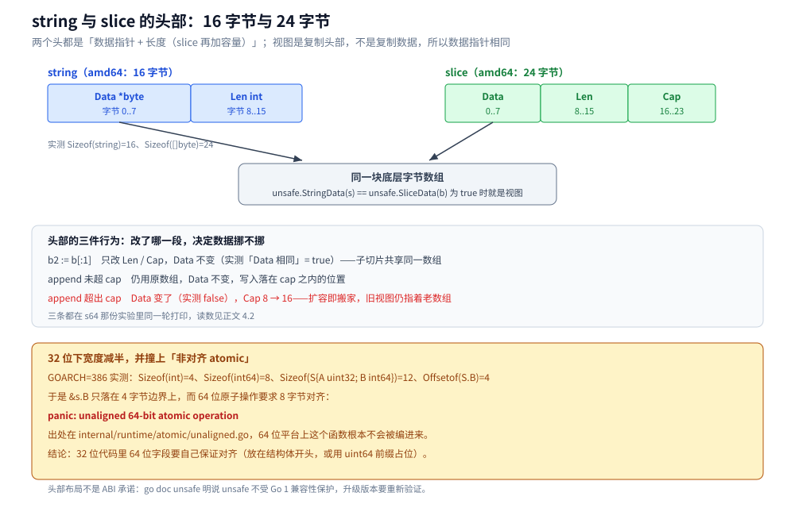
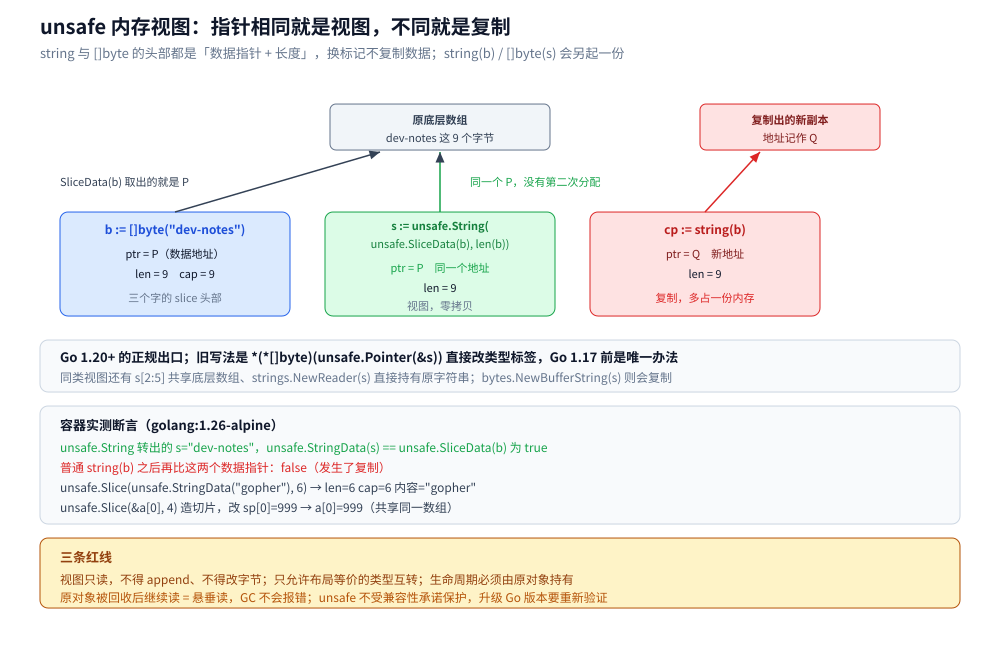

# unsafe 与内存布局

> 覆盖 `unsafe` 的三种能力（量布局、绕类型系统、造内存视图）、`unsafe.Pointer` 的四条特殊操作与五种合法模式、
> 尺寸/对齐/偏移三件套、`string` 与 slice 的头部布局、四类会静默出错的内存视图失效，
> 以及 `go vet` 与 `checkptr` 两道闸门各能拦住哪一半。
>
> 不覆盖：`reflect` 的 `Type` / `Value` 两件套、`CanSet` 判据与反射性能在 [反射.md](反射.md)；
> `uintptr` 不保活的 GC 实测与 `unsafe.Add` 的指针侧用法在 [指针与引用.md](../类型与语法/指针与引用.md) 第 3.3、6.3 节；
> 基础类型尺寸全表在 [基础类型与零值.md](../类型与语法/基础类型与零值.md)，字段对齐规则与 `unsafe.Sizeof` 全表在
> [struct与tag.md](../类型与语法/struct与tag.md) 第一、二节。
>
> 内容整理自个人学习笔记，素材见 [素材清单.md](../../../素材清单.md)。
>
> ⚠️ 本篇读数全部来自容器 `golang:1.26-alpine`（`go version go1.26.8 linux/amd64`）真跑；
> 32 位读数用同一镜像以 `GOARCH=386` 编译运行；`go vet` stderr、`checkptr` 的 fatal error 与
> `/usr/local/go/src` 源码片段同样出自该容器。基准连跑五轮取区间，地址数值每次运行都不同、只当示意。

---

## 一、`unsafe` 到底能做什么？一段程序看全三种能力

**本节要点**：`unsafe` 只做三件事——量布局、绕过类型系统读写、造共享内存的视图。
三件事都不做检查，代价一律由调用方承担；好在这三件事能用二十来行代码全部演示完。

### 1.1 最小闭环：三种能力一次跑完

```go
package main

import (
	"fmt"
	"unsafe"
)

type Header struct {
	Name string
	Age  int
}

func main() {
	h := Header{Name: "gopher", Age: 3}

	// ① 量布局：类型有多大、字段在第几个字节
	fmt.Println("Sizeof(Header) =", unsafe.Sizeof(h))
	fmt.Println("Offsetof(Age)  =", unsafe.Offsetof(h.Age))

	// ② 绕类型系统：按字节偏移拿到字段，再改它
	age := (*int)(unsafe.Add(unsafe.Pointer(&h), unsafe.Offsetof(h.Age)))
	*age = 42
	fmt.Println("h.Age =", h.Age, "（没写 h.Age = 42）")

	// ③ 造视图：string 与 []byte 共享同一块内存
	b := []byte("dev-notes")
	s := unsafe.String(unsafe.SliceData(b), len(b))
	fmt.Println("同一块内存 =", unsafe.StringData(s) == unsafe.SliceData(b))
	b[0] = 'D'
	fmt.Println("改了 b[0] 之后 s =", s)
}
```

```text
Sizeof(Header) = 24
Offsetof(Age)  = 16
h.Age = 42 （没写 h.Age = 42）
同一块内存 = true
改了 b[0] 之后 s = Dev-notes
```

这段程序 `go vet` 一条不报，但三行读数各自说明一件事：

- **① 是安全区**：`Sizeof` / `Alignof` / `Offsetof` 都是编译期常量，算不出错，只可能算错你想要的。
- **② 已经越权**：`h.Age` 是导出的，正常写法也能改；但换成一个未导出字段、或者一个 `t.Field(i)` 拿不到的字段，
  这套「基址 + 偏移」照样能读写——编译器连看一眼的机会都没有。
- **③ 改了「不可变」的东西**：`string` 在语言层约定不可变，可 `b[0] = 'D'` 之后 `s` 直接变成了 `Dev-notes`。
  不可变是**约定**，不是内存页权限。

### 1.2 三种能力各自用哪些 API

| 能力 | API | 一句话 | 在哪里会出事 |
|---|---|---|---|
| 量布局 | `unsafe.Sizeof` / `Alignof` / `Offsetof` | 编译期常量，回答「多大 / 多齐 / 第几字节」 | 只在 32 位上算错，见 3.3 |
| 绕类型系统 | `unsafe.Pointer`、`unsafe.Add` | 任意指针、任意整数地址之间互通 | 断链与越界，见第二节 |
| 造视图 | `unsafe.String` / `StringData` / `Slice` / `SliceData` | 复制头部、共享数据，零拷贝 | 四类静默失效，见 5.3 |

### 1.3 与反射的分界：一个「不知道类型」，一个「知道但不许写」

一句话对照：**`reflect` 管「类型在编译期不可知」，`unsafe` 管「类型我全知道，但编译器不让我这么写」**。
两者的错误形态完全不同：

| | `reflect` | `unsafe` |
|---|---|---|
| 什么时候错 | 运行期，`panic` 带可读信息（`reflect: call of ...`） | 运行期或**根本不报**，直接读到别人的内存 |
| 守门人 | 三条反射法则、`CanSet` 的 flag 位 | 只有你自己对不对得上布局 |
| 典型入口 | `TypeOf` / `ValueOf` / `Field` / `Set` | `Pointer` / `Sizeof` / `String` / `Slice` |

所以别把两者混着记：反射的问题是**慢与晚**，`unsafe` 的问题是**对与错没有中间态**。
反射侧的全部内容在 [反射.md](反射.md)，本篇只讲 `unsafe` 这半。

---

## 二、`unsafe.Pointer` 的转换规则是什么？哪些写法会断链？

**本节要点**：四条特殊操作讲「能转」，五种模式讲「许转」。断链只有一个根源——
`uintptr` 一旦落进变量，它就退化成整数，GC 从此看不见它。

### 2.1 四条特殊操作与五种合法模式

`/usr/local/go/src/unsafe/unsafe.go` 的包注释开篇就把话说死了（原文逐字摘录）：

```go
// Pointer represents a pointer to an arbitrary type. There are four special operations
// available for type Pointer that are not available for other types:
//   - A pointer value of any type can be converted to a Pointer.
//   - A Pointer can be converted to a pointer value of any type.
//   - A uintptr can be converted to a Pointer.
//   - A Pointer can be converted to a uintptr.
//
// Pointer therefore allows a program to defeat the type system and read and write
// arbitrary memory. It should be used with extreme care.
```

紧接着是五种「被认为是合法」的模式，以及一句关键限定：

```go
// The following patterns involving Pointer are valid.
// Code not using these patterns is likely to be invalid today
// or to become invalid in the future.
```

| 模式 | 写法要点 | 边界 |
|---|---|---|
| (1) `*T1` → `*T2` | 两边大小相同、布局等价才能重解释 | `math.Float64bits` 是范例 |
| (2) Pointer → `uintptr` | 只为打印、比较数值 | **不许转回去** |
| (3) 来回转 + 算术 | 转换必须出现在**同一个表达式**里 | 结果必须仍指在原对象内 |
| (4) 传给汇编实现的函数 | 转换必须写在**实参列表**里 | 先存变量再传就失效 |
| (5) `reflect.Value.Pointer` / `UnsafeAddr` | 返回值立刻同表达式转回 Pointer | 反射侧接口见 [反射.md](反射.md) 6.2 |

模式 (3) 还有两条容易漏的否定项，官方注释直接给了 INVALID 例子：
**不能越过对象末尾**（哪怕只是「指向末尾之后」），**不能对 nil 做算术**。


图怎么读：中间绿色的 `unsafe.Pointer` 是唯一的例外口，左边蓝色是任意类型指针、右边灰色是 `uintptr`；
中间四个箭头是四条特殊操作，其中「`uintptr` → Pointer」这条是红色的——它只在下面五种模式里被许可。
再往下那张表把五种模式的写法与边界并排列出；最底下三行是判断顺序：答不上属于哪种模式，就是越权。

### 2.2 断链：`uintptr` 一旦落进变量，GC 就再也看不见它

把同一个对象的转换拆成两句，就是模式 (3) 被破坏的样子：

```go
func roundTrip() {
	var x int
	p := uintptr(unsafe.Pointer(&x)) // 转出来这一步还合法
	q := unsafe.Pointer(p)           // 中间落了变量：模式 (3) 被破坏
	*(*int)(q) = 7
}
```

`go vet` 的 `unsafeptr` 分析器会直接抓这种写法，报 `possible misuse of unsafe.Pointer`
（完整文件与 stderr 原文见 6.1）。为什么这么严？官方注释写得很直白：

```go
// A uintptr is an integer, not a reference.
// Converting a Pointer to a uintptr creates an integer value
// with no pointer semantics.
// Even if a uintptr holds the address of some object,
// the garbage collector will not update that uintptr's value
// if the object moves, nor will that uintptr keep the object
// from being reclaimed.
```

最后一句是关键：`uintptr` **既不跟着搬家，也不保活**。实测里把对象交给 `finalizer`、只留 `uintptr`，
连续几次读回的是 `0` 和 `-999`（那块内存已被清零或被别的分配复用），全程没有任何报错——
完整实验与读数在 [指针与引用.md](../类型与语法/指针与引用.md) 6.3，本篇不重复跑。

同一表达式里完成就没事，因为编译器会为这段连续表达式保留对原对象的引用：

```go
type Row struct{ A, B int }

r := &Row{A: 1, B: 2}
pB := unsafe.Add(unsafe.Pointer(r), unsafe.Offsetof(r.B))
*(*int)(pB) = 22
```

### 2.3 `unsafe.Add` 只是写法，不是豁免

`unsafe.Add(ptr, len)` 的语义就是 `unsafe.Pointer(uintptr(ptr) + uintptr(len))`，
它把模式 (3) 封装成函数，让编译器能识别并插入检查（编译期确实会展开成同样的三次转换，见
`walk/expr.go` 里对 `OUNSAFEADD` 的处理）。容器实测：

```go
type P struct {
	A uint8
	B int64
	C uint16
}

u := P{A: 1, B: 2, C: 3}
p := unsafe.Add(unsafe.Pointer(&u), unsafe.Offsetof(u.B))
*(*int64)(p) = 42
fmt.Printf("unsafe.Add+Offsetof 直接改 B → u.B=%d（不经反射、不装箱）\n", u.B)
```

```text
unsafe.Add+Offsetof 直接改 B → u.B=42（不经反射、不装箱）
```

用了 `unsafe.Add` 之后三条规则一条没松：偏移后仍要落在原对象里、对象要被引用保活、类型仍要对得上。
它只是让「写法」从「明显违规」变成「可能合规」，是否真的合规还得自己保证。

---

## 三、尺寸、对齐、偏移：为什么量出来的和写的不一样？

**本节要点**：三件套回答三个不同问题；结构体大小由**对齐**算出来，不由字段书写顺序算出来。
同一组字段换个顺序，24 字节能压到 16 字节。

### 3.1 三件套各回答什么

| 想知道什么 | 用谁 | 容器实测 |
|---|---|---|
| 这个类型占几字节 | `unsafe.Sizeof`，或运行时拿到的 `reflect.Type.Size()` | `Sizeof(P)=24`，`t.Size()` 给出同一个数 |
| 这个类型的对齐值 | `unsafe.Alignof` | `Alignof(P)=8` |
| 字段在第几个字节 | `unsafe.Offsetof`，或 `reflect.StructField.Offset` | `Offsetof(P.B)=8` |

后两种出口是**同一份数据的两个视口**：`unsafe.Offsetof` 要写出字段名，因此是编译期常量；
`reflect.StructField.Offset` 能用在一个运行期才知道的 `Type` 上。尺寸三件套的返回值都是 `uintptr`，
直接打印是十进制数字，想要十六进制得自己转。

### 3.2 字段重排实测：24 字节压到 16

```go
type P struct {
	A uint8
	B int64
	C uint16
}

type Q struct {
	C uint16
	A uint8
	B int64
}

fmt.Printf("Sizeof(P)=%d Alignof(P)=%d：A@%d B@%d C@%d\n",
	unsafe.Sizeof(P{}), unsafe.Alignof(P{}),
	unsafe.Offsetof(P{}.A), unsafe.Offsetof(P{}.B), unsafe.Offsetof(P{}.C))
fmt.Printf("Sizeof(Q)=%d Alignof(Q)=%d：C@%d A@%d B@%d\n",
	unsafe.Sizeof(Q{}), unsafe.Alignof(Q{}),
	unsafe.Offsetof(Q{}.C), unsafe.Offsetof(Q{}.A), unsafe.Offsetof(Q{}.B))
```

```text
Sizeof(P)=24 Alignof(P)=8：A@0 B@8 C@16
Sizeof(Q)=16 Alignof(Q)=8：C@0 A@2 B@8
```

两条规则算出这两个数：

1. **每个字段的偏移必须是它自身对齐值的整数倍**。`P` 里 `B` 要 8 字节对齐，`A` 只占 0 号字节，
   于是 1~7 全部补空；`Q` 把 2 字节的 `C`、1 字节的 `A` 摆在前面，到 3 号字节时才需要补 5 个，`B` 正好落在 8。
2. **结构体大小要补齐到最大对齐值的整数倍**。`P` 的 `C` 占 16~17 两个字节，但整体要按 8 对齐，补到 24；
   `Q` 到 16 号字节正好结束，本来就对齐。

顺带澄清一个容易混淆的地方：开场那个 `Header{Name string; Age int}` 也是 24 字节，但它是 `16+8`
**一个字节 padding 都没有**；`P` 的 24 是补出来的。同样的数字、完全不同的成因。
字段顺序怎么排、padding 怎么算的完整表格在 [struct与tag.md](../类型与语法/struct与tag.md) 第一节。

### 3.3 32 位下宽度减半，撞上「非对齐 atomic」

```go
type S struct {
	A uint32
	B int64
}

var s S
fmt.Printf("Sizeof(int)=%d Sizeof(int64)=%d Sizeof(S)=%d Offsetof(S.B)=%d\n",
	unsafe.Sizeof(int(0)), unsafe.Sizeof(int64(0)),
	unsafe.Sizeof(S{}), unsafe.Offsetof(S{}.B))
atomic.AddInt64(&s.B, 1)
```

同一份代码用 `GOARCH=386` 编译运行：

```text
Sizeof(int)=4 Sizeof(int64)=8 Sizeof(S)=12 Offsetof(S.B)=4
panic: unaligned 64-bit atomic operation
```

原因是 32 位下 `int64` 的对齐值只有 4，`B` 落在 4 号字节上，而 64 位原子操作在 386 上要求 8 字节对齐。
panic 的出处就一行（`/usr/local/go/src/internal/runtime/atomic/unaligned.go` 全文）：

```go
package atomic

func panicUnaligned() {
	panic("unaligned 64-bit atomic operation")
}
```

这个文件在 64 位平台上根本不参与编译，所以本地跑得好的代码，`GOARCH=386` 一跑就炸。
两条对策：把 64 位字段放在结构体最前面（`B` 挪到 0 号字节），或者显式补一个 `uint64` 占位；
`sync/atomic` 的 64 位对齐规则在 [atomic操作.md](../并发编程/atomic操作.md) 有更完整的讨论。

---

## 四、`string` 与 slice 的头部长什么样？

**本节要点**：头部里只有指针和长度（slice 再加容量），没有「数据」。
16 与 24 字节这两个数字决定了视图能怎么做、append 为什么会搬家。

### 4.1 两个头、三个字

把两个头用等价结构体读出来（`strHdr` / `sliceHdr` 只是布局描述，不是标准库类型）：

```go
type strHdr struct {
	Data unsafe.Pointer
	Len  int
}

type sliceHdr struct {
	Data unsafe.Pointer
	Len  int
	Cap  int
}

s := "dev-notes"
sh := *(*strHdr)(unsafe.Pointer(&s))
b := make([]byte, 3, 8)
copy(b, "abc")
bh := *(*sliceHdr)(unsafe.Pointer(&b))
fmt.Printf("string 头：Data=%p Len=%d（%d 字节）\n", sh.Data, sh.Len, unsafe.Sizeof(sh))
fmt.Printf("slice 头：Data=%p Len=%d Cap=%d（%d 字节）\n", bh.Data, bh.Len, bh.Cap, unsafe.Sizeof(bh))
```

```text
Sizeof(string)=16 Sizeof([]byte)=24
string 头：Data=0x4c6f30 Len=9（16 字节）
slice 头：Data=0xa04e7402008 Len=3 Cap=8（24 字节）
```

`0x4c6f30` 是只读段里的地址（字符串字面量），`0xa04e7402008` 是堆地址；这两个数值每次运行都不同，
能确定的只有「两个头分别占 16 与 24 字节」和「Data 指向第一个字节」。



图怎么读：上半是两个头的字段排布与各自宽度，中间那块灰色是底层字节数组——两个头的 `Data`
都指向它；下半写明「改哪一段会搬家」：`b[:1]` 只动 Len/Cap、`append` 未超 cap 仍原地写、
超出 cap 才分配新数组。最下面是 386 的尺寸与那条非对齐 panic。

### 4.2 子切片不改 Data，扩容才搬家

接着 4.1 的 `b` 与 `bh`：

```go
b2 := b[:1]
bh2 := *(*sliceHdr)(unsafe.Pointer(&b2))
fmt.Printf("b[:1] 的 Data 相同吗=%v（子切片不复制）\n", bh.Data == bh2.Data)

b3 := append(b, 'x', 'y', 'z', 'w', 'v', 'u')
bh3 := *(*sliceHdr)(unsafe.Pointer(&b3))
fmt.Printf("append 超出 cap 后 Data 相同吗=%v Cap=%d（扩容即搬家）\n", bh.Data == bh3.Data, bh3.Cap)
```

```text
b[:1] 的 Data 相同吗=true（子切片不复制）
append 超出 cap 后 Data 相同吗=false Cap=16（扩容即搬家）
```

这两行就是子切片泄漏与视图失效的**共同机制**：`b2` 与 `b` 共享数组，所以 `b2` 存活期间整个数组都不能回收
（子切片泄漏，见 [切片.md](../类型与语法/切片.md)）；而 `b3` 拿到的是新数组，任何在这之前造出来的视图，
读写的都是那块已经没人认领的老数组。

### 4.3 头布局是事实，但不是 ABI 承诺

`go doc unsafe` 的包注释第一段就把免责声明写清了（原文）：

```go
// Packages that import unsafe may be non-portable and are not protected by the
// Go 1 compatibility guidelines.
```

所以「16 / 24 字节」可以用来**解释现象**（为什么 `unsafe.String` 不复制、为什么视图会让 GC 多留一块内存），
不该用来**写业务逻辑**（比如自己拼一个 24 字节的 buffer 当 slice 头传出去）。
真要在代码里依赖宽度，就写成 `unsafe.Sizeof` 的比较判断，让它在布局变化时立刻断言失败。

---

## 五、内存视图怎么做？哪里会塌？

**本节要点**：视图 = 复制头部、共享数据；唯一可靠的判据是**数据指针相同**。
四类失效全部静默——编译期不报、出错点不报，这是 `unsafe` 真正贵的地方。

### 5.1 三件套与旧写法

Go 1.20 起有了官方出口，之前只能靠「改写类型标签」：

```go
// 旧：直接改标签，靠 string 与 []byte 头部布局等价
func stringToBytesOld(s string) []byte { return *(*[]byte)(unsafe.Pointer(&s)) }

// 新：三个 API，语义写在名字里
func stringToBytes(s string) []byte { return unsafe.Slice(unsafe.StringData(s), len(s)) }
func bytesToString(b []byte) string { return unsafe.String(unsafe.SliceData(b), len(b)) }
```

旧写法仍然能编译、能跑，但它是「依赖布局等价」的隐式假设，而新写法把这层假设变成了显式 API，
并且能被 `go vet` 正确判定。官方对 `StringData` 的限制也写得很清楚：

```go
// Since Go strings are immutable, the bytes returned by StringData
// must not be modified.
func StringData(str string) *byte
```

`unsafe.Slice` 一侧同样有边界：`len` 为负、或者 `ptr` 为 nil 而 `len` 不为零，运行期都会 panic。

### 5.2 判据：指针相同就是视图

```go
b := []byte("dev-notes")
s := unsafe.String(unsafe.SliceData(b), len(b))
fmt.Println("unsafe.String 视图 数据指针相同=", unsafe.StringData(s) == unsafe.SliceData(b))

cp := string(b)
fmt.Println("string(b) 复制后数据指针相同=", unsafe.StringData(cp) == unsafe.SliceData(b))

var arr [4]int
sp := unsafe.Slice(&arr[0], 4)
sp[0] = 999
fmt.Println("unsafe.Slice 数组视图写 sp[0]=999 → arr[0]=", arr[0])
```

```text
unsafe.String 视图 数据指针相同= true
string(b) 复制后数据指针相同= false
unsafe.Slice 数组视图写 sp[0]=999 → arr[0]= 999
```

「指针相同就是视图，指针不同就是复制」——这一条比任何文档措辞都可靠。它同时说明了两件事：
视图为零拷贝的判据是**地址相等**，而视图能不能写、写完别人看不看得见，要看它共享的是谁的内存。



图怎么读：左边蓝色是原 slice 头（三个字），中间绿色是 string 视图头（两个字），两者的 `ptr` 都指向
同一个 `P`；右边红色是 `string(b)` 复制出的新副本，地址记作 `Q`。三个头下面列的是容器里跑出来的断言，
最底两条是红线：视图只读、生命周期必须由原对象持有。

### 5.3 四类失效：改到了、活不长、搬了家、认不出


图怎么读：四行各是一类失效，左侧红标签是名字，中间两行是触发条件，最后一行红字是容器里的实测现象。
四类的共同点是「程序还在正常工作」，所以发现它们靠的不是运行报错，而是 `checkptr=2` 或自己写的断言。

第四类值得单独看一眼，因为它的表现最反直觉：

```go
buf := make([]byte, 4, 4)
copy(buf, "key1")
k := unsafe.String(&buf[0], 4) // 视图，没有复制字节
m := map[string]int{k: 1}
copy(buf, "key2") // 改的是同一块内存

_, ok1 := m["key1"]
_, ok2 := m["key2"]
v, ok3 := m[k]
fmt.Printf("len(m)=%d lookup(key1)=%v lookup(key2)=%v lookup(视图 k)=%v v=%d\n",
	len(m), ok1, ok2, ok3, v)
for kk, vv := range m {
	fmt.Printf("range 出来 key=%q value=%d\n", kk, vv)
}
```

```text
len(m)=1 lookup(key1)=false lookup(key2)=false lookup(视图 k)=false v=0
range 出来 key="key2" value=1（表里那条记录的 key 已被改动）
```

三条 lookup 全 miss：map 存的是 string 头、不复制字节，插入时按 `"key1"` 算的哈希已经把这条记录放进了
对应桶；现在 key 的**内容**变成了 `"key2"`，用 `"key1"` 算的哈希找不到它，用 `"key2"` 算的哈希也找不到
（记录还在 `"key1"` 对应的桶里），用视图 `k` 自己算同样找不到。而 `range` 直接把桶里那串变了的字节打出来。
`map` 侧为什么不能靠「再算一次哈希」兜底，见 [map.md](../类型与语法/map.md) 的扩容与桶布局。

---

## 六、`go vet` 与 `checkptr` 是两道什么闸门？

**本节要点**：`go vet` 查**写法**，`checkptr` 查**地址**；`checkptr=1` 只插检查、不改变逃逸结论，
所以「`=1` 没报」经常只是因为被检查的对象根本还在栈上。

### 6.1 `go vet`：只查明显违规

```go
package main

import (
	"fmt"
	"unsafe"
)

type T struct{ A, B int }

func main() {
	var v T
	p := uintptr(unsafe.Pointer(&v))
	q := unsafe.Pointer(p)
	*(*int)(q) = 7
	fmt.Println(v.A)
}
```

```text
main.go:13:7: possible misuse of unsafe.Pointer
```

注意它报的是「possible」：`unsafeptr` 分析器做的是静态模式匹配，能认出「`uintptr` 落在变量里再转回」这类
教科书错误，但认不出「偏移算错了对象」「视图活过了原对象」。官方的定位原文：

```go
// Running "go vet" can help find uses of Pointer that do not conform to these patterns,
// but silence from "go vet" is not a guarantee that the code is valid.
```

### 6.2 `checkptr` 两档：为什么 `=1` 会放过越界

`-d=checkptr` 的三档语义（`go tool compile -d help` 原文）：

```text
checkptr             	instrument unsafe pointer conversions
	                     	0: instrumentation disabled
	                     	1: conversions involving unsafe.Pointer are instrumented
	                     	2: conversions to unsafe.Pointer force heap allocation
```

同一份越界写的代码（`b := make([]byte, 8)` 之后 `unsafe.Add(p, 32)` 再写）在两档下表现完全不同：

```go
package main

import (
	"fmt"
	"unsafe"
)

func main() {
	b := make([]byte, 8)
	p := unsafe.Pointer(&b[0])
	q := unsafe.Add(p, 32) // 越过这次分配的边界
	*(*byte)(q) = 1
	fmt.Println("wrote beyond allocation")
}
```

```text
=== checkptr=1
wrote beyond allocation
=== checkptr=2
fatal error: checkptr: pointer arithmetic result points to invalid allocation
goroutine 1 gp=0x9c48c6b01e0 m=0 mp=0x58c140 [running]:
runtime.throw({0x4d41de?, 0x8?})
	/usr/local/go/src/runtime/panic.go:1229 +0x48 fp=0x9c48c80cec0 sp=0x9c48c80ce90 pc=0x47a148
runtime.checkptrArithmetic(0x414d92?, {0x9c48c80cf30, 0x1, 0x70?})
	/usr/local/go/src/runtime/checkptr.go:69 +0x9c fp=0x9c48c80cef0 sp=0x9c48c80cec0 pc=0x415a5c
main.main()
	/w/.workbuddy/tmp/exp/unsafeopen/checkptr/main.go:11 +0x49
```

`=1` 明明也给 `unsafe.Add` 插了检查——`walk/convert.go` 里 `ShouldCheckPtr(..., 1)` 会把它展开成
「两次转换 + 一次加法」。真正的原因在逃逸分析：

```text
=== -gcflags='-m -d=checkptr=1'
./main.go:9:11: make([]byte, 8) does not escape
=== -gcflags='-m -d=checkptr=2'
./main.go:9:11: make([]byte, 8) escapes to heap
```

`checkptrArithmetic` 的第一步是找出这个地址属于哪次堆分配（`checkptrBase`），拿不到基址就直接返回——
而 `=1` 下 `b` 的底层数组还在栈上，栈地址不属于任何堆分配，于是检查被静默跳过。
`=2` 的关键并不是「检查得更严」，而是**把转成 `unsafe.Pointer` 的指针强制分配到堆**，检查这才有东西可查。

验证方式很简单：让 `b` 真的逃逸（比如赋给一个包级变量），同一份代码在 `=1` 下也会报：

```go
package main

import "unsafe"

var sink []byte

func main() {
	b := make([]byte, 8)
	sink = b // 真正逃逸到堆
	p := unsafe.Pointer(&b[0])
	q := unsafe.Add(p, 32)
	*(*byte)(q) = 1
	println("ok", len(sink))
}
```

```text
=== heap.go checkptr=1（b 赋给了包级变量 sink）
fatal error: checkptr: pointer arithmetic result points to invalid allocation
```

所以「`checkptr=1` 跑过了」这件事几乎没有信息量。两个推论：

1. 用 `checkptr` 抓越界就必须上 `=2`；`=1` 的检查依赖对象已经在堆上，实际覆盖不到这种栈上的越界。
2. `-race` 与 `-msan` / `-asan` 会自动带上 `checkptr=1`（`cmd/compile/internal/base/flag.go`
   里 `if Debug.Checkptr == -1 { Debug.Checkptr = 1 }`），所以它们同样抓不到上面这种越界。

### 6.3 落地：`unsafe` 代码的三条检查

| 检查 | 命令 | 能抓到 | 抓不到 |
|---|---|---|---|
| 静态模式 | `go vet ./...` | `uintptr` 落变量、`unsafe.Pointer` 明显误用 | 偏移错、生命周期错、视图失效 |
| 地址检查 | `go test -gcflags=all=-d=checkptr=2 ./...` | 越界算术、跨分配指针 | 指针值合法但语义错的场景 |
| 竞态 | `go test -race ./...` | 数据竞争（隐含 `checkptr=1`） | 单线程的 `unsafe` 语义错 |

这三条都只进测试与 CI，不进生产构建：`checkptr=2` 会改变逃逸结论（该上栈的被迫上堆），
性能读数不能拿它跑。开关的完整用法见 [编译与gcflags.md](../工程实践/编译与gcflags.md)。

---

## 使用：copy 与 view 差多少

**本节要点**：同一次五轮基准里，`copy` 落在 72 ~ 179 ns/op（1 次分配、64 B），
`view` 落在 14 ~ 21 ns/op（0 次分配）——两侧区间不重叠，最慢的 view 仍快过最快的 copy。

```go
package main

import (
	"fmt"
	"strings"
	"testing"
	"unsafe"
)

var sink string

var line = []byte("2026-10-27T10:00:00Z level=info msg=\"cache hit\" key=user:42")

//go:noinline
func parseCopy(b []byte) string {
	s := string(b)
	_, v, _ := strings.Cut(s, " ")
	return v
}

//go:noinline
func parseView(b []byte) string {
	s := unsafe.String(unsafe.SliceData(b), len(b))
	_, v, _ := strings.Cut(s, " ")
	return v
}

func BenchmarkParseCopy(b *testing.B) {
	b.ReportAllocs()
	for i := 0; i < b.N; i++ {
		sink = parseCopy(line)
	}
}

func BenchmarkParseView(b *testing.B) {
	b.ReportAllocs()
	for i := 0; i < b.N; i++ {
		sink = parseView(line)
	}
}

func round(name string, f func(*testing.B)) {
	var lo, hi, allocs, bytes int64
	for i := 0; i < 5; i++ {
		r := testing.Benchmark(f)
		n := r.NsPerOp()
		if lo == 0 || n < lo {
			lo = n
		}
		if n > hi {
			hi = n
		}
		allocs, bytes = r.AllocsPerOp(), r.AllocedBytesPerOp()
	}
	fmt.Printf("  %-10s %d ~ %d ns/op  %d allocs/op  %d B/op\n", name, lo, hi, allocs, bytes)
}

func main() {
	round("copy", BenchmarkParseCopy)
	round("view", BenchmarkParseView)
}
```

```text
  copy       72 ~ 179 ns/op  1 allocs/op  64 B/op
  view       14 ~ 21 ns/op  0 allocs/op  0 B/op
```

差价的来源可以算出来：这一行 59 字节，`string(b)` 要按 64 字节的 size class 分配一块内存再拷 59 个字节，
`view` 只写两个机器字。倍数关系（3.4 ~ 12.8 倍）跨运行会变，`1 allocs` 与 `0 allocs` 不会变。

要不要换 view，判据不是「快多少」，而是下面三条同时成立：

1. **结果只读**：返回值是 `string`，调用方不会拿它去改字节。要改就不能用视图（5.3 第一类）。
2. **生命周期被原 buffer 覆盖**：`b` 必须活得比 `s` 久。把视图返回给上层、而 `b` 是某个 `sync.Pool`
   借来的或某个 `io.Read` 复用的缓冲区，就是 5.3 第二、三类的入口。
3. **不落进长生命周期容器**：别拿视图当 `map` 的 key 或长期缓存的字段（5.3 第四类）。

`io.Copy` 这类「真省了系统调用」的零拷贝属于另一条线，判据在 [零拷贝.md](零拷贝.md)：
那边省的是内核态与用户态之间的拷贝，这边省的是用户态内部的一次分配。

---

## 延伸追问

- **`unsafe.Pointer` 与 `uintptr` 谁会被 GC 追踪？** → 只有前者。`unsafe.Pointer` 是引用类型，
  GC 追它、搬对象时更新它、它存活时对象不被回收；`uintptr` 只是个整数，「地址还在」与「对象还属于你」是两件事（2.2）。
- **为什么不能「指向对象末尾之后」？** → 越过末尾的指针不再指向任何对象，GC 无法判断它属于谁；
  官方注释把「`&s` 再加 `Sizeof(s)`」与「`&b[0]` 再加 `n`」两例都列成 INVALID（2.1 模式 3）。
- **`Sizeof` / `Offsetof` 是编译期常量吗？** → 参数类型固定时是，可以写进数组长度、用于常量表达式；
  参数字段有变长类型时（比如 `[n]T` 里的 `n` 来自变量）就是运行期值，`go doc unsafe.Offsetof` 有这句限定。
- **`*(*[]byte)(unsafe.Pointer(&s))` 这种写法还要不要用？** → 不要。Go 1.20 起 `unsafe.Slice(unsafe.StringData(s), len(s))`
  是官方出口，语义显式、`go vet` 能判；旧写法依赖头部布局等价，属于 4.3 说的「事实但不是承诺」。
- **32 位下为什么 `atomic.AddInt64` 会 panic？** → 386 上 `int64` 的对齐值是 4，字段可能落在 4 字节边界；
  64 位原子操作要求 8 字节对齐，`panicUnaligned` 就是为此准备的（3.3）。
- **`unsafe` 与 `reflect` 能拿到未导出字段吗？** → `unsafe` 能读写（只要算得出偏移）；`reflect` 只能读元数据、
  `Interface()` 与 `Set` 都被 `flagStickyRO` 挡住。两者的边界见 [反射.md](反射.md) 2.5。
- **为什么 `checkptr=1` 明明插了检查却放过越界？** → 检查的第一步是找堆分配基址，`=1` 不强制逃逸时对象还在栈上，
  基址为 0 就直接返回；`=2` 强制堆分配，检查才有对象可查（6.2）。
- **`unsafe` 代码怎么进 CI？** → 三条：`go vet`、`go test -gcflags=all=-d=checkptr=2`、`go test -race`；
  再加一条团队约定——凡 `import "unsafe"` 的文件必须在 PR 里说明属于五种模式中的哪一种（6.3）。

---

## 关联

- **上游/总纲**：[README.md](README.md) — 运行时 14 篇的分工表、五条读线与篇间依赖（六个二级目录的顺序见 [go/README.md](../README.md)）
- **对照/互补**：[反射.md](反射.md) — 反射侧：`Type` / `Value`、`CanSet` 的 flag 位、`encoding/json` 背后的反射流程；本篇 1.3 的分界在彼展开
- **机制前置**：[指针与引用.md](../类型与语法/指针与引用.md) — `uintptr` 不保活的 GC 实测（6.3）、`unsafe.Add` 的指针侧用法（3.3）、`reflect.Value.Pointer` 的规则（6.2）
- **机制前置**：[struct与tag.md](../类型与语法/struct与tag.md) — 字段对齐与 padding 的完整规则，本篇 3.2 只给两条判据
- **机制前置**：[切片.md](../类型与语法/切片.md) — `append` 扩容策略与母子切片共享，本篇 4.2 的「搬家」由此而来
- **机制前置**：[接口.md](../类型与语法/接口.md) — `eface` / `iface` 的两字布局，与 string/slice 头同为「两三个机器字」
- **下游现象**：[map.md](../类型与语法/map.md) — key 的哈希与桶布局，解释 5.3 第四类为什么三次 lookup 全 miss
- **下游现象**：[内存逃逸.md](内存逃逸.md) — 逃逸分析本身；`checkptr=2` 强制堆分配就是直接改写逃逸结论
- **对照/互补**：[零拷贝.md](零拷贝.md) — 省的是内核态与用户态之间的拷贝；本篇 5.2 省的是用户态内部的一次分配
- **运维/配置**：[编译与gcflags.md](../工程实践/编译与gcflags.md) — `-d=checkptr` 三档与 `-race` 的开关用法
- **并发侧**：[atomic操作.md](../并发编程/atomic操作.md) — 64 位对齐与 386 上的 `panicUnaligned`
> 反向引用（本篇被下列文档引到）：[Unsafe与内存布局.md](../../java/运行时/Unsafe与内存布局.md)
