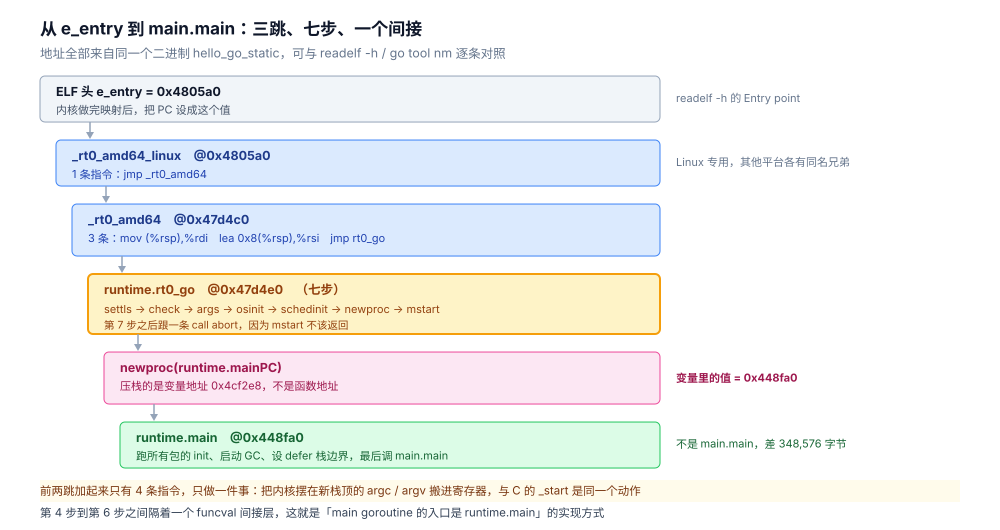

# 从源码到 main

> 一个 `main.go` 敲了回车之后，`go build` 先把它拆成 62 个包、编出 61 个 `.a`（合计 32.7 MB），再由链接器压成一个 2.4 MB 的可执行文件；内核把它装载起来，入口不是 `main`，而是 `_rt0_amd64_linux` 的一条 `jmp`。这篇讲这条路。
>
> 同一条链路上还有三篇，分工是：
>
> | 篇 | 讲哪一段 | 边界 |
> |---|---|---|
> | [从可执行文件到第一条指令.md](../../../02-计算机基础/编译原理/从可执行文件到第一条指令.md) | 二进制 → 进程（ELF、`execve`、装载、`e_entry`） | 语言无关，Go 静态与 C 动态同场对照 |
> | **本篇** | **源码 → 二进制（编译单元、链接器、Go 特有段），再交代到 `main` 的交接点** | 只讲 Go 特有部分 |
> | [程序启动流程.md](程序启动流程.md) | `rt0_go` 内部的七个阶段逐段剖析 | 本篇只给时间序，不复述内部 |
> | [编译与gcflags.md](../工程实践/编译与gcflags.md) | `-gcflags` / `-ldflags` 怎么用、静态与动态、镜像瘦身 | 本篇不复述参数用法 |
>
> 素材来源：本机 Docker 实测（`golang:1.26-bookworm`，go1.26.8 / gcc 12.2 / 内核 6.18.54.1-WSL2）。本篇是链路篇，口吻为陈述式而非面试题式。

---

## 一、从零：一条命令，62 个包，1 次链接

**本节要点**：`go build` 不是「编译一个文件」，而是「编译一整个依赖闭包」。看清楚它实际调了什么，后面所有的体积、速度、缓存问题才有解释。

### 1.1 `go build` 到底调了谁

加 `-x` 打印所有子命令，`-a` 强制重建（否则全命中构建缓存，什么都看不到）：

```bash
CGO_ENABLED=0 go build -x -a -o hello hello.go 2>&1 \
  | grep -oE '/(compile|link|asm|buildid|pack)\b' | sort | uniq -c
```

一个「Hello, World」的结果：

```text
     62 asm
     61 compile
      1 link
```

**61 次 `compile`**：一个包一次。**62 次 `asm`**：汇编器，标准库里的 `runtime`、`internal/bytealg`、`crypto` 系都带 `.s` 文件，每一个都要过一遍。**1 次 `link`**：只在最后，把所有东西合成一个文件。

依赖闭包有多大：

```bash
CGO_ENABLED=0 go list -deps hello.go | wc -l    # 62
```

62 个包里 **61 个是标准库**，最后一个是 `command-line-arguments`（就是你的 main 包）。也就是说，「打印一行字」这个动作，拖进来的是整个标准库的启动子集：`runtime`、`internal/abi`、`internal/cpu`、`sync`、`unicode`、`reflect`、`os`、`fmt`、`strconv`……

### 1.2 `-work` 留住中间产物

`go build` 默认把中间目录用完就删。加 `-work` 保留：

```bash
W=$(CGO_ENABLED=0 go build -a -work -o /tmp/hh hello.go 2>&1 | grep '^WORK=' | cut -d= -f2)
echo $W          # /tmp/go-build1392583511
```

里面的内容：

```text
顶层目录数  61          每个包一个 b0xx 目录
.a 文件数   61
.a 合计     32,726,000 字节（32.7 MB）
.o 文件数   36
```

**中间产物 32.7 MB，最终二进制 2.4 MB，差 13.6 倍。** 这个比例就是链接器「去重 + 丢弃未被引用符号」的量化结果——不是它压缩了什么，而是它**只把用得到的那部分装进输出**。


读法：从左到右四个块，「1 次 link」只出现在最后一步——前面 123 次工具调用全是 compile 与 asm，一个包一次。中间那个 32.7 MB 是理解「为什么 go build 慢、为什么构建缓存重要」的关键数字。

### 1.3 每个 `.a` 里只有两样东西

```bash
go tool pack t <某个 .a>
```

```text
__.PKGDEF
_go_.o
```

- `__.PKGDEF`：**导出数据**（export data）。这个包对外暴露了什么类型、函数签名、内联体，都在这里，而且是一种编译器内部的二进制格式，不是源码。
- `_go_.o`：目标代码（Go 自己的目标文件格式，不是 ELF `.o`）。

下游的包只读 `__.PKGDEF`，不读上游源码。这就是为什么**删掉一个依赖的源码目录，只要构建缓存里还有它的 `.a`，编译照样能过**；也是为什么两个包互相 import 时不报错而只是循环引用报错——编译期只按导出数据走。

### 1.4 跑起来

```bash
CGO_ENABLED=0 go build -o hello hello.go && ./hello
```

到这里「源码 → 二进制」这一段就结束了。剩下的问题是：那 32.7 MB 是怎么变成 2.4 MB 的（第三节），以及 2.4 MB 里到底装了什么（第四节）。

---

## 二、原理：编译单元是包，不是文件

**本节要点**：Go 的编译粒度是 package。一个包里的所有 `.go` 文件一起编，产出一个 `.a`。这决定了两件日常能感知到的事：改一行要重编多少，以及为什么「拆包」能加快构建。

### 2.1 62 个包、61 次 compile、36 个 `.o`

三个数不一样，各有原因：

| 数 | 为什么 |
|---|---|
| 62 个包 | `go list -deps` 数出来的，含 `main` 自身 |
| 61 次 `compile` | 有一个包不含 Go 代码（纯汇编或用导出数据交付），不需要 compile |
| 36 个 `.o` | `.o` 是**汇编器的产物**，只有带 `.s` 的包才有；其余 25 个包只有 `_go_.o` 在 `.a` 里 |

所以「61 次 compile + 62 次 asm」并不意味着 123 个目标文件被链接——很多 `.a` 是 archive，链接器按需取用里面的成员。

### 2.2 一个包内的改动会重编整包

`compile` 的入参是**一组文件**（该包目录下所有参与构建的 `.go`，加上 `-p` 指定的包路径），不是单个文件。改其中任意一个，整个 `.a` 失效。

但**不会**连锁重编下游——只要导出数据没变。Go 的构建缓存对每个包的 key 里包含「自己的源码哈希 + 依赖的导出数据哈希」，所以：

- 只改了函数体、签名不变 → 下游包的 key 不变 → 下游不重编，只重链
- 改了导出签名 → 下游全部重编

这就是「加一个参数就全量重编、改个实现只用几秒」的机制。

### 2.3 依赖的是导出数据，不是源码

`__.PKGDEF` 里存的不只是签名，还有**内联体**。

Go 的内联是跨包的：`fmt.Println` 能被内联进你的 `main`，靠的就是 `fmt.a` 的 `.PKGDEF` 里带着 `Println` 的中间表示。这也解释了一个反直觉的现象——**`-gcflags` 的内联诊断信息（`-m`）常常指向标准库里的行**，因为编译你的包时，编译器在拿标准库的导出数据做内联。

---

## 三、原理：链接器做的五件事

**本节要点**：链接器不是「把 `.a` 拼起来」，而是重新分配地址、重算每个符号的偏移、并生成几张运行时必需的索引表。Go 二进制「大」的主因就出在第 4 件事上。

### 3.1 收集与去重

61 个 `.a` 里必然有重复符号（同一个 `runtime` 函数被多个包引用的是同一份，但类型描述、`itab` 这类可能被多处生成）。链接器按「包路径 + 符号名」建全局符号表，同一符号只保留一份。

去重是 32.7 MB → 2.4 MB 的第一个来源。

### 3.2 布局：把段切成 `PT_LOAD`

链接器定义了一个固定的段序（`.text` → `.rodata` → `.typelink` → `.itablink` → `.gopclntab` → `.go.buildinfo` → `.data` → `.bss`），然后按页对齐切成若干 `PT_LOAD`。这就是为什么 `readelf -lW` 里 Go 程序只有 3 个 `LOAD`，而同样功能的 C 程序有 4 个——Go 把「可执行」与「只读」尽量并到同一段里，减少页表项。

### 3.3 重定位

编译每个包时，谁也不知道 `fmt.Println` 最终落在哪个地址。`.a` 里记的是「这里有个指向 `fmt.Println` 的占位」。链接器分配完地址后，把这些占位逐个改写成真实偏移。

这一步也是「为什么 `go tool nm` 的地址只能配同一个二进制」的原因：不同二进制布局不同，同一个符号的地址一定不同。拿 A 的地址去反汇编 B，会落在别的函数中间。

### 3.4 生成 `.gopclntab`：PC → 函数 → 行号

这是 Go 特有的一步，也是体积最大的一步。链接器把所有函数的「程序计数器区间 ↔ 函数名/文件名/行号」编成一张压缩表写进 `.gopclntab`。

它的作用是让**任何地址都能自解释**：

- `panic` 打印调用栈时，不需要符号表，运行时直接查这张表
- `runtime.Caller`、`pprof` 的火焰图、`GOTRACEBACK` 全部依赖它
- 所以 Go 程序**默认带符号**，即使 `strip` 掉了 ELF 的 `.symtab`

### 3.5 写 buildinfo 与 `-X` 注入

链接器把构建元信息写进 `.go.buildinfo`（224 字节）：

```text
$ go version -m hello_go_static
hello_go_static: go1.26.8
	path	command-line-arguments
	build	-buildmode=exe
	build	-compiler=gc
	build	CGO_ENABLED=0
	build	GOARCH=amd64
	build	GOOS=linux
	build	GOAMD64=v1
```

`-X` 也是在这一步生效——它把某个 `var` 的**初始值**改写掉，源码里的 `var version = "dev"` 在最终二进制里就是 `"1.2.3-rc1"`：

```text
$ ./bi_dev              → version = dev
$ ./bi_rel              → version = 1.2.3-rc1
```

两个二进制体积分别是 2,397,395 与 2,397,452 字节，差 57 字节——**`-X` 只改数据，不改代码**。这也意味着「用 `-X` 注入的版本号」在二进制里是明文可搜的，不能用来藏密钥。

### 3.6 赋 `runtime.mainPC`

最后一件、也是最容易被忽略的事：链接器把 `main.main` 的地址写进一个全局变量 `runtime.mainPC`，并把这个变量的地址作为 `rt0_go` 那个 `newproc` 的参数。

也就是说，**`runtime.mainPC` 是一个 funcval，它的 `.fn` 字段才是真正的入口**。第 5.3 节会把这条读出来验证。

---

## 四、Go 特有段：2.4 MB 里有一半不是代码

**本节要点**：`.gopclntab` 665 KB 比代码段 `.text` 643 KB 还大。它交换来的是「任何地址都能反查函数与行号」，代价是体积。

### 4.1 段体积分布

同一个 `hello_go_static`（2,397,206 字节）：

| 段 | 字节 | 占可执行内容 |
|---|---|---|
| `.gopclntab` | 665,474 | **43.4%** |
| `.text` | 643,537 | 42.0% |
| `.rodata` | 222,018 | 14.5% |
| `.typelink` | 2,056 | 0.1% |
| `.go.buildinfo` | 224 | 0.0% |
| `.itablink` | 136 | 0.0% |

「可执行内容」合计 1,533,725 字节，剩下的 **863,481 字节是 ELF 符号表与字符串表**（`.symtab` / `.strtab`），不在上面这张表的统计口径里。

三个数要分清：**文件 2.4 MB、段表内容 1.53 MB、代码 0.64 MB**。任何「Go 二进制多大」的说法都得指定是哪一个。


读法：橙色那条是行号表，比蓝色的代码段还长——这是 Go 独有的一笔开销。灰色那条（符号表）是 `-s -w` 唯一能裁掉的东西，它与橙色那条毫无关系，这解释了为什么裁完符号 `panic` 栈依然有函数名。

### 4.2 四个特有段各自是什么

| 段 | 内容 | 谁在读 |
|---|---|---|
| `.gopclntab` | PC 区间 → 函数/文件/行号的压缩表 | `panic`、`runtime.Caller`、`pprof` |
| `.typelink` | 运行时类型的索引（`reflect` 遍历用） | `reflect`、GC 的类型扫描 |
| `.itablink` | 接口表索引（接口断言用） | 接口断言与 `reflect` |
| `.go.buildinfo` | 构建元信息 | `go version -m`、`debug.ReadBuildInfo` |

`.noptrdata` 在这个程序里是 0 字节——它只在有「不含指针的全局数据」时才非空，Hello World 没有。

### 4.3 `-s -w` 裁不掉 `.gopclntab`

`-s -w` 是「去掉符号表 + 去掉 DWARF」。实测裁前裁后：

```text
hello_go_static   .gopclntab  0xa2782  = 665,474 字节
hello_go_sw       .gopclntab  0xa2782  = 665,474 字节
```

**一模一样。** 原因很直接：`.gopclntab` 不在 `.symtab` 里，它是 `PT_LOAD` 的一部分（要能被 mmap 到内存里查），而 `-s -w` 只作用于调试信息。

这解释了一个常见的困惑：`-s -w` 之后体积确实小了（共性篇实测裁掉 789 KB），但 `panic` 的调用栈**照样带函数名和行号**——因为那张表根本不在被裁的范围内。想连它一起裁，得用 `-ldflags=-w -s` 之外的手段（比如破坏性剥离），代价是彻底失去栈信息。

### 4.4 它换来了什么

一张 665 KB 的表，换来的是「把任意地址贴到 `go tool addr2line` 里，就能得到函数名和行号」：

```bash
go tool addr2line hello_go_static   # 输入 0x49e140，输出 main.main / hello.go:8
```

线上抓到的崩溃地址、`pprof` 里那个十六进制指针、`GOTRACEBACK=system` 打出来的原始 PC，全靠它翻译成人话。这是 Go 与 C 的一个根本差别：**C 的符号在外挂的 `.symtab` 里，裁掉就没了；Go 的符号在运行时必读的段里，裁不掉。**

---

## 五、交接：第一条指令到 main

**本节要点**：从 `e_entry` 到 `main.main` 要跳三次、过七步。这一节只给时间序和交接点，`rt0_go` 内部每个阶段做了什么在 [程序启动流程.md](程序启动流程.md) 里逐节展开，这里不复述。

### 5.1 三跳

```text
ELF 头 e_entry = 0x4805a0
  │
  ├─ _rt0_amd64_linux  (0x4805a0)   1 条指令：jmp _rt0_amd64
  │
  ├─ _rt0_amd64        (0x47d4c0)   3 条指令：从栈顶取 argc/argv，再 jmp rt0_go
  │
  └─ runtime.rt0_go    (0x47d4e0)   Go 代码（汇编写），七个阶段
```

前两跳之所以只有 1 + 3 条指令，是因为它们只做一件事：**把内核摆在新栈顶的参数搬到寄存器里**，然后交给 Go 写的 `rt0_go`。这与 C 的 `_start`（12 条指令）是同一个动作，只是 C 还要自己调 `__libc_start_main` 做 libc 初始化，Go 不需要——它没有 libc。



读法：粉色那一格是全篇最容易看错的地方——`newproc` 收到的是 `runtime.mainPC` 这个**变量**的地址（0x4cf2e8），而变量里存的值是 `runtime.main`（0x448fa0）。所以真正的执行顺序是 `rt0_go → runtime.main → main.main`，中间隔着 348,576 字节的运行时。

### 5.2 `rt0_go` 的七个阶段

从 `objdump` 里能直接读出来的调用序（地址是同一个二进制的）：

| 序 | 调用 | 地址 | 一句话 |
|---|---|---|---|
| 1 | `runtime.settls` | 0x47d599 | 把 g0 的地址写进线程本地存储（TLS） |
| 2 | `runtime.check` | 0x47d5de | 九个编译期/运行期一致性检查，不通过就 `abort` |
| 3 | `runtime.args` | 0x47d5f4 | 把 argc/argv 存成 Go 的切片，解析 auxv |
| 4 | `runtime.osinit` | 0x47d5f9 | 取 CPU 核数、物理页大小、是否 CGO |
| 5 | `runtime.schedinit` | 0x47d5fe | 初始化栈池、内存分配器、调度器、GC |
| 6 | `runtime.newproc` | 0x47d60b | 创建 main goroutine |
| 7 | `runtime.mstart` | 0x47d611 | 进入调度循环，此时才真正开始跑 Go 代码 |

第 7 步之后跟着一条 `call runtime.abort`——因为 `mstart` 永远不该返回。这七个阶段每一个的内部逻辑（栈池的两个层级、分配器的五步、调度器的前后段）在 [程序启动流程.md](程序启动流程.md) 里各有专节，本篇只交代顺序。

### 5.3 `newproc` 的参数不是 `main.main`

这一步值得单独看，因为它与「程序入口是 main」的直觉正好相反。`newproc` 前面两条指令：

```text
47d603: lea 0x51cde(%rip),%rax        # 4cf2e8 <runtime.mainPC>
47d60a: push %rax
47d60b: call 481540 <runtime.newproc.abi0>
```

压栈的是 **`runtime.mainPC` 这个变量的地址**，不是 `main.main` 的函数地址。读一下这个变量在文件里的值（`0x4cf2e8` 所在 `LOAD` 段、换算文件偏移、读 8 字节）：

```text
runtime.mainPC 在文件偏移 0xcf2e8，值 = 0x448fa0
```

对照符号表：

```text
  448fa0 T runtime.main
  49e140 T main.main
```

**值等于 `runtime.main`，不是 `main.main`。** 所以执行顺序是：

```text
rt0_go → newproc(runtime.mainPC) → 调度 → runtime.main → main.main
                                          ↑
                          这里才做包初始化（init）、启动 GC、
                          设置 defer 的栈边界、调 main.main
```

`main.main`（0x49e140）离 `runtime.main`（0x448fa0）有 **348,576 字节（340 KB）**的代码距离，中间全是运行时。这就是为什么「入口不是 main」不只是个说法——它确实隔着一大段。

### 5.4 包初始化花了多久

`main.main` 之前还要跑所有包的 `init`。`GODEBUG=inittrace=1` 会把每个包的开销打出来：

```text
init internal/bytealg @0 ms, 0 ms clock, 0 bytes, 0 allocs
init internal/runtime/gc/scan @0.035 ms, 0 ms clock, 0 bytes, 0 allocs
init runtime @0.072 ms, 0.90 ms clock, 0 bytes, 0 allocs
init math @2.3 ms, 0 ms clock, 0 bytes, 0 allocs
init errors @3.0 ms, 0 ms clock, 0 bytes, 0 allocs
init sync @3.8 ms, 0 ms clock, 0 bytes, 0 allocs
init syscall @4.7 ms, 0.018 ms clock, 304 bytes, 5 allocs
init os @5.0 ms, 0.095 ms clock, 416 bytes, 9 allocs
init reflect @4.5 ms, 0 ms clock, 0 bytes, 0 allocs
```

一个 Hello World 有 **15 个包带 `init`**，最后一个（`reflect`）落在 4.5 ms 左右。注意第二列是「相对进程启动的时刻」而不是耗时，第三列 `clock` 才是这个包自己花的 CPU 时间——`runtime` 包花了 0.90 ms，是最贵的一个。

这个日志本身有开销（每次 init 都要读时钟），所以它测出的绝对值偏大。真实启动时间看外部测量：本机容器内 **4.5 ~ 7.0 ms**（同机 C 程序 2.5 ~ 2.9 ms）。

---

## 六、排障：现象到原因

**本节要点**：从「二进制不对」「启动慢」「栈信息丢了」三类现象往回查，比通读链路快。

| 现象 | 先查 | 原因 |
|---|---|---|
| `go build` 秒回但产物没更新 | `-work` 是否空、`GOCACHE` 位置 | 全命中缓存；`-a` 才强制重建 |
| 二进制 2 MB 上下去不掉 | `readelf -SW \| grep gopclntab` | `.gopclntab` 占 40%+，`-s -w` 裁不掉 |
| `-s -w` 后 panic 栈仍有函数名 | 同上 | 栈信息来自 `.gopclntab`，不来自 `.symtab` |
| `go tool addr2line` 输出不对 | 地址是不是从这个二进制取的 | 不同二进制布局不同，地址不能跨文件用 |
| 反汇编出来是乱码 | `go tool nm` 与 `objdump` 是不是同一个文件 | 同上 |
| `-X` 注入的版本号没生效 | 变量是不是包级 `var`、路径写没写全 | `-X importpath.name=value`，且变量不能被编译器优化掉 |
| 启动比预期慢 | `GODEBUG=inittrace=1` | 找那个 `clock` 最大的包，通常是某个 SDK 的 `init` 在连网 |
| 镜像里跑不起来，报 `not found` | `file <binary>` 看有没有 `interp` | CGO 打开了会变成动态链接，alpine 上没有那个 loader |
| 改了代码下游全量重编 | 是不是改了导出签名 | 导出数据变了，下游缓存 key 全失效 |

一条最常用的命令：

```bash
go version -m <binary>
```

它能回答「这个二进制是谁编的、什么版本、什么模式、注入了什么」——线上排查「跑的是不是我以为的那个包」，比看文件名可靠。

---

## 七、校验口径

> ✅ 实测（`golang:1.26-bookworm`，go1.26.8 / gcc 12.2 / 内核 6.18.54.1-WSL2 / 容器 4 核无配额）：

- `go build -x -a` 的工具调用次数：正则匹配输出行里的 `/compile` `/asm` `/link` 后计数，一次采集。
- 中间产物：`go build -a -work` 拿 `WORK=` 路径，`find` 统计 `.a` / `.o` 数量与字节数。
- 段体积：`readelf -SW` 第 7 列（Size）解析；百分比以「段表总量 1,533,725 字节」为分母，符号表另算。
- `-s -w` 对照：同一份 `hello.go` 分别编 `hello_go_static` 与 `hello_go_sw`，比对 `.gopclntab` 的 Size。
- `-X`：`bi_dev` 与 `bi_rel` 两个二进制，分别跑并 `stat -c%s` 比对体积。
- `runtime.mainPC`：从 `objdump` 读出变量地址 `0x4cf2e8`，按 `readelf -lW` 的 `LOAD` 段换算文件偏移，用 Python 读 8 字节小端，再与 `go tool nm` 的符号地址对照。
- `inittrace`：`GODEBUG=inittrace=1 ./hello_go_static`，行数即带 `init` 的包数。
- 启动耗时：二进制 `cp` 到容器内 `/tmp` 后跑 3 轮 × 10 次取区间（见下条）。

⚠️ **未实测 / 边界**：

- **二进制必须放容器内路径再测启动。** 放在宿主 bind mount（virtiofs）上时，`hello_go_static` 从 4.5 ms 涨到 25 ms，同一份文件、同一时刻，只差路径。任何与「文件页是否驻留」有关的测量都会被这一点污染。
- 没有测「大项目」的编译：62 个包是最小闭包，真实服务的包数常在上千，`compile` 次数与 `.a` 总量不可按比例外推。
- 没有测链接器在 `-linkmode=internal` 与 `external` 下的差异（外部链接需要 CGO，属 [编译与gcflags.md](../工程实践/编译与gcflags.md) 的范围）。
- `.a` 内部的 `__.PKGDEF` 格式是编译器私有的二进制，本篇只按「导出数据」这一层描述，没有解析其字节结构。
- 段体积百分比的分母是段表总量，不是文件大小；两者差 863 KB 的符号表。写「Go 二进制 2.4 MB」时要注意说的是哪个数。

---

## 延伸追问

- **61 个包为什么会有 62 次 `asm`？** 汇编器是按「含 `.s` 文件的包子集」调用的，一个包若同时有多个 `.s`（比如 `runtime` 里 `asm_amd64.s`、`preempt_amd64.s`、`sys_linux_amd64.s`），可以一次调完也可以分次。62 这个数是「汇编器被调用的次数」，不等于「包的个数」；它的值会随 Go 版本变化，不必记数字，记「量级与 compile 相当」即可。
- **构建缓存的 key 里到底有什么？** 至少包含：编译器的版本与构建参数（`GOEXPERIMENT`、`-gcflags`）、该包所有源文件的哈希、以及**每个依赖的导出数据哈希**。最后一项是关键——它让「改了实现但没改签名」不至于引发下游重编，也让「依赖升级但自己没动」必然触发重编。
- **`strip` 之后 `go tool nm` 没输出了，为什么 `addr2line` 还能用？** 两者读的是不同的表。`nm` 读 `.symtab`，`strip` 把它删了；`addr2line` 走的是 `.gopclntab`，它在 `PT_LOAD` 里、属于运行时要用的内容，删了程序就跑不了。这也是为什么 Go 二进制的「符号残留」比 C 严重——它的符号是运行时的基础设施，不是可选的调试信息。
- **跨包内联到底靠什么？** 靠 `__.PKGDEF` 里的内联体。编译器在编你的包时，从依赖的 `.a` 里读出被调用函数的中间表示，直接塞进调用点。所以内联决策发生在**调用方**的编译期，而不是被调用方——这解释了一个常见现象：给标准库加 `-gcflags` 是无效的，因为标准库早就以 `.a` 形式躺在缓存里了。
- **36 个 `.o` 与 61 个 `.a` 是什么关系？** `.o` 是汇编器的产物，只有带 `.s` 的包才有；`.a` 是归档，每个包一个，里面装 `__.PKGDEF` 与 `_go_.o`（可能还有多个汇编产生的 `.o`）。所以 `.a` 里有 `.o`，但 `.a` 的个数由包数决定、`.o` 的个数由汇编文件数决定。

---

## 关联

- [从可执行文件到第一条指令.md](../../../02-计算机基础/编译原理/从可执行文件到第一条指令.md) — **上游**。本篇终点是那个二进制的 `e_entry`，那篇从 `e_entry` 讲到第一条指令。
- [程序启动流程.md](程序启动流程.md) — **下游机制**。本篇第 5.2 节只给 `rt0_go` 的七步时间序，每个阶段内部做什么在那篇逐节展开。
- [编译与gcflags.md](../工程实践/编译与gcflags.md) — **互补**。本篇讲「链路」，那篇讲「旋钮」：`-gcflags` 看内联与逃逸、`-ldflags` 瘦身、静态与动态链接的取舍。
- [AOT、JIT与解释执行.md](../../../02-计算机基础/编译原理/AOT、JIT与解释执行.md) — **总纲·对照**。本篇是「构建期编译」这第一条路线的落地，那篇把它与 JIT、解释执行放在一起比。
- [执行链路.md](../../php/执行链路.md) — **横向对照**。PHP 侧对应的那条链：构建期为空白，编译被推迟到每个请求。
> 反向引用（本篇被下列文档引到）：[JIT与执行引擎.md](../../java/运行时/JIT与执行引擎.md)、[JVM启动与参数体系.md](../../java/运行时/JVM启动与参数体系.md)、[对象布局与引用类型.md](../../java/运行时/对象布局与引用类型.md)、[类文件与字节码.md](../../java/运行时/类文件与字节码.md)
