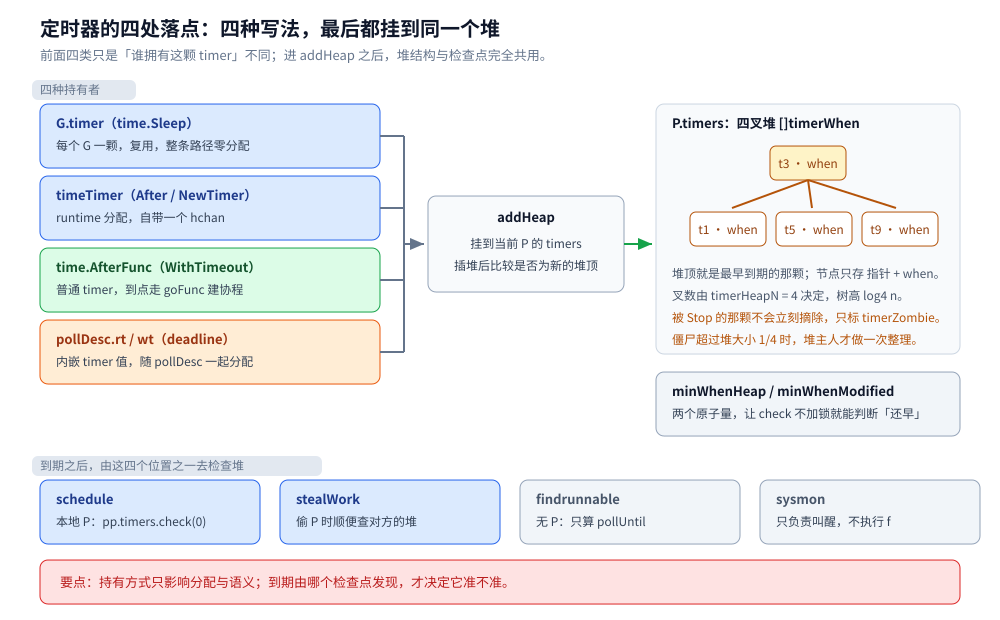
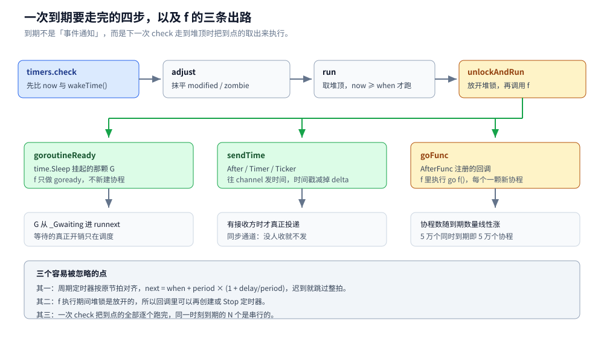
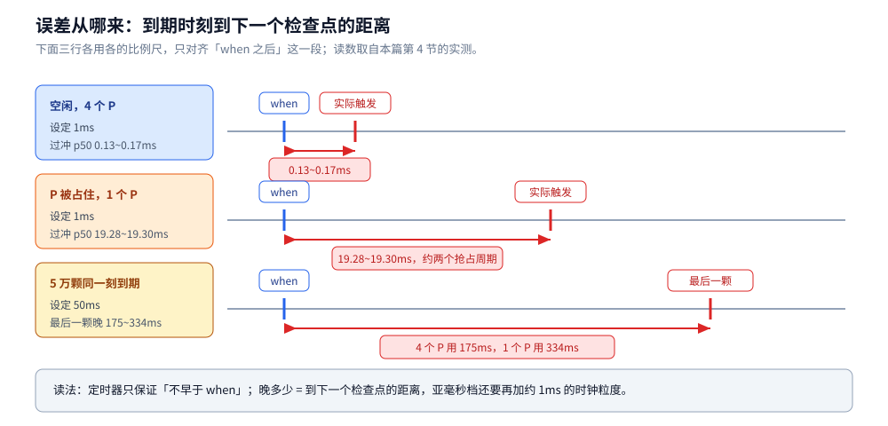

# 定时器与超时

> 覆盖：`time.Sleep` / `After` / `Timer` / `Ticker` 在 runtime 里的落点——定时器存在哪里（每个 P 一个四叉堆）、到期由谁发现、`Stop` / `Reset` 的返回值为什么反直觉、`context.WithTimeout` 与 `SetReadDeadline` 怎么搭在定时器上，以及「只保证不早于」的误差从哪里来。
>
> 不覆盖：五种定时任务写法与漂移 / 丢拍 / 漏跑 / 重入 / 多副本这些**调度语义**见 [标准库实现.md](../工程实践/定时任务/标准库实现.md)；时间轮这类替代结构见 [时间轮.md](../../../02-计算机基础/数据结构/高级数据结构/时间轮.md)；堆本身怎么实现见 [堆与优先队列.md](../../../02-计算机基础/数据结构/堆/堆与优先队列.md)；`SetReadDeadline` 的网络侧机制见 [网络IO与netpoll.md](网络IO与netpoll.md)；`context` 的取消传播见 [context.md](../工程实践/context.md)。
>
> 内容整理自个人学习笔记，素材见 [素材清单](../../../素材清单.md)。**实测口径**：`golang:1.26-alpine`（go1.26.8 linux/amd64，容器 4 CPU，WSL2 内核 6.18.54.1）；计时类读数连跑 3 轮给区间，只断言量级与趋势；`GODEBUG` 对照在同一个二进制上换环境变量跑；源码摘录与该版本行号一一对应。

---

## 一、`time.Sleep(1ms)` 到底睡了多久？

**本节要点**：定时器的承诺只有一半——**不早于**是保证，**不晚于**不是。先把误差量出来，再顺着源码找它从哪来。

### 1.1 从零开始：38 行量出过冲

```go
package main

import (
	"fmt"
	"runtime"
	"time"
)

func main() {
	fmt.Printf("GOMAXPROCS=%d\n", runtime.GOMAXPROCS(0))
	for _, d := range []time.Duration{100 * time.Microsecond, time.Millisecond, 10 * time.Millisecond} {
		var sum time.Duration
		for i := 0; i < 100; i++ {
			start := time.Now()
			time.Sleep(d)
			sum += time.Since(start) - d
		}
		fmt.Printf("d=%-6s 平均过冲=%v 平均实际=%v\n", d,
			(sum / 100).Round(10*time.Microsecond), (d + sum/100).Round(10*time.Microsecond))
	}
}
```

```text
GOMAXPROCS=4
d=100µs  平均过冲=970µs  平均实际=1.07ms
d=1ms    平均过冲=180µs  平均实际=1.18ms
d=10ms   平均过冲=350µs  平均实际=10.35ms
```

三件事一眼可见：**没有一次负过冲**（「不早于」成立）；**亚毫秒被整体抬高**（100µs 实际睡了 1.07ms）；**毫秒以上有固定底噪**（1ms 过冲 0.17~0.18ms，10ms 过冲 0.32~0.35ms，三轮区间）。

### 1.2 三次跳转：`Sleep` 根本没有系统调用

`time.Sleep` 在标准库里只有声明，函数体在 runtime：

```go
// time/sleep.go:14
func Sleep(d Duration)
```

```go
// runtime/time.go:329
//go:linkname timeSleep time.Sleep
func timeSleep(ns int64) {
	if ns <= 0 {
		return
	}

	gp := getg()
	t := gp.timer
	if t == nil {
		t = new(timer)
		t.init(goroutineReady, gp)
		if gp.bubble != nil {
			t.isFake = true
		}
		gp.timer = t
	}
	var now int64
	if bubble := gp.bubble; bubble != nil {
		now = bubble.now
	} else {
		now = nanotime()
	}
	when := now + ns
	if when < 0 { // check for overflow.
		when = maxWhen
	}
	gp.sleepWhen = when
	if t.isFake {
		// Call timer.reset in this goroutine, since it's the one in a bubble.
		// We don't need to worry about the timer function running before the goroutine
		// is parked, because time won't advance until we park.
		resetForSleep(gp, nil)
		gopark(nil, nil, waitReasonSleep, traceBlockSleep, 1)
	} else {
		gopark(resetForSleep, nil, waitReasonSleep, traceBlockSleep, 1)
	}
}
```

三个细节决定了这条路径很便宜，也决定了它的误差：

- **定时器跟着 G 走**：`gp.timer` 一个 G 只分配一次，之后每次 `Sleep` 复用同一颗，所以 `Sleep` 本身不产生分配，只改 `when`；
- **挂起时什么锁都不持有**：`gopark` 把 G 改成 `_Gwaiting` 就换下一个 G，M 不会被 `Sleep` 拖住——这一点与 [网络IO与netpoll.md](网络IO与netpoll.md) 第三节的 `gopark` 是同一套机制；
- **不是睡在系统调用里**：没有 `nanosleep`，只有「往堆里塞一颗定时器 + 让出 P」。

### 1.3 为什么 `reset` 必须放在挂起之后

注意 `gopark` 的第一个参数不是 `nil`，而是 `resetForSleep`：

```go
// runtime/time.go:371
func resetForSleep(gp *g, _ unsafe.Pointer) bool {
	gp.timer.reset(gp.sleepWhen, 0)
	return true
}
```

`gopark` 的回调在 G 已经变成 `_Gwaiting`、且还持有 G 的调度锁时执行。源码注释把原因写得很直白：如果在 `timeSleep` 里直接 `reset`，**短睡眠 + 大量协程**时，定时器可能在「G 还没挂起」的窗口里就到点，`goroutineReady` 调 `goready` 时 G 还是 `_Grunning`，这次唤醒就丢了——G 睡过去，再没人叫它。

同一条规则在别处也成立：**凡是「先登记、后挂起」的等待，登记动作必须放在挂起回调里**，否则就会丢唤醒。

## 二、定时器存在哪里？

**本节要点**：不是一个全局堆，而是**每个 P 一个堆**；堆节点是「指针 + 到期时刻」，四叉堆；堆上的定时器靠三个状态位在「改动」与「删除」之间打标记，真正的整理推迟到下一次检查。

### 2.1 每个 P 一个 `timers`

```go
// runtime/time.go:131
type timers struct {
	mu mutex

	heap []timerWhen

	len  atomic.Uint32
	zombies atomic.Int32

	raceCtx uintptr

	minWhenHeap     atomic.Int64
	minWhenModified atomic.Int64
}

type timerWhen struct {
	timer *timer
	when  int64
}
```

P 里就一个字段（`runtime/runtime2.go:891`）：

```go
	// Timer heap.
	timers timers
```

堆节点只存「指针 + 时刻」而不是整个 `timer`，让 `siftUp` / `siftDown` 搬动的数据尽量小。排序键是 `when`，同一时刻再按 `timer.rand` 排（只有 fake time 才会出现真正同刻的情况）。

真正被持有的定时器有四类对象，它们最后都落到某个 P 的堆上：



四类持有者的区别只在前半段：`G.timer` 省掉每次分配，`timeTimer` 多带一个 `hchan`，`pollDesc.rt` / `wt` 是**内嵌值**（顺手省一次分配），`context` 的 `timerCtx` 什么都没多带、就是一个 `time.AfterFunc`。到了 `addHeap` 之后，它们走的是完全相同的堆与检查逻辑。

### 2.2 为什么是四叉堆

```go
// runtime/time.go:1343
const timerHeapN = 4
```

`timerHeapN` 就是这个堆的叉数，`siftUp` 找父节点用 `(i-1)/timerHeapN`，`siftDown` 在最多 4 个子节点里挑最小。叉数直接决定树高：100 万个定时器，二叉堆 20 层、四叉堆 10 层。

层数少不等于总代价小——四叉堆每层要多比较 2~3 次。本机微基准（同样的数据、同样的实现，只换叉数）：

| n | 叉数 | 树高 | 逐个插入 | 全部弹出 | 合计 |
|---|---|---|---|---|---|
| 100 万 | 2 | 20 | 64~69ms | 315~339ms | 378~408ms |
| 100 万 | 4 | 10 | 42~47ms | 330~400ms | 372~447ms |
| 100 万 | 8 | 7 | 25~35ms | 380~496ms | 405~531ms |

读法：**插入四叉比二叉快约 35%，弹出反而略慢**，合计基本持平（三轮区间有重叠）。所以四叉不是「全面更快」，而是把成本压在了「注册多、到期少」这一侧——一个长驻服务里绝大多数定时器是注册后很久才到期（或干脆被 `Stop`），插入才是热路径。

### 2.3 三个状态位：改动和删除都只是「打标记」

```go
// runtime/time.go:202（节选）
const (
	timerHeaped uint8 = 1 << iota
	timerModified
	timerZombie
)
```

- `timerHeaped`：这颗定时器在某个 P 的堆里；
- `timerModified`：`when` 已经被改（`Reset`、周期定时器重新定时），但堆里那条 `timerWhen` 还是旧值，等有锁的时候再重排；
- `timerZombie`：已经被 `Stop`，但还赖在堆里。

为什么只能打标记？因为**改它的人不一定是堆的主人**。`time.Timer.Reset` 可能在任意 P 上调用，而堆的锁在另一个 P 手里；为了一次 `Reset` 去抢别人的堆锁不划算，所以先在自己这颗 timer 上置位，等堆主人下次 `check` 时统一整理（`adjust`）。

清理的触发点有两个：

- `maybeAdd` 在入堆前先调一次 `cleanHead()`，把堆顶的僵尸顺手摘掉；
- 本地 P 的 `check` 发现僵尸超过堆大小的 1/4 就强制整理：

```go
// runtime/time.go:1030
force := ts == &getg().m.p.ptr().timers && int(zombies) > int(ts.len.Load())/4
```

注意第二个条件里的 `ts == 本地 P`：**只有堆主人才做全量整理**，别的 P 就算看到别处的僵尸也不动手，避免所有 P 抢同一把锁。

### 2.4 没人收的 channel 定时器根本不进堆

这是 1.23 之后最反直觉的一条：`time.NewTimer(d)` 创建出来、但没有任何人卡在 `<-t.C` 上时，这颗定时器**不会进入任何堆**。

```go
// runtime/time.go:682（节选）
func (t *timer) needsAdd() bool {
	assertLockHeld(&t.mu)
	need := t.state&timerHeaped == 0 && t.when > 0 && (!t.isChan || t.blocked > 0)
	// 省略：timerDebug 打开时的 trace 输出
	return need
}
```

`t.blocked` 是「有几个协程正阻塞在这颗定时器的 channel 上」。没人等 → `needsAdd` 为假 → `maybeAdd` 什么都不做。所以：

- `time.After(time.Hour)` 只要没人接收，既不进堆也不触发，丢掉引用后还能被 GC 收回——**300000 个丢弃的 `After(1h)`，堆内存停在 0.1MB**（第 5 节的实测）；
- `Stop` 在这种定时器上永远返回 `true`，因为「它根本没跑过」。

## 三、到点了，谁在跑这个定时器？

**本节要点**：没有「定时器线程」。到期只是让它在堆顶冒出来，真正跑它的是**下一次有人检查这个堆的时刻**——可能来自调度循环、偷 P 的动作，或睡在 epoll 里的那条 M。

### 3.1 检查点只有三个半

```text
schedule ──► pp.timers.check(0, nil)            每次调度循环都看一眼本地 P
stealWork ─► p2.timers.check(now, nil)          偷 P 时顺便检查对方的堆
findrunnable ─► checkTimersNoP(allp, mask, ...)  没有 P 在手，只读原子量算 pollUntil
sysmon ────► timeSleepUntil()                   只决定自己睡多久，不跑定时器
```

前三个是真跑定时器的；`sysmon` 只负责「保证有人醒着去跑」——它自己不带 P，不能执行 Go 代码里的 `f`。

`findrunnable` 那条要特别说明：它没有 P，而 `check` 里的 `adjust` 可能要扩堆（分配内存），所以这里只能退化成 `checkTimersNoP`——只读各 P 的 `minWhenHeap` / `minWhenModified` 两个原子量，算出「最早什么时候该有人来看一眼」，不碰任何堆。

### 3.2 `check` 的快路径：先看两个原子量

```go
// runtime/time.go:985
func (ts *timers) wakeTime() int64 {
	nextWhen := ts.minWhenModified.Load()
	when := ts.minWhenHeap.Load()
	if when == 0 || (nextWhen != 0 && nextWhen < when) {
		when = nextWhen
	}
	return when
}
```

然后 `check` 拿 `now` 与它比：

```go
// runtime/time.go:1024（节选）
zombies := ts.zombies.Load()
// 省略：zombies < 0 的防御性 badTimer()
force := ts == &getg().m.p.ptr().timers && int(zombies) > int(ts.len.Load())/4

if now < next && !force {
	return now, next, false
}
```

**没到期就立刻返回**，一把锁都不拿。这是定时器多但都不急的程序（长连接服务、长 TTL 缓存）几乎不付代价的原因；也是 `minWhenHeap` / `minWhenModified` 这两个原子量存在的全部意义——让「看一眼」不用锁堆。

真到期时才加锁，走 `adjust`（把 `timerModified` / `timerZombie` 抹平）→ 循环 `run`（取堆顶、判断是否到点、执行 `f`），直到堆顶又变成「还没到」，把它作为 `pollUntil` 返回给调用方。

### 3.3 执行 `f` 之前先放开堆锁

```go
// runtime/time.go:1119（节选）
func (t *timer) unlockAndRun(now int64, bubble *synctestBubble) {
	f := t.f
	arg := t.arg
	seq := t.seq
	var next int64
	delay := now - t.when
	if t.period > 0 {
		next = t.when + t.period*(1+delay/t.period)
	} else {
		next = 0
	}
	t.when = next
	if t.state&timerHeaped != 0 {
		t.state |= timerModified
		if next == 0 {
			t.state |= timerZombie
			t.ts.zombies.Add(1)
		}
	}
	t.unlock()
	// 省略：放开 ts.mu 后调用 f(arg, seq, delay)，返回前重新加锁
}
```

两个后果值得记住：

- **周期定时器按原节拍对齐**：`next = when + period*(1+delay/period)`，迟到的那些拍直接跳过，不累积漂移。`Ticker` 的「丢拍」就是这么来的（语义层面见 [标准库实现.md](../工程实践/定时任务/标准库实现.md) 第二节）；
- **执行 `f` 时堆锁是放开的**：所以 `f` 里可以再创建 / `Stop` 定时器，不会自锁。

`f` 只有三种，对应三种用户写法：



| 用户写法 | 运行时的 `f` | 到点后发生什么 |
|---|---|---|
| `time.Sleep` | `goroutineReady` | `goready(gp)`，G 进 runnext |
| `time.After` / `NewTimer` / `Ticker` | `sendTime` | 往 channel 发时间（同步通道，见 5.1） |
| `time.AfterFunc` | `goFunc` | `go f()`，新建一个协程 |

## 四、为什么定时器不保证准时？

**本节要点**：误差的主项不是「时钟不准」，而是「**到期之后过了多久才有人来检查这个堆**」。检查点的间隔取决于有没有 P 在跑、有没有人睡在 epoll 里、sysmon 睡多久。

### 4.1 精度下限：亚毫秒被抬到 1.1ms

同一台机器上扫一遍时长（空闲、`GOMAXPROCS=4`、每档 300 次，取 p50 过冲）：

| 设定 | 过冲 p50 | 实际睡眠 | 读法 |
|---|---|---|---|
| 100µs | 1.03~1.08ms | 1.13~1.18ms | 被时钟粒度抬高 |
| 300µs | 0.84~0.88ms | 1.14~1.18ms | 同上 |
| 600µs | 0.54~0.57ms | 1.14~1.17ms | 同上 |
| 900µs | 0.25~0.28ms | 1.15~1.18ms | 同上 |
| 1ms | 0.13~0.17ms | 1.13~1.17ms | 刚过粒度线 |
| 2ms | 0.26~0.31ms | 2.26~2.31ms | 固定底噪 |
| 5ms | 0.30~0.33ms | 5.30~5.33ms | 同上 |
| 10ms | 0.25~0.34ms | 10.25~10.34ms | 同上 |

**亚毫秒的四档全部落在 1.13~1.18ms**——这台 WSL2 虚拟机的时钟粒度就在 1ms 附近，小于粒度的睡眠没有意义；**1ms 以上则是一个稳定的 0.13~0.35ms 底噪**，它来自「到点 → 检查点发现 → 协程被调度上 CPU」这一小段。

这条读数直接给出选型判据：**要 1ms 以下的精度，`time.Sleep` 这条路径给不了**，得换忙等或者混合睡眠（先 `Sleep(d-余量)` 再自旋）。

### 4.2 P 被占住时，误差按「抢占周期」计

把 `GOMAXPROCS` 压到 1，同时放一个纯自旋的协程占住唯一的 P：

| 设定 | 过冲 p50 | 过冲 p99 |
|---|---|---|
| 1ms | 19.28~19.30ms | 39.38~39.60ms |
| 10ms | 10.27~10.29ms | 13.8~17.4ms |

定时器本身没有变慢：`when` 仍然精确，堆仍然有序，只是**没有 P 来检查它**。1ms 的睡眠要等约两个抢占周期（Go 的异步抢占约 10ms 一次），10ms 的睡眠等一个周期就够——所以两者的 p50 都落在 10ms 量级。

这也是 `4.1` 里那个「底噪」的极限放大版：误差 ≈「到期时刻到下一次检查点」的距离。



三行用的是三套比例尺：前两行以毫秒计，第三行已经到百毫秒；同一个「`when` 到下一个检查点」的距离，在三类负载下被放大了三个数量级。

### 4.3 同一瞬间到期很多个：尾巴按 N 叠

50000 个 `time.AfterFunc(50ms, ...)` 同时注册：

| GOMAXPROCS | 从开始到全部跑完 | 最后一个的延迟 | goroutine 峰值 |
|---|---|---|---|
| 4 | 227ms | 175ms | 13521 |
| 1 | 386ms | 334ms | 46956 |

「同一时刻到期」不是一个事件，而是**一次 `check` 里的循环**：`run` 每取一颗就执行一次 `f`，`AfterFunc` 的 `f` 又是 `go f()`。所以尾巴 ≈ N × 单颗处理成本 ÷ 并行度；`GOMAXPROCS=1` 时处理更慢，同时在队的协程也更多（峰值 4.7 万）。

判据：**大量定时器要避免落在同一时刻**（加抖动），否则到点那一下会把自己的调度器打满。

### 4.4 一个陷阱：时间戳是「补」回来的

```go
// time/sleep.go:180
func sendTime(c any, seq uintptr, delta int64) {
	// delta is how long ago the channel send was supposed to happen.
	// The current time can be arbitrarily far into the future, because the runtime
	// can delay a sendTime call until a goroutine tries to receive from
	// the channel. Subtract delta to go back to the old time that we
	// used to send.
	select {
	case c.(chan Time) <- Now().Add(Duration(-delta)):
	default:
	}
}
```

`delta = now - t.when`。如果这颗定时器晚了 5ms 才被处理，发出去的时间戳会被**减掉 5ms**，看起来像准时发的。所以「`<-time.After(d)` 收到的时间」不能用来判断调度是否准时；要测真实延迟，得在到点后自己再读一次 `time.Now()`。

## 五、`Stop` 和 `Reset` 的返回值为什么反直觉？

**本节要点**：Go 1.23 把定时器 channel 从「缓冲 1」改成了「同步」，`Stop` / `Reset` 的语义跟着变了。同一个二进制在 `GODEBUG=asynctimerchan=1` 下能直接对照出两代行为。

### 5.1 实测：到期了没人收，`Stop` 仍然返回 `true`

```text
GODEBUG=""
到期未收: Stop=true  len(C)=0
先 Stop 再 Reset: Stop1=true  Reset=false
AfterFunc 已跑完: Stop=false
已收过值: Stop=false
```

```text
GODEBUG="asynctimerchan=1"
到期未收: Stop=false len(C)=1
先 Stop 再 Reset: Stop1=true  Reset=false
AfterFunc 已跑完: Stop=false
已收过值: Stop=false
```

同样的代码，只因 `GODEBUG` 不同，第一行就从 `Stop=true len=0` 变成 `Stop=false len=1`。

默认语义下 `Stop` 返回 `true` 不是 bug，有两层原因叠在一起：

1. 没人接收 → 这颗 channel 定时器压根没进堆（2.4），所以它确实「还没跑」；
2. 就算进了堆，同步通道的发送要**等到有接收方**才发生，`Stop` 递增 `t.seq` 把这次待发的发送作废：

```go
// runtime/time.go:497（节选）
func (t *timer) stop() bool {
	// 省略：async 判定，以及 t.mu / sendLock 的加锁
	if t.state&timerHeaped != 0 {
		t.state |= timerModified
		if t.state&timerZombie == 0 {
			t.state |= timerZombie
			t.ts.zombies.Add(1)
		}
	}
	pending := t.when > 0
	t.when = 0
	if !async && t.isChan {
		// Stop any future sends with stale values.
		t.seq++
		if t.period == 0 && t.isSending.Load() > 0 {
			pending = true
		}
	}
	// 省略：放锁后调 timerchandrain 清掉可能已缓存的旧值
	return pending
}
```

`pending` 的语义是「停下之前它还算活着」。所以**判断「停没停成功」不能只看返回值**：`Stop` 返回 `false` 只说明「它已经跑过或已经被停过」；而返回 `true` 也包含了「本来就没开始跑」的情况。

### 5.2 旧语义与内存：`asynctimerchan=1` 为什么还留着一个旋钮

1.23 之前，channel 定时器的值会**缓存**在容量 1 的通道里，于是 `Stop` / `Reset` 之后仍可能读到旧值，标准姿势是「`Stop` 返回 false 就再 `<-t.C` 排空」。同时，GC 无法回收未到期的定时器。

```text
GODEBUG=""                 丢弃 After(1h) x 300000 → HeapAlloc=0.1 MB
GODEBUG=asynctimerchan=1   丢弃 After(1h) x 300000 → HeapAlloc=76.3 MB
```

默认那条不是「GC 太强」，而是 **2.4 的懒入堆**：没人等的 channel 定时器不进堆，随手丢掉也就没有残留；`asynctimerchan=1` 恢复的是「创建即入堆 + 未到期不可回收」，30 万个一小时的定时器就一直占着 76.3MB。

源码注释里写明这个旋钮「may be removed in Go 1.27 or later」——它只是过渡期的对照开关，不要写进业务代码。

### 5.3 `Reset` 的返回值只有一种含义

- 返回 `true`：这颗定时器**之前是活的**（还在计时），现在被改成新时刻；
- 返回 `false`：它之前已经到期或已被停过，现在**重新开始计时**。

上表里「先 Stop 再 Reset」得到 `Reset=false`，正是因为 `Stop` 已经把它变成「不活」。返回值影响的是调用方要不要做补偿动作，不影响力是否生效。

1.23 之后 `Reset` **不需要**再 `Stop` + 排空：`Reset` 同样递增 `seq`，旧值不会漏进来。反过来说，1.23 之前那种「`Stop` 后 `<-t.C`」的写法放到新语义下会**永久阻塞**（没有值可收）——老代码迁移时这是最容易踩的一处。

## 六、超时是怎么搭上定时器的？

**本节要点**：`context.WithTimeout`、`http.Server` 的读写超时、`SetReadDeadline` 全是同一颗定时器的三种包装；定时器之所以在没有网络 IO 的程序里也能准时，是因为它蹭了 `epoll_wait` 的超时参数。

### 6.1 `context.WithTimeout` 就是一次 `time.AfterFunc`

```go
// context/context.go:652
if c.err.Load() == nil {
	c.timer = time.AfterFunc(dur, func() {
		c.cancel(true, DeadlineExceeded, cause)
	})
}
```

没有专门的「超时对象」：`timerCtx` 比 `cancelCtx` 多的就是一个 `*time.Timer`，到点后走 `cancel`，然后靠 `ctx.Done()` 的关闭把信号传给所有监听者。取消传播的细节见 [context.md](../工程实践/context.md)。

### 6.2 `SetReadDeadline` 用的是同一套堆

网络侧不是另起一套定时机制：`pollDesc` 里直接内嵌两颗 `timer`（`runtime/netpoll.go:109` 的 `rt`、`:112` 的 `wt`），`poll_runtime_pollSetDeadline` 调的就是 `pd.rt.modify(...)`。所以一次 deadline 的语义与 `time.Timer.Reset` 完全一致，连 `timerModified` 的延迟重排都一样。

到期时发生的是「解除等待」而不是「关闭 fd」——这条结论与源码路径写在 [网络IO与netpoll.md](网络IO与netpoll.md) 第五节，这里只补一句：**deadline 与普通定时器共享同一个堆与同一批检查点**。

### 6.3 定时器靠 `pollUntil` 蹭进了 `epoll_wait`

一个只有定时器、没有任何网络 IO 的程序，谁来叫醒它？`findrunnable` 的末尾：

```go
// runtime/proc.go:3732（节选）
if netpollinited() && (netpollAnyWaiters() || pollUntil != 0) && sched.lastpoll.Swap(0) != 0 {
	sched.pollUntil.Store(pollUntil)
	delay := int64(-1)
	if pollUntil != 0 {
		delay = pollUntil - now
		if delay < 0 {
			delay = 0
		}
	}
	list, delta := netpoll(delay) // block until new work is available
	// 省略：拿到空闲 P 后，把 list 里的 G 塞进队列
}
```

`pollUntil` 是 `check` 返回的「下一次有人该来看堆」的时刻，被直接当成 `epoll_wait` 的超时。于是**睡在 epoll 里的那条 M 到了时刻自然醒来，顺手接着检查定时器**——不额外开线程，也不依赖信号。

新定时器如果比当前 `epoll_wait` 的超时更早到期，`wakeNetPoller` 会打断它：

```go
// runtime/proc.go:4002（节选）
func wakeNetPoller(when int64) {
	if sched.lastpoll.Load() == 0 {
		pollerPollUntil := sched.pollUntil.Load()
		if pollerPollUntil == 0 || pollerPollUntil > when {
			netpollBreak()
		}
	} else {
		if GOOS != "plan9" {
			wakep()
		}
	}
}
```

这两段代码就是 `网络IO与netpoll.md` 第四节那个「谁去 poll」的门控在定时器侧的镜像：**网络事件和定时器共用一条 M 的睡眠**。

实测这条链路：一个只做 `time.Sleep(800ms)` 的程序（`GOMAXPROCS=1`），从外部每 50ms 采样它每个线程的内核睡眠点：

```text
pid=1320 GOMAXPROCS=1
     40 futex_do_wait
      8 do_epoll_wait
sleeper: 计划=800ms 实测=801.2ms
```

8 轮采样，**每轮都恰好有一条线程停在 `do_epoll_wait`**（`8 do_epoll_wait`），其余线程停在 `futex_do_wait`（`stopm` 的 `notesleep`）。醒来时刻 800.3~801.2ms，误差就是 4.1 那个底噪。

### 6.4 全都没 P 时，sysmon 兜底

如果连 poller 都不可用（`netpollinited()` 为假，比如极早期启动阶段），还有 `sysmon` 这条不带 P 的线程。它自己按 20µs 起、上限 10ms 的间隔醒来：

```go
// runtime/proc.go:6498（节选）
if idle == 0 { // start with 20us sleep...
	delay = 20
} else if idle > 50 { // start doubling the sleep after 1ms...
	delay *= 2
}
if delay > 10*1000 { // up to 10ms
	delay = 10 * 1000
}
```

醒来后它算一遍 `timeSleepUntil()`（所有 P 的 `wakeTime` 取最小），作为自己下一次睡眠的上限：

```go
// runtime/proc.go:6528（节选）
next := timeSleepUntil()
if next > now {
	// 省略：把睡眠上限截到 next-now，再 notetsleep
	syscallWake = notetsleep(&sched.sysmonnote, sleep)
}
```

注意 `sysmon` **不执行定时器的 `f`**（它没有 P），它只保证「总有线程会醒过来去看堆」。

## 应用场景

| 场景 | 底层用的是 | 该关注什么 |
|---|---|---|
| `context.WithTimeout` / gRPC deadline | `time.AfterFunc` + `timerCtx` | 取消传播、`cancel` 必须 `defer` |
| HTTP 服务端 `ReadTimeout` / `WriteTimeout` | `pollDesc.rt` / `wt` | deadline 只解除等待，连接可复用 |
| 连接池获取超时、重试退避 | `time.After` / `NewTimer` | 循环里用 `NewTimer` + `Stop` 更可控 |
| 指标上报 / 心跳 | `Ticker` | 按原节拍跳过错过的拍 |
| 缓存 TTL、会话过期 | 海量长定时器 | 四叉堆插入快；注意 `Stop` 只是打标记 |
| 单机限流 | 时间戳差值 | 通常不需要定时器（惰性计算） |
| 定时任务调度 | `Ticker` / `cron` | 语义层面见 [标准库实现.md](../工程实践/定时任务/标准库实现.md) |
| 百万连接超时管理 | 时间轮等替代结构 | 见 [时间轮.md](../../../02-计算机基础/数据结构/高级数据结构/时间轮.md) |

判据：**先看「同时存在的定时器数量级」与「精度要求」**——几万个以内、毫秒级够用，直接用 `time` 包；上百万且只关心「超时」这一个语义，才考虑时间轮。

## 具体使用

### 运行环境

`golang:1.26-alpine`（go1.26.8 linux/amd64，容器 4 CPU），实验源码在 `.workbuddy/tmp/exp/timer/`。

### 程序一：`GODEBUG` 对照看回收语义

```go
package main

import (
	"fmt"
	"os"
	"runtime"
	"time"
)

func heap(tag string) {
	runtime.GC()
	runtime.GC()
	var m runtime.MemStats
	runtime.ReadMemStats(&m)
	fmt.Printf("%-30s HeapAlloc=%6.1f MB\n", tag, float64(m.HeapAlloc)/(1<<20))
}

func main() {
	const n = 300000
	fmt.Printf("GODEBUG=%q GOMAXPROCS=%d\n", os.Getenv("GODEBUG"), runtime.GOMAXPROCS(0))
	heap("基线")
	for i := 0; i < n; i++ {
		_ = time.After(time.Hour) // 不保存 channel：没有任何人在等它
	}
	heap(fmt.Sprintf("丢弃 After(1h) x %d", n))
	ts := make([]*time.Timer, 0, n)
	for i := 0; i < n; i++ {
		t := time.NewTimer(time.Hour)
		t.Stop()
		ts = append(ts, t)
	}
	heap(fmt.Sprintf("NewTimer+Stop x %d（保留引用）", n))
	runtime.KeepAlive(ts)
}
```

```text
$ go run exp2_leak.go
丢弃 After(1h) x 300000 → HeapAlloc=0.1 MB
NewTimer+Stop x 300000（保留引用） → HeapAlloc=73.3 MB

$ GODEBUG=asynctimerchan=1 go run exp2_leak.go
丢弃 After(1h) x 300000 → HeapAlloc=76.3 MB
NewTimer+Stop x 300000（保留引用） → HeapAlloc=149.5 MB
```

### 程序二：5 万个同时到期

```go
package main

import (
	"fmt"
	"runtime"
	"sync/atomic"
	"time"
)

func main() {
	const n = 50000
	d := 50 * time.Millisecond
	var fired, maxDelay, peak atomic.Int64

	stopSample := make(chan struct{})
	go func() {
		for {
			select {
			case <-stopSample:
				return
			default:
			}
			if g := int64(runtime.NumGoroutine()); g > peak.Load() {
				peak.Store(g)
			}
			time.Sleep(time.Millisecond)
		}
	}()

	base := time.Now()
	deadline := base.Add(d)
	for i := 0; i < n; i++ {
		time.AfterFunc(d, func() {
			if dd := int64(time.Since(deadline)); dd > maxDelay.Load() {
				maxDelay.Store(dd)
			}
			fired.Add(1)
		})
	}
	for fired.Load() < n {
		time.Sleep(2 * time.Millisecond)
	}
	close(stopSample)
	fmt.Printf("n=%d GOMAXPROCS=%d 全部到齐=%v 最后一个延迟=%v goroutine峰值=%d\n",
		n, runtime.GOMAXPROCS(0), time.Since(base).Round(time.Millisecond),
		time.Duration(maxDelay.Load()).Round(time.Millisecond), peak.Load())
}
```

```text
$ go run exp4_many.go
n=50000 GOMAXPROCS=4 全部到齐=227ms 最后一个延迟=175ms goroutine峰值=13521

$ GOMAXPROCS=1 go run exp4_many.go
n=50000 GOMAXPROCS=1 全部到齐=386ms 最后一个延迟=334ms goroutine峰值=46956
```

### 程序三：看线程睡在内核哪里

```sh
#!/bin/sh
cd /w || exit 1
go build -o /tmp/sleeponly exp5b_sleep.go || exit 1
/tmp/sleeponly &
pid=$!
sleep 0.2
for i in $(seq 1 8); do
  for t in /proc/$pid/task/*; do
    printf '%s\n' "$(cat $t/wchan 2>/dev/null)"
  done
  sleep 0.05
done | sort | uniq -c | sort -rn
wait $pid
```

配套的 `exp5b_sleep.go` 只有三行有效逻辑：`runtime.GOMAXPROCS(1)`、打印 pid、`time.Sleep(800 * time.Millisecond)`。

### 程序四：四叉堆 vs 二叉堆

正文 2.2 的表格来自一个只换叉数的堆实现（`exp6_heap.go`）：建堆用逐个 `up(i)`，弹出用「堆顶换尾 + `down(0)`」，数据是同一种子的 100 万个随机 `int64`，叉数分别取 2 / 4 / 8。

### 命令表

| 命令 | 用途 |
|---|---|
| `go run exp0_min.go` | 量 `Sleep` 的平均过冲（正文 1.1） |
| `go run exp1_sleep.go` | 扫描八档时长 + P 被占住时的过冲（正文 4.1、4.2） |
| `go run exp2_leak.go` | 丢弃的 `After` 与 `Stop` 后的内存（正文 5.2） |
| `GODEBUG=asynctimerchan=1 go run exp3_stop.go` | 对照两代 `Stop` / `Reset` 语义（正文 5.1） |
| `go run exp4_many.go` | 5 万个同时到期的尾巴与协程峰值（正文 4.3） |
| `sh exp5b.sh` | 采样线程的内核睡眠点（正文 6.3） |
| `go run exp6_heap.go` | 二叉 / 四叉 / 八叉堆的插入与弹出（正文 2.2） |

## 延伸追问

- **`time.After` 放在循环里一定会泄漏吗？** → 1.23 起不会：没人接收的 channel 定时器根本不进堆（2.4），且 GC 能回收未到期的定时器。只有「有人一直阻塞在 `<-t.C` 上」才需要 `Stop`。
- **`Ticker` 会漂移吗？** → 不会累积：`next = when + period*(1+delay/period)` 按原节拍对齐，慢了就跳过错过的拍。所以高峰时看到的是「丢拍」而不是「间隔变长」。
- **为什么 `time.Sleep` 要给每个 G 存一颗 timer？** → `Sleep` 是最热的一次性等待，复用 `gp.timer` 让整条路径零分配；代价是每个 G 多一个指针字段（`g.timer`）。
- **`Reset` 与 `Stop` 并发调用安全吗？** → 安全，靠 `t.mu`、`sendLock`、`isSending` 与 `seq` 四件套；语义上 `Stop` / `Reset` 返回时的状态是确定的，但「`f` 是否已经开始跑」只能靠业务自己同步（`AfterFunc` 尤其如此）。
- **能把定时器精度调到 100µs 吗？** → 这条路径不行：粒度下限在 1ms 附近（4.1）。要更高精度只能混合睡眠（先 `Sleep` 再自旋），代价是烧 CPU。
- **为什么堆是 per-P，而不是全局一个？** → 全局堆意味着每次 `Sleep` 都抢同一把锁；per-P 让绝大多数插入落在本地锁上，跨 P 的 `modify` / `stop` 只置位、不搬数据。
- **海量长定时器该用时间轮吗？** → 当数量到百万级、且只需要「某时刻回调一次」的语义时值得；原理与三条结构的实测见 [时间轮.md](../../../02-计算机基础/数据结构/高级数据结构/时间轮.md)，两边的取舍是「堆的 log n 插入」对「时间轮的 O(1) 但需要自己的推进线程」。
- **为什么 `Stop` 之后 `C` 在旧版本还能收到值？** → 旧版通道容量 1，值已经被缓存进去了；1.23 改成同步通道后这个值根本不会被投递，所以「`Stop` 后 `<-t.C` 排空」的写法会阻塞。

## 关联

- **上游/总纲**：[README.md](README.md) — 运行时 14 篇的分工表、五条读线与篇间依赖（六个二级目录的顺序见 [go/README.md](../README.md)）
- **同层机制**：[GMP调度.md](GMP调度.md) — `schedule` / `findrunnable` / `sysmon` 是定时器的三个检查点
- **同层机制**：[网络IO与netpoll.md](网络IO与netpoll.md) — `pollUntil` 与 `epoll_wait` 超时如何共用一条 M，deadline 如何解除等待
- **对照/互补**：[标准库实现.md](../工程实践/定时任务/标准库实现.md) — 本篇讲机制，彼篇讲漂移 / 丢拍 / 漏跑 / 重入这些调度语义
- **对照/互补**：[时间轮.md](../../../02-计算机基础/数据结构/高级数据结构/时间轮.md) — 海量定时器的替代结构
- **数据结构**：[堆与优先队列.md](../../../02-计算机基础/数据结构/堆/堆与优先队列.md) — 四叉堆的通用形态与操作
- **下游应用**：[context.md](../工程实践/context.md) — `WithTimeout` 的取消传播
- **观测手段**：[trace与运行时指标.md](trace与运行时指标.md) — 看调度延迟与协程阻塞的工具
