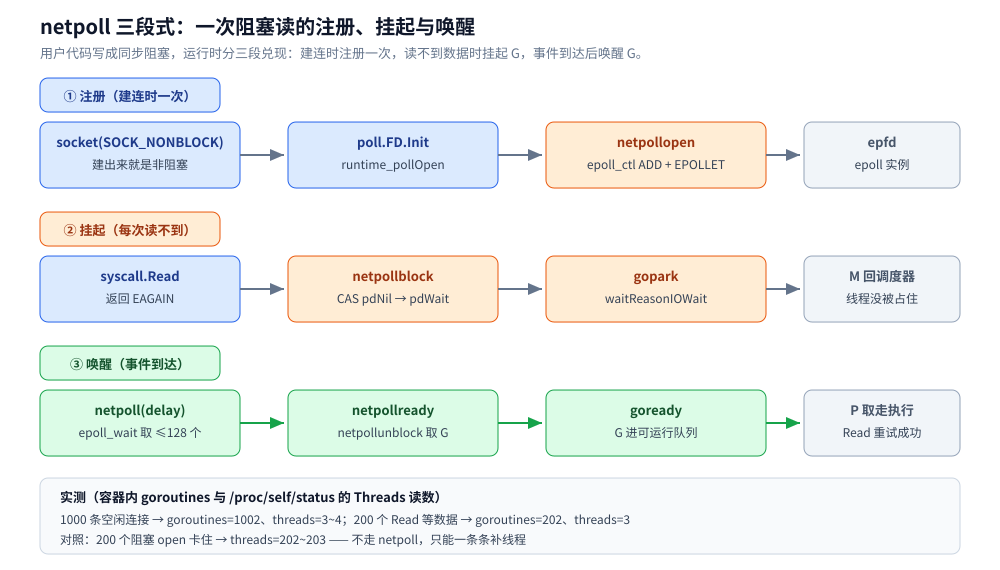
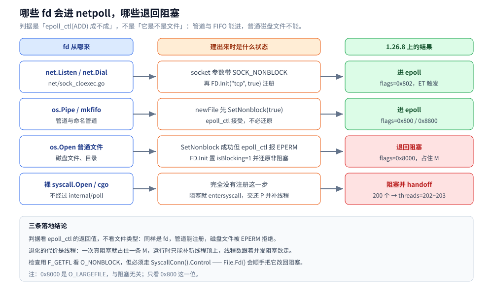
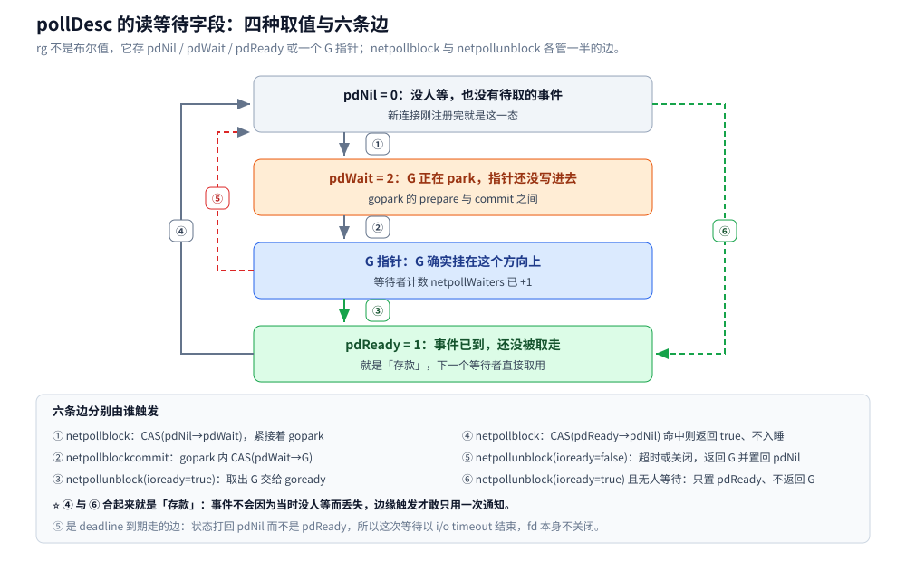

# 网络 IO 与 netpoll

> 覆盖：Go runtime 在 Linux 上怎样把一次「阻塞式」的 `Read` / `Write` / `Accept` 拆成「非阻塞 fd + epoll 等待」的三段（注册 → 挂起 → 唤醒）、`pollDesc` 的三态与边缘触发的两个坑、`SetReadDeadline` 为什么能准时打断、以及哪些 fd 注定退回阻塞模式。
> 不覆盖：epoll 的内核语义与 LT / ET 的定义见 [IO多路复用.md](../../../02-计算机基础/网络/传输层/IO多路复用.md) 第六节；`gopark` / `goready` 与 G、M、P 的调度细节见 [GMP调度.md](GMP调度.md)；「协程为什么便宜」的量化对比见 [协程与线程成本.md](../并发编程/协程与线程成本.md)；`net` 包的 API 用法与逐字节读的实测见 [net包与TCP-UDP编程.md](../网络编程/net包与TCP-UDP编程.md)；一次 `read` 从用户态到网卡的内核路径见 [用户态内核态与一次IO的内存路径.md](../../../02-计算机基础/操作系统/用户态内核态与一次IO的内存路径.md)。
>
> 内容整理自个人学习笔记，素材见 [素材清单](../../../素材清单.md)。实测口径：`golang:1.26-alpine`（go1.26.8 linux/amd64，容器 4 CPU，`ulimit -n` 1048576，WSL2 内核 6.18.54.1），本篇四个程序真编译运行、读数取自 3 轮以上；源码摘录与该版本行号一一对应。Windows IOCP、kqueue 分支与 `io_uring` 未实测（1.26 源码里 `io_uring` 出现 0 次）。

---

## 一、一次看起来「阻塞」的 Read，实际经过了几段？

**本节要点**：Go 让代码写成同步阻塞，运行时做的是「**先直接试一次非阻塞读**，只有返回 `EAGAIN` 才挂起 G」。所以 netpoll 减少的不是系统调用，而是「**等待期间被占住的线程**」。

### 1.1 从零开始：38 行看一次挂起与唤醒

```go
package main

import (
	"fmt"
	"net"
	"runtime"
	"time"
)

func main() {
	runtime.GOMAXPROCS(1) // 只有一个 P，更能看出「阻塞读」并没有占住线程
	ln, err := net.Listen("tcp", "127.0.0.1:9006")
	if err != nil {
		panic(err)
	}
	defer ln.Close()

	go func() {
		c, err := ln.Accept()
		if err != nil {
			return
		}
		buf := make([]byte, 5)
		n, _ := c.Read(buf) // 没数据时 park，不占线程
		fmt.Printf("服务端读到 %q，goroutines=%d\n", buf[:n], runtime.NumGoroutine())
		c.Close()
	}()

	c, err := net.Dial("tcp", ln.Addr().String())
	if err != nil {
		panic(err)
	}
	defer c.Close()
	for i := 1; i <= 3; i++ {
		time.Sleep(50 * time.Millisecond)
		fmt.Printf("主协程第 %d 次计数（服务端仍卡在 Read）\n", i)
	}
	c.Write([]byte("hello"))
	time.Sleep(100 * time.Millisecond)
	fmt.Println("结束")
}
```

容器内真跑（`GOMAXPROCS=1`）：

```text
主协程第 1 次计数（服务端仍卡在 Read）
主协程第 2 次计数（服务端仍卡在 Read）
主协程第 3 次计数（服务端仍卡在 Read）
服务端读到 "hello"，goroutines=2
结束
```

这一段的读法：**全局只有一个 P**。服务端协程读不到数据时如果真占着 P，主协程根本没有机会继续计数；三行计数照常打印，说明这段「阻塞读」期间 G 已经让出了 P。

### 1.2 三段：注册、挂起、唤醒



三段的分工是：注册只在建连时做一次，挂起与唤醒在每次 I/O 上往复；第三段不是业务代码触发的，而是空闲 M 在调度循环里顺手把事件捞回来。

### 1.3 三段各自落在哪几个函数

| 段 | 触发时机 | 用户代码入口 | 标准库 / runtime 函数 | 1.26.8 位置 |
|---|---|---|---|---|
| ① 注册 | 建连、打开可 poll 的 fd 时一次 | `net.Listen` / `net.Dial` / `os.Open` | `poll.FD.Init` → `pd.init` → `runtime_pollOpen` → `netpollopen` | `internal/poll/fd_unix.go:55`、`runtime/netpoll_epoll.go:49` |
| ② 挂起 | 每次 `syscall.Read` 返回 `EAGAIN` | `conn.Read` / `conn.Write` / `ln.Accept` | `FD.Read` → `pd.waitRead` → `runtime_pollWait` → `netpollblock` → `gopark` | `internal/poll/fd_unix.go:141`、`runtime/netpoll.go:342`、`:548` |
| ③ 唤醒 | epoll 报事件 | 无（运行时内部） | `netpoll(delay)` → `netpollready` → `netpollunblock` → `goready` | `runtime/netpoll_epoll.go:99`、`runtime/netpoll.go:494` |

⭐ 最容易漏掉的是第 ② 段里「先试一次」这半句。`internal/poll.FD.Read` 的主循环长这样：

```go
for {
	n, err := ignoringEINTRIO(syscall.Read, fd.Sysfd, p)
	if err != nil {
		n = 0
		if err == syscall.EAGAIN && fd.pd.pollable() {
			if err = fd.pd.waitRead(fd.isFile); err == nil {
				continue
			}
		}
	}
	err = fd.eofError(n, err)
	return n, err
}
```

这意味着：**有数据时走的是一条纯 syscall 路径，压根没有 epoll**；只有空读才进 netpoll。本篇 4.2 节讲边缘触发为什么在 Go 里安全，根子就在这个「每次读先 syscall」的写法上。

## 二、fd 是什么时候、被谁注册进 epoll 的？

**本节要点**：网络 fd 在建 socket 时就是非阻塞的，注册只是顺路一步；文件类 fd 则要先「试探性地」设成非阻塞再尝试注册，失败还得还原——这套试探决定了哪些 fd 能用 netpoll。

### 2.1 socket 建出来就已经是非阻塞

```go
// net/sock_cloexec.go:20
s, err := socketFunc(family, sotype|syscall.SOCK_NONBLOCK|syscall.SOCK_CLOEXEC, proto)
```

所以对网络连接来说，「非阻塞」不是运行时事后改的，而是 `socket(2)` 的第二个参数就带上了。随后 `netFD` 构造时调 `poll.FD.Init("tcp", true)`，`pd.init` 里 `runtime_pollOpen(uintptr(fd.Sysfd))` 一路走到 `netpollopen`：

```go
// runtime/netpoll_epoll.go:49
func netpollopen(fd uintptr, pd *pollDesc) uintptr {
	var ev linux.EpollEvent
	ev.Events = linux.EPOLLIN | linux.EPOLLOUT | linux.EPOLLRDHUP | linux.EPOLLET
	tp := taggedPointerPack(unsafe.Pointer(pd), pd.fdseq.Load())
	*(*taggedPointer)(unsafe.Pointer(&ev.Data)) = tp
	return linux.EpollCtl(epfd, linux.EPOLL_CTL_ADD, int32(fd), &ev)
}
```

三个细节值得记住：

- **读写事件一次性全注册**（`EPOLLIN | EPOLLOUT`），没有 `EPOLLONESHOT`，之后不再按需 arm；
- **带上了 `EPOLLET`**，即边缘触发（本篇 4.2 节展开）；
- `ev.Data` 里塞的不是 fd，而是 `pollDesc` 指针 + `fdseq` 标签——epoll 返回事件时靠它找回等待者，并用 `fdseq` 挡住「fd 已关闭又被复用」的陈旧事件。

epoll 实例本身是懒创建的：第一次注册时才 `epoll_create1(EPOLL_CLOEXEC)`，同时建一个 `eventfd` 挂进去当「打断 fd」，用于把睡在 `epoll_wait` 里的线程叫醒（本篇 4.3 节）。

### 2.2 文件类 fd 的一次试探：先设非阻塞，注册失败再还原

`os.Open` 这类调用没有 `SOCK_NONBLOCK` 可用，于是 `os.newFile` 用「先改再试、失败还原」的办法判断能不能接进 netpoll：

```go
	// os/file_unix.go:155（节选）
	clearNonBlock := false
	if pollable {
		if nonBlocking {
			if kind == kindSock {
				f.nonblock = true // tell Fd to return blocking descriptor
			}
		} else if err := syscall.SetNonblock(fd, true); err == nil {
			f.nonblock = true
			clearNonBlock = true
		} else {
			pollable = false
		}
	}

	// An error here indicates a failure to register with the netpoll system.
	// That can happen for a file descriptor that is not supported by
	// epoll/kqueue; for example, disk files on Linux systems.
	// We do restore the blocking behavior if it was set by us.
	if pollErr := f.pfd.Init("file", pollable); pollErr != nil && clearNonBlock {
		if err := syscall.SetNonblock(fd, false); err == nil {
			f.nonblock = false
		}
	}
```

（`os/file_unix.go:155` 起，节选，关键注释保留。）在 Linux 上对普通磁盘文件做 `epoll_ctl(ADD)` 会返回 `EPERM`，`pollErr != nil` 成立，于是 `SetNonblock(fd, false)` 把刚才的改动还原——**文件最终是阻塞的，这个试探对用户不可见**。

### 2.3 注册失败的退路：`isBlocking = 1`

```go
// internal/poll/fd_unix.go:55
func (fd *FD) Init(net string, pollable bool) error {
	fd.SysFile.init()
	if net == "file" {
		fd.isFile = true
	}
	if !pollable {
		fd.isBlocking = 1
		return nil
	}
	err := fd.pd.init(fd)
	if err != nil {
		// If we could not initialize the runtime poller,
		// assume we are using blocking mode.
		fd.isBlocking = 1
	}
	return err
}
```

`isBlocking` 只从 0 变 1、不再变回来。置 1 之后 `FD.Read` 里的 `fd.pd.pollable()` 恒为假，`EAGAIN` 分支根本不会进——如果 fd 真被设成了非阻塞，这里就会变成「读到 `EAGAIN` 直接当错误返回」。所以还原非阻塞标志那一句不是可有可无的收尾。

### 2.4 谁会注册，谁注定退回阻塞



判据不是「它是不是文件」，而是「`epoll_ctl(ADD)` 成不成」：同样是文件描述符，管道与 FIFO 能注册进去，普通磁盘文件不能。下面四条 fd 的实际 `F_GETFL` 读数里，`flags & O_NONBLOCK` 才是最终判据。

```text
os.Open 普通文件           flags=0x8000 O_NONBLOCK=false
net.Dial TCP           flags=0x802 O_NONBLOCK=true
os.Pipe 读端             flags=0x800 O_NONBLOCK=true
os.Open FIFO           flags=0x8800 O_NONBLOCK=true
```

注意 FIFO 和 pipe 是**能**进 netpoll 的：`epoll_ctl` 接受管道类对象，所以「文件 I/O 都阻塞」这个说法只对**普通磁盘文件**成立。

## 三、G 挂起之后，M 去哪了？

**本节要点**：`gopark` 把 G 从 `_Grunning` 打成 `_Gwaiting` 并交还 P，M 立刻回调度循环找下一个可运行的 G；只有「全系统都没活干」时，才轮到一个 M 去 `epoll_wait` 上睡。

### 3.1 挂起的调用链

```text
conn.Read
 └─ internal/poll.(*FD).Read
     └─ syscall.Read → EAGAIN
         └─ (*FD).waitRead → pd.wait
             └─ runtime_pollWait → poll_runtime_pollWait(pd, 'r')
                 └─ netpollblock(pd, 'r', false)
                     └─ gopark(netpollblockcommit, ..., waitReasonIOWait, ...)
```

`poll_runtime_pollWait` 里还有个平台分支值得一看：

```go
// runtime/netpoll.go:342
func poll_runtime_pollWait(pd *pollDesc, mode int) int {
	errcode := netpollcheckerr(pd, int32(mode))
	if errcode != pollNoError {
		return errcode
	}
	// As for now only Solaris, illumos, AIX and wasip1 use level-triggered IO.
	if GOOS == "solaris" || GOOS == "illumos" || GOOS == "aix" || GOOS == "wasip1" {
		netpollarm(pd, mode)
	}
	for !netpollblock(pd, int32(mode), false) {
		errcode = netpollcheckerr(pd, int32(mode))
		if errcode != pollNoError {
			return errcode
		}
	}
	return pollNoError
}
```

「只有这四个平台需要 arm」正好反过来说明：Linux 用的是边缘触发，事件一次报清、不需要每次等待前重新武装。

### 3.2 `pollDesc` 的三种状态与「存款」语义

`pollDesc` 的读、写各有一个原子字段 `rg` / `wg`，它们不是布尔值，而是三种特殊值之一或一个 G 指针：

```go
// runtime/netpoll.go:63
const (
	pdNil   uintptr = 0 // 没人等、也没有待取的事件
	pdReady uintptr = 1 // 事件已到但还没被取走
	pdWait  uintptr = 2 // 有 G 正在 park 的过程中
)
```



这四种取值之间只有六条边，`netpollblock` 与 `netpollunblock` 各管一半；把 ⑥ 的「存款」与 ④ 的「取款」连起来看，才能解释边缘触发为什么不会丢事件。下面是两条最容易看错的边：

- `pdNil → pdReady` 发生在**没有人等**的时候：`netpollunblock` 见到 `pdNil` 且 `ioready=true`，直接把状态记成 `pdReady` 再返回 `nil`（没有 G 可唤醒）。这就是「存款」——下一轮 `netpollblock` 里的 `CAS(pdReady, pdNil)` 会立刻返回 `true`，调用方不 park、直接重试 syscall。
- `pdWait → pdReady` 是**并发窗口**：G 已经把自己置成 `pdWait` 但还没把指针写进去，此时事件到了，`netpollunblock` 会把状态改成 `pdReady` 并返回 `nil`；随后 `gopark` 内部的 `netpollblockcommit` 执行 `CAS(pdWait, gp)` 失败，`gopark` 直接返回不入睡，`netpollblock` 末尾再 `Swap(pdNil)` 读到 `pdReady`，于是返回 `true`——事件没丢。

### 3.3 实测：200 个网络 Read 与 200 个阻塞 open

同一份程序、同样 `GOMAXPROCS=1`，只换「等的东西」（线程数读 `/proc/self/status` 的 `Threads:`，3 轮一致）：

| 场景 | 卡住时 goroutines | 卡住时 threads |
|---|---|---|
| 200 个 `net.Conn.Read` 等数据 | 202 | 3 |
| 200 个 `syscall.Open` 阻塞在 FIFO 上 | 201 | 202 ~ 203 |

```text
tcp: 200 个 Read 等数据时 goroutines=202 threads=3
fifo: 200 个阻塞 open 卡住时 goroutines=201 threads=203
```

⭐ 两个数一起读：**协程数几乎一样（201 对 202），线程数是 3 对 203**。网络读卡住时线程没涨，是因为 G 挂在 netpoll 上、M 回调度器；阻塞 `open` 卡住时 Go 只能 `entersyscall` 之后 handoff，**每卡住一个就给系统补一条新线程**，于是线程数跟着并发数走。

## 四、数据到了，谁把 G 叫醒？

**本节要点**：唤醒不是中断、不是回调线程，而是「某条本来在找活干的 M 顺手 `epoll_wait` 拿到事件，把 G 塞回可运行队列」。弄懂这一点，才能解释为什么空闲连接的成本极低，也才能解释 `netpollBreak` 为什么存在。

### 4.1 `netpoll` 一次拿 128 个事件

```go
// runtime/netpoll_epoll.go:99（节选）
var events [128]linux.EpollEvent
retry:
n, errno := linux.EpollWait(epfd, events[:], int32(len(events)), waitms)
// 错误分支略：waitms>0 时 EINTR 直接返回，waitms==0 时 goto retry
for i := int32(0); i < n; i++ {
	ev := events[i]
	if ev.Events == 0 {
		continue
	}
	if *(**uintptr)(unsafe.Pointer(&ev.Data)) == &netpollEventFd {
		// 打断用 eventfd：读掉 8 字节计数并清 netpollWakeSig
		continue
	}
	var mode int32
	if ev.Events&(linux.EPOLLIN|linux.EPOLLRDHUP|linux.EPOLLHUP|linux.EPOLLERR) != 0 {
		mode += 'r'
	}
	if ev.Events&(linux.EPOLLOUT|linux.EPOLLHUP|linux.EPOLLERR) != 0 {
		mode += 'w'
	}
	if mode != 0 {
		tp := *(*taggedPointer)(unsafe.Pointer(&ev.Data))
		pd := (*pollDesc)(tp.pointer())
		tag := tp.tag()
		if pd.fdseq.Load() == tag {
			pd.setEventErr(ev.Events == linux.EPOLLERR, tag)
			delta += netpollready(&toRun, pd, mode)
		}
	}
}
return toRun, delta
```

`waitms` 的换算也值得记一笔：`delay < 0` 表示永久等待，`delay == 0` 表示只轮询一次，`delay < 1e6`（1ms）向上取整成 1ms，超过 `1e15` 纳秒则截到 `1e9` 毫秒（注释写的是约 11.5 天）。

收到的事件转成 `'r'` / `'w'` 之后交给 `netpollready`，后者对每个方向调 `netpollunblock`，拿到的 G 推进 `toRun` 列表；调用方（`findrunnable`）再给其中一个 P，用 `goready` 把它们变成 `_Grunnable`。**唤醒只是改状态 + 入队**，真正跑起来仍要等一个 P。

### 4.2 为什么只用边缘触发，`netpollarm` 为什么直接 `throw`

Linux 上 `netpollarm` 长这样：

```go
// runtime/netpoll_epoll.go:62
func netpollarm(pd *pollDesc, mode int) {
	throw("runtime: unused")
}
```

边缘触发下「就绪」只在状态变化时报一次，如果没人消费这唯一一条通知，事件就永久丢失。Go 靠两条设计兜住：

1. **每次读首先 syscall**（1.3 的 `FD.Read`）：缓冲区里还有残余数据时直接读到，不需要等新事件；
2. **事件先存成 `pdReady`**（3.2 的「存款」）：没有等待者时也不丢，下一个等待者立刻消费掉而不入睡。

反过来说，任何绕过 `internal/poll` 自己拿 fd 做 epoll 的代码都没有这两层保护——比如用 `SyscallConn().Control` 取出 fd 自己注册，就必须自己「读到 `EAGAIN` 为止」，否则残留数据再也不会通知。

### 4.3 空闲 M 怎么知道该去 `epoll_wait`：`lastpoll` 与 `netpollBreak`

M 进入 `epoll_wait` 的位置是 `findrunnable` 的末尾，且有两道门：

```go
// runtime/proc.go:3732（节选）
if netpollinited() && (netpollAnyWaiters() || pollUntil != 0) && sched.lastpoll.Swap(0) != 0 {
	delay := int64(-1)
	if pollUntil != 0 {
		delay = pollUntil - now
		if delay < 0 {
			delay = 0
		}
	}
	list, delta := netpoll(delay) // block until new work is available
	// 省略：取一个空闲 P，把 list 里的 G 塞进 runnext / 本地队列
}
stopm()
```

- `netpollAnyWaiters()`：**没有任何 G 在等 I/O 就不必 poll**，直接 `stopm` 睡觉。计数在 `netpollblockcommit` 里 +1、在 `netpollunblock` 里按 delta 减。
- `sched.lastpoll.Swap(0) != 0`：保证同一时刻只有一条 M 在 poller 里睡。
- `pollUntil`：最近一个定时器的到期时间（来自 `checkTimers`），作为 `epoll_wait` 的等待上限——没有网络事件、但有 `SetReadDeadline` 或 `time.After` 时，M 也不会睡过头。

反过来，「已经有一条 M 睡在 `epoll_wait` 里，这时新增了一个更早到期的定时器」怎么办？`wakeNetPoller(when)` 会比一下 `sched.pollUntil`，如果新定时器更早，就调 `netpollBreak()`：

```go
// runtime/netpoll_epoll.go:67
func netpollBreak() {
	if !netpollWakeSig.CompareAndSwap(0, 1) {
		return // 已有一次未处理的中断，不重复写
	}
	var one uint64 = 1
	oneSize := int32(unsafe.Sizeof(one))
	for {
		n := write(netpollEventFd, noescape(unsafe.Pointer(&one)), oneSize)
		if n == oneSize {
			break
		}
		// 其余分支：EINTR 重试，EAGAIN 直接返回，其他值 throw
	}
}
```

往 `eventfd` 写一个 8 字节整数，`epoll_wait` 立刻返回；`netpoll` 认出这个 fd，把计数读掉、把 `netpollWakeSig` 归零，然后带着新的 `delay` 重新睡。整套机制里没有信号、没有额外线程。

## 五、`SetReadDeadline` 为什么能准时打断？

**本节要点**：deadline **不在 epoll 里**，它挂在 `pollDesc` 自己的 runtime 定时器上；到期时走的是「解除等待」，不是「关闭 fd」，所以连接仍然可用。

### 5.1 deadline 从 `time.Time` 变成一个 runtime 定时器

```go
// internal/poll/fd_poll_runtime.go:146
func setDeadlineImpl(fd *FD, t time.Time, mode int) error {
	var d int64
	if !t.IsZero() {
		d = int64(time.Until(t))
		if d == 0 {
			d = -1 // don't confuse deadline right now with no deadline
		}
	}
	// incref / decref 与 ErrNoDeadline 检查略
	runtime_pollSetDeadline(fd.pd.runtimeCtx, d, mode)
	return nil
}
```

传入的是**相对时长**，而 `poll_runtime_pollSetDeadline` 第一件事就是把它换成绝对时刻：

```go
// runtime/netpoll.go:372（节选）
if d > 0 {
	d += nanotime() // 相对时长换成绝对时刻；溢出时截到最大 int64
}
if mode == 'r' || mode == 'r'+'w' {
	pd.rd = d
}
// 写方向 wd 同构，略
pd.rt.modify(pd.rd, 0, netpollReadDeadline, pd.makeArg(), pd.rseq)
```

`pd.rt` 是一个运行时定时器，到期回调是 `netpollReadDeadline`；同一个 `pollDesc` 的读、写各有一个（`rt` / `wt`）。`rseq` 是「定时器代数」：重设或取消 deadline 时 `rseq++`，到期回调先比对代数，不一致就直接忽略——**这就是「先设 200ms、20ms 后又改成 2s」不会在 200ms 时被旧定时器误杀的原因**。

### 5.2 到期时发生的是「解除等待」

```go
// runtime/netpoll.go:622（节选）
func netpolldeadlineimpl(pd *pollDesc, seq uintptr, read, write bool) {
	lock(&pd.lock)
	currentSeq := pd.rseq
	if !read {
		currentSeq = pd.wseq
	}
	if seq != currentSeq {
		// The descriptor was reused or timers were reset.
		unlock(&pd.lock)
		return
	}
	delta := int32(0)
	var rg *g
	if read {
		if pd.rd <= 0 || !pd.rrun {
			throw("runtime: inconsistent read deadline")
		}
		pd.rd = -1
		pd.publishInfo()
		rg = netpollunblock(pd, 'r', false, &delta)
	}
	// 写方向同构；最后 unlock 并 netpollgoready(rg, 0)
}
```

注意 `netpollunblock(pd, 'r', false, ...)` 的第三个参数是 `false`——**不是 I/O 就绪**，所以它把状态从 `pdWait` 打回 `pdNil` 并返回那个 G，而不是记成 `pdReady`。G 被 `goready` 之后，`netpollblock` 里 `gopark` 返回、`Swap(pdNil)` 拿到 `pdNil`，于是返回 `false`；`poll_runtime_pollWait` 的 `for` 循环退出前再查一次 `netpollcheckerr`：

```go
// runtime/netpoll.go:512
func netpollcheckerr(pd *pollDesc, mode int) int {
	info := pd.info()
	if info.closing() {
		return pollErrClosing
	}
	if (mode == 'r' && info.expiredReadDeadline()) || (mode == 'w' && info.expiredWriteDeadline()) {
		return pollErrTimeout
	}
	// 其余：扫描错误（eventErr）只在读方向上报
}
```

`pollErrTimeout` 经 `internal/poll` 的 `convertErr` 转成 `os.ErrDeadlineExceeded`，用户看到的就是 `read tcp ...: i/o timeout`。**fd 没有关闭、也没有从 epoll 里摘掉**，只是这一次等待以超时结束。

### 5.3 三个场景的实测

同一个连接上分别做三件事（`GOMAXPROCS=1`，耗时与进程 CPU 均取 `getrusage`）：

```text
场景一：err=read tcp 127.0.0.1:9003->127.0.0.1:41254: i/o timeout 耗时=201ms 进程CPU=1ms
场景二：n=1 err=<nil> 耗时=20ms
场景三：n=1 byte='y' err=<nil>
```

| 场景 | 设置 | 结果 | 说明了什么 |
|---|---|---|---|
| 一 | 200ms 后到期，对端不发数据 | `i/o timeout`，耗时 200~201ms，进程 CPU 0~1ms | 等待期间**没有轮询**：CPU 上去就说明在忙等 |
| 二 | 200ms 后到期，对端 20ms 时发 1 字节 | 读到 1 字节，耗时 20ms | 数据先到，deadline 定时器被后续 `stop` 掉 |
| 三 | deadline 已过期，先 `SetReadDeadline(time.Time{})` 再读 | 仍能读到数据 | 过期只影响那一次等待，连接本身没坏 |

场景三是排障时最有用的一条：**看到 `i/o timeout` 不代表连接不可用**。Go 的 deadline 是「每次操作的等待上限」，不是 socket 的 SO_RCVTIMEO——后者会在内核层把连接废掉。

## 六、netpoll 省了什么，省不掉什么？

**本节要点**：netpoll 买到的是「**线程数不随连接数增长**」，代价是每次空等多一次 `epoll_wait` 唤醒与一次重试 syscall；而普通文件、cgo、长 CPU 这三类根本不在它的管辖范围内。

### 6.1 2000 条空闲连接的真实读数

服务端每来一条连接起一个 goroutine 读 1 字节（永远读不到），客户端只建连不发数据：

| 规模 | GOMAXPROCS | 服务端 goroutines | 服务端 threads | 客户端 threads |
|---|---|---|---|---|
| 1000 条 | 1 | 1002 | 3 ~ 4 | 4 |
| 2000 条 | 4 | 2002 | 6 | 5 |

```text
server: goroutines=2002 threads=6 GOMAXPROCS=4
client: dialed=2000 threads=5
```

⭐ 读法：**2002 个 G、6 条线程**。多出来的 4 条大致对应 4 个 P 各带一条 M（外加运行时自己的 sysmon / 模板线程），**没有一条线程是「为某条连接而生」的**。这就是「几万连接几千线程」与「几万连接几十线程」的分界。

### 6.2 省掉的是线程，不是系统调用

一次「空读 → 有数据」的完整开销是：`read`（EAGAIN）+ `gopark` + 之后某条 M 的 `epoll_wait` 返回 + `goready` + `read`（成功）。跟「阻塞在读上」相比，系统调用甚至更多。netpoll 的收益只在**并发规模**上成立：

| 对比项 | 一连接一线程的阻塞 IO | Go netpoll |
|---|---|---|
| 1 万空闲连接 | 1 万线程（栈 + 内核结构） | 数十线程 |
| 单连接单次往返 | 2 次 syscall 左右 | 2 次 syscall 起，可能多次重试 |
| 上下文切换 | 内核调度线程 | 用户态调度 G（更便宜） |
| 大量连接同时就绪 | 线程调度抖动 | 一条线程批量取 128 个事件 |

所以「连接多、活跃度低」的形态收益最大；「连接少、每次都要大量 syscall」的形态，netpoll 帮不上忙。

### 6.3 四类必然绕开 netpoll 的东西

| 类别 | 为什么绕开 | 后果 | 实测/证据 |
|---|---|---|---|
| 普通磁盘文件 | `epoll_ctl(ADD)` 返回 `EPERM`，`FD.Init` 置 `isBlocking=1` | 每次 `Read` 真正阻塞 M | `os.Open` 的 flags=0x8000，`O_NONBLOCK=false` |
| 阻塞的 `open` / `syscall.*` | 裸 syscall 不经过 `internal/poll` | 卡住即 handoff，一条新线程顶上 | 200 个阻塞 open → threads=202~203 |
| cgo 调用 | 进入 C 代码期间 M 被占 | 线程数上涨 | 见 [协程与线程成本.md](../并发编程/协程与线程成本.md) |
| 长 CPU 片段 | 与 I/O 无关，抢占延迟 | 拖住 P，影响同 P 上所有 G | 见 [GMP调度.md](GMP调度.md) |

还有一条常被问到的：**为什么不用 `io_uring`**。在 1.26.8 的源码里搜 `io_uring` 是 0 个文件命中，Linux 侧仍只有 epoll 一条路径；`io_uring` 的提交—完成语义与 epoll 的就绪通知是两套模型，不能只换一个 syscall 就搬过来。

### 6.4 一个会静默毁掉 netpoll 的坑：`os.File.Fd()`

```go
// os/file_unix.go:70
func (f *File) fd() uintptr {
	...
	// If we put the file descriptor into nonblocking mode,
	// then set it to blocking mode before we return it,
	// because historically we have always returned a descriptor
	// opened in blocking mode. The File will continue to work,
	// but any blocking operation will tie up a thread.
	if f.nonblock {
		f.pfd.SetBlocking()
	}
	return uintptr(f.pfd.Sysfd)
}
```

`Fd()` 为了兼容历史语义，**会把 fd 改回阻塞模式**。所以：观察原始状态必须用 `SyscallConn().Control`（本篇 2.4 的四行读数就是这么做出来的，用 `Fd()` 会把 Pipe / FIFO 读成 `false`）；而在热路径上随手调 `Fd()`，对 `os` 包装出来的管道、FIFO、socket 来说，之后就退回「每次等待都占住一条线程」的真阻塞（`Fd()` 只在 `f.nonblock` 为真时才动它，普通磁盘文件不受影响）。

## 应用场景

**本节要点**：netpoll 是所有「连接数远大于活跃数」场景的底座；反过来，凡是要跑长阻塞操作的地方，都得主动避开它管辖的那条路径。

| 场景 | 用到的机制 | 为什么值得注意 |
|---|---|---|
| HTTP / RPC 服务端 | 监听 fd 注册、accept 循环 | 空闲长连接几乎零线程成本，见 [HTTP服务端与优雅关停.md](../网络编程/HTTP服务端与优雅关停.md) |
| 网关 / 反向代理 | 双端 netpoll + 读写 deadline | 上下游各一套连接，超时靠 deadline 而非独立线程，见 [反向代理接入.md](../网络编程/反向代理接入.md) |
| 长连接推送（IM / 订阅） | 上万 idle 连接 | 实测 2000 连接 6 线程，见 6.1 |
| 客户端连接池（DB / Redis / HTTP） | 拨号与读写的 deadline | 池里连接的空闲等待不占线程，见 [数据访问与连接池.md](../工程实践/数据访问与连接池.md) |
| 文件 / 大对象服务 | 反过来——磁盘读会阻塞 M | 用 `io.Copy` + `sendfile` 绕开用户态，见 [零拷贝.md](零拷贝.md) |
| 排障：线程数暴涨 | `Threads:` 与阻塞 syscall 的对照 | 线程数 ≈ 并发阻塞数时先查哪条路径绕开了 netpoll，见 6.3 |

## 具体使用

**本节要点**：四个程序分别验证「挂起不占线程」「规模」「阻塞对照」「fd 状态」，都能在容器里一分钟跑完；观察 fd 状态一律走 `SyscallConn`。

### 运行环境

```bash
MSYS_NO_PATHCONV=1 docker run -d --name netpoll-lab golang:1.26-alpine sleep infinity
MSYS_NO_PATHCONV=1 docker exec netpoll-lab go version
```

```text
go version go1.26.8 linux/amd64
```

### 程序一：最小闭环（1.1 的代码）

```bash
MSYS_NO_PATHCONV=1 docker exec netpoll-lab sh -c \
  'cd /exp/solo && go build -o /tmp/solo main.go && GOMAXPROCS=1 /tmp/solo'
```

### 程序二：规模实验

```go
func server(n int) {
	ln, _ := net.Listen("tcp", "127.0.0.1:9001")
	go func() {
		for {
			c, err := ln.Accept()
			if err != nil {
				return
			}
			go func(c net.Conn) {
				defer c.Close()
				c.Read(make([]byte, 1)) // 没有数据就 park 在 netpoll 上
			}(c)
		}
	}()
	for runtime.NumGoroutine() < n+2 {
		time.Sleep(50 * time.Millisecond)
	}
	fmt.Printf("server: goroutines=%d threads=%s GOMAXPROCS=%d\n",
		runtime.NumGoroutine(), threads(), runtime.GOMAXPROCS(0))
}
```

`threads()` 的实现只有一句：读 `/proc/self/status` 里以 `Threads:` 开头的那行。服务和客户端分两个进程跑，客户端只 `Dial` 不发数据。

### 程序三：阻塞 syscall 对照

```go
for _, p := range paths {
	go func(p string) {
		fd, err := syscall.Open(p, syscall.O_RDONLY, 0) // 没有写端，卡在这里
		if err != nil {
			return
		}
		var b [1]byte
		syscall.Read(fd, b[:])
		syscall.Close(fd)
	}(p)
}
```

用 `syscall.Mkfifo` 造 200 个 FIFO、每个 goroutine 只以 `O_RDONLY` 打开——**这一步就会阻塞**，且完全不经过 `internal/poll`。对照组是 200 条 TCP 连接上各起一个 `Read`。

### 程序四：看清 fd 的真实标志

```go
func fl(name string, fd uintptr) {
	r, _, e := syscall.Syscall(syscall.SYS_FCNTL, fd, syscall.F_GETFL, 0)
	if e != 0 {
		fmt.Printf("%-22s fcntl err=%v\n", name, e)
		return
	}
	v := int(r)
	fmt.Printf("%-22s flags=0x%x O_NONBLOCK=%v\n", name, v, v&syscall.O_NONBLOCK != 0)
}

// os.File.Fd() 会把 fd 改回阻塞模式，必须走 SyscallConn 看原始状态
func flFile(name string, f *os.File) {
	raw, err := f.SyscallConn()
	if err != nil {
		return
	}
	raw.Control(func(fd uintptr) { fl(name, fd) })
}
```

标准库没有 `syscall.FcntlInt`，所以这里直接发 `SYS_FCNTL`；`O_NONBLOCK` 的值是 `0x800`，四行读数里 `0x802` / `0x800` / `0x8800` 都带这一位，只有 `0x8000` 没有。

### 四条命令一览

| 目的 | 命令（在 `/exp/<目录>` 下先 `go build`） | 关键读数 |
|---|---|---|
| 挂起不占线程 | `GOMAXPROCS=1 /tmp/solo` | 三次计数照常打印 |
| 规模 | `/tmp/idle -mode server -n 2000` + `-mode client` | `goroutines=2002 threads=6` |
| 阻塞对照 | `/tmp/block -mode tcp \| -mode fifo` | `threads=3` 对 `threads=203` |
| fd 标志 | `/tmp/flags` | `0x8000` 对 `0x802` |

## 延伸追问

- **`Read` 返回 `n=0, err=nil` 是什么情况？** → 长度为 0 的切片会立即返回，不进 syscall；非 0 长度下 `n=0, nil` 不会出现（`fd.eofError` 会把 0 读转成 `io.EOF`），除非用了 `RawConn.Read` 自己处理。
- **fd 关闭后被复用了，epoll 里的旧事件会唤醒错误的 G 吗？** → 不会。`ev.Data` 里带了 `fdseq` 标签，`netpoll` 里 `pd.fdseq.Load() == tag` 不成立就整条丢弃（4.1）。
- **`SetReadDeadline` 需要重新注册 fd 吗？** → 不需要。deadline 是 `pollDesc` 上的 runtime 定时器，与 epoll 无关；改 deadline 只做 `pd.rt.modify` / `stop` 并 `rseq++`（5.1）。
- **为什么 `pollUntil` 要作为 `netpoll` 的等待上限？** → 否则只有定时器的程序会让 M 睡在 `epoll_wait` 里错过定时器；`netpollBreak` 则处理「已经睡下之后又来一个更早的定时器」。
- **`GOMAXPROCS=1` 时一个 goroutine 卡在阻塞 syscall 上，整个程序会卡死吗？** → 不会死锁，但线程会涨。`entersyscall` 会把 P 交出去，运行时补一条 M 继续跑其他 G；代价是线程数随并发阻塞数线性增长（3.3 实测 203）。
- **`net.Conn` 的 `Close` 也会唤醒等待中的 G 吗？** → 会。`pollDesc.close` → `runtime_pollUnblock` 把状态置为 closing 并解除等待，`netpollcheckerr` 返回 `pollErrClosing`，用户看到 `use of closed network connection`。
- **多个 goroutine 同时对同一连接 `Read` 会怎样？** → `FD` 上有读锁，串行化；但语义上不建议——`pollDesc` 的 `rg` 一个方向只能挂一个 G（源码注释 "Concurrent calls to netpollblock in the same mode are forbidden"）。

## 关联

- **上游/总纲**：[IO多路复用.md](../../../02-计算机基础/网络/传输层/IO多路复用.md) — 内核侧的 epoll、LT 与 ET、Reactor 模型；本篇是它在 Go 运行时里的落地
- **上游/总纲**：[02-计算机基础/操作系统/用户态内核态与一次IO的内存路径.md](../../../02-计算机基础/操作系统/用户态内核态与一次IO的内存路径.md) — 一次 `read` 从用户态到设备的内存路径
- **下游机制**：[GMP调度.md](GMP调度.md) — `gopark` / `goready`、M 的 handoff 与 `findrunnable` 的整体结构
- **对照/互补**：[协程与线程成本.md](../并发编程/协程与线程成本.md) — 「协程便宜」的量化口径与本篇的线程数读数互为印证
- **对照/互补**：[net包与TCP-UDP编程.md](../网络编程/net包与TCP-UDP编程.md) — `net.Conn` 的 API 用法与逐字节读的耗时实测
- **对照/互补**：[零拷贝.md](零拷贝.md) — 绕开用户态缓冲的另一条优化轴；`splice` / `sendfile` 同样以 socket 为基础
- **对照/互补**：[数据访问与连接池.md](../工程实践/数据访问与连接池.md) — 连接池里空闲连接的等待同样挂在 netpoll 上，超时靠 deadline
- **下游机制**：[定时器与超时.md](定时器与超时.md) — `SetReadDeadline` 落到 `pollDesc.rt` / `wt` 之后，到期由运行时定时器叫醒 netpoll；`pollUntil` 又直接成为 `epoll_wait` 的超时
- **排障**：[pprof性能分析.md](pprof性能分析.md) — `threadcreate` 与 `goroutine` profile 一起看，能区分「G 多」与「线程被阻塞 syscall 拖住」
- **运维/配置**：[GODEBUG与运行时观测.md](GODEBUG与运行时观测.md) — `schedtrace` 里的 `threads` 与 `idleprocs`：线程数涨而 P 空闲，先怀疑阻塞 syscall
