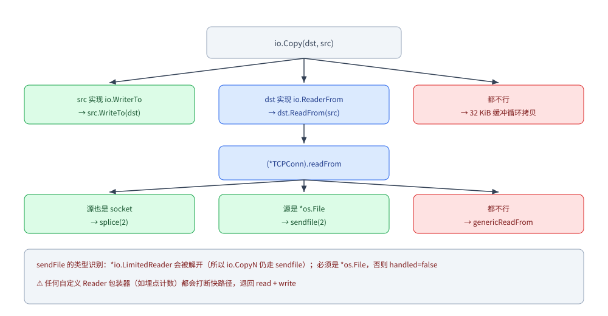
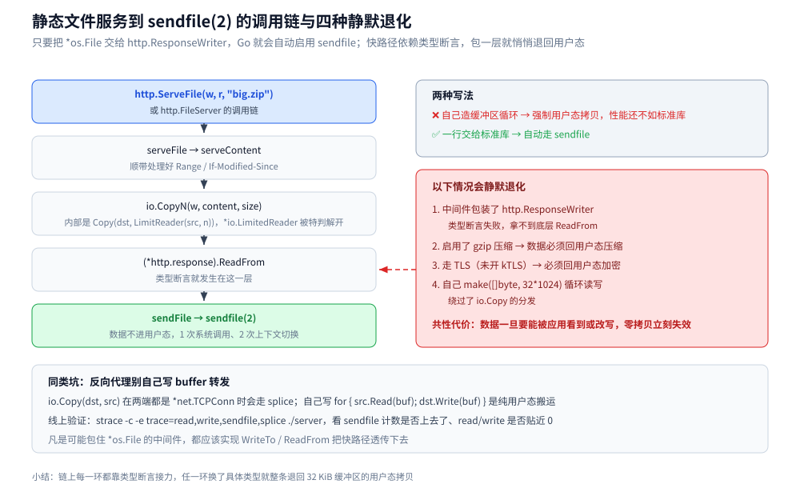

# Go 零拷贝（zero-copy）

> 覆盖：Go 标准库里零拷贝在哪些路径**自动生效**（`io.Copy` / `net/http` / `copy_file_range` / `syscall.Mmap`）、哪些写法会让它**静默失效**、语言层的 `string ↔ []byte` 视图，以及最容易被误认成零拷贝的 `bufio` 缓冲写及其 `Flush` / `Sync` 落盘边界。
> 不覆盖：零拷贝的原理与五种实现路径（mmap / sendfile / SG-DMA / splice / MSG_ZEROCOPY）见 [零拷贝.md](../../../02-计算机基础/linux/零拷贝.md)；unsafe 内存视图的机制、实测断言与红线见 [unsafe与内存布局.md](unsafe与内存布局.md)；`syscall.Mmap` 占的页为什么不在 `MemStats` 里，见 [trace与运行时指标.md](trace与运行时指标.md) 3.5。
>
> 内容整理自个人学习笔记，素材见 [素材清单](../../../素材清单.md)。

---

## 一、Go 的零拷贝自动分发是怎么做的？

**本节要点**：`io.Copy` 看起来是「循环读写」，实际先做一次**能力探测**：目标实现了 `ReadFrom` 或源实现了 `WriteTo`，就把搬运交给内核。落地时最该记住的是 —— **任何自定义的 `io.Reader` 包装器都会静默打断这条快路径**。

### 1.1 `io.Copy` 的能力探测

```go
// io.copyBuffer（简化）
if wt, ok := src.(io.WriterTo); ok {
    return wt.WriteTo(dst)          // 优先问源
}
if rt, ok := dst.(io.ReaderFrom); ok {
    return rt.ReadFrom(src)         // 再问目标
}
// 都不行 → 分配 32 KiB 缓冲区，纯用户态循环拷贝
```

### 1.2 关键路径：`TCPConn.readFrom` 依次尝试 splice / sendfile

`io.Copy(conn, f)`（`conn` 是 `*net.TCPConn`，`f` 是 `*os.File`）：

```go
// net/tcpsock.go + net/splice_linux.go + net/sendfile_linux.go（简化）
func (c *TCPConn) readFrom(r io.Reader) (int64, error) {
    if n, err, handled := splice(c.fd, r); handled {   // ① 源也是 socket → splice(2)
        return n, err
    }
    if n, err, handled := sendFile(c.fd, r); handled { // ② 源是文件 → sendfile(2)
        return n, err
    }
    return genericReadFrom(c, r)                       // ③ 都不行 → 退回用户态拷贝
}
```

### 1.3 `sendFile` 的类型识别只认两种情况

```go
lr, ok := r.(*io.LimitedReader)     // io.LimitReader / io.CopyN 包过的会被解开
if ok {
    remain, r = lr.N, lr.R
}
f, ok := r.(*os.File)               // 必须是 *os.File，否则 handled = false
```



图注：分发顺序是「先问源、再问目标」；`TCPConn.readFrom` 里 `splice` 优先于 `sendfile`，两者都没接住时才会退回 32 KiB 缓冲的用户态循环拷贝。

### 1.4 三条实战判据

| 写法 | 零拷贝? | 原因 |
|---|---|---|
| `io.Copy(conn, f)` | **是** | `*os.File` 被识别 → `sendfile(2)` |
| `io.Copy(conn, io.LimitReader(f, n))` | **是** | `*io.LimitedReader` 被特判解开 |
| `io.Copy(conn, io.TeeReader(f, hasher))` | 否 | 类型不匹配；且本来就要读数据 |
| `io.Copy(conn, countingReader{f})` | **否** | **任何自定义包装器都会打断快路径** |

---

## 二、哪些写法会让快路径静默失效？

**本节要点**：快路径的判据是**类型精确匹配**，一旦中间被人包了一层，`sendfile` 就无声无息地退化成用户态循环拷贝 —— 不会报错，只会变慢。

> **最容易踩的坑**：一个「只做埋点计数」的 `io.Reader` 包装器，就能把几千次 `sendfile` 变成十几万次 `read`+`write`，CPU 翻倍、吞吐腰斩。
> **凡是可能包住 `*os.File` 的中间件，都应该实现 `WriteTo` / `ReadFrom` 透传下去。**

线上验证：`strace -c -e trace=read,write,sendfile,splice ./server`，看 `sendfile` 计数是否上去了、`read` / `write` 是否贴近 0。

服务端这一侧同理，`http.ResponseWriter` 被中间件包一层也会掉出快路径（见第四节）。

---

## 三、具体使用

**本节要点**：Go 侧真正会手写零拷贝的场景只有四个 —— 文件到文件、静态文件服务、需要精确控制的手工通道，以及语言层的 `string ↔ []byte` 视图。

### 3.1 文件 → 文件：`copy_file_range`

两端都是常规文件时不需要走网络，Linux 4.5+ 提供 `copy_file_range(2)`：

```go
io.Copy(dstFile, srcFile)   // 两个都是 *os.File
```

`(*os.File).ReadFrom`（Go 1.15+）与 `(*os.File).WriteTo`（Go 1.22+）会在 Linux 上尝试内核快路径（`copy_file_range` / `sendfile`），**全程在内核页缓存之间搬运、不产生用户态副本**，失败自动退化为带缓冲的循环拷贝。适用场景：**大文件归档、日志滚动、对象存储落盘**。

### 3.2 `net/http`：静态文件服务天然零拷贝

`http.FileServer` / `http.ServeFile` 的调用链是：

```text
serveFile → serveContent → io.CopyN(w, content, size) → (*http.response).ReadFrom → sendFile → sendfile(2)
```

也就是说，**只要把 `*os.File` 交给 `http.ResponseWriter`，Go 就会自动启用 `sendfile`**。但它的快路径同样脆弱，**以下情况会静默退化**：

| 破坏因素 | 原因 |
|---|---|
| 中间件包装了 `http.ResponseWriter` | 类型断言失败，拿不到底层 `ReadFrom` |
| 启用了 gzip 压缩 | 数据必须回用户态压缩 |
| 走 TLS（未开 kTLS） | 数据必须回用户态加密 |
| 自己 `make([]byte, 32*1024)` 循环读写 | 绕过了 `io.Copy` 的分发 |

```go
// ❌ 自己造缓冲区循环 → 强制用户态拷贝，性能还不如标准库
buf := make([]byte, 32*1024)
for {
    n, err := f.Read(buf)
    if n > 0 { w.Write(buf[:n]) }
    if err != nil { return }
}

// ✅ 一行交给标准库走 sendfile，还顺带处理好 Range / If-Modified-Since
http.ServeFile(w, r, "big.zip")
```

> 顺带一个高频点：**反向代理别自己写 buffer 转发**。`io.Copy(dst, src)` 在两端都是 `*net.TCPConn` 时会走 `splice`；自己写 `for { src.Read(buf); dst.Write(buf) }` 则是**纯用户态搬运**。



图注：这条链能让 `*os.File` 一路走到 `sendfile(2)`，靠的是每一层都不做类型包装；只要中间任一层换成自定义 `Reader` / `ResponseWriter`，快路径就在那一层断掉。

### 3.3 `syscall.Sendfile`：需要精确控制时的手工通道

```go
// outFd 目标 socket，inFd 源文件，offset 传 nil 表示从当前偏移继续，count 传 0 表示发到 EOF
n, err := syscall.Sendfile(int(connFD), int(fileFD), nil, 0)
```

什么时候需要它：标准库自动分发**够不到**的场景（响应体被自定义 Reader 包装、只想发文件的一部分）、要**显式控制 offset / count**（Range 分段下载、断点续传）、或需要**确定性而非依赖类型断言的隐式行为**。代价也直接：**Linux 独占**、fd 生命周期要自己管、`EAGAIN` 要配合非阻塞 fd 自行处理，通常用 `golang.org/x/sys/unix` 版本更稳。

### 3.4 语言层的零拷贝：`string ↔ []byte` 视图

⭐ **一句话**：`string` 与 `[]byte` 底层都是 `{数据指针, 长度}`，**只是类型标记不同** —— 换标记不复制数据，这叫**视图**；`string(b)` / `[]byte(s)` 是**复制**。判据只有一条：**转换前后数据指针相同就是视图，不同就是复制**。

```go
// 旧写法：靠布局等价直接改类型标签（Go 1.17 前唯一的办法）
func stringToBytes(s string) []byte { return *(*[]byte)(unsafe.Pointer(&s)) }

// Go 1.20+ 起有正规 API，不要再手写标签转换
func stringToBytes2(s string) []byte { return unsafe.Slice(unsafe.StringData(s), len(s)) }
func bytesToString(b []byte) string  { return unsafe.String(unsafe.SliceData(b), len(b)) }
```

本篇**只留红线**，机制、`unsafe.StringData(s) == unsafe.SliceData(b)` 这类可验证断言与 `go vet` / `checkptr` 的把关都在 [unsafe与内存布局.md](unsafe与内存布局.md) 5.2 与第六节；`reflect.Value.UnsafePointer` 的取值规则见 [反射.md](反射.md) 第二节：

| 红线 | 后果 |
|---|---|
| 视图**只读**，不得 append、不得改字节 | 写穿了原本不可变的字符串数据（`cap` 也无效） |
| 只允许**布局等价**的类型互转 | `string` ↔ `[]byte` 成立，转成结构体等其他类型就是未定义行为 |
| 生命周期必须由**原对象**持有 | 原对象被回收后继续读 = 悬垂读，**GC 不会报错** |

⚠️ 绕过类型系统的指针若被错误持有，还会让 GC 误判存活对象；且 `unsafe` **不受兼容性承诺保护**，**升级 Go 版本要重新验证**。

同类的语言层零拷贝还有：**切片共享底层数组**（`s[2:5]` 不复制）、**`strings.NewReader(s)`**（直接持有原字符串，只读、不复制）。注意 **`bytes.NewBufferString(s)` 是会复制的**——两者在「是否零拷贝」上并不等价。

### 3.5 `syscall.Mmap`：把文件映射进地址空间

比 `sendfile` 更进一步的一条路：**连"读进缓冲区"这一步都不要**，直接把文件的页映射进进程地址空间，用 `[]byte` 访问：

```go
f, err := os.OpenFile("data.bin", os.O_RDWR|os.O_CREATE, 0644)
if err != nil {
	panic(err)
}
defer f.Close()
if err := f.Truncate(4096); err != nil { // ⚠️ 不能映射长度为 0 的文件
	panic(err)
}
// MAP_SHARED：修改写回文件；MAP_PRIVATE 是写时复制，不落盘
b, err := syscall.Mmap(int(f.Fd()), 0, 4096, syscall.PROT_READ|syscall.PROT_WRITE, syscall.MAP_SHARED)
if err != nil {
	panic(err)
}
defer syscall.Munmap(b)
copy(b, []byte("hello mmap")) // 像操作普通 []byte 一样写
// ⭐ 等价 msync(2)，刷脏页；不调用就等内核异步回写
if err := syscall.Msync(b, syscall.MS_SYNC); err != nil {
	panic(err)
}
fmt.Println(string(b[:10]))
```

什么时候值得用：**大文件的随机读写**（读一页只缺页一页，不用整段 `read`）、**多进程共享同一份映射**（`MAP_SHARED`）。代价同样直接：

| 要点 | 说明 |
|---|---|
| 平台 | `syscall.Mmap` **Unix 专用**（Windows 无此调用），跨平台用 `golang.org/x/exp/mmap` |
| 内存账 | 映射页**计入 RSS**，但不计入 Go 堆 —— 所以 `MemStats` 看不见它（见 [trace与运行时指标.md](trace与运行时指标.md) 3.5） |
| 落盘 | 改的是页缓存，**必须自己 `Msync`**；脏页回写时机不由你控制 |
| 长度 | 不能映射 0 长度文件，先 `Truncate` |
| 收尾 | 必须 `Munmap`，映射期间文件不能缩短 |

## 四、哪些操作看着像零拷贝、其实是显式复制？

**本节要点**：`bufio` 是最容易和零拷贝混淆的一层 —— 它省的是**系统调用次数**，不是**拷贝次数**；而且 `Flush()` 的终点只是内核页缓存，要落盘还得 `Sync()`。

```go
f, err := os.OpenFile("app.log", os.O_CREATE|os.O_APPEND|os.O_WRONLY, 0644)
if err != nil {
	panic(err)
}
defer f.Close()
w := bufio.NewWriterSize(f, 64*1024) // ⭐ 64KB 用户缓冲，减少系统调用
if _, err := w.WriteString("hello\n"); err != nil {
	panic(err)
}
if err := w.Flush(); err != nil { // ① 只刷进内核页缓存，还没落盘
	panic(err)
}
if err := f.Sync(); err != nil { // ② 等价 fsync(2)，才真正落盘
	panic(err)
}
```

| 动作 | 数据搬了几次 | 终点 |
|---|---|---|
| `w.WriteString` | 1 次（用户缓冲） | 用户态 `bufio` 缓冲区 |
| `w.Flush()` | 1 次（`write(2)`） | **内核页缓存**（进程崩了数据还在，**掉电就没了**） |
| `f.Sync()` | 0 次拷贝，只是命令 | 磁盘（`fsync(2)`） |
| `io.Copy(文件→socket)` | 0~1 次（`sendfile` / `splice`） | 网卡，**不经过用户态** |

⚠️ 所以 `bufio` + `Flush` 与零拷贝是**两个正交的优化**：前者减少 syscall、后者减少拷贝。判据只有一条 —— **数据有没有进用户态缓冲区**：进了就是复制，没进才是零拷贝。内核侧的 `write` → 页缓存 → `fsync` 完整路径见 [文件系统与IO.md](../../../02-计算机基础/linux/文件系统与IO.md) 第二节。

---

## 延伸追问

- **`io.Copy` 永远零拷贝吗？** → **不是**。只有「目标实现 `ReadFrom` 或源实现 `WriteTo`」且**类型精确匹配**（`*os.File`、`*net.TCPConn`、`*io.LimitedReader`）时才走快路径。
- **`io.Copy` / `io.CopyBuffer` / `io.CopyN` 的区别？** → `Copy` 走能力探测；`CopyN` 内部是 `Copy(dst, LimitReader(src, n))`，**`*io.LimitedReader` 会被 `sendfile` 路径特判解开，所以 `CopyN` 仍是零拷贝**；`CopyBuffer` 只在退化路径上使用你给的缓冲区。
- **`io.CopyBuffer` 能提升性能吗？** → 它和 `Copy` 一样**先做能力探测**，只有真的退化时才用你给的缓冲区——作用是**复用缓冲区、省掉每次 32 KiB 的分配**，并不会关闭内核快路径（真零拷贝时那个缓冲区根本用不上）。
- **`sendfile` 支持下游是 TLS 吗？** → 标准 Go 不支持。加密必须在用户态完成，除非启用内核 kTLS，那不是 Go 的默认行为。
- **为什么 `net/http` 加了 gzip 中间件就慢下来？** → 压缩函数必须读一遍数据，`ResponseWriter` 被包装后类型断言失败，`sendfile` 路径直接失效（见 3.2 的破坏因素表）。
- **`MSG_ZEROCOPY` 在 Go 里能用吗？** → 标准库没有暴露，得走 `x/sys/unix` 手写 `sendmsg` + 收 error queue 通知（原理见 [零拷贝.md](../../../02-计算机基础/linux/零拷贝.md) 3.6）。
- **`Flush()` 之后进程 panic，数据会丢吗？** → 不会丢 —— 数据已经在内核页缓存里，进程没了页缓存还在；但**机器掉电会丢**，所以关键写入必须 `Sync()`（见第四节）。
- **`bufio` 算零拷贝吗？** → **不算**。它省的是系统调用次数，数据仍要在用户缓冲区与页缓存之间搬一次；零拷贝的判据是"数据有没有进用户态缓冲区"（第四节）。
- **什么时候值得用 `syscall.Mmap`？** → 大文件的随机读写、多进程共享同一份映射时；⚠️ 它占 RSS、脏页回写时机不可控（要自己 `Msync`），小文件与顺序读写用 `bufio` 更简单（3.5）。

## 关联

- **上游/总纲**：[零拷贝.md](../../../02-计算机基础/linux/零拷贝.md) — 零拷贝的原理、四种拷贝基准与五种实现路径
- **对照/互补**：[unsafe与内存布局.md](unsafe与内存布局.md) — 本篇 3.4 只列红线的内存视图三件套：机制、可验证断言与四类失效全在彼
- **对照/互补**：[反射.md](反射.md) — `reflect.Value.UnsafePointer` 的取值规则与反射侧的耗时实测
- **对照/互补**：[指针与引用.md](../类型与语法/指针与引用.md) — `unsafe.Pointer` 与 `uintptr` 的分工、断链为什么 GC 不报错
- **对照/互补**：[基础类型与零值.md](../类型与语法/基础类型与零值.md) — `string` 不可变与 `[]byte` 可变带来的拷贝差异
- **内存口径**：[trace与运行时指标.md](trace与运行时指标.md) — `syscall.Mmap` 与 cgo 的内存为什么不计入 `MemStats`、只体现在 RSS 上
- **内核侧**：[文件系统与IO.md](../../../02-计算机基础/linux/文件系统与IO.md) — `write` / `fsync` / `mmap` 在 I/O 栈上的位置
- **对照/互补**：[核心概念与架构.md](../../../03-数据与中间件/中间件/消息队列/Kafka/核心概念与架构.md) — 零拷贝在 MQ 消费链路里的真实收益
- **对照/互补**：[TCP的Nagle与延迟确认.md](../../../02-计算机基础/网络/传输层/tcp/TCP的Nagle与延迟确认.md) — 减少拷贝与减少系统调用是两条独立的优化轴
> 反向引用（本篇被下列文档引到）：[子进程与外部命令.md](../工程实践/子进程与外部命令.md)、[堆外内存与内存映射.md](../../java/运行时/堆外内存与内存映射.md)、[内存管理.md](../../../02-计算机基础/linux/内存管理.md)
