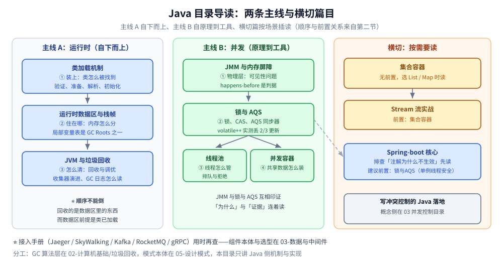

# Java 本目录导读

> 本目录收 **Java 语言的机制与实现**：运行时（JVM 怎么跑类与内存）、并发（锁与内存模型）、
> 基础容器、框架（Spring Boot）以及接入类手册。
>
> ⚠️ **这里不重复 [目录.md](../../目录.md) 的知识点描述** —— 那篇按技术栈列「有什么」，
> 本篇只回答「**从哪读、按什么顺序、谁是谁的前置**」。按「Java 这条线」系统过一遍时从这里进。

---

## 一、先读哪几篇

| 先读 | 为什么是它 |
|---|---|
| [垃圾回收原理与收集器.md](运行时/垃圾回收原理与收集器.md) | JVM 的 GC 是什么类型：堆怎么分代、对象什么时候进老年代、收集器怎么演进、G1 为什么切 region、ZGC 凭什么亚毫秒。**不读它，后面所有「为什么会有这个问题」都缺一个解释框架** |
| [GC调优与日志.md](运行时/GC调优与日志.md) | 从一份 GC 日志读到一组参数：两套日志开关、字段逐段解读、`-Xmx` / 新生代 / 停顿目标的实测曲线、jstat/jcmd/jmap 三步诊断、调优五步顺序 |
| [锁与AQS.md](并发/锁与AQS.md) | Java 并发的地基。`synchronized` 的对象头、`ReentrantLock` 的取舍、AQS「一个 `state` 四种语义」—— 后面线程池与并发容器全部建立在这套机制上 |

⭐ 这两篇也是**与 Go 对照反差最大**的两篇：Go 用 goroutine + channel（CSP），Java 用线程 + 锁（共享内存）。
如果你是从 Go 过来看 Java，这两篇的「读它理由」最足。

---

## 二、两条主线（各按依赖顺序读）

### 主线 A：运行时（自下而上）

```text
类加载机制.md          ① 类怎么被找到、验证、准备、解析、初始化
      ↓                （这篇讲「装上」）
运行时数据区与栈帧.md   ② 装上之后，内存怎么分、栈帧长什么样
      ↓                （这篇讲「住在哪」）
垃圾回收原理与收集器.md  ③ 这些内存怎么回收（分代 / 收集器 / G1 / ZGC）
      ↓                （这篇讲「怎么清」）
GC调优与日志.md        ④ 回收得对不对、怎么调（日志 / 堆比例 / 诊断）
      ↓                （这篇讲「怎么量」）
线上问题排查.md         ⑤ 线上出事怎么定位到线程与代码行
                       （这篇讲「怎么查」；堆外内存与内存映射.md 是 ③ 的旁支：
                        RSS 为什么大于 -Xmx）
```

⭐ **顺序不能倒**：GC 要回收的是「运行时数据区」里的东西（局部变量表是 GC Roots 的第一类）；
而运行时数据区的前提是「类已经被加载」。

### 主线 B：并发（自原理到工具）

```text
JMM与内存屏障.md        ① 内存模型与可见性 —— 并发问题的「物理层」
      ↓                 （happens-before 是后面所有结论的判据）
锁与AQS.md              ② 怎么解决它：锁、CAS、AQS 同步器
      ↓
线程池.md               ③ 线程怎么管、任务怎么排队与拒绝
并发容器.md             ④ 共享数据怎么装（ChM / COW / BlockingQueue）
      ↓
线程与进程开销.md        ⑤ 线程到底多贵：创建成本、超订、竞态复现、虚拟线程
```

⭐ `JMM` 与 `锁与AQS` 是**互相印证的一对**：前者讲「为什么 `volatile` 保不住原子性」，
后者给出「`volatile++` 实测丢 2/3 更新」的直接证据。建议连着读。



**图怎么读**：三条竖列对应上面主线 A、主线 B 与本节横切篇目；箭头指「先读谁」，跨列虚线是 Spring-boot核心 对 锁与AQS 的前置依赖（单例共享状态的线程安全）。

### 横切（按需要读）

| 篇 | 什么时候读 | 前置 |
|---|---|---|
| [集合容器.md](集合容器.md) | 在写业务代码、要选 `List`/`Map` 时 | 无（可与主线并行） |
| [对象布局与引用类型.md](运行时/对象布局与引用类型.md) | 要估算对象体积、算内存账、或者疑惑「字段顺序为什么不影响大小」时 | [运行时数据区与栈帧.md](运行时/运行时数据区与栈帧.md)；与 [集合容器.md](集合容器.md) 的每元素成本互为印证 |
| [Spring-boot核心.md](Spring-boot核心.md) | 用 Spring 系框架时；**排查「注解为什么不生效」的先读它** | 建议先读 [锁与AQS.md](并发/锁与AQS.md)（单例的线程安全） |
| [Stream流实战.md](Stream流实战.md) | 用流式写法处理集合时 | [集合容器.md](集合容器.md) |
| [接入Jaeger.md](可观测性/接入Jaeger.md) / [接入Skywalking.md](可观测性/接入Skywalking.md) | 给 Java 服务接链路追踪时 | 属**接入手册**，用时再查；组件本体在 [可观测性/](../../03-数据与中间件/中间件/可观测性/) |
| [接入Kafka.md](工程实践/接入Kafka.md) | 给 Java 服务接 Kafka 生产者 / 消费者时 | 属**接入手册**，用时再查；组件本体在 [消息队列/Kafka/](../../03-数据与中间件/中间件/消息队列/Kafka/README.md)。⭐ 原生客户端已编译运行实测（Spring Kafka 部分未编译验证） |
| [接入HTTP客户端.md](工程实践/接入HTTP客户端.md) | 给 Java 服务配 HTTP 客户端、调连接池时 | 属**接入手册**，用时再查；机制侧在 [HTTP与gRPC.md](../../02-计算机基础/网络/应用层/HTTP与gRPC.md) 与 [HTTP1.1与HTTP2的区别.md](../../02-计算机基础/网络/应用层/HTTP1.1与HTTP2的区别.md)，Go 侧对照 [HTTP客户端与连接池.md](../go/网络编程/HTTP客户端与连接池.md) |
| [接入RocketMQ.md](工程实践/接入RocketMQ.md) | 给 Java 服务接 RocketMQ 生产者 / 消费者时 | 属**接入手册**，用时再查；组件本体在 [消息队列/RocketMQ/](../../03-数据与中间件/中间件/消息队列/RocketMQ/README.md)。⭐ 原生客户端已编译运行实测（Spring Boot 部分未编译验证） |
| [接入NATS.md](工程实践/接入NATS.md) | 给 Java 服务接 NATS（Core / JetStream）时 | 属**接入手册**，用时再查；组件本体在 [消息队列/NATS/](../../03-数据与中间件/中间件/消息队列/NATS/README.md)。⭐ `jnats 2.20.5` 已编译运行实测（队列组、请求-应答、建流与拉取重投、`drain` 状态轮询）；⚠️ 无官方 Spring Starter，集群 / Leaf Node / NKey 鉴权未实测 |
| [接入ActiveMQ.md](工程实践/接入ActiveMQ.md) | 给 Java 服务接 ActiveMQ（JMS / Spring JMS）时 | 属**接入手册**，用时再查；组件本体在 [消息队列/ActiveMQ/](../../03-数据与中间件/中间件/消息队列/ActiveMQ/README.md)。⭐ `activemq-client 6.1.4` + `jakarta.jms-api 3.1.0` 已编译运行实测（200 条收发、三种确认模式、`JMSXGroupID` 亲和、延迟与 selector、事务回滚重投与 DLQ）；⚠️ Spring JMS 一节未编译，持久订阅与 failover 未实测 |
| [接入Pulsar.md](工程实践/接入Pulsar.md) | 给 Java 服务接 Pulsar（原生客户端 / Spring Pulsar）时 | 属**接入手册**，用时再查；组件本体在 [消息队列/Pulsar/](../../03-数据与中间件/中间件/消息队列/Pulsar/README.md)。⭐ JDK 21 + `pulsar-client 4.0.5` 已编译运行实测（同步 / 异步 `flush`、Shared ack、Key_Shared、`seek` 回溯、Properties）；⚠️ Spring Pulsar 一节未编译，事务与地理复制未实测 |
| [写冲突控制的Java落地.md](写冲突控制的Java落地.md) | 要写「同一份数据被并发写」的代码时 | 概念侧在 [并发控制/](../../03-数据与中间件/数据存储/并发控制/README.md)；Go 侧对照 [写冲突控制的Go落地.md](../go/工程实践/写冲突控制的Go落地.md)。⚠️ 未编译校验 |
| [子进程与外部命令.md](工程实践/子进程与外部命令.md) | 要在 Java 里跑外部命令 / 替代 shell 管道时 | 默认不过 shell；超时要自己处理进程树。Go 侧对照 [子进程与外部命令.md](../go/工程实践/子进程与外部命令.md) |
| [接入etcd.md](工程实践/接入etcd.md) | 要在 Java 里用 etcd 做配置 / 选主 / 服务注册时 | 属**接入手册**，用时再查；概念侧在 [服务发现.md](../../04-架构与系统/分布式/服务治理/服务发现.md)。含 ZooKeeper / Curator 对照。⚠️ 未编译校验 |
| [服务发现的Java实现.md](工程实践/服务发现的Java实现.md) | 用 Spring Cloud + Nacos 做服务发现时 | 概念侧在 [服务发现.md](../../04-架构与系统/分布式/服务治理/服务发现.md)；Go 侧对照 [服务注册与发现的Go实现.md](../go/工程实践/服务注册与发现的Go实现.md) |
| [接入Seata.md](工程实践/接入Seata.md) | 给 Java 服务接分布式事务时 | 属**接入手册**：AT / TCC / Saga / XA 选型、`@GlobalTransactional`、数据源代理与 `undo_log` / `tcc_fence_log`、XID 跨线程传播；概念侧在 [分布式事务/README.md](../../04-架构与系统/分布式/分布式事务/README.md)。⚠️ 未编译校验 |
| [稳定性组件的Java实现.md](工程实践/稳定性组件的Java实现.md) | 给 Java 服务接限流 / 熔断时 | 概念侧在 [稳定性/README.md](../../04-架构与系统/分布式/稳定性/README.md)；Sentinel 与 Resilience4j 选型 + 手写状态机；⚠️ 框架代码未编译校验 |

---

## 三、依赖关系表（谁是谁的前置）

| 篇目 | 硬前置 | 强关联 |
|---|---|---|
| [类加载机制.md](运行时/类加载机制.md) | — | [运行时数据区与栈帧.md](运行时/运行时数据区与栈帧.md) |
| [运行时数据区与栈帧.md](运行时/运行时数据区与栈帧.md) | 类加载机制 | 线程池（每个线程一个栈） |
| [类文件与字节码.md](运行时/类文件与字节码.md) | 类加载机制 | [JIT与执行引擎.md](运行时/JIT与执行引擎.md)（字节码就是 JIT 的输入） |
| [对象布局与引用类型.md](运行时/对象布局与引用类型.md) | 运行时数据区与栈帧 | [集合容器.md](集合容器.md)、[JIT与执行引擎.md](运行时/JIT与执行引擎.md)（标量替换省掉的就是它算出来的字节） |
| [JIT与执行引擎.md](运行时/JIT与执行引擎.md) | 类文件与字节码 | [AOT、JIT与解释执行.md](../../02-计算机基础/编译原理/AOT、JIT与解释执行.md)（跨语言三条路线）、[对象布局与引用类型.md](运行时/对象布局与引用类型.md)、[从源码到main.md](../go/运行时/从源码到main.md)（Go 的 AOT 对照） |
| [垃圾回收原理与收集器.md](运行时/垃圾回收原理与收集器.md) | 运行时数据区与栈帧 | [垃圾回收/](../../02-计算机基础/垃圾回收/) 五篇（算法层） |
| [GC调优与日志.md](运行时/GC调优与日志.md) | 垃圾回收原理与收集器 | [JFR与诊断工具.md](运行时/JFR与诊断工具.md)（`jstat` 的数据源）、[线上问题排查.md](运行时/线上问题排查.md)（非 GC 的现场流程） |
| [JVM启动与参数体系.md](运行时/JVM启动与参数体系.md) | 类文件与字节码（CDS 里存的就是它） | [对象布局与引用类型.md](运行时/对象布局与引用类型.md)（压缩指针会动 CDS 指纹）、[JIT与执行引擎.md](运行时/JIT与执行引擎.md)（`-Xint` 的真实展开）、[堆外内存与内存映射.md](运行时/堆外内存与内存映射.md)（RSS > Xmx 的另一半） |
| [JFR与诊断工具.md](运行时/JFR与诊断工具.md) | JVM启动与参数体系（`VM.flags` 只是借个入口）、类文件与字节码（`Thread.print` 输出的栈帧来源） | [线上问题排查.md](运行时/线上问题排查.md)（现场流程与工具分工）、[GC调优与日志.md](运行时/GC调优与日志.md)（`jstat` 每列与 GC 日志字段的含义）、[JIT与执行引擎.md](运行时/JIT与执行引擎.md)（`Compiler.queue` 查的就是那边的 nmethod） |
| [Unsafe与内存布局.md](运行时/Unsafe与内存布局.md) | 对象布局与引用类型（字段偏移就是它给出的尺子）、JVM启动与参数体系（`MaxDirectMemorySize` 与 `-Xmx` 的默认换算） | [unsafe与内存布局.md](../go/运行时/unsafe与内存布局.md)（Go 侧 `unsafe.Pointer` 与 `checkptr` 的两道闸门对照）、[堆外内存与内存映射.md](运行时/堆外内存与内存映射.md)（RSS > Xmx 的另一半账） |
| [JMM与内存屏障.md](并发/JMM与内存屏障.md) | — | [线程安全与CSP.md](../go/并发编程/线程安全与CSP.md)（路线对照） |
| [线程与进程开销.md](并发/线程与进程开销.md) | 线程池（线程数怎么定） | [协程与线程成本.md](../go/并发编程/协程与线程成本.md)（Go 侧同批实验）、[进程与线程.md](../../02-计算机基础/linux/进程与线程.md)（概念） |
| [锁与AQS.md](并发/锁与AQS.md) | JMM 与内存屏障 | 线程池、并发容器（都建立在它的机制上） |
| [线程池.md](并发/线程池.md) | 锁与AQS | [goroutine实战模式.md](../go/并发编程/goroutine实战模式.md)（worker 池对照） |
| [并发容器.md](并发/并发容器.md) | 锁与AQS、JMM | [集合容器.md](集合容器.md)（非线程安全版） |
| [集合容器.md](集合容器.md) | — | [README.md](../../02-计算机基础/数据结构/README.md) |
| [Spring-boot核心.md](Spring-boot核心.md) | 并发/锁与AQS（单例共享状态） | [代理模式.md](../../05-设计模式/结构型/代理模式.md)、[模板方法模式.md](../../05-设计模式/行为型/模板方法模式.md) |
| [Stream流实战.md](Stream流实战.md) | 集合容器 | [数据建模.md](../../03-数据与中间件/数据存储/关系型/MySQL/数据建模.md) |

---

## 四、与其它目录的分工

| 目录 | 分工口径 |
|---|---|
| [go/](../go/) | **同主题的 Go 侧**。并发线尤其建议对照读：`../go/并发编程/`（goroutine / channel / sync）↔ 本目录 `并发/`；`../go/运行时/垃圾回收机制.md` ↔ `运行时/垃圾回收原理与收集器.md` |
| [垃圾回收/](../../02-计算机基础/垃圾回收/) | **算法层**（语言无关）：判定垃圾的路线、四类算法的代价、三色标记与写屏障。本目录 `运行时/垃圾回收原理与收集器.md` 只讲 **JVM 的实现**，两篇互引不重复 |
| [算法/](../../02-计算机基础/算法/) | 语言无关的原理（限流算法、缓存淘汰算法、数据结构）。Java 侧的实现若 ≥1 屏且与生态相关，拆到本目录并双向引用 |
| [设计模式/](../../05-设计模式/) | 设计模式以 PHP 为骨架、附 Java/Go 实现。**Spring 里见到的模式**（模板方法、代理、观察者）先看那里的模式本体 |
| [可观测性/](../../03-数据与中间件/中间件/可观测性/) | 组件本体（Jaeger / SkyWalking / 选型）。本目录的 `接入*.md` 是**各语言分册**，两边双向关联 |
| [数据存储/](../../03-数据与中间件/数据存储/) | MySQL / Redis 的原理与命令；其中 `JOIN与反范式`、`事务与隔离级别` 等篇带 Java 落地代码 |

---

## 五、已知缺口

⭐ **2026-10-01 已补齐四项，2026-10-08 再补一项**（原先记在本节的缺口）：

| 原缺口 | 现在在哪 |
|---|---|
| JUC / 线程池 | [锁与AQS.md](并发/锁与AQS.md)（AQS、CAS、读写锁）+ [线程池.md](并发/线程池.md) |
| 集合容器 | [集合容器.md](集合容器.md)（ArrayList / LinkedList / HashMap / 树化） |
| Spring | [Spring-boot核心.md](Spring-boot核心.md)（IoC / 依赖注入 / AOP / 自动装配） |
| JMM | [JMM与内存屏障.md](并发/JMM与内存屏障.md)（`happens-before`、伪共享、安全发布） |
| gRPC 接入 | [接入gRPC.md](工程实践/接入gRPC.md)（手写 `MethodDescriptor` + `Marshaller`、四种模式、拦截器与 metadata；本体篇在 [gRPC 目录](../../03-数据与中间件/中间件/RPC框架/gRPC/README.md)） |
| Dubbo 接入 | [接入Dubbo.md](工程实践/接入Dubbo.md)（`dubbo-bom` 三坐标、三种写法、单例边界与初始化顺序、`RpcContext` 跨线程、优雅退出；本体篇在 [Dubbo 目录](../../03-数据与中间件/中间件/RPC框架/Dubbo/README.md)，⚠️ 未编译未运行） |

**仍然缺的**：

| 缺口 | 说明 |
|---|---|
| ~~**虚拟线程（JDK 21+）**~~ | 已成篇：[线程与进程开销.md](并发/线程与进程开销.md)（含载体线程、`synchronized` pin 住载体线程）；另在 [Java实现.md](../../04-架构与系统/系统设计/弹幕系统/Java实现.md) 有投递对照实验 |
| **`CompletableFuture` 编排** | 组合式异步（`thenCompose` / `allOf` / 超时与异常）目前散在几篇里，没有专篇 |
| **JMH 基准测试** | 本目录的微基准都是手写的（也因此踩过「JIT 折叠」「分层编译」两个坑）。JMH 才是正解，值得单开一篇 |
| **Spring 生态的其余部分** | `Spring-boot核心.md` 只覆盖核心容器 + 自动装配。Spring Cloud（Gateway / Feign / Sentinel 接入）、Spring Data、事务传播行为都还没写；⚠️ 本机**无 `aspectjweaver`**，`@Aspect` 注解风格与 `@Transactional` 均未实测 |
| **Java 新特性** | record / sealed / 模式匹配 / switch 表达式 —— 本仓目前没有专篇 |
| **指标接入** | 接入类只有 Jaeger / SkyWalking（链路）。Prometheus / Micrometer 的 Java 接入还没写 |

**再发现缺口时的判断口径**：先 `grep` 全仓确认**真的空白**（很多零件已在其它篇里），
再按 [README.md](../../02-计算机基础/算法/README.md) 第四节的口径判「独立成篇还是并入已有篇」。

---

## 六、三条反直觉提醒（读完容易忘的）

| 提醒 | 依据 |
|---|---|
| **`volatile` 不保证原子性** | `volatile int i; i++` 是「读-改-写」三步，4 线程各加 50 万次实测**丢约 2/3**（[锁与AQS.md](并发/锁与AQS.md) 第二节） |
| **公平锁的代价约 300 倍** | 非公平 23.9~24.3 ms vs 公平 7369~8926 ms。**默认用非公平**，`synchronized` 本身就是非公平（[锁与AQS.md](并发/锁与AQS.md) 2.3） |
| **`submit` 会静默吞掉异常** | `execute` 的异常打到 stderr 且线程死亡；`submit` 的异常被 `FutureTask` 收走，**只有 `get()` 才抛**（[线程池.md](并发/线程池.md) 第五节） |

---

## 关联

- [目录.md](../../目录.md) — 全仓知识点索引（按技术栈进）
- [垃圾回收原理与收集器.md](运行时/垃圾回收原理与收集器.md) — 运行时线的终点（分代与收集器），也是本目录的起点
- [GC调优与日志.md](运行时/GC调优与日志.md) — 运行时线的落地：日志怎么读、参数怎么调、现场怎么查
- [并发同步原语.md](../go/并发编程/并发同步原语.md) — 同主题的 Go 侧：`Mutex` 饥饿模式与 `sync.Map`
- [README.md](../../02-计算机基础/网络/README.md) — 另一个带导读的目录（纵向 / 横向两条视角的分工）
- [GC基础算法.md](../../02-计算机基础/垃圾回收/GC基础算法.md) — GC 的算法层入口（本目录只讲 JVM 实现）
- [README.md](../../05-设计模式/README.md) — 另一个带导读的目录，体例可参照
- [素材清单.md](../../素材清单.md) — 素材来源登记
