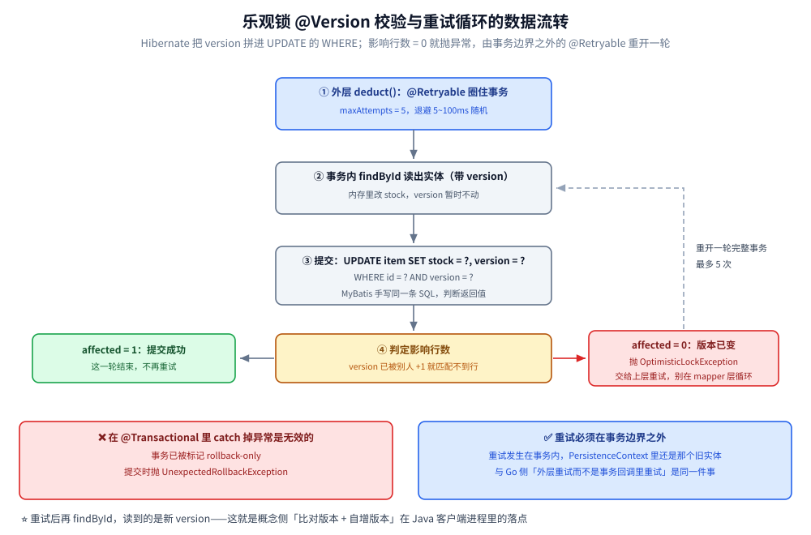
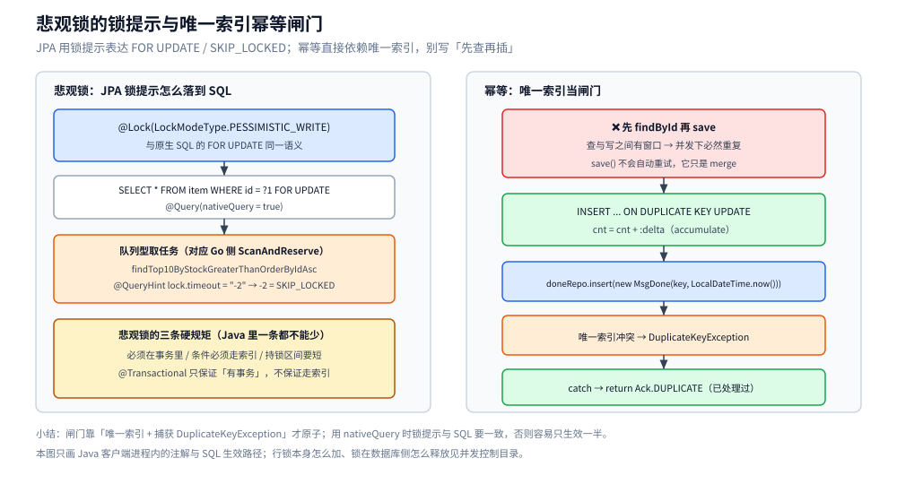

# 写冲突控制的 Java 落地

> Java 侧「同一份数据被并发写」的落地写法：JPA 的 `@Version` 乐观锁、`FOR UPDATE` 与 `SKIP_LOCKED` 锁提示、以及靠唯一索引做幂等。
> **概念侧**（乐观锁与悲观锁怎么选、MVCC、快照读与当前读）见 [并发控制](../../03-数据与中间件/数据存储/并发控制/README.md) 目录；Go 侧对照见 [写冲突控制的Go落地.md](../go/工程实践/写冲突控制的Go落地.md)。
>
> 内容整理自个人学习笔记。素材见 [素材清单.md](../../素材清单.md)。
>
> ⚠️ **未编译校验**：本篇代码按 Spring Boot 3.x / Hibernate 6.x 书写，**未在本机编译或运行**——本机 Maven 仓库有 `spring-boot 3.2.5`，但**没有 `hibernate-core`**（拉这个包要联网，本轮没装），所以它停在文档口径；四条结论与 Go 侧一一对应，Go 侧那篇是 `go build` 通过、但本机无 MySQL 实例，同样没跑过真实并发。

---

## 一、乐观锁：`@Version` 就是那套版本号机制

**本节要点**：Hibernate 把「比对版本 + 自增版本」拼进 `UPDATE` 的 `WHERE`，影响行数 0 就抛 `OptimisticLockException`；**重试必须在事务边界之外**。

```java
package notes.lock;

import jakarta.persistence.Column;
import jakarta.persistence.Entity;
import jakarta.persistence.Id;
import jakarta.persistence.Table;
import jakarta.persistence.Version;

@Entity
@Table(name = "item")
public class Item {

    @Id
    private Long id;

    private long stock;

    // Hibernate 自动把 version 拼进 WHERE 并 +1：
    //   UPDATE item SET stock=?, version=? WHERE id=? AND version=?
    // 影响行数 0 → 抛 OptimisticLockException（Spring 转成 ObjectOptimisticLockingFailureException）
    @Version
    private long version;

    @Column(name = "updated_by")
    private String updatedBy;

    public Long getId() {
        return id;
    }

    public long getStock() {
        return stock;
    }

    public void setStock(long stock) {
        this.stock = stock;
    }
}
```

```java
package notes.lock;

import org.springframework.orm.ObjectOptimisticLockingFailureException;
import org.springframework.retry.annotation.Backoff;
import org.springframework.retry.annotation.Retryable;
import org.springframework.stereotype.Service;
import org.springframework.transaction.annotation.Transactional;

@Service
public class StockService {

    private final ItemRepository repo;

    public StockService(ItemRepository repo) {
        this.repo = repo;
    }

    // ⚠️ @Retryable 必须放在**事务方法的外层**：
    // 重试如果发生在事务内部，JPA 的 PersistenceContext 里还是那个旧实体，等于白重。
    @Retryable(for = ObjectOptimisticLockingFailureException.class, maxAttempts = 5,
            backoff = @Backoff(delay = 5, maxDelay = 100, random = true))
    public void deduct(Long id, long qty) {
        doDeduct(id, qty);
    }

    @Transactional
    void doDeduct(Long id, long qty) {
        Item item = repo.findById(id).orElseThrow();
        if (item.getStock() < qty) {
            throw new IllegalStateException("库存不足");
        }
        item.setStock(item.getStock() - qty); // 提交时带 version 校验
    }
}
```

**MyBatis 侧**没有自动版本管理，就是把那条 SQL 直接写出来并**判断返回的影响行数**：

```java
// interface ItemMapper { int deduct(@Param("id") Long id, @Param("qty") long qty, @Param("v") long version); }
// <update id="deduct">
//   UPDATE item SET stock = stock - #{qty}, version = version + 1
//   WHERE id = #{id} AND version = #{v} AND stock >= #{qty}   <!-- 条件更新也顺手带上 -->
// </update>
int affected = mapper.deduct(id, qty, loaded.getVersion());
if (affected == 0) {
    throw new OptimisticLockerException("版本已变");  // 交给上层重试，别在 mapper 层循环
}
```

> ⚠️ `@Transactional` 里 catch 掉 `OptimisticLockException` 是**无效的**：事务已被标记 rollback-only，
> 提交时会抛 `UnexpectedRollbackException`。**乐观锁的重试必须在事务边界之外**，
> 这和 Go 侧「外层重试、而不是在事务回调里重试」是同一件事。



**图怎么读**：中列 ①~④ 是一条事务尝试，右侧虚线回环是 `@Retryable` 在事务边界之外重开整轮——重试的下一步 `findById` 读到的已是新 version；乐观/悲观的选型判据在概念侧 [并发控制](../../03-数据与中间件/数据存储/并发控制/README.md)，本图只画 Java 客户端进程内的链路。

## 二、悲观锁与幂等

**本节要点**：JPA 用锁提示表达 `FOR UPDATE` / `SKIP_LOCKED`；幂等直接依赖唯一索引，别写「先查再插」。

```java
// FOR UPDATE：JPA 用锁提示，Hibernate 6 起支持 NOWAIT / SKIP_LOCKED
@Transactional
@Query(value = "SELECT * FROM item WHERE id = ?1 FOR UPDATE", nativeQuery = true)
@Lock(LockModeType.PESSIMISTIC_WRITE)
Optional<Item> lockForUpdate(Long id);

// 队列型取任务（对应 Go 侧 ScanAndReserve）
@Lock(LockModeType.PESSIMISTIC_WRITE)
@QueryHints(@QueryHint(name = "jakarta.persistence.lock.timeout", value = "-2")) // -2 = SKIP_LOCKED
List<Item> findTop10ByStockGreaterThanOrderByIdAsc(long stock);
```

```java
// 幂等：直接依赖唯一索引 + ON DUPLICATE KEY，别写 findById 再 save
@Modifying
@Query(value = """
        INSERT INTO stat_day (day, cnt) VALUES (:day, :delta)
        ON DUPLICATE KEY UPDATE cnt = cnt + :delta
        """, nativeQuery = true)
int accumulate(@Param("day") String day, @Param("delta") long delta);

// 重复消费闸门：捕获 DuplicateKeyException 而不是"先查再插"
try {
    doneRepo.insert(new MsgDone(key, LocalDateTime.now()));
} catch (DuplicateKeyException e) {
    return Ack.DUPLICATE; // 已处理过
}
```

> ⚠️ 悲观锁的三条硬规矩（必须在事务里、条件必须走索引、持锁区间要短）在 Java 里一条都不能少：
> `@Transactional` 只保证「有事务」，**不保证走索引**，也不保证区间短 —— 后者取决于你在方法里做了多少事。



**图怎么读**：左列自上而下是「锁提示 → 原生 SQL → SKIP_LOCKED 取任务 → 三条硬规矩」的生效路径；右列是幂等闸门的两段——先给出「先查再插」为什么留窗口，再走唯一索引这条路：插入撞 `DuplicateKeyException` 就直接返回 `Ack.DUPLICATE`。

## 延伸追问

- **`@Version` 对 `long` 和 `Timestamp` 有区别吗？** → 用数值型版本号是单调递增，不会 ABA；用时间戳做版本要小心同一时间窗口内改回原值被误判。
- **`@Retryable` 放在 `@Transactional` 方法上会怎样？** → 重试发生在同一事务内，实体状态没有刷新，基本等于白重；必须让重试包在事务外层。
- **`LockModeType.PESSIMISTIC_WRITE` 和 `FOR UPDATE` 是一回事吗？** → 是同一语义的两种表达（注解 / 原生 SQL）；用 `nativeQuery` 时锁提示与 SQL 要一致，否则容易只生效一半。
- **JPA 的 `save()` 会不会自动重试？** → 不会。它只是 `merge`，冲突在提交（flush）时才暴露，因此重试逻辑必须写在服务层。
- **幂等为什么不用「先 `findById` 再 `save`」？** → 查与写之间有窗口，并发下必然重复；唯一索引 + 捕获 `DuplicateKeyException` 才是原子的。

## 关联

- [README.md](../../03-数据与中间件/数据存储/并发控制/README.md) — 概念侧总纲
- [乐观锁与悲观锁.md](../../03-数据与中间件/数据存储/并发控制/乐观锁与悲观锁.md) — 选型判据
- [写冲突控制的Go落地.md](../go/工程实践/写冲突控制的Go落地.md) — Go 侧四条结论一一对应
- [锁与AQS.md](并发编程/锁与AQS.md) — 语言级的锁与 CAS（与数据库的锁是两回事）
- [事务与隔离级别.md](../../03-数据与中间件/数据存储/关系型/MySQL/事务与隔离级别.md) — `@Transactional` 与隔离级别、大事务拆分
- [Spring-boot核心.md](Spring-boot核心.md) — 事务传播与自动装配
- [素材清单.md](../../素材清单.md) — 素材来源登记
> 反向引用（本篇被下列文档引到）：[接入Seata.md](工程实践/接入Seata.md)、[最终一致方案.md](../../04-架构与系统/分布式/分布式事务/最终一致方案.md)
