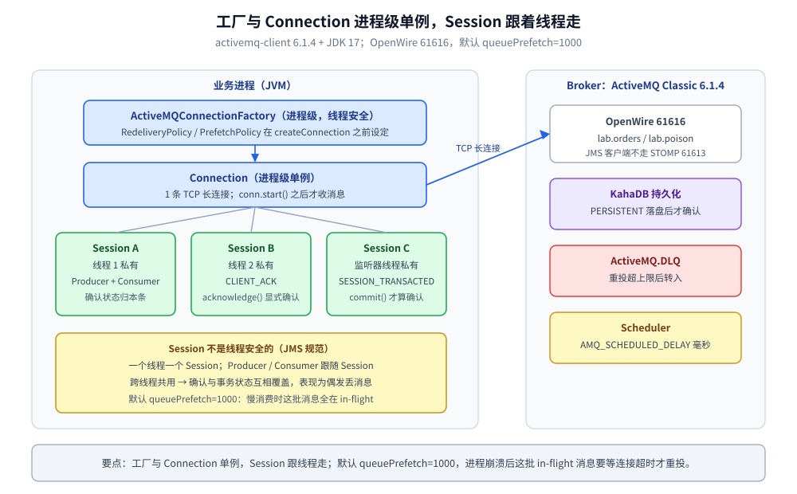
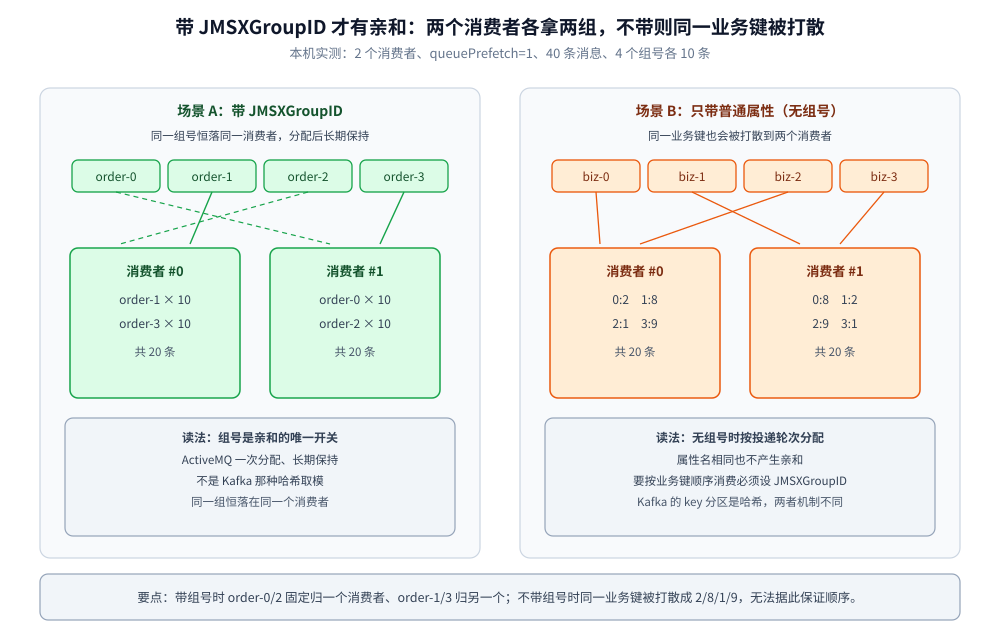
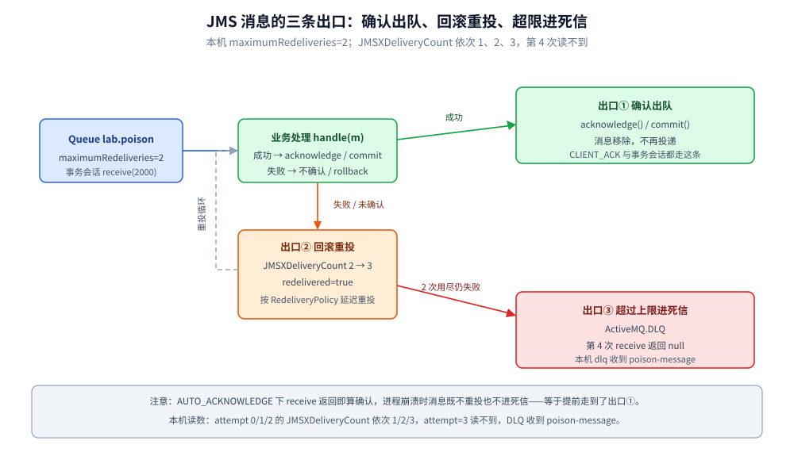

# Java 接入 ActiveMQ

> 覆盖：Java 侧接入 ActiveMQ Classic 的完整手册 —— 客户端选型与依赖、前提与端口、初始化、单例与线程边界、初始化顺序、点对点 / 确认模式 / 消息组 / 延迟 / 重投死信各场景、JMS 属性传播、优雅退出、验证与排障。
>
> 不覆盖：ActiveMQ 的 JMS 概念、KahaDB、重投与死信机制见 [ActiveMQ 目录导读](../../../03-数据与中间件/中间件/消息队列/ActiveMQ/README.md)（零件篇从 [核心概念与架构.md](../../../03-数据与中间件/中间件/消息队列/ActiveMQ/核心概念与架构.md) 起读）；Go 侧 STOMP 写法见 [接入ActiveMQ.md](../../go/工程实践/接入ActiveMQ.md)。
>
> 内容整理自个人学习笔记。本篇代码在 JDK 17（`javac 17.0.20.1`）+ `org.apache.activemq:activemq-client 6.1.4` + `jakarta.jms-api 3.1.0` 下编译运行通过，并对本机 `apache/activemq-classic:6.1.4` 容器（OpenWire `61616`）实测，输出见第十节。

---

## 一、客户端选型与依赖

**本节要点**：Java 是 ActiveMQ 的「母语」——用官方 `activemq-client` 走 OpenWire；真正要提前定的是 **JMS 包名版本**与**确认模式**。

```xml
<dependency>
  <groupId>org.apache.activemq</groupId>
  <artifactId>activemq-client</artifactId>
  <version>6.1.4</version>
</dependency>
<dependency>
  <groupId>jakarta.jms</groupId>
  <artifactId>jakarta.jms-api</artifactId>
  <version>3.1.0</version>
</dependency>
```

| 依赖 / 选择 | 说明 |
| --- | --- |
| `activemq-client` 6.1.4 | Classic 主线客户端；走 **OpenWire 61616**，不是 STOMP 的 61613 |
| ⚠️ JMS 包名 | **5.17 及以前是 `javax.jms`，5.18 起切到 `jakarta.jms`**；6.x 延续 jakarta，Spring Boot 3 系必须用 5.18+/6.x |
| Spring | `spring-jms` + `spring-context` 6.2.x（`JmsTemplate` / `@JmsListener`）；本篇的 Spring 代码**未编译运行**，只给配置要点 |
| Artemis | 新项目优先评估 Artemis（下一代 broker）；本篇只讲 Classic，两者 API 相近但配置不同 |

⚠️ **常见误装**：

- 用 `javax.jms` 的包名配 6.x：编译期就找不到类，不是运行时问题；
- 连到 61613 却用 JMS 客户端：那是 STOMP 端口，握手失败；
- 以为 `setUserName/setPassword` 一定校验：本机 broker 未配鉴权插件，**错密码照样连**（第十节实测）。

## 二、前提

**本节要点**：JMS 客户端不创建 broker 资源；连接器端口、目的地、重投策略、鉴权都要先在 broker 上成立。

| 依赖 | 要先准备好什么 | 漏了会怎样（本机实测） |
| --- | --- | --- |
| **Broker** | `activemq` 已起，`61616` 可达 | `JMSException: Could not connect to broker URL: tcp://host.docker.internal:61619. Reason: java.net.ConnectException: Connection refused` |
| **连接器** | `<transportConnector name="openwire" uri="tcp://0.0.0.0:61616"/>` | 端口不通，`createConnection` 抛异常 |
| **目的地** | `Queue` 点对点、`Topic` 发布订阅；队列可自动创建 | 用 Topic 当队列，所有订阅者各收一份 |
| **重投策略** | 客户端 `RedeliveryPolicy`（次数 / 延迟 / 退避） | 用默认值时重投次数与退避节奏和预期不同 |
| **死信** | 默认 `ActiveMQ.DLQ`，由重投上限触发 | 不配上限则消息反复重投，永远不进死信 |
| **延迟** | broker `schedulerSupport="true"` | `AMQ_SCHEDULED_DELAY` 被忽略，立即投递 |
| **鉴权** | `simpleAuthenticationPlugin` | ⚠️ 不配时任意账号可连，客户端侧无法发现 |

## 三、初始化

**本节要点**：`ActiveMQConnectionFactory` 是配置载体，`Connection` 才是真正的长连接；**工厂上的策略要在 `createConnection` 之前设好**。

```java
import jakarta.jms.*;
import org.apache.activemq.ActiveMQConnectionFactory;
import org.apache.activemq.RedeliveryPolicy;

ActiveMQConnectionFactory factory = new ActiveMQConnectionFactory(
        "admin", "admin", "tcp://127.0.0.1:61616");
factory.setUseAsyncSend(true);          // 异步发送换吞吐；send() 返回 ≠ broker 已落盘
factory.setWatchTopicAdvisories(false); // 不订阅 advisory，减少消费者上下线的通知流量

RedeliveryPolicy rp = new RedeliveryPolicy();
rp.setMaximumRedeliveries(2);           // 超过上限进 ActiveMQ.DLQ（本机用 2）
rp.setInitialRedeliveryDelay(200);
rp.setRedeliveryDelay(200);
factory.setRedeliveryPolicy(rp);        // ⭐ 必须在 createConnection 之前

Connection conn = factory.createConnection();
conn.start();                           // ⭐ Connection 建好默认 stopped，不 start 收不到消息
```

**在哪调**：进程启动阶段建一次。`Connection` 内部管理传输、重连与 session 列表，不要每个请求建一个。

**本机实测的失败原文**：

```text
WRONG-PORT: jakarta.jms.JMSException: Could not connect to broker URL: tcp://host.docker.internal:61619.
Reason: java.net.ConnectException: Connection refused
BAD-PASS connected (broker 未配鉴权插件)
```

## 四、单例边界与线程模型 ⭐

**本节要点**：`ConnectionFactory` 与 `Connection` 可共享，**`Session` 不是线程安全的**——一个线程一个 Session，Producer/Consumer 跟着 Session 走。

| 对象 | 单例？ | 为什么 |
| --- | --- | --- |
| `ActiveMQConnectionFactory` | ✅ 进程级 | 线程安全，承载 Redelivery / Prefetch 等策略配置 |
| `Connection` | ✅ 进程级 | 线程安全；持有传输、重连与会话集合 |
| `Session` | ❌ **线程私有** | JMS 规范明确**非线程安全**；跨线程共用会串确认与事务状态 |
| `MessageProducer` | ❌ 按 Session | 绑定 Session；异步发送的窗口也挂在它上面 |
| `MessageConsumer` | ❌ 按 Session | 绑定 Session；`receive` 阻塞与监听器都依赖它 |
| `Message` | ❌ 请求级 | 每条独立；异步处理要先把 body 取出来 |

**写错的后果**：

- 多线程共用一个 `Session` 发消息：轻则确认错乱，重则事务状态互相覆盖，**表现为「消息偶发丢失」**；
- 把 `MessageConsumer` 放到全局给多个处理线程 `receive`：只有一个线程能拿到消息，其它线程空转；
- `Connection` 每个请求建一次：连接与线程数线性增长，broker 的 `maximumConnections` 很快触顶。

> 一句话：**工厂与连接单例，Session 跟线程走。**

**默认 prefetch（本机日志读数）**：`queue=1000 topic=32767 queueBrowser=500 durableTopic=100`。队列的 1000 意味着 broker 会一次推 1000 条到客户端缓冲——消费慢时这些消息都在 in-flight，进程崩溃后要等连接超时才重投。



读图要点：JMS 规范里只有工厂与连接是线程安全的，Session 及其下的 Producer / Consumer 必须一线程一份；默认 `queuePrefetch=1000` 会让慢消费时大量消息停在 in-flight，进程崩溃后要等连接超时才重投。

## 五、初始化顺序 ⭐

**本节要点**：⭐ 判据是「谁在初始化时捕获了全局单例」；JMS 侧的关键是**工厂上的策略在连接创建时被快照**。

1. **`RedeliveryPolicy` / `PrefetchPolicy` 必须早于 `createConnection`**：之后改工厂不影响已建连接，且**不报错**；
2. **`conn.start()` 必须早于任何 `receive` / 监听器注册**：Connection 默认 stopped，不 start 就像「队列里没消息」；
3. **监听器先于生产**：`setMessageListener` 注册前发出的消息不会丢（队列留存），但首轮测试容易出现「先发后监听」的假空队列。

> ⭐ 跨组件的经典例子仍在链路追踪栈：**GORM 的 OTel 插件在 `Install` 时就捕获了当时的全局 `TracerProvider`**——`InitMySQL` 排在 `InitJaeger` 之前，SQL span 永远不上报且不报错。详见 [接入Jaeger.md](../可观测性/接入Jaeger.md)。

## 六、单例与依赖注入的封装

**本节要点**：工厂与连接用静态单例；Session 不作为单例，用「每个消费线程 / 每次事务自建」的模板方法。

```java
public final class ActiveMqClient {
    private static final ActiveMQConnectionFactory FACTORY = buildFactory();
    private static volatile Connection connection;

    private ActiveMqClient() {}

    private static ActiveMQConnectionFactory buildFactory() {
        ActiveMQConnectionFactory f = new ActiveMQConnectionFactory(
                "admin", "admin", "tcp://127.0.0.1:61616");
        f.setUseAsyncSend(true);
        f.setWatchTopicAdvisories(false);
        RedeliveryPolicy rp = new RedeliveryPolicy();
        rp.setMaximumRedeliveries(2);
        rp.setInitialRedeliveryDelay(200);
        rp.setRedeliveryDelay(200);
        f.setRedeliveryPolicy(rp); // ⭐ 在 createConnection 之前
        return f;
    }

    public static Connection connection() throws JMSException {
        Connection c = connection;
        if (c == null) {
            synchronized (ActiveMqClient.class) {
                c = connection;
                if (c == null) {
                    c = FACTORY.createConnection();
                    c.start();
                    connection = c;
                }
            }
        }
        return c;
    }
}
```

消费者模板（Session 局部创建，先处理后确认）：

```java
try (Session session = ActiveMqClient.connection()
        .createSession(false, Session.CLIENT_ACKNOWLEDGE)) {          // ⭐ 手动确认
    MessageConsumer mc = session.createConsumer(session.createQueue("lab.orders"));
    Message m;
    while ((m = mc.receive(3000)) != null) {
        try {
            handle(m);          // 业务先做
            m.acknowledge();    // 成功后才确认
        } catch (Exception e) {
            // 不 ack：会话关闭时按 RedeliveryPolicy 重投，超上限进 ActiveMQ.DLQ
        }
    }
}
```

## 七、实际调用

**本节要点**：JMS 的调用形态由「目的地 + 确认模式 + 属性」决定；同一个连接下按业务建 Session 即可覆盖全部场景。

### 7.1 点对点：发送与消费

```java
Session s = conn.createSession(false, Session.AUTO_ACKNOWLEDGE);
Queue q = s.createQueue("lab.orders");
MessageProducer p = s.createProducer(q);
p.setDeliveryMode(DeliveryMode.PERSISTENT); // 默认即持久化；NON_PERSISTENT 重启就丢

for (int i = 1; i <= 200; i++) {
    TextMessage m = s.createTextMessage("order-" + i);
    m.setIntProperty("seq", i);
    p.send(m);
}
```

本机实测：200 条 `PERSISTENT` 发送共 `1129 ms`，平均 `5.645 ms/条`；消费端 `CLIENT_ACKNOWLEDGE` 逐条确认，`acked=200`。

⭐ **持久化的代价**是每次发送都要等 KahaDB 落盘；`setUseAsyncSend(true)` 能把返回时间压下来，但**send 返回不再等于已落盘**。

### 7.2 确认模式：三种选择的差别

| 模式 | 何时算确认 | 崩溃会怎样 | 适用 |
| --- | --- | --- | --- |
| `AUTO_ACKNOWLEDGE` | `receive` 返回后 / 监听器回调前 | **消息已确认**，业务没做完就丢 | 可丢的通知类 |
| `CLIENT_ACKNOWLEDGE` ⭐ | 业务显式 `acknowledge()` | 未确认 → 重投 | 订单等不能丢 |
| `SESSION_TRANSACTED` | `commit()` | 未提交 → 全部重投 | 一批一起成功或一起失败 |

⚠️ `CLIENT_ACKNOWLEDGE` 的 `acknowledge()` 会确认**该 Session 上所有已消费未确认的消息**，不是只确认这一条——批量处理时要注意。

### 7.3 消息组：`JMSXGroupID` 的亲和性

```java
TextMessage m = s.createTextMessage("group-msg");
m.setStringProperty("JMSXGroupID", "order-" + (i % 4)); // 同一组恒落同一消费者
p.send(m);
```

本机实测（2 个消费者、`queuePrefetch=1`、40 条消息、4 个组号各 10 条）：

| 场景 | 消费者 #0 | 消费者 #1 |
| --- | --- | --- |
| 带 `JMSXGroupID` | `order-1=10, order-3=10` | `order-0=10, order-2=10` |
| 不带组号（只带业务属性） | `0:2, 1:8, 2:1, 3:9` | `0:8, 1:2, 2:9, 3:1` |

⭐ 读法：**组号是「亲和」的唯一开关**。不带组号时，哪怕业务键相同也会被打散到两个消费者——这与 Kafka 的 key 分区是两种机制，ActiveMQ 的亲和是**一次分配、长期保持**，而不是哈希取模。



读图要点：左列是带组号的分配（10/10 各自成组），右列是不带组号的随机分布（2/8/1/9）；想按业务键顺序消费，必须设 `JMSXGroupID`，只设普通属性没有亲和效果。

### 7.4 延迟投递与选择器

```java
// 延迟 5 秒：AMQ_SCHEDULED_DELAY 是消息属性，单位毫秒
TextMessage d = s.createTextMessage("delayed-5s");
d.setLongProperty("AMQ_SCHEDULED_DELAY", 5000L);
p.send(d);

// 选择器：属性名必须能当 JMS 标识符，不要用中划线
MessageConsumer mc = s.createConsumer(q, "orderKey = 'A'");
```

本机实测：设置 `5000 ms`，实际收到 `5113 ms`。

⚠️ **属性名带中划线会静默失配**（与 STOMP 侧同一坑）：

```text
SET-DASH-PROP ok                       # 设置成功，不报错
SELECTOR-DASH got=null                 # order-key = 'A' 匹配不到
SELECTOR-CAMEL got=camel               # orderKey = 'A' 正常匹配
```

### 7.5 重投与死信：用事务回滚制造重投

```java
// 事务会话 + rollback：未提交的消息会按 RedeliveryPolicy 重投
Session tx = conn2.createSession(true, Session.SESSION_TRANSACTED);
MessageConsumer mc = tx.createConsumer(tx.createQueue("lab.poison"));
for (int i = 0; i < 5; i++) {
    Message m = mc.receive(2000);
    if (m == null) {
        System.out.println("no message at attempt=" + i);
        break;
    }
    System.out.printf("attempt=%d JMSXDeliveryCount=%d redelivered=%s%n",
            i, m.getIntProperty("JMSXDeliveryCount"), m.getJMSRedelivered());
    tx.rollback(); // 触发重投
}
```

本机实测（`maximumRedeliveries=2`）：

```text
poison: attempt=0 JMSXDeliveryCount=1 redelivered=false body=poison-message
poison: attempt=1 JMSXDeliveryCount=2 redelivered=true body=poison-message
poison: attempt=2 JMSXDeliveryCount=3 redelivered=true body=poison-message
poison: no message at attempt=3
dlq: received=poison-message
```

⭐ 读法：**重投 2 次 + 首次投递 = 共 3 次**，第 4 轮读不到，消息已进 `ActiveMQ.DLQ`。`JMSXDeliveryCount` 是判断「是不是重投」的权威字段，比 `getJMSRedelivered()` 更细。



读图要点：三条出口由「确认模式 + 事务边界」决定；本机 `maximumRedeliveries=2` 时，三次投递后进死信，重投次数与 `JMSXDeliveryCount` 一一对应。

### 7.6 Spring JMS：配置要点（未编译）

- `DefaultJmsListenerContainerFactory` 里设置 `sessionAcknowledgeMode`（`CLIENT_ACKNOWLEDGE` 或 `SESSION_TRANSACTED`）与 `concurrency`（并发消费者数）；
- 并发消费的每个 listener 各用独立 Session，这正是第四节「Session 跟线程走」的落地；
- `JmsTemplate` 默认每次操作新建 Session/Producer，高频场景要配连接池（`CachingConnectionFactory`）；
- ⚠️ 上述为配置要点整理，本篇**未编译运行** Spring 代码，读数以 7.1–7.5 的原生 JMS 实测为准。

## 八、跨进程与跨线程传播

**本节要点**：跨进程用 **JMS 属性**（`setStringProperty` / `getStringProperty`）做 Inject / Extract；跨线程用显式参数或 MDC，别塞进共享的 Session。

```java
// 生产端：业务键 + 链路头写进属性
TextMessage m = s.createTextMessage("order-created");
m.setStringProperty("orderKey", "ORDER_JAVA_1001");
m.setStringProperty("xTraceId", "trace-java-abc123"); // ⚠️ 不要用 x-trace-id
m.setStringProperty("JMSXGroupID", "order-1001");     // 组号也是属性，但语义特殊
p.send(m);
```

```java
// 消费端：属性读取；没有该属性返回 null
System.out.printf("biz=%s trace=%s%n",
        m.getStringProperty("orderKey"), m.getStringProperty("xTraceId"));
```

**传递铁律**：

- 属性名必须是合法 JMS 标识符（驼峰 / 下划线），中划线能设进去但 selector 匹配不到（7.4 实测）；
- 请求-应答用 `setJMSCorrelationID` + 临时队列，别自己编一套回复字段；
- ⚠️ **别把请求级数据存进单例 `Connection` / 共享 `MessageProducer` 的属性**——它们被多线程共用，立刻串数据。

## 九、优雅退出

**本节要点**：退出顺序 = 反初始化顺序：**停监听 → 关 Session（提交或回滚）→ 关 Connection**；不确认的消息会重投。

```java
// 1. 停入口（Spring 里是 stop 容器 / 注销 listener）
// 2. 关闭 Session：事务会话要显式 commit 或 rollback，别让它半途而废
// 3. 关闭 Connection：释放传输、触发 broker 侧清理
conn.close();
```

| 退出方式 | 在途消息 | 适用 |
| --- | --- | --- |
| `conn.close()`（未确认消息自然回队列） ⭐ | 重投 | 正常停机 |
| 事务会话不 commit 直接关 | 全部回滚重投 | 一批要么全成要么全退 |
| `AUTO_ACKNOWLEDGE` + 进程被 kill | **已确认的丢失** | 只能靠业务补偿 |

**漏了会丢什么**：

- `AUTO_ACKNOWLEDGE` 下业务未完成就崩溃：消息已确认，不会重投；
- 事务会话忘了 `commit`：整批回滚，表现为「消息发了但没到」；
- 只关 Session 不关 Connection：连接与 broker 侧消费者要等心跳/超时才清理。

## 十、验证与排查

**本节要点**：先确认「发得进、收得到、确认与重投符合预期」，再用 broker 侧计数定位。

### 10.1 先确认生效

```bash
# 环境：JDK 17.0.20.1 + activemq-client 6.1.4 + jakarta.jms-api 3.1.0
javac -cp 'lib/*' ActiveMQLab.java
java -cp 'lib/*:.' ActiveMQLab send 200
```

```text
sent seq=1 JMSMessageID=ID:1cd4241d0baf-41801-1792569769000-1:1:1:1:1 deliveryMode=2
send: messages=200 elapsed=1129ms avg=5.645ms
consume: acked=200
delayed: received=delayed-5s elapsed=5113ms
groups consumer#0 groups={order-1=10, order-3=10}
groups consumer#1 groups={order-0=10, order-2=10}
poison: attempt=2 JMSXDeliveryCount=3 redelivered=true body=poison-message
dlq: received=poison-message
```

⭐ 读法：`deliveryMode=2` 就是 `PERSISTENT`；`acked=200` 说明确认链路通；`groups` 两行各两组说明亲和生效；`poison` 到第 3 次投递后进 DLQ。

broker 侧复核（Jolokia 必须带 `Origin` 头，否则 403）：

```bash
curl -s --noproxy '*' -u admin:admin -H 'Origin: http://localhost' \
  "http://127.0.0.1:8161/api/jolokia/read/org.apache.activemq:brokerName=localhost,destinationName=lab.orders,destinationType=Queue,type=Broker/QueueSize,EnqueueCount,DequeueCount,InFlightCount"
```

### 10.2 常见故障速查

| 症状 | 多半是 | 处置 |
| --- | --- | --- |
| `JMSException: Could not connect to broker URL ... Connection refused` | 端口错 / 容器网络不通 | 认 61616；先验端口 |
| `ClassNotFoundException: javax.jms.*` | 包名用了旧 JMS | 6.x 改 `jakarta.jms` |
| 消费者收不到消息 | 忘了 `conn.start()` | Connection 默认 stopped |
| 选择器永远匹配不到 | 属性名带中划线 | 改驼峰（本机 `null` vs `camel`） |
| 消息重复消费 | 事务回滚 / 未确认重投 | 用 `JMSXDeliveryCount` 判断，业务幂等 |
| 消息进了 `ActiveMQ.DLQ` | 超过 `maximumRedeliveries` | 查业务异常，修正后重放 DLQ |
| 延迟属性不生效 | broker 未开 `schedulerSupport` | 开配置重启 |
| 错密码也能连 | 未配 `simpleAuthenticationPlugin` | 生产补鉴权 |
| 并发消费时偶发丢消息 | 多线程共用 Session | 一个线程一个 Session |

| 排查项 | 命令 / 接口 |
| --- | --- |
| 队列积压 / 出队 | Jolokia `QueueSize` / `EnqueueCount` / `DequeueCount` / `InFlightCount` |
| 死信 | `destinationName=ActiveMQ.DLQ` 计数 |
| 连接与消费者 | 管理台 `http://127.0.0.1:8161/admin`（`admin/admin`） |
| 订阅与消息组 | 管理台目标页的 `Consumers` / `Messages Enqueued` |

## 十一、延伸追问

- **`Session` 为什么不能共享？** → JMS 规范明确 Session 非线程安全，确认与事务状态都挂在它上面；并发消费要让每个线程 / 每个 listener 各建一个 Session。详见第四节。
- **`JMSXGroupID` 和 Kafka 的 key 分区一样吗？** → 不一样。ActiveMQ 是「同一组长期绑定一个消费者」，Kafka 是哈希取模；本机不带组号时同一业务键被打散成 `2/8/1/9`。详见 7.3。
- **为什么重投 2 次却收到 3 次？** → `maximumRedeliveries` 只算**重投**，首次投递不算；本机 `JMSXDeliveryCount` 依次 1/2/3，第 4 次不再投并进 DLQ。详见 7.5。
- **属性名写错了为什么不报错？** → `setStringProperty("order-key", ...)` 能设进去，但 selector 解析时找不到该标识符，于是零匹配；本机两种写法一个 `null` 一个命中。详见 7.4。
- **`AUTO_ACKNOWLEDGE` 什么时候会丢？** → `receive` 返回即确认，业务没处理完就崩溃就丢了；不能丢的场景用 `CLIENT_ACKNOWLEDGE` 或事务会话。详见 7.2。

## 十二、校验口径

> ✅ 本篇代码的校验方式与范围（JDK 17.0.20.1 + activemq-client 6.1.4）：

- **真编译 + 运行通过**：第三节连接工厂与 `RedeliveryPolicy`、第六节 `ActiveMqClient` 单例、7.1 发送 200 / 消费 200、7.2 确认模式对照、7.3 `JMSXGroupID` 亲和与无组号对照、7.4 延迟与选择器（含属性名对照）、7.5 事务回滚重投与 DLQ。
- **只编译、未运行**：第六节消费者模板（等价逻辑已在 7.1、7.5 跑通）。
- **未编译**：7.6 Spring JMS 配置要点（依赖 Spring 上下文，本项目未引入；只作要点整理，不含读数）。
- **未实测**：Topic 持久订阅与虚拟主题；failover 传输；主从 / 网络分区；AMQP / MQTT 连接器。
- **实测环境**：`apache/activemq-classic:6.1.4` 单机，OpenWire 61616，`schedulerSupport="true"`，**未配鉴权插件**。
- **未伪造输出**：第十节读数全部来自本次容器运行；Spring 部分明确标注未编译。

| 依赖 | 实际版本 |
| --- | --- |
| `org.apache.activemq:activemq-client` | 6.1.4 |
| `jakarta.jms:jakarta.jms-api` | 3.1.0 |
| JDK | 17.0.20.1 |
| ActiveMQ Classic（镜像） | 6.1.4 |

## 关联

- **上游/总纲**：[ActiveMQ 目录导读](../../../03-数据与中间件/中间件/消息队列/ActiveMQ/README.md) — 定位、阅读路线与实测坐标
- **对照/互补**：[接入ActiveMQ.md](../../go/工程实践/接入ActiveMQ.md) — Go 侧 STOMP 写法与同一批坑的对照
- **对照/互补**：[接入RocketMQ.md](接入RocketMQ.md) — Java 侧另一套消息模型（Topic + 队列 + 位点）
- **对照/互补**：[接入Pulsar.md](接入Pulsar.md) — Java 侧的订阅类型与重放
- **下游机制**：[消息类型与消费语义.md](../../../03-数据与中间件/中间件/消息队列/ActiveMQ/消息类型与消费语义.md) — 队列 / 主题 / 选择器 / 消息组
- **下游机制**：[消息可靠性.md](../../../03-数据与中间件/中间件/消息队列/ActiveMQ/消息可靠性.md) — 重投、死信与持久化
- **运维/配置**：[运维与排障.md](../../../03-数据与中间件/中间件/消息队列/ActiveMQ/运维与排障.md) — 控制台、Jolokia 与常见故障
- **运维/配置**：[部署与配置.md](../../../03-数据与中间件/中间件/消息队列/ActiveMQ/部署与配置.md) — `activemq.xml` 与连接器配置
> 反向引用（本篇被下列文档引到）：[STOMP.md](../../../02-计算机基础/网络/消息协议/STOMP.md)
