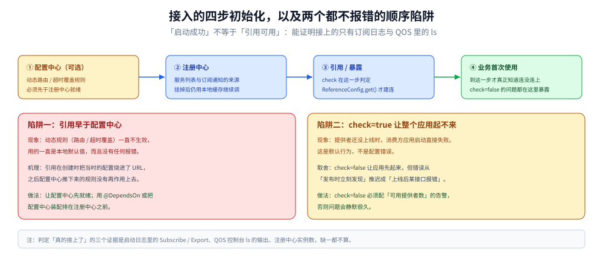

# Java 接入 Dubbo

> 覆盖：Dubbo 3.x 的 Maven 依赖、`@EnableDubbo` 与注解 / XML / API 三种写法、注册中心与协议配置、单例边界、初始化顺序的两个陷阱、attachment 的跨线程传递、优雅下线，以及 QOS 与常见故障速查。
>
> 不覆盖：链路与扩展点（→ [调用链路.md](../../../03-数据与中间件/中间件/RPC框架/Dubbo/调用链路.md)）；协议与序列化选型（→ [通信协议.md](../../../03-数据与中间件/中间件/RPC框架/Dubbo/通信协议.md)）；路由与容错策略（→ [服务治理.md](../../../03-数据与中间件/中间件/RPC框架/Dubbo/服务治理.md)）；该不该用 Dubbo（→ [RPC框架选型对比.md](../../../03-数据与中间件/中间件/RPC框架/RPC框架选型对比.md)）。
>
> 内容整理自个人学习笔记。⚠️ **本篇代码没有在本机编译或运行**：`dubbo-spring-boot-starter` 需要 Maven 拉包与一个可用注册中心，本机都没有。代码按 Dubbo 3.x 官方文档的 API 形态书写，逐块口径见文末 [校验口径](#校验口径)。

---

## 一、客户端选型与依赖

**本节要点**：三个坐标必须对齐 —— **starter 版本、注册中心实现、Spring Boot 大版本**。错一个就有可能是「启动没报错但服务没注册」。

| 依赖 | 作用 | 缺了会怎样 |
|---|---|---|
| `dubbo-spring-boot-starter` | 自动装配、`@EnableDubbo`、`@DubboService` / `@DubboReference` | 注解不生效，`@DubboReference` 注入进来是 `null` |
| `dubbo-registry-nacos`（或 zookeeper 实现） | 注册中心 SPI 实现 | 启动报 `No such extension RegistryFactory` 一类 |
| 接口 jar（服务提供方的 API 包） | 消费端要能编译到接口 | 只能走泛化调用（`GenericService`） |
| Spring Boot 3 时还需 `dubbo-spring-boot3-starter` 一类适配 | 自动配置的 `spring.factories` → `AutoConfiguration.imports` 迁移 | 自动装配完全不触发，且**不报错** |

```xml
<dependencyManagement>
  <dependencies>
    <dependency>
      <groupId>org.apache.dubbo</groupId>
      <artifactId>dubbo-bom</artifactId>
      <version>3.2.15</version>
      <type>pom</type>
      <scope>import</scope>
    </dependency>
  </dependencies>
</dependencyManagement>

<dependencies>
  <dependency>
    <groupId>org.apache.dubbo</groupId>
    <artifactId>dubbo-spring-boot-starter</artifactId>
  </dependency>
  <dependency>
    <groupId>org.apache.dubbo</groupId>
    <artifactId>dubbo-registry-nacos</artifactId>
  </dependency>
</dependencies>
```

⭐ **为什么用 BOM 而不是逐个写版本**：Dubbo 的 `dubbo-*` 模块是一组强耦合的坐标，
手工对齐时最容易出现「starter 是 3.2、registry 是 3.1」这种**编译通过、运行期 SPI 不匹配**的组合。
BOM 把这件事收敛成一处。⚠️ 上面写的 `3.2.15` 只是示例坐标，接之前换成目标版本。

## 二、前提

**本节要点**：Dubbo 不创建任何服务端资源，下游必须先齐；缺一样都有对应的报错原文。

| 要先准备 | 检查方式 | 漏了的表现 |
|---|---|---|
| 注册中心可达 | `curl http://127.0.0.1:8848/nacos/` 返回页面 | 启动卡在订阅，或报 `Failed to connect to registry` |
| 端口未被占用 | 提供方默认 `20880`（`dubbo`）/ 常用 `50051`（`tri`） | 启动报 `Address already in use` |
| 接口 jar 一致 | 消费端与提供端的接口全名、方法签名逐字一致 | 报 `No such method` 或反序列化失败 |
| 版本号约定 | `version` / `group` 两边一致 | 报 `No provider available`（注册中心里其实有，只是维度对不上） |
| JDK 版本 | 3.x 要求 JDK 8+，Triple 建议 11+ | 启动期 `UnsupportedClassVersionError` |

⚠️ **最容易忽略的是第四项**：`version` 与 `group` 参与服务唯一标识（`serviceKey`），
两边不一致时注册中心里的服务**看起来是好的**，但消费端就是找不到 —— 这类问题在日志里只有一个 `No provider`。

## 三、初始化

**本节要点**：注解方式只有两步 —— 启动类开 `@EnableDubbo`，配置文件给应用名 + 注册中心 + 协议。

```java
@SpringBootApplication
@EnableDubbo(scanBasePackages = "com.example.order")
public class OrderProviderApplication {
    public static void main(String[] args) {
        SpringApplication.run(OrderProviderApplication.class, args);
    }
}
```

```yaml
dubbo:
  application:
    name: order-provider          # ⭐ 必填，注册中心与指标都靠它
    qos-enable: true
    qos-port: 22222
  registry:
    address: nacos://127.0.0.1:8848
  protocol:
    name: tri                     # 2.x 私有协议用 dubbo；3.x 推荐 tri
    port: 50051
  consumer:
    timeout: 1000                 # 默认值，写出来是为了显式化
    retries: 0                    # ⭐ 写接口必须是 0，见服务治理篇第六节
    check: false                  # 启动时找不到提供者不失败
```

⭐ **三个必写的配置**及理由：

| 配置 | 为什么不能省 |
|---|---|
| `dubbo.application.name` | 应用级服务发现的注册单位；缺了注册中心里没有归属，指标也聚合不了 |
| `dubbo.registry.address` | 不写会退化到「直连模式」，本地能跑、上线就废 |
| `dubbo.protocol.port` | 不写默认 20880，多实例同机部署时直接端口冲突 |

## 四、单例边界 ⭐

**本节要点**：判据和别的中间件一致 —— **内部有长活资源的才要单例**。Dubbo 里几乎所有核心对象都是单例，因为它们各自持有连接、线程或注册订阅。

| 对象 | 是否单例 | 为什么 |
|---|---|---|
| `ReferenceConfig` / `@DubboReference` 代理 | **单例**（按 `serviceKey` 缓存） | 内部持有与提供者的连接、Directory 订阅、重试计数器 |
| `ServiceConfig` / `@DubboService` 暴露的 `Exporter` | **单例** | 内部持有 `Invoker` 与端口监听 |
| `Registry`（注册中心客户端） | **单例** | 一条长连接 + 订阅通知回调；多实例会重复收到推送 |
| `Protocol`（`DubboProtocol` / `TripleProtocol`） | **单例** | 持有 server 端监听与 client 端连接池 |
| `Filter` / `Router` / `LoadBalance` 实现 | **单例** | SPI 默认 `singleton=true`，⚠️ **不要在实现类里放请求级可变字段** |
| `RpcContext` | **线程级**（不是单例） | 按线程存 attachment，跨线程要手动传（见第八节） |

⚠️ **第五项是最常见的坑**：自己写一个 `Filter` 加个成员变量 `private String traceId;` 存当前请求的 trace，
并在类上持有它 —— 因为 Filter 是单例，这个字段会被所有并发请求互相覆盖。
**Filter 里只能用局部变量或 `RpcContext`。**

## 五、初始化顺序 ⭐

**本节要点**：Dubbo 有两个「顺序敏感」的地方，错了都不报错。

```text
① 配置中心（可选）→ ② 注册中心 → ③ 引用/暴露 → ④ 业务 Bean 首次使用
        ↑ 覆盖规则                         ↑ check 在这里判
```

| 顺序陷阱 | 现象 | 做法 |
|---|---|---|
| **引用在配置中心之前初始化** | 动态规则（路由 / 超时覆盖）不生效，用的一直是本地默认值 | 让 `config-center` 先于 `registry` 就绪；用 `@DependsOn` 或配置中心优先装配 |
| **`check` 与启动解耦** | `check=true`（默认）时，提供者没起来 → **整个应用启动失败** | 消费者设 `check=false` 让应用先起来，但要配「没有可用提供者」的告警 |
| **Bean 循环依赖里注入 `@DubboReference`** | 拿到的是早期引用，代理还没初始化 | 用 `@Lazy` 或 `ObjectProvider` 延迟取 |

⭐ 判据：**「启动成功」不等于「引用可用」**。
`check=false` 之后应用能起来，但第一次调用才暴露问题 —— 所以启动日志里必须有一条
`Subscribe service ...` 或 QOS 里能看到 `ls` 出这个引用，才算真的接上了。



第③步的 `check` 判定发生在「有没有可用提供者」上，所以它挡的是**启动**而不是**调用**。
两个陷阱的共同点是**都不报错**：一个让动态规则静默不生效，一个把「提供者没上线」变成「应用起不来」——
后者至少还看得见，前者只能靠对比「URL 里的值」与「配置中心里的值」发现。

## 六、单例与依赖注入的封装

**本节要点**：Spring 环境下用注解最省事；**不依赖 Spring 的场景**（批处理、SDK、测试）用 API 式，但必须自己管生命周期。

```java
// 注解式：交给 Spring，单例由容器保证
@DubboService(version = "1.0.0", group = "order")
public class OrderServiceImpl implements OrderService {
    @Override
    public OrderVO create(CreateReq req) { /* ... */ }
}

@Component
public class OrderClient {
    @DubboReference(version = "1.0.0", group = "order")
    private OrderService orderService;   // 单例代理，可安全复用
}
```

```java
// API 式：不依赖 Spring，自己保证只创建一次
public final class DubboRefs {
    private static volatile OrderService orderService;

    public static OrderService order() {
        if (orderService == null) {
            synchronized (DubboRefs.class) {
                if (orderService == null) {
                    ReferenceConfig<OrderService> ref = new ReferenceConfig<>();
                    ref.setInterface(OrderService.class);
                    ref.setVersion("1.0.0");
                    ref.setGroup("order");
                    ref.setCheck(false);
                    ref.setTimeout(1000);
                    ref.setRetries(0);
                    orderService = ref.get();   // ⚠️ 这一步才真正建连
                }
            }
        }
        return orderService;
    }
}
```

⚠️ API 式的三个硬要求：
1. **`ReferenceConfig` 不能每次调用都 new** —— 它内部持连接，反复创建等于反复建连（也会把注册中心订阅堆起来）；
2. **必须在退出时 `destroy()`**，否则线程与连接不会被释放；
3. **`ref.get()` 是阻塞的**，别放在请求路径上首次调用。

## 七、实际调用

### 7.1 注解方式（推荐）

```java
@DubboService(version = "1.0.0")
public class PayServiceImpl implements PayService {

    @DubboReference(version = "1.0.0", retries = 0, timeout = 800)
    private AccountService accountService;   // 写接口：retries=0

    @Override
    public PayResult pay(PayReq req) {
        // 一次远程调用，超时预算 800ms
        return accountService.deduct(req.getAccountId(), req.getAmount());
    }
}
```

### 7.2 XML 方式（存量项目常见）

```xml
<!-- 提供方 -->
<dubbo:service interface="com.example.OrderService" ref="orderService"
               version="1.0.0" timeout="1000" retries="0"/>

<!-- 消费方 -->
<dubbo:reference id="orderService" interface="com.example.OrderService"
                 version="1.0.0" check="false" timeout="1000" retries="0"/>
```

⭐ XML 与注解的优先级：**注解默认覆盖 XML**，而配置中心的覆盖规则又高于两者。
排查「配置不生效」时按这个顺序往上找，最后一定是**打印 `URL`** 看清楚实际值。

### 7.3 泛化调用（没有接口 jar）

```java
@DubboReference(interfaceName = "com.example.OrderService", generic = true, version = "1.0.0")
private GenericService orderService;

// 参数用 Map 表示，返回值也是 Map
Object result = orderService.$invoke("getById", new String[]{"java.lang.Long"}, new Object[]{1L});
```

⚠️ 泛化调用**没有编译期检查**，字段名写错只有运行时才知道；且不走接口的 Filter 配置，排障手段会少一半。

## 八、跨进程与跨协程传播

**本节要点**：`RpcContext` 是**线程级**的，且 Dubbo 3.x 把客户端与服务端的 attachment 拆成了两个入口 —— 混用会拿到空值。

```java
// 消费端：设置将要随请求发出去的 attachment
RpcContext.getClientAttachment().setAttachment("traceId", traceId);

// 服务端：读取请求带来的 attachment
String traceId = RpcContext.getServerAttachment().getAttachment("traceId");

// 异步调用完成后的回调里，上下文已经不是调用线程的了
CompletableFuture<OrderVO> f = RpcContext.getServiceContext().getCompletableFuture();
```

| 场景 | 做法 | 踩坑 |
|---|---|---|
| 业务线程 → 线程池 → 远程调用 | **先取出 attachment，再在线程池任务里重新 set** | 线程池复用线程，不传就丢；更糟的是**串到别人的请求上** |
| 服务端收到后起异步任务 | 同上，手动透传 | `RpcContext` 不会自动跟着 `CompletableFuture` 走 |
| 链路追踪 | 让 trace 的传播走 `Filter`（如 SkyWalking / OTel 的 Dubbo 插件） | 自己 set attachment 容易漏分支 |

⭐ 一条铁律：**`RpcContext` 是「线程局部变量 + 显式传递」，不是魔法。**
凡是有线程切换的地方（线程池、`@Async`、`CompletableFuture` 的默认 executor），都要把它当成一个必须手动搬运的参数。

## 九、优雅退出

**本节要点**：下线顺序是「**先反注册，再等请求跑完，最后关端口**」。顺序反了，消费端会拿到已关闭的连接。

```text
SIGTERM
  → DubboShutdownHook 触发
  → ① 从注册中心**注销**自己（消费端不再拿到这个地址）
  → ② 等待在途请求完成（有等待上限）
  → ③ 关闭 server 端口、释放线程池
```

| 要点 | 说明 |
|---|---|
| **不要用 `kill -9` 做发布** | 跳过①②③：消费端要等下个周期才发现地址失效，期间一直往死端口发请求 |
| Spring Boot 的 `server.shutdown=graceful` **只管 Web 容器** | Dubbo 的端口是独立的，要单独配 Dubbo 的等待时间（3.x 有 shutdown 等待项，接版本核对） |
| K8s 里要配 `preStop` | 先 `sleep` 让注册中心推送生效，再发 `SIGTERM`（同 [K8s部署流程.md](../../../06-工程实践/部署/k8s/K8s部署流程.md)） |
| 长耗时任务要有上限 | 「等在途请求完成」不能无限等，否则发布永远卡住 |

## 十、验证与排查

### 10.1 先确认真的接上了

| 检查 | 期望 |
|---|---|
| 提供方启动日志 | 有 `Export dubbo service ...` 与 `Start NettyServer` / 协议端口监听 |
| 消费方启动日志 | 有 `Subscribe` / `Refer dubbo service ...`，且能看到提供者地址 |
| QOS 控制台 | `telnet 127.0.0.1 22222` 后 `ls` 能看到服务与引用 |
| 注册中心控制台 | Nacos 服务列表里有该应用，实例数为预期值 |
| 直接调一次 | QOS 的 `invoke` 可以在**不写代码**的情况下调一个方法，这是最快的连通性验证 |

### 10.2 常见故障速查

| 症状 | 先查什么 |
|---|---|
| `@DubboReference` 注入为 `null` | 启动类是否有 `@EnableDubbo`；扫描包是否覆盖该接口所在包 |
| `No provider available` | `version` / `group` 是否一致 → 路由是否把实例全过滤了 → 注册中心里到底有没有 |
| 启动直接失败、报找不到提供者 | `check=true`（默认）；消费者改 `check=false` |
| 调用必超时但提供方日志正常 | 消费端 `timeout` 太小，或重试把时间预算吃光（见 [服务治理.md](../../../03-数据与中间件/中间件/RPC框架/Dubbo/服务治理.md) 第六节） |
| 反序列化异常 / 字段全是 `null` | 两端接口 jar 版本不一致；序列化方式不一致（看 `URL` 里的 `serialization`） |
| 提供方线程池打满、报 `RejectedExecutionException` | `threads` / `queues` 配置，或上游重试放大（见 [调用链路.md](../../../03-数据与中间件/中间件/RPC框架/Dubbo/调用链路.md) 第五节） |
| 发布时有一批请求失败 | 是否 `kill -9`；`preStop` 与 Dubbo 等待时间是否配了 |
| 灰度不生效 | `dubbo.tag` 是否真的设上；`force` 的选择（见 [服务治理.md](../../../03-数据与中间件/中间件/RPC框架/Dubbo/服务治理.md) 第七节） |

---

## 校验口径

> ⚠️ 本篇代码的校验方式与范围：

- **未编译、未运行**：第一至第十节的所有 Java / YAML / XML 片段都**没有在本机编译或启动过**。
  原因：需要 Maven 拉取 `dubbo-spring-boot-starter` 与注册中心实现，并且要有一个可达的 Nacos / Zookeeper 实例；本机两样都不具备。
- **版本坐标是示例**：`3.2.15` 只是占位，**不是推荐版本**；用之前换成目标版本并核对 `dubbo-spring-boot-starter` 与 Spring Boot 的兼容矩阵。
- **API 形态按 3.x 核对**：`@DubboService` / `@DubboReference` / `RpcContext.getClientAttachment()` / `getServerAttachment()` 都是 3.x 的写法。
  2.7 及以前的 `@Service` / `@Reference` / `RpcContext.getContext().setAttachment()` **语义不同**（客户端与服务端共用），迁移时不能只改注解名。
- **未断言具体参数名**：优雅退出的「等待在途请求」时长配置在不同小版本里名字变过，正文只写「接版本核对」，没有给出可能失效的键名。
- **待实测项**：① `@EnableDubbo` 缺失时的确切报错；② `check=false` 下首次调用失败的报错；③ QOS `invoke` 的实际输出格式；④ 优雅退出时消费端收到的异常类型（`Connection refused` vs `channel closed`）。

| 依赖 | 版本口径 |
|---|---|
| Dubbo | 3.x（文档与 API 形态），正文示例坐标 `3.2.15`（占位） |
| Spring Boot | 3.x（正文提到 `imports` 迁移，未验证） |
| JDK | 未使用（未编译） |
| 注册中心 | 未连接 |

## 延伸追问

- **为什么 `@DubboReference` 要单例，而 `ReferenceConfig` 反复 new 会出问题？** →
  `get()` 的那一刻会建立与提供者的连接、发起注册中心订阅、初始化重试计数器。
  反复 new 等于把这三件事重复做，且旧对象不会自动释放 —— 表现为连接数与线程数持续上涨，最后 OOM 或把注册中心压垮。
- **`check=false` 是不是万能解法？** →
  它只是把「启动失败」推迟成「首次调用失败」。真正的做法是：**用 `check=false` 换取启动韧性，同时用「可用提供者数」的指标兜底**，
  否则问题会从「发布时立刻发现」变成「上线后某个低频接口报错」。
- **`RpcContext` 为什么在线程池里会丢？** →
  它是 `ThreadLocal`。线程池的线程会被复用，既可能「丢」（新线程里没有值），也可能「串」（上一个任务的值还在）。
  ⚠️ 后者比前者危险：不是报错，而是**把 A 请求的 traceId 带到了 B 请求**。
- **QOS 的 `invoke` 能替代写代码测试吗？** →
  能做连通性与参数验证，但它绕过了你的业务封装（鉴权、参数校验、上下文准备），
  所以「`invoke` 成功」只证明「服务可达、方法存在」，不证明「业务链路通」。
- **API 式接入在什么场景比 Spring 注解更合适？** →
  短生命周期进程（批处理、命令行工具）、SDK 与中间件内部、以及**需要精确控制初始化时机**的场景。
  代价是生命周期全要自己管 —— 尤其是退出时的 `destroy()`，漏了就是连接泄漏。

## 关联

- **上游/总纲**：[RPC框架选型对比.md](../../../03-数据与中间件/中间件/RPC框架/RPC框架选型对比.md) — 该不该用 Dubbo
- **上游/总纲**：[README.md](../../../03-数据与中间件/中间件/RPC框架/Dubbo/README.md) — Dubbo 册导读（本篇是它的语言分册）
- **下游机制**：[调用链路.md](../../../03-数据与中间件/中间件/RPC框架/Dubbo/调用链路.md) — 这些配置最终变成了链路里的哪些对象
- **下游机制**：[服务治理.md](../../../03-数据与中间件/中间件/RPC框架/Dubbo/服务治理.md) — `timeout` / `retries` / `cluster` 为什么这么配
- **对照/互补**：[接入gRPC.md](接入gRPC.md) — 同一套「接入」关注点在 gRPC 侧的形态（含可运行代码）
- **对照/互补**：[服务发现的Java实现.md](服务发现的Java实现.md) — 注册中心客户端在应用侧的另一种接法
- **运维/配置**：[Nacos.md](../../../03-数据与中间件/中间件/注册与配置中心/Nacos.md) — 注册中心与配置中心的部署与命名空间
- **反向引用（本篇被下列文档引到）**：[README.md](../../../03-数据与中间件/中间件/RPC框架/Dubbo/README.md)
> 反向引用（本篇被下列文档引到）：[通信协议.md](../../../03-数据与中间件/中间件/RPC框架/Dubbo/通信协议.md)
