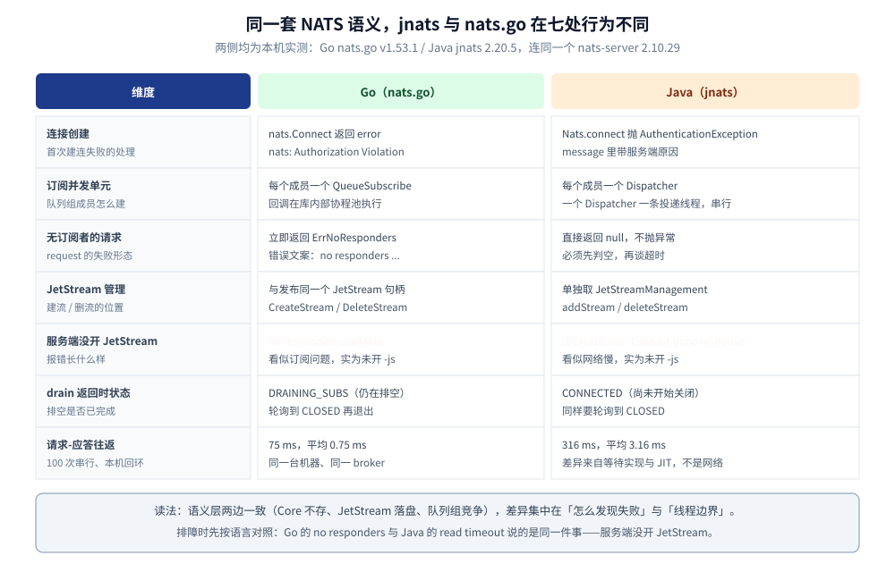
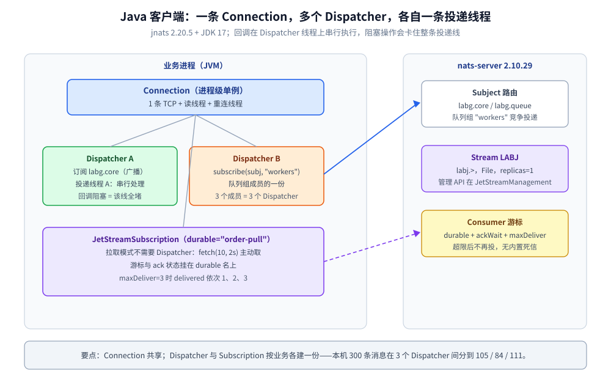
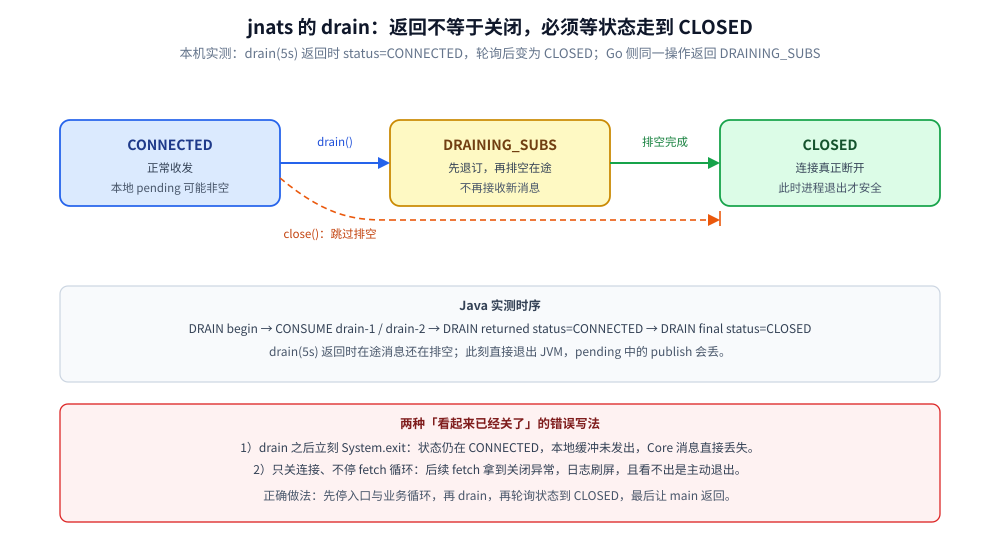

# Java 接入 NATS

> 覆盖：Java 侧接入 NATS 的完整手册 —— `jnats` 选型与依赖、前提与鉴权、初始化、单例与线程边界、初始化顺序、Core / Queue / Request-Reply / JetStream 各场景、Header 跨进程传播、`drain` 优雅退出、验证与排障。
>
> 不覆盖：NATS 的定位、Subject 通配符、队列组与 JetStream 的机制见 [NATS 目录导读](../../../03-数据与中间件/中间件/消息队列/NATS/README.md)（零件篇从 [核心概念与架构.md](../../../03-数据与中间件/中间件/消息队列/NATS/核心概念与架构.md) 起读）；Go 侧写法见 [接入NATS.md](../../go/工程实践/接入NATS.md)。
>
> 内容整理自个人学习笔记。本篇代码在 JDK 17（`javac 17.0.20.1`）+ `io.nats:jnats 2.20.5` 下编译运行通过，并对本机 `nats:2.10-alpine`（nats-server **2.10.29**，开 JetStream、token 鉴权）容器实测，输出见第十节。

---

## 一、客户端选型与依赖

**本节要点**：Java 侧认准 `io.nats:jnats`（官方维护、纯 Java）；真正需要提前想清楚的是**日志依赖**与**回调线程模型**。

```xml
<dependency>
  <groupId>io.nats</groupId>
  <artifactId>jnats</artifactId>
  <version>2.20.5</version>
</dependency>
```

| 依赖 | 作用 | 漏了会怎样 |
| --- | --- | --- |
| `io.nats:jnats` | 客户端本体，含 Core / JetStream / KV / ObjectStore 全部 API | — |
| `org.slf4j:slf4j-api` + 一个实现（本机 `slf4j-simple 2.0.13`） | `jnats` 的连接与错误日志走 slf4j | 日志静默，`ErrorListenerLoggerImpl` 什么也不打，排障时看不到 `Authorization Violation` |

⚠️ **常见误装 / 误用**：

- `NatsMessage` 在 2.20.5 里**不存在**（本机编译原文 `cannot find symbol: class NatsMessage`）——发带 Header 的消息用 `nc.publish(subject, headers, data)`，不要照抄别处的 builder 写法；
- 建流 / 删流不在 `JetStream` 接口上，而在 `JetStreamManagement`（`Cannot find symbol: method addStream`）；`JetStream` 只负责发布与订阅；
- 服务端没开 `-js` 时，Java 报的是 **`IOException: Timeout or no response waiting for NATS JetStream server`**，不是「JetStream 未开启」——见第十节故障表。

## 二、前提

**本节要点**：客户端不创建 broker 级资源；鉴权、JetStream、Stream 三件事必须在服务端先成立。

| 依赖 | 要先准备好什么 | 漏了会报什么（本机原文） |
| --- | --- | --- |
| **服务端** | `nats-server` 已起、`4222` 可达 | `IOException: Unable to connect to NATS server`（重连耗尽后） |
| **鉴权** | `authorization { token: ... }`，连接字符串带 token | `AuthenticationException: Authentication error connecting to NATS server: Authorization Violation` |
| **JetStream** | 启动参数 `-js` + `store_dir` | `IOException: Timeout or no response waiting for NATS JetStream server` |
| **Stream** | `JetStreamManagement.addStream(...)` 或运维预建 | `Publish` 无响应，`jetStream.publish` 抛超时 |
| **Consumer** | `PullSubscribeOptions.durable("xxx")`，进度挂在这个名字上 | 换 durable 名 = 从头重新消费 |
| **`max_payload`** | 默认 1 MB（本机 `/varz` 读数 `1048576`） | `IllegalArgumentException: Message payload size exceed server configuration 2097152 vs 1048576` |

> ⚠️ 鉴权失败在 Java 侧**先打一条 SEVERE 日志再抛异常**，两者内容一致。只看 `catch` 里的异常容易漏掉连接号（`Connection: 102`），排障时把 slf4j 实现配上是值得的。

## 三、初始化

**本节要点**：`Nats.connect(Options)` 是**同步建连**，失败直接抛异常；连接建立后订阅与发布都是内存操作，没有再 Start 的步骤。

```java
import io.nats.client.*;
import java.time.Duration;

Connection nc = Nats.connect(Options.builder()
        .server("nats://s3cret-token@172.17.0.2:4222") // token 拼 URL；生产从环境变量读
        .connectionTimeout(Duration.ofSeconds(5))
        .maxReconnects(10)
        .reconnectWait(Duration.ofSeconds(2))
        .build());
```

**在哪调**：进程启动阶段建一次（Spring 里就是 `@Bean` 单例，配 `destroyMethod`）。`Nats.connect` 内部已起好读线程与重连线程，**不要**在每个请求里 Connect。

**与 Go 的差异**：两边的首次建连都是同步、都由调用方处理失败；区别在**错误类型**——Go 返回 `error` 字符串 `nats: Authorization Violation`，Java 抛 `AuthenticationException` 并把服务端原因拼在 message 里。

## 四、单例边界与线程模型 ⭐

**本节要点**：`Connection` 必须单例；每个订阅（尤其是队列组里的每个成员）要有**自己的 `Dispatcher`**——`jnats` 的回调在 Dispatcher 的线程上串行执行。

| 对象 | 单例？ | 为什么 |
| --- | --- | --- |
| `Connection` | ✅ 进程级 | 持有一条 TCP、读写线程与重连状态；反复建 = 连接数线性膨胀 |
| `JetStream` / `JetStreamManagement` | ✅ 跟随 Connection | 只是上下文句柄，`nc.jetStream()` 取即可 |
| `Dispatcher` | ❌ 按订阅 | 每个 Dispatcher 有自己的投递线程；队列组的每个成员各一个 |
| `JetStreamSubscription` | ❌ 按消费组 | 绑定 durable 与 ACK 状态 |
| `Message` / `Headers` | ❌ 请求级 | 每条消息独立；异步处理要先把 `getData()` 取出来 |

**线程边界（本机实测的写法）**：队列组测试里三个成员各建一个 Dispatcher：

```java
AtomicInteger[] counters = {c1, c2, c3};
Dispatcher[] ds = new Dispatcher[3];
for (int i = 0; i < 3; i++) {
    final int idx = i;
    ds[i] = nc.createDispatcher(m -> counters[idx].incrementAndGet());
    ds[i].subscribe("labg.queue", "workers"); // 第二参数是队列组名
}
```

**写错的后果**：

- 只建一个 Dispatcher 却想让多个队列组成员并发：成员数看起来是 3，实际只有一个投递线程，处理慢时全部排队；
- 在 Dispatcher 回调里做阻塞调用（DB、HTTP）：**该 Dispatcher 上的后续消息全被卡住**，`pending` 涨到上限后变慢消费者；
- 把 `Message` 存进成员变量再异步处理：消息对象会被复用，取出的 `byte[]` 要先落地。

> 一句话：**Connection 单例（省 TCP），Dispatcher 按订阅建（一个投递线程一份）。**

## 五、初始化顺序 ⭐

**本节要点**：⭐ 判据是「谁在初始化时捕获了全局单例」；NATS 侧三条实序。

1. **slf4j 实现先于 `Nats.connect`**：`jnats` 的错误监听器通过 slf4j 输出，实现不在 classpath 上时启动期的鉴权失败只剩一个异常，日志里什么都没有；
2. **订阅先于发布（Core）**：Core NATS 不存储，发布那一刻没有订阅者，消息就没了（本机实测 `LOSSY subscriber got=0`）；
3. **JetStream 一切调用在 `Nats.connect` 之后**：`nc.jetStream()` 不建连，错误推迟到第一次 `addStream` / `publish`，且表现为**超时**而非明确报错。

> ⭐ 跨组件的经典例子仍在链路追踪栈：**GORM 的 OTel 插件在 `Install` 时就捕获了当时的全局 `TracerProvider`**——插件装早了，SQL span 永远不上报且不报错。详见 [接入Jaeger.md](../可观测性/接入Jaeger.md)。

## 六、单例与依赖注入的封装

**本节要点**：`Connection` 用「静态持有 + 显式关闭」或 Spring 单例 Bean；消费者用「构造 → 订阅 → 停止」生命周期类封装。

```java
public final class NatsClient {
    private static volatile Connection conn;

    private NatsClient() {}

    // 双重检查：进程内只建一条连接；建连失败直接抛，别把异常结果缓存成单例
    public static Connection conn() {
        Connection c = conn;
        if (c == null) {
            synchronized (NatsClient.class) {
                c = conn;
                if (c == null) {
                    try {
                        c = Nats.connect(Options.builder()
                                .server(System.getenv("NATS_URL")) // nats://token@host:4222
                                .connectionTimeout(Duration.ofSeconds(5))
                                .maxReconnects(10)
                                .reconnectWait(Duration.ofSeconds(2))
                                .build());
                    } catch (Exception e) {
                        throw new IllegalStateException("connect nats failed", e);
                    }
                    conn = c;
                }
            }
        }
        return c;
    }
}
```

⚠️ **不要把建连结果缓存成「失败的 null」**：一旦把 `null` 存进静态字段，后续调用会直接返回 null 而不是重试。要么失败即抛（启动期 fail-fast），要么在启动重试循环里成功后再赋值。

消费者（非单例）：

```java
public final class OrderConsumer implements AutoCloseable {
    private final Connection nc;
    private final JetStreamSubscription sub;
    private final Dispatcher dispatcher;

    public OrderConsumer(String durable) throws Exception {
        this.nc = NatsClient.conn();
        JetStream js = nc.jetStream();
        this.sub = js.subscribe("order.created", PullSubscribeOptions.builder()
                .durable(durable)
                .configuration(ConsumerConfiguration.builder()
                        .maxDeliver(5)
                        .ackWait(Duration.ofSeconds(30))
                        .build())
                .build());
        this.dispatcher = null; // 拉取模式不需要 Dispatcher
    }

    @Override
    public void close() {
        sub.unsubscribe(); // 停止拉取；在途未 ack 的消息按 ackWait 重投
    }
}
```

## 七、实际调用

**本节要点**：同一个 Connection，Core 用「Dispatcher + subscribe」，JetStream 用「subscribe(PullSubscribeOptions) + fetch / ack」。

### 7.1 发布订阅与队列组

```java
// 广播：同一 Subject 的每个订阅者都收到一份
Dispatcher d = nc.createDispatcher(msg ->
        System.out.printf("SUB subject=%s data=%s%n",
                msg.getSubject(), new String(msg.getData())));
d.subscribe("labg.core");

for (int i = 1; i <= 3; i++) {
    nc.publish("labg.core", ("java-core-" + i).getBytes());
}
nc.flush(Duration.ofSeconds(1)); // ⭐ 等本地缓冲真正写进 TCP
System.out.println("PUB DONE core=3");
```

本机实测：3 条消息全部到达，输出顺序与发送顺序一致（同一 Subject、同一 Dispatcher 串行投递）。

队列组用 `subscribe(subject, queueGroup)`（见第四节代码）。本机实测 300 条、3 个成员：`c1=105 c2=84 c3=111`——**与 Go 侧一样，每轮比例都会变**，队列组不做 key 亲和、也不轮流发。

### 7.2 请求-应答

```java
// 服务端：回写到 m.getReplyTo()（客户端自动生成的 _INBOX.xxx）
Dispatcher svc = nc.createDispatcher(m ->
        nc.publish(m.getReplyTo(), ("echo:" + new String(m.getData())).getBytes()));
svc.subscribe("labg.echo");

// 调用方：无订阅者时返回 null，不是抛异常（⭐ 2.20.5 实测）
Message reply = nc.request("labg.echo", "q-1".getBytes(), Duration.ofSeconds(2));
if (reply == null) {
    log.warn("no responder or timeout");
    return;
}
System.out.println(new String(reply.getData()));
```

本机实测：100 次串行请求共 `316 ms`，平均 `3.16 ms`（Go 侧同一台机器 `75 ms` / `0.75 ms`，差异来自两边 `Request` 的等待实现与 JIT 预热）。

⚠️ **判空是强制的**：本机对无人订阅的 `nobody.home` 发请求，`request` **直接返回 `null`**，没有异常也没有等待满 2 秒。生产代码里 `null` 既可能表示「无订阅者」也可能表示「超时」，日志里必须把 Subject 与耗时一起打出来。



读图要点：语义层两边一致（Core 不存、JetStream 落盘、队列组竞争），差异集中在「怎么发现失败」与「线程边界」；同对无订阅者，Go 报 `ErrNoResponders`，Java 返回 `null`，判空必须先于判超时。

### 7.3 JetStream：建流、发布与拉取消费

```java
JetStream js = nc.jetStream();
JetStreamManagement jsm = nc.jetStreamManagement();

// 建流：管理操作在 JetStreamManagement 上，不在 JetStream 上
jsm.addStream(StreamConfiguration.builder()
        .name("ORDERS").subjects("order.>")
        .storageType(StorageType.File).replicas(1) // 单机只能 1
        .build());

// 发布：同步等 PubAck，返回 PublishAck
PublishAck ack = js.publish("order.created", "{\"id\":\"ORDER_1\"}".getBytes());
System.out.printf("seq=%d stream=%s%n", ack.getSeqno(), ack.getStream());
```

```java
// 拉取消费：durable 名即进度；fetch 一批，逐条 ack
JetStreamSubscription sub = js.subscribe("order.created",
        PullSubscribeOptions.builder().durable("order-pull")
                .configuration(ConsumerConfiguration.builder()
                        .maxDeliver(5).ackWait(Duration.ofSeconds(30)).build())
                .build());

List<Message> msgs = sub.fetch(10, Duration.ofSeconds(2));
for (Message m : msgs) {
    MessageMetaData meta = m.metaData();
    System.out.printf("CONSUME data=%s delivered=%d streamSeq=%d%n",
            new String(m.getData()), meta.deliveredCount(), meta.streamSequence());
    m.ack(); // 业务成功后再 ack
}
```

本机实测：发 5 条、durable 拉取，5 条全部 `delivered=1` 并 ack，`JS CONSUME DONE n=5`。

⭐ **重投**：只 `nak()` 不 `ack()`，`deliveredCount` 依次 `1 → 2 → 3`，第 4 轮 `fetch` 返回空（`maxDeliver=3`）。NATS **没有内置死信**，超限消息停在 Stream 里，需要应用自己转发——详见 [消息可靠性.md](../../../03-数据与中间件/中间件/消息队列/NATS/消息可靠性.md) 第四节。

### 7.4 延迟与顺序：同样没有现成件

| 需求 | Java 侧可行做法 | 代价 |
| --- | --- | --- |
| 延迟投递 | 应用层定时器再 `publish`；或 `nakWithDelay` 做延后重试 | 无 broker 级延迟队列 |
| 严格顺序 | 同一 Subject 单订阅，或 JetStream 单 Consumer 串行处理 | 放弃水平扩展 |
| 按 key 亲和 | key 编进 Subject（`order.ORDER_1.created`）+ 通配符订阅 | Subject 基数增长，需要命名规范 |

> 需要 broker 级延迟 / 顺序 / 死信时，Java 侧的对照路线是 [接入RocketMQ.md](接入RocketMQ.md) 与 [接入Pulsar.md](接入Pulsar.md)。



读图要点：能共享的只有 `Connection`；`Dispatcher` 与 `JetStreamSubscription` 都是「一份消费语义一份状态」，回调里做阻塞操作卡住的是该 Dispatcher 的整条投递线程。

## 八、跨进程与跨协程传播

**本节要点**：跨进程用 Header 做 Inject / Extract；跨线程用显式参数（或 MDC）传递 trace_id，别塞进共享的 Connection 或 Dispatcher 字段。

```java
// 生产端：Headers 是 MultiMap，publish(subject, headers, data) 一步发出
Headers h = new Headers();
h.add("x-biz-id", "ORDER_JAVA_NATS_1");
h.add("x-trace-id", "trace-nats-java-abc");
nc.publish("labg.headers", h, "java-nats-props".getBytes());
nc.flush(Duration.ofSeconds(1));
```

```java
// 消费端：getHeaders() 可能为 null（无 Header 的消息），先判空
Dispatcher d = nc.createDispatcher(m -> {
    Headers hh = m.getHeaders();
    System.out.printf("HDR biz=%s trace=%s data=%s%n",
            hh == null ? null : hh.getFirst("x-biz-id"),
            hh == null ? null : hh.getFirst("x-trace-id"),
            new String(m.getData()));
});
d.subscribe("labg.headers");
```

本机实测（属性完整往返）：

```text
HDR subject=labg.headers biz=ORDER_JAVA_NATS_1 trace=trace-nats-java-abc data=java-nats-props
HDR DONE got=1
```

**传递铁律**：

- `request` / `publish` 的等待时间由参数控制，不是 `ctx`；要跟随上游取消，得自己用 future 或超时参数换算；
- Header 必须是 `Map<String, List<String>>` 语义，同 key 多值用 `add` 追加，别用 `put` 覆盖；
- ⚠️ **别把请求级 trace_id 存成 Dispatcher 的成员字段**——一个 Dispatcher 被所有消息共用，立刻串数据。

## 九、优雅退出

**本节要点**：退出用 `nc.drain(...)`，且 **`drain` 返回不等于连接已关闭**——Java 侧返回时状态可能仍是 `CONNECTED`，必须轮询到 `CLOSED`。

```java
Runtime.getRuntime().addShutdownHook(new Thread(() -> {
    System.out.println("SHUTDOWN triggered");
    try {
        nc.drain(Duration.ofSeconds(5)); // 先退订、排空在途，再关
        for (int i = 0; i < 30 && nc.getStatus() != Connection.Status.CLOSED; i++) {
            Thread.sleep(100);
        }
        System.out.println("SHUTDOWN done status=" + nc.getStatus());
    } catch (Exception e) {
        System.err.println("drain failed: " + e.getMessage());
    }
}));
```

本机实测：

```text
DRAIN begin
CONSUME drain-1
CONSUME drain-2
DRAIN returned status=CONNECTED
DRAIN final status=CLOSED
```



读图要点：三种退出路径里只有「drain + 轮询到 `CLOSED`」能把在途消息排空；`drain()` 返回时状态还停在 `CONNECTED`，此时 JVM 退出仍然会丢掉本地缓冲。

⭐ 读法：`drain()` 先是异步发起，**返回时状态还是 `CONNECTED`**（Go 侧同一操作返回 `DRAINING_SUBS`，见 [接入NATS.md](../../go/工程实践/接入NATS.md) 第九节）；若此时 JVM 退出，在途消息与缓冲就丢了。要等状态变 `CLOSED` 或给一个固定宽限期。

| 退出方式 | 在途消息 | 订阅 | 适用 |
| --- | --- | --- | --- |
| `nc.drain(timeout)` + 轮询 `CLOSED` ⭐ | 排空后关闭 | 先退订 | 正常停机 |
| `nc.close()` | **丢弃本地缓冲** | 立即断 | 进程已崩、或要快停 |
| 直接 `System.exit` | 全部丢弃 | — | 只在异常兜底 |

**漏了会丢什么**：

- 不 drain 直接退出：本地 pending 的 publish 丢失（Core 无存储）；
- JetStream 已 fetch 未 ack 就退出：`ackWait` 到期后重投，**不是丢，是重**，业务必须幂等；
- 只 drain 不停 fetch 循环：后续 `fetch` 会拿到关闭后的异常，日志刷屏。

## 十、验证与排查

**本节要点**：先确认接入生效（建连、队列组、JetStream ack），再按故障表定位；Java 侧尤其要看 slf4j 日志里的服务端原因。

### 10.1 先确认生效

```bash
# 环境：JDK 17（javac 17.0.20.1）+ jnats 2.20.5 + slf4j-simple 2.0.13
javac -cp 'jnats.jar:slf4j-api.jar' NatsAccessLab.java
java -cp 'jnats.jar:slf4j-api.jar:slf4j-simple.jar:.' NatsAccessLab jetstream
```

```text
STREAM created LABJ
JS PUBLISH n=5
JS CONSUME subject=labj.orders data=js-1 delivered=1
JS CONSUME DONE n=5
QUEUE total=300 c1=105 c2=84 c3=111
REQREP n=100 total=316ms avg=3.16ms last=echo:q-99
REDELIVER round=1 delivered=1 data=redeliver-1
REDELIVER round=3 delivered=3 data=redeliver-1
REDELIVER round=4 nothing (maxDeliver reached)
LOSSY subscriber got=0 (core NATS 不补投)
```

服务端复核（宿主映射 `18222`）：

```bash
curl --noproxy '*' -s http://127.0.0.1:18222/varz | head -c 400
curl --noproxy '*' -s http://127.0.0.1:18222/jsz  | head -c 400
```

### 10.2 常见故障速查

| 症状 | 多半是 | 处置 |
| --- | --- | --- |
| `AuthenticationException: Authentication error connecting to NATS server: Authorization Violation` | 连接串没带 token | 补 `nats://token@host:4222`，或 `Options.token(...)` |
| `IOException: Unable to connect to NATS server` | 地址 / 端口 / 容器网络 | 先验端口，再看 `maxReconnects` 是否已耗尽 |
| `IOException: Timeout or no response waiting for NATS JetStream server` | **服务端没开 `-js`**（也见于 Stream 不存在） | 启动加 `-js`；别误判成网络慢 |
| `resource_not_found`（Stream/Consumer） | 名字拼错或已被删 | 用 `jsm.getStreamNames()` 复核 |
| `IllegalArgumentException: Message payload size exceed ...` | 超过 `max_payload`（默认 1 MB） | 拆包或调大 `max_payload` |
| `request` 返回 `null` | 无订阅者，或超时 | 打印 Subject + 耗时区分两者；检查订阅先于发布 |
| 回调里越来越慢、`pending` 上涨 | 在 Dispatcher 线程做阻塞调用 | 把重活丢到业务线程池，回调里只做入队 |
| `drain` 后进程立刻退出导致丢消息 | 状态还在 `CONNECTED` | 轮询到 `CLOSED` 再返回 |
| 日志里什么都看不到 | 缺 slf4j 实现 | 加 `slf4j-simple` 或 logback |

| 排查项 | 命令 / 接口 |
| --- | --- |
| 连接、吞吐 | `GET /varz` |
| 单连接订阅与 pending | `GET /connz?subs=1` |
| Stream / Consumer 积压 | `GET /jsz?streams=1&consumers=1` |
| 健康检查 | `GET /healthz?js-enabled-only=true` |

## 十一、延伸追问

- **为什么 `request` 返回 null 而不抛异常？** → 本机 jnats 2.20.5 实测如此：无订阅者时直接返回 `null`，不等满超时；Go 的 `nats.go` 返回 `ErrNoResponders`。判空是 Java 侧的必要动作。详见 7.2。
- **为什么 `addStream` 报超时而不是「JetStream 未开启」？** → 管理 API 在协议上是一次请求-应答，服务端没开 `-js` 时无人应答，客户端只能等到超时；Go 侧则表现为 `no responders`。详见第二节、第十节。
- **Dispatcher 能开几个？** → 按订阅开，一个 Dispatcher 一个投递线程；队列组的每个成员各一个，否则成员数只是「看起来有并发」。详见第四节。
- **`drain` 之后为什么状态还是 CONNECTED？** → 它先异步发起排空，返回早于关闭完成；必须轮询到 `CLOSED`，否则 JVM 退出会丢在途消息。详见第九节。
- **超过 `maxDeliver` 的消息在哪？** → 留在 Stream 里不再投递，**没有内置死信**；要死信得由应用转发到自己的死信 Subject。详见 7.3。

## 十二、校验口径

> ✅ 本篇代码的校验方式与范围（JDK 17.0.20.1 + jnats 2.20.5）：

- **真编译 + 运行通过**：第三节 `Nats.connect`、第四节 3 个 Dispatcher 的队列组、7.1 广播、7.2 请求-应答、7.3 建流 / 发布 / 拉取 / 重投、第八节 Header 往返、第九节 `drain` 与状态轮询。
- **只写出、未编译运行**：第六节 `NatsClient` / `OrderConsumer` 的完整封装（等价逻辑已在 7.1–7.3 跑通）；Spring 集成未涉及（NATS 无官方 Spring Boot Starter，接入按普通 Bean 处理）。
- **未实测**：集群 / Leaf Node / Super Cluster（本机 `docker network create` 不可用）；NKey / JWT 鉴权；KV 与 Object Store；异步 `CompletableFuture` 请求变体。
- **实测环境**：`nats:2.10-alpine`（nats-server 2.10.29），`nats-lab` 开 JetStream + token 鉴权（`s3cret-token`），另一容器 `nats-lab-nojs` 作「未开 JetStream」对照。
- **未伪造输出**：第十节读数全部来自本次容器运行；队列组 `105/84/111` 与 Go 侧 `92/104/104` 是两次独立运行，未混用。

| 依赖 | 实际版本 |
| --- | --- |
| `io.nats:jnats` | 2.20.5 |
| `org.slf4j:slf4j-api` / `slf4j-simple` | 2.0.13 |
| JDK | 17.0.20.1 |
| `nats-server`（镜像内） | 2.10.29 |

## 关联

- **上游/总纲**：[NATS 目录导读](../../../03-数据与中间件/中间件/消息队列/NATS/README.md) — 定位、阅读路线与实测坐标
- **对照/互补**：[接入NATS.md](../../go/工程实践/接入NATS.md) — Go 侧同一组场景的写法与差异
- **对照/互补**：[接入Pulsar.md](接入Pulsar.md) — Java 侧另一套「订阅类型 + 重放」的写法
- **对照/互补**：[接入RocketMQ.md](接入RocketMQ.md) — 需要 broker 级延迟 / 顺序 / 死信时的对照路线
- **下游机制**：[订阅与消费语义.md](../../../03-数据与中间件/中间件/消息队列/NATS/订阅与消费语义.md) — 队列组、Durable、Push 与 Pull
- **下游机制**：[消息可靠性.md](../../../03-数据与中间件/中间件/消息队列/NATS/消息可靠性.md) — ACK、重投、`MaxDeliver` 与死信缺口
- **运维/配置**：[运维与排障.md](../../../03-数据与中间件/中间件/消息队列/NATS/运维与排障.md) — `/varz` `/connz` `/jsz` 怎么读
