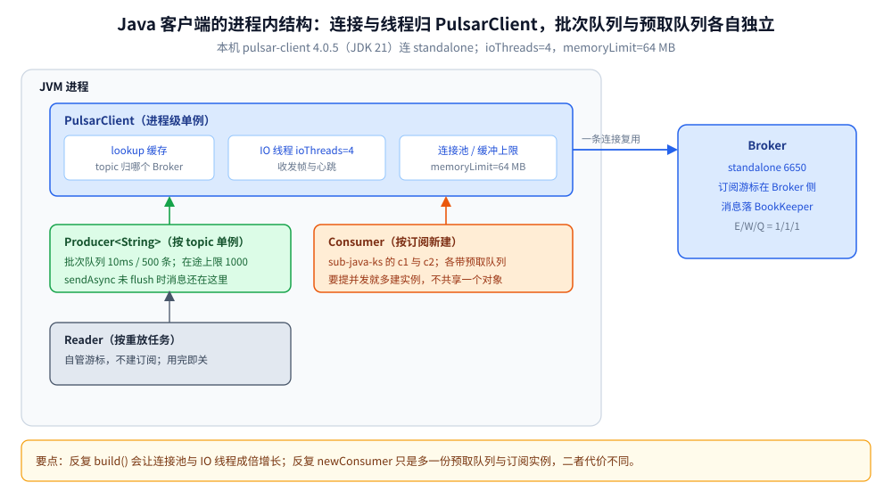
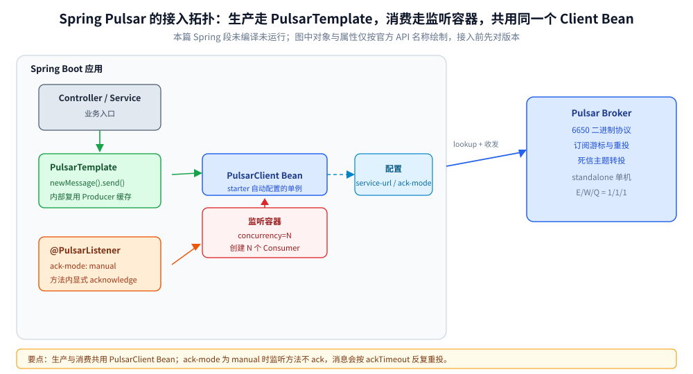
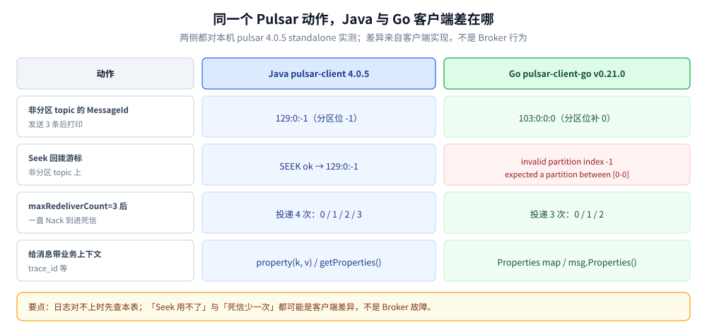

# Java 接入 Pulsar

> 覆盖：Java 侧接入 Pulsar 的完整手册 —— 依赖坐标、初始化、单例边界、初始化顺序、原生 `PulsarClient` / `Producer` / `Consumer` 的生产消费写法、Key_Shared、Seek 回溯、Spring Pulsar、跨进程传播、优雅退出、验证与排障。
>
> 不覆盖：Pulsar 的存算分离、订阅语义、可靠性与协议机制见 [Pulsar 目录导读](../../../03-数据与中间件/中间件/消息队列/Pulsar/README.md)（零件篇从 [核心概念与架构.md](../../../03-数据与中间件/中间件/消息队列/Pulsar/核心概念与架构.md) 起读）；Go 侧写法见 [接入Pulsar.md](../../go/工程实践/接入Pulsar.md)。
>
> 内容整理自个人学习笔记。本篇原生代码在 `apachepulsar/pulsar:4.0.5` 容器内（Corretto JDK 21 + `/pulsar/lib` 下的 `pulsar-client 4.0.5`）用 `javac` 编译并运行通过，Broker 为同容器 standalone（`pulsar://127.0.0.1:6650`），输出见第十节。

---

## 一、依赖坐标与版本兼容

**本节要点**：生产消费只要一个 `pulsar-client`；Spring 项目换 starter，但 starter 的坐标与属性在版本间调整过，接入时先对版本。

```xml
<dependency>
  <groupId>org.apache.pulsar</groupId>
  <artifactId>pulsar-client</artifactId>
  <version>4.0.5</version>   <!-- 与本机 Broker 同版本；跨大版本前先看客户端的兼容说明 -->
</dependency>
<dependency>
  <groupId>org.springframework.pulsar</groupId>
  <artifactId>spring-pulsar-spring-boot-starter</artifactId>
</dependency>
```

| 项 | 事实 |
| --- | --- |
| JDK | Pulsar 4.x 客户端要求 **JDK 17+**；本机实测 JDK 21 |
| 版本对齐 | 客户端与 Broker 同大版本最省事；4.x 客户端可以连 3.x Broker，但新 API 不保证可用 |
| `pulsar-client-original` | 带 Netty/Protobuf 等依赖的全量包；`pulsar-client` 是常用入口，别同时引两个 |
| Spring Pulsar | starter 提供 `PulsarTemplate` 与 `@PulsarListener`；⚠️ 本篇 Spring 段**未编译未运行**，版本请以所用 Boot 的依赖管理为准 |

⚠️ **常见误装**：

- 只引 `pulsar-client-api`——它只有接口，运行时会报实现类缺失；
- 把 `pulsar-client-tools` 当客户端依赖——那是 `pulsar-client` 命令行工具，体积大且会带进 admin；
- Spring 项目里手写 `PulsarClient` 单例——starter 已经把它做成 Bean，重复创建等于两套连接池。

## 二、前提

**本节要点**：客户端不创建 topic 之外的服务端资源；Broker 侧缺什么，第一次建生产者 / 订阅时就会报。

| 依赖 | 要先准备好什么 | 漏了会怎样 |
| --- | --- | --- |
| **Broker** | `6650` 可达（本机在容器内直连 `127.0.0.1:6650`；宿主映射为 `16650`） | 建生产者 / 订阅失败，抛 `PulsarClientException` |
| **Topic** | 显式建，或 Broker 开 `allowAutoTopicCreation=true`（standalone 默认 true） | 建生产者失败；自动建仍受 namespace 配额与权限约束 |
| **订阅** | 不需要预建：第一次 `subscribe()` 即创建 | 已有订阅不会按客户端传的起始位置重置，见第五节 |
| **namespace 策略** | retention / 去重 / backlog quota 配在 namespace 上 | 回溯没数据（retention 默认 0）、去重不生效（默认 false），见 [消息可靠性.md](../../../03-数据与中间件/中间件/消息队列/Pulsar/消息可靠性.md) 第三、四节 |
| **`advertisedAddress`** | 单 Broker 且 lookup 返回 `Connect` 时可留空（本机容器内直连实测可发） | lookup 返回 `Redirect` 时按 Broker 自报地址重连；自报 `localhost` 则跨机断连，见 [部署与配置.md](../../../03-数据与中间件/中间件/消息队列/Pulsar/部署与配置.md) 第二节 |
| **端口** | `6650` 收发、`8080` 管理 | 只开 8080 能看控制台，但收发不通 |

## 三、初始化

**本节要点**：`PulsarClient` 线程安全、内部自带连接池与 IO 线程，**进程内只建一次**；`build()` 不校验 Broker 可达，第一次 `newProducer` / `subscribe` 才触发 lookup 与建连。

```java
public final class PulsarClientHolder {
    private static volatile PulsarClient instance;

    private PulsarClientHolder() {
    }

    public static PulsarClient get() throws PulsarClientException {
        if (instance == null) {
            synchronized (PulsarClientHolder.class) {
                if (instance == null) {
                    instance = PulsarClient.builder()
                            .serviceUrl("pulsar://127.0.0.1:6650") // ⚠️ 容器内端口；宿主是 16650
                            .connectionTimeout(5, TimeUnit.SECONDS)
                            .operationTimeout(10, TimeUnit.SECONDS)
                            .ioThreads(4)
                            .memoryLimit(64, SizeUnit.MEGA_BYTES) // 客户端缓冲上限，超了发送会阻塞
                            .build();
                }
            }
        }
        return instance;
    }
}
```

**在哪调**：进程启动阶段建一次，之后全局复用；**不要**在每次请求里 `build()`。

> 💡 Spring 项目里不要写这段双检锁：`spring-pulsar` 已经把 `PulsarClient` 做成单例 Bean，直接构造注入即可（见 7.5）。

## 四、单例边界 ⭐

**本节要点**：判据同样是「对象内部有没有长活资源」。`PulsarClient` 与 `Producer` 共享，`Consumer` 按订阅建，`TypedMessageBuilder` 是请求级。

| 对象 | 单例？ | 为什么 |
| --- | --- | --- |
| `PulsarClient` | ✅ 进程级 | 连接池、lookup 缓存、IO 线程都在里面；反复 `build()` = 多套连接池与线程 |
| `Producer<T>` | ✅ **按 topic** 单例 | 持有批次缓冲与在途队列；每请求新建会让批次凑不满、连接数随 QPS 涨 |
| `Consumer<T>` | ❌ 一份订阅一个 | 订阅游标在 Broker；要提并发应建**多个 Consumer**（`@PulsarListener(concurrency=…)` 或手工多实例） |
| `Reader<T>` | ❌ 按重放任务 | 自管位置，任务结束即关闭 |
| `TypedMessageBuilder<T>` | ❌ 请求级 | 由 `newMessage()` 现取现用，跨请求复用会串 key / 属性 |

**写错的后果**：

- 每请求 `build()` 客户端 → 连接池、IO 线程、lookup 缓存全部成倍增长，JVM 线程数与 Broker 连接数一起爆；
- 把 `Consumer` 做成单例 Bean 再开多个线程 `receive()` → 消息能收，但 ack 归属混乱；正确做法是订阅名不变、消费者实例多建；
- 复用 `TypedMessageBuilder` → 上一条的 key 与 property 残留到下一条。

## 五、初始化顺序 ⭐

**本节要点**：⭐ 判据是「**谁在初始化时捕获了全局单例**」——凡是有这个特征的下游组件，都必须排在被捕获者之后，否则拿的是初始化那一刻的旧值，且不报错。

Pulsar 侧三条实序：

1. **`PulsarClient` 先于所有 Producer / Consumer**。`build()` 只构造客户端；真正的 lookup 与建连发生在第一次 `newProducer` / `subscribe`，所以「客户端建好了」不代表服务端可达。
2. **起始位置只在「新建订阅」时生效**。`subscriptionInitialPosition(Earliest)` 对已存在订阅无效——游标在 Broker 上，客户端改不了。与 Go 客户端不同，**Java 的 `Seek` 在非分区 topic 上可用**（本机实测）：

   ```text
   SEEK ok
   SEEK got 129:0:-1
   ```

   这条差异很实用：同一个「回拨游标」的需求，Java 直接 `seek(MessageId.earliest)` 即可，Go 侧则会报 `invalid partition index -1`（见 [接入Pulsar.md](../../go/工程实践/接入Pulsar.md) 第五节）。
3. **MQ 客户端晚于日志 / 链路设施**。客户端起连接与 IO 线程、可能捕获全局 `TracerProvider`；先设全局设施，再 `build()`。

> ⭐ 这个判据的经典例子在链路追踪栈：**GORM 的 OTel 插件在 `Install` 时就捕获了当时的全局 `TracerProvider`**——装插件若早于设全局 provider，插件拿到 noop，**SQL span 永远不上报且不报错**。详见 [接入Jaeger.md](../可观测性/接入Jaeger.md)。

## 六、单例与依赖注入的封装

**本节要点**：`PulsarClient` 与 `Producer` 用持有类 / Bean 兜底；`Consumer` 用「构造 → 订阅 → 关闭」的生命周期方法，交给 Spring 或 `try-with-resources` 管理。

```java
public final class OrderProducer {
    private static volatile Producer<String> instance;

    public static Producer<String> get() throws PulsarClientException {
        if (instance == null) {
            synchronized (OrderProducer.class) {
                if (instance == null) {
                    instance = PulsarClientHolder.get().newProducer(Schema.STRING)
                            .topic("persistent://shop/default/order-events")
                            .producerName("order-producer") // 去重开启时参与「生产者名 + 序号」判重
                            .sendTimeout(10, TimeUnit.SECONDS)
                            .maxPendingMessages(1000)
                            .blockIfQueueFull(true)
                            .create();
                }
            }
        }
        return instance;
    }
}

// 消费者：一个订阅一份实例，随消费循环同生命周期。
public static Consumer<String> newOrderConsumer(String sub) throws PulsarClientException {
    return PulsarClientHolder.get().newConsumer(Schema.STRING)
            .topic("persistent://shop/default/order-events")
            .subscriptionName(sub)
            .subscriptionType(SubscriptionType.Shared)
            .subscriptionInitialPosition(SubscriptionInitialPosition.Earliest)
            .receiverQueueSize(1000)
            .ackTimeout(60, TimeUnit.SECONDS)
            .subscribe();
}
```

## 七、实际调用

**本节要点**：同一个客户端，按场景换发送形态、订阅类型与确认策略即可覆盖全部用法；Spring 项目走 `PulsarTemplate` + `@PulsarListener`。

### 7.1 生产者：同步 / 异步 / 延迟

```java
Producer<String> p = OrderProducer.get();

for (int i = 1; i <= 3; i++) {
    MessageId id = p.newMessage()
            .key("ORDER_JAVA_1001")
            .value("{\"event\":\"created\",\"seq\":" + i + "}")
            .send(); // 返回 MessageId 即 Broker（BookKeeper）已确认
    System.out.println("SYNC ok messageId=" + id);
}

p.newMessage().key("ORDER_JAVA_1002").value("{\"event\":\"paid\"}")
        .sendAsync()
        .whenComplete((id, ex) -> {
            if (ex != null) {
                System.out.println("ASYNC err: " + ex.getMessage());
                return;
            }
            System.out.println("ASYNC ok messageId=" + id);
        });

p.newMessage().key("ORDER_JAVA_1003").value("{\"event\":\"timeout-check\"}")
        .deliverAfter(60, TimeUnit.SECONDS) // ⚠️ 只在 Shared / Key_Shared 生效
        .sendAsync();

p.flush(); // 进程退出前必调
```

本机实测（`lab-java` topic）：

```text
SYNC ok messageId=129:0:-1
SYNC ok messageId=129:1:-1
SYNC ok messageId=129:2:-1
PRODUCE DONE
ASYNC ok messageId=129:3:-1
```

⭐ 读法：`129:0:-1` 是 `ledger:entry:partition`——**非分区 topic 的分区位是 `-1`**，不是错误。同一个 topic 在 Go 客户端里打印成 `129:0:0:0`（Go 补了分区下标），两边日志对不上时先看这个差异。MessageId 的语义见 [核心概念与架构.md](../../../03-数据与中间件/中间件/消息队列/Pulsar/核心概念与架构.md) 第二节。



这张图说明「哪些对象能共享」的边界画在进程内：所有 Producer 与 Consumer 都复用同一个 `PulsarClient` 的连接与 IO 线程，但 Producer 的批次队列、Consumer 的预取队列各自独立，所以前者按 topic 共享、后者按订阅新建。

### 7.2 消费者：Shared + ackTimeout + 死信

```java
try (Consumer<String> consumer = client.newConsumer(Schema.STRING)
        .topic("persistent://public/default/lab-java")
        .subscriptionName("sub-java-shared")
        .subscriptionType(SubscriptionType.Shared)
        .subscriptionInitialPosition(SubscriptionInitialPosition.Earliest)
        .receiverQueueSize(100)
        .ackTimeout(60, TimeUnit.SECONDS) // 60 秒未 ack，Broker 重投
        .negativeAckRedeliveryDelay(1, TimeUnit.SECONDS)
        .deadLetterPolicy(DeadLetterPolicy.builder()
                .maxRedeliverCount(3)
                .deadLetterTopic("persistent://public/default/lab-java-dead")
                .build())
        .subscribe()) {

    Message<String> msg = consumer.receive(5, TimeUnit.SECONDS);
    if (msg != null) {
        try {
            handle(msg);
            consumer.acknowledge(msg); // ⭐ 先处理业务，成功后再 ack
        } catch (Exception e) {
            consumer.negativeAcknowledge(msg); // 交还 Broker 按延迟重投
        }
    }
}
```

本机实测（取 4 条）：

```text
CONSUME id=129:0:-1 key=ORDER_JAVA_1001 redelivery=0 body={"event":"created","seq":1}
CONSUME id=129:1:-1 key=ORDER_JAVA_1001 redelivery=0 body={"event":"created","seq":2}
CONSUME id=129:2:-1 key=ORDER_JAVA_1001 redelivery=0 body={"event":"created","seq":3}
CONSUME id=129:3:-1 key=ORDER_JAVA_1002 redelivery=0 body={"event":"paid"}
CONSUME DONE n=4
```

### 7.3 同 key 有序：Key_Shared

```java
Consumer<String> c1 = client.newConsumer(Schema.STRING).topic(topic)
        .subscriptionName("sub-java-ks")
        .subscriptionType(SubscriptionType.Key_Shared)
        .subscriptionInitialPosition(SubscriptionInitialPosition.Earliest)
        .subscribe();
Consumer<String> c2 = client.newConsumer(Schema.STRING).topic(topic)
        .subscriptionName("sub-java-ks")
        .subscriptionType(SubscriptionType.Key_Shared)
        .subscriptionInitialPosition(SubscriptionInitialPosition.Earliest)
        .subscribe();
// ⚠️ 两个消费者都就绪后等一会儿再发，让 key 区间分配完成
```

本机实测（10 条 / 2 个 key，等 3 秒后发送）：

```text
KS polled c1=5 c2=5
KS c1|order-0 -> 5
KS c2|order-1 -> 5
```

⚠️ 同一段代码**不等重平衡**直接发，实测会得到 `c1=9 c2=2`、两个 key 一度都落在先加入的消费者上；等 3 秒后 key 才稳定一边一个。**Key_Shared 的分配是事件驱动的，不是发送时即时算的**，扩容后也一样。

### 7.4 回溯：Seek

```java
// 订阅创建后可回拨游标；入参是 MessageId、毫秒时间戳或分区路由函数
consumer.seek(MessageId.earliest);
Message<String> msg = consumer.receive(5, TimeUnit.SECONDS);
System.out.println(msg == null ? "SEEK receive timeout" : "SEEK got " + msg.getMessageId());
```

本机实测：

```text
SEEK ok
SEEK got 129:0:-1
```

⭐ 与 Go 的关键差异：Java 的 `seek(MessageId.earliest)` 在**非分区 topic** 上成功；Go 的同名操作会报 `invalid partition index -1 expected a partition between [0-0]`。**跨语言排查「为什么我 seek 不了」时先确认是哪套客户端**。

### 7.5 Spring Pulsar（未实测）

```yaml
spring:
  pulsar:
    client:
      service-url: pulsar://127.0.0.1:6650
    consumer:
      subscription-type: Shared
      subscription-initial-position: Earliest
    listener:
      ack-mode: manual   # 监听方法里自己 ack
```

```java
@Service
public class OrderListener {
    private final PulsarTemplate<String> template;

    public OrderListener(PulsarTemplate<String> template) {
        this.template = template;
    }

    public void publish(String orderId, String payload) throws PulsarClientException {
        template.newMessage(payload)
                .withTopic("persistent://shop/default/order-events")
                .withMessageCustomizer(b -> b.key(orderId))
                .send();
    }

    @PulsarListener(topics = "persistent://shop/default/order-events",
            subscriptionName = "order-service",
            subscriptionType = SubscriptionType.Shared)
    public void onMessage(String payload, Consumer<String> consumer, MessageId id) {
        handle(payload);              // 1) 业务处理 + 幂等校验
        consumer.acknowledge(id);     // 2) 成功才 ack
    }
}
```

⚠️ `ack-mode: manual` 下必须由监听方法自己 ack，否则消息会等 `ackTimeout` 反复重投（表现为「消费了但一直重复」）。Spring Pulsar 的坐标与属性前缀在版本间调整过，**本篇未编译未运行**，接入前先对版本。



这张图对应 7.5 的 yaml 与两个 Bean：生产侧只有 `PulsarTemplate` 一个入口，消费侧的并发由监听容器的 `concurrency` 决定；两条链路在 `PulsarClient` 处汇合，所以客户端配置只写一份。

## 八、跨进程与跨协程传播

**本节要点**：跨进程携带业务上下文用**消息属性（properties）**做 Inject / Extract；跨线程用参数传递，别存进单例字段。

```java
// 生产端：Inject
producer.newMessage()
        .key("ORDER_JAVA_2001")
        .value("java-props-1")
        .property("x-biz-id", "ORDER_JAVA_2001")
        .property("x-trace-id", "trace-java-abc123")
        .send();

// 消费端：Extract
Map<String, String> props = msg.getProperties();
System.out.printf("PROPS CONSUME key=%s biz=%s trace=%s body=%s%n",
        msg.getKey(), props.get("x-biz-id"), props.get("x-trace-id"), msg.getValue());
```

本机实测（属性完整往返）：

```text
PROPS PRODUCE ok
PROPS CONSUME key=ORDER_JAVA_2001 biz=ORDER_JAVA_2001 trace=trace-java-abc123 body=java-props-1
```

**传参铁律**：

- 生产端 `sendTimeout` 控制**发送超时**，请求进来就用请求的上下文；
- 消费回调的线程由客户端提供，**别把请求级数据放进单例 Producer 的字段**——并发下消息头互相覆盖；
- 属性要**随消息走**，不能随对象走。

## 九、优雅退出

**本节要点**：退出顺序 = 反初始化顺序：**先停止拉取 → 处理完在途消息 → 关闭 Consumer → 关闭 Client**；Java 用 shutdown hook 承接信号。

```java
Runtime.getRuntime().addShutdownHook(new Thread(() -> {
    consumer.closeAsync().join(); // 停止投递，已 ack 的游标由 Broker 持久化
    client.closeAsync().join();   // 释放连接池与 IO 线程
}));
```

本机实测（`System.exit(0)` 触发，走的是同一条 hook）：

```text
CONSUMER started
CONSUME id=129:0:-1
CONSUME id=129:1:-1
CONSUME id=129:2:-1
CONSUME id=129:3:-1
SHUTDOWN triggered
SHUTDOWN hook
SHUTDOWN done
```

| 顺序 | 为什么 |
| --- | --- |
| 先停止拉取 | 避免退出过程中还在把新消息取进内存 |
| 处理完在途消息 | 否则「已收未 ack」的那批会在重启后重投（有幂等兜底才安全） |
| 关闭 Consumer | 停止投递并让 Broker 记录已有 ack；**不关闭**则本次进度可能丢失 |
| 关闭 Client | 释放连接池、lookup 缓存与 IO 线程 |

**漏了会丢什么**：Producer 不 `flush()` / `close()` → 批次里未发出的消息丢；Consumer 不 `close()` → 已处理但未提交的 ack 丢失，重启后重复消费。Spring 项目里由容器负责关闭 Bean，别手动 `new`。

## 十、验证与排查

**本节要点**：先确认「接入真的生效」（编译通过 + MessageId 与消费读数），再用故障速查表定位。

### 10.1 先确认生效

```bash
/opt/jvm/bin/javac -cp '/pulsar/lib/*' PulsarAccessLab.java
/opt/jvm/bin/java  -cp '/pulsar/lib/*:.' PulsarAccessLab produce
```

环境：容器内 Corretto JDK 21 + `pulsar-client 4.0.5`；Broker 为同容器 standalone，客户端直连 `pulsar://127.0.0.1:6650`。

```text
SYNC ok messageId=129:0:-1
SYNC ok messageId=129:1:-1
SYNC ok messageId=129:2:-1
PRODUCE DONE
ASYNC ok messageId=129:3:-1
CONSUME id=129:0:-1 key=ORDER_JAVA_1001 redelivery=0 ...
KS polled c1=5 c2=5
KS c1|order-0 -> 5
KS c2|order-1 -> 5
PROPS CONSUME key=ORDER_JAVA_2001 biz=ORDER_JAVA_2001 trace=trace-java-abc123 body=java-props-1
DLQ recv redelivery=0/1/2/3 ... DLQ TOPIC got body=java-dlq-1
SEEK ok / SEEK got 129:0:-1
SHUTDOWN done
```

⭐ 一次跑完能确认五件事：**同步发送拿到 MessageId**、**Key_Shared 同 key 不跨消费者**、**Properties 完整往返**、**重投到上限进死信**、**Seek 能回拨非分区 topic 的游标**。



这张对照表是排查「同一套 Broker，为什么两边日志对不上」的第一站：四处差异全部来自客户端实现，Broker 没有变；其中非分区 topic 上的 `Seek` 与死信投递次数最容易被人误判成服务端故障。

### 10.2 常见故障速查

| 症状 | 多半是 | 处置 |
| --- | --- | --- |
| MessageId 里带 `-1` | 非分区 topic 的 partitionIdx | 正常现象，不是分区掉了 |
| 延迟消息立刻收到 | 订阅类型是 Exclusive / Failover | 换 Shared / Key_Shared；并确认关闭批次 |
| Key_Shared 分配严重倾斜 | 消费者刚加入，key 区间还在重平衡 | 等几秒再发；或扩容后观察一段再判断热点 |
| 死信 topic 收不到 | `maxRedeliverCount` 未到 | ⚠️ Java 实测投递 4 次（`0/1/2/3`）后进 DLQ，Go 是 3 次；按本语言读数判断 |
| 消费了但一直重复 | 手动 ack 没生效（Spring `ack-mode: manual` 未 ack） | 在监听方法成功分支显式 `acknowledge` |
| 第二个实例连不上同一订阅 | 订阅类型是 Exclusive | 换 Shared / Key_Shared，或改用不同订阅 |
| `seek` 报分区下标错误 | 用的是 Go 客户端 | Java 的 `Seek` 支持非分区 topic；Go 要新建订阅 + 起始位置 |

| 排查项 | 命令（容器内） |
| --- | --- |
| Topic 吞吐 / 积压 | `bin/pulsar-admin topics stats <topic>` |
| 内部 ledger / 游标 | `bin/pulsar-admin topics stats-internal <topic>` |
| 有哪些订阅 | `bin/pulsar-admin topics subscriptions <topic>` |
| 看某订阅的头几条 | `bin/pulsar-admin topics peek-messages -s <sub> -n 2 <topic>`（⚠️ 会创建订阅，见运维篇） |

## 十一、延伸追问

- **`PulsarClient.build()` 成功就代表能连吗？** → 不代表。它只构造客户端，lookup 与建连发生在第一次 `newProducer` / `subscribe`。详见第三节。
- **Java 和 Go 的 MessageId 为什么打印得不一样？** → Java 打印 `ledger:entry:partition`，非分区 topic 是 `-1`；Go 补成 `ledger:entry:partition:batch`，显示 `0`。不是版本差异，是两套客户端的格式化不同。详见 7.1。
- **Java 能 Seek，Go 不能？** → Java 的 `seek(MessageId.earliest)` 在非分区 topic 上实测成功；Go 的同名调用报分区下标错误。跨语言排查先确认客户端。详见 7.4。
- **Key_Shared 刚启动为什么分配不均？** → key 区间是消费者加入后重平衡出来的，紧接着发送会先堆在已有消费者上。等几秒再发即可复现均匀分配。详见 7.3。
- **死信次数为什么和 Go 差一次？** → 两套客户端对 `maxRedeliverCount` 的计数起点不同：Java 实测 `0/1/2/3` 后进 DLQ，Go 是 `0/1/2`。见第十节。

## 十二、校验口径

> ✅ 本篇代码的校验方式与范围（`apachepulsar/pulsar:4.0.5` 容器内，Corretto JDK 21）：

- **真编译 + 运行通过**：第三、六节客户端与生产者持有类、7.1 同步 / 异步 / `flush`、7.2 Shared 消费与 ack、7.3 Key_Shared（含不等重平衡的对照读数）、7.4 Seek、第八节 Properties、第九节 shutdown hook（`System.exit` 触发）。
- **只编译、未运行**：7.1 的 `deliverAfter` 随类编译通过，延迟投递的运行时读数引用书内 Java 实测，**本篇未单独跑延迟场景**。
- **未编译、未运行**：7.5 Spring Pulsar（`PulsarTemplate` / `@PulsarListener`），依赖未在本机安装。
- **实测环境**：`apachepulsar/pulsar:4.0.5` standalone 容器，JDK 21（`/opt/jvm`），客户端 jar 来自 `/pulsar/lib`。
- **未实测**：TLS / Token 认证、多 Broker 与 `Redirect`、事务、Schema 演化、分层存储。

| 依赖 | 实际版本 |
| --- | --- |
| `org.apache.pulsar:pulsar-client` | 4.0.5（容器自带 jar） |
| `spring-pulsar-spring-boot-starter` | 未编译（见上） |
| JDK | 21 |

## 关联

- **上游/总纲**：[Pulsar 目录导读](../../../03-数据与中间件/中间件/消息队列/Pulsar/README.md) — 组件本体（概念 / 订阅 / 可靠性 / 部署 / 排障 / 协议）
- **对照/互补**：[接入Pulsar.md](../../go/工程实践/接入Pulsar.md) — Go 侧同一组场景的写法与差异
- **对照/互补**：[接入Kafka.md](接入Kafka.md) — Java 接 Kafka 的对照手册
- **对照/互补**：[接入RocketMQ.md](接入RocketMQ.md) — Java 接 RocketMQ 的对照手册
- **下游机制**：[订阅与消费语义.md](../../../03-数据与中间件/中间件/消息队列/Pulsar/订阅与消费语义.md) — 四种订阅类型与延迟投递限制
- **下游机制**：[消息可靠性.md](../../../03-数据与中间件/中间件/消息队列/Pulsar/消息可靠性.md) — 发送确认、retention、去重、重投与死信
- **运维/配置**：[部署与配置.md](../../../03-数据与中间件/中间件/消息队列/Pulsar/部署与配置.md) — standalone 起法与端口映射
- **运维/配置**：[运维与排障.md](../../../03-数据与中间件/中间件/消息队列/Pulsar/运维与排障.md) — 积压、慢订阅与 `pulsar-admin` 命令
> 反向引用（本篇被下列文档引到）：[接入ActiveMQ.md](接入ActiveMQ.md)、[接入NATS.md](接入NATS.md)
