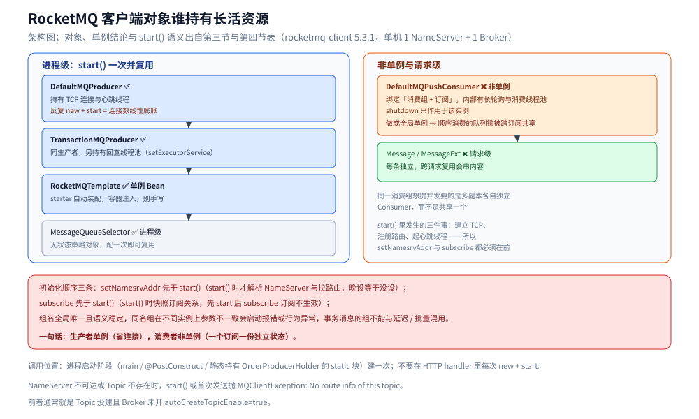
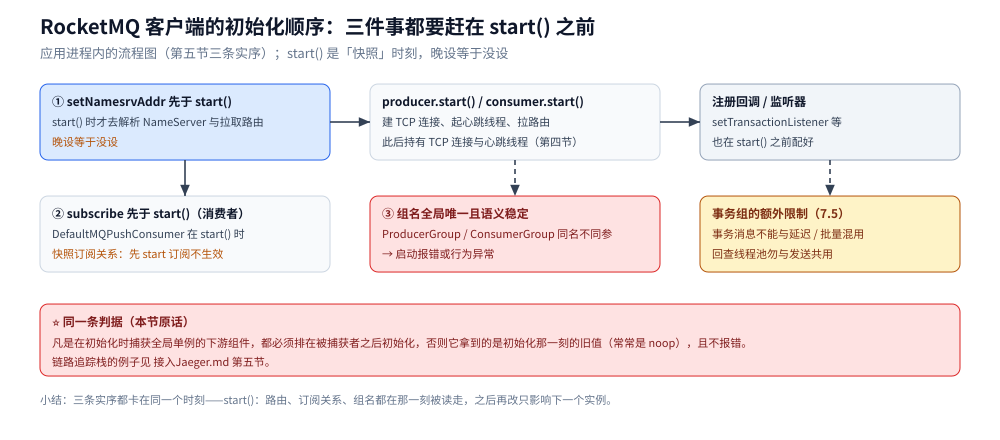
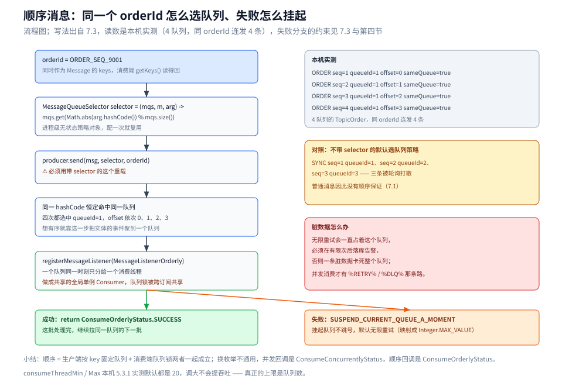
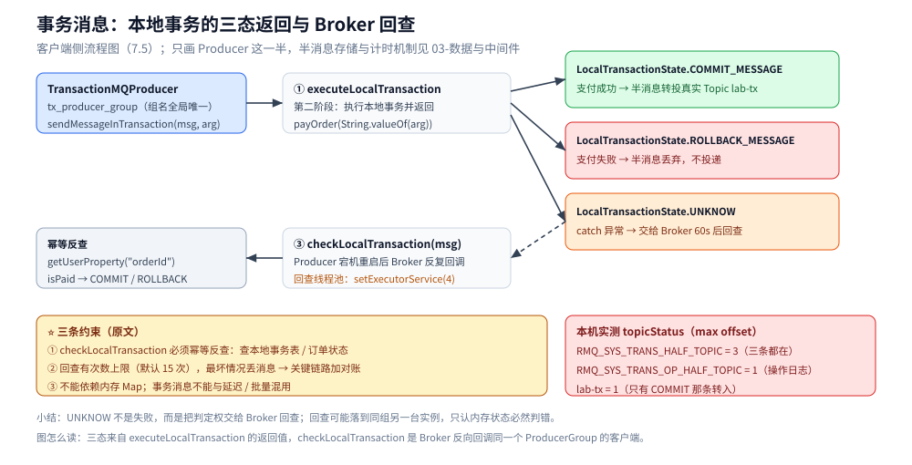

# Java 接入 RocketMQ

> 覆盖：Java 侧接入 RocketMQ 的完整手册 —— 依赖坐标、初始化、单例边界、初始化顺序、原生 `DefaultMQProducer` / `DefaultMQPushConsumer` 的普通 / 顺序 / 延迟 / 事务四种消息写法、Spring Boot 集成、跨进程传播、优雅退出、验证与排障。
>
> 不覆盖：RocketMQ 的概念、存储与可靠性机制见 [RocketMQ 目录导读](../../../03-数据与中间件/中间件/消息队列/RocketMQ/README.md)（零件篇从 [核心概念与架构.md](../../../03-数据与中间件/中间件/消息队列/RocketMQ/核心概念与架构.md) 起读）；Go 侧写法见 [接入RocketMQ.md](../../go/工程实践/接入RocketMQ.md)。
>
> 内容整理自个人学习笔记。本篇代码在 `maven:3.9-eclipse-temurin-17` + `rocketmq-client 5.3.1` 下编译运行通过，对本机单机集群（`apache/rocketmq:5.3.1`，1 NameServer + 1 Broker）实测。

---

## 一、依赖坐标与版本兼容

**本节要点**：生产消费只要一个 `rocketmq-client`；Spring 用 starter；命令行排查另加 `rocketmq-tools`。

```xml
<dependency>
  <groupId>org.apache.rocketmq</groupId>
  <artifactId>rocketmq-client</artifactId>
  <version>5.3.1</version>   <!-- 仍在 4.x Broker 上可退用 4.9.7 -->
</dependency>
<!-- Spring 集成：org.apache.rocketmq:rocketmq-spring-boot-starter:2.3.1（内部依赖 client 5.x） -->
<!-- 命令行工具：org.apache.rocketmq:rocketmq-tools:5.3.1（提供 mqadmin） -->
```

⭐ **5.x 客户端可连 4.9.4+ Broker**（兼容协议），但任意时间延迟等新特性必须「5.x 客户端 + 5.x Broker」同时满足。

## 二、前提

**本节要点**：Java 客户端不创建服务端资源，连上之前 NameServer / Broker / Topic 那侧要先齐；缺一样都有对应报错。

| 依赖 | 要先准备好什么 | 漏了会报什么 |
| --- | --- | --- |
| **NameServer** | `mqnamesrv` 已起、`9876` 可达 | 连接失败 / 路由拉不到 |
| **Broker** | `mqbroker` 已起、`10911` 可达（另有 **VIP 通道 `10909`**） | 发送超时 / 偶发重连 |
| **Topic** | 已建，或 Broker 开 `autoCreateTopicEnable=true` | `No route info of this topic: <topic>` |
| **消费组** | 通常可自动创建 | 位点查不到 / 订阅不上报 |
| **生产者组** | 全局唯一；事务消息的组**不能**与延迟 / 批量混用 | 组冲突或事务语义异常（见 7.5） |
| **端口** | `9876`（NS）、`10911`（Broker）、**`10909`**（VIP 通道） | 连接被拒 |
| **mqadmin** | `rocketmq-tools` 已在 PATH | 无法查位点 / 事务半消息 |

## 三、初始化

**本节要点**：生产者初始化 = 「设置 NameServer → 设参数 → `start()`」；`start()` 才建立 TCP、注册路由、起心跳线程。在哪调很关键——放进程启动处走一次，不要放请求处理里。

```java
DefaultMQProducer producer = new DefaultMQProducer("producer_group_demo");
producer.setNamesrvAddr("127.0.0.1:9876");     // ⭐ 必须在 start 之前
producer.setRetryTimesWhenSendFailed(2);       // 失败重试 2 次（共 3 次尝试）
producer.setSendMsgTimeout(3000);              // 默认 3000ms
producer.start();                              // 建立 TCP、注册路由、起心跳线程
```

**在哪调**：进程启动阶段（`main` / `@PostConstruct` / 静态持有）建一次并复用；**不要**在 HTTP handler 里每次 `new + start`。

**初始化失败的报错原文**：NameServer 不可达或 Topic 不存在时，`start()` 或首次发送会抛 `MQClientException: No route info of this topic: <topic>` / 连接超时——前者通常就是 **Topic 没建且 Broker 未开自动创建**。

## 四、单例边界 ⭐

**本节要点**：判「要不要单例」只看一件事——**这个对象内部有没有长活的资源（TCP 连接、心跳 / 消费线程池）**：有 → 进程级；没有、且绑定一次业务操作的 → 请求级。

| 对象 | 单例？ | 为什么 |
| --- | --- | --- |
| `DefaultMQProducer` | ✅ 进程级 | 持有 TCP 连接与心跳线程，反复 `new + start` = 连接数线性膨胀 |
| `TransactionMQProducer` | ✅ 进程级 | 同生产者，另持有**回查线程池**（`setExecutorService`），更不能反复建 |
| `DefaultMQPushConsumer` | ❌ 非单例 | 绑定「消费组 + 订阅」，内部有长轮询与消费线程池，`shutdown` 只作用于该实例 |
| `RocketMQTemplate`（Spring） | ✅ 进程级（单例 Bean） | starter 自动装配；容器注入，别手写 |
| `Message` / `MessageExt` | ❌ 请求级 | 每条独立，跨请求复用会串内容 |
| `MessageQueueSelector` | ✅ 进程级 | 无状态策略对象，配一次即可复用 |

**写错的后果**：

- 生产者每次请求新建 → 连接数与心跳线程随 QPS 线性膨胀，最终打爆 Broker 连接上限；
- 消费者做成全局单例 → 「一个订阅一份状态」的边界失效，**顺序消费依赖的队列锁**（`MessageListenerOrderly`）被跨订阅共享，顺序不再成立；同一消费组想提并发要的是**多副本各自独立 Consumer**，而不是共享一个。

> 一句话：**生产者单例（省连接），消费者非单例（一个订阅一份独立状态）。**



## 五、初始化顺序 ⭐

**本节要点**：⭐ 判据是「**谁在初始化时捕获了全局单例**」——凡是有这个特征的下游组件，都必须排在被捕获者**之后**初始化，否则拿到的是初始化那一刻的旧值（常常是 noop），且**不报错**。

RocketMQ 侧三条实序：

1. **`setNamesrvAddr` 必须先于 `start()`**：`start()` 时才去解析 NameServer 与拉取路由，晚设等于没设。
2. **`subscribe` 必须先于 `start()`**（消费者）：`DefaultMQPushConsumer` 在 `start()` 时**快照订阅关系**，先 `start` 后 `subscribe` 订阅不生效。
3. **组名（ProducerGroup / ConsumerGroup）全局唯一且语义稳定**：同名组在不同实例上参数不一致会启动报错或行为异常；事务消息的组**不能**与延迟 / 批量混用（见 7.5）。

> ⭐ 这个判据的经典例子在链路追踪栈：**instrumentation 在初始化时取一次全局实例**——若它在全局 Tracer 注册**之前**完成初始化，span 就走 noop provider，**永远不上报且不报错**。详见 [接入Jaeger.md](../可观测性/接入Jaeger.md)。



## 六、单例与依赖注入的封装

**本节要点**：原生写法用**静态持有**兜底（本机编译通过）；Spring 侧不用手写——`RocketMQTemplate` 由 starter 装配为单例 Bean。

原生（可直接抄）：

```java
// 整个应用只 start 一次并复用；不要在请求路径里每次 new + start。
public final class OrderProducerHolder {
    private static final DefaultMQProducer PRODUCER = new DefaultMQProducer("producer_group_demo");

    private OrderProducerHolder() { }

    static {
        PRODUCER.setNamesrvAddr("127.0.0.1:9876");
        PRODUCER.setRetryTimesWhenSendFailed(2);
        PRODUCER.start();          // 全程只 start 一次
    }

    public static DefaultMQProducer get() { return PRODUCER; }
}
```

Spring：

```java
@Service
public class OrderProducerService {
    @Resource private RocketMQTemplate rocketMQTemplate;   // starter 装配的单例 Bean
}
```

> 一句话：**生产者单例（省连接），消费者非单例（一个订阅一份独立状态）。**

## 七、实际调用

**本节要点**：同一个单例 Producer，按场景换「发送方式 / selector / 延迟级别 / 事务监听器」即可覆盖全部形态；消费侧按 `CONCURRENTLY` 或 `ORDERLY` 写回调。

### 7.1 生产者：同步 / 异步 / 单向

```java
Message msg = new Message("TopicTest", "TagA", "key-1001", "hello rocketmq".getBytes("UTF-8"));
// 1) 同步发送：有返回值，可靠性最高
SendResult r = producer.send(msg);
// 2) 异步发送：不阻塞主线程，回调处理结果，适合高吞吐
producer.send(msg, new SendCallback() {
    public void onSuccess(SendResult result) { }
    public void onException(Throwable e) { }
});
// 3) 单向发送：只写 socket 不等响应，最快但可能丢，适合日志采集
producer.sendOneway(msg);                     // ⚠️ 是 sendOneway（小写 w），不是 sendOneWay
```

> ⚠️ **方法名坑**：单向发送的 API 是 `sendOneway(Message)`，不是 `sendOneWay`——本机用 `javap` 查 `DefaultMQProducer` 确认过；网上大量示例写成 `sendOneWay`，直接编译不过。

异常处理：`MQClientException`（未 start / 路由为空 / 消息体超限 / Topic 未创建）、`RemotingException`（网络断连）、`MQBrokerException`（Broker 错误码，如 `SERVICE_NOT_AVAILABLE`）、`InterruptedException`（线程中断）。
⚠️ 重试只发生在**发送阶段**且是「换队列 / 换 Broker 重发」；Broker 已成功但客户端超时同样会重发，因此**消费端幂等必须有**（见 [消息可靠性.md](../../../03-数据与中间件/中间件/消息队列/RocketMQ/消息可靠性.md) 第三节）。

本机实测：

```text
SYNC   seq=1 status=SEND_OK queueId=1 offset=0 msgId=C0A83004000167424E823E90DA0A0000
SYNC   seq=2 status=SEND_OK queueId=2 offset=0 msgId=C0A83004000167424E823E90DA350001
SYNC   seq=3 status=SEND_OK queueId=3 offset=0 msgId=C0A83004000167424E823E90DA3B0002
ASYNC  status=SEND_OK queueId=1 offset=1
ONEWAY sent (no response waited)
```

三条同步发送**被轮询打散到 queueId 1/2/3**——这就是默认选队列策略的直接体现，也是「普通消息没有顺序保证」的证据（想有序要用 7.3 的 selector）。

### 7.2 消费者：并发监听

```java
DefaultMQPushConsumer consumer = new DefaultMQPushConsumer("consumer_group_demo");
consumer.setNamesrvAddr("127.0.0.1:9876");
consumer.setConsumeThreadMax(20);
consumer.setMaxReconsumeTimes(3);             // 重试 3 次后进死信队列
consumer.subscribe("TopicTest", MessageSelector.byTag("TagA || TagB"));   // ⚠️ subscribe 必须在 start 之前

consumer.registerMessageListener((MessageListenerConcurrently) (msgs, context) -> {
    for (MessageExt msg : msgs) {
        try {
            System.out.printf("msgId=%s queue=%d offset=%d key=%s body=%s%n",
                    msg.getMsgId(), msg.getQueueId(), msg.getQueueOffset(),
                    msg.getKeys(), new String(msg.getBody()));
        } catch (Exception e) {
            return ConsumeConcurrentlyStatus.RECONSUME_LATER;   // 稍后重投 %RETRY%group
        }
    }
    return ConsumeConcurrentlyStatus.CONSUME_SUCCESS;
});
consumer.start();
```

| 配置项 | 实测默认值 | 说明 |
| --- | --- | --- |
| `consumeFromWhere` | `CONSUME_FROM_LAST_OFFSET` | 消费组首次启动位点；已有位点时该配置无效 |
| `messageModel` | `CLUSTERING` | 集群模式；`BROADCASTING` 每个实例消费全量，位点存本地文件 |
| `consumeThreadMin` / `consumeThreadMax` | 20 / 20 | ⚠️ 老资料常写 20 / 64；本机 `rocketmq-client 5.3.1` 实测都是 20，且真正上限是队列数 |
| `consumeMessageBatchMaxSize` | 1 | 一次回调最多几条 |
| `maxReconsumeTimes` | **`-1`**（= 用框架默认） | ⭐ 字段默认是 `-1` 不是 16：顺序消费把它映射成 `Integer.MAX_VALUE`（字节码核实），并发消费超限默认 16 次后进 `%DLQ%{group}` |

本机实测：

```text
CONSUME msgId=C0A83004000167424E823E90DA0A0000 queue=1 offset=0 key=ORDER_1001 tag=TagA body=sync-1
CONSUME msgId=C0A83004000167424E823E90DA4B0003 queue=1 offset=1 key=ORDER_2001 tag=TagA body=async-1
CONSUME msgId=C0A83004000167424E823E90DA3B0002 queue=3 offset=0 key=ORDER_1003 tag=TagA body=sync-3
CONSUME msgId=C0A83004000167424E823E90DA350001 queue=2 offset=0 key=ORDER_1002 tag=TagA body=sync-2
CONSUME msgId=C0A83004000167424E823E90E0270004 queue=0 offset=0 key=ORDER_2002 tag=TagA body=oneway-1
CONSUME DONE total=5
```

```bash
mqadmin consumerProgress -n rmq-namesrv:9876 -g lab_consumer_group
# Diff Total: 0   → 全部消费完，位点已提交
```

⭐ 一次回调拿到数组（这里是单条），`getKeys()` 能读回发送时的业务 Key——这也是后续 `queryMsgByKey` 排障的前提。

### 7.3 顺序消息：同 Key 固定落同一队列

```java
// 生产端
String orderId = "ORDER_SEQ_9001";
Message msg = new Message("TopicOrder", "CREATE", orderId, ("下单:" + orderId).getBytes("UTF-8"));
MessageQueueSelector selector = (mqs, m, arg) -> mqs.get(Math.abs(arg.hashCode()) % mqs.size());
producer.send(msg, selector, orderId);        // ⚠️ 必须用带 selector 的重载

// 消费端
consumer.registerMessageListener((MessageListenerOrderly) (msgs, context) -> {
    for (MessageExt msg : msgs) {
        System.out.printf("queueId=%d body=%s%n", msg.getQueueId(), new String(msg.getBody()));
    }
    return ConsumeOrderlyStatus.SUCCESS;      // 失败：SUSPEND_CURRENT_QUEUE_A_MOMENT
});
```

本机实测（4 队列，同 `orderId` 连发 4 条）：

```text
ORDER  seq=1 queueId=1 offset=0 sameQueue=true
ORDER  seq=2 queueId=1 offset=1 sameQueue=true
ORDER  seq=3 queueId=1 offset=2 sameQueue=true
ORDER  seq=4 queueId=1 offset=3 sameQueue=true
```

⚠️ 顺序消费失败必须返回 `SUSPEND_CURRENT_QUEUE_A_MOMENT`（挂起队列不跳号、默认无限重试），并**在有限次后落库告警**，否则脏数据卡死队列。



### 7.4 延迟消息：级别（4.x 语义）与任意时间（5.x）

```java
// ① 固定级别：level 5 = 1 分钟（4.x 语义，5.x Broker 兼容）
Message m1 = new Message("lab-delay", "TagD", "DLY_LEVEL5", "delay-level5".getBytes("UTF-8"));
m1.setDelayTimeLevel(5);
producer.send(m1);

// ② 任意时间（RIP-43，需 5.x 客户端 + 5.x Broker）
Message m2 = new Message("lab-delay", "TagD", "DLY_10S", "delay-10s".getBytes("UTF-8"));
m2.setDelayTimeMs(10_000L);                        // 也有 setDelayTimeSec / setDeliverTimeMs
producer.send(m2);
```

本机实测：两条都 `SEND_OK`；**12 秒后**真实 Topic `lab-delay` 位点 = `1`——只有 10s 那条已到期投递，level 5（1 分钟）那条仍在 `rmq_sys_wheel_timer` 里等待。⚠️ `setDelayTimeLevel(0)` 会抛异常（level 从 1 开始）。

### 7.5 事务消息

```java
TransactionMQProducer producer = new TransactionMQProducer("tx_producer_group");
producer.setNamesrvAddr("127.0.0.1:9876");
producer.setExecutorService(Executors.newFixedThreadPool(4));   // 回查线程池，勿与发送共用
producer.setTransactionListener(new OrderTxListener());
producer.start();

Message msg = new Message("TopicTx", "PAY", "ORDER_1001", "支付成功通知".getBytes("UTF-8"));
msg.putUserProperty("orderId", "ORDER_1001");                   // 回查时靠它反查本地事务
TransactionSendResult result = producer.sendMessageInTransaction(msg, "ORDER_1001");
```

```java
class OrderTxListener implements TransactionListener {
    // 第二阶段：Broker 收到半消息后回调，执行本地事务并返回提交 / 回滚
    @Override
    public LocalTransactionState executeLocalTransaction(Message msg, Object arg) {
        try {
            return payOrder(String.valueOf(arg)) ? LocalTransactionState.COMMIT_MESSAGE
                                                 : LocalTransactionState.ROLLBACK_MESSAGE;
        } catch (Exception e) {
            return LocalTransactionState.UNKNOW;   // 交给 Broker 60s 后回查
        }
    }

    // 回查阶段：Producer 宕机重启后 Broker 会反复回调，必须幂等反查
    @Override
    public LocalTransactionState checkLocalTransaction(MessageExt msg) {
        String orderId = msg.getUserProperty("orderId");
        return isPaid(orderId) ? LocalTransactionState.COMMIT_MESSAGE
                               : LocalTransactionState.ROLLBACK_MESSAGE;
    }
}
```

本机实测（三条分别 commit / rollback / UNKNOW）：

```text
TX  local: commit      → TX  send key=ORDER_TX_COMMIT   localState=COMMIT_MESSAGE   sendStatus=SEND_OK
TX  local: rollback    → TX  send key=ORDER_TX_ROLLBACK localState=ROLLBACK_MESSAGE sendStatus=SEND_OK
TX  local: UNKNOW（交给 Broker 回查）→ TX send key=ORDER_TX_UNKNOWN localState=UNKNOW sendStatus=SEND_OK

# mqadmin topicStatus 读数
RMQ_SYS_TRANS_HALF_TOPIC      max offset = 3   ← 三条半消息都在，对消费者不可见
RMQ_SYS_TRANS_OP_HALF_TOPIC   max offset = 1   ← 操作日志
lab-tx                        max offset = 1   ← 只有 COMMIT 的那条转入了真实 Topic
```

⭐ 三条约束：① `checkLocalTransaction` 必须能**幂等反查**（查本地事务表 / 订单状态，不能依赖内存 Map——回查可能落到同组另一台实例上）；② 回查有次数上限（默认 15 次），最坏情况丢消息，关键链路加对账；③ ProducerGroup 全局唯一，事务消息**不能与延迟 / 批量混用**。



### 7.6 Spring Boot 集成

依赖坐标：`org.apache.rocketmq:rocketmq-spring-boot-starter:2.3.1`（内部已依赖 rocketmq-client 5.x）。

```yaml
rocketmq:
  name-server: 127.0.0.1:9876
  producer:
    group: my-producer-group
    retry-times-when-send-failed: 2
```

```java
// 发送：destination 语法为 "topic:tag"
@Service
public class OrderProducerService {
    @Resource private RocketMQTemplate rocketMQTemplate;

    public void sendCreate(OrderDTO order) {
        rocketMQTemplate.syncSend("order-topic:CREATE", order);              // 同步
        rocketMQTemplate.sendOneWay("order-topic:LOG", order);               // 单向
        // 异步：rocketMQTemplate.asyncSend("order-topic:CREATE", order, callback);
        rocketMQTemplate.syncSend("order-topic:DELAY",                       // 延迟级别（4.x 语义）
                MessageBuilder.withPayload(order).build(), 3000, 5);
        // 事务：rocketMQTemplate.sendMessageInTransaction("order-topic:CREATE", msg, arg);
    }
}

// 消费：抛异常即重投
@Service
@RocketMQMessageListener(topic = "order-topic", selectorExpression = "CREATE",
        consumerGroup = "order-consumer-group",
        consumeMode = ConsumeMode.CONCURRENTLY,   // ORDERLY 为顺序消费
        messageModel = MessageModel.CLUSTERING)
public class OrderConsumer implements RocketMQListener<OrderDTO> {
    @Override public void onMessage(OrderDTO order) { /* 业务处理 */ }
}
```

⭐ 事务用法：`@RocketMQTransactionListener` 实现 `executeLocalTransaction` / `checkLocalTransaction`，配合 `rocketMQTemplate.sendMessageInTransaction("topic:tag", msg, arg)`。
⚠️ `RocketMQTemplate` 发送的是序列化对象，消费端泛型必须与生产端一致，否则反序列化失败会一直重试到进死信队列。**Spring 部分本机未编译验证**，按官方文档写法整理。

## 八、跨进程与跨协程传播

**本节要点**：跨进程携带业务上下文，用**消息属性（UserProperty）**做 Inject / Extract；跨线程携带用 `Context` 传参，别存结构体字段。

- **Inject（生产端）**：`msg.putUserProperty(k, v)` 把 trace_id / 业务键写进消息属性；
- **Extract（消费端）**：`msg.getUserProperty(k)` 取出，接到本进程的链路 / 日志上下文里。

```java
// 生产端：把链路与业务头写进属性（不是消息体）
Message m = new Message("lab-props", "TagP", "ORDER_JAVA_9001", "java-props-1".getBytes("UTF-8"));
m.putUserProperty("x-biz-id", "ORDER_JAVA_9001");
m.putUserProperty("x-trace-id", "trace-java-abc123");
producer.send(m);
```

```java
// 消费端：Extract 出来
System.out.printf("RMQ-PROPS-CONSUME msgId=%s biz=%s trace=%s body=%s%n",
        me.getMsgId(), me.getUserProperty("x-biz-id"),
        me.getUserProperty("x-trace-id"), new String(me.getBody()));
```

本机实测（属性完整往返）：

```text
RMQ-PROPS-PRODUCE status=SEND_OK queueId=1 msgId=C0A83004002867424E824441E2570000
RMQ-PROPS-CONSUMER started, waiting 8s ...
RMQ-PROPS-CONSUME msgId=C0A83004002867424E824441E2570000 biz=ORDER_JAVA_9001 trace=trace-java-abc123 body=java-props-1
RMQ-PROPS DONE
```

**ctx 传参铁律**：

- 生产端 `send(msg)` 是同步阻塞的，要超时控制就设 `setSendMsgTimeout`；异步用 `SendCallback`；
- 消费回调的 `context` 由客户端随回调传入，**用完即弃**，不要塞进任何进程级结构体；
- ⚠️ **别把请求级数据存进单例 Producer 的字段**——单例被多个线程共享，立刻串数据。属性要**随消息走**（`putUserProperty`），不能随对象走。

## 九、优雅退出

**本节要点**：退出顺序 = 反初始化顺序：**先停入口 → 再停消费者 → 最后停生产者**；漏掉 `shutdown` 会漏位点或让连接 / 线程悬着。

```java
consumer.shutdown();   // 停止长轮询与消费线程池、提交位点
producer.shutdown();   // 停心跳线程、关 TCP 连接
```

| 顺序 | 为什么 |
| --- | --- |
| 先停入口 | 避免退出过程中还在产生新消息 |
| 再 `consumer.shutdown()` | 停止拉取并让在途消费提交位点，否则重启后重复消费 |
| 最后 `producer.shutdown()` | flush 缓冲、关连接、停心跳线程 |

**漏了会丢什么**：消费者不 `shutdown` → 组内成员不退出，重平衡要等会话超时；生产者不 `shutdown` → 心跳线程与连接泄漏。

> ⚠️ **客户端 JVM 不退出**：RocketMQ 客户端会留下非守护线程，`shutdown()` 之后 JVM 仍不退出（本机实测脚本会一直挂着）。写一次性工具（命令行跑完就结束）时末尾加 `System.exit(0)`。


## 十、验证与排查

**本节要点**：先确认「接入真的生效」（看成功码与位点），再用排查表定位。

### 10.1 先确认生效

环境：`maven:3.9-eclipse-temurin-17`（JDK 17）+ `rocketmq-client 5.3.1`，容器接入 `rocketmq-lab-net`；目标集群单机（`apache/rocketmq:5.3.1`，1 NameServer + 1 Broker）。各场景的实测输出见 7.1 ~ 7.5 各节，这里只给「一眼判生效」的两条。

```bash
# 发送侧：status=SEND_OK 即成功（见 7.1 实测）
# 消费侧：位点归零 即全部消费完
mqadmin consumerProgress -n rmq-namesrv:9876 -g lab_consumer_group
# Diff Total: 0
```

### 10.2 排查入口

| 要查什么 | 命令 |
| --- | --- |
| 消费堆量 / 位点 | `mqadmin consumerProgress -n <ns> -g <group>` |
| 某 Topic 各队列位点 | `mqadmin topicStatus -n <ns> -t <topic>` |
| 按业务 Key 查消息 | `mqadmin queryMsgByKey -n <ns> -t <topic> -k <key>` |
| 按 MsgId 查消息 | `mqadmin queryMsgById -n <ns> -i <msgId>` |
| 事务半消息堆积 | `mqadmin topicStatus -n <ns> -t RMQ_SYS_TRANS_HALF_TOPIC` |
| DLQ 重投 | Dashboard 的「消息」页，或 `mqadmin` 相关子命令 |

## 十一、延伸追问

- **为什么 `sendOneway` 容易写错？** → 它没有返回 `SendResult`，是 fire-and-forget；方法名里 `way` 是小写 `w`，故常见误写 `sendOneWay` 直接编译失败。详见 7.1。
- **重试次数设多少合适？** → 发送侧默认不重试，`setRetryTimesWhenSendFailed(2)` 是「共 3 次尝试」；重试本身会放大重复，消费侧幂等要一起上。详见 7.1。
- **顺序消费回调和并发回调的签名区别？** → 并发是 `MessageListenerConcurrently` + `ConsumeConcurrentlyStatus`，顺序是 `MessageListenerOrderly` + `ConsumeOrderlyStatus`；两者返回的枚举不能混用。详见 7.2、7.3。
- **事务消息的 `UNKNOW` 什么时候返回？** → 本地事务结果未知时（异常、超时、宕机）——它不是失败，而是「把判定权交给 Broker 回查」，所以 `checkLocalTransaction` 必须实现。详见 7.5。
- **`consumeThreadMax` 调到 64 有用吗？** → 没用——真正上限是队列数，一个队列同一时刻只分给一个消费线程；调大只会让线程空转。本机 5.3.1 实测默认值就是 20 / 20。详见 7.2。

## 十二、校验口径

> ✅ 本篇校验方式与范围（`maven:3.9-eclipse-temurin-17`，JDK 17 + `rocketmq-client 5.3.1`）：

- **真编译 + 运行通过**：第一节依赖坐标、第三节 `DefaultMQProducer` 构造 + `start()`、7.1 同步 / 异步 / 单向发送、7.2 并发消费、7.3 顺序消息、7.4 延迟级别与任意时间延迟、7.5 事务消息三态（COMMIT / ROLLBACK / UNKNOW）、第八节 `putUserProperty` / `getUserProperty` 的 Inject / Extract。
- **只编译、未运行**：第六节 `OrderProducerHolder` 的静态持有（随 `javac` 编译通过；运行时走的是 `RocketLab` 主流程）。
- **未编译验证**：7.6 Spring Boot 集成（starter 的 yaml、`RocketMQTemplate`、`@RocketMQMessageListener`）；第九节优雅退出片段。
- **实测环境**：`apache/rocketmq:5.3.1` 单机（1 NameServer + 1 Broker），容器间用 IP 通信。
- **未实测**：ACL 认证；多主多从 / DLedger 集群；任意时间延迟的定时精度。

| 依赖 | 实际版本 |
| --- | --- |
| `org.apache.rocketmq:rocketmq-client` | 5.3.1 |
| `org.apache.rocketmq:rocketmq-spring-boot-starter` | 未编译（见上） |
| `org.apache.rocketmq:rocketmq-tools`（mqadmin） | 5.3.1 |

## 关联

- **上游/总纲**：[RocketMQ 目录导读](../../../03-数据与中间件/中间件/消息队列/RocketMQ/README.md) — 组件本体（概念 / 存储 / 可靠性 / 排障）
- **对照/互补**：[接入RocketMQ.md](../../go/工程实践/接入RocketMQ.md) — Go 侧同一组场景的写法与差异
- **对照/互补**：[接入Kafka.md](接入Kafka.md) — Java 接 Kafka 的对照手册（`KafkaTemplate` / `@KafkaListener`）
- **下游机制**：[消息类型与语义.md](../../../03-数据与中间件/中间件/消息队列/RocketMQ/消息类型与语义.md) — 顺序 / 延迟 / 事务消息的机制与限制
- **下游机制**：[消费者与消费位点.md](../../../03-数据与中间件/中间件/消息队列/RocketMQ/消费者与消费位点.md) — 线程模型与位点
- **运维/配置**：[部署与配置.md](../../../03-数据与中间件/中间件/消息队列/RocketMQ/部署与配置.md) — `brokerIP1` 与容器网络
> 反向引用（本篇被下列文档引到）：[最终一致方案.md](../../../04-架构与系统/分布式/分布式事务/最终一致方案.md)
