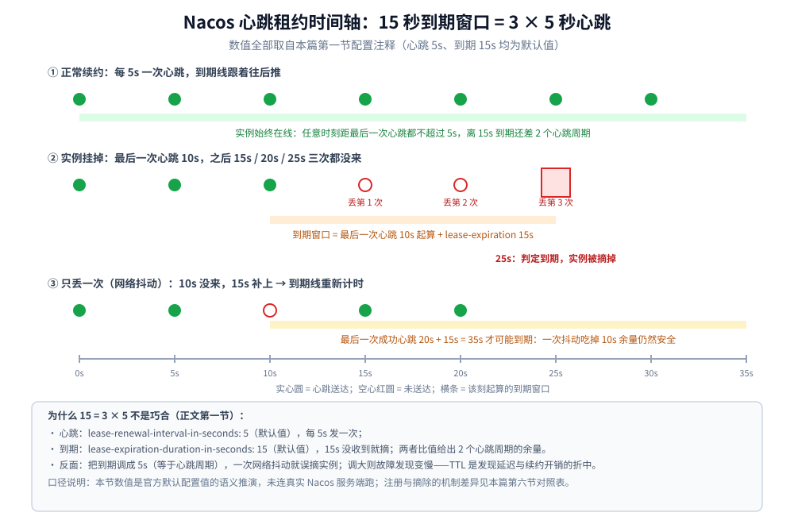
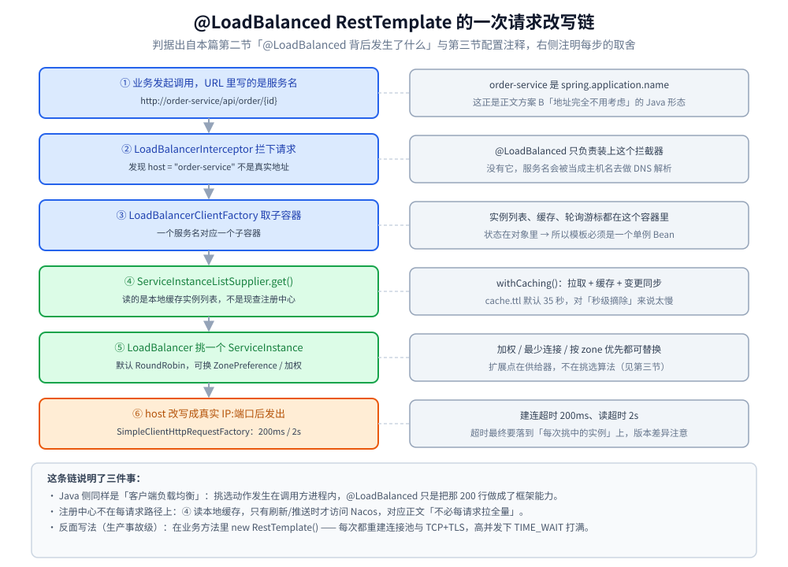
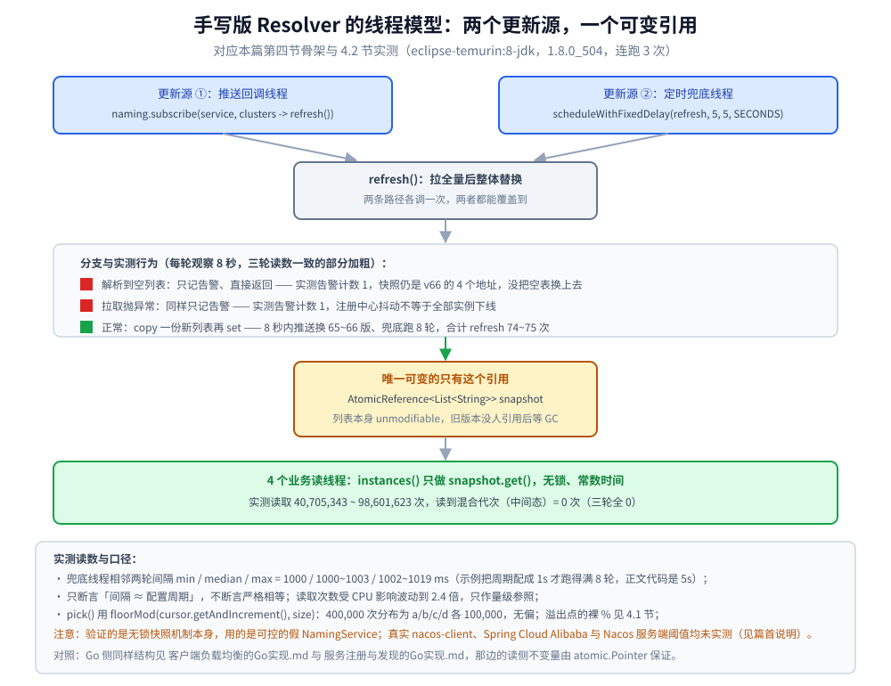
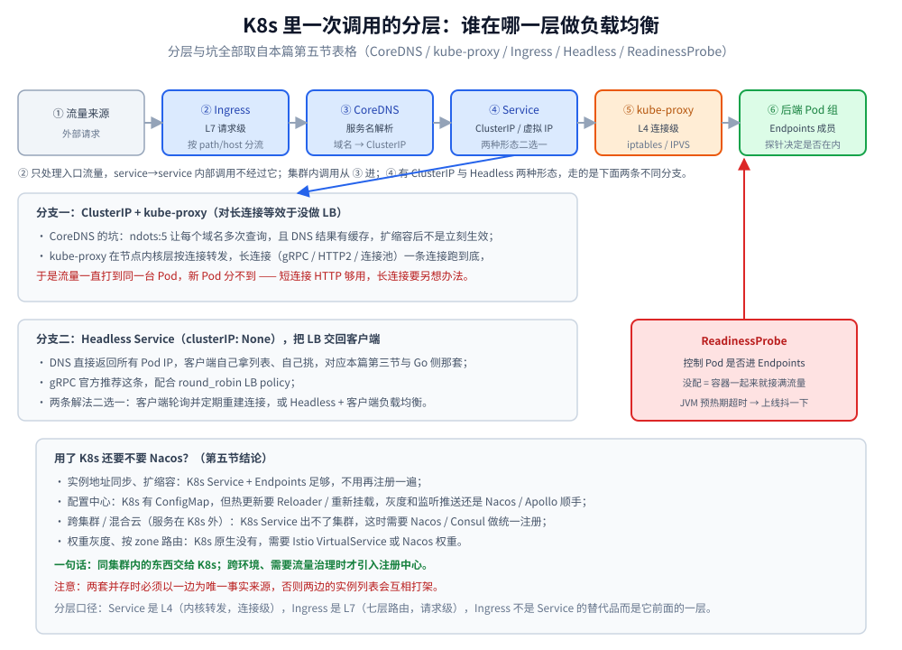

# 服务发现的 Java 实现（Spring Cloud + Nacos）

> 一提到服务发现，**Java 背景的人默认你说的是 Spring Cloud**，Go 背景的默认是 etcd / K8s。
> 这篇的重点是**把两套词汇对上**：Nacos 的 `lease` ≈ etcd 的租约，`@LoadBalanced` ≈ Go 侧的 `DiscoveryTransport`；
> 并说清 **K8s 那一层到底谁在做负载均衡**。
>
> 内容整理自个人学习笔记，并参考《大型网站技术架构：核心原理与案例分析》（李智慧）；参考资料与原始素材见 [素材清单](../../../素材清单.md)。
>
> ⚠️ **Java 代码未在本机编译校验**（依赖 Spring Cloud Alibaba，需要私服 / 联网拉包）；
> API 名称按 `spring-cloud-starter-alibaba-nacos-discovery` + `spring-cloud-starter-loadbalancer` 的公开接口书写，落地前请以你所用版本的源码为准。

## 一、注册参数：`lease` 就是 etcd 的"租约 + KeepAlive"

```yaml
spring:
  application:
    name: order-service          # ← 正文说的"服务名"，客户端按它发现，永远不用改 IP
  cloud:
    nacos:
      discovery:
        server-addr: nacos-headless.nacos.svc:8848
        enabled: true
        # ↓↓ 这三行就是"租约 + 续约 + TTL"，语义与使用一完全一致
        lease-renewal-interval-in-seconds: 5    # 每 5s 发一次心跳（默认值就是 5）
        lease-expiration-duration-in-seconds: 15 # 15s 没收到心跳就摘掉（默认值就是 15）
        weight: 100                              # 权重 → 对应使用一的加权轮询
        metadata:
          zone: sh-a
          version: v2.3.1
        # 本地调试时不把自己注册上去，否则流量会打到你笔记本
        # register-enabled: false
```

**⚠️ `15 = 3 × 5` 不是巧合，这是正文那句"TTL 是故障发现延迟与续约开销的折中"的具体形态**：
容忍连续丢 2 次心跳，第 3 次还没来才摘——
把 `lease-expiration` 调到 5s 只是"心跳周期"，**一次网络抖动就会误摘实例**。



**和 etcd 的两点差异**：

| | etcd | Nacos |
|---|---|---|
| 续约通道 | gRPC 流 `KeepAlive`（**一个租约一条流**） | v1/v2 都是客户端心跳；**v2 换成 gRPC 长连接**，变更走**推送**，秒级→毫秒级 |
| 一致性 | **CP**（Raft，全部 key 一致） | **临时实例走 AP（Distro 协议）**、持久实例走 CP（JRaft）——**注册中心挂时优先保证"还能读到旧列表"** |
| 健康检查 | **纯被动**（心跳停 → key 过期） | **双模**：临时实例被动心跳；持久实例服务端**主动探测** |

> 这也回答了正文第三节追问里"AP 还是 CP"的取舍：
> **注册中心通常选 AP**——列表旧一点只是有几个请求打到死地址（客户端能重试），
> 而选 CP 时**注册中心一旦不可写，整个服务的实例信息就冻结甚至不可用**。

## 二、客户端：`@LoadBalanced` 的模板必须**是单例**

```java
@Configuration
public class DiscoveryClientConfig {

    /**
     * ★ 一个进程一个。@Bean 默认 singleton，这正好符合"中间件客户端要单例"。
     *
     * 反面写法（生产事故级）：在业务方法里 new RestTemplate() ——
     * 它内部的 ClientHttpRequestFactory 有自己的连接池，
     * 每次 new 等于每次请求重建 TCP+TLS 连接，高并发下直接 TIME_WAIT 打满。
     * 同理 FeignClient / WebClient.Builder 也只该在 @Bean 里建一次。
     */
    @Bean
    @LoadBalanced                       // ← 加上它，URL 里就能写服务名而不是 IP
    public RestTemplate orderRestTemplate() {
        var factory = new SimpleClientHttpRequestFactory();
        factory.setConnectTimeout(Duration.ofMillis(200));   // 建连超时
        factory.setReadTimeout(Duration.ofSeconds(2));       // 等待响应超时
        // 注意：@LoadBalanced 会替换 factory，需要用
        //   LoadBalancerRestTemplateBuilder / 自定义 RequestFactory
        // 才能把超时真正落到"每次挑中的实例"上；这里给出意图，版本差异请以源码为准。
        return new RestTemplate(factory);
    }
}
```

调用方就写成**服务名**，这正是正文方案 B"地址完全不用考虑"的 Java 形态：

```java
// URL 里的 order-service 是 spring.application.name，不是主机名
OrderVO vo = restTemplate.getForObject(
        "http://order-service/api/order/{id}", OrderVO.class, orderId);
```

**`@LoadBalanced` 背后发生了什么**（这段说清楚，才算不是只会用注解）：

```text
RestTemplate 拦截 URL 的 host = "order-service"
        ↓
LoadBalancerInterceptor → LoadBalancerClientFactory 拿到该服务的一个子容器
        ↓
ServiceInstanceListSupplier.get() → Nacos 的本地缓存实例列表（★ 本地缓存，和正文一样）
        ↓
LoadBalancer（默认 RoundRobin，可换 ZonePreference / 加权 / 最少连接）挑一个 ServiceInstance
        ↓
把 host 改写成真实 IP:端口，再发出去
```

> **所以 Java 侧同样是"客户端负载均衡"**——`@LoadBalanced` 只是把使用一那 200 行做成了框架能力。



## 三、换策略：自定义 `ServiceInstanceListSupplier`（预热摘除的例子）

Spring Cloud LoadBalancer 的**扩展点是"实例列表供给器"**，而不是"挑选算法"——
绝大多数需求（过滤不健康实例、按 zone 优先、**新实例预热期不打满流量**）都应该在这里做：

```java
/**
 * 新实例刚起来时 JVM 未预热、缓存未加载，直接按全权重接流量会超时。
 * 做法：实例第一次被看到时记时间戳，预热窗口内把它**排到列表最后**（而不是删掉，
 * 删掉会导致实例数骤减、压力转移到其他机器）。
 *
 * 这个 bean 会被 Spring Cloud 放在"每个服务名一个"的子容器里，
 * 所以内部的 ConcurrentHashMap 只保护该服务的实例，天然不需要跨服务共享。
 */
public class WarmupSupplier extends DelegatingServiceInstanceListSupplier {

    private static final Logger log = LoggerFactory.getLogger(WarmupSupplier.class);
    private final Duration warmup;
    private final ConcurrentHashMap<String, Instant> firstSeen = new ConcurrentHashMap<>();

    public WarmupSupplier(ServiceInstanceListSupplier delegate, Duration warmup) {
        super(delegate);
        this.warmup = warmup;
    }

    @Override
    public Flux<List<ServiceInstance>> get() {
        return delegate.get().map(this::orderByWarmup);
    }

    private List<ServiceInstance> orderByWarmup(List<ServiceInstance> instances) {
        Instant now = Instant.now();
        // ★ 排序前先复制：delegate 返回的 List 可能是不可变的，也可能被别的线程共享
        List<ServiceInstance> copy = new ArrayList<>(instances);
        copy.sort(Comparator.comparingLong(si -> {
            Instant seen = firstSeen.computeIfAbsent(si.getInstanceId(), k -> {
                log.info("discover: new instance {} at {}", si.getHost(), now);
                return now;
            });
            // 预热中的实例给一个大数，被排到末尾
            return Duration.between(seen, now).compareTo(warmup) < 0 ? 1L : 0L;
        }));
        return copy;
    }
}
```

注册到子容器（**`@LoadBalancerClient` 只作用于指定服务名，全局生效用 `@LoadBalancerClients`**）：

```java
@Configuration
@LoadBalancerClient(name = "order-service", configuration = OrderLbConfig.class)
public class LbRegistration { }

public class OrderLbConfig {
    @Bean
    public ServiceInstanceListSupplier serviceInstanceListSupplier(
            ConfigurableApplicationContext context) {
        return new WarmupSupplier(
                ServiceInstanceListSupplier.builder()
                        .withDiscoveryClient()
                        .withCaching()          // ← 本地缓存 + 定时刷新，对应正文"不必每请求拉全量"
                        .build(context),
                Duration.ofSeconds(30));
    }
}
```

> **`withCaching()` 就是正文那句关键设计的 Java 版**：
> **拉取 + 缓存 + 变更同步**，而不是每次请求查注册中心。
> 默认刷新间隔由 `spring.cloud.loadbalancer.cache.ttl` 控制（默认 35 秒）——
> **这个默认值对"秒级摘除"来说太慢了**，Nacos 推送场景应改小或直接用带 watch 的 supplier。

## 四、手写版（等价于使用一的 `Resolver` + `Balancer`）

如果要"不用框架手写一把"，Java 版长这样——

**结构和 Go 那节一一对应**：不可变快照 + `AtomicReference` 整体替换 + 无锁读路径。

```java
/**
 * 未编译校验。依赖：nacos-client（NamingService 是**进程级单例**，一个 serverAddr 一个，
 * 用完才 shutdown；把它当普通对象到处 new 会泄漏 gRPC 连接和后台线程）。
 */
public final class NacosResolver {

    private final NamingService naming;          // ← 单例注入，不要在这里 new
    private final String service;
    private final AtomicReference<List<String>> snapshot =
            new AtomicReference<>(List.of());     // ★ 不可变列表，读侧无锁

    public NacosResolver(NamingService naming, String service) {
        this.naming = naming;
        this.service = service;
    }

    /** 读路径：无锁、常数时间。 */
    public List<String> instances() { return snapshot.get(); }

    /** 全量替换。订阅 + 定时兜底各调一次，两者都能覆盖到。 */
    private void refresh() {
        try {
            List<String> list = naming.selectInstances(service, true).stream()
                    .map(i -> "http://" + i.getIp() + ":" + i.getPort())
                    .toList();
            if (list.isEmpty()) {
                // ★ 正文/使用一铁律 2：**空列表要告警，不能当正常状态换上去**
                log.warn("discover: {} resolved to EMPTY, keep old {}", service, snapshot.get());
                return;
            }
            snapshot.set(list);
        } catch (NacosException e) {
            // ★ 拉取失败：**保留旧列表**（注册中心抖动 ≠ 全部实例下线）
            log.warn("discover: refresh {} failed, keep stale list", service, e);
        }
    }

    /** 变更推送：Nacos v2 是 gRPC 推，v1 是 UDP；两者都只需实现这个回调。 */
    public void start() throws NacosException {
        refresh();
        naming.subscribe(service, clusters -> refresh());
        // 再挂一个 5s 的定时兜底：订阅回调可能丢事件（这是所有 watch 机制的通病）
        scheduler.scheduleWithFixedDelay(this::refresh, 5, 5, TimeUnit.SECONDS);
    }

    /** 挑一个：轮询。注意 AtomicInteger 的取模而不是 synchronized。 */
    private final AtomicInteger cursor = new AtomicInteger();
    public String pick() {
        List<String> list = snapshot.get();
        if (list.isEmpty()) throw new NoInstanceException(service);
        int i = Math.floorMod(cursor.getAndIncrement(), list.size());
        return list.get(i);
    }
}
```

> **`Math.floorMod` 而不是 `%`**：`AtomicInteger` 溢出成负数后，
> `-2147483648 % 3` 在 Java 里是 `-2` → `IndexOutOfBounds`。这个坑每年都有人踩。

### 4.1 本机实测：溢出点上的 `%` 与 `floorMod`

**本节要点**：上面那句坑不用背，JDK 8 容器里跑一次就能看见下标真的是负数。

环境：Docker Desktop + `eclipse-temurin:8-jdk`，`java.version = 1.8.0_504`，`java.vm.name = OpenJDK 64-Bit Server VM`。
连跑 3 次输出逐行一致（纯确定性计算，不涉及耗时）。

```text
-2147483648 % 3          = -2
Math.floorMod(min, 3)    = 1
裸 % 在溢出点算出的下标  = -2
取 List 时抛错：ArrayIndexOutOfBoundsException：-2
取数组时抛错：ArrayIndexOutOfBoundsException：-2
floorMod 在同一溢出点 = 1 -> 访问 b
0..999 内两种写法结果相同的个数 = 1000 / 1000
3,000,000 次轮询分布 = {a=1000000, b=1000000, c=1000000}
```

三点读法：

- **只有溢出才出问题**：`0..999` 区间里 `%` 与 `floorMod` 结果 1000/1000 相同，所以测试环境永远复现不出来；
- **抛的是 `ArrayIndexOutOfBoundsException` 而不是返回 `null`**，`List.get()` 和数组下标行为一致，负数下标没有"绕回末尾"的语义；
- **`floorMod` 的 300 万次轮询分布仍是严格均匀**（三个节点各 1,000,000 次），换成 `floorMod` 不改变轮询语义，只消掉溢出这一类边界。

### 4.2 本机实测：双更新源 + 不可变快照 + 空列表保护

**本节要点**：把上面骨架里"不依赖 nacos-client 也能验证"的三条铁律，在真实线程模型下跑出来。

同一个运行进程里放**两个更新源**（模拟 `naming.subscribe` 的推送回调线程，每 120ms 换一版；
模拟 `scheduleWithFixedDelay` 的定时兜底线程，这里为跑满几轮配 1s，**正文代码里是 5s**）
和 **4 个业务读线程**（只做 `snapshot.get()`），读侧每轮校验"列表里所有元素是否同一代次"——
混代即代表读到了改到一半的中间态。

```bash
MSYS_NO_PATHCONV=1 docker run --rm -v D:/www/dev-notes:/w -w /w/.workbuddy/tmp/round495 \
  eclipse-temurin:8-jdk sh -c "javac W2R7rSnapshot.java && java W2R7rSnapshot"
```

连跑 3 次（观察窗口 8 秒）的读数与波动范围：

| 观测项 | run1 | run2 | run3 | 读法 |
|---|---|---|---|---|
| 兜底刷新轮数（周期 1000ms） | 8 | 8 | 8 | 与 `scheduleWithFixedDelay` 周期一致 |
| 相邻两轮间隔 min / median / max | 1000 / 1001 / 1019 ms | 1000 / 1003 / 1019 ms | 1000 / 1000 / 1002 ms | 中位数贴着 1s，长尾 ~1.02s；只断言"≈ 配置周期"不断言严格相等 |
| 推送回调换快照次数 | 66 | 65 | 66 | 120ms 一次，8s 约 66 次 |
| 两个更新源合计 refresh | 75 | 74 | 75 | 基线 1 + 推送 + 兜底，两条路径都能覆盖到 |
| 4 个读线程合计读取次数 | 40,705,343 | 51,375,971 | 98,601,623 | 无锁读路径的量级（波动大，只作参照） |
| **读到混合代次（中间态）次数** | **0** | **0** | **0** | 三轮全为 0：读侧只见完整版本 |
| 注入空列表后快照 | 保留 v66 四项 | 保留 v65 四项 | 保留 v66 四项 | 空列表告警计数 = 1，**没有将空表换上去** |
| 注入拉取异常后快照 | 保留 v66 四项 | 保留 v65 四项 | 保留 v66 四项 | 失败告警计数 = 1，旧列表继续用 |
| `pick()` 400,000 次分布 | a/b/c/d 各 100,000 | 同左 | 同左 | `floorMod` + `AtomicInteger` 的轮询无偏 |

由此确认四条（对应正文骨架里的四个 ★）：

1. **整体替换指针**是唯一可变的写入动作，读线程 4000 万次以上读取里没有一次看到"改到一半"的列表；
2. **空列表必须当异常处理**：`list.isEmpty()` 分支直接 `return`，快照保持上一版，不会把"解析到空"当成"全部下线"；
3. **拉取失败保留旧列表**：`catch` 分支同样只记警告，注册中心抖动不影响正在使用的地址表；
4. **定时兜底不是冗余**：推送回调 66 次与兜底 8 次是两条独立触发路径，任一条丢事件另一条仍能覆盖——
   这正是"订阅回调可能丢事件"这句注释的实测形态。

> ⚠️ 这一节验证的是**无锁快照机制本身**，用的假 `NamingService` 可控地返回全量 / 空列表 / 抛异常。
> **Nacos 服务端的真实心跳与摘除阈值（第六节那两个 15s / 30s）未在本机连服务端实测**；
> 同理，`nacos-client`、Spring Cloud Alibaba 的完整代码仍因需要联网拉包而未编译校验（见篇首说明）。



## 五、K8s 里到底谁在做负载均衡（正文方案 B 的完整分层）

| 层 | 组件 | 层级 | 粒度 | 典型坑 |
|---|---|---|---|---|
| 服务名解析 | **CoreDNS** | — | 域名 → **ClusterIP** | `ndots:5` 导致每个域名多次查询；**DNS 结果有缓存，扩缩容后不是立刻生效** |
| 集群内转发 | **kube-proxy**（Service） | **L4** | **连接级**（iptables/IPVS） | ⚠️ **长连接（gRPC/HTTP2/连接池）会一直打到同一台 Pod** → 新 Pod 分不到流量；解法：客户端轮询重建连接、或用 **Headless Service + 客户端 LB** |
| 七层入口 | **Ingress**（Nginx/Traefik）/ Gateway API | **L7** | **请求级**，可按 path/host 分流 | 只对**入口流量**生效，**service→service 内部调用不经过它** |
| 无平台 LB | **Headless Service**（`clusterIP: None`） | — | DNS 直接返回**所有 Pod IP** | 把 LB 交回给客户端（gRPC 官方推荐这条，配合 `round_robin` LB policy） |
| 摘除时机 | **ReadinessProbe** | — | 控制 Pod 是否进 Endpoints | ⚠️ **Readiness 没配 = 容器一起来就接满流量**（JVM 预热期超时），这是 K8s 里最常见的"上线抖一下"原因 |

> **正文第一节那句"用 Swarm/K8s 就直接用它的传输层负载均衡"要补一句限制**：
> **K8s Service 是连接级 LB**，对短连接 HTTP 完全够用；
> **对 gRPC / 数据库长连接这类"一条连接跑到底"的协议，它等效于没做负载均衡**。
> 这句话说出来，基本就能把这一题从"背过"变成"做过"。



**用了 K8s 还要不要 Nacos？**（高频追问，给结论）

| 问题 | 谁来做 |
|---|---|
| 实例地址同步、扩缩容 | **K8s Service + Endpoints 足够**，不用再注册一遍 |
| 配置中心 | K8s 有 ConfigMap，但**热更新要 Reloader/重新挂载**，做灰度和监听推送还是 Nacos/Apollo 顺手 |
| 跨集群 / 混合云（服务在 K8s 外） | K8s Service **出不了集群**，这时需要 Nacos/Consul 做统一注册 |
| 权重灰度、按 zone 路由 | K8s 原生没有，需要 **Istio VirtualService** 或 Nacos 权重 |

> **一句话**：**同集群内的东西交给 K8s；跨环境、需要流量治理时才引入注册中心**——
> 两套并存时，**必须以一边为唯一事实来源**，否则两边的实例列表会互相打架。

## 六、四种注册中心的"健康检查语义"对照（正文第二节/第三节的收口）

| 注册中心 | 怎么发现实例 | 判定"不健康"的方式 | 摘除延迟 |
|---|---|---|---|
| **etcd** | 客户端写 KV + 租约 | **纯被动**：KeepAlive 停 → TTL 到期 → key 消失 | ≈ TTL（10s） |
| **ZooKeeper** | 客户端建**临时节点**（EPHEMERAL） | **session 超时**（会话断，节点自动删）——续约与摘除是**同一个机制** | ≈ session timeout（常配 10~30s） |
| **Consul** | Agent 注册 service | **主动探测**（HTTP/TCP/gRPC check 周期性访问）+ 可选 TTL；**失败会立刻摘出 DNS/接口** | check interval（秒级，可配） |
| **Nacos** | 客户端注册（临时实例） | **被动心跳**为主，持久实例**主动探测**；不健康实例**默认只停转发不删除** | 15s 标不健康 / 30s+ 摘除 |

> **讲法**：**先说"谁主动"（服务端心跳 vs 注册中心探测），再说"摘除延迟"，最后说"摘除是否可逆"**。
> 比如 Consul/Nacos 会把不健康实例**标记**而不是删除，恢复后立刻回流；
> etcd/ZK 是**删除**，恢复要靠服务重新注册。

## 七、具体使用：最小落地清单

**本节要点**：本节不引入任何新代码，只把 §一~§四 的片段收拢成「依赖 → 配置 → 模板与调用 → 换策略 → 选型边界 → 健康检查语义」的六步清单，每步回指原节；抄走清单前先看 §八 的校验口径。

1. **依赖**：两个 starter——`spring-cloud-starter-alibaba-nacos-discovery`（注册与发现）+ `spring-cloud-starter-loadbalancer`（`@LoadBalanced` 的执行体）；走 §四 手写版另需 `nacos-client`。**本篇没有给出任何 Maven 坐标与版本号**，落地时按你所用版本的源码与 BOM 确定，starter 名称按篇首声明书写。
2. **`application.yml` 四项关键**（§一）：`spring.application.name` 就是服务名；`server-addr` 指注册中心；心跳对 `lease-renewal-interval-in-seconds` / `lease-expiration-duration-in-seconds` 必须保持 3 倍余量（默认 5 / 15，压到 1 倍一次抖动就误摘）；本地调试设 `register-enabled: false` 不把自己注册上去。
3. **模板与调用**（§二）：`@Bean` + `@LoadBalanced` 产出**进程级单例**模板，工厂上挂建连 / 读超时（示例 200ms / 2s，注意 `@LoadBalanced` 会替换 factory，超时要落到每次挑中的实例）；调用方 URL 直接写 `http://<服务名>/...`。反面写法是每个请求 `new RestTemplate()`——连接池重建、轮询游标与缓存被重置（§二、延伸追问 2）。
4. **换策略时改哪里**（§三）：扩展点不是挑选算法，而是**实例列表供给器** `ServiceInstanceListSupplier`——`@LoadBalancerClient(name = …, configuration = …)` 注册进"每个服务名一个"的子容器，`.withDiscoveryClient().withCaching()` 开启本地缓存 + 定时刷新；默认 `spring.cloud.loadbalancer.cache.ttl` 35 秒对秒级摘除太慢，要改小或换带 watch 的 supplier；预热摘除、按 zone 优先、过滤不健康实例都写在这一层。
5. **出框架（K8s）与弃框架（手写）**（§五 / §四）：集群内调用可以交给 K8s Service 的 L4 转发，但 gRPC / 连接池这类长连接要换 Headless Service + 客户端 LB 或定期重建连接；手写 `Resolver` 守四条：**`NamingService` 进程级单例注入、不可变快照整体替换、空列表告警不换表、拉取失败保留旧列表**，取模用 `Math.floorMod`（溢出实测见 §4.1）。
6. **知道"坏的实例谁在摘"**（§六）：etcd 靠租约 TTL 到期、ZooKeeper 靠 session 超时、Consul 主动探测、Nacos 临时实例被动心跳（15s 标不健康 / 30s+ 摘除、默认只停转发不删除）——换注册中心先对照这张语义表再动配置。

## 八、校验与排查

**本节要点**：先划清本篇的校验口径（Spring 集成链路未在本机编译），再按「症状 → 先查什么」排障；症状表每一条都是前六节已写内容的汇总，不引入新事实。

校验口径：§4.1、§4.2 已在 `eclipse-temurin:8-jdk` 容器实测（读数见各节）；§二、§三 的 Spring 集成、§五 的 K8s 各组件、§六 的服务端 15s / 30s 阈值**均未经本机编译或连服务端实测**（依赖 Spring Cloud Alibaba，需要私服 / 联网拉包，篇首已声明）；注解名与配置键落地前以你所用版本的源码为准。

| 症状 | 先查什么 | 出处 |
|---|---|---|
| 用服务名调用解析不到主机名，或 URL 里仍写着 IP | 模板是否加了 `@LoadBalanced`；URL host 是否为 `spring.application.name` | §二、§一 |
| 轮询像"永远从第一个实例开始"、本地缓存永不生效、TIME_WAIT 打满 | 每请求新建非单例模板：游标、缓存、订阅、连接池全被重置 | §二、延伸追问 2 |
| 一次网络抖动就"全服务无实例" | `lease-expiration` 被压到等于心跳周期，没留 3 倍余量 | §一 |
| 新实例上线第一波流量就超时 | 没做预热摘除（§三），或 K8s 里 Readiness 探针没配、容器一起来接满流量 | §三、§五 |
| gRPC / 长连接一直打到同一 Pod，新 Pod 分不到流量 | K8s Service 是连接级 LB；换 Headless + 客户端 LB，或客户端定期重建连接 | §五 |
| 摘掉一个坏实例要等接近一分钟 | LB 缓存默认 TTL 35s 未调小，再叠加 Nacos 侧 15s 标不健康 / 30s+ 摘除 | §三、§六 |
| 注册中心抖动期间调用全挂 | `Resolver` 在拉取失败或解析到空列表时直接把快照换掉了——应告警并保留旧表 | §四、§4.2 |
| 长时间运行后偶发负数下标越界 | `AtomicInteger` 溢出后裸 `%` 返回负数，换 `Math.floorMod` | §四、§4.1 |

---

## 延伸追问

### 1. Nacos 的 `lease` 和 etcd 的租约是同一回事吗？
**机制同源，细节不同**：两者都靠"客户端定期续期 + 服务端到期剔除"来实现故障剔除。
差别在**谁负责续期**：etcd 需要应用自己调 `KeepAlive`（原文 Go 侧就是这么写的），而 Nacos 的客户端 SDK 默认在后台**自动心跳**，
所以 Java 侧看到的配置项少一些、但"到底多久没心跳会被摘掉"这件事也更不透明。
⚠️ 更要紧的是**健康检查语义**：Nacos 有"临时实例（心跳）"与"持久化实例（主动探测）"两种，行为完全不同（见本篇第六节）。

### 2. `@LoadBalanced` 的模板为什么必须是单例？
因为负载均衡器的**状态就在这个对象里**：它持有实例列表的订阅、本地缓存、以及轮询/哈希的游标与权重状态。
每次请求 `new RestTemplate` 就等于**每次重置状态** —— 轮询永远从第一个实例开始、缓存永远为空、订阅被反复创建。
所以它必须是一个 Spring 单例 Bean，把"实例列表 + 选择策略 + 状态"在进程内共享。
（这和 Go 侧"etcd 客户端一个进程一个"是同一条原则。）

### 3. K8s 里 Service 和 Ingress 分别做了什么？
**Service 做 L4**：给一组 Pod 一个稳定虚拟 IP / DNS 名，并用 kube-proxy（iptables / IPVS）在**节点内核层**做转发与负载均衡，
配合 readiness 探针把没就绪的 Pod 从 Endpoints 里摘掉。

**Ingress 做 L7**：按域名 / 路径路由到不同的 Service，做 TLS 终止 —— 它**不是** Service 的替代品，而是它前面的一层。
所以"K8s 里谁在做 LB"要分两层答：**Service（L4，内核转发）** 与 **Ingress（L7，七层路由）**；
而**客户端负载均衡**（本篇与 Go 篇讲的那套）在 K8s 里通常被 Service 取代 —— 这是"两套词汇"最容易混的地方。

## 关联

- [服务发现.md](../../../04-架构与系统/分布式/服务治理/服务发现.md) — 机制与三道题
- [服务注册与发现的Go实现.md](../../go/工程实践/服务注册与发现的Go实现.md) — etcd 侧的对应实现
- [客户端负载均衡的Go实现.md](../../go/工程实践/客户端负载均衡的Go实现.md) — LB 策略在 Go 侧怎么写
- [K8s部署与生命周期面试题.md](../../../06-工程实践/部署/k8s/K8s部署与生命周期面试题.md) — K8s 那一层的服务发现与 LB
- [Nacos.md](../../../03-数据与中间件/中间件/注册与配置中心/Nacos.md) — Nacos 作为注册中心的配置与实操
- [锁与AQS.md](../../../01-编程语言/java/并发编程/锁与AQS.md) — 不可变快照 + `AtomicInteger` 轮询背后的 CAS、可见性与原子类选择
- [JMM与内存屏障.md](../../../01-编程语言/java/并发编程/JMM与内存屏障.md) — 推送回调线程与业务线程之间必须有一条 `happens-before` 链，这就是快照能被安全看到的原因
- [Spring-boot核心.md](../../../01-编程语言/java/Spring-boot核心.md) — `@LoadBalanced` 为什么只能加在 `@Bean` 上、`@Scheduled` 在多副本下为什么会重复执行
> 反向引用（本篇被下列文档引到）：[接入Dubbo.md](接入Dubbo.md)、[接入etcd.md](接入etcd.md)、[负载均衡.md](../../../04-架构与系统/分布式/服务治理/负载均衡.md)
