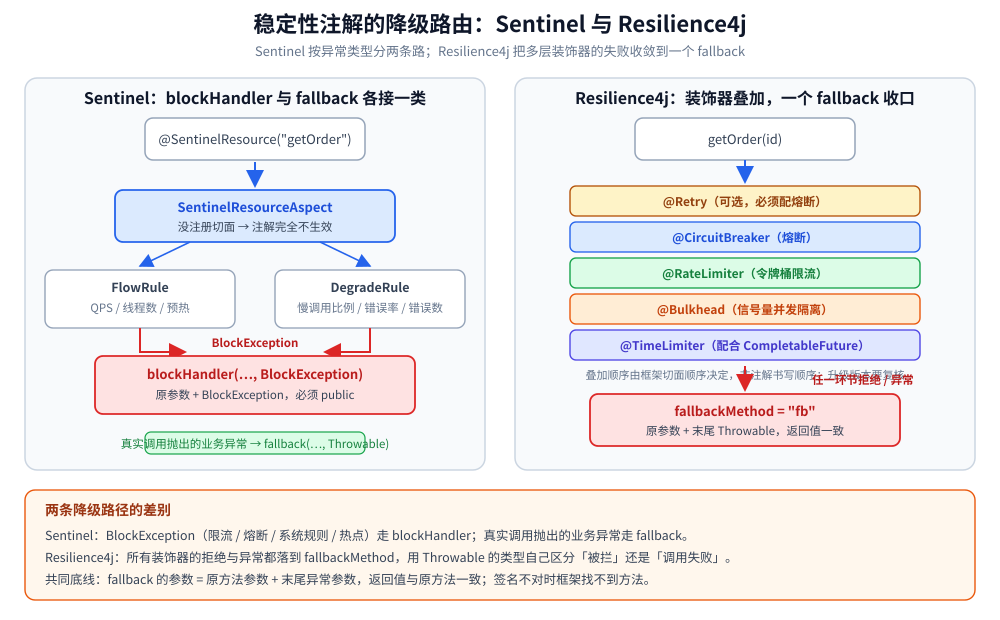

# 稳定性组件的 Java 实现（Sentinel / Resilience4j）

> 覆盖：Java 侧接入限流与熔断的两套主流做法——Alibaba Sentinel（注解 + 规则 + Dashboard 集中治理）与 Resilience4j（函数式装饰器 + Spring Boot 配置）；两者的组件对照与选型；手写三态状态机及其与 Go 版的逐行对照。
>
> 不覆盖：稳定性各机制的原理与参数取舍见 [稳定性/README.md](../../../04-架构与系统/分布式/稳定性/README.md) 与 [限流算法.md](../../../04-架构与系统/分布式/稳定性/限流算法.md)、[熔断器.md](../../../04-架构与系统/分布式/稳定性/熔断器.md)、[重试与超时.md](../../../04-架构与系统/分布式/稳定性/重试与超时.md)、[降级.md](../../../04-架构与系统/分布式/稳定性/降级.md)；Go 侧同一套语义见 [稳定性组件的Go实现.md](../../go/工程实践/稳定性组件的Go实现.md)。
>
> 内容整理自个人学习笔记，并参考《大型网站技术架构：核心原理与案例分析》（李智慧），素材见 [素材清单](../../../素材清单.md)。
>
> **验证情况**：第六节手写状态机按原文 `JDK 1.8`、同参数、同注入时钟的实测结论迁移（输出与 Go 版逐行一致）；Sentinel 与 Resilience4j 的依赖、注解、YAML 与规则代码**未在本机编译运行**（需要 Spring Boot 3 与联网拉包），API 名称按 1.8.8 / 2.2.0 的公开接口书写，落地前以所用版本源码为准。

---

## 一、选型：Sentinel 还是 Resilience4j？

**本节要点**：两者都能做限流和熔断，差别在治理方式——Sentinel 是「控制台 + 规则中心」，Resilience4j 是「代码里的装饰器」。先定治理方式，再看功能清单。

> ⚠️ **Hystrix 已进入维护模式（2018 年起停止新特性开发）**，Netflix 官方推荐迁移到 **Resilience4j**（轻量、函数式、无线程池强制隔离）。阿里巴巴生态还有 Sentinel（控制台 + 热点限流更强）。新项目不要再引入 Hystrix。

| 维度 | Sentinel | Resilience4j |
| --- | --- | --- |
| 形态 | 切面 + 控制台，规则集中管理 | 函数式装饰器 / 注解，配置即代码 |
| 亮点 | ⭐ 控制台、热点参数限流、集群流控、系统自适应、网关流控 | ⭐ 轻量、组合灵活（Retry/Bulkhead/TimeLimiter）、与 Micrometer 集成好 |
| 侵入 | 需要资源名 + 规则配置 | 低，装饰器包一层 |
| 生态 | 阿里系、国内主流 | Spring Cloud Circuit Breaker 官方推荐 |
| 适用 | 需要集中治理、大促场景、多语言（含 Go） | Spring Boot 单体/微服务、偏好代码化配置 |



⭐ 三个选型判据：

1. **要控制台动态改规则、要大促期间集中治理** → Sentinel。
2. **规则跟着代码走、Spring Boot 单体/微服务、想自由组合 Retry/Bulkhead** → Resilience4j。
3. **已经选了 Sentinel 做熔断，就不要再叠 Resilience4j 的 `CircuitBreaker`**——两套状态机、两套阈值、两套半开逻辑，排查时无法判断是谁拒的。

## 二、前提：资源名、fallback 签名与规则持久化

**本节要点**：框架只负责「拦」，不负责「拦完返回什么」；接入前先定资源名、降级方法和规则存放位置，否则会出现「注解写了但不生效」或「重启后规则全丢」。

| 先准备什么 | 漏了会怎样 |
| --- | --- |
| **统一的资源名**（如 `getOrder`） | Sentinel 的规则按资源名匹配；`@SentinelResource(value=...)` 与规则里的名字不一致时，规则永远不命中 |
| **符合签名的 fallback / blockHandler** | 签名不匹配时框架找不到降级方法，异常会直接抛给调用方（详见 4.3 的签名表） |
| **规则持久化** | Dashboard 里的规则默认只在内存，应用重启即丢失；生产必须接 Nacos / Apollo / ZooKeeper DataSource |
| **最小请求数** | 低流量下 1 次失败就是 100% 错误率，熔断会被误触发 |

## 三、初始化：依赖、切面与单例边界

**本节要点**：Sentinel 需要显式注册切面（没有 starter 时），Resilience4j 通过 starter 自动装配；规则仓库与熔断器注册表都是**进程级**，不要按请求创建。

### 3.1 Sentinel 依赖

```xml
<!-- sentinel-core：核心；sentinel-annotation-aspectj：@SentinelResource 支持；
     sentinel-transport-simple-http：接入 Dashboard 必需的通信模块（均 1.8.8） -->
<dependency>
  <groupId>com.alibaba.csp</groupId>
  <artifactId>sentinel-core</artifactId>
  <version>1.8.8</version>
</dependency>
<dependency>
  <groupId>com.alibaba.csp</groupId>
  <artifactId>sentinel-annotation-aspectj</artifactId>
  <version>1.8.8</version>
</dependency>
<dependency>
  <groupId>com.alibaba.csp</groupId>
  <artifactId>sentinel-transport-simple-http</artifactId>
  <version>1.8.8</version>
</dependency>
```

### 3.2 手动注册切面

```java
@Configuration  // 没有 spring-cloud-starter 时需手动注册切面，否则 @SentinelResource 不生效
class SentinelAspectConfig {
    @Bean SentinelResourceAspect sentinelResourceAspect() { return new SentinelResourceAspect(); }
}
```

⭐ 这是 Sentinel 最常见的「注解不生效」原因：依赖引入了，但切面没注册，`@SentinelResource` 只是一个普通注解。

### 3.3 Resilience4j 依赖与配置

```xml
<dependency>
  <groupId>io.github.resilience4j</groupId>
  <artifactId>resilience4j-spring-boot3</artifactId>
  <version>2.2.0</version>
</dependency>
<!-- 单独使用可只引子模块：resilience4j-circuitbreaker / ratelimiter / bulkhead -->
```

```yaml
resilience4j:
  circuitbreaker:
    instances:
      orderService:
        slidingWindowType: COUNT_BASED     # 或 TIME_BASED
        slidingWindowSize: 100             # 基于最近 100 次调用统计
        minimumNumberOfCalls: 20           # ⭐ 最小调用数，低于此值不计算错误率
        failureRateThreshold: 50           # 错误率 50%
        waitDurationInOpenState: 10s       # Open 持续时长
        permittedNumberOfCallsInHalfOpenState: 5            # 半开放行 5 个试探
        automaticTransitionFromOpenToHalfOpenEnabled: true  # 自动转半开，无需等请求触发
        registerHealthIndicator: true
  ratelimiter:
    instances:
      orderService:
        limitRefreshPeriod: 1s     # 令牌补充周期
        limitForPeriod: 50         # 每周期 50 个许可
        timeoutDuration: 0         # 等待令牌的超时，0 = 不等待直接失败
  bulkhead:
    instances:
      orderService:
        maxConcurrentCalls: 20     # ⭐ 并发隔离（信号量舱壁）
        maxWaitDuration: 0
```

### 3.4 哪些对象是单例

| 对象 | 边界 | 为什么 |
| --- | --- | --- |
| `FlowRuleManager` / `DegradeRuleManager` | 进程级（全局） | 规则表按资源名匹配；每次请求重新 `loadRules` 会覆盖统计并造成抖动 |
| `CircuitBreakerRegistry` / `RateLimiterRegistry` | 进程级 | 注册表内部缓存实例；按请求新建等于每次从 CLOSED 开始 |
| `SentinelResourceAspect` | 进程级 | Spring Bean 单例；重复注册会导致同一个方法被多次统计 |
| `@SentinelResource` / `@CircuitBreaker` 注解 | 方法级 | 只是声明，由切面解释；不要手动 new 出被注解的对象 |

## 四、实际调用：注解、上报与降级分支

**本节要点**：Sentinel 把「限流 / 熔断触发」和「业务异常」分成两条降级路径（`blockHandler` 与 `fallback`）；Resilience4j 则把二者都收敛到 `fallbackMethod`，按 `Throwable` 自己分。

### 4.1 Sentinel：两条降级路径

```java
@Service
public class OrderService {

    // blockHandler：限流/熔断/系统规则触发；fallback：业务异常触发
    @SentinelResource(value = "getOrder",
            blockHandler = "getOrderBlock",
            fallback = "getOrderFallback")
    public OrderDTO getOrder(Long orderId) {
        return orderClient.query(orderId); // 被保护的远程调用
    }
    // ⚠️ 签名要求：参数与原方法一致，末尾多一个 BlockException，返回值一致，必须 public
    public OrderDTO getOrderBlock(Long orderId, BlockException ex) {
        return OrderDTO.degrade(orderId);  // 限流/熔断 → 返回兜底
    }
    // fallback 末尾多一个 Throwable；业务异常（非 BlockException）走这里
    public OrderDTO getOrderFallback(Long orderId, Throwable t) {
        return localCache.get(orderId);    // 兜底缓存
    }
}
```

### 4.2 Resilience4j：装饰器叠加，一个 fallback 收口

```java
@Service
public class OrderFacade {

    @CircuitBreaker(name = "orderService", fallbackMethod = "fb")  // 熔断
    @RateLimiter(name = "orderService",  fallbackMethod = "fb")    // 限流
    @Bulkhead(name = "orderService",     fallbackMethod = "fb")    // 并发隔离
    @TimeLimiter(name = "orderService")                            // 超时（配合 CompletableFuture）
    public OrderDTO getOrder(Long id) {
        return orderClient.query(id);
    }
    // ⚠️ fallback 签名：原参数 + Throwable，返回值相同
    private OrderDTO fb(Long id, Throwable t) {
        log.warn("degrade id={}, cause={}", id, t.getClass().getSimpleName());
        return localCache.getOrDefault(id, OrderDTO.empty(id));
    }
}
```

| 组件 | 作用 | 对应 Sentinel |
| --- | --- | --- |
| `CircuitBreaker` | 三态熔断 + 滑动窗口统计 | 熔断规则（DegradeRule） |
| `RateLimiter` | 令牌桶限流（周期补充许可） | 流控规则（FlowRule） |
| `Bulkhead` | 信号量 / 线程池并发隔离，防单个依赖耗尽资源 | 信号量隔离（Hystrix 线程池隔离的替代） |
| `TimeLimiter` | `CompletableFuture` 超时控制 | 超时降级 |
| `Retry` | 有限次重试（⚠️ 必须配熔断，避免重试风暴） | — |

⭐ 装饰器的**叠加顺序由框架切面顺序决定**，不是注解书写的顺序。顺序不同，被拒绝时抛出的异常类型就不同（先被限流拒绝还是先被熔断短路）。升级框架版本后要复核，排查时先看异常类型再定位是谁拒的。

### 4.3 降级方法签名对照

| 框架 / 方法 | 签名要求 | 漏了会怎样 |
| --- | --- | --- |
| Sentinel `blockHandler` | 原参数 + 末尾 `BlockException`，返回值一致，**必须 public** | 找不到方法，`BlockException` 直接抛出 |
| Sentinel `fallback` | 原参数 + 末尾 `Throwable`，返回值一致 | 业务异常不被兜底 |
| Resilience4j `fallbackMethod` | 原参数 + 末尾 `Throwable`，返回值一致 | 启动或首次调用时报找不到 fallback 方法 |

## 五、规则配置：流控、熔断与 Dashboard

**本节要点**：Sentinel 的规则是普通 Java 对象，启动时 `loadRules` 一次；Dashboard 只负责推送，默认不负责持久化。

```java
// 流控规则：QPS 20，预热 10s（冷启动，防刚启动时被打垮）
FlowRule flow = new FlowRule("getOrder")
        .setGrade(RuleConstant.FLOW_GRADE_QPS)          // FLOW_GRADE_THREAD = 并发数
        .setCount(20)
        .setControlBehavior(RuleConstant.CONTROL_BEHAVIOR_WARM_UP)
        .setWarmUpPeriodSec(10);
FlowRuleManager.loadRules(Collections.singletonList(flow));

// 熔断规则：10s 窗口内，RT>200ms 的慢调用占比超 50% 且请求数 >= 10 → 熔断 10s
DegradeRule degrade = new DegradeRule("getOrder")
        .setGrade(CircuitBreakerStrategy.SLOW_REQUEST_RATIO.getType())
        .setCount(200)                 // ⚠️ 慢调用判定的 RT 阈值(ms)
        .setSlowRatioThreshold(0.5)    // 慢调用比例
        .setMinRequestAmount(10)       // ⭐ 最小请求数
        .setStatIntervalMs(10000)
        .setTimeWindow(10);            // 熔断时长(秒)
DegradeRuleManager.loadRules(Collections.singletonList(degrade));

// 错误率模式：grade = ERROR_RATIO 时 count 直接就是错误率(0.0~1.0)
DegradeRule errRule = new DegradeRule("pay").setGrade(CircuitBreakerStrategy.ERROR_RATIO.getType())
        .setCount(0.5).setMinRequestAmount(20).setStatIntervalMs(10000).setTimeWindow(10);
```

```bash
# Dashboard：java -Dserver.port=8080 -jar sentinel-dashboard-1.8.8.jar（控制台默认账号 sentinel/sentinel）
# 应用侧 JVM 参数：-Dcsp.sentinel.dashboard.server=localhost:8080 -Dproject.name=order-service
```

> ⚠️ Dashboard 中的规则默认**只存在内存**，重启丢失，生产要接**规则持久化**（Nacos / Apollo / ZooKeeper DataSource）。

⭐ 三个易混参数：

- `setGrade` 决定**看什么**：QPS、并发线程数、慢调用比例、错误率、错误数。
- `setCount` 的含义随 `grade` 变：错误率模式下直接是 0.0~1.0，慢调用模式下是 RT 阈值（ms）。
- `setMinRequestAmount` 与 `setStatIntervalMs` 一起决定**样本够不够**；样本不足时不该判熔断。

## 六、手写实现：与 Go 版同场景对照

**本节要点**：Java 侧同样手写一套（对应「Resilience4j 内部是怎么实现的」）。**代码结构与 Go 版一一对应**：`TokenBucket` / `SlideWindow` / `Breaker` 三个内部类，同样把时钟作为参数传入。

熔断器是核心，Java 用 `enum` 表达三态：

```java
enum State { CLOSED, OPEN, HALF_OPEN }

boolean allow(long nowMs) {
    switch (state) {
        case OPEN:
            if (nowMs - openedAtMs >= openMs) {
                state = State.HALF_OPEN;   // 冷却结束 → 放一个探测
                return true;
            }
            return false;                  // 熔断中：快速失败
        case HALF_OPEN:
            return false;                  // 半开只放一个
        default:
            return true;
    }
}

void report(long nowMs, boolean ok) {
    if (state == State.HALF_OPEN) {
        if (ok) {
            state = State.CLOSED;          // 探测成功 → 关闭
            consecFails = 0;
        } else {
            state = State.OPEN;            // 探测失败 → 重新熔断并计时
            openedAtMs = nowMs;
        }
        return;
    }
    if (ok) {
        consecFails = 0;
        return;
    }
    consecFails++;
    if (consecFails >= failThreshold) {
        state = State.OPEN;
        openedAtMs = nowMs;
    }
}
```

⭐ 与 Go 版一样，两个地方不能写错：**半开只放一个探测**（`case HALF_OPEN: return false`）、**探测失败重新计时**（`openedAtMs = nowMs`）。

**实测（JDK 1.8，同参数、同注入时钟）**：输出与 Go 版**逐行一致**（令牌桶 2.00→1.00→0.00 的令牌变化、熔断的 `CLOSED → OPEN → HALF_OPEN → CLOSED` 全流程、滑动窗口 8 次请求 37.5% 失败率），因此不再重复贴一遍；完整读数见 [稳定性组件的Go实现.md](../../go/工程实践/稳定性组件的Go实现.md) 第八节。

## 七、跨语言对照：状态迁移语义完全一致

**本节要点**：两种语言的手写版只差在语法，状态迁移的每个分支都相同；这也说明框架文档里的状态图可以跨语言直接套用。

| 维度 | Go | Java | 说明 |
| --- | --- | --- | --- |
| 状态表达 | 自定义 `type State int` + `String()` | `enum State` | Java 的 enum 天然带名字，Go 需自己写 `String()` |
| 时钟注入 | 函数参数 `nowMs int64` | 方法参数 `nowMs long` | ⭐ 语言无关的**可测试性设计**：不依赖 `time.Now()` / `System.currentTimeMillis()` |
| 并发保护 | 需自己加 `sync.Mutex`（或用原子操作） | 需自己加 `synchronized` / `ReentrantLock` | ⚠️ 上表代码都是**单线程演示版**，生产必须加锁或改用原子量；框架替你做的第一件事就是这个 |
| 输出 | 与 Java 逐行一致 | 与 Go 逐行一致 | 说明两边的**状态迁移语义**完全相同 |

⚠️ 最后一条要强调：**手写实现的真正难点不是状态机，而是并发与时间**——多线程同时调用 `allow`、时钟回拨、补令牌时的竞态，都是框架帮你处理掉的。所以「能手写」是理解深度的证明，「生产直接用手写」通常不是好选择。

## 八、排障速查

**本节要点**：Java 侧「配了不生效」大多不是算法问题，而是切面、签名、资源名或规则持久化四件事。

| 症状 | 先查什么 |
| --- | --- |
| `@SentinelResource` 完全不生效 | 是否注册了 `SentinelResourceAspect`；方法是否被同类内部调用（绕过代理） |
| 规则配了但不拦截 | `value` 资源名与规则名是否一致；`loadRules` 是否真的执行 |
| 限流 / 熔断后没有降级 | `blockHandler` 签名是否带 `BlockException`、是否 public、返回值是否一致 |
| 业务异常没有走兜底 | 是 `fallback` 还是 `blockHandler` 配反了；`fallback` 是否带 `Throwable` |
| 应用重启后规则消失 | Dashboard 规则只在内存；是否接了 Nacos / Apollo / ZooKeeper DataSource |
| Resilience4j 拒绝时异常类型对不上 | 装饰器叠加顺序；先看异常来自 `CallNotPermittedException`、`BulkheadFullException` 还是限流 |
| 低流量下频繁误熔断 | `minimumNumberOfCalls` / `setMinRequestAmount` 是否太小 |

## 九、校验口径

> ✅ 本篇代码的校验方式与范围（JDK 1.8 / Sentinel 1.8.8 / Resilience4j 2.2.0）：

- **实测结论已迁移**：第六节「输出与 Go 版逐行一致」来自原文同参数、同注入时钟的运行结果，本篇未改动结论与读数。
- **未编译运行**：第三节的 Sentinel / Resilience4j 依赖、切面、YAML，第四节注解示例，第五节规则代码均需 Spring Boot 3 与联网拉包，本次只做 API 与参数核对。
- **未独立编译**：第六节为类片段（`openedAtMs`、`consecFails`、`failThreshold` 等字段在前序章节定义），不能单独成文件运行。
- **同场景对照**：完整读数与 Go 侧实现见 [稳定性组件的Go实现.md](../../go/工程实践/稳定性组件的Go实现.md) 第七、八节。

| 依赖 | 实际版本 |
| --- | --- |
| JDK | 1.8（实测结论） |
| Sentinel | 1.8.8（未编译，见上） |
| Resilience4j | 2.2.0（未编译，见上） |
| Spring Boot | 3.x（Resilience4j starter 要求） |

## 延伸追问

- **`blockHandler` 和 `fallback` 到底怎么分？** → `blockHandler` 只接 `BlockException`（限流、熔断、系统规则、热点参数）；`fallback` 接业务异常（含 `BlockException`，但会被 `blockHandler` 优先截获）。两者可以只配一个，但只配 `fallback` 时降级逻辑里要自己区分是「被拦」还是「调用失败」。
- **Sentinel 为什么能统计到业务异常，而 Go 侧要手动 `TraceError`？** → Java 的切面能捕获方法抛出的异常并自动上报；`sentinel-golang` 的 `Entry` 不是代理，框架看不到函数内部发生了什么，必须显式上报。这是两套 API 形态差异，不是能力差异。
- **Resilience4j 的 `minimumNumberOfCalls` 和 Sentinel 的 `setMinRequestAmount` 是一回事吗？** → 语义相同：样本不足时不计算错误率、不熔断。默认值与窗口类型不同，迁移规则时要逐项对照。
- **Dashboard 里改的规则为什么重启就没了？** → 默认规则源是内存；要接 Nacos / Apollo / ZooKeeper 等 `DataSource`，把规则存到外部配置中心。
- **Sentinel 和 Resilience4j 能同时用吗？** → 技术上可以，但不要同时让两者都做熔断：两套状态机对同一个下游给出不同判定，排查时无法归因。通常选一个做熔断，另一个只补它缺的能力（如 Sentinel 的网关流控）。
- **手写状态机加了 `synchronized` 就能上生产吗？** → 还不够。还要处理时钟回拨、半开并发探测的名额、统计窗口的并发读写；这些正是框架已经做掉的部分。

## 关联

- **上游/总纲**：[稳定性/README.md](../../../04-架构与系统/分布式/稳定性/README.md) — 稳定性防线的分层、分工与上线顺序
- **对照/互补**：[稳定性组件的Go实现.md](../../go/工程实践/稳定性组件的Go实现.md) — Sentinel-golang / gobreaker / Redis 限流与手写三件套
- **下游机制**：[限流算法.md](../../../04-架构与系统/分布式/稳定性/限流算法.md) — 令牌桶 / 漏桶模型与分布式限流
- **下游机制**：[熔断器.md](../../../04-架构与系统/分布式/稳定性/熔断器.md) — 三态机、滑动窗口与最小请求数
- **下游机制**：[重试与超时.md](../../../04-架构与系统/分布式/稳定性/重试与超时.md) — 重试预算、退避与超时预算
- **对照/互补**：[降级.md](../../../04-架构与系统/分布式/稳定性/降级.md) — 降级方法返回什么、读写降级的边界
- **运维/配置**：[配置热重载与快照.md](../../go/工程实践/配置热重载与快照.md) — 熔断阈值热更新时为什么必须整体替换快照
- **运维/配置**：[网关选型对比.md](../../../03-数据与中间件/中间件/网关与代理/网关选型对比.md) — 网关侧熔断与配置对照
