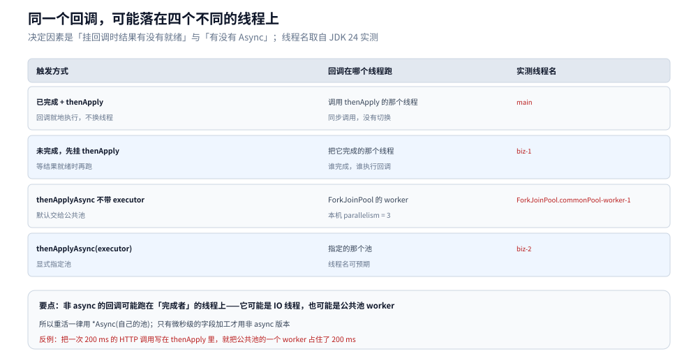
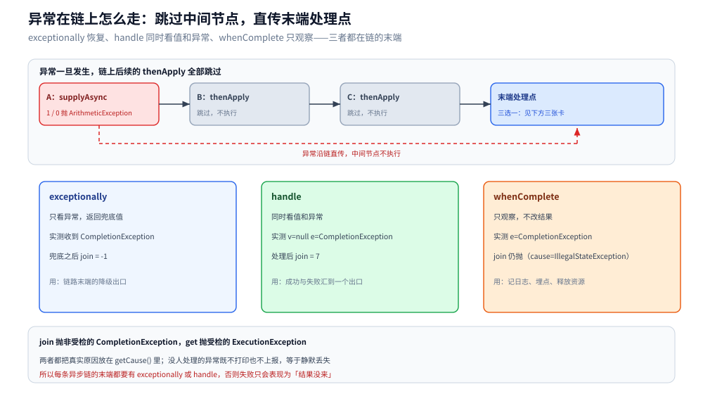
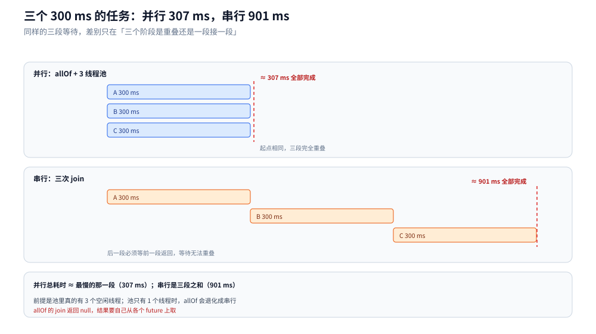

# CompletableFuture 与异步编排

> 覆盖：`CompletableFuture` 的状态与五种完成方式、`thenApply` 与 `thenCompose` 的分界、回调到底在哪个线程执行、异常在链上的三种处理位置（`exceptionally` / `handle` / `whenComplete`）、`join` 与 `get` 的差异、`orTimeout` 与 `completeOnTimeout`、`allOf` / `anyOf` 的汇合、回调里读不到 `ThreadLocal` 的原因，以及在同一单线程池里等另一个任务为什么会卡死。
>
> 不覆盖：线程池的参数、队列与拒绝策略见 [线程池.md](线程池.md)；`ThreadLocal` 的归属与装饰器写法见 [ThreadLocal与上下文传递.md](ThreadLocal与上下文传递.md)；`ForkJoinPool` 的工作窃取与并行流见 [ForkJoin与并行流.md](ForkJoin与并行流.md)；虚拟线程上跑阻塞任务见 [虚拟线程.md](虚拟线程.md)。
>
> 内容整理自个人学习笔记，素材见 [素材清单](../../../素材清单.md)。
>
> 实测口径：容器 `java-lab`，`eclipse-temurin:24-jdk`（24.0.2+12，linux/amd64，4 CPU，公共池 parallelism=3），源码在 `.workbuddy/tmp/exp/java/cf/CF.java`，八组实验全部真跑，输出逐节贴在正文里。计时类读数（`allOf` 304~307 ms 对串行 901 ms）为单轮实测，只断言量级。

---

## 一、一个 `CompletableFuture` 到底是什么？

**本节要点**：它是一个「可以手动完成、也可以挂回调」的结果容器。回调挂上去时结果已就绪，就地执行；还没就绪就登记，等完成的那一刻由完成者执行。

### 1.1 从零：二十行闭环

```java
import java.util.concurrent.CompletableFuture;

public class Quick {
    public static void main(String[] args) {
        CompletableFuture<String> f = CompletableFuture.supplyAsync(() -> {
            sleep(100);                        // 模拟一次远程调用
            return "user-42";
        });

        String name = f.thenApply(id -> "name-of-" + id)   // 加工
                       .exceptionally(e -> "fallback")     // 兜底
                       .join();                            // 取用

        System.out.println(name);              // name-of-user-42
    }

    static void sleep(long ms) {
        try { Thread.sleep(ms); } catch (InterruptedException e) { Thread.currentThread().interrupt(); }
    }
}
```

这一条链里已经有四个角色：`supplyAsync` **产生**结果，`thenApply` **加工**，`exceptionally` **兜底**，`join` **取用**。四件事各自独立、可以任意组合 —— 这正是它比 `Future` 多出来的部分：`Future` 只有「取用」，没有「加工完自动接着做」。

### 1.2 状态只有两类：没完成 / 完成了

内部只有一个 `result` 字段：`null` 表示未完成；正常完成存放值；异常完成存放一个 `AltResult` 包装。由此推出五种完成方式：

| 完成方式 | 结果状态 | 典型来源 |
|---|---|---|
| `complete(v)` | 正常完成 | 手动把某个回调的结果塞进来 |
| `completeExceptionally(e)` | 异常完成 | 底层客户端回调报错 |
| `cancel(mayInterrupt)` | 取消（也是异常完成的一种） | 调用方主动放弃 |
| `orTimeout(t, unit)` | 超时后异常完成 | 兜底超时 |
| `completeOnTimeout(v, t, unit)` | 超时后正常完成 | 降级返回默认值 |

⭐ 关键认知：**`CompletableFuture` 自己不是线程，也不持有线程**。它只是「结果 + 一串等待通知的回调」。所以「取消」能改的只是结果状态，改不了正在跑的任务 —— 这一点在第四节会看到实测。

### 1.3 回调到底在哪个线程跑

这是最容易想当然的一处。同一个 `thenApply`，跑在哪个线程完全取决于**挂回调时结果有没有就绪**：

```java
// 1) 已完成：回调在调用线程里就地执行
CompletableFuture.completedFuture("x").thenApply(v -> { print(tn()); return v; });

// 2) 未完成就先挂上：回调由「完成它的那个线程」执行
ExecutorService pool = Executors.newFixedThreadPool(2, /* 线程名 biz-N */ ...);
CompletableFuture<String> f = delayed("y", 100, pool);
f.thenApply(v -> { print(tn()); return v; }).join();

// 3) Async 不带 executor：交给公共池
CompletableFuture.completedFuture("z").thenApplyAsync(v -> { print(tn()); return v; }).join();

// 4) Async 带 executor：交给指定的池
CompletableFuture.completedFuture("w").thenApplyAsync(v -> { print(tn()); return v; }, pool).join();
```

```text
已完成 + thenApply        -> main
异步完成 + thenApply      -> biz-1
thenApplyAsync（默认池）  -> ForkJoinPool.commonPool-worker-1
thenApplyAsync(pool)      -> biz-2
main 线程名               -> main
```



图里四行就是上面四条实测：非 async 的回调要么在调用线程、要么在「完成者」线程，后者可能是 IO 线程，也可能是公共池 worker。要读出的结论是：**重活必须显式 `*Async(自己的池)`**，否则会把别人的线程占住 —— 在 IO 线程上阻塞会拖慢整条连接，在公共池 worker 上阻塞会拖慢全 JVM 的并行流。

---

## 二、`thenApply` 和 `thenCompose` 有什么区别？

**本节要点**：看函数的返回值是「普通值」还是「另一个 future」。返回 future 就必须用 `thenCompose`，否则拿到的是嵌套 future。

```java
CompletableFuture<CompletableFuture<String>> nested =
        CompletableFuture.completedFuture("a")
                .thenApply(s -> CompletableFuture.completedFuture(s + "b"));

CompletableFuture<String> flat =
        CompletableFuture.completedFuture("a")
                .thenCompose(s -> CompletableFuture.completedFuture(s + "b"));
```

```text
thenApply 的结果类型 = CompletableFuture（里面还套着一层 future）
nested.join().join() = ab
thenCompose 的结果 = ab ｜ 类型 = CompletableFuture
```

`thenApply` 相当于 `map`，`thenCompose` 相当于 `flatMap`。区别不只是类型好看：`thenCompose` 会**等内层 future 完成**再让外层完成，所以下一段逻辑拿到的是展平后的值。

| 方法 | 输入 | 输出 | 什么时候用 |
|---|---|---|---|
| `thenApply` | 上一段的值 | 新值 | 同步加工（拼接、转换） |
| `thenCompose` | 上一段的值 | **另一个 future** | 下一段本身也是异步（再查一次远程） |
| `thenAccept` | 上一段的值 | 无（`Void`） | 末端消费，不产出 |
| `thenRun` | 无 | 无 | 只关心「上一段完成了」 |
| `thenCombine` | 两个独立 future | 合并值 | 两路并行、结果要一起用 |

⭐ 判据：**下一段是否还需要上一段的结果** —— 需要，用 `thenApply` / `thenCompose`；不需要，用 `thenAccept` / `thenRun`。至于 `thenApply` 还是 `thenCompose`，只看那个 lambda 里**有没有再启动一个异步任务**。

---

## 三、异常是怎么在链上走的？

**本节要点**：异常一旦发生，链上后续的 `thenApply` 全部跳过，直传到末端处理点；没人处理就等于静默丢失。

```java
CompletableFuture<Integer> bad = CompletableFuture.supplyAsync(() -> 1 / 0);
CompletableFuture<Integer> recovered = bad.exceptionally(e -> {
    System.out.println("exceptionally 收到 = " + e.getClass().getSimpleName());
    return -1;
});
System.out.println("exceptionally 之后 join = " + recovered.join());
```

```text
exceptionally 收到 = CompletionException
exceptionally 之后 join = -1
handle: v=null e=CompletionException
handle 之后 join = 7
whenComplete: e=CompletionException（不影响结果）
whenComplete 之后 join 仍抛 = CompletionException cause=IllegalStateException
join 抛 = java.util.concurrent.CompletionException ｜ cause = java.lang.IllegalStateException
get  抛 = java.util.concurrent.ExecutionException ｜ cause = java.lang.IllegalStateException
```



图里红色虚线是异常路径：A 抛出后 B、C 不执行，直接到末端。三张卡对应三个 API 的实测行为 —— `exceptionally` 只给兜底值、`handle` 同时拿到值和异常、`whenComplete` 观察完仍然把原异常传下去。

几点容易踩的：

- **回调收到的都是 `CompletionException`**，真实原因还要再 `.getCause()` 一层。上面的 `exceptionally` 与 `handle` 打印的都是 `CompletionException`，而不是 `ArithmeticException`。
- **`join` 与 `get` 的异常类型不同**：`join` 抛非受检的 `CompletionException`，`get` 抛受检的 `ExecutionException`。链在业务线程里跑用 `join` 少写 try，但同样要把 `cause` 拆开看。
- **`whenComplete` 不是兜底**：它常被误当成「异常了就走这里」，其实它只是观察，返回值仍是原来的异常；要兜底只能用 `exceptionally` 或 `handle`。
- **没人处理的异常不会打印**。`FutureTask` 至少还有 `get()` 才抛这条规则，`CompletableFuture` 连这个都没有 —— 回调里抛出的异常如果链路末端没有处理点，它只留在那个 future 的 `result` 里，然后随对象一起被回收。

---

## 四、超时与取消怎么做才有效？

**本节要点**：`orTimeout` / `completeOnTimeout` 只改 future 的状态，**不打断正在跑的任务**；`cancel(true)` 的布尔参数对 `CompletableFuture` 没有意义。

```java
CompletableFuture<String> never = new CompletableFuture<>();
try {
    never.orTimeout(100, TimeUnit.MILLISECONDS).join();
} catch (CompletionException ex) {
    System.out.println("orTimeout 后 join 抛 = " + ex.getCause().getClass().getName());
}

CompletableFuture<String> fb = new CompletableFuture<String>()
        .completeOnTimeout("fallback", 100, TimeUnit.MILLISECONDS);
System.out.println("completeOnTimeout 之后 join = " + fb.join());
```

```text
orTimeout 后 join 抛 = java.util.concurrent.TimeoutException
completeOnTimeout 之后 join = fallback
```

取消的实测更反直觉：

```java
CountDownLatch started = new CountDownLatch(1);
AtomicBoolean finished = new AtomicBoolean(false);
CompletableFuture<String> slow = CompletableFuture.supplyAsync(() -> {
    started.countDown();
    sleep(300);
    finished.set(true);
    return "done";
});
started.await();
System.out.println("cancel(true) 返回 = " + slow.cancel(true) + " ｜ isCancelled = " + slow.isCancelled());
sleep(400);
System.out.println("任务体仍然跑完了 = " + finished.get() + "（cancel 不中断线程）");
```

```text
cancel(true) 返回 = true ｜ isCancelled = true
任务体仍然跑完了 = true（cancel 不中断线程）
```

四种手段的差别，只看「谁的状态变了」和「任务有没有被打断」：

| 手段 | 谁的状态变了 | 任务被打断吗 | 适用 |
|---|---|---|---|
| `get(timeout, unit)` | 不变（只是这次等待放弃） | 否 | 调用方不想一直等 |
| `orTimeout` | future 变异常完成（`TimeoutException`） | 否 | 链路的硬超时 |
| `completeOnTimeout` | future 正常完成（兜底值） | 否 | 降级返回默认值 |
| `cancel(true)` | future 变取消 | 否（参数被忽略） | 只是让下游不再等 |

⭐ 要真打断，得持有任务所在的线程：`ExecutorService.submit` 返回的 `Future.cancel(true)` 会 `interrupt` 那个 worker；`CompletableFuture.cancel` 做不到，因为它根本不持有线程。

第五节的单线程池实验还能看到另一点：**超时读取不会取消任务** —— `outer.get(1, SECONDS)` 超时抛异常后，把内层 future 从外面补完，`outer` 照样能拿到值。

---

## 五、一组任务怎么汇合？

**本节要点**：`allOf` 只负责「全部完成」这个信号，返回 `null`，结果要自己从各 future 上取；`anyOf` 只给第一个完成者，其余任务不会取消。

```java
CompletableFuture<String> a = delayed("A", 300, three);
CompletableFuture<String> b = delayed("B", 300, three);
CompletableFuture<String> c = delayed("C", 300, three);
String joined = CompletableFuture.allOf(a, b, c)
        .thenApply(v -> a.join() + b.join() + c.join())
        .join();
```

```text
allOf 三个 300 ms -> ABC ｜ 用时 307 ms
串行同样三个        -> 用时 901 ms
anyOf -> fast
allOf 有一个失败 -> join 抛 CompletionException ｜ cause = java.lang.IllegalStateException
allOf 的 join 返回值 = null
```



图里两行是同一批任务的两条时间轴：并行三段完全重叠，总耗时约等于最慢的那一段；串行必须等前一段返回，等待无法重叠。要读出的结论是：**并行只省「等待」，不省「计算」** —— 若三段都是 CPU 密集，总时间不会变，只是换成抢线程。

`allOf` 的三个细节：

- **返回 `CompletableFuture<Void>`**，`join()` 得到 `null`；结果必须像上面那样逐个 `join`。收集成列表的模板在第九节。
- **一败俱败**：任一子 future 异常完成，`allOf` 立即异常完成，且 `cause` 是**原始异常**（实测 `IllegalStateException`），不像 `handle` / `exceptionally` 收到的是 `CompletionException` —— 两处口径不一致，排查时要注意。
- **失败不会取消其余任务**：已经提交的照样跑完，只是结果没人取。

`anyOf` 返回 `CompletableFuture<Object>`（第一个完成者的值），其余 future 不会被取消，仍占着线程跑完。它的正确用途是「多副本取最快」，不是「取消慢的」。

---

## 六、为什么回调里读不到 `ThreadLocal`？

**本节要点**：`ThreadLocal` 按线程存值，异步回调默认跑在别的线程上，自然读不到；要么用装饰器把值带过去，要么改用显式参数。

```java
ThreadLocal<String> tl = new ThreadLocal<>();
tl.set("req-1");
CompletableFuture.completedFuture("v")
        .thenApplyAsync(v -> { System.out.println("回调里读到 tl = " + tl.get()); return v; })
        .join();
System.out.println("主线程仍读到 tl = " + tl.get());
```

```text
回调里读到 tl = null
主线程仍读到 tl = req-1
```

这不是 bug，而是 1.3 那节线程列表的直接推论：回调跑在公共池 worker 上，那个 worker 的 `ThreadLocalMap` 里没有 `req-1`。`InheritableThreadLocal` 也救不了 —— 它只在 `new Thread` 时复制，池化线程早就在别的请求里创建好了（机制与实测见 [ThreadLocal与上下文传递.md](ThreadLocal与上下文传递.md) 第三节）。

标准做法是在**提交时**取快照、**执行时**恢复：

```java
CompletableFuture.runAsync(Ctx.wrap(() -> {
    // 这里读到的是提交线程的上下文
}), BIZ_POOL);
```

⚠️ `Ctx.wrap` 只包住最外层任务；在回调里再 `*Async` 一次，新任务仍然不带上下文，得再包一次。MDC / traceId 走的是同一条链，日志里 traceId 时有时无，根因就在这里。

---

## 七、线程池怎么配？

**本节要点**：不传 executor 时 `supplyAsync` 用公共池（本机 parallelism=3）；把阻塞任务丢进去会拖慢全 JVM；在同一个单线程池里等另一个任务就是自锁。

```text
commonPool parallelism = 3
```

公共池的大小是「CPU 数 − 1」，且**全 JVM 共用**：并行流、`parallelSort`、所有不带 executor 的 `*Async` 都从这 3 个 worker 里拿线程。一次 200 ms 的阻塞调用就能让整个 JVM 的并行能力掉三分之一。所以业务代码里**永远显式传自己的池**。

自锁更容易被忽略 —— 单线程池里，回调等一个排在它后面的任务：

```java
ExecutorService one = Executors.newFixedThreadPool(1);
AtomicReference<CompletableFuture<String>> innerRef = new AtomicReference<>();
CompletableFuture<String> outer = CompletableFuture.supplyAsync(() -> "outer", one)
        .thenApplyAsync(x -> {
            CompletableFuture<String> inner = delayed("inner", 100, one);  // 排队在回调之后
            innerRef.set(inner);
            return x + "-" + inner.join();                                 // 回调等它
        }, one);
try {
    System.out.println("结果 = " + outer.get(1, TimeUnit.SECONDS));
} catch (TimeoutException te) {
    System.out.println("1 秒内没返回 -> TimeoutException（inner 排在回调之后，排不到）");
}
innerRef.get().complete("forced");
System.out.println("从外面补完 inner 之后 outer = " + outer.get(2, TimeUnit.SECONDS));
```

```text
1 秒内没返回 -> TimeoutException（inner 排在回调之后，排不到）
从外面补完 inner 之后 outer = outer-forced ｜ 这次拿到了
```

队列是 FIFO、线程只有一个：回调占着唯一的线程，等一个排在队列后面的任务，形成循环等待。它不是死锁（没有锁），但结果一样 —— 线程永远不释放。排查特征是线程转储里 worker 停在 `CompletableFuture.join`，见 [死锁与并发缺陷诊断.md](死锁与并发缺陷诊断.md)。

三条规避路径：

| 做法 | 说明 |
|---|---|
| 换成 `thenCompose` | 不在回调里阻塞，把「第二步」作为新任务提交，回调立即返回 |
| 用两个不同的池 | 回调在 A 池、被等的任务在 B 池 |
| 加大池并设上限 | 只是降低概率，任务依赖成环时照样卡 |

---

## 八、应用场景

**本节要点**：五种编排形态各自对应本篇哪一节 —— 先看依赖关系（并行 / 串行 / 二选一），再决定用 `allOf`、`thenCompose` 还是 `handle`。

| 场景 | 编排形态 | 要点 |
|---|---|---|
| 商品详情页聚合 | 商品、库存、评价三路 `supplyAsync` + `allOf` | 总耗时降到最慢那一路；任一路失败要能降级 |
| 下单链路 | `thenCompose` 串行：扣库存 → 建订单 → 发通知 | 后一步依赖前一步结果，失败即整链失败 |
| 远程调用兜底 | `orTimeout` + `exceptionally` | 超时降级，别让请求线程无限等 |
| 多副本读取 | `anyOf` 取最快 | 其余请求不会取消，要能容忍浪费 |
| 批量并发任务 | 固定池 + `allOf` | 池大小 = 下游能承受的并发度，不是越大越好 |
| 异步通知 | `thenAccept` / `thenRun` 末端消费 | 通知失败不能影响主链路结果 |

⭐ 反面清单：不要在 `thenApply` 里做远程调用（占住完成者线程）；不要用公共池跑阻塞任务；不要用 `anyOf` 当「取消慢请求」用。

## 九、具体使用

**本节要点**：三段可直接抄的骨架 —— 并行聚合与结果收集、串行依赖链、超时与降级；每段都点名一个「不这么写就会静默失败」的点。

### 9.1 并行聚合 + 结果收集

```java
List<CompletableFuture<User>> futures = ids.stream()
        .map(id -> CompletableFuture.supplyAsync(() -> svc.load(id), BIZ_POOL))
        .toList();

CompletableFuture<Void> all = CompletableFuture.allOf(futures.toArray(new CompletableFuture[0]));
List<User> users = all.thenApply(v -> futures.stream().map(CompletableFuture::join).toList())
        .exceptionally(e -> List.of())
        .join();
```

`allOf` 之后每个 `join` 都不会阻塞 —— 因为 `allOf` 完成就代表全部完成。

### 9.2 串行依赖 + 兜底

```java
CompletableFuture<Order> chain = reserveStock(item)
        .thenCompose(stock -> createOrder(stock))
        .thenCompose(order -> notifyUser(order).thenApply(v -> order))
        .orTimeout(2, TimeUnit.SECONDS)
        .exceptionally(e -> Order.failed("下单失败: " + rootCause(e)));

static Throwable rootCause(Throwable t) {
    return t instanceof CompletionException && t.getCause() != null ? t.getCause() : t;
}
```

⭐ `orTimeout` 放在**链的末端**：放在前面只约束前半段；全程超时要放在最后，且它不会打断已提交的任务（第四节）。

### 9.3 回调里带上下文

```java
CompletableFuture.runAsync(Ctx.wrap(() -> auditService.write(event)), BIZ_POOL)
        .exceptionally(e -> { log.warn("audit failed", e); return null; });
```

异步任务的异常必须在这里收掉 —— 否则一次审计失败会静默消失，第六节的 `null` 只是它的一个温和版本。

### 9.4 池的创建与关闭

```java
private static final ExecutorService BIZ_POOL = new ThreadPoolExecutor(
        8, 8, 0L, TimeUnit.MILLISECONDS,
        new ArrayBlockingQueue<>(1000),
        r -> new Thread(r, "cf-biz-" + SEQ.incrementAndGet()),
        new ThreadPoolExecutor.CallerRunsPolicy());

// 关闭：先停止接收，再等队列跑完，最后强制中断
BIZ_POOL.shutdown();
if (!BIZ_POOL.awaitTermination(10, TimeUnit.SECONDS)) {
    BIZ_POOL.shutdownNow();
}
```

`CallerRunsPolicy` 的意义：队列满时让提交线程自己执行，形成天然背压；异步任务里这条比直接拒绝更稳。

## 延伸追问

- **`thenApply` 和 `thenApplyAsync` 的本质区别？** → 前者不换线程（在调用线程或完成者线程跑），后者把回调提交给 executor。区别不是「同步/异步」，而是「由谁执行」。
- **为什么 `exceptionally` 收到的是 `CompletionException`，而不是原始异常？** → 依赖链传播时 JVM 会把原始异常包一层 `CompletionException` 再存进下游节点；真实原因在 `getCause()`。`allOf` 是例外，它直接给原始异常。
- **`allOf` 有一个失败，其余任务会取消吗？** → 不会。`allOf` 只是立即异常完成，已提交的任务照常跑完，结果被丢弃。
- **`join` 和 `get` 怎么选？** → 业务线程里用 `join`（不写受检异常），需要带超时或需要标准 `Future` 接口时用 `get`；两者都要拆 `cause`。
- **`CompletableFuture` 能替代线程池吗？** → 不能。它没有线程，所有异步能力都来自 executor；不传就是借公共池，这往往是最坏的默认值。
- **回调里能修改 `ThreadLocal` 吗？** → 能改，但改的是**回调所在线程**的那份；主线程看不到，也不该依赖。
- **超时后任务还在跑，会有什么后果？** → 结果被丢弃，但线程、连接、数据库事务都还在；写操作尤其危险（超时了但订单已创建）。要真取消必须走 `Future.cancel(true)` 或客户端侧超时。
- **并行流和 `CompletableFuture` 怎么选？** → 纯 CPU 计算用并行流（工作窃取、开销小）；有阻塞等待用 `CompletableFuture` + 自己的池。展开见 [ForkJoin与并行流.md](ForkJoin与并行流.md)。

## 关联

- **上游/总纲**：[README.md](README.md) — 并发编程 13 篇的分工表与主线读序（本篇位次 ⑧：`ThreadLocal` 之后、虚拟线程之前）
- **前置**：[线程池.md](线程池.md) — executor 的参数、队列与拒绝策略；本篇的 `BIZ_POOL` 就建在它上面
- **前置**：[ThreadLocal与上下文传递.md](ThreadLocal与上下文传递.md) — 回调读不到上下文的机制与装饰器写法
- **下游机制**：[死锁与并发缺陷诊断.md](死锁与并发缺陷诊断.md) — 单线程池自锁在线程转储里的样子
- **对照/互补**：[ForkJoin与并行流.md](ForkJoin与并行流.md) — 公共池的另一批使用者与工作窃取
- **对照/互补**：[虚拟线程.md](虚拟线程.md) — 用虚拟线程写「看起来同步」的并发，替代大部分编排代码
- **对照/互补**：[goroutine实战模式.md](../../go/并发编程/goroutine实战模式.md) — Go 侧 `errgroup` / `context` 的等价编排
