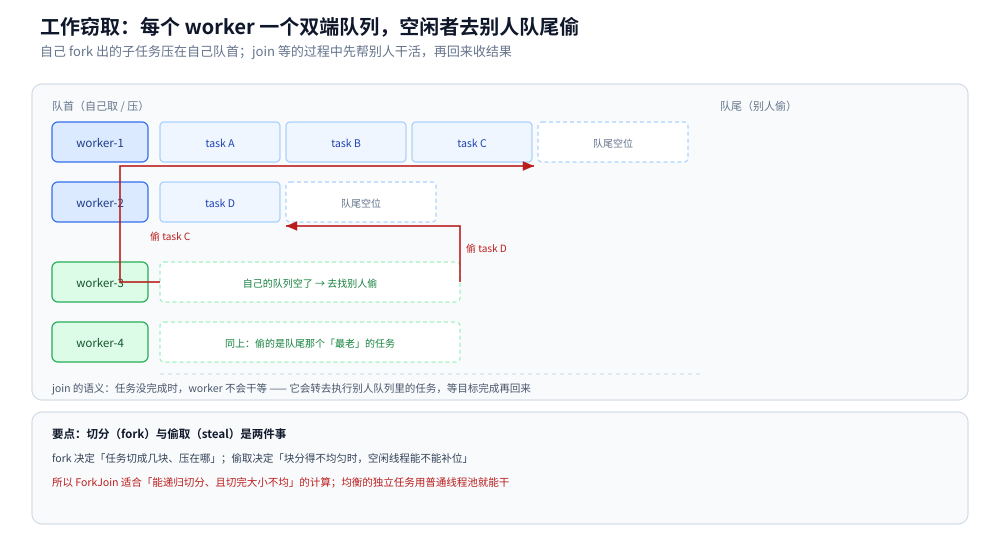
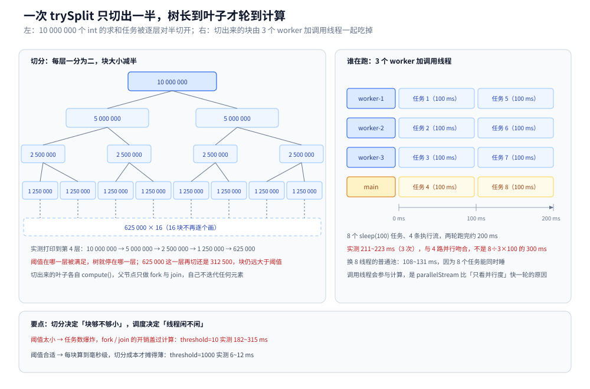
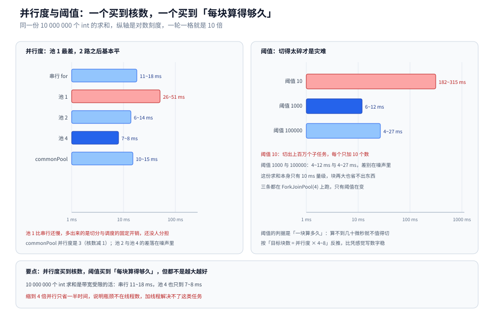

# ForkJoin 与并行流

> 覆盖：从零写一个 `RecursiveTask` 求和开始，讲清 fork / join / compute 各自做什么、双端队列为什么要分两端、`Spliterator` 怎么对半切、`parallelStream` 与 commonPool 的关系（含「并行度 = 核数 − 1」和「调用线程也参与」两处反直觉）、阈值与并行度的实测曲线、并行流最容易踩的四个坑，以及什么任务根本不该并行。
>
> 不覆盖：普通线程池的参数与拒绝策略见 [线程池.md](线程池.md)；`ForkJoinPool` 作为虚拟线程调度器那一面见 [虚拟线程.md](虚拟线程.md)；`parallelStream` 里累加要用 `LongAdder` 还是原子类见 [原子类与无锁.md](原子类与无锁.md)；`map` 类容器能不能并发写见 [并发容器.md](并发容器.md)；worker 大面积阻塞后怎么读转储见 [死锁与并发缺陷诊断.md](死锁与并发缺陷诊断.md)；`CompletableFuture` 的异步编排见 [CompletableFuture与异步编排.md](CompletableFuture与异步编排.md)。
>
> 内容整理自个人学习笔记，素材见 [素材清单](../../../素材清单.md)。
>
> 实测口径：容器 `java-lab`，`eclipse-temurin:24-jdk`（24.0.2+12，linux/amd64，4 CPU）。源码在 `.workbuddy/tmp/exp/java/fj/`：`FJ.java` 六组主实验、`FJE.java` 五组补充实验。耗时类读数全部连跑 3 轮给区间，`FJ.java` 的输出来自同一批 3 轮；`FJE.java` 的单次读数只用于确认机制（用到哪几条线程、特征位、异常类型、顺序），不做性能断言。⚠️ commonPool 内部 `externalPush` / `awaitJoin` 的具体调用链只读源码、未单独插桩验证。

---

## 一、从零：一个求和任务怎么被切成多份？

**本节要点**：ForkJoin 的全部内容就是三个东西——一个自己会分裂的任务、一个装着 worker 的池、一条「切到足够小就自己算」的出口。先写出能跑的最小版本，再谈机制。

### 1.1 二十行写出第一个 ForkJoin

拿 10 000 000 个 `int` 求和当例子：切成两半分别算，再把两个结果加起来。出口是「这一段的长度已经不超过阈值」——此时不再切，直接循环加完。

```java
import java.util.concurrent.*;

public class Quick {
    static final int N = 10_000_000;
    static final int[] DATA = new int[N];
    static { for (int i = 0; i < N; i++) DATA[i] = i % 7; }

    static class SumTask extends RecursiveTask<Long> {
        final int[] a; final int lo, hi; final int threshold;
        SumTask(int[] a, int lo, int hi, int threshold) {
            this.a = a; this.lo = lo; this.hi = hi; this.threshold = threshold;
        }
        @Override
        protected Long compute() {
            if (hi - lo <= threshold) {          // 出口：够小了，自己算
                long s = 0;
                for (int i = lo; i < hi; i++) s += a[i];
                return s;
            }
            int mid = (lo + hi) >>> 1;           // 对半切
            SumTask left = new SumTask(a, lo, mid, threshold);
            SumTask right = new SumTask(a, mid, hi, threshold);
            left.fork();                          // 左半边丢出去，可能被别人捡走
            long rs = right.compute();            // 右半边自己就地算
            return left.join() + rs;              // 等左半边：等的过程不闲着
        }
    }

    public static void main(String[] args) {
        var pool = new ForkJoinPool(4);
        try {
            System.out.println(pool.invoke(new SumTask(DATA, 0, N, 100_000)));
            System.out.println(ForkJoinPool.commonPool().getParallelism());
        } finally {
            pool.shutdown();
        }
    }
}
```

```text
commonPool parallelism = 3
```

第一行是被求出来的和，第二行是**这台 4 核机器上 commonPool 的并行度：3，不是 4**。这一条后面单独讲，它是并行流最容易估错的地方之一。

### 1.2 三个角色：任务、池、worker

| 角色 | 类 / 接口 | 职责 | 写错会怎样 |
|---|---|---|---|
| 任务 | `RecursiveTask<V>`（有返回值）、`RecursiveAction`（无）、`CountedCompleter`（回调式） | 在 `compute()` 里判断「切还是算」，切完负责 fork / join | 出口条件写错 → 无限递归，栈或堆先炸 |
| 池 | `ForkJoinPool` | 固定数量的 worker，每个 worker 有自己的双端队列 | 用 `new Thread` 自己起线程 → 享受不到偷取 |
| worker | `ForkJoinWorkerThread` | 循环：取自己队首 → 空了去别人队尾偷 | — |

三点容易忽略：

1. **池的线程数在构造时就定了**，不会因为任务多就扩容。任务再多也只是排队。
2. **`compute()` 里不要干阻塞的活**（IO、`sleep`、等锁）。一个 worker 被阻塞，等于少一条执行流；这一点和 [线程池.md](线程池.md) 的「池大小」是同一个道理，只是 ForkJoin 更敏感——它假设 worker 永远有活干。
3. **`fork()` 只负责「放进队列」**，不保证立刻有人执行；真正让它跑起来的是别的 worker 来偷，或者自己走到 `join()` 时顺手执行。

## 二、fork、join、compute 各做什么？

**本节要点**：`fork` 是**压进自己队列的队首**，`join` 在目标没完成时**不会干等**——它会转去执行别人的任务。这两条合起来，才解释得了「为什么任务分得不均匀也不怕」。

### 2.1 fork 压哪、join 等谁

`ForkJoinTask.fork()` 的语义是「异步提交给当前 worker」，具体动作是把任务压进**当前线程自己的双端队列**。因为在一棵递归树里，最后压进去的任务往往最晚被需要，所以它被放在队首，靠前的任务压在后面。

`join()` 的语义是「等这个任务算完，拿结果」。关键在「等」的实现：

- 目标已经完成 → 直接返回结果。
- 目标还没完成 → 当前 worker **先去执行别的任务**（先自己队列里的，再别人的），时不时回来看一眼目标有没有完成。
- 目标被别人偷走正在跑 → 也是帮别人干活并等它结束。

所以 `join()` 不是 `Thread.join()`，也不是 `Future.get()` 那种「挂起 + 唤醒」。它是「用干活来等待」，专业点的说法叫 work-helping。

这一条直接决定了任务树不必切得均匀：某一条分支特别慢时，其他 worker 不会站在旁边看，它们会去帮这条慢分支的子树。

### 2.2 队列为什么必须是双端

如果所有 worker 都从同一个队尾取、从同一个队头放，那队列本身就是一把锁，偷取要多花一次 CAS。所以每个 worker 一个队列，并且**两端分工**：



图里 worker-1 队列上从左到右是 task A、task B、task C，靠左是队首、靠右是队尾：自己 fork 出来的任务压在左边、自己取也从左边取，所以同一线程对队首的操作天然没有竞争；worker-3、worker-4 空了就往别人队尾伸手，偷到的是「最老、最大、还没被切过」的那个任务，偷一次能顶很久。这就是 `ForkJoinPool` 用数组加两个下标就能撑住高并发的原因——热路径是单线程的，只有偷取才需要 CAS。

## 三、Spliterator 是切分的抓手，它怎么切？

**本节要点**：`ForkJoin` 本身不关心「怎么切」，它只负责调度；真正决定切法的是 `Spliterator.trySplit()`，而并行流正是靠它把一条流切开。切得好不好，看三个特征位。

### 3.1 trySplit 一次只切一半

手写的 `SumTask` 里切法是自己定的（取中点）。并行流的切法由数据源的 `Spliterator` 决定，规则只有一条：**`trySplit()` 返回前半段，自己留下后半段**；切不动时返回 `null`。

把 10 000 000 个 `int` 的 spliterator 逐层切开，每层把队列里所有段都切一次：

```java
Spliterator.OfInt sp = Arrays.spliterator(DATA);
Deque<Spliterator.OfInt> q = new ArrayDeque<>();
q.add(sp);
for (int level = 0; level <= 4; level++) {
    int n = q.size();
    StringBuilder row = new StringBuilder("level " + level + "：" + n + " 段，每段 ");
    for (int i = 0; i < n; i++) {
        Spliterator.OfInt s = q.poll();
        if (i == 0) row.append(s.getExactSizeIfKnown());
        Spliterator.OfInt half = s.trySplit();
        if (half != null) { q.add(half); q.add(s); }
    }
    System.out.println(row);
}
```

```text
level 0：1 段，每段 10000000
level 1：2 段，每段 5000000
level 2：4 段，每段 2500000
level 3：8 段，每段 1250000
level 4：16 段，每段 625000
```

每切一次，段数翻倍、段长减半——这就是「分治」里的「分」，而这棵树的深度由阈值决定，不是由数据量决定。



左边这棵树说明：切到第 4 层是 16 段 625 000，再往下切还是 312 500——块仍然远大于阈值，树还会继续长。右边说明的是另一件事：这些块最终由 **3 个 worker 加调用线程 `main`** 四条执行流吃掉，8 个 `sleep(100)` 的任务实测 211~223 ms，正好两轮，而不是按「8 ÷ 3」算出来的 300 ms。

### 3.2 三个特征位决定「切得动还是切不动」

`Spliterator` 的特征位是一组位标记，其中最影响并行的三个：

| 特征位 | 含义 | 没有它会怎样 |
|---|---|---|
| `SIZED` | 能给出准确元素个数 | 切分时不知道切多少，`trySplit` 可能直接返回 `null`，整条流退化为串行 |
| `SUBSIZED` | 切出来的子段大小也准确 | 切完之后无法继续均分，只能一段段试 |
| `ORDERED` | 元素有遇到顺序 | 能不能用 `findFirst` / `forEachOrdered`，以及能否安全跳跃 |

实测一条「看起来很长」的流：

```java
Spliterator<Integer> iter = Stream.iterate(0, i -> i + 1).limit(100).spliterator();
System.out.println(iter.estimateSize() + " " + iter.hasCharacteristics(Spliterator.SIZED) + " " + iter.trySplit());
Spliterator<Integer> rng = IntStream.range(0, 100).boxed().spliterator();
System.out.println(rng.estimateSize() + " " + rng.hasCharacteristics(Spliterator.SIZED));
```

```text
iterate.limit(100)：estimateSize=9223372036854775807 SIZED=false trySplit=null
range(0,100)：estimateSize=100 SIZED=true SUBSIZED=true ORDERED=true
```

`iterate` 那条是无穷流的包装：`estimateSize` 是 `Long.MAX_VALUE`，`SIZED=false`，`trySplit` 直接 `null`。也就是说 `.parallel()` 写了也白写——只有主线程会跑。`range` 则是标准的可切分结构：大小已知、能均分、有顺序。

结论是**并行流快不快，一半取决于数据源**：`ArrayList`、数组、`IntStream.range` 这类索引可寻址的源切得干净；`LinkedList`、`Stream.iterate`、`BufferedReader.lines()` 这类只能顺序走一遍的源，切一次的开销常常超过它带来的收益。

## 四、并行流与 ForkJoinPool 是什么关系？

**本节要点**：`parallelStream()` 没有自己的线程池，它默认落在 `ForkJoinPool.commonPool()` 上；而这个池的并行度是「核数减 1」，且**调用线程也下场算**，所以实际并发才是核数。想换池，只能用「在目标池里提交一个任务」的写法。

### 4.1 默认落在 commonPool，并行度不是核数

```java
System.out.println(ForkJoinPool.commonPool().getParallelism());
System.out.println(ForkJoinPool.commonPool());
```

```text
3
java.util.concurrent.ForkJoinPool@7ad041f3[Running, parallelism = 3, size = 0, active = 0, running = 0, steals = 0, tasks = 0, submissions = 0]
```

4 核机器上 `parallelism = 3`，规矩是 `Math.max(1, availableProcessors - 1)`：留一个核给别的活（GC、主线程、其他池）。想看真实是谁在跑，就把线程名收上来：

```java
Set<String> names = ConcurrentHashMap.newKeySet();
IntStream.range(0, 8).parallel().forEach(i -> {
    names.add(Thread.currentThread().getName());
    sleep(100);
});
List<String> sorted = new ArrayList<>(names);
Collections.sort(sorted);
System.out.println(sorted.size() + " -> " + sorted);
```

```text
4 -> [ForkJoinPool.commonPool-worker-1, ForkJoinPool.commonPool-worker-2, ForkJoinPool.commonPool-worker-3, main]
```

三条 `commonPool-worker-*` 加一条 `main`。**`main` 之所以出现在里面，是因为并行流的终止操作在调用线程里执行，它自己当了一个 worker。** 所以「并行度 3」指的是池内 worker 数，实际参与计算的线程数是 4；这两个数在估算墙钟时都得算进去，只按 3 算会高估耗时。

### 4.2 同一批任务，换池换出三个读数

8 个各睡 100 ms 的任务，三种跑法：

| 跑法 | 线程数 | 实测（3 轮） | 为什么是这个数 |
|---|---|---|---|
| `IntStream.range(0, 8).parallel()` | 3 worker + main = 4 | 211~223 ms | 8 个任务分两轮，每轮 100 ms |
| 8 线程的 `newFixedThreadPool(8)` | 8 | 108~131 ms | 8 个同时睡，一轮就完 |
| 提交进 `ForkJoinPool(1)` 的并行流 | 1 | 810 ms | 串成 8 轮，一次只睡一个 |

第一行和第二行的差距（约 2 倍）不是「并行流比线程池慢」，而是**并行流能用的执行流只有 4 条**。这一点在阻塞型任务上尤其明显：`sleep` 期间 worker 什么也干不了，也就没法去偷别的任务，工作窃取在这类负载上等于不存在。

### 4.3 想指定池，只有一种写法

并行流没有「传入池」的参数，池是**从当前线程的环境里取**的：如果调用 `parallel()` 时的线程本身是某个 `ForkJoinPool` 的 worker，就用那个池；否则用 commonPool。所以指定池的办法是把自己塞进目标池：

```java
ForkJoinPool pool = new ForkJoinPool(4);
long sum = pool.submit(() ->
        IntStream.range(0, 8).parallel().map(i -> { sleep(100); return i; }).sum()
).join();
```

```text
ForkJoinPool(1) = 810 ms，用 1 条线程，sum=28
ForkJoinPool(4) = 202 ms，用 4 条线程，sum=28
```

同一个并行流，外面套一层 `submit` 就换了池，线程数从 1 变 4、耗时从 810 ms 变 202 ms。这条读数的另一个用途是**验证池真的生效了**：如果不管池设成几，耗时都一样，那就是池没生效——十有八九是 `parallel()` 写在了 `submit` 里层但终止操作跑到外面去了。

## 五、阈值与并行度各该取多少？

**本节要点**：这两个参数买的东西完全不同。**并行度买核数**（但边际收益掉得很快），**阈值买「每块算得够久」**（让切分成本摊薄）。两个都不是越大越好，而且都得用实测定。

### 5.1 阈值太小：切分本身成了主要开销

固定 `ForkJoinPool(4)`，只改阈值，同一份 10 000 000 个 `int` 求和：

| 阈值 | 切出的块数 | 实测（3 轮） | 读数说明 |
|---|---|---|---|
| 10 | 约 100 万 | 182~315 ms | 每块只加 10 个数，fork / join 的次数比加法还多 |
| 1 000 | 约 1 万 | 6~12 ms | 块内做 1000 次加法，切分成本被摊薄 |
| 100 000 | 100 | 4~27 ms | 再往上没有可切的余地，收益停在噪声里 |

阈值 10 的耗时是阈值 1000 的 20 倍以上——多出来的时间全是 `RecursiveTask` 对象的分配和队列操作，一个加法都没多算。这是分治并行最典型的自伤：**把「分」做到极致，却没有给「治」留下工作量**。

### 5.2 并行度：池 1 最差，2 路之后基本平

阈值固定 100 000，只改池大小：

| 跑法 | 实测（3 轮） |
|---|---|
| 串行 `for` | 11~18 ms |
| `ForkJoinPool(1)` | 26~51 ms |
| `ForkJoinPool(2)` | 6~14 ms |
| `ForkJoinPool(4)` | 7~8 ms |
| `commonPool`（并行度 3） | 10~15 ms |

三个结论，每个都值得记：

1. **池 1 比串行还慢**：同样的算法，多出来的 15~35 ms 就是切任务、压队列、join 的固定开销。并行从来不免费，人少的时候它是净亏损。
2. **2 路到 4 路几乎没差别**：4 核跑这份求和只比 2 路快 1~6 ms。原因是这个任务是内存带宽受限——四个核抢同一条内存总线，加核不等于加带宽。
3. **commonPool 比 `ForkJoinPool(4)` 慢一点**（10~15 对 7~8 ms）：它的 worker 只有 3 条，加上调用线程才凑够 4 条，而且 `main` 还要负责 join 收尾。



两张图都是对数刻度，这一点必须注意：左图里池 1（26~51 ms）和池 4（7~8 ms）看起来只差一格多，实际是 3~6 倍；右图阈值 10 那一根（182~315 ms）比另外两根长出一大截，而 1000 与 100000 的差别（6~12 与 4~27 ms）在重复运行下会正反颠倒，不能当归结。

### 5.3 阈值怎么估，不靠感觉

一个够用的经验式：

```text
目标块数 ≈ 并行度 × 4~8      // 多切几块，让偷取有余量
阈值     ≈ 总元素数 ÷ 目标块数
单块耗时 ≈ 阈值 × 每个元素的操作开销
```

判据是最后一行：**单块算不到几十微秒，切分就没有意义**。10 000 000 个 `int` 求和、4 路、每块 100 000 时，单块大约 100 微秒量级，正好卡在「值得切」的边界上——这也解释了为什么阈值 1000 和 100000 拉不开差距：两者都在「块太小」的反面，收益已经饱和。

## 六、并行流最容易踩的四个坑

**本节要点**：并行流的坑不在 API，在**并发语义**——它把「一段顺序代码」变成了「多线程同时跑这段代码」，而原来的代码是按单线程写的。四个坑分别是非原子累加、顺序、异常、阻塞。

### 6.1 非原子累加：结果不对，且不报错

```java
for (int round = 1; round <= 2; round++) {
    int[] c = {0};
    IntStream.range(0, 100_000).parallel().forEach(i -> c[0]++);
    System.out.println("第 " + round + " 轮：期望 100000 ｜ 实际 " + c[0]);
}
```

```text
第 1 轮：期望 100000 ｜ 实际 37788
第 2 轮：期望 100000 ｜ 实际 38978
```

连跑 6 轮的实际值：37 788、38 978、65 144、68 231、91 786、100 000。**最后一轮一次都没丢**——这才是最坑的地方：它不是「必错」，是「偶错」，小数据量或机器空闲时可能一直看不出问题，上线到多核高负载才暴露。

`c[0]++` 是「读 → 加 → 写」三步，两条线程同时读到 5、都写回 6，就有一次更新消失。修法按场景选：计数用 `LongAdder`（分段累加，见 [原子类与无锁.md](原子类与无锁.md)），求和使用 `mapToLong(...).sum()` 这类**归约**操作，需要精确保留结构时用 `collect(Collectors.toConcurrentMap(...))`，或者干脆退回串行。

### 6.2 顺序：`forEach` 不保证，`forEachOrdered` 保证

```text
第 1 轮 forEach=[5, 4, 7, 6, 2, 3, 1, 0] ｜ forEachOrdered=[0, 1, 2, 3, 4, 5, 6, 7]
第 2 轮 forEach=[5, 4, 7, 6, 2, 3, 0, 1] ｜ forEachOrdered=[0, 1, 2, 3, 4, 5, 6, 7]
```

`forEach` 的输出顺序取决于哪个任务先算完，两轮都不一样；`forEachOrdered` 每轮都是 0 到 7。代价是后者需要在归并时按原顺序重排，并行度越高、这个收尾越贵。日常用法上分两类：**只写不读顺序的地方**（打监控、发消息、写文件分片）用 `forEach`；**下游依赖顺序的地方**（拼字符串、按序落盘）要么用 `forEachOrdered`，要么用 `collect` 里的保序容器。

顺带一句：`findFirst()` 在并行流上也是保序的（拿到的是原有顺序里的第一个），它比「取任意一个」的 `findAny()` 更贵——不需要顺序时用 `findAny()`。

### 6.3 异常：会抛，但只抛一个

```text
抛出类型 = java.lang.IllegalStateException，消息 = java.lang.IllegalStateException: boom at 42
```

并行流里某个任务抛异常时，异常会被包装成 `CompletionException` 或用原类型抛到终止操作的调用方，**其他分支的异常会被丢弃**，只留下最先被发现的那个。所以排查时看到的是一个异常，但真实故障点可能有多处；日志里一定要带元素标识（比如上面消息里的 `at 42`），否则不知道是哪一块炸的。

### 6.4 阻塞：`parallelStream` 里做 IO 等于自废武功

第 4.2 节那三行读数已经说明：8 个 `sleep(100)` 走 `parallelStream` 要 211~223 ms，而 8 线程池只要 108~131 ms。原因是 worker 被阻塞时无法偷取任务，整套调度假设失效。

反过来说，**并行流只适合纯 CPU 计算**。要并发做 IO（调下游、读文件），正确工具是 `CompletableFuture` 加专门的 IO 线程池，或者虚拟线程（见 [虚拟线程.md](虚拟线程.md)、[CompletableFuture与异步编排.md](CompletableFuture与异步编排.md)）。把阻塞任务塞进 commonPool 还有个额外后果：commonPool 是**全 JVM 共享**的，你的阻塞会把别人的并行流一起拖慢。

## 七、什么时候不该用并行流？

**本节要点**：判据只有一条——**这段计算的耗时是不是主要花在 CPU 上，且能被独立地切开**。不满足就退回串行，串行的 11~18 ms 往往比并行加调度还快。

| 场景 | 该不该并行 | 原因 |
|---|---|---|
| 大数组 / `ArrayList` 上的数值计算、统计、排序 | 该 | 索引可寻址，切得干净，无共享状态 |
| 元素只有几百个、每项只做一次简单运算 | 不该 | 切分与合并的固定开销大于计算本身（池 1 的 26~51 ms 就是这笔账） |
| 需要累加到同一个变量 / 同一个集合 | 不该（除非换成归约） | 见 6.1，非原子更新会静默丢数据 |
| 每项要调一次下游接口、查一次库 | 不该 | 阻塞型，worker 被卡住，见 6.4 |
| 结果顺序有意义，下游依赖顺序 | 谨慎 | 得用 `forEachOrdered` / 保序 `collect`，收尾成本随并行度上升 |
| 数据源是 `LinkedList`、`Stream.iterate`、`BufferedReader.lines()` | 不该 | 特征位不全，`trySplit` 切不动（见 3.2） |
| 计算里有 `synchronized` / 共享 `HashMap` 写 | 不该 | 并行度被锁串行化，还可能死锁 |

一个务实的流程是：**先写串行版本，量出耗时；大于 10 ms 且满足上表第一行，再考虑并行；并行后必须与串行结果逐值比对**（并行流的正确性验证不能只看「跑通了」）。

## 八、应用场景

**本节要点**：ForkJoin 的落点几乎都在 JDK 与框架内部；业务代码真正会用到的只有「批量加工」与「排序、归约」两种形态，其余场景该用线程池或虚拟线程。

| 场景 | 具体落点 | 说明 |
|---|---|---|
| 排序 | JDK 的 `Arrays.parallelSort` | 归并 + ForkJoin：切成小段各自排序，再两两归并；阈值控制「多小就不再切、改用插入排序」 |
| 集合批量加工 | `list.parallelStream().map(...).collect(...)` | 数据源是 `ArrayList` / 数组时切分最干净；结果容器必须用并发容器或 `collect` 归约 |
| 大数据计算引擎 | Spark 的 task、Flink 的 subtask | 同一套思想（切分 → 分发 → 归约），但跨进程、带序列化与网络，不能直接套用本文读数 |
| 递归型算法 | 归并排序、快速排序、矩阵乘、树的遍历求和 | 天生可分治，`RecursiveTask` 就是为这类结构写的 |
| 图像 / 音频分块处理 | 按行或按块切分像素 | 每块独立、无共享状态，典型的带宽与计算混合负载，要先量再调 |
| 本项目内 | [线程池.md](线程池.md) 的池选型对照 | 普通池管「独立任务并发」，ForkJoin 管「一个任务递归地切开」，两者别混用 |

## 九、具体使用

**本节要点**：三种写法覆盖绝大多数需求——手写递归任务（可控但啰嗦）、并行流（最短但要防四个坑）、以及「在指定池里跑并行流」（隔离 commonPool）。先给模板，再给改造步骤。

### 9.1 手写递归任务：模板与两个易错点

```java
static class MaxTask extends RecursiveTask<Integer> {
    private static final int THRESHOLD = 10_000;
    private final int[] a; private final int lo, hi;

    MaxTask(int[] a, int lo, int hi) { this.a = a; this.lo = lo; this.hi = hi; }

    @Override
    protected Integer compute() {
        if (hi - lo <= THRESHOLD) {
            int m = Integer.MIN_VALUE;
            for (int i = lo; i < hi; i++) m = Math.max(m, a[i]);
            return m;
        }
        int mid = (lo + hi) >>> 1;
        MaxTask left = new MaxTask(a, lo, mid);
        MaxTask right = new MaxTask(a, mid, hi);
        left.fork();
        int r = right.compute();
        int l = left.join();
        return Math.max(l, r);
    }
}
```

两个易错点：

- **`fork()` 之后必须有人 `join()`**。只 fork 不 join，结果会缺一半，而且不报错。反过来，成对 fork 两个再 join 两个（`left.fork(); right.fork(); left.join(); right.join();`）也能跑，但当前线程在两次 fork 之间没干活，等于浪费了一条执行流——所以惯例是「fork 一个、就地算另一个」。
- **阈值要选成「块内循环能占满一次调度的时间」**。`THRESHOLD = 10_000` 对数组求最大值差不多是 10 微秒级，属于偏小；如果每块只有几十纳秒，就该往上调（见 5.1 的 20 倍差距）。

### 9.2 并行流改造三步

把一段串行循环改成并行流，只有三步，每步都有对应的验证手段：

| 步骤 | 动作 | 怎么验证 |
|---|---|---|
| 1. 换源 | 确认数据源是数组、`ArrayList`、`IntStream.range` 这类可切分结构 | 打印 `spliterator().hasCharacteristics(SIZED)` 与 `trySplit()` 是否为 `null` |
| 2. 换终止操作 | 累加改成 `sum()` / `reduce()` / `collect()`，不要碰共享变量 | 与串行版本逐值比对，连跑多轮（6.1 的偶错就是靠多轮暴露的） |
| 3. 定池 | 默认 commonPool；有阻塞或想隔离就用 4.3 的 `submit` 写法 | 打印线程名集合，确认用了哪个池、几条线程 |

一个完整的写法（按分区求和，结果顺序无关但要用 `sum()` 归约）：

```java
long total = IntStream.range(0, N).parallel()
        .mapToLong(i -> DATA[i] % 7)
        .sum();
System.out.println(total);   // 29999994，与串行结果逐值比对
```

### 9.3 隔离 commonPool

commonPool 是全 JVM 共享的。业务里有阻塞操作、或者不能被别的模块拖慢时，应该自建池：

```java
try (ForkJoinPool pool = new ForkJoinPool(4)) {          // JDK 19+ 可直接 try-with-resources
    long sum = pool.submit(() -> IntStream.range(0, 8).parallel()
            .map(i -> { sleep(100); return i; }).sum()).join();
    System.out.println(sum);
}
```

两点提醒：

- `ExecutorService` 自 JDK 19 起继承 `AutoCloseable`，所以 JDK 19 之后才能这么写；更早的版本要 `finally { pool.shutdown(); }`。本篇的 `FJ.java` 用的是 `shutdown()` 写法，在两个版本上都成立。
- `shutdown()` **不会打断正在跑的任务**，它只是不再接受新任务；要等结果就 `join()` 或 `awaitTermination()`。这一点与 [线程池.md](线程池.md) 的关闭语义完全一致。

## 延伸追问

- **`ForkJoinPool` 和普通 `ThreadPoolExecutor` 到底差在哪？** → 差在队列模型与调度假设：普通池是一个共享队列，线程取一个任务干完再取；ForkJoin 是每线程一个双端队列，自己取队首、别人偷队尾。前者适合独立任务，后者适合「一个任务递归切开、子任务有依赖（父任务等子任务）」。`ThreadPoolExecutor` 里父任务等子任务会占着线程死等，ForkJoin 里等的同时会去帮别人干活。
- **为什么 commonPool 的并行度是核数减 1，而不是核数？** → 留一条给调用线程自己下场（第 4.1 节实测线程名里有 `main`），以及留给 GC、其他池。合起来正好吃满核数。想改可以用系统属性 `java.util.concurrent.ForkJoinPool.common.parallelism`，但它影响全 JVM 所有并行流，生产上一般不改。
- **`invokeAll(left, right)` 和 `fork()` + `compute()` 有什么区别？** → `invokeAll` 会把两个任务都压进队列再等，当前线程在等的时候会去帮别人干活；而 `left.fork()` 之后紧接着 `right.compute()` 是让当前线程**确定**执行右半边，少一次压队列再取出的往返。后者更快，但要求「右半边可以就地算」——也就是 `compute()` 里能直接调用。
- **并行流里能再开并行流吗？** → 能，但用的是同一个池。如果外层已经把池占满，内层任务只能排队，极端情况会互相等到死。⚠️ 这一条是读源码得出的结论，本篇没做死锁复现实验；工程上的做法是不要在并行任务里再开并行流。
- **为什么 `parallelSort` 好像没有阈值问题？** → 它有阈值，只是藏在实现里（小分段退化为插入排序）。JDK 的做法是「切到一定粒度后不再分治，改走低开销的串行算法」——这正是 5.3 那条判据的工业版。
- **`parallelStream` 里的 `ThreadLocal` 还能用吗？** → 能用，但语义变了：每个 worker 线程有自己的那份，同一个 ThreadLocal 在 4 条执行流里可能有 4 个值。跨任务传递上下文要用显式参数或包装对象，见 [ThreadLocal与上下文传递.md](ThreadLocal与上下文传递.md)。
- **归约操作为什么不怕丢更新？** → `sum()` / `reduce()` 走的是「每个任务算局部结果，再把局部结果按树形合并」，合并发生在 `join()` 之后、单线程里；它不使用共享可变变量，所以没有竞态。这就是 6.1 的修法里「换成归约」这一条能成立的原因。
- **`ForkJoinPool` 的 worker 是守护线程还是用户线程？** → 是守护线程（`ForkJoinWorkerThread` 默认 daemon），所以主线程退出后池里没跑完的任务会一起消失；`shutdown()` + `awaitTermination()` 是拿到结果的正确姿势。

## 关联

- **上游/总纲**：[README.md](README.md) — 并发编程 13 篇的分工表与主线读序（本篇位次 ⑩；两条主线的入口与横切表在 [java/README.md](../README.md)）
- **对照/互补**：[线程池.md](线程池.md) — 独立任务的并发用普通池，一个任务递归切开用 ForkJoin，两套队列模型的对照
- **对照/互补**：[虚拟线程.md](虚拟线程.md) — `ForkJoinPool` 同时是虚拟线程的调度器，本篇讲它作为计算池的那一面
- **下游机制**：[原子类与无锁.md](原子类与无锁.md) — 6.1 里累加丢更新的正确修法（`LongAdder` 的分段思路与偷取异曲同工）
- **下游机制**：[并发容器.md](并发容器.md) — 并行流结果收集时，容器该选哪一个
- **运维/排查**：[死锁与并发缺陷诊断.md](死锁与并发缺陷诊断.md) — worker 全被阻塞后，转储里长什么样
- **对照/互补**：[JIT与执行引擎.md](../运行时/JIT与执行引擎.md) — 阈值偏小时热点方法会被内联与逃逸分析改写，读数里含这层优化
- **对照/互补**：[Stream流实战.md](../Stream流实战.md) — 流的惰性求值、短路与收集器的用法，本篇只讲并行那一半
> 反向引用（本篇被下列文档引到）：[CompletableFuture与异步编排.md](CompletableFuture与异步编排.md)
