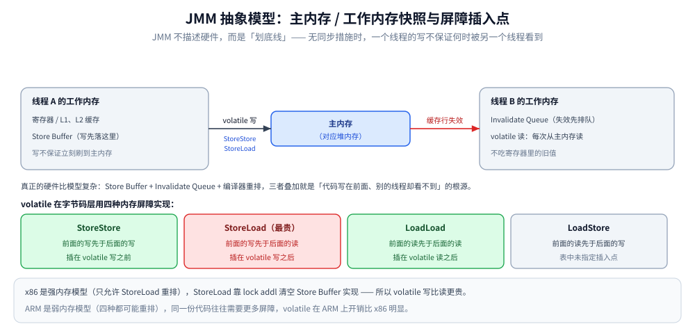
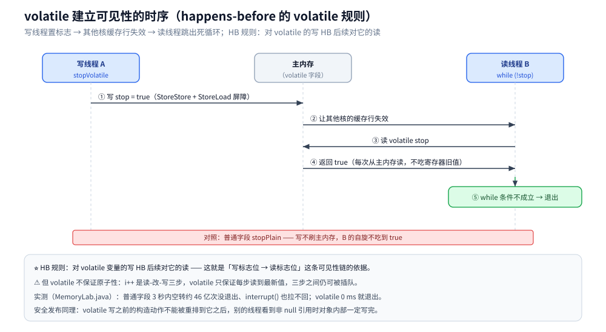
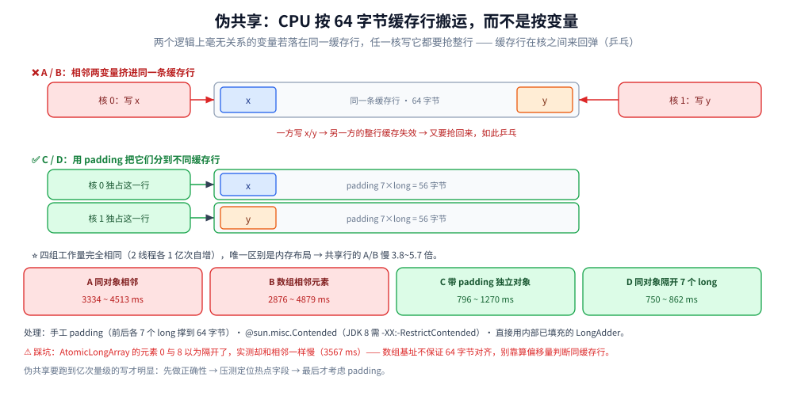
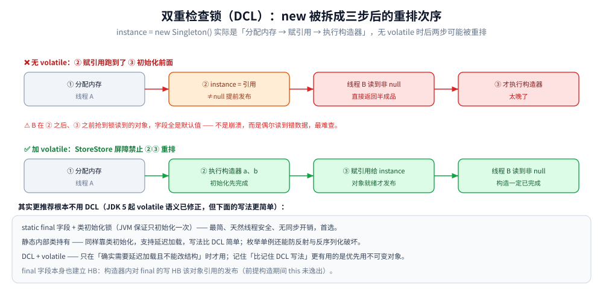

# JMM 与内存屏障

> Java 内存模型规定了什么、`happens-before` 八条规则、`volatile` 到底保证哪些性质（可见性与有序性的**正面实测**）、
> 内存屏障与 CPU 缓存行（**伪共享实测：同缓存行组慢 1.2~5.7 倍，倍数随轮次波动**）、以及安全发布与双重检查锁。
>
> 不覆盖：锁的语义与 AQS 的实现见 [锁与AQS.md](锁与AQS.md)（那里 `volatile++` 丢 2/3 更新是本篇「不保证原子性」的反面证据）；
> 线程池的交接语义见 [线程池.md](线程池.md)；`ConcurrentHashMap` 怎么用这套原语见 [并发容器.md](并发容器.md)；
> 原子类的 API 与 CAS 的代价见 [原子类与无锁.md](原子类与无锁.md)。
>
> 内容整理自个人学习笔记，素材见 [素材清单](../../../素材清单.md)。**结论配套两套实测坐标**：
> JDK 1.8.0_321（Windows / 8 核）与 Temurin 24.0.2+12（Linux 容器 / 4 vCPU），实验源码 `.workbuddy/tmp/juc_lab/MemoryLab.java`。
> 实验 1（可见性）与实验 3（安全发布）在两套坐标下结论一致；实验 2（伪共享）的放大倍数在容器里**单轮波动较大**，
> 见 5.2 的两组读数 —— ⚠️ 引用倍数时请带上「同缓存行组会更慢」这个方向，而不是某个具体倍数。

---

## 一、从零：一个线程改了变量，另一个线程什么时候能看到？

**本节要点**：并发里最难查的一类 bug 不是崩溃，而是「**写过了、对方一直没看到**」；这一节用一个 20 行的程序把它复现出来，再说明为什么它不是「顺手加个 `volatile` 就行」的问题。

### 1.1 让标志位失效 3 秒

```java
static boolean stop = false;                       // 先不加 volatile

public static void main(String[] args) throws Exception {
    Thread reader = new Thread(() -> {
        long n = 0;
        while (!stop) { n++; }                     // 纯自旋：不 sleep、不检查中断
        System.out.println("看到 stop，自旋 " + n + " 次后退出");
    });
    reader.setDaemon(true);                        // 纯自旋不响应 interrupt，只能靠 daemon 收尾
    reader.start();
    Thread.sleep(300);                             // 给 JIT 时间把循环优化起来
    stop = true;                                   // 写线程：置 true
    reader.join(3000);
    System.out.println("3 秒内退出？" + !reader.isAlive());
}
```

`MemoryLab.java` 实验 1 在两套坐标下的读数：

```text
# JDK 1.8.0_321（Windows / 8 核）
  普通字段 ：❌ 3 秒内未退出（interrupt() 也拉不回来；标志位写完后它又空转了 4602513854 次）
  volatile ：✅ 0 ms 后退出（退出前自旋 8255314 次）

# Temurin 24.0.2（容器 / 4 vCPU）
  普通字段 ：❌ 3 秒内未退出（interrupt() 也拉不回来；标志位写完后它又空转了 3276050717 次）
  volatile ：✅ 0 ms 后退出（退出前自旋 4962657 次）
```

⭐ `stop = true` **确实执行了**，可读线程又空转了 32~46 亿次，始终没看到 —— JIT 把这个读提升到了寄存器，循环里再也不回内存取；改成 `volatile` 后 0 ms 就退出。同一个结论跨了 16 个 JDK 版本，说明它来自语义，不是某个版本的行为。

### 1.2 「没看到」的三层来源

| 层级 | 干了什么 | 谁能拦住 |
|---|---|---|
| 编译器 / JIT | 把循环内的读提到寄存器，或把不相干的语句提前 / 延后 | `volatile` 读与写 |
| Store Buffer | 写先落在核私有的缓冲区，不立刻对其他核可见 | `StoreLoad` 屏障 |
| Invalidate Queue | 别的核发来的「你这一行失效了」先排队，不立刻处理 | 屏障 + 之后的那次读 |

⭐ 三层是**叠加**的：即使 CPU 不重排，编译器也可能先动；即使两者都不动，缓冲区也让写「晚到」。JMM 的全部价值，就是把这三层的不确定性收敛成一句可判断的话 —— **这两个线程之间有没有 happens-before 关系**（第三节）。模型与屏障的插入点见 2.1 的图。

### 1.3 三个反直觉点

- **`interrupt()` 停不下一个自旋循环**：它只让响应中断的操作抛异常，`while (!flag)` 压根不检查中断标志（1.1 的现象）；
- **`volatile` 不保证原子性**：`volatile int i; i++` 照样丢更新（[锁与AQS.md](锁与AQS.md) 第三节有 4 线程丢 2/3 的读数）；
- **只改内存布局、不改逻辑，性能差数倍**：两个无关变量落在同一条 64 字节缓存行上就会互相抢（5.2 实测）。

---

## 二、JMM 规定了什么？

**本节要点**：JMM 是一份**规范**，不是硬件。它回答的是一个问题：「一个线程改了变量，另一个线程什么时候必须能看到」。理解它的关键是分清**它承诺的**与**它没承诺的**。

### 2.1 抽象模型：主内存 + 工作内存

JMM 定义了一套抽象（不是真实的硬件结构）：

| JMM 概念 | 真实对应物 |
|---|---|
| 主内存（Main Memory） | 堆内存 |
| 工作内存（Working Memory） | CPU 寄存器 + L1/L2 缓存 + 写缓冲区（Store Buffer） |
| 线程与工作内存一一对应 | 一个线程可能在不同核之间迁移 |
| `read / load / use / assign / store / write` | 缓存行在核之间搬运、Store Buffer 延迟写入 |

⭐ **关键认知**：真正的硬件比模型更复杂 —— 有 **Store Buffer**（写先落在缓冲区，不立刻刷到缓存）、**Invalidate Queue**（失效消息先排队，不立刻处理）、以及**编译器重排**。这三样加起来，就是「明明代码里写在前面的语句，别的线程却看不到 / 看到的顺序不一样」的根源。

**所以 JMM 的真正作用**：它不是描述硬件，而是**划出底线** —— 告诉你能依赖什么、不能依赖什么。它明确说了：**没有同步措施时，一个线程的写不保证何时（甚至是否）被另一个线程看到。**



图里最该盯住的是读侧那一步：工作内存里存的只是缓存行副本，普通字段的读可以直接复用寄存器或旧副本，只有 `volatile` 读才强制重新取；四种屏障插在哪，决定了哪些重排被挡住。

### 2.2 实测：不保证，就是不保证

```java
static volatile boolean stopVolatile = false;
static boolean stopPlain = false;          // 没有 volatile
```

写线程 `sleep(300ms)` 后把标志位置 `true`，读线程在 `while (!flag)` 上自旋（`MemoryLab.java` 实验 1，跑 3 次结果一致）：

```text
== 实验 1：普通字段 vs volatile 字段的可见性 ==
  普通字段 ：❌ 3 秒内未退出（interrupt() 也拉不回来；标志位写完后它又空转了 4602513854 次）→ 写线程改了、读线程一直没看到
  volatile ：✅ 0 ms 后退出（退出前自旋 8255314 次）
```

⭐ 这是**教科书级的可见性问题复现**：写线程把 `stopPlain = true` 执行了，但读线程 3 秒内又空转了 **45~46 亿次**，始终没看到这个改动（JIT 把 `stopPlain` 的读提升到了寄存器，循环里再也不去内存读）。换成 `volatile` 后，`0 ms` 就退出了。

⚠️ **顺带一个实测发现**：`reader.interrupt()` 对那个卡住的读线程**无效**。因为 `interrupt()` 只能让**响应中断的操作**（`sleep` / `wait` / 阻塞 IO / 可中断锁）抛出 `InterruptedException`，而它只是个纯自旋的 `while (!flag)` 循环 —— **根本不检查中断标志**。要让 JVM 正常退出只能把它设为 daemon 线程。**这也是「不要用 `interrupt` 去停一个死循环」的实证。**

### 2.3 顺带纠正一个常见误解

> 「加了 `volatile` 就不会有并发问题了」——错。

`volatile` 保证的是**可见性**与**有序性**，**不保证原子性**。`volatile int i; i++` 是「读-改-写」三步，`volatile` 不阻止别线程插在中间。这一点在 [锁与AQS.md](锁与AQS.md) 第三节有硬数据：4 线程各加 50 万次，最终只数到 65 万左右（**丢约 2/3**）。

---

## 三、`happens-before` 讲了什么？

**本节要点**：八条规则里，日常真正用到的是**四条**。它的价值在于：把「我要不要加 `volatile`」变成「**我和另一个线程之间有没有建立 HB 关系**」这个可判断的问题。

### 3.1 规则清单（记这四条就够日常用）

| 规则 | 含义 | 日常形态 |
|---|---|---|
| **程序顺序** | 同一线程内，前面的操作 HB 后面的 | 单线程不用管任何同步 |
| **`volatile` 变量规则** | 对 `volatile` 的**写** HB 后续对它的**读** | 「写标志位 → 读标志位」 |
| **监视器锁规则** | 解锁 HB 后续对同一把锁的加锁 | `synchronized` / `ReentrantLock` |
| **线程启动 / 终止** | `start()` HB 线程内第一个动作；线程内所有操作 HB `join()` 返回 | 用 `join()` 拿子线程结果不需要额外同步 |
| 传递性 | A HB B，B HB C ⇒ A HB C | 上面几条可以串起来用 |
| `interrupt` | 中断 HB 被中断线程检测到中断 | — |
| 对象终结 | 构造完成 HB `finalize()` | 已废弃，忽略 |
| `final` 字段 | 构造器内对 `final` 的写 HB 该对象引用的发布 | 不可变对象的安全发布 |

⭐ **判据**：要判断「两个线程之间有没有可见性保证」，就找这两个线程之间**有没有一条 HB 链**。有 → 前面的写对后面可见；没有 → 什么都别假设。

### 3.2 一个容易忽略的点：HB 不是「时间先后」

`happens-before` 是**偏序关系**，不是时间顺序。两条操作之间**没有 HB 关系**时，它们就是「并发」的 —— 谁先谁后不确定，甚至「看起来像是先发生的那个」也可能是错觉。**所以「我这两句代码写了先后顺序，所以…… 」这种推理只在单线程内成立。**

---

## 四、`volatile` 到底保证什么、不保证什么？

**本节要点**：一句话 —— **保证可见性与有序性，不保证原子性**。下面把三者拆开验证。

### 4.1 保证一：可见性（2.2 已实测）

写 `volatile` 变量会**立即刷到主内存并让其他核的缓存行失效**；读 `volatile` 每次都**从主内存（或最新缓存）读**，不吃寄存器里的旧值。



顺着箭头读时序：写线程先改本地副本，`volatile` 写把它刷到主内存并让其他核的缓存行失效，读线程下一次 `volatile` 读才拿得到新值 —— 普通字段缺的正是「失效」这一步，所以它可以无限期停在旧副本上。

### 4.2 保证二：有序性（禁止特定重排）

`volatile` 写之前的操作**不能**被重排到它之后，`volatile` 读之后的操作**不能**被重排到它之前。这正是「安全发布」成立的基础（见第六节）。

⚠️ 注意方向：它只**单向**约束 —— `volatile` 写之前的不能往后挪，但**读之后的**可以。两条 `volatile` 之间（写后读）也不保证不重排。**所以别把 `volatile` 当成万能的屏障，它只在标量语义上给出了保证。**

### 4.3 不保证：原子性

`i++` 是三条操作。`volatile` 让每一步都读到最新值，但**三步之间依然可以被别的线程插入** → 丢更新。

**要原子就用 `AtomicInteger` / `LongAdder`，或者加锁。** 三者的取舍见 [锁与AQS.md](锁与AQS.md) 第五节。

### 4.4 `volatile` 与 `synchronized` 的性能差异从哪来

| | `volatile` | `synchronized` |
|---|---|---|
| 无竞争 | 一次内存屏障（约几条指令），无系统调用 | 轻量级锁（JDK 8 之前先进偏向锁），一次 CAS |
| 有竞争 | **不会阻塞**，各线程继续跑（但会丢更新，因为是读-改-写） | 线程 park，进 `_EntryList`，**涉及内核态** |

⚠️ 所以「`volatile` 比锁快」这个说法只在**单次读或单次写**的语义下成立。需要「读-改-写」原子时，`volatile` 根本不解决问题，快也没用。

---

## 五、内存屏障与伪共享

**本节要点**：`volatile` 在字节码层是通过**内存屏障**实现的，而屏障之所以必要，是因为 CPU 按**缓存行**（通常 64 字节）而不是按变量来搬运数据。这一节用实测把「缓存行」这个抽象概念变成一个能看见的性能差。

### 5.1 四种屏障

| 屏障 | 作用 | 典型插入点 |
|---|---|---|
| `LoadLoad` | 前面的读先于后面的读 | `volatile` 读之后 |
| `StoreStore` | 前面的写先于后面的写 | `volatile` 写之前 |
| `LoadStore` | 前面的读先于后面的写 | — |
| **`StoreLoad`** | 前面的写先于后面的读 | `volatile` 写之后 |

⭐ **`StoreLoad` 是最贵的一种**（x86 上用 `lock addl` 实现，会清空 Store Buffer）。「`volatile` 写比 `volatile` 读更贵」的原因就在这里。x86 本身是**强内存模型**（只允许 StoreLoad 重排），ARM 是弱内存模型（四种都可能重排）—— 所以同一份代码在 ARM 上往往需要更多屏障，这也是为什么 `volatile` 在 ARM 上的开销比 x86 明显。

### 5.2 实测：伪共享（False Sharing）

CPU 按缓存行加载，两个**逻辑上毫无关系**的变量若落在同一个缓存行里，任一核写它都要把整行「抢」过来 → **缓存行在核之间来回弹（乒乓）**。

对比四组：A 同一个对象里相邻的两个 `volatile long`、B 数组里相邻的两个元素、C 两个各自带 padding 的独立对象、D 同一个对象里被 7 个 `long` 隔开的两个字段（`MemoryLab.java` 实验 2，2 线程各写 1 亿次）：

```text
  第 1 轮  A 同对象相邻字段 3578.0 ms | B 数组相邻元素 4431.0 ms | C 独立 padding 对象  895.0 ms | D 同对象内隔开  829.0 ms
         → 共享缓存行的 A/B 相对隔离后最快组的倍数：4.32× / 5.34×
  第 2 轮  A 同对象相邻字段 3334.0 ms | B 数组相邻元素 2876.0 ms | C 独立 padding 对象 1067.0 ms | D 同对象内隔开  765.0 ms
         → 共享缓存行的 A/B 相对隔离后最快组的倍数：4.36× / 3.76×
```

三轮运行的汇总：

| 组 | 布局 | 耗时范围 |
|---|---|---|
| A | 同一对象内相邻的两个 `volatile long` | 3334 ~ 4513 ms |
| B | 数组里相邻的两个元素 | 2876 ~ 4879 ms |
| C | 两个各自带 padding 的独立对象 | 796 ~ 1270 ms |
| D | 同一对象内被 7 个 `long` 隔开 | 750 ~ 862 ms |

⭐ **共享缓存行的 A/B 比隔离后的 C/D 慢约 3.8 ~ 5.7 倍**，而**四个组做的工作量完全一样**（都是 2 线程各 1 亿次自增）。**唯一的区别是内存布局。** 这就是伪共享：两个线程改的是不同变量、逻辑上零共享，性能却掉了数倍。

同一份实验在容器（Temurin 24.0.2 / 4 vCPU）上重跑 2 轮，**倍数明显不稳**：

```text
  第 1 轮  A 同对象相邻字段 4050.0 ms | B 数组相邻元素 2840.0 ms | C 独立 padding 对象 1204.0 ms | D 同对象内隔开  956.0 ms
         → 共享缓存行的 A/B 相对隔离后最快组的倍数：4.24× / 2.97×
  第 2 轮  A 同对象相邻字段 1220.0 ms | B 数组相邻元素 4402.0 ms | C 独立 padding 对象  997.0 ms | D 同对象内隔开 1234.0 ms
         → 共享缓存行的 A/B 相对隔离后最快组的倍数：1.22× / 4.42×
```

⚠️ 第 2 轮的 A 组（1220 ms）几乎与隔离组的 D（1234 ms）持平 —— **共享缓存行的劣化不是每一轮都必然放大**，它取决于这一轮两个核是否恰好被调度到真正并发写。
所以引用时只能说**「同一缓存行的组会更慢，最多可差 5 倍上下」这个方向**，不能把某个倍数当成常数；要证明自己遇到了伪共享，靠的是「加 padding 前后对比」的成对实验（5.3），而不是单轮读数。



四组里 A、B 共享缓存行，C、D 是 padding 隔离后的对照组，工作量完全一致；要读的是 A+C 与 B+D 的成对差距，而不是某个绝对耗时 —— 这正是 5.3 判伪共享必须做成对实验的原因。

### 5.3 怎么处理

| 手段 | 说明 |
|---|---|
| **手工 padding** | 在热点字段前后各填 7 个 `long`（56 字节），保证跨 64 字节边界。上面 D 组就是这么做的 |
| `@sun.misc.Contended` | JDK 8 提供，需要 `-XX:-RestrictContended` 才在用户类上生效；JDK 9+ 需 `--add-exports` |
| 用 JDK 自带的 `LongAdder` | 它内部已经做了 `@Contended` 的 `Cell` 填充，**计数场景直接用它就是最省事的规避** |

✅ **实践建议**：伪共享是**长跑在高频写热点上**才会暴露的问题（本机要跑到 1 亿次量级才明显）。**先做正确性，再靠压测定位热点字段，最后才考虑 padding** —— 一上来就给所有字段加 padding 只会浪费内存。

> ⚠️ **实测踩坑记录**：第一版拿 `AtomicLongArray(16)` 的元素 0 与元素 8 做「相隔 64 字节」的对照组，预期它们在不同缓存行，实测却和相邻元素一样慢（3567 ms）。原因是**数组基址不保证 64 字节对齐**，靠「元素下标 × 元素大小」推算缓存行并不可靠。换成「两个各自带 padding 的独立对象」后立刻快了 4 倍多。**结论：判断是否同缓存行不能靠算偏移量，要靠 padding 把对象本身撑大、或直接用 `@Contended`。**

---

## 六、安全发布与双重检查锁

**本节要点**：`volatile` 最有价值的一个用途是**安全发布** —— 把一个对象引用发布出去，让别的线程拿到它时，对象内部状态一定已经初始化完。

### 6.1 实测：安全发布

```java
static final class Config {
    final int a;
    final int b;
    Config(int a, int b) { this.a = a; this.b = b; }
}
static volatile Config published;          // ← volatile 是关键
```

写线程循环 `new Config(1, 2)` 并赋给 `published`，读线程不停读 `published` 并检查 `a/b`（`MemoryLab.java` 实验 3）：

```text
== 实验 3：volatile 安全发布（10 万次，检查读侧是否看到 null / 半初始化）==
  读线程读到的发布次数 = 8248869，其中 a/b 不符合预期 = 0
```

读线程读了 **800 多万次**，**0 次**看到 `a/b` 不符合预期。

⭐ 原理：`volatile` 写**之前**的动作不能被重排到它之后（StoreStore 屏障）。所以「构造对象（写 a、写 b）」一定发生在「把引用赋给 `published`」之前；别的线程看到 `published != null` 时，对象内部**一定已经写完**。

⚠️ 反过来说：**没有 `volatile`（或用 `final` 之外的方式发布）时，别的线程可能看到一个「引用不是 null、但字段还是默认值」的半成品对象。** 这正是并发 bug 最难查的形态 —— 不是崩溃，而是偶尔读到错数据。

### 6.2 双重检查锁（DCL）

```java
// ❌ 曾经错过的写法（JDK 5 之前）
class Singleton {
    private static Singleton instance;
    static Singleton getInstance() {
        if (instance == null) {                 // 第一次检查：避免每次都加锁
            synchronized (Singleton.class) {
                if (instance == null) {         // 第二次检查：避免重复创建
                    instance = new Singleton(); // ⚠️ 可能被重排：先赋引用，再执行构造
                }
            }
        }
        return instance;
    }
}
```

问题在 `instance = new Singleton()` 这一句被拆分并被重排为「① 分配内存 → ② **把引用赋给 instance** → ③ 执行构造器」。如果另一个线程在 ② 之后、③ 之前抢到锁并读到 `instance != null`，就会拿到一个**字段全是默认值**的对象。



✅ 修法（JDK 5 起 `volatile` 语义已修正，这也是 `volatile` 在 JDK 5 重新定义的原因之一）：

```java
private static volatile Singleton instance;      // 加 volatile，禁止 ② 与 ③ 重排
```

⭐ **不过更推荐的做法是根本不用 DCL**：

| 写法 | 优势 |
|---|---|
| `static final` 字段 + **类初始化锁**（由 JVM 保证只初始化一次） | 最简、天然线程安全、无同步开销 —— **首选** |
| **静态内部类持有**（同样靠类初始化） | 支持延迟加载，写法比 DCL 简单 |
| 枚举单例 | 还能防反射与反序列化破坏 |
| DCL + `volatile` | 只有在「确实需要延迟加载且不能改结构」时才用 |

---

## 七、应用场景

**本节要点**：JMM 不是「面试才会用到」的理论 —— 它决定的是**每一个「一个线程写、另一个线程读」的交接点该怎么写**；这张表按「你要保证什么」索引到具体做法。

| 场景 | 要保证的性质 | 该用什么 | 展开在 |
|---|---|---|---|
| **停止标志位 / 开关**（`running`、`shutdown`） | 可见性 | `volatile boolean`，读写都是单次操作 | 第四节 |
| **配置 / 实例列表热更新** | 整体替换的安全发布 | 不可变快照 + `volatile` 引用或 `AtomicReference.set()` | 第八节 |
| **单例初始化** | 安全发布 + 只初始化一次 | `static final` 或**静态内部类**（类初始化锁），不要 DCL | 6.2 |
| **计数器 / 累加统计** | 原子性（读-改-写） | `AtomicInteger` / `LongAdder`，不是 `volatile` | 4.3 |
| **状态机 / 无锁数据结构** | 复合操作的原子性 | `AtomicReference.compareAndSet` 自旋 | [原子类与无锁.md](原子类与无锁.md) |
| **按 key 分段互斥** | 可见性 + 互斥 | `ConcurrentHashMap.computeIfAbsent` 的锁粒度 | [并发容器.md](并发容器.md) |
| **多线程高频写热点字段** | 缓存行不被抢 | padding / `@Contended` / 直接用 `LongAdder` | 5.3 |
| **跨线程交接任务** | 交接点上的 HB | `BlockingQueue`、`ExecutorService` 内部已建好 HB，**不要自己再拼** | [线程池.md](线程池.md) |

⭐ 一条总纲：**先找交接点，再选原语**。系统里所有「一个线程生产、另一个线程消费」的位置就是需要 HB 的地方（第八节把这句话落到 Nacos 那条链路上）；交接点以内的**局部变量不需要任何同步** —— 给每个字段都加 `volatile` 只是把性能送掉。

---

## 八、具体使用

**本节要点**：把前面几节的语义落到一条真实链路上 —— Nacos 推送 → 本地缓存替换 → 业务线程读取；关键是找出「生产线程」与「消费线程」的交接点，并在交接点上用**不可变快照 + 原子引用替换**，而不是给字段逐个加 `volatile`。

### 8.1 先识别：这不是「一个变量」的事

本项目里**真实存在**的 Java 场景在 [服务发现的Java实现.md](../工程实践/服务发现的Java实现.md)（Spring Cloud + Nacos）。拿其中「注册中心推送新实例列表 → 本地缓存替换」这条链路逐环节拆。

配置 / 实例列表是一个**数据结构**（列表或 map），不是单个标量。所以不能让写线程「逐个字段改」，而要用**不可变快照 + 整体替换**：

```java
private final AtomicReference<List<String>> snapshot =
        new AtomicReference<>(List.of());        // ★ 不可变列表，读侧无锁
```

### 8.2 找发布点：替换快照本身就是一次安全发布

「替换快照」这个动作本身必须是**安全发布** —— 读线程拿到新列表引用时，列表内容必须已经完整。这里用的是 `AtomicReference.set()`（内部是 `volatile` 写），**和 6.1 `published` 的效果完全一样**：`set` 之前的构造动作不会被重排到它之后。

⭐ 这就是为什么**不可变 + 原子引用替换**是「配置热更新」的标准解法：

1. **写侧**：造好一个**不可变**的新列表（内容不再改）→ 原子替换引用；
2. **读侧**：一次原子读拿到引用 → 后面全程无锁遍历；
3. **不需要读锁**：因为读到的那个列表永远不会再变 —— 这就是 [锁与AQS.md](锁与AQS.md) 里说的「读侧安全的前提是内容不可变，不是列表线程安全」。

### 8.3 别漏第二个位置：推送线程 → 业务线程

Nacos 的推送回调在**自己的线程池**里执行，而快照要被**业务线程**使用 —— 这是两个不同的线程，中间必须有一条 HB 链。`AtomicReference` 的 `set` / `get` 正好提供了这条链（`volatile` 写 HB 后续 `volatile` 读）。**如果换成普通字段，快照更新了但业务线程可能一直读旧值** —— 那就是 1.1 那个 3 秒、几十亿次空转的现场。

⭐ 归纳：**`volatile` / `AtomicReference` 在架构里的位置，通常是「跨线程传递不可变数据的那个交接点」。** 找到系统里所有「一个线程生产、另一个线程消费」的地方，那些地方就是需要 HB 的地方。

---

## 延伸追问

- **为什么 `volatile` 不保证原子性，却还说它「比锁快」？** → 因为「快」指的是**单次读或单次写**的语义：`volatile` 只插屏障，不进内核态、不阻塞线程；而锁会把等不到的线程 park 掉。但「读-改-写」本来就不是单次操作，`volatile` 在这件事上**根本不提供保证**，所以「快」在这里没有意义 —— 要比的是 `AtomicInteger` 与锁。
- **`happens-before` 和时间先后到底什么关系？** → HB 是**偏序**（可传递的部分序），不是全序。两条操作之间没有 HB 关系时它们就是「并发」的 —— 谁先谁后不确定，甚至「看起来先发生」可能是错觉。**所以「代码里写在前面」只对同一线程内有效。**
- **为什么 `StoreLoad` 屏障最贵？** → 它要保证「前面的写对后面的读可见」，在 x86 上靠 `lock addl` 实现，会**清空 Store Buffer**（把缓冲区里的写都刷出去）。而其他三种屏障在 x86 上通常是空操作（x86 本来就不允许那几种重排）。这也是 x86 被称为「强内存模型」的由来。
- **`final` 字段为什么也能保证安全发布？** → JMM 对 `final` 有特殊规定：构造器内对 `final` 字段的写，与「该对象引用的发布」之间建立 HB 关系（前提是构造期间没有把 `this` 逸出）。所以**不可变对象即使不用 `volatile` 发布也是安全的** —— 这也是「优先用不可变对象」比「加 `volatile`」更根本的原因。
- **伪共享在什么量级才会暴露？** → 本机要跑到**亿次量级**的写才明显（共享缓存行的组慢 1.2~5.7 倍，**倍数随轮次波动，第 2 轮就曾几乎追平**）。日常业务代码几乎碰不到，只有在**无锁数据结构、计数器、高频状态位**这类热点上才值得关心。**先压测定位热点，再考虑 padding**，别一上来就加。
- **怎么验证一个字段是不是真的被多个核抢？** → 用 `perf c2c`（Linux）可以直接看缓存行竞争（HITM 次数）；实践上更常用的是「加 padding 前后对比压测吞吐」——本机这个实验就是这么做的。
- **`AtomicReference` 与 `volatile` 字段有什么区别？** → 对「单次读 / 单次写」而言两者语义等同（`AtomicReference` 内部就是 `volatile` 字段）；但 `AtomicReference` 额外提供 `compareAndSet`，能表达「只在值没被别人改过时才替换」——**跨步骤的复合操作需要它，纯交接用 `volatile` 就够**。
- **DCL 现在还有必要吗？** → **基本没有**。静态内部类（靠类初始化锁）写法更短、性能一样、还不用 `volatile`。DCL 唯一的用武之地是「不能改类的结构、又必须延迟加载」。⭐ 记住这一点比记住 DCL 的写法更有用。

## 关联

- [锁与AQS.md](锁与AQS.md) — `synchronized` / `Lock` 提供的是**监视器锁规则**那条 HB；那里实测的 `volatile++` 丢 2/3 更新是本篇「不保证原子性」的反面证据
- [并发容器.md](并发容器.md) — `ConcurrentHashMap` 靠 `volatile` + CAS 实现无锁读，是本节原理的直接应用
- [线程池.md](线程池.md) — 任务从提交线程「交接」给工作线程，交接点上同样依赖 HB 关系
- [运行时数据区与栈帧.md](../运行时/运行时数据区与栈帧.md) — 工作内存对应到真实硬件时，寄存器与操作数栈就是「每个线程一份」的部分
- [垃圾回收原理与收集器.md](../运行时/垃圾回收原理与收集器.md) — 同样在对象头里做文章：锁状态与 GC 分代年龄共用 Mark Word
- [线程安全与CSP.md](../../go/并发编程/线程安全与CSP.md) — Go 侧对同一问题的取舍：选择 CSP（channel）而不是共享内存 + 屏障
- [并发同步原语.md](../../go/并发编程/并发同步原语.md) — Go `Mutex` 与 `atomic` 的语义对照，Go 内存模型的 HB 规则与 Java 高度相似
- [atomic操作.md](../../go/并发编程/atomic操作.md) — ⚠️ 关键差异：Go 的 `sync/atomic` 全部是**顺序一致**（没有 relaxed / acquire-release 可选），
  Java 的 `VarHandle` / `AtomicXxx` 却能按 AccessMode 选内存序；类型族、64 位对齐坑与 CAS 循环写法在彼
- [服务发现的Java实现.md](../工程实践/服务发现的Java实现.md) — 「使用」一节的代码出处：不可变快照 + `AtomicReference` 整体替换
> 反向引用（本篇被下列文档引到）：[Go内存模型.md](../../go/并发编程/Go内存模型.md)、[原子类与无锁.md](原子类与无锁.md)、[线程与进程开销.md](线程与进程开销.md)、[线程基础与生命周期.md](线程基础与生命周期.md)
