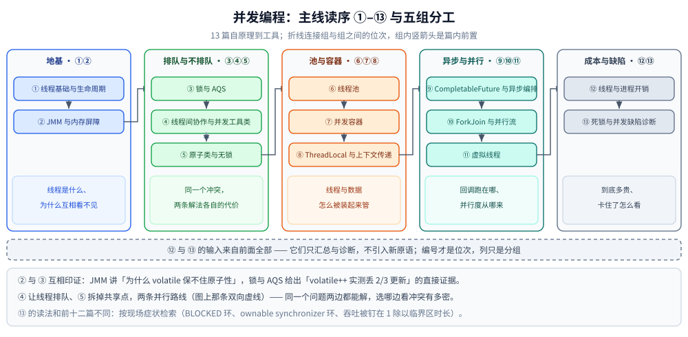

# 并发编程

> 覆盖：本目录 13 篇的分工表、主线读序与篇间依赖 —— 判据是「这个 API / 原语怎么用」：线程与它的状态、内存模型、锁与 AQS、协作工具、原子类、线程池、并发容器、ThreadLocal、异步编排、ForkJoin、虚拟线程、成本与缺陷诊断。
>
> 不覆盖：JVM 怎么装类、怎么排内存、怎么编译与回收见 [运行时/README.md](../运行时/README.md)；集合的非线程安全版本见 [集合容器.md](../集合容器.md)；Spring 与接入手册见 [java/README.md](../README.md) 的横切表。
>
> 内容整理自个人学习笔记；素材见 [素材清单](../../../素材清单.md)。

---

## 一、一句话定位与它凭什么

**本节要点**：Java 的并发线是**共享内存 + 锁**这一条路线（Go 是 goroutine + channel 那一条）。本目录的判据与 Go 侧完全一致 —— 写「`ReentrantLock` 该怎么用、`LongAdder` 什么时候别用」在这里；写「对象头里的锁位怎么被改、逃逸分析怎么把分配消掉」在 [运行时/](../运行时/)。

| 这个问题在问 | 归哪层 | 本目录对应篇 |
|---|---|---|
| 线程的六种状态、中断打在哪 | `并发编程/` | [线程基础与生命周期.md](线程基础与生命周期.md) |
| 这个字段为什么另一个线程看不到 | `并发编程/` | [JMM与内存屏障.md](JMM与内存屏障.md) |
| 排队还是 CAS、锁选哪个 | `并发编程/` | [锁与AQS.md](锁与AQS.md)、[原子类与无锁.md](原子类与无锁.md) |
| 线程从哪来、开多少、怎么关 | `并发编程/` | [线程池.md](线程池.md)、[虚拟线程.md](虚拟线程.md) |
| `synchronized` 的 `_owner` 字段怎么写、monitor 怎么升级 | `运行时/` | 见 [运行时/README.md](../运行时/README.md)（对象布局与引用类型） |

⭐ 与 Go 侧的对照是逐篇的：`线程基础与生命周期.md` ↔ `go/并发编程/goroutine.md`、`JMM与内存屏障.md` ↔ `Go内存模型.md`、`锁与AQS.md` ↔ `并发同步原语.md`、`线程池.md` ↔ `goroutine实战模式.md`、`线程与进程开销.md` ↔ `协程与线程成本.md`。

---

## 二、分工表：13 篇各讲什么

**本节要点**：一张表说清每篇的独有能力 —— **同一张表只在这里维护一份**，[java/README.md](../README.md) 的主线 B 只留指向本节的入口。

| 篇 | 讲什么 |
|---|---|
| [线程基础与生命周期.md](线程基础与生命周期.md) | 六个状态、`interrupt` 的八种落点、`join` 的本质（字节码就是 `monitorenter` + `wait`）、`-Xss` 与每线程的内存账、1:1 内核线程实测 |
| [JMM与内存屏障.md](JMM与内存屏障.md) | 主内存 / 工作内存与 Store Buffer、`happens-before` 八条、可见性复现（普通字段空转看不到写入）、四种屏障与 `StoreLoad` 为何最贵、伪共享实测 |
| [锁与AQS.md](锁与AQS.md) | `synchronized` 的对象头与 monitor、锁升级与偏向锁的版本口径、四种计数方式实测、公平锁的代价、AQS「一个 `state` 四种语义」、手写 AQS 子类、CAS 与 ABA |
| [线程间协作与并发工具类.md](线程间协作与并发工具类.md) | `wait` / `notify` 四条契约、信号没有暂存、一个条件队列为什么会真挂死、四个协调器（`CountDownLatch` / `CyclicBarrier` / `Semaphore` / `Exchanger`）按「等什么」分界 |
| [原子类与无锁.md](原子类与无锁.md) | CAS 变体与 `LongAdder` 分段、`Atomic*` 与 `VarHandle` 的取舍、ABA 与版本号、无锁队列的边界 |
| [线程池.md](线程池.md) | 七个参数、队列与拒绝策略、线程数怎么定、`shutdown` 与 `shutdownNow` 的差别、`submit` 静默吞异常 |
| [并发容器.md](并发容器.md) | `ConcurrentHashMap` 的 sizing 与遍历弱一致性、`CopyOnWriteArrayList`、`BlockingQueue` 家族与选型 |
| [ThreadLocal与上下文传递.md](ThreadLocal与上下文传递.md) | 值挂在 `Thread` 上、`ThreadLocalMap` 的弱引用 key、池化线程为什么串数据、怎么跨任务传（含 `InheritableThreadLocal` 的失效场景） |
| [CompletableFuture与异步编排.md](CompletableFuture与异步编排.md) | 回调跑在哪个线程、`thenApply` 与 `thenApplyAsync` 的分别、异常去哪、`allOf` 汇合与超时 |
| [ForkJoin与并行流.md](ForkJoin与并行流.md) | 分治与工作窃取、`commonPool` 的并行度从哪来、`parallelStream` 的两处反直觉 |
| [虚拟线程.md](虚拟线程.md) | 十万条线程的真实成本、挂载与卸载、`synchronized` 钉住载体线程的新旧对照、该配哪种池 |
| [线程与进程开销.md](线程与进程开销.md) | 线程到底多贵：与进程、协程对照，超订扫描与乒乓切换的单次成本 |
| [死锁与并发缺陷诊断.md](死锁与并发缺陷诊断.md) | 转储里怎么认出死锁（`BLOCKED` 环、`ownable synchronizer` 环）、单线程池自锁为何查不出、吞吐被钉在 `1 ÷ 临界区时长` |

---

## 三、阅读路线

**本节要点**：13 篇是一条**自原理到工具**的主线，位次基本不能倒 —— 但 ④ 与 ⑤ 是两条并行路线，可以按「冲突有多密」任选先后。

```text
线程基础与生命周期.md        ① 六个状态、中断落点、join 的本质、一个线程的内存账
      ↓
JMM与内存屏障.md            ② 物理层：可见性、happens-before、四种内存屏障
      ↓
锁与AQS.md                 ③ 怎么解决：synchronized / ReentrantLock / AQS / CAS
      ↓
线程间协作与并发工具类.md     ④ 怎么约顺序：wait 契约、Condition、四个协调器
      ↓
原子类与无锁.md             ⑤ 怎么不排队：CAS 变体、LongAdder 分段、ABA
      ↓
线程池.md                  ⑥ 线程怎么管：七参数、队列与拒绝、线程数、优雅关闭
      ↓
并发容器.md                ⑦ 共享数据怎么装：CHM / COW / BlockingQueue
      ↓
ThreadLocal与上下文传递.md   ⑧ 值挂在谁身上、池里为什么串数据、怎么跨任务传
      ↓
CompletableFuture与异步编排.md ⑨ 回调跑在哪个线程、异常去哪、汇合与超时
      ↓
ForkJoin与并行流.md         ⑩ 分治、工作窃取、parallelStream 的两处反直觉
      ↓
虚拟线程.md                ⑪ 十万条线程的真实成本、挂载卸载、pin 住载体
      ↓
线程与进程开销.md           ⑫ 线程到底多贵：与进程、协程对照与超订扫描
      ↓
死锁与并发缺陷诊断.md        ⑬ 转储里怎么认出死锁、单线程池自锁为何查不出
```

| 分组 | 篇（主线位次） | 这组在回答什么 |
|---|---|---|
| **地基** | ①② | 「线程是什么、为什么互相看不见」 |
| **排队 vs 不排队** | ③④⑤ | 「同一个冲突，两条解法各自的代价」 |
| **池与容器** | ⑥⑦⑧ | 「线程与数据怎么被装起来管」 |
| **异步与并行** | ⑨⑩⑪ | 「回调跑在哪、并行度从哪来、能不能开十万条」 |
| **成本与缺陷** | ⑫⑬ | 「到底多贵、卡住了怎么看」 |

⭐ ② 与 ③ 是**互相印证的一对**：[JMM与内存屏障.md](JMM与内存屏障.md) 讲「为什么 `volatile` 保不住原子性」，[锁与AQS.md](锁与AQS.md) 给出「`volatile++` 实测丢 2/3 更新」的直接证据，建议连着读。

⭐ ④ 与 ⑤ 是**两条并行路线**：④ 让线程排队，⑤ 拆掉共享点；同一个问题两边都能解，选哪边看「冲突有多密」。

⭐ ⑬ 的读法和前十二篇不同：它按**现场症状**检索（`BLOCKED` 环、`ownable synchronizer` 环、吞吐被钉在 `1 ÷ 临界区时长`），不出问题时不必通读。



看图时抓住三点：**编号 ①–⑬ 才是主线位次**（写在每个框里），五列只是「读它理由」的分组，组与组之间用折线接上；④ 与 ⑤ 之间那条双向虚线表示这两篇可以互换；底部横贯整幅的虚线带写着「⑫ 与 ⑬ 的输入来自前面全部」—— 它们只汇总与诊断，不引入新原语。

---

## 四、篇间依赖（谁是谁的前置）

**本节要点**：「硬前置」是没有它就读不懂本篇的篇目，「强关联」是读完该马上对照的篇 —— 并发编程 13 行**只在本表维护一份**，[java/README.md](../README.md) 第三节已删掉重复的行，只留下横切三篇的前置。

| 篇目 | 硬前置 | 强关联 |
|---|---|---|
| [线程基础与生命周期.md](线程基础与生命周期.md) | —（只要求会写 `new Thread`） | [JMM与内存屏障.md](JMM与内存屏障.md)（中断标志的可见性）、[线程池.md](线程池.md)（`shutdownNow` 发的就是中断）、[线程与进程开销.md](线程与进程开销.md)、[进程与线程.md](../../../02-计算机基础/linux/进程与线程.md)（`task` 的内核侧） |
| [JMM与内存屏障.md](JMM与内存屏障.md) | — | [线程安全与CSP.md](../../go/并发编程/线程安全与CSP.md)（路线对照） |
| [锁与AQS.md](锁与AQS.md) | JMM 与内存屏障 | [线程池.md](线程池.md)、[并发容器.md](并发容器.md)（都建立在它的机制上） |
| [线程间协作与并发工具类.md](线程间协作与并发工具类.md) | 锁与AQS（`Condition` 与同步队列）、线程基础与生命周期（`interrupt` 落点） | [线程池.md](线程池.md)（阻塞队列把两类条件等待封装掉了）、[并发容器.md](并发容器.md)（`BlockingQueue` 就是它的现成实现） |
| [原子类与无锁.md](原子类与无锁.md) | 锁与AQS（CAS 的三步组成在那篇第五节） | [JIT与执行引擎.md](../运行时/JIT与执行引擎.md)（逃逸分析把分配消掉、同进程微基准漂移）、[并发容器.md](并发容器.md)（`LongAdder` 在容器里的用法） |
| [线程池.md](线程池.md) | 锁与AQS | [goroutine实战模式.md](../../go/并发编程/goroutine实战模式.md)（worker 池对照）、[线程与进程开销.md](线程与进程开销.md)（创建成本的账） |
| [并发容器.md](并发容器.md) | 锁与AQS、JMM | [集合容器.md](../集合容器.md)（非线程安全版）、[线程池.md](线程池.md)（队列选型的另一半） |
| [ThreadLocal与上下文传递.md](ThreadLocal与上下文传递.md) | 线程基础与生命周期（值挂在 `Thread` 上）、线程池（池化线程才有串数据问题） | [接入Jaeger.md](../可观测性/接入Jaeger.md)（traceId 写 MDC 的落地）、[CompletableFuture与异步编排.md](CompletableFuture与异步编排.md)（回调里读不到上下文） |
| [CompletableFuture与异步编排.md](CompletableFuture与异步编排.md) | 线程池（默认 `ForkJoinPool.commonPool`）、ThreadLocal与上下文传递 | [ForkJoin与并行流.md](ForkJoin与并行流.md)（commonPool 的并行度从哪来）、[虚拟线程.md](虚拟线程.md)（阻塞任务该用哪种池） |
| [ForkJoin与并行流.md](ForkJoin与并行流.md) | 线程池（对照）、原子类与无锁（累加用什么） | [CompletableFuture与异步编排.md](CompletableFuture与异步编排.md)、[虚拟线程.md](虚拟线程.md)（`ForkJoinPool` 作为调度器那一面） |
| [虚拟线程.md](虚拟线程.md) | 线程基础与生命周期、线程池 | [线程与进程开销.md](线程与进程开销.md)（成本对照）、[死锁与并发缺陷诊断.md](死锁与并发缺陷诊断.md)（转储里认载体） |
| [线程与进程开销.md](线程与进程开销.md) | 线程池（线程数怎么定） | [协程与线程成本.md](../../go/并发编程/协程与线程成本.md)（Go 侧同批实验）、[进程与线程.md](../../../02-计算机基础/linux/进程与线程.md)（概念） |
| [死锁与并发缺陷诊断.md](死锁与并发缺陷诊断.md) | 锁与AQS、线程基础与生命周期 | [JFR与诊断工具.md](../运行时/JFR与诊断工具.md)（事件模型）、[线上问题排查.md](../运行时/线上问题排查.md)（更宽的现场口径） |

---

## 五、本轮实测坐标

**本节要点**：主线读数来自容器 `java-lab`，三组版本各有分工 —— **偏向锁只存在于 JDK 8**，虚拟线程要回到 21，跨版本的结论必须写明是哪一版跑出来的。

- **容器 `java-lab`**：`eclipse-temurin:24-jdk`（24.0.2+12，linux/amd64，4 CPU，cgroup v2）。
  ①②④⑤⑥⑨⑩⑪⑫ 九篇的主线读数取这里（`线程与进程开销.md`、`线程间协作与并发工具类.md` 等篇首各自写明）。
- **容器 `jdk21-lab`**：`eclipse-temurin:21-jdk`（21.0.12.1）。
  [虚拟线程.md](虚拟线程.md) 与 [锁与AQS.md](锁与AQS.md) 的 `synchronized` 钉住对照另起这个容器 —— JDK 21 与 24 的载体线程行为不同，不能混在一份读数里。
- **本机 Windows JDK 8**：`D:/java/jdk1.8`（1.8.0_321，`java` 不在 PATH，用绝对路径或起 `eclipse-temurin:8-jdk`）。
  [锁与AQS.md](锁与AQS.md) 的锁升级与偏向锁默认参数（`StartupDelay=4000`）、[JMM与内存屏障.md](JMM与内存屏障.md) 的部分对照取这里；⚠️ JDK 21 / 24 实测 `BiasedLocking*` 0 条、`-XX:+UseBiasedLocking` 直接 `Unrecognized VM option`，所以「偏向锁」的一切结论**只适用于 8**。
- ⚠️ **时序类读数连跑 3～5 次报波动区间**，只断言趋势；`jstack` / 转储类读数一次一贴，不复用别处的 pid 现场。

---

## 六、本目录的边界

**本节要点**：本目录只管 JDK 侧的并发 API 与其机制读数；JVM 内部实现、集合的非线程安全版、框架与接入手册都不在这里重讲。

- **JVM 侧**在 [运行时/](../运行时/)：`对象布局与引用类型.md`（MarkWord 里的锁位与 hash 位）、`JIT与执行引擎.md`（逃逸分析、标量替换）、`JFR与诊断工具.md`（`jdk.JavaMonitorEnter` 从哪来）、`线上问题排查.md`（更宽的现场口径）。
- **概念层**在 `02-计算机基础/linux/进程与线程.md`（`task`、三种线程实现方式）与 `04-架构与系统/分布式/稳定性/`（限流、熔断的算法口径）。
- **框架与接入**在 [java/README.md](../README.md) 的横切表：`Spring-boot核心.md`（单例的线程安全要先懂 [锁与AQS.md](锁与AQS.md)）、`写冲突控制的Java落地.md`、各 `接入XX.md`。
- **Go 侧对照**在 `../../go/并发编程/`：同一个问题两边的失败模式不同（共享内存静默丢更新且退出码 0，CSP 当场死锁并指出行号），判据见 [线程安全与CSP.md](../../go/并发编程/线程安全与CSP.md)。

---

## 延伸追问

- **13 篇里哪几篇是「只读一次」的地基？** → [线程基础与生命周期.md](线程基础与生命周期.md) 与 [JMM与内存屏障.md](JMM与内存屏障.md)：分不清 `BLOCKED` 与 `WAITING`，后面所有结论只能背。
- **为什么 `并发容器` 里不讲 `HashMap`？** → 非线程安全版本在 [集合容器.md](../集合容器.md)，本目录只讲「加了什么、代价是什么」。
- **虚拟线程要配哪种池？** → 见 [CompletableFuture与异步编排.md](CompletableFuture与异步编排.md) 与 [虚拟线程.md](虚拟线程.md) 的对照：默认 `commonPool` 的并行度是 CPU 核数，阻塞型任务放上去会把并行度钉死。
- **本目录的分工表会不会和 `java/README.md` 打架？** → 不会。表与主线读序只在本篇维护，`java/README.md` 的主线 B 已改成指向本篇的入口。

---

## 关联

- **上游/总纲**：[java/README.md](../README.md) — Java 目录两条主线的入口与横切篇目
- **同层另一目录**：[运行时/README.md](../运行时/README.md) — JVM 侧「怎么执行、怎么存」
- **对照/互补**：[go/并发编程/README.md](../../go/并发编程/README.md) — CSP 路线的同一批问题（16 篇）
- **对照/互补**：[go/运行时/README.md](../../go/运行时/README.md) — Go 运行时的对照线
- **下层概念**：[进程与线程.md](../../../02-计算机基础/linux/进程与线程.md) — 线程的内核侧形态
- **上层场景**：[弹幕系统/Java实现.md](../../../04-架构与系统/系统设计/弹幕系统/Java实现.md) — 虚拟线程投递的落地对照
- **素材**：[素材清单.md](../../../素材清单.md) — 来源登记
