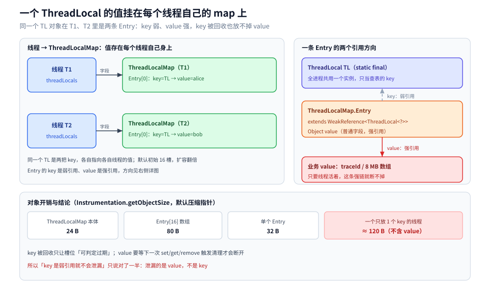
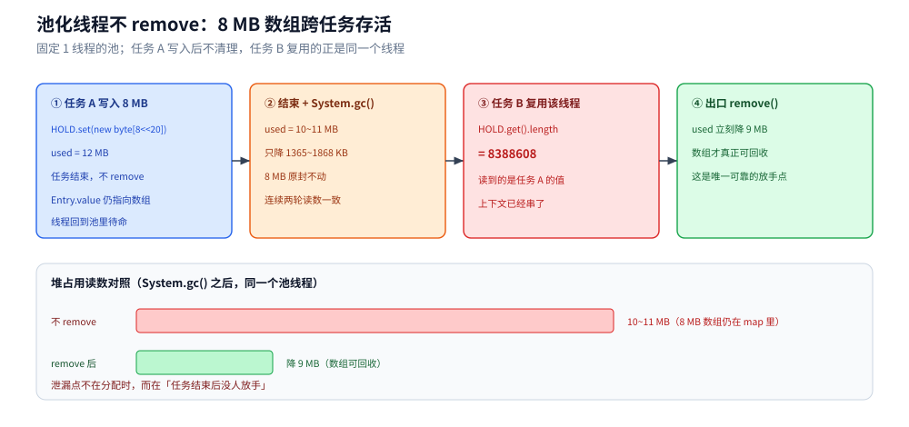
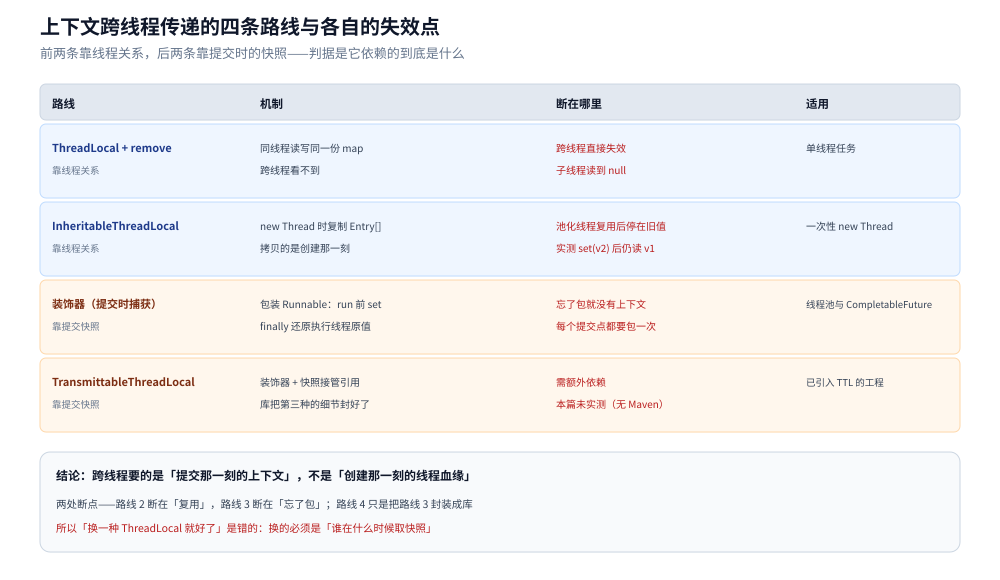

# ThreadLocal 与上下文传递

> 覆盖：一个 `ThreadLocal` 的值到底挂在谁身上、`ThreadLocalMap` 的槽位结构与「弱 key + 强 value」这条引用链、线程池里不 `remove` 会泄漏多少、过期槽位的清理为什么不可依赖、`InheritableThreadLocal` 为什么在池里失效，以及把上下文跨任务传递的三种可行写法。
>
> 不覆盖：`Thread` 的状态与中断语义见 [线程基础与生命周期.md](线程基础与生命周期.md)；线程池的队列与拒绝策略见 [线程池.md](线程池.md)；虚拟线程上 `ThreadLocal` 的成本见 [虚拟线程.md](虚拟线程.md)；可观测性侧的 traceId 写入 MDC 与跨线程接法见 [接入Jaeger.md](../可观测性/接入Jaeger.md)。
>
> 内容整理自个人学习笔记，素材见 [素材清单](../../../素材清单.md)。
>
> 实测口径：容器 `java-lab`，`eclipse-temurin:24-jdk`（24.0.2+12，linux/amd64，4 CPU，cgroup v2），源码在 `.workbuddy/tmp/exp/java/threadlocal/`。`ThreadLocalMap` 的槽位、`Entry` 大小、弱 key 变 stale、池化线程读到旧值、`InheritableThreadLocal` 的复制时机全部真跑（`--add-opens java.base/java.lang=ALL-UNNAMED` 与 `java.lang.ref` 才能反射到 `threadLocals` / `referent`）；⚠️ `TransmittableThreadLocal` 未实测（容器无 Maven 仓库，`com.alibaba:transmittable-thread-local` 拉不下来），文中只给机制与手写等价实现。

---

## 一、一个 `ThreadLocal` 的值存在谁身上？

**本节要点**：不在 `ThreadLocal` 里，而在**每个线程自己的 `ThreadLocalMap`** 里；`ThreadLocal` 只是查表的 key。这句话决定了后面所有泄漏与传递问题。

### 1.1 从零：二十行看清归属

```java
import java.lang.reflect.Field;

public class WhoOwns {
    static final ThreadLocal<String> TL = new ThreadLocal<>();

    public static void main(String[] args) throws Exception {
        TL.set("alice");
        Object map = read(Thread.currentThread(), "threadLocals");
        System.out.println("map 类型 = " + map.getClass().getName());
        System.out.println("槽位数   = " + ((Object[]) read(map, "table")).length);
        System.out.println("本线程读到 = " + TL.get());

        Thread other = new Thread(() -> System.out.println("另一线程读到 = " + TL.get()));
        other.start();
        other.join();
    }

    static Object read(Object target, String field) throws Exception {
        Class<?> c = target instanceof Class ? (Class<?>) target : target.getClass();
        Field f = c.getDeclaredField(field);
        f.setAccessible(true);
        return f.get(target instanceof Class ? null : target);
    }
}
```

容器里加 `--add-opens java.base/java.lang=ALL-UNNAMED` 后运行：

```text
map 类型 = java.lang.ThreadLocal$ThreadLocalMap
槽位数   = 16
本线程读到 = alice
另一线程读到 = null
```

同一个 `TL` 对象，两个线程读出两个值 —— 因为值不在 `TL` 上，`TL` 只是各自表里的 key。JDK 24 里 `Thread` 有两个这样的字段：`threadLocals` 与 `inheritableThreadLocals`，默认都是 `null`，**第一次 `set` 时才建表**。

### 1.2 表长什么样：16 个槽、弱 key、线性探测

`ThreadLocalMap` 没有链表，也没有红黑树，就是一个 `Entry[] table`：

```java
static class Entry extends WeakReference<ThreadLocal<?>> {
    Object value;          // 强引用！
    Entry(ThreadLocal<?> k, Object v) { super(k); value = v; }
}
```

- 初始容量 **16**，负载因子 2/3（阈值 10），扩容翻倍。
- 落点 `i = threadLocalHashCode & (len - 1)`；冲突时**线性探测**往后找空槽（不是拉链）。
- 每个新 `ThreadLocal` 的 hash 递增一个常量 `0x61c88647`（黄金分割数），实测在 16 槽表里相邻 key 的落点**固定相差 7**（模 16）：

```text
index = threadLocalHashCode & (len-1) -> 0:1 1:8 2:15 3:6 4:13 5:4 6:11 7:2
```

起点每次 JVM 启动随机（第一轮从 10 开始、第二轮从 1 开始），但步长恒定 —— 这样连续创建的 key 会均匀散开，避免全挤在头部。

对象开销（`Instrumentation.getObjectSize`，默认压缩指针）：

| 对象 | 字节 |
|---|---|
| `ThreadLocalMap` 本体 | 24 |
| `Entry[16]` 表数组 | 80（16 头 + 16 × 4 引用） |
| 一个 `Entry` | 32（含弱引用与 `value` 字段） |

即：**一个只放了一个 key 的线程，ThreadLocal 侧固定开销约 120 B**（不含 value 本身），之后每个 key 再加一个 `Entry`。

### 1.3 为什么 key 弱、value 强？

引用链是这样的：

```text
Thread ──> ThreadLocalMap ──> Entry ──(弱)──> ThreadLocal
                                 └──(强)──> value
```

`ThreadLocal` 对象通常被 `static final` 持有，生命周期与类一样长；但业务代码里也常 `new ThreadLocal<>()` 临时用。**key 弱**保证「这个 `ThreadLocal` 没人用了，槽位可以被识别成过期」；**value 强**是因为值必须活到线程自己放手为止 —— 这正是泄漏的来源：只要线程活着，`Thread → map → Entry → value` 这条强链就断不掉，哪怕 key 已经变成 `null`。



图里左边是线程对象，右边是表；虚线是弱引用、实线是强引用。要读出的结论是：**key 被回收只让槽位「可判定过期」，并不能把 value 从强引用链上摘下来**，必须等下一次操作触发清理。

---

## 二、线程池为什么会把它变成泄漏？

**本节要点**：池化线程的存活期 = 进程存活期；只要不在任务结束前 `remove`，这次任务写进去的 value 会被**下一个不相关的任务**读到，并且 GC 回收不掉。

### 2.1 实测：8 MB 数组跨任务存活

固定 1 个线程的池，第一个任务写入 8 MB，不做 `remove`；第二个任务直接读：

```java
ExecutorService pool = Executors.newFixedThreadPool(1);
pool.submit(() -> HOLD.set(new byte[8 << 20])).get();   // 不 remove
pool.submit(() -> {
    System.out.println(HOLD.get().length);              // 8388608，仍是同一个数组
    HOLD.remove();
}).get();
```

```text
不 remove：GC 前 used=12 MB，GC 后 used=10 MB
第二个任务读到 HOLD 长度=8388608 ｜ 还是同一个数组=非空
remove 前后 used 差 = 9 MB
不 remove 时降幅 = 1365~1868 KB，8 MB 数组仍在池线程的 map 里
```

`System.gc()` 之后 used 只降了 1.3~1.8 MB（噪声级别），8 MB 原封不动；`remove()` 之后立刻降 9 MB。两轮读数一致，差异只在测量噪声。

### 2.2 过期槽位的清理是「顺手扫描」，不保证

把 `ThreadLocal` 的两个强引用都置空再 GC，槽位并不会消失：

```text
设置后：槽位数=16 ｜ 非空槽=1
只置空外部引用（strong 仍持有）→ 槽位还在=16
两个引用都置空并 GC 后 → 槽位数仍=16（Entry 还在表里，key 已为 null）
stale Entry 的 key=null ｜ 只有下一次 set/get/remove 才会清理
```

随后新建一个 key 并 `set`，同一份代码两轮跑出不同结果：

```text
第 1 轮：另建一个 key 并 set 之后：非空槽=2
第 2 轮：另建一个 key 并 set 之后：非空槽=1
```

因为 `ThreadLocalMap` 的 `cleanSomeSlots` 是**按启发式扫描**（从随机位置开始扫 log2(n) 个槽），不是每次全表清扫。结论：**过期槽位可能要等很多次操作才被清掉，甚至在容量再次触发扩容前一直占着**。所以「key 是弱引用所以不会泄漏」是半句真话：key 能被回收，value 不会自动释放。

### 2.3 `remove` 落在哪几个位置

| 场景 | 清理位置 | 漏了会怎样 |
|---|---|---|
| 池里的任务体 | `try { ... } finally { tl.remove(); }` | 下一个任务读到上一个请求的值；value 常驻 |
| Web 请求（Servlet / Spring MVC） | 拦截器 `afterCompletion` / Filter `finally` | 同上，且随线程数累积 |
| 手动创建的线程 | 线程退出即随 `Thread` 一起回收 | 短命线程问题不大，但仍建议成对写 |
| 异步任务提交处 | 提交时捕获、执行时恢复、结束清除 | 见第三节的装饰器 |

⭐ 判据：**「这个值属不属于这次任务」**——属于，就必须在任务出口 `remove`；属于整个应用（如全局配置），才允许一直挂着。



图中三段对应上面三条读数：写入 8 MB 后 GC 不降、下个任务仍读到 `8388608`、`remove` 后 used 立刻降 9 MB。要点是泄漏发生在「任务结束后」，不是「分配时」。

---

## 三、`InheritableThreadLocal` 为什么在线程池里失效？

**本节要点**：它只在 `new Thread` 的那一刻把父线程的表复制给子线程；池化线程只创建一次，之后的 `set` 与它无关。

### 3.1 只在创建时复制

```java
InheritableThreadLocal<String> itl = new InheritableThreadLocal<>();
itl.set("v1");
Thread t = new Thread(() -> System.out.println(itl.get()));   // 读到 v1
t.start();
t.join();

ExecutorService pool = Executors.newFixedThreadPool(1);
pool.submit(() -> System.out.println(itl.get())).get();       // 创建时复制 → v1
itl.set("v2");
pool.submit(() -> System.out.println(itl.get())).get();       // 复用线程 → 仍是 v1
```

```text
子线程读到=v1
池线程创建时 itl=v1 → 读到=v1
改 set(v2) 后，复用的池线程仍读到=v1
```

复制动作在 `Thread` 构造函数的 `ThreadLocal.createInheritedMap(parent.inheritableThreadLocals)` 里，拷贝的是**创建那一刻**的 `Entry[]`。池化线程创建一次、复用无数次，于是它永远停在旧值上。这也是日志 MDC 在池里「有时有、有时没有」的根因。

### 3.2 四条传递路线

| 路线 | 机制 | 适用 | 代价 |
|---|---|---|---|
| `ThreadLocal` + 手写 `remove` | 同线程内传递 | 单线程任务 | 最简单，跨线程无效 |
| `InheritableThreadLocal` | 创建线程时复制 | `new Thread` 的一次性任务 | 池化后失效；值是浅拷贝，可变对象会共享 |
| 提交时捕获、执行时恢复（装饰器） | 包装 `Runnable`/`Callable` | 任何线程池、`CompletableFuture` | 每个提交点都要包一次，要处理嵌套与恢复 |
| `TransmittableThreadLocal` | 在装饰器基础上接管父线程引用与快照 | 大型工程已有 TTL 依赖时 | 额外依赖；⚠️ 本篇未实测（容器无 Maven） |

⭐ 关键是第三种：它不依赖线程关系，只依赖**提交那一刻的上下文快照**，所以在池里、在 `CompletableFuture` 的回调里都能用。

### 3.3 手写一个可用的装饰器

```java
public final class Ctx {
    private static final ThreadLocal<String> TL = new ThreadLocal<>();

    public static void set(String v) { TL.set(v); }
    public static String get() { return TL.get(); }
    public static void clear() { TL.remove(); }

    /** 把提交时的值搬进执行线程，结束后恢复执行线程原值 */
    public static Runnable wrap(Runnable task) {
        String captured = TL.get();
        return () -> {
            String backup = TL.get();
            TL.set(captured);
            try {
                task.run();
            } finally {
                if (backup == null) TL.remove(); else TL.set(backup);
            }
        };
    }
}
```

两个细节不能省：`captured` 必须在**提交线程**里取（不是在 `run` 里取）；`backup` 保证包装可以嵌套。用 `wrap` 包住的任务在池里也拿得到提交时的上下文 —— 这与 `CompletableFuture` 的 `*Async(..., executor)` 配合方式见 [CompletableFuture与异步编排.md](CompletableFuture与异步编排.md)。



图里四条横向路线按「依赖线程关系 / 依赖提交快照」分两栏：前两条靠线程自身，后两条靠包装。要点是 `InheritableThreadLocal` 的断点在「复用」，装饰器的断点在「忘了包」。

---

## 四、应用场景

**本节要点**：能放进 `ThreadLocal` 的只有「一次请求内到处都要、又不该出现在方法签名里」的少量值；下表每一项都附了清理点，漏清理就是第二节的泄漏。

| 场景 | 存什么 | 为什么必须用 ThreadLocal | 清理点 |
|---|---|---|---|
| 链路追踪 traceId / spanId | 字符串或 `Span` | 每个请求一条链路，不能靠参数层层透传 | 拦截器 `finally`、HTTP 客户端回调结束 |
| 日志 MDC | key-value | 日志框架从 MDC 取值写进每行 | 同上；跨线程要装饰器 |
| 事务上下文（连接、XID） | `Connection` / 事务对象 | 同一线程内多个 DAO 要复用同一个连接 | 事务模板的 `finally`；Spring 用 `TransactionSynchronizationManager` |
| 用户身份 / 租户 ID | 对象 | 权限与分库分表路由都要读 | Filter 出口 |
| 非线程安全的工具对象 | `SimpleDateFormat` 等 | 避免每次 `new` 的分配开销 | 线程结束即回收，长驻线程需 `remove` |
| 递归/嵌套调用的隐式参数 | 任意 | 避免把上下文塞进每个方法签名 | 最外层调用结束 |

⭐ 反面清单：**不要把可变的大对象长期放在池线程的 `ThreadLocal` 里**（等价于自己造了一个泄漏）；也**不要用 `ThreadLocal` 做缓存**（它不是缓存，没有淘汰、没有上限）。

## 五、具体使用

**本节要点**：三段骨架 —— 带初始值的写法、拦截器里的清理模板、以及跨线程传递的装饰器；每一段都对应第二节的一类泄漏。

### 5.1 带初始值的写法与「首次 get 才分配」

```java
ThreadLocal<List<String>> buf = ThreadLocal.withInitial(ArrayList::new);
buf.get().add("a");          // 每个线程各一份，不需要判空
```

`withInitial` 只是把 `initialValue()` 包了一层，仍然遵循「首次 `get` 时分配、之后复用」。

### 5.2 线程池里的标准写法

```java
ExecutorService pool = Executors.newFixedThreadPool(8);
pool.submit(Ctx.wrap(() -> {
    // 这里读到的是提交线程的上下文
    System.out.println(Ctx.get());
}));
```

若任务体自己会 `set`，`wrap` 结束时的恢复逻辑仍然正确：先恢复提交线程快照，再还原执行线程原值。

### 5.3 虚拟线程上要注意什么

JDK 21+ 的虚拟线程同样是 `Thread` 实例，`ThreadLocal` 一样可用、一样按虚拟线程隔离。但**每个虚拟线程一份 `ThreadLocalMap`**：十万个虚拟线程各放一个小对象，就是十万份表头（约 120 B 起）。JDK 24 已把 `ThreadLocal` 在虚拟线程上的实现改为可伸缩的共享结构（`ScopedValue` 仍为预览），实测数据与迁移建议见 [虚拟线程.md](虚拟线程.md) 第四节。

## 延伸追问

- **`ThreadLocal` 的值会被子线程看到吗？** → 普通 `ThreadLocal` 不会；`InheritableThreadLocal` 只在 `new Thread` 时复制一份，池化线程复用后不再更新（本篇 3.1 实测：改了 `v2` 仍是 `v1`）。
- **key 是弱引用，为什么还会内存泄漏？** → 弱的是 key，value 是强引用，且值挂在 `Thread → map → Entry` 这条链上；key 变成 `null` 只让槽位「可判定过期」，清理要等下一次 `set/get/remove` 的启发式扫描（实测两轮分别留下 2 / 1 个非空槽）。
- **不 `remove` 一定泄漏吗？** → 线程退出就随 `Thread` 回收，短命线程不算泄漏；线程池、`ForkJoinPool`、事件循环这类长驻线程才是（本篇 2.1：8 MB 跨任务存活，`remove` 后立刻降 9 MB）。
- **`ThreadLocal` 能当缓存吗？** → 不能。它没有上限、没有淘汰、生命周期跟着线程；要缓存用 `Caffeine` 或 `ConcurrentHashMap` + 明确的淘汰策略。
- **为什么 `ThreadLocalMap` 用线性探测而不是链表？** → 每个线程的表通常只有个位数条目，探测几步就结束；省掉 `Node` 对象与指针，单条 `Entry` 只有 32 B。代价是删除要「清理并重排」，所以 `remove` 比普通 map 更必要。
- **`remove()` 之后 `get()` 返回什么？** → `null`（若用 `withInitial` 则重新调 `initialValue()`）；不会回到「父线程的值」，因为继承只发生在创建时。
- **MDC 和 ThreadLocal 是什么关系？** → MDC 内部就是一个 `ThreadLocal<Map<String,String>>`（Logback 的 `LogbackMDCAdapter`）；所以它在池里失效的原因与本节完全相同，接法见 [接入Jaeger.md](../可观测性/接入Jaeger.md)。
- **虚拟线程上还需要 `remove` 吗？** → 需要。虚拟线程数量大、生命周期短，泄漏的绝对量小，但「一个请求读到上一个请求的值」这类正确性问题一样存在。

## 关联

- **上游/总纲**：[README.md](README.md) — 并发编程 13 篇的分工表与主线读序（本篇位次 ⑧：线程池与并发容器之后、异步编排之前）
- **前置**：[线程基础与生命周期.md](线程基础与生命周期.md) — 线程对象上还有哪些字段、`Thread` 与内核 task 的对应
- **下游机制**：[线程池.md](线程池.md) — 池化线程为什么长驻、任务在哪个线程执行
- **对照/互补**：[CompletableFuture与异步编排.md](CompletableFuture与异步编排.md) — 回调在哪个线程跑、上下文怎么跟着任务走
- **对照/互补**：[虚拟线程.md](虚拟线程.md) — 每个虚拟线程一份 `ThreadLocalMap` 的成本与 JDK 24 的改法
- **应用**：[接入Jaeger.md](../可观测性/接入Jaeger.md) — traceId 写入 MDC、跨线程传递的四种接法
- **对照/互补**：[线程安全与CSP.md](../../go/并发编程/线程安全与CSP.md) — Go 侧没有 `ThreadLocal`，上下文靠 `context.Context` 显式传递
