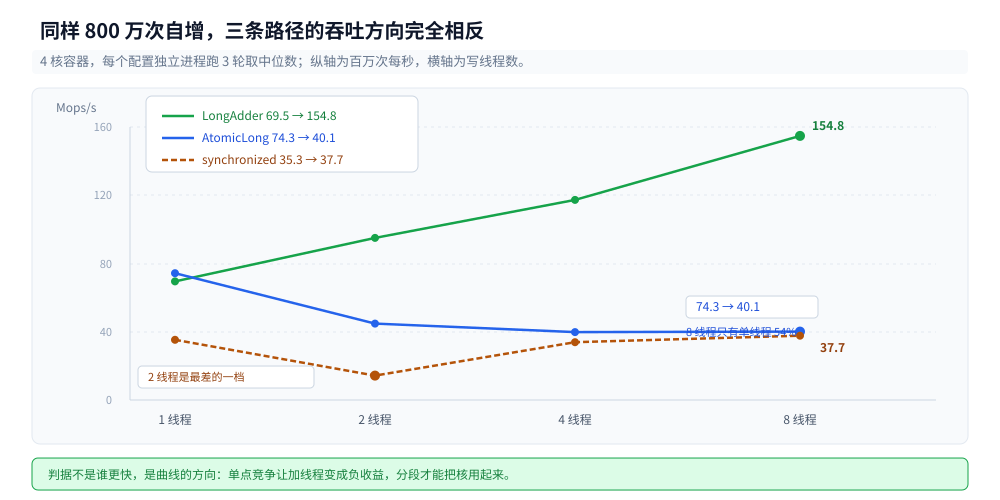
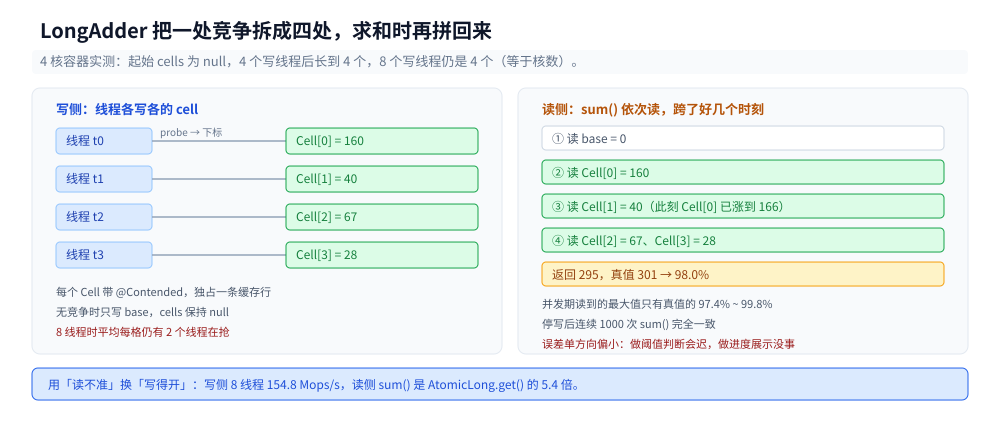
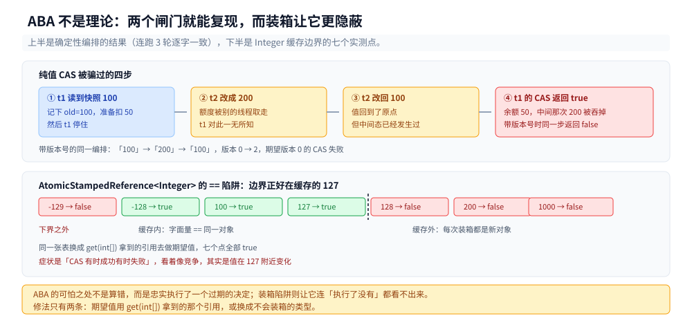
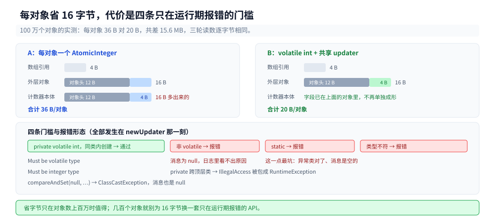
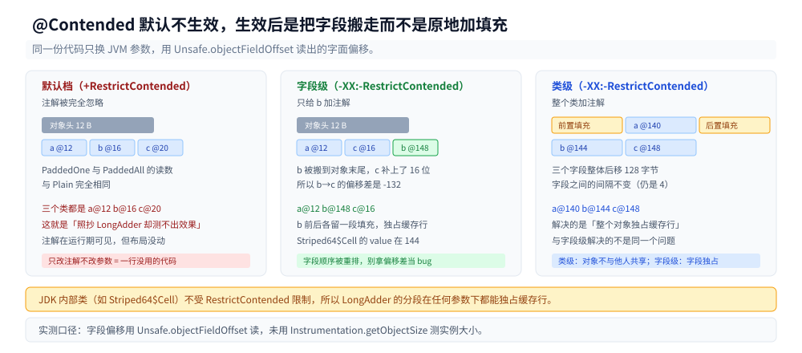

# 原子类与无锁

> 覆盖：`incrementAndGet()` 在字节码层最后落到哪个 `Unsafe` 方法、七个 CAS 变体的真实差别、写侧三条曲线的分叉（`synchronized` / `AtomicLong` / `LongAdder`）、`LongAdder` 用读一致性换来的扩展性有多大代价、ABA 的确定性复现与 `AtomicStampedReference` 的 `==` 装箱陷阱、字段更新器省下的 16 字节从哪来、`@Contended` 为什么在自己的类上默认不生效。
>
> 不覆盖：CAS 的三步组成与 `lock cmpxchg` 见 [锁与AQS.md](锁与AQS.md) 第五节，AQS 的 `state` 与锁升级见其第二、四节；伪共享的 4~6 倍实测与手写 padding 见 [JMM与内存屏障.md](JMM与内存屏障.md) 第四节；并发容器内部的 CAS 使用见 [并发容器.md](并发容器.md)；`Unsafe` 的获取路径与越界后果见 [Unsafe与内存布局.md](../运行时/Unsafe与内存布局.md)。
>
> 内容整理自个人学习笔记，素材见 [素材清单](../../../素材清单.md)。
>
> 实测口径：容器 `java-lab`，`eclipse-temurin:24-jdk`（24.0.2+12，linux/amd64，cgroup v2，**4 CPU**，5.9 GB 内存），源码与 class 在 `.workbuddy/tmp/exp/java/atomic/`。⚠️ 四处**未实测**：`lock cmpxchg` 的真汇编（容器无 `hsdis`，只能给到字节码与 `Unsafe` 方法名）、`@Contended` 的精确实例大小（只报字段偏移，未用 `Instrumentation.getObjectSize`）、`Striped64` 的扩容阈值 `NCPU` 在核数更多机器上的表现、JDK 8 侧的对照读数（本篇全部是 JDK 24）。

---

## 一、`incrementAndGet()` 最后变成了什么？

**本节要点**：原子类不是「`volatile` 外面套个循环」。JDK 9 之后 `incrementAndGet()` 编译成**一次** `getAndAddInt` 加一条加法，不再有 CAS 重试循环；`lazySet` 落到 `putIntRelease`，不是老资料里的 `putOrderedInt`；七个 CAS 变体里名字最弱的那个 `weakCompareAndSet`，字节码与 `weakCompareAndSetPlain` **逐字相同**。

### 1.1 从零：二十行把返回值和内存序变体摆全

原子类的坑集中在「返回的是旧值还是新值」和「这个写到底保证什么」两处，跑一遍比背名字快：

```java
AtomicInteger a = new AtomicInteger(10);
System.out.println("getAndIncrement() 返回 " + a.getAndIncrement() + "，之后 get()=" + a.get());
System.out.println("incrementAndGet() 返回 " + a.incrementAndGet() + "，之后 get()=" + a.get());
System.out.println("CAS(100,200)     返回 " + a.compareAndSet(100, 200) + "，之后 get()=" + a.get());
a.set(7);   a.lazySet(8);
System.out.println("lazySet(8) 之后本线程 get()=" + a.get());
a.setRelease(9);   a.setOpaque(10);
System.out.println("setOpaque(10) 之后 getPlain()=" + a.getPlain());
```

实测输出：

```text
初始                 get()=10
getAndIncrement()   返回 10，之后 get()=11
incrementAndGet()   返回 12，之后 get()=12
getAndAdd(5)        返回 12，之后 get()=17
addAndGet(-3)       返回 14，之后 get()=14
getAndSet(100)      返回 14，之后 get()=100
CAS(100,200)        返回 true，之后 get()=200
CAS(100,300)        返回 false，之后 get()=200
lazySet(8) 之后本线程 get()=8；setRelease(9) 之后 get()=9；setOpaque(10) 之后 getPlain()=10
```

`lazySet` 那一行只能证明「本线程立刻看得见」——它在单线程里与 `set` 没有可观测差别，差别只出现在**别的线程什么时候能看见**。所以这三行的用途是确认 API 没写错，不是证明语义。语义要看下一节的字节码。

### 1.2 七个 CAS 变体各自落到哪个 `Unsafe` 方法

把 `AtomicInteger` 的方法体拆开，调用链只有一层：

```text
lazySet(int)                → jdk.internal.misc.Unsafe.putIntRelease(Object,long,int)
getAndSet(int)              → Unsafe.getAndSetInt
compareAndSet(int,int)      → Unsafe.compareAndSetInt
weakCompareAndSet(int,int)  → Unsafe.weakCompareAndSetIntPlain
weakCompareAndSetPlain      → Unsafe.weakCompareAndSetIntPlain    ← 与上一行逐字相同
weakCompareAndSetVolatile   → Unsafe.weakCompareAndSetInt
weakCompareAndSetAcquire    → Unsafe.weakCompareAndSetIntAcquire
weakCompareAndSetRelease    → Unsafe.weakCompareAndSetIntRelease
getAndIncrement()           → Unsafe.getAndAddInt + iconst_1 + iadd
incrementAndGet()           → Unsafe.getAndAddInt + iconst_1 + iadd
set(int) / get()            → Unsafe.putInt / Unsafe.getInt
getPlain / getOpaque / getAcquire → Unsafe.getInt / getIntOpaque / getIntAcquire
```

⭐ 这里有两处与常见说法对不上，都是字节码直读的结果：

**第一处，`weakCompareAndSet` 转发的不是 volatile 版本。** 上一行与下一行的字节码完全相同（`invokevirtual #35 // Method Unsafe.weakCompareAndSetIntPlain`），而 JDK 24 里它带着 `@Deprecated(since="9")`：

```text
CasChain.java:34: warning: [deprecation] weakCompareAndSet(int,int) in AtomicInteger has been deprecated
```

`weakCompareAndSet` 与 `weakCompareAndSetPlain` 在 JDK 24 上是同一个东西，`weakCompareAndSetVolatile` 才是「只弱在可以伪失败、内存序与 `compareAndSet` 等同」的那个。想要「弱版本」就不要用它，用带 `Plain` 后缀的显式版本。

**第二处，`incrementAndGet` 不是 CAS 循环。** 字节码是 `getAndAddInt` 后面接 `iconst_1; iadd; ireturn`，也就是说 JVM 只需要**一条**原子的「取回并加」指令（x86 上是 `lock xadd`），读到旧值之后在寄存器里加一就得到返回值。JDK 8 时代那种 `do { old = get(); } while (!cas(old, old+1))` 的写法早已不在 `AtomicInteger` 里了 —— 这也是为什么单线程下 `AtomicLong` 能跑到 74 Mops/s（见第二节），一个 CAS 循环在无竞争时也要两条指令。

⚠️ 容器没有 `hsdis`，`-XX:+PrintAssembly` 用不了，所以上面的「x86 上是 `lock xadd`」是按 `Unsafe.getAndAddInt` 的实现推的，**没有本机汇编证据**。有汇编证据的部分只有字节码层。

### 1.3 溢出与「CAS 失败不抛异常」

原子类在边界上的行为是**静默溢出**，不抛任何异常：

```text
Integer.MAX_VALUE incrementAndGet() = -2147483648（溢出成负数，不抛异常）
Long.MAX_VALUE    incrementAndGet() = -9223372036854775808
```

这与 `Math.addExact` 正好相反。计数器做容量规划时要按 `long` 算上限，`int` 计数器在 21 亿次处回绕，而 `compareAndSet` 返回 `false` 也是正常返回值不是错误 —— 这两条合起来意味着「计数类 bug 全是静默的」。

---

## 二、为什么加线程反而更慢？

**本节要点**：`AtomicLong` 与 `LongAdder` 在**单线程**几乎一样快，但方向完全相反：`AtomicLong` 的吞吐随线程数**下降**（8 线程只有单线程的 53%），`LongAdder` 随线程数**上升**（8 线程是单线程的 2.2 倍）。`synchronized` 还有一段反直觉的低谷：**2 线程时最差，4 线程反而回升**。

### 2.1 三条曲线：同一份工作量，三个计数器

固定每线程 800 万次自增，只换计数方式，线程数从 1 爬到 8。每个配置独立进程跑 3 轮，取 3 轮区间：

| 线程数 | `synchronized` | `AtomicLong` | `LongAdder` |
|---|---|---|---|
| 1 | 34.4 ~ 37.2 | **67.4 ~ 75.1** | 68.3 ~ 73.5 |
| 2 | **13.1 ~ 15.9** | 44.1 ~ 50.1 | 84.8 ~ 98.3 |
| 4 | 31.4 ~ 35.8 | 36.7 ~ 39.9 | 79.9 ~ 147.4 |
| 8 | 35.4 ~ 38.2 | 37.3 ~ 40.3 | **144.2 ~ 168.8** |



横轴是写线程数、纵轴是百万次每秒，三条线的起点几乎重合、终点差出 4 倍——只看单线程的读数会得出完全错误的结论。

单位 Mops/s（百万次每秒）。三条曲线的形状完全不同：

- `AtomicLong`：从 74.3 一路掉到 40.1（表中位数，下同），**加线程是负收益**。8 线程的总吞吐只有单线程的 54%。
- `LongAdder`：从 69.5 升到 154.8，**8 线程是单线程的 2.2 倍**。4 核机器上 2.2 倍已经是这条路的极限（写侧还有 `cell` 定位与求和之外的开销）。
- `synchronized`：非单调。1 线程 35.3，**2 线程掉到 14.3（-60%）**，4 线程回到 33.9，8 线程 37.7。

### 2.2 烧掉的核去哪了

只看吞吐会漏掉一半信息。把每个写线程的 `getCurrentThreadCpuTime` 加起来除以墙钟，得到「这段时间里平均有几个核在跑」：

| 配置 | CPU / 墙钟 | 吞吐 Mops/s |
|---|---|---|
| `synchronized` 1 线程 | 0.98 ~ 0.99 | 34.4 ~ 35.9 |
| `synchronized` 2 线程 | **1.96 ~ 1.97** | **13.4 ~ 13.7** |
| `synchronized` 4 线程 | 1.50 ~ 1.86 | 33.6 ~ 33.9 |
| `AtomicLong` 1 线程 | 0.99 ~ 1.00 | 70.7 ~ 73.3 |
| `AtomicLong` 4 线程 | **3.41 ~ 3.78** | 37.3 ~ 38.3 |
| `LongAdder` 4 线程 | 1.70 ~ 1.84 | 72.9 ~ 77.4 |

CPU/墙钟这组只跑了 2 轮（比 2.1 少一轮：每线程多一次 `getCurrentThreadCpuTime`），所以吞吐列与 2.1 的三轮区间略有出入。

两行放在一起看最刺眼：`AtomicLong` 在 4 线程下**烧掉了 3.4~3.8 个核**，吞吐却比单线程低 48%；`LongAdder` 只用 1.7~1.8 个核，吞吐是它的两倍。差的那部分 CPU 全部花在缓存行往返上：所有线程抢同一个 `value`，每次失败重试都要等对方的 `lock` 前缀指令把缓存行抢过来，抢到之后立刻又被抢走。

`LongAdder` 不用满核并不是因为它省 CPU，而是它**没那么多活可干** —— 线程拿到自己的 `cell` 之后几乎一次成功，剩下的时间在等下一次递增，而 `PER` 循环本身极短，所以 CPU 利用率反而低。这条读数的用处是反过来的：**CPU 烧满但吞吐不涨，是单点竞争的指纹**。

### 2.3 `synchronized` 为什么在 2 线程最差

1 线程 35.3、2 线程 14.3、4 线程 33.9 —— 如果只看「锁的代价」，这条曲线不该长这样。配合 CPU/墙钟能看出分工：

2 线程时 CPU/墙钟是 **1.96**，两个线程都在满负荷烧，说明谁都没睡 —— 它们在**自旋等锁**，而不是被 `park`。4 线程时这个比值掉到 1.50~1.86，有线程开始睡，反而因为排队有序、少了无效自旋，吞吐回到 33.7。

这背后是 HotSpot 的轻量级锁路径：竞争不激烈时先自旋几次（本机 4 核，自旋次数按核数放大），自旋失败才膨胀成重量级锁去 `park`。**2 个线程正好落在「每次自旋都差一点、又不足以膨胀」的区间**，于是两个线程互相把对方挤出自旋，谁也进不去。线程再多一些，膨胀发生得更早，`park`/`unpark` 的有序等待就接管了。

这条结论的实用价值是：**不要用 2 线程压测就去下「锁的代价」的结论**，会高估一倍以上。要么单线程看固定开销，要么 ≥4 线程看稳态。

---

## 三、`LongAdder` 拿什么换掉了竞争？

**本节要点**：`LongAdder` 把「一个 `value`」换成「一个 `base` 加分段的 `Cell[]`」，每个线程尽量写自己那个 `cell`。代价是 `sum()` 不再是快照 —— 它拿的是各 `cell` **不同时刻**的值之和，单方向偏小（实测只有真值的 97.4% ~ 99.8%）。

### 3.1 `base` 与 `cells` 两级结构

结构不复杂：低竞争时只写 `base`（一个 `volatile long`），出现竞争才创建 `cells`，每个 `cell` 是一个带 `@Contended` 注解的填充对象，线程按自己的探针值（`getProbe()`，类似 TLS 的 hash）落到某个 `cell` 上。求和时把 `base` 与所有 `cell` 加起来。

反射能直接看到这两级：

```text
起始 cells 长度 = null（未创建），只用 base
4 个写线程跑起来后 cells 长度 = 4，java.util.concurrent.atomic.Striped64$Cell 注解=[Contended ]
8 个写线程时 cells 长度仍是 4（= 核数）
```

⭐ 第三条是本机最有信息量的一条：**`cells` 的数组长度上限等于核数**（`NCPU`），8 个写线程也只长到 4 个 `cell`。所以 8 线程时平均每个 `cell` 上仍有 2 个线程在抢 —— 这就是为什么 8 线程的 154.8 Mops/s 还远达不到 4 × 单线程，也解释了为什么在核数少的机器上加线程到某个点就不再涨。



图里左半是写侧：线程按探针值分到不同 `cell`，各自改各自的缓存行；右半是读侧：`sum()` 依次读 `base` 与每个 `cell`，这些读发生在不同时刻，所以和是一个「拼接快照」。

### 3.2 `sum()` 的误差有多大

写侧持续写、读侧并发读 30 万次 `sum()`，然后停写读真值：

```text
4 写线程：并发读 2,009,787 次｜最小 694,048｜最大 26,446,045｜真值 26,496,669 → 最大值是真值的 99.81%
4 写线程：并发读 1,009,770 次｜最大 23,464,733｜真值 23,805,785 → 98.57%
4 写线程：并发读 1,252,347 次｜最大 40,293,576｜真值 41,286,240 → 97.60%
8 写线程：并发读   743,560 次｜最大 42,561,502｜真值 43,693,019 → 97.41%
```

三个特征要一起看：

- **误差是单方向的**：并发期间读到的最大值永远**小于**真值（97.4% ~ 99.8%），因为每个 `cell` 只增不减，任何拼接快照都不可能超过总和。既然只会偏小，那么用它做「已经处理了多少」的进度展示没问题，做「是否达到阈值」的判断就会**迟**。
- **误差随竞争变大**：4 线程 2.4% 上下，8 线程 2.6%，线程越多、`cell` 之间进度差越大。
- **停写之后立刻准确**：所有写线程 `join` 之后连续 1000 次 `sum()` 完全一致。所以「停机时核对总数」这个场景没有误差。

如果业务需要「精确的瞬时值 + 高写入量」，`sum()` 之后还得配一个总量校验（比如定期把 `sum()` 落库再对账），不能指望它做实时阈值判断。

### 3.3 写优化是拿读变贵换的

同一份代码，独立进程各测一项（同一 JVM 里先后测会漂，见下）：

| 状态 | `AtomicLong.get()` | `LongAdder.sum()` | `LongAdder.sumThenReset()` |
|---|---|---|---|
| cells 未创建 | 1.27 ~ 1.50 ns | 3.28 ~ 3.29 ns | 23.1 ~ 23.5 ns |
| cells = 4 | 1.23 ~ 1.28 ns | 6.66 ~ 7.45 ns | 50.0 ~ 50.2 ns |

三档结论：

- `sum()` 比 `get()` 贵 **2.5 倍**（无 `cell`）/ **5.4 倍**（4 个 `cell`），且随 `cell` 数近似线性 —— 它真的在遍历数组。
- `sumThenReset()` 比 `sum()` 又贵 **7 倍**，因为它要逐个 `cell` 做 CAS 归零，一次重置是 4 次原子写。
- `AtomicLong.get()` 的 1.2 ~ 1.5 ns 在两种状态下**不变**，说明它不随 `LongAdder` 的结构变化而变。

⚠️ 这张表的第一版读数错了：同一个 JVM 里先跑「撑开 cells」再测 `AtomicLong.get()`，基线从 1.3 ns 漂到 **7.65 ns**（6 倍），三轮都一样。换成「一个进程只测一组」才稳定。这类微基准的坑与 [JIT与执行引擎.md](../运行时/JIT与执行引擎.md) 里那条「同一进程内连跑会读到被优化后的数」是同一类问题：**跨项比较必须是跨进程比较**。

---

## 四、CAS 什么时候会被骗过？

**本节要点**：ABA 不是理论问题，用两个闸门就能**确定性复现**（不依赖竞态，3/3 轮都一样）。`AtomicStampedReference` 能挡住它，但它用 `==` 比较引用 —— 对 `Integer` 这类装箱值，CAS 会在 `-128 ~ 127` 之外**静默失败**。

### 4.1 用编排复现 ABA

不靠撞运气，靠两个 `CountDownLatch` 把时序钉死：读快照的线程先停住，另一个线程把值改出去再改回来，然后放行。

```java
AtomicInteger balance = new AtomicInteger(100);
// t1：读到 100 之后停住，等 t2 完成
int snapshot = balance.get();
t1Read.countDown();
t2Done.await();
casResult[0] = balance.compareAndSet(snapshot, snapshot - 50);
// t2：等 t1 读过之后，把 100 改成 200 再改回 100
t1Read.await();
balance.set(200);
balance.set(100);
t2Done.countDown();
```

三轮输出完全一致：

```text
纯值 CAS：t1 拿到快照 100，中间被改成 200 又改回 100 → CAS 结果 true，余额 50（中间态被吞掉）
```

`compareAndSet` 返回 `true`，说明它认为「值还是那 100」。但从 t1 读快照到 CAS 成功这段时间里，余额经历过一次 200 —— 如果那 200 代表「额度被别的线程取走又还回来」，这 50 的扣减就建立在过期信息上。**ABA 的可怕之处不是 CAS 算错了，而是它忠实地执行了一个过期的决定。**

### 4.2 版本号挡住它

同样编排，值换成 `String`（避免上一节的装箱问题，下面会讲为什么），版本号跟着走：

```text
带版本：t1 快照 ("100", 版本 0)，中间走完 100→200→100、版本到 2 → CAS 结果 false，当前 (100, 版本 2)
```

值和版本都回到了起点（`"100"`），但版本从 0 走到了 2，`compareAndSet(值, 新值, 0, 1)` 期望版本 0 → 失败。这就是 `AtomicStampedReference` 的全部作用：**把「值相同」升级成「值与历史都相同」**。

它的读接口也刻意做了限制 —— 没有无参 `get()`：

```text
get(int[]) 返回 A 并把版本写进数组 = 0；getStamp() 单独取版本 = 0
attemptStamp("A", 7) = true，版本变为 7（只改版本不改值）
```

要版本就必须传数组，因为「先 `get()` 值、再 `getStamp()` 版本」这两步之间可能被人改过，两个方法分开调就保证不了原子性。`attemptStamp` 则是另一个少见但有用的口子：只推进版本、不改值。

### 4.3 ⭐ 装箱陷阱：`==` 比较的是引用

这一节是本篇最值得记住的一条。`AtomicStampedReference.compareAndSet` 内部用 `==` 比较 `expectedReference` 与当前引用，因此**传字面量 `Integer` 进去会被重新装箱**，一旦超出 `Integer` 缓存范围就永远失败。实测七个点：

| 值 | 传字面量 CAS | 传 `get()` 拿到的引用 CAS |
|---|---|---|
| -129 | **false** | true |
| -128 | true | true |
| 100 | true | true |
| 127 | true | true |
| **128** | **false** | true |
| 200 | **false** | true |
| 1000 | **false** | true |

边界正好落在 `-128` 与 `127`，与 `Integer.valueOf` 的缓存区间完全重合。用 `String` 走一遍能看得更清楚：

```text
compareAndSet("A","B") = true，版本 1
compareAndSet(new String("B"),"C") = false（内容相同但不是同一对象 → 失败）
compareAndSet(当前引用,"C") = true，现值 C
```

`"B"` 字面量与 `new String("B")` 内容完全相同，前者成功、后者失败 —— 因为 `==` 比的是对象身份。



图的上半是 ABA 的时间线（值回到原点、版本回不去），下半是装箱边界的七个实测点：左边三格绿（缓存内，字面量 `==` 成立）、右边四格红（缓存外，每次装箱都是新对象）。

**生产代码里踩到这个坑的症状**是：`AtomicStampedReference<Integer>` 的 CAS 有时成功有时失败，看起来像竞争，其实是值的大小在 127 附近变化。修法只有两条 —— 用 `get(int[])` 拿到的引用去做期望值，或者换成不会装箱的类型（`String`、枚举、自定义对象）。

---

## 五、字段更新器省下的是什么？

**本节要点**：每个对象都塞一个 `AtomicInteger` 要多花 **16 字节**（实测 36 B vs 20 B/对象，100 万个差 15.6 MB）。`AtomicIntegerFieldUpdater` 把这 16 字节换成「一个全类共享的更新器 + 一个 `volatile int` 字段」，代价是四条准入门槛和一堆只在运行期才报的错。

### 5.1 内存账：36 B 与 20 B

同一个计数器语义，两种装法，各分配 100 万个对象，`System.gc()` 之后读堆占用：

| 装法 | 每对象 | 100 万个 | 说明 |
|---|---|---|---|
| 每对象一个 `AtomicInteger` | **36 B** | 36.5 MB | 数组引用 4 B + 外层对象 16 B + `AtomicInteger` 对象 16 B |
| `volatile int` + 共享 updater | **20 B** | 20.2 MB | 数组引用 4 B + 外层对象 16 B |

差值 **16 B/对象**，三轮读数逐字节相同。`AtomicInteger` 的对象体是「12 B 对象头 + 4 B `value`」= 16 B，这 16 字节就是省下来的全部。业务对象数量上百万时（连接、会话、分片、缓存条目）这笔账很实在；几百个对象时完全不必折腾。

⚠️ 这个实验的第一版也错了：200 万个对象只涨了 295 KB，因为数组只被赋值、从未被读取，C2 判定不逃逸，把整批分配标量替换掉了。加一个 `static volatile Object[] keep` 持有它，读数才正常。**测内存前先确认对象真的分配了**，这与 [Unsafe与内存布局.md](../运行时/Unsafe与内存布局.md) 里那条「`Arena.allocate` 只写首尾两字节时 RSS 不反映真实占用」是同一类坑。

### 5.2 四条准入门槛，每条撞一遍

`newUpdater` 在**运行期**做检查，编译期什么都不拦：

| 写法 | 结果 |
|---|---|
| `private volatile int` + 在字段所属类里创建 | ✅ 通过 |
| 非 `volatile` 字段 | `IllegalArgumentException: Must be volatile type` |
| `static` 字段 | `IllegalArgumentException`，**消息为 `null`** |
| `long` 字段配 `AtomicIntegerFieldUpdater` | `IllegalArgumentException: Must be integer type` |
| `private` 字段从**另一个顶层类**创建 | `RuntimeException` 包 `IllegalAccessException: class CrossPrivate cannot access a member of class CrossHolder with modifiers "private volatile"` |
| 字段在父类，操作**子类**实例 | ✅ 通过 |
| `compareAndSet(null, ...)` | `ClassCastException`，消息为 `null` |

两条容易踩的：

**`static` 字段那条消息是空的。** 输出只有 `java.lang.IllegalArgumentException: null`，日志里看不出原因，只能靠堆栈定位到 `AtomicIntegerFieldUpdaterImpl` 的构造器。同类问题在 `compareAndSet(null, ...)` 上更彻底 —— 抛的是 `ClassCastException`（`cast` 出来的），消息也是 `null`，看上去完全不像是「你传了 null」。

**「同类内」窄到 nestmate 级别，不是「同包」。** 同属一个顶层类的嵌套类之间建 `private` 字段的 updater 能过（JDK 11+ 的 nestmate 访问），而**跨顶层类**——哪怕同一个包——就被 `IllegalAccessException` 拦下。所以标准写法必须是「updater 声明在字段所属的那个类里，`static final`，对外暴露」：

```java
class Session {
    private volatile int hits;
    static final AtomicIntegerFieldUpdater<Session> HITS =
            AtomicIntegerFieldUpdater.newUpdater(Session.class, "hits");
}
```



图左是两种装法的对象图（外层对象 + 引用 + `AtomicInteger` 体 vs 外层对象 + `int` 字段），右是四条门槛与各自的报错形态 —— 注意其中两条的消息是 `null`。

### 5.3 更新器不改变可见性语义

更新器只是「换个地方拿偏移」，它做的仍是 `volatile` 读写：

```text
compareAndSet(1,2)=true v=2
compareAndSet(1,2)=false v=2（值已变，CAS 失败不抛异常）
getAndSet(o,9) 返回 2 v=9
getAndIncrement(o) 返回 9 v=10
lazySet(o,100) 之后 v=100
```

所以「字段必须是 `volatile`」不是形式要求：去掉 `volatile` 之后 `Unsafe` 的 `putIntRelease` 也就没有了 release 语义，别的线程看不见。这也是准入检查存在的理由。

---

## 六、`@Contended` 为什么在自己的类上不生效？

**本节要点**：默认 `-XX:+RestrictContended` 下，自己的类上的 `@Contended` **完全无效**（字段偏移一点没变）。要生效必须显式加 `-XX:-RestrictContended`，而且生效后的表现是**把带注解的字段搬到对象末尾**，不是「原地加填充」。

### 6.1 三个类的偏移，两档参数

同一份代码，只改 JVM 参数，字段偏移完全不同：

| 类 | 默认（`+RestrictContended`） | 加 `-XX:-RestrictContended` |
|---|---|---|
| `Plain`（三个 `int`） | a@12 b@16 c@20 | a@12 b@16 c@20 |
| `PaddedOne`（只给 b 加注解） | a@12 b@16 c@20 | a@12 **b@148** c@16 |
| `PaddedAll`（整个类加注解） | a@12 b@16 c@20 | **a@140 b@144 c@148** |

三档读数说明三件事：

1. **默认档下注解被完全忽略**，三个类的偏移一模一样，全部 4 字节紧排。这就是「照抄 `LongAdder` 的写法却测不出效果」的原因。
2. `PaddedOne` 里带注解的 `b` 从 16 被搬到了 **148**，而 `c` 回到了 16 —— 字段**顺序被重排**了。所以「`b` 之后留了 132 字节空洞」这个说法不准确，准确的说法是「`b` 被单独放到对象末尾，前后各留一段填充」。算字段偏移差会出现负数（`b→c = -132`），别当成 bug。
3. `PaddedAll` 的类级注解是**所有字段整体后移 128 字节**（12 + 128 = 140），字段之间的间隔不变。类级和字段级解决的是两个问题：类级让整个对象不与他人共享缓存行，字段级让同一个对象里的某个热点字段独占缓存行。

### 6.2 注解在运行期是可见的

一条常被说错的细节：`@Contended` 不是「编译期就被 JVM 吃掉」的注解，它带 `@Retention(RUNTIME)`，反射能读到：

```text
Retention.x 的注解数 = 1，isAnnotationPresent(Contended)=true
Contended 自身的 @Retention = @java.lang.annotation.Retention(RUNTIME)
```

JVM 在读类文件时识别它、重排布局，同时把注解留在运行期。所以「能不能用反射判断某个字段加了 `@Contended`」的答案是能 —— 但**用处不大**：加了注解不等于布局生效，还得看 `RestrictContended`。

### 6.3 JDK 自己怎么用它

`LongAdder` 的 `Cell` 就靠这个：

```text
Striped64$Cell 的 value 偏移 = 144（Cell 自身带 @Contended，字段偏移被推到 128 之后）
```

144 = 128（对象头 + 前置填充）+ 16。JDK 内部类不受 `RestrictContended` 限制（这个开关只拦用户类），所以 `Cell` 的填充在任何参数下都生效 —— 第三节里 8 线程仍能跑到 154.8 Mops/s，靠的就是这 128 字节让每个 `cell` 独占缓存行。



图按三列排开：默认档（注解无效、全部紧排）、`-XX:-RestrictContended` 下的字段级（`b` 被搬到 148）、类级（全部字段后移 128），每列标出实测偏移。

---

## 七、无锁到什么程度就该停？

**本节要点**：判据不是「CAS 比锁快」，而是**共享点的数量**。一个变量、写多读少、能接受近似值 —— 三条同时成立才轮到无锁；任意一条不成立，锁或分段更省事。

### 7.1 一张选择的表

| 场景 | 选择 | 依据 |
|---|---|---|
| 单变量计数，读少写多，能接受 `sum()` 的近似 | `LongAdder` | 8 线程 154.8 Mops/s，是同线程数 `AtomicLong` 的 3.9 倍 |
| 单变量计数，需要精确瞬时值 | `AtomicLong` | 线程数 ≤2 时吞吐最高；线程多了就别指望它扩展 |
| 单变量的状态位、指针替换 | `AtomicInteger` / `AtomicReference` | 一次 CAS 完成，不进内核 |
| 需要一个「值 + 历史」的判定 | `AtomicStampedReference` | 但注意 4.3 的装箱陷阱 |
| 对象数量上百万、每个都要一个计数器 | `volatile int` + `FieldUpdater` | 每对象省 16 B |
| 多个变量要一起改 | 锁 | CAS 保不住跨变量一致性 |
| 临界区里有 I/O、长计算、或需要公平 | 锁 | 自旋纯属浪费，公平性要排队 |
| 热点字段跨线程高频写 | `@Contended` + 分段 | 默认档下注解无效，必须加参数 |

### 7.2 三条「别用无锁」的判据

**判据一：竞争面超过 1 个变量。** 两个变量要在同一个原子步里更新，就只能把它们塞进一个不可变对象整体替换（`AtomicReference` + 不可变快照），要么用锁。前者在读多写少时好用，写多时会不停造垃圾 —— 这也是 `ConcurrentHashMap` 用 `synchronized` 锁桶而不是「CAS 整个表」的原因。

**判据二：需要「等」。** CAS 是「试一次、失败就返回 `false`」，它不会等。要等就必须自己写循环，而循环就是自旋 —— 第二节那 3.4~3.8 个烧满的核就是自旋的账单。`LongAdder` 之所以快，是它把「等」换成了「换个地方写」，这是分段而不是无锁。

**判据三：需要可观测的进度。** `sum()` 只有 97.4% ~ 99.8% 的准确度。做「已处理 N 条」的展示没问题，做「N 达到阈值就切换」就会迟。需要精确判断时，`LongAdder` 后面必须再挂一个真值来源。

### 7.3 与锁的分工线在哪

一句话：**`锁与AQS.md` 回答「怎么让多个线程排队」，本篇回答「怎么让它们不排队」**。前者的核心是 AQS 的 `state` 与等待队列，后者的核心是「把共享点拆开或搬走」。两条路都能解决计数问题，选择依据就是上面那三条判据 —— 不是性能数字，而是**共享点数量、能否等待、能否接受近似**。

---

## 延伸追问

**`AtomicLong` 在 2 线程下还有 50 Mops/s，为什么 8 线程只剩 39？** 因为竞争的是同一条缓存行，而失败的 CAS 在 x86 上要重新发 `lock` 前缀指令并等待缓存行所有权。线程越多，缓存行在核间往返越频繁，每次往返的时间不随线程数减少。这是「临界区极短 + 争抢者极多」的典型，解法是分段而不是加线程。

**`LongAdder` 的 `cells` 为什么不是越多越好？** 本机 8 个写线程也只长到 4 个 `cell`（`NCPU`）。每个 `cell` 是一个带 128 字节填充的对象，`sum()` 要遍历全部 —— `cell` 多了写侧冲突少但读侧变慢，而读侧成本已实测是 `AtomicLong.get()` 的 5.4 倍（4 个 `cell`）。

**`sumThenReset()` 那么贵（50 ns，是 `sum()` 的 7 倍），什么时候还值得用？** 只在「周期性取走并清零」的场景，比如每秒上报一次指标。它内部要对每个 `cell` 做 CAS 归零，4 个 `cell` 就是 4 次原子写；如果上游能接受「先读后清」的窗口误差，用 `sum()` + 另一个 `reset()` 反而更清楚自己在做什么。

**`weakCompareAndSet` 既然和 `weakCompareAndSetPlain` 一样，为什么还留着？** 兼容。JDK 8 的 `weakCompareAndSet` 就是 plain 语义（那时还没有显式的内存序变体），JDK 9 加了 `Plain`/`Volatile`/`Acquire`/`Release` 四档之后把它标记废弃但保留转发，避免老代码改变行为。

**`@Contended` 生效后对象变大了多少？** 字段级注解把该字段搬到对象末尾并前后各留 128 字节，类级注解让整个对象前后各 128 字节。本机只测了字段偏移（`PaddedOne` 的 `b` 从 16 搬到 148），没测精确实例大小 —— 那需要 `Instrumentation.getObjectSize`，容器里没跑。量级上「一个字段从 4 字节变成 260 字节」是准确的。

**为什么 `AtomicStampedReference` 不用 `equals` 比较？** 因为它要支持任意引用类型，而 `equals` 的语义由用户定义 —— 一个「内容相等但对象不同」的期望值算不算同一个期望，只有调用方知道。用 `==` 是保守选择（宁可失败不可误成功），代价就是我实测的那个 `Integer` 陷阱。

## 关联

- [锁与AQS.md](锁与AQS.md)：CAS 的三步组成、`lock cmpxchg`、ABA 的概念、自旋代价与 AQS 的两段式都在它的第五节。本篇不重复概念，只给字节码链路与编排复现。
- [JMM与内存屏障.md](JMM与内存屏障.md)：伪共享为什么慢 4~6 倍、手写 padding 怎么写，在它的 4.2 与 4.3。本篇的第六节只回答「注解为什么没生效」，两篇合起来才是「伪共享从现象到处理」的完整链条。
- [Unsafe与内存布局.md](../运行时/Unsafe与内存布局.md)：本篇所有原子操作最终都落到 `Unsafe`，`objectFieldOffset` 拿偏移的那一套原语与越界后果在那篇。
- [JIT与执行引擎.md](../运行时/JIT与执行引擎.md)：为什么同一进程连跑微基准会读到被优化后的数、逃逸分析怎么把 200 万个对象消掉，机制在那篇；本篇第三节与第五节的两次读数翻车都是它的直接后果。
- [对象布局与引用类型.md](../运行时/对象布局与引用类型.md)：`AtomicInteger` 那 16 字节怎么算出来的（对象头 12 + `int` 4 + 对齐），字段重排规则在那里。
- [并发容器.md](并发容器.md)：`ConcurrentHashMap` 的 `synchronized` 锁桶、`LongAdder` 作为 `ConcurrentHashMap` 的 `size` 实现在那里的语境里出现。
- [线程基础与生命周期.md](线程基础与生命周期.md)：自旋烧满核在转储里是什么样（`RUNNABLE` 但在用户态空转），判据在那篇第二节。
- [并发同步原语.md](../../go/并发编程/并发同步原语.md)：Go 侧的 `atomic` 包与 `sync.Mutex` 对照 —— Go 的 `sync.Pool` 与 `atomic.Value` 走的是另一条路。
> 反向引用（本篇被下列文档引到）：[ForkJoin与并行流.md](ForkJoin与并行流.md)
