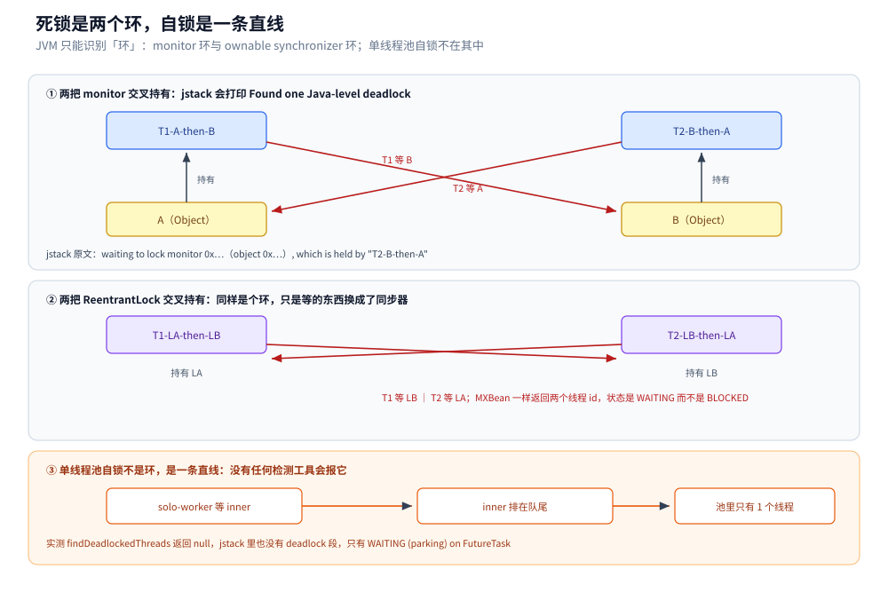
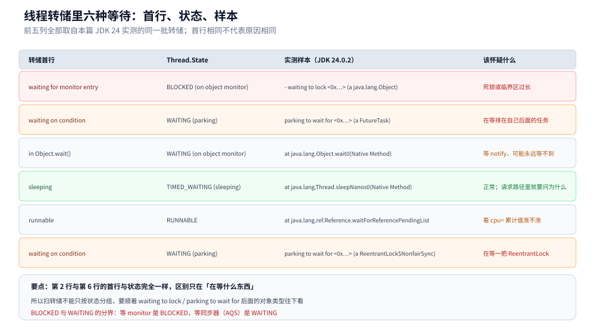

# 死锁与并发缺陷诊断

> 覆盖：死锁的四个必要条件在 Java 里各落在哪、`monitor` 环与 `ownable synchronizer` 环在转储里的两种写法、`ThreadMXBean.findDeadlockedThreads` 与 `jstack` / `jcmd` 的分工、单线程池自锁为什么任何工具都查不出来、线程转储里六种等待的读法、锁竞争如何把吞吐钉死在「1 ÷ 临界区时长」、JFR 的 `jdk.JavaMonitorEnter` 能给什么给不了什么，以及活锁、饥饿、线程泄漏各自的认定手段。
>
> 不覆盖：线程的六个状态与中断语义见 [线程基础与生命周期.md](线程基础与生命周期.md)；锁的实现原理与 AQS 队列见 [锁与AQS.md](锁与AQS.md)；线程池的参数与拒绝策略见 [线程池.md](线程池.md)；JFR 的启动方式与事件类型清单见 [JFR与诊断工具.md](../运行时/JFR与诊断工具.md)；更宽口径的线上排查（内存、GC、容器）见 [线上问题排查.md](../运行时/线上问题排查.md)。
>
> 内容整理自个人学习笔记，素材见 [素材清单](../../../素材清单.md)。
>
> 实测口径：容器 `java-lab`，`eclipse-temurin:24-jdk`（24.0.2+12，linux/amd64，4 CPU），源码在 `.workbuddy/tmp/exp/java/dl/DL.java`（四种模式：`monitor` / `lock` / `selfwait` / `contend`）。`jstack` 与 `jcmd Thread.print` 的输出照贴原文，`ThreadMXBean`、`jfr summary` / `jfr print` 的读数均为真跑。JFR 的对照另在 `jdk21-lab`（`eclipse-temurin:21-jdk`，21.0.12.1）上跑过一轮；活锁与线程泄漏未单独实测，只给判据。

---

## 一、死锁到底是什么在转圈？

**本节要点**：判定标准与用了什么锁无关，只看**等待图里有没有环**。互斥、持有并等待、不可剥夺这三条是环的前提，环本身是最后一条。

### 1.1 从零：二十行造一个死锁

```java
static final Object A = new Object();
static final Object B = new Object();

public static void main(String[] args) {
    new Thread(() -> {
        synchronized (A) {
            sleep(150);                 // 让另一个线程拿到 B
            synchronized (B) { }
        }
    }, "T1-A-then-B").start();

    new Thread(() -> {
        synchronized (B) {
            sleep(150);
            synchronized (A) { }
        }
    }, "T2-B-then-A").start();
}
```

两个线程、两把锁、相反的获取顺序。`sleep(150)` 不是必须的，它只是把「交错」变成「必然」——真实系统里靠的是流量与调度，撞上就卡死，撞不上就一直正常。

四条必要条件在 Java 里的落点：

| 条件 | 在 Java 里是什么 | 能不能拆 |
|---|---|---|
| 互斥 | `synchronized` / `Lock` 的本质 | 不能（要保护共享可变状态） |
| 持有并等待 | 拿着 A 再去要 B | 能：要么一次要齐，要么要不到就放 |
| 不可剥夺 | JVM 不能强行从线程手里夺锁 | 不能（`tryLock(timeout)` 是「自己放弃」） |
| 循环等待 | T1 等 B、T2 等 A | **能：给锁排序，所有线程按同一顺序获取** |

结论很实用：前三条动不了，**能动的只有「顺序」和「超时」**。这也解释了为什么「统一加锁顺序」是最有效的一条规约。

### 1.2 两个环：monitor 环与同步器环



图里前两栏都是环，区别只在「等的东西」：`synchronized` 等的是 `ObjectMonitor`，`ReentrantLock` 等的是 AQS 的同步器。第三栏是一条直线 —— 线程在等一个排在自己**后面**的任务，等待图里没有环，所以任何基于环检测的工具都不会报。要读出的结论是：**「没有 deadlock 段」不等于「没有卡死」**。

### 1.3 JVM 怎么找环，原文怎么读

`jstack -l <pid>`（或 `jcmd <pid> Thread.print -l`）在打印完所有线程后，会额外做一次环检测。两种锁的原文长得不一样：

```text
Found one Java-level deadlock:
=============================
"T1-A-then-B":
  waiting to lock monitor 0x00007a18c8000f30 (object 0x00000000a911afe8, a java.lang.Object),
  which is held by "T2-B-then-A"

"T2-B-then-A":
  waiting to lock monitor 0x00007a18bc000f30 (object 0x00000000a911afd8, a java.lang.Object),
  which is held by "T1-A-then-B"
```

```text
Found one Java-level deadlock:
=============================
"T1-LA-then-LB":
  waiting for ownable synchronizer 0x00000000a911b128, (a java.util.concurrent.locks.ReentrantLock$NonfairSync),
  which is held by "T2-LB-then-LA"
```

读法是**顺着 `which is held by` 往下走**，走到回到起点就是环。两个 `0x…` 是对象地址，用它们能对上 `- waiting to lock <0x…>` 那行，从而知道是哪一行代码在加锁。

`ThreadMXBean` 给的是同一份信息的结构化版本：

```text
[MXBean] findDeadlockedThreads = [23, 24]
[MXBean]   T1-A-then-B 状态=BLOCKED 等在=java.lang.Object@5451c3a8 持有monitor=1 持有同步器=[]
[MXBean]   T2-B-then-A 状态=BLOCKED 等在=java.lang.Object@49476842 持有monitor=1 持有同步器=[]
```

换成 `ReentrantLock` 的死锁，返回的 id 一样是两个，但**状态是 `WAITING` 而不是 `BLOCKED`**，且信息落在 `持有同步器` 那一列：

```text
[MXBean]   T1-LA-then-LB 状态=WAITING 等在=java.util.concurrent.locks.ReentrantLock$NonfairSync@5451c3a8 持有monitor=0 持有同步器=[java.util.concurrent.locks.ReentrantLock$NonfairSync@78308db1]
```

⭐ 这个 `BLOCKED` / `WAITING` 的分界是扫转储时最容易被忽略的一条：**等 monitor 是 `BLOCKED`，等同步器（AQS）是 `WAITING (parking)`**。按状态过滤只留 `BLOCKED`，会把所有 `ReentrantLock` 死锁筛掉。

## 二、为什么有的「卡死」永远查不出来？

**本节要点**：因为等待图里没有环。工具只会做环检测，不会推断「这个任务排在那个任务后面」这种队列依赖。

### 2.1 单线程池自锁的转储

一个只有单线程的池，任务里再提交一个任务并等它：

```java
ExecutorService one = Executors.newFixedThreadPool(1);
one.submit(() -> {
    Future<String> inner = one.submit(() -> "inner");
    return inner.get();                        // 永远等不到：inner 排在队尾
});
```

等 3 秒后问 `ThreadMXBean`，答案是「没有环」：

```text
[MXBean] findDeadlockedThreads = null（没有检测到环）
```

`jstack` 输出里 `grep -c 'Found one Java-level deadlock'` 的结果是 **0**，唯一可疑的是这个线程块：

```text
"solo-worker" #23 [75132] daemon prio=5 os_prio=0 cpu=2.33ms elapsed=6.24s ...
   java.lang.Thread.State: WAITING (parking)
	at jdk.internal.misc.Unsafe.park(java.base@24.0.2/Native Method)
	- parking to wait for  <0x00000000a9007b70> (a java.util.concurrent.FutureTask)
	at java.util.concurrent.FutureTask.get(java.base@24.0.2/FutureTask.java:192)
	at DL.lambda$selfWait$1(DL.java:92)
	at java.util.concurrent.ThreadPoolExecutor.runWorker(java.base@24.0.2/ThreadPoolExecutor.java:1095)
```

诊断的关键就是最后三行：**栈上同时出现了「线程池的 worker」与「等 `FutureTask`」**。这是一条只有人能看出来的因果链：worker 在等的那件事，只有 worker 自己才能执行。`CompletableFuture` 版本的自锁与此完全同形，写法见 [CompletableFuture与异步编排.md](CompletableFuture与异步编排.md)。

### 2.2 还有哪些「不是环」的卡死

| 形态 | 转储特征 | 为什么工具不报 |
|---|---|---|
| 单线程池 / 单消费者自锁 | worker 栈上既有池的 `runWorker` 又有 `FutureTask.get` / `join` | 队列依赖不是环 |
| 有界池 + 任务里提交任务并等待（所有线程都变成等待者） | 所有 worker 都在 `parking to wait for FutureTask` | 同上，环在「任务」之间，不在线程之间 |
| 等一个永远不来的外部事件（socket 无超时、`CountDownLatch` 少一个 count） | `TIMED_WAITING` 或 `RUNNABLE` 在 `socketRead0`，`cpu=` 不涨 | 没有锁参与 |
| 线程池 `submit` 之后没人 `shutdown`，主线程退出不了 | 非守护线程停在 `park`，`main` 已结束 | 程序语义问题，不是死锁 |
| 等一个已经抛异常、但异常被吞掉的任务 | 等的一侧 `WAITING`，被等的一侧已消失 | 目标线程不存在，没有边 |

⭐ 判据：**环检测只能回答「这几个线程是否互相等」；「这个线程等的那件事会不会发生」只能靠人读栈**。

## 三、拿到转储之后怎么读？

**本节要点**：先按「首行 + 状态」定位等待类型，再看 4 个字段确认「在等谁」，最后靠多次采样确认「真的不动」。

### 3.1 六种等待的首行与状态



图里六行全部来自本篇实测的同一批转储，最后一列是「该怀疑什么」。要读出两点：**第一，首行 `waiting on condition` 对应两种完全不同的东西**（等 `FutureTask` 与等 `ReentrantLock`），必须看 `parking to wait for` 后面的类型；**第二，`BLOCKED` 只表示「等 monitor」，把 `BLOCKED` 当「卡死」会漏掉所有 `ReentrantLock` 与 `FutureTask` 的等待。**

### 3.2 四个必看字段

| 字段 | 在哪 | 怎么用 |
|---|---|---|
| `java.lang.Thread.State` | 每个线程块第二行 | 区分 `BLOCKED`（等 monitor）/ `WAITING`（等条件或同步器）/ `TIMED_WAITING`（有超时）/ `RUNNABLE` |
| `- waiting to lock <0x…>` / `parking to wait for <0x…>` | 线程栈里缩进的行 | 对象地址，用来在别的线程块里搜「谁 `locked <0x…>`」 |
| `- locked <0x…>` / `Locked ownable synchronizers` | 线程块末尾 | 这个线程正持有什么；`-l` 才有同步器列表 |
| `cpu=` | 线程块首行 | 累计 CPU 时间；两次采样相减，涨 → 在算，不涨 → 在等（哪怕状态是 `RUNNABLE`） |

`cpu=` 这一条最容易被忽略。实测转储里 `Reference Handler` 的状态是 `RUNNABLE`，但 `cpu=0.45ms` 且栈顶是 native 方法 —— 它其实在等引用队列，不是真在算：

```text
"Reference Handler" #13 [74931] daemon prio=10 os_prio=0 cpu=0.45ms elapsed=6.44s ...
   java.lang.Thread.State: RUNNABLE
	at java.lang.ref.Reference.waitForReferencePendingList(java.base@24.0.2/Native Method)
```

`RUNNABLE` 在 Java 里的含义是「不是 `WAITING` / `BLOCKED`」，**包括在 native 里阻塞等待**。所以判「它在不在干活」只能看 `cpu=` 的增量。

### 3.3 一次采样不够：看「同一栈是否重复出现」

| 采样方式 | 判据 |
|---|---|
| 间隔 10~20 秒连采 3 次 | 同一线程名、同一 `Thread.State`、同一业务帧（`at com.xxx.Yyy.zzz`）都在 → 卡住 |
| 只采 1 次 | 只能看「此刻在等什么」，不能断言「一直没动」 |
| 采 3 次栈在变、但业务指标不动 | 活锁或线程 starvation，转 §5 |

## 四、锁竞争有多贵？怎么量化？

**本节要点**：加锁后的吞吐与线程数无关，只由**临界区时长**决定 —— 因为临界区是串行的。量化等待时长要靠 JFR，但**事件条数不是等待次数**。

### 4.1 一个反直觉的读数：4 个线程没有带来 4 倍

4 个线程抢同一把 monitor，临界区里忙 30 ms，跑 3 秒：

```text
contend 结束：4 个线程抢同一把 monitor，临界区约 30 ms，3 秒内共 103 次进入
```

把临界区改成 200 ms 再跑：

```text
contend 结束：4 个线程抢同一把 monitor，临界区约 200 ms，3 秒内共 18 次进入
```

| 临界区 | 理论最大进入次数（3000 ÷ 临界区） | 实测 |
|---|---|---|
| 30 ms | 100 | 103 |
| 200 ms | 15 | 18 |

⭐ 结论：**有 4 个线程，吞吐却正好等于「1 ÷ 临界区时长」**。临界区里那段代码无论多少线程都只能一个接一个地进，其余三个线程的时间全花在等上。所以「加线程提升并发」在锁竞争下是失效的，要提吞吐只能缩短临界区。

### 4.2 JFR 能补什么，不能补什么

线程转储是快照，给不出「等了多久」。JFR 的 `jdk.JavaMonitorEnter` 给的是带时长的记录。默认阈值写死在 `default.jfc` 里：

```text
<event name="jdk.JavaMonitorEnter">
  <setting name="enabled">true</setting>
  <setting name="stackTrace">true</setting>
  <setting name="threshold" control="locking-threshold">20 ms</setting>
</event>
```

同一次 3 秒竞争实验（约 300 次实际等待），调低到 1 ms 阈值后：

```text
jdk.JavaMonitorEnter                        7           167
```

一条记录的原文：

```text
jdk.JavaMonitorEnter {
  startTime = 06:36:16.479 (2026-10-28)
  duration = 240 ms
  monitorClass = java.lang.Object (classLoader = bootstrap)
  previousOwner = "worker-0" (javaThreadId = 27)
  eventThread = "worker-3" (javaThreadId = 30)
  stackTrace = [
    DL.lambda$contend$0(long, Object, AtomicLong) line: 106
  ]
}
```

它能给出的三样东西正好是转储没有的：**等了多久**（`duration`）、**等谁**（`previousOwner`）、**哪一行**（带行号的栈）。JDK 21 上同一段代码也只记到 10 条、时长 25 ms ~ 1.95 s。

但**条数不能当次数用**：约 300 次等待只留下 7~10 条记录。而且出现 1.95 s 的 `duration` 说明有线程在 3 秒的窗口里几乎一直抢不到锁 —— 这就是下一节的饥饿，JFR 顺手把它量化了。

## 五、活锁、饥饿、线程泄漏怎么认定？

**本节要点**：这三类都没有「环」，靠的是「转储 + 指标」交叉验证，不能只看单次栈。

### 5.1 一张认定表

| 缺陷 | 现象 | 转储 / 指标特征 | 确认手段 |
|---|---|---|---|
| 活锁 | 日志在刷、CPU 高、业务不前进 | 线程 `RUNNABLE`，栈停在同一段重试代码；无 `BLOCKED`；两次采样栈几乎相同 | 同栈重复出现 + 业务计数（如成功数）不涨 |
| 饥饿 | 少数线程长期拿不到锁/CPU，整体吞吐低 | 某些线程长期 `WAITING (parking)` 在同一把锁，另一些 `cpu=` 很高 | JFR 的 `duration` 出现秒级；锁换成公平模式看是否缓解 |
| 线程泄漏 | 线程数只增不减，内存缓慢上涨 | 转储里同类线程数百上千、栈几乎相同；`elapsed=` 很长 | 间隔采样数线程数（`jcmd Thread.print \| grep -c`），对比曲线 |
| 单线程池自锁 | 无 CPU、无 deadlock 报告、请求全挂 | `WAITING (parking)` + 栈上同时有池的 `runWorker` 与 `FutureTask.get` | 见第二节 |
| `ThreadLocal` 泄漏 | 堆缓慢上涨、GC 后不降 | 见 [ThreadLocal与上下文传递.md](ThreadLocal与上下文传递.md) | 堆直方图 + `jcmd GC.class_histogram` |

饥饿的成因通常是**锁不公平**：刚释放锁的线程可以立刻再抢到（barging），排队线程一直排不上。实测 30 ms 临界区的竞争里，最长的一条等待记录到了 1.95 s —— 3 秒里它基本没轮到。改成公平锁（`new ReentrantLock(true)`）能消除这种偏斜，代价是每次切换都要唤醒排队者，吞吐下降。

## 六、应用场景

**本节要点**：三类现场（大面积超时、周期性假死、单点卡住）各自该看哪一节的哪个证据；先分诊，再取转储，不要一上来就 `jstack`。

| 场景 | 用本篇的哪一节 | 典型触发点 |
|---|---|---|
| 接口大面积超时、CPU 却不高 | 第二节 + 第三节 | 线程池自锁、等一个不会来的外部事件 |
| 应用周期性假死、重启就好 | 第三节（三次采样） | 死锁被偶发的并发窗口触发 |
| 压测 QPS 上不去、CPU 打满 | 第四、五节 | 临界区过长、锁竞争、饥饿 |
| 线程数持续上涨 | 第五节 | 线程泄漏（每次请求 new Thread、池未复用） |
| 发布后新出现的卡顿 | 1.2 的锁顺序 | 新代码引入了「反序加锁」 |
| 虚拟线程上吞吐不升反降 | [虚拟线程.md](虚拟线程.md) 3.3 | `synchronized` 里做阻塞 IO 把载体钉住 |

## 七、具体使用

**本节要点**：三板斧命令按「取证据 → 读证据 → 定位持有者」的顺序排，每步给出判据与失败时的下一步。

### 7.1 三板斧命令

```bash
# 1. 转储：-l 才会打印 ownable synchronizers，缺了它就看不到 ReentrantLock 持有关系
jcmd <pid> Thread.print -l > /tmp/td1.txt
sleep 15
jcmd <pid> Thread.print -l > /tmp/td2.txt

# 2. 只看死锁段与可疑等待
sed -n '/Found one Java-level deadlock/,$p' /tmp/td1.txt
grep -n 'parking to wait for\|waiting to lock' /tmp/td1.txt | head -20

# 3. 60 秒飞行记录：看等待时长，而不是快照
jcmd <pid> JFR.start duration=60s filename=/tmp/rec.jfr name=diag
jcmd <pid> JFR.dump name=diag filename=/tmp/rec.jfr
```

实测 `jcmd <pid> Thread.print` 与 `jstack -l <pid>` 的死锁段完全一致（都是 `Found one Java-level deadlock` + `waiting to lock monitor … which is held by …`），用哪个都行；容器里没有 `jstack` 时用 `jcmd`。

### 7.2 进程内自检：定期查一次环

```java
ThreadMXBean mx = ManagementFactory.getThreadMXBean();
long[] ids = mx.findDeadlockedThreads();
if (ids != null) {
    for (ThreadInfo ti : mx.getThreadInfo(ids, true, true)) {
        log.warn("死锁：{} 状态={} 等在={} 持有monitor={} 同步器={}",
                ti.getThreadName(), ti.getThreadState(), ti.getLockName(),
                ti.getLockedMonitors().length, Arrays.toString(ti.getLockedSynchronizers()));
    }
}
```

挂在定时任务里（比如每 30 秒一次）比等告警强：`findDeadlockedThreads` 只做环检测，开销极小，且同时覆盖 monitor 与同步器两类。⚠️ 它**查不出**第二节的自锁。

### 7.3 预防：两条能落地的规约

```java
// 规约一：所有线程按同一顺序加锁（用 id 排序决定先后）
void transfer(Account from, Account to, long amount) {
    Account first = from.id < to.id ? from : to;
    Account second = from.id < to.id ? to : from;
    synchronized (first) {
        synchronized (second) {
            // 转账
        }
    }
}

// 规约二：拿不到就放弃，绝不无限等
if (lock.tryLock(200, TimeUnit.MILLISECONDS)) {
    try {
        // 临界区
    } finally {
        lock.unlock();
    }
} else {
    // 降级：重试、返回失败、进队列
}
```

两条分别拆掉「循环等待」与「无限等待」。第三条常被忽略：**不要在持锁时调用外部代码**（回调、监听器、远程调用），因为你不知道对方会去拿哪把锁；这条是「锁顺序」失效的主要来源。

## 延伸追问

- **死锁能被 JVM 自动解开吗？** → 不能。JVM 只做检测与报告，不做抢占；`Thread.stop` 已废弃且不安全。唯一的出路是重启进程或让业务侧的超时/降级生效。
- **为什么 `findDeadlockedThreads` 有时返回 null，但系统明明卡住了？** → 它只找环。队列依赖（单线程池自锁）、外部事件、`CountDownLatch` 计数不对都不构成环，见 2.2。
- **`jstack` 要加 `-l` 吗？** → 建议加。`-l` 会打印 `Locked ownable synchronizers`（`ReentrantLock`、`Semaphore` 等），没有它就看不出同步器的持有关系；死锁段本身在两种情况下都会打印。
- **公平锁能解决饥饿吗？** → 能缓解偏斜，但吞吐会降：每次释放都要唤醒排队线程并做上下文切换。多数场景用非公平锁 + 缩短临界区更划算。
- **线程转储里线程数几千，是泄漏吗？** → 先看池的配置与 `elapsed=`：池本来就该有这么多就不算；同栈线程数持续增长、且 `elapsed` 分布很宽才是泄漏。
- **`BLOCKED` 的线程会消耗 CPU 吗？** → 不会，它在 monitor 的入口队列里睡着。但**自旋阶段**会短暂消耗 CPU，所以高竞争下 `BLOCKED` 线程的 `cpu=` 也会有增量。
- **JFR 的 `JavaMonitorEnter` 为什么不等于锁竞争次数？** → 实测约 300 次等待只记到 7~10 条，它给的是「足够长、值得记」的样本，不是全量计数。要计数得自己埋点或看业务指标。
- **虚拟线程的死锁怎么查？** → 转储里同样有 `Found one Java-level deadlock` 段，但要看的是虚拟线程而不是载体；`synchronized` 在 JDK 21~23 上还会钉住载体，排查口径见 [虚拟线程.md](虚拟线程.md)。

## 关联

- **上游/总纲**：[README.md](README.md) — 并发编程 13 篇的分工表与主线读序（本篇位次 ⑬，主线最后一篇，按现场症状检索）
- **前置**：[线程基础与生命周期.md](线程基础与生命周期.md) — 六个状态的语义；本篇的等待分类以它为基础
- **前置**：[锁与AQS.md](锁与AQS.md) — `BLOCKED` 与 `WAITING (parking)` 的机制来源：monitor 队列 vs AQS 队列
- **前置**：[线程池.md](线程池.md) — 单线程池自锁的队列前提
- **对照/互补**：[CompletableFuture与异步编排.md](CompletableFuture与异步编排.md) — 同一类自锁在异步链上的写法
- **下游机制**：[JFR与诊断工具.md](../运行时/JFR与诊断工具.md) — `jdk.JavaMonitorEnter` 之外还能开哪些事件
- **下游机制**：[线上问题排查.md](../运行时/线上问题排查.md) — 把线程问题放回「CPU / 内存 / GC / 容器」的整体排查里
- **对照/互补**：[虚拟线程.md](虚拟线程.md) — 载体被钉住时的表现与 `-Djdk.tracePinnedThreads`
> 反向引用（本篇被下列文档引到）：[ForkJoin与并行流.md](ForkJoin与并行流.md)
