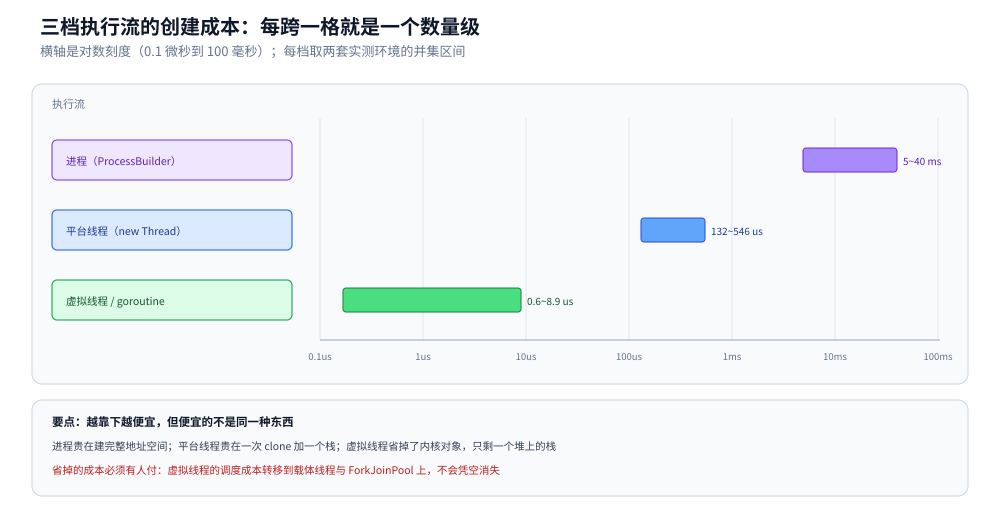
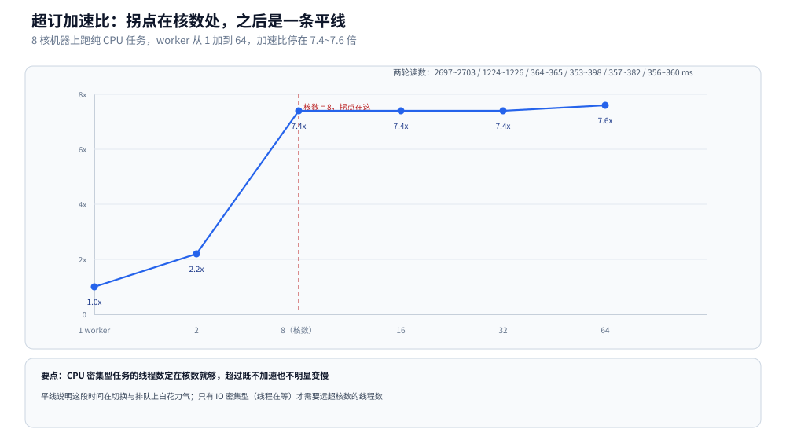

# 线程与进程开销

> 覆盖：从零算清「一个执行流花什么钱」的三笔账（创建、栈、切换），Linux 容器与 Windows 两套创建成本实测、真好内核线程超订的加速比拐点、不加锁计数为什么大部分时候是对的、线程数怎么定与线程池纪律、Java 21 虚拟线程的成本位置，以及 Java 子进程 API 与 Go 的语义对应。
>
> 不覆盖：Linux 侧的进程定义、五状态与上下文切换见 [进程与线程.md](../../../02-计算机基础/linux/进程与线程.md)；线程池的五级判定见 [线程池.md](线程池.md)；锁与 AQS 见 [锁与AQS.md](锁与AQS.md)；虚拟线程的挂载 / 卸载与十万个虚拟线程的账单见 [虚拟线程.md](虚拟线程.md)；Go 侧同一批实验见 [协程与线程成本.md](../../go/并发编程/协程与线程成本.md)。
>
> 内容整理自个人学习笔记，素材见 [素材清单](../../../素材清单.md)。
>
> 实测口径：两套环境，**不混用**。① 容器 `java-lab`，`eclipse-temurin:24-jdk`（24.0.2+12，linux/amd64，4 CPU），源码 `.workbuddy/tmp/exp/java/thread/THR.java`，连跑 3 轮；② 本机 Windows + IDEA 自带 JBR 17，源码 `ProcMeasure.java`，`javac -Xlint:all` 无 error 无 warning，跑通两轮。⚠️ 两套环境只有**同语言内部的相对比值**可以横看：Windows 的进程创建走 `CreateProcess`，Linux 走 `clone`，绝对值差一个量级。
>
> ⚠️ 本篇的 `pidstat -w` / `/proc/<pid>/status` 读切换次数、子进程 `destroyForcibly` 与 `getInputStream` 卡死三类实验**未做**，只写语义约定。

---

## 一、从零：一个线程到底花什么钱？

**本节要点**：一个执行流的成本分成三笔，彼此独立——**创建花在系统调用上、驻留花在栈上、切换花在上下文保存上**。三笔账的量级完全不同，混在一起谈「线程重」就永远算不清。

### 1.1 三笔账分开记

| 这笔账 | 由什么决定 | 量级（实测） | 什么时候变成瓶颈 |
|---|---|---|---|
| 创建 | 一次 `clone` 系统调用 + 分配栈 + 初始化 JVM 结构 | 平台线程 132~159 µs（Windows）/ 334~546 µs（Linux 4 核） | 每个请求都 `new Thread` |
| 驻留 | `-Xss` × 线程数（虚拟地址），实际 RSS 小得多 | 默认 1 MB 预留，5000 线程 → 虚拟地址 +5899 MB | 线程数上千，容器按 RSS 报内存 |
| 切换 | 保存 / 恢复寄存器与栈指针，内核选下一个任务 | 微秒级，但每秒上万次就吃掉整核 | 线程数远超核数且都在抢 CPU |

### 1.2 三十行把两笔账量出来

```java
static long platform(int n) throws Exception {
    CountDownLatch gate = new CountDownLatch(1);
    CountDownLatch started = new CountDownLatch(n);
    long t0 = System.nanoTime();
    for (int i = 0; i < n; i++) {
        Thread t = new Thread(() -> {
            started.countDown();
            try { gate.await(); } catch (InterruptedException e) { Thread.currentThread().interrupt(); }
        });
        t.setDaemon(true);
        t.start();
    }
    started.await();                 // 全部到齐，测量只包含「创建」
    long cost = System.nanoTime() - t0;
    gate.countDown();                // 一起放行
    return cost;
}
```

`gate` 和 `started` 两个闸门是关键：**没有 `started.await()`，测到的是「创建 + 线程跑完任务」**，任务体一旦有耗时就把创建成本淹掉；没有 `gate`，先创建的线程可能已经退出，重复创建会污染读数。

实测（容器，4 核，3 轮）：

```text
round 1: 平台线程 334 us/个 ｜ 虚拟线程 8.9 us/个 ｜ 进程 33.2 ms/个
round 2: 平台线程 381 us/个 ｜ 虚拟线程 3.4 us/个 ｜ 进程 4.9 ms/个
round 3: 平台线程 546 us/个 ｜ 虚拟线程 0.6 us/个 ｜ 进程 7.0 ms/个
池化提交 20000 次：2.26 us/次
```

三个读数各自的意思：**平台线程 334~546 µs 且越跑越慢**（大量线程同时创建时，内核调度与栈分配开始互相挤）；**虚拟线程 8.9 → 0.6 µs 越跑越快**（JIT 编译 + 载体线程池预热，第一次含有冷启动）；**进程 33.2 → 4.9 ms**（第一轮含页缓存冷启动）。读数不稳定这件事本身就是结论：**创建成本是「测出来的分布」，不是常数**。

## 二、为什么必须先热身？怎么跑？

**本节要点**：JIT 没编译之前，同一个循环能慢 2~5 倍——不热身就去测「线程创建成本」，数字里混着一大截解释执行的时间。（Go 侧不需要这一步：AOT 编译、没有解释执行阶段，**这也是两边数字不能直接横比的原因之一**。）

```java
// ⚠️ JIT 没编译之前，同一个循环能慢 2~5 倍。
// 不热身就去测"线程创建成本"，数字里混着一大截解释执行的时间。
scaling(2, 200);
threadCreate(200);
spawnProcess(3, true);
```

**跑法**（Git bash 里用 IDEA 自带的 JBR，不用另装 JDK）：

```bash
JBR="<IDEA 安装目录>/jbr/bin"    # IDEA 自带的 JBR 17，路径按自己的安装位置替换
"$JBR/javac.exe" -Xlint:all -encoding UTF-8 -d out ProcMeasure.java
"$JBR/java.exe" -Dstdout.encoding=UTF-8 -cp out ProcMeasure
```

容器里的跑法（本篇 Linux 读数就这么来的）：

```bash
MSYS_NO_PATHCONV=1 docker exec java-lab sh -c 'cd /w/.workbuddy/tmp/exp/java/thread && javac -d . THR.java && java -cp . THR'
```

## 三、创建一个线程比一个进程便宜多少？

**本节要点**：Java 没有 goroutine，`new Thread()` **就是一个内核线程**（Linux 侧「一对一」那一格）；量出来是 进程 : 线程 : 协程 ≈ **6000 : 25 : 1**。

```java
static long threadCreate(int n) throws InterruptedException {
	CountDownLatch gate = new CountDownLatch(1);
	CountDownLatch started = new CountDownLatch(n);
	Thread[] ts = new Thread[n];
	long start = System.nanoTime();
	for (int i = 0; i < n; i++) {
		ts[i] = new Thread(() -> {
			started.countDown();
			try {
				gate.await(); // 全部挂在这里，只花线程本身的成本
			} catch (InterruptedException e) {
				Thread.currentThread().interrupt();
			}
		});
		ts[i].setDaemon(true);
		ts[i].start();
	}
	started.await();
	long cost = System.nanoTime() - start;
	gate.countDown();
	for (Thread t : ts) {
		t.join(50); // 对应 Go 侧的 Wait：不回收就是攒僵尸
	}
	return cost;
}
```

Windows + JBR 17（原始实验）：

| 执行流（同一台 Windows 机器） | 单个成本 | 相对 |
|---|---|---|
| Java 进程（`ProcessBuilder` + `waitFor`） | **34.9 ~ 39.5 ms** | 1x |
| Java 内核线程（`new Thread().start()`） | **132 ~ 159 µs** | ≈ **1/250** |
| Go goroutine（对照） | **5.0 ~ 5.7 µs** | ≈ **1/6000** |

→ 「线程比进程轻、协程再轻两个数量级」这三个量级差，一张表讲完：进程 : 线程 : 协程 ≈ **6000 : 25 : 1**。

Linux 容器 + JDK 24（本轮补测，同一台机器内的对照）：

| 执行流 | 单个成本（3 轮） | 相对进程 |
|---|---|---|
| 进程（`ProcessBuilder("/bin/true")` + `waitFor`） | 4.9 ~ 33.2 ms | 1x |
| 平台线程（`new Thread().start()`，200 个） | 334 ~ 546 µs | ≈ 1/20 ~ 1/60 |
| 虚拟线程（`Thread.ofVirtual().start()`，20 000 个） | 0.6 ~ 8.9 µs | ≈ 1/2000 |
| 线程池提交（复用 4 条线程，20 000 次） | 2.26 µs | — |

两套环境的比值差得很远（Windows 上线程:进程 ≈ 1:250，Linux 上 ≈ 1:20），**这正是「绝对值和比值都不能跨环境横比」的证据**：Windows 的进程创建贵（`CreateProcess` 要建完整地址空间），Linux 的 `clone` 共享页表便宜得多，分母一小，比值就上去了。



图里三档各占一个数量级：进程在毫秒格、平台线程在百微秒格、虚拟线程与 goroutine 在微秒格。真正要记住的不是具体数字，而是**跨一格就是十倍**——所以「用线程池代替每请求新建」省的是百倍，而「用虚拟线程代替平台线程」省的又是百倍。

**那「只 start 不 wait」能省多少？** 实测 **7.3 ~ 7.8 ms/个**（对 34.9 ms 是 **4~5 倍**快）。⚠️ 而这正是僵尸进程的来源：Linux 上 `fork` 完不 `wait`，子进程退出后 PCB 一直留着（`ps` 里的 `<defunct>`）。**省下来的那部分成本，就是「没做的回收工作」**——快是用泄漏换的。

## 四、真内核线程超订会怎样？

**本节要点**：和 Go 侧同一个结论——**核数处到顶，超订不再变快**；Java 侧能多证明一点：这里没有任何用户态调度、全是真内核线程，所以「频繁上下文切换的额外开销」体现在 **CPU 时间**里而不是墙上时间。

```java
static long scaling(int workers, long totalUnits) throws InterruptedException {
	long chunk = totalUnits / workers + 1;
	final double[] sums = new double[workers]; // ★ 每个 worker 写自己的格子
	final CountDownLatch done = new CountDownLatch(workers);
	long start = System.nanoTime();
	for (int i = 0; i < workers; i++) {
		final int id = i;
		Thread t = new Thread(() -> {
			sums[id] = busy(chunk);
			done.countDown();
		});
		t.setDaemon(true);
		t.start();
	}
	done.await();
	return System.nanoTime() - start;
}
```

| worker | 耗时（两轮） | 加速比 |
|---|---|---|
| 1 | 2697 ~ 2703 ms | 1.0x |
| 2 | 1224 ~ 1226 ms | 2.2x |
| **8（= 核数）** | 364 ~ 365 ms | **≈ 7.4x** |
| 16 | 353 ~ 398 ms | ≈ 7.4x |
| 32 | 357 ~ 382 ms | ≈ 7.4x |
| 64 | 356 ~ 360 ms | ≈ 7.6x |

- **和 Go 侧同一个结论**：核数处到顶，超订不再变快（也没明显变慢，理由同 [协程与线程成本.md](../../go/并发编程/协程与线程成本.md) 第三节第 2 条）。
- 要抓「切换的额外开销」，得用 `pidstat -w -p <pid> 1`（看 `cswch/s`、`nvcswch/s`），或读 `/proc/<pid>/status`。⚠️ 两条都没在本机实测过。
- Java 8 worker 能到 7.4x、Go 只有 5.5x：**别横向比这两个数**。两边的 `busy` 循环不是一套指令（JIT 会把纯浮点累加向量化 / 部分消除），这个差异大到能盖过调度模型的差异。同语言内比才有意义。



曲线的拐点在核数处，之后是一条平线。这条平线是「线程数怎么定」那张表的全部依据：CPU 密集型任务加线程到核数就够，再加只是把同一份算力切得更碎，还会多出切换成本。

## 五、不加锁计数为什么大部分时候是对的？

**本节要点**：和 Go 侧完全同一个教训——**大部分时候它是对的**，所以「跑了一遍没问题」永远不能拿来排除竞态。

```java
static int unsafeAdd(int g, int n) throws InterruptedException {
	final int[] counter = {0}; // ⚠️ 故意不用 AtomicInteger：就是让它出错
	Thread[] ts = new Thread[g];
	for (int i = 0; i < g; i++) {
		ts[i] = new Thread(() -> {
			for (int j = 0; j < n; j++) {
				counter[0]++; // 读-改-写三步，不是原子的
			}
		});
		ts[i].setDaemon(true);
		ts[i].start();
	}
	for (Thread t : ts) {
		t.join();
	}
	return counter[0];
}
```

实测（8 线程 × 1000 次，两轮各 5 次，对照组 `synchronized` 恒为 8000）：

| | 不加锁出现的值 |
|---|---|
| 第 1 轮 | 8000、8000、**7349**、8000、8000 |
| 第 2 轮 | 8000、**7830**、8000、8000、8000 |

十次里有八次是全对。原因是 `counter[0]++` 只有三条指令、相邻两次循环挨得极近，两个线程真正撞进同一段的时间窗口只有几十纳秒；线程数少、CPU 闲、JIT 刚编译完时几乎撞不上。同样的现象在并行流里更隐蔽：环境允许时能连续多轮不丢（[ForkJoin与并行流.md](ForkJoin与并行流.md) 第六节六轮里最后一轮就是 100 000）。

Java 侧对应 `-race` 的工具是 **ThreadSanitizer**（`-XX:+UnlockDiagnosticVMOptions -XX:+WhiteBoxAPI` 那套）或更常用的 **jcstress**；日常靠 review + `Atomic*` / 锁的纪律。

## 六、线程池：为什么不要每请求 `new Thread`？

**本节要点**：`new Thread` 就是一个内核线程（130 µs 起 + 一个栈），**而且没有上限保护**——一次请求风暴能把机器打到 `OutOfMemoryError: unable to create new native thread`。所以线上只有池，且**池是进程级单例**（Spring `@Bean` 注入），不是每次请求新建。

```java
// ⚠️ 不用 Executors.newFixedThreadPool：它的队列是**无界** LinkedBlockingQueue，
// 任务堆积会先撑爆堆，而不是触发拒绝策略。
ThreadPoolExecutor pool = new ThreadPoolExecutor(
		Runtime.getRuntime().availableProcessors(),         // 核心数 = CPU 核数（对应第四节 的拐点）
		Runtime.getRuntime().availableProcessors() * 2,     // 只有 IO 密集型才把上限调大
		60, TimeUnit.SECONDS,
		new ArrayBlockingQueue<>(1000),                     // ★ 有界队列
		new ThreadPoolExecutor.CallerRunsPolicy());         // 满了让调用方自己跑 = 背压
```

| 场景 | 线程数怎么定 | 依据 |
|---|---|---|
| **CPU 密集型**（加解密、压缩、图像） | ≈ 核数（核数 +1 补偿偶发阻塞） | 第四节：核数处就到顶 |
| **IO 密集型**（RPC、DB、文件） | 远大于核数，粗算 `核数 / (1 − 阻塞比)` | 线程大部分时间在等，不占 CPU |
| **虚拟线程 / 协程** | 不用定，按任务数开 | 协程按 KB 计（实测 2 万条 0.6~8.9 µs/条） |

Java 21+ 的**虚拟线程**就是 Java 侧的 goroutine（M:N 挂到载体线程上，`Thread.ofVirtual()` / `Executors.newVirtualThreadPerTaskExecutor()`）。用它之后上面那张「IO 密集型线程数怎么定」的表**基本作废**——不用再靠堆线程掩盖延迟了，但 ⚠️ 池化的仍然是载体线程，`synchronized` 长临界区仍会 pin 住载体线程（那条在 JDK 24 已被 JEP 491 解决，新旧对照见 [虚拟线程.md](虚拟线程.md)）。

## 七、Java 子进程 API 与 Go 怎么对应？

**本节要点**：同样是「起子进程 → 回收 → 优雅停止」三件事，两边 API 一一对应；⚠️ Java 侧最容易踩的是**不读输出就 `waitFor()`**，子进程写满管道缓冲区就互等成死锁。

| 语义 | Go | Java |
|---|---|---|
| 回收子进程 | `cmd.Wait()` / 后台协程兜底 Wait | `p.waitFor()`；⚠️ 不 wait 在 Linux 上留僵尸 |
| 优雅停止 | SIGTERM → 超时 → SIGKILL | `p.destroy()` → 超时 → `p.destroyForcibly()`（后者才等价 SIGKILL） |
| 拿输出 | `cmd.CombinedOutput()`（内部已 Wait） | `p.getInputStream()` **要读**，否则管道满了子进程会卡死 |
| 线程数量 | `runtime.NumGoroutine()` / 读 `/proc` | `ThreadMXBean.getThreadCount()`（只有数量，没有切换次数） |
| 栈大小 | goroutine 自动增长，不可配 | `-Xss`（默认 512KB~1MB），⚠️ 是**预留**不是驻留 |

⚠️ Java 这一栏只有「线程数量 / 线程池 / 创建成本」三项在本机跑过；`destroy` 与 `destroyForcibly` 的差别、`getInputStream` 卡死，都是**语义层面的约定，没有做破坏性实验去验证**。

## 八、应用场景

**本节要点**：执行流只有三档（平台线程池 / 虚拟线程 / 进程），选择依据是「阻塞占比」与「任务层数」，不是「哪个更快」。

| 场景 | 该用什么执行流 | 判据 |
|---|---|---|
| Web 请求处理（IO 为主） | 平台线程池或虚拟线程 | 线程在等下游；池大小按 `核数 / (1 − 阻塞比)`，或直接一条任务一条虚拟线程 |
| 批量计算（压缩、加解密、图像缩放） | 平台线程池，大小 = 核数 | 第四节：超过核数不再加速 |
| 海量短任务（每请求一个任务、几万并发） | 虚拟线程 | 实测 2 万条 0.6~8.9 µs/条，比平台线程便宜两个数量级 |
| 临时脚本 / 一次性并发 | `new Thread` 也行 | 数量可控（几个到几十个）、生命周期短，不值得建池 |
| 调用外部命令 | `ProcessBuilder` + 读流 + 超时 | 第七节：不读流会死锁，不 wait 会留僵尸 |
| 本项目内 | [虚拟线程.md](虚拟线程.md) 的十万条账单 | 同一套成本口径，换成虚拟线程后的地址空间与 RSS 对照 |

## 九、具体使用

**本节要点**：三段可直接抄的东西——按任务性质算线程数、池的生命周期模板、子进程的安全回收。

### 9.1 线程数估算

```java
int cores = Runtime.getRuntime().availableProcessors();
double blockRatio = 0.9;                      // 线程 90% 时间在等下游，用压测或 APM 量出来
int poolSize = (int) Math.ceil(cores / (1 - blockRatio));   // 4 核 → 40
```

三点提醒：`blockRatio` 必须是**量出来的**，拍脑袋填 0.9 就会得到 40 条线程去抢 4 个核；池大小一旦超过核数，收益完全取决于「等待能否重叠」，CPU 密集型填这个公式只会更慢；虚拟线程场景下这个公式直接不用。

### 9.2 池的生命周期

```java
@Bean(destroyMethod = "shutdown")
public ThreadPoolExecutor bizPool() {
    ThreadPoolExecutor p = new ThreadPoolExecutor(cores, cores * 2, 60, TimeUnit.SECONDS,
            new ArrayBlockingQueue<>(1000), new ThreadPoolExecutor.CallerRunsPolicy());
    p.setThreadFactory(r -> {
        Thread t = new Thread(r, "biz-pool-" + r.hashCode());
        t.setDaemon(false);                   // ⚠️ 别设 daemon：会被 JVM 退出时直接掐断
        return t;
    });
    return p;
}
```

`destroyMethod = "shutdown"` 保证容器关闭时会停池；线程名带前缀，线上 `jstack` 一眼能按前缀数出「池里还有几条在跑」（见 [线上问题排查.md](../运行时/线上问题排查.md)）。

### 9.3 子进程的安全回收

```java
Process p = new ProcessBuilder("sh", "-c", "long-running-task").redirectErrorStream(true).start();
try (BufferedReader r = p.inputReader()) {
    r.lines().forEach(line -> log.info("child: {}", line));   // ⚠️ 必须持续读
}
if (!p.waitFor(30, TimeUnit.SECONDS)) {
    p.destroy();                                   // SIGTERM
    if (!p.waitFor(5, TimeUnit.SECONDS)) p.destroyForcibly();  // SIGKILL
}
```

## 延伸追问

- **Java 的线程能像 goroutine 那样「不占内核线程」吗？** → Java 21+ 的**虚拟线程**才行（M:N 挂在载体线程上）；`new Thread()` 自始至终都是一对一内核线程（第三节）。
- **为什么 Java 侧不用 `LockOSThread` 也能量到超订？** → 因为 `new Thread()` 本来就是真内核线程；Go 的 goroutine 默认多路复用到少量 M，要看超订必须显式 `LockOSThread`（第四节）。
- **线程池为什么不用 `Executors.newFixedThreadPool`？** → 它的队列无界，任务堆积会先撑爆堆而不是触发拒绝策略；要用有界队列 + `CallerRunsPolicy` 做背压（第六节）。
- **虚拟线程上了以后，线程池还需要吗？** → 线程数那张表基本作废，但载体线程仍被池化，且 `synchronized` 长临界区会 pin 住载体线程（第六节）。
- **`p.waitFor(timeout)` 能当超时用吗？** → 不能单独用：它只能等**直接子进程**，孙子进程还握着管道就读不到 EOF。完整解法见 [子进程与外部命令.md](../../java/工程实践/子进程与外部命令.md)。
- **`-Xss` 设小了会怎样？** → 栈溢出提前发生，且不易复现（取决于调用深度）。实测 2000 条线程时 `-Xss 256k / 1024k / 2m` 对应虚拟地址 +1399 / +2899 / +4899 MB，即几乎线性（见 [虚拟线程.md](虚拟线程.md)）；RSS 则远小于这个数，因为只有真正用到的页才驻留。
- **为什么 Linux 上创建 200 条线程的单条成本比 Windows 高？** → 因为 200 条是同时创建、只有 4 个核：内核要在同一批 CPU 上调度 200 个新任务，栈分配与调度器开销叠在一起。这也说明**单条成本依赖并发度**，不能用「总时间 ÷ 条数」当常数。

## 关联

- **上游/总纲**：[README.md](README.md) — 并发编程 13 篇的分工表与主线读序（本篇位次 ⑫，收口成本账）
- **对照/互补**：[线程基础与生命周期.md](线程基础与生命周期.md) — 线程对象的六种状态与中断语义，本篇只算成本
- **对照/互补**：[协程与线程成本.md](../../go/并发编程/协程与线程成本.md) — Go 侧同一批实验（goroutine 创建成本、栈内存、GOMAXPROCS）
- **对照/互补**：[进程与线程.md](../../../02-计算机基础/linux/进程与线程.md) — 进程 / 线程 / 协程的概念与三种线程实现方式
- **下游机制**：[线程池.md](线程池.md) — 五级判定、核心数与队列的关系
- **下游机制**：[锁与AQS.md](锁与AQS.md) — `synchronized` 锁升级与 `counter++` 为什么不是原子的
- **下游机制**：[JMM与内存屏障.md](JMM与内存屏障.md) — 竞态背后的可见性与重排
- **对照/互补**：[子进程与外部命令.md](../../java/工程实践/子进程与外部命令.md) — 子进程创建 / 回收 / 超时的 Java 写法
- **对照/互补**：[堆外内存与内存映射.md](../运行时/堆外内存与内存映射.md) — `线程数 × -Xss` 是 RSS 账单里的一项
