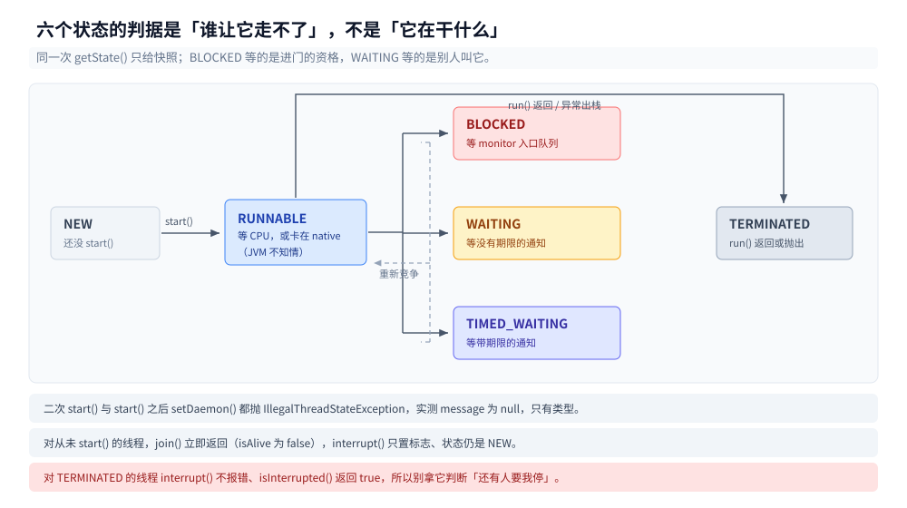
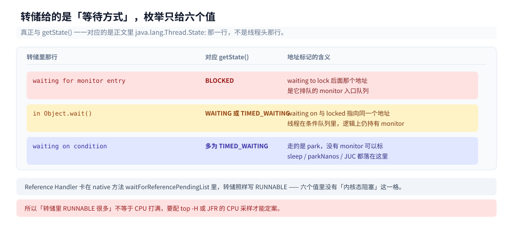
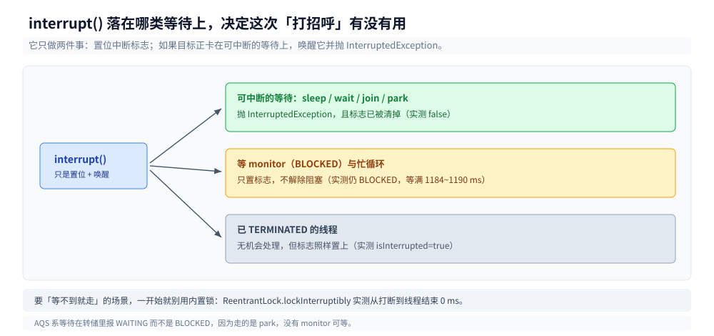
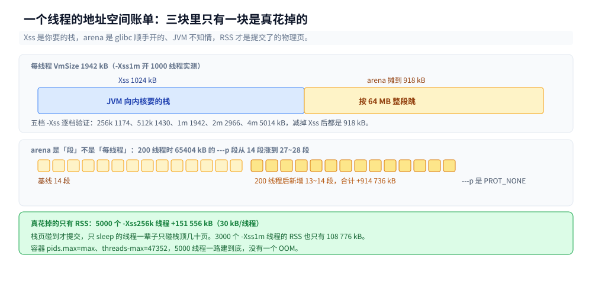
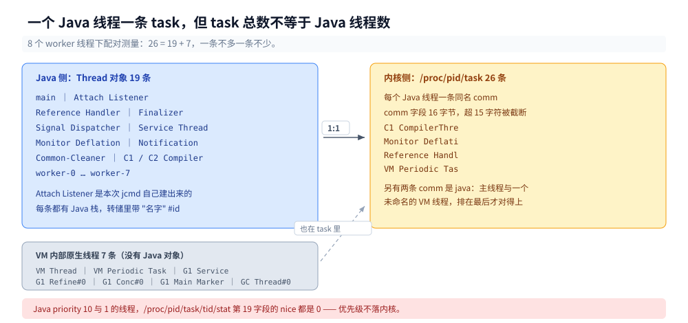

# 线程基础与生命周期

> 覆盖：一个线程从 `new` 到 `TERMINATED` 的六种状态与各自在等什么、`getState()` 与线程转储文字的逐项对照（含「RUNNABLE 不等于在跑」）、`interrupt()` 作为协作式信号在八种等待上的不同落点、`join()` 的字节码实现、`-Xss` 与一个线程真实的地址空间账单、一个 Java 线程与内核 task 的一一对应（含 `comm` 截断与 `nice` 不落地）、daemon 与未捕获异常处理器改变了什么。
>
> 不覆盖：线程创建成本与超订曲线见 [线程与进程开销.md](线程与进程开销.md)；`synchronized` 与 AQS 的实现见 [锁与AQS.md](锁与AQS.md)；池化与拒绝策略见 [线程池.md](线程池.md)；栈帧里放什么见 [运行时数据区与栈帧.md](../运行时/运行时数据区与栈帧.md)；`happens-before` 与可见性见 [JMM与内存屏障.md](JMM与内存屏障.md)；虚拟线程（JDK 21+）见 [线程与进程开销.md](线程与进程开销.md) 末节，本篇只在 `join()` 的字节码里给一条分支证据。
>
> 内容整理自个人学习笔记，素材见 [素材清单](../../../素材清单.md)。
>
> 实测口径：容器 `java-lab`，`eclipse-temurin:24-jdk`（24.0.2+12，linux/amd64，cgroup v2，4 CPU，5.9 GB 内存），源码与 class 在 `.workbuddy/tmp/exp/java/thread/`。状态与中断类结论连跑 3 轮逐字一致；递归深度必须配 `-Xint` 才稳定（原因见第五节），默认模式下给区间。⚠️ 四处**未实测**：`-Xss` 上限受宿主 `ulimit -s` 影响的那一段（本机 `sh` 不支持 `ulimit -u`，没能改）、Windows 与 macOS 的默认栈值、`Attach Listener` 在非 `jcmd` 场景下的创建时机、glibc arena 那 64 MB 段的分配触发点（只观察到「线程一多就涨」，没定位到哪一次 `malloc` 触发的）。

---

## 一、一个线程从创建到结束要经过哪六个状态？

**本节要点**：`Thread.State` 只有六个值，判据是「此刻**谁**在等」——等 CPU、等锁、等通知、等超时、还没开始、已经结束。`getState()` 拿的是**某一瞬间的快照**，同一个线程前后两次调用可能给出两个不同答案。

### 1.1 从零：四十行把六个状态同时摆出来

六个线程各占一格，主线程停 500 ms 后统一读一遍。要让 `BLOCKED` 出现，必须有另一个线程**正持有**同一把锁；只 `synchronized` 一下是拿不到 `BLOCKED` 的：

```java
public class FirstStates {
    static final Object WAIT = new Object();
    static final Object BLOCK = new Object();

    public static void main(String[] args) throws Exception {
        Thread tNew = new Thread(() -> { }, "s-new");                    // 只 new，不 start
        Thread tTerm = new Thread(() -> { }, "s-term");
        tTerm.start();
        tTerm.join();                                                    // 跑完了
        Thread tRun = new Thread(() -> { while (true) { } }, "s-run");
        Thread tTimed = new Thread(() -> {
            try { Thread.sleep(60_000); } catch (InterruptedException e) { }
        }, "s-timed");
        Thread tWait = new Thread(() -> {
            synchronized (WAIT) {
                try { WAIT.wait(); } catch (InterruptedException e) { }
            }
        }, "s-wait");
        Thread holder = new Thread(() -> {
            synchronized (BLOCK) {
                try { Thread.sleep(60_000); } catch (InterruptedException e) { }
            }
        }, "s-holder");
        Thread tBlock = new Thread(() -> { synchronized (BLOCK) { } }, "s-block");
        for (Thread t : new Thread[]{tRun, tTimed, tWait, holder, tBlock}) {
            t.setDaemon(true);
            t.start();
        }
        Thread.sleep(500);
        for (Thread t : new Thread[]{tNew, tTerm, tRun, tTimed, tWait, tBlock}) {
            System.out.printf("%-14s %s%n", t.getName(), t.getState());
        }
    }
}
```

三轮输出逐字一致：

```text
s-new          NEW
s-term         TERMINATED
s-run          RUNNABLE
s-timed        TIMED_WAITING
s-wait         WAITING
s-block        BLOCKED
```

`Thread.State.values().length` 就是 6，顺序是 `NEW, RUNNABLE, BLOCKED, WAITING, TIMED_WAITING, TERMINATED`——注意 `BLOCKED` 排在 `WAITING` 前面，这个顺序和「等待的深重程度」无关，只是枚举声明顺序，不要拿它当优先级。

### 1.2 六个状态各自在等什么

判据不是「线程在干什么」，而是「**谁**让它走不了」：

| 状态 | 谁让它走不了 | 怎么造出来 | 转储里的那行 |
|---|---|---|---|
| `NEW` | 还没 `start()` | `new Thread(...)` | 不出现 |
| `RUNNABLE` | 等 CPU，或在内核态等着但 JVM 不知情 | 忙循环；任何 native 阻塞 | `runnable` / `waiting on condition` |
| `BLOCKED` | 另一线程持有 monitor | 抢 `synchronized` 抢不到 | `waiting for monitor entry` |
| `WAITING` | 等一个没有期限的通知 | `wait()` / `join()` / `park()` | `in Object.wait()` |
| `TIMED_WAITING` | 等一个带期限的通知 | `sleep(n)` / `wait(n)` / `parkNanos` | `waiting on condition` |
| `TERMINATED` | 已经跑完，task 已回收 | `run()` 返回或抛异常出栈 | 不出现 |

`BLOCKED` 与 `WAITING` 的区别值得单独记：两者都在等，但 `BLOCKED` 等的是**进门的资格**（monitor 的入口队列），`WAITING` 等的是**别人叫它**（条件队列）。第三节会看到这个区别带来完全不同的中断行为。

### 1.3 只有一格不能回头

`NEW → RUNNABLE` 只能走一次：同一个线程第二次 `start()` 抛 `IllegalThreadStateException`（实测 `message` 是 `null`，只有类型没有原因）。同样地，`start()` 之后再 `setDaemon()` 也抛 `IllegalThreadStateException`——daemon 属性只能在启动前定。

`BLOCKED` / `WAITING` / `TIMED_WAITING` 三者可以来回跳，也可能直接跳过其中几格（一个线程可以一辈子不 `BLOCKED`）。但 `TERMINATED` 是终点：到了就再也回不去，`start()` 也不会让它复活。

还有两个容易踩的边界，实测都反直觉：

- 对**从未 `start()`** 的线程调 `join()`，**立即返回**，不抛异常（`isAlive()` 是 `false`）。
- 对**从未 `start()`** 的线程调 `interrupt()`，状态仍是 `NEW`，但 `isInterrupted()` 变成 `true`——中断标志置上了，线程却永远不会跑。



图中实线是唯一能走的迁移，虚线是从等待回到 `RUNNABLE` 需要重新竞争；`NEW` 与 `TERMINATED` 各自只有一条边，中间四个状态可以互相穿越，没有任何顺序保证。

---

## 二、`getState()` 的返回值与线程转储里的文字怎么对上？

**本节要点**：`getState()` 只有六个值，而转储每个线程头给的是**等待方式**（`waiting on condition` / `in Object.wait()` / `waiting for monitor entry`），真正与枚举一一对应的是正文里 `java.lang.Thread.State:` 那一行。更要紧的是：**`RUNNABLE` 不等于「在跑」**，卡在 native 方法里的线程照样报 `RUNNABLE`。

### 2.1 一段转储里同时出现三类等待

把 1.1 那个程序加上「保持 60 秒」，用 `jcmd <pid> Thread.print` 抓快照，节选三个线程（完整转储 16 个 Java 线程 + 7 个原生线程）：

```text
Threads class SMR info:
_java_thread_list=0x000077ddcc002790, length=16, elements={...}

"main" #3 [269] prio=5 os_prio=0 cpu=158.74ms elapsed=19.27s tid=... nid=269 waiting on condition
   java.lang.Thread.State: TIMED_WAITING (sleeping)
	at java.lang.Thread.sleepNanos0(java.base@24.0.2/Native Method)

"Reference Handler" #13 [279] daemon prio=10 os_prio=0 cpu=1.76ms elapsed=19.21s tid=... nid=279 waiting on condition
   java.lang.Thread.State: RUNNABLE
	at java.lang.ref.Reference.waitForReferencePendingList(java.base@24.0.2/Native Method)

"s-waiting" #27 [291] daemon prio=5 os_prio=0 cpu=0.65ms elapsed=19.12s tid=... nid=291 in Object.wait()
   java.lang.Thread.State: WAITING (on object monitor)
	at java.lang.Object.wait0(java.base@24.0.2/Native Method)
	- waiting on <0x00000000a9118b08> (a java.lang.Object)
	- locked <0x00000000a9118b08> (a java.lang.Object)

"s-blocked" #29 [293] daemon prio=5 os_prio=0 cpu=0.34ms elapsed=19.11s tid=... nid=293 waiting for monitor entry
   java.lang.Thread.State: BLOCKED (on object monitor)
	- waiting to lock <0x00000000a9118b18> (a java.lang.Object)
```

`Reference Handler` 这一条是全文最该记住的反例：它卡在 `waitReferencePendingList` 这个 native 方法里，内核层面早就不占 CPU 了，但 JVM 报的是 **`RUNNABLE`**。因为 JVM 只知道「这线程在跑 Java 代码，进了个 native 方法」，native 里睡了多久它管不着。所以「转储里 RUNNABLE 很多」不等于「CPU 打满」，要配 `top -H` 或 JFR 的 CPU 采样才能定案。

### 2.2 三行文字与三类地址

转储里除了 `Thread.State:` 还有三类标记，含义各不相同：

| 转储文字 | 对应的 `getState()` | 地址标记的含义 |
|---|---|---|
| `waiting for monitor entry` | `BLOCKED` | `waiting to lock <A>`：在 A 的入口队列里排队 |
| `in Object.wait()` | `WAITING` 或 `TIMED_WAITING` | `waiting on <A>` + `locked <A>`：是被 `wait` 放进了 A 的条件队列，但**逻辑上仍持有** A |
| `waiting on condition` | 多数是 `TIMED_WAITING`，也可能是 `RUNNABLE` | 走的是 `park`（`Unsafe.park` / `sleep` / JUC），没有 monitor 可标 |

`s-waiting` 那两行标记里，`waiting on` 与 `locked` 指向的是**同一个地址** `0x...8b08`。这不是笔误：`Object.wait()` 会把线程放进条件队列并释放 monitor，但转储仍然把它算作 `locked`，因为它随时可能被唤醒并继续在临界区里跑。这一点在第三节会得到一次独立验证：`InterruptedException` 抛出的那一刻 `Thread.holdsLock(lock)` 是 `true`。

### 2.3 线程 id、`nid` 与内核 tid 是三个东西

同一个线程头上有三个编号：

- `#27` 是 Java 线程 id，`Thread.threadId()`，从 1 开始按创建顺序发号，进程内唯一。
- `[291]` 与 `nid=291` 是同一件事——**内核 tid**，十进制，与 `/proc/<pid>/task/291` 逐字对应。
- `tid=0x000077de58148d60` 是 JVM 内部的 `JavaThread*` 指针，只在同一份转储内有意义。

`nid` 是十进制这件事在 JDK 24 上可以用 `/proc` 直接核对；老版本转储按十六进制打印，所以「看到 `nid` 先 `printf %x`」这个老习惯在新版本上反而会把地址算错。跨版本读转储时先确认这一条。



图中三行是转储里最常见的三种等待文字，右侧那列才是关键：`waiting on` 与 `locked` 指向同一地址时，线程其实还在临界区里，只是被 `wait` 暂时放出了 monitor。

---

## 三、为什么 `interrupt()` 只是「打招呼」？

**本节要点**：`interrupt()` 只做两件事——置位中断标志、如果目标正卡在**可中断的等待**上就唤醒它并抛 `InterruptedException`。它落在哪一类等待上，决定了这次「打招呼」是立刻生效、延迟生效、还是根本无效：`sleep` / `wait` / `join` / `park` 可中断，`synchronized` 的等锁**不可中断**，忙循环也不会被打断。

### 3.1 八种情形跑一遍

同一份代码连跑 3 轮，除 C 的毫秒数（1184 / 1187 / 1190）外逐字一致：

```text
=== A) sleep 中 interrupt ===
  抛 InterruptedException，此刻 isInterrupted()=false
=== B) 忙等中 interrupt ===
  打断前 state=RUNNABLE
  循环自行退出，观察到 isInterrupted()=true
=== C) BLOCKED（等 monitor）中 interrupt ===
  interrupt 前 state=BLOCKED
  interrupt 后 state=BLOCKED ｜ isInterrupted()=true
  终于拿到锁，等待了 1184 ms（打断没让它提前返回）
=== D) WAITING（wait()）中 interrupt ===
  打断前 state=WAITING
  抛 InterruptedException，isInterrupted()=false ｜ 仍持有 monitor=true
=== E) TIMED_WAITING（join）中 interrupt ===
  joiner state=WAITING
  join 被 InterruptedException 打断，目标仍存活=true
=== F) isInterrupted() 与 Thread.interrupted() ===
  interrupt 后 isInterrupted()=true
  interrupted() 第一次=true
  interrupted() 第二次=false
=== G) ReentrantLock.lockInterruptibly() 对照 synchronized ===
  打断前 state=WAITING
  lockInterruptibly 抛 InterruptedException，提前返回
  从打断到线程结束 = 0 ms
=== H) 对 TERMINATED 线程 interrupt ===
  state=TERMINATED ｜ isInterrupted()=true
```

八条里最有信息量的是 C 与 G 的对照：同样在等一把锁，**内置锁**那条等了 1184 ms 才进门（打断只是把标志置上，线程照旧排队），`ReentrantLock` 的 `lockInterruptibly` 从打断到线程结束是 **0 ms**。要「等不到就走」，只能换显式锁。

### 3.2 五条容易记错的

1. **抛异常时标志已经被清掉**。A 与 D 里 `InterruptedException` 一抛出，`isInterrupted()` 就是 `false`——JVM 在抛之前替你清了。所以「catch 到之后要不要再 `interrupt()` 一次」不是风格问题：如果你把异常吞掉且不恢复标志，上层永远不知道有人要求停。
2. **`Thread.interrupted()` 会清标志，`isInterrupted()` 不会**。F 里连续两次 `interrupted()`，第一次 `true` 第二次 `false`。
3. **等锁期间打断不解除阻塞**。C 的 `isInterrupted()` 已经是 `true`，`getState()` 仍报 `BLOCKED`。只有拿到锁之后，线程才有可能处理这个标志。
4. **`wait()` 被打断抛异常时已经重新持有 monitor**。D 的 `holdsLock=true` 是实测结果，这意味着 `catch` 块里仍然在临界区内，别在里面做长耗时操作。
5. **AQS 系等待报的是 `WAITING` 不是 `BLOCKED`**。G 打断前 `state=WAITING`——`ReentrantLock` 走 `LockSupport.park`，没有 monitor 可等，所以它落在 `WAITING` 那一格。读转储时看到「一堆 WAITING」，先想清楚它们是 `wait` 还是 `park`。

还有一条反直觉的：对**已经 `TERMINATED`** 的线程 `interrupt()` 不报错，`isInterrupted()` 返回 `true`（H）。也就是说 `isInterrupted()` 不能拿来判断「还有没有人要我停」——它只回答「标志位现在是什么」。



图中三条去向对应三类等待：抛异常并清标志（`sleep`/`wait`/`join`）、只置标志不解除阻塞（`synchronized` 等锁、忙循环）、以及根本没机会处理（已结束）。

---

## 四、`join()` 到底在等什么？

**本节要点**：`join()` 不是「等线程结束」的专用原语，它是 `synchronized (thread) { while (thread.isAlive()) thread.wait(); }`——等的是**线程对象上的 monitor 通知**。线程退出时 JVM 会 `notifyAll` 这个对象，`join` 因此醒来。所以 `join` 天然是一个可被 `interrupt` 打断的 `wait`。

### 4.1 字节码里没有魔法

无参 `join()` 只有四条指令，转调 `join(0L)`；真正的循环在 `join(long)` 里（节选分支）：

```text
public final void join() throws java.lang.InterruptedException;
   0: aload_0
   1: lconst_0
   2: invokevirtual #454                // Method join:(J)V
   5: return

public final void join(long) throws java.lang.InterruptedException;
  34: invokevirtual #436                // Method isAlive:()Z
  44: invokevirtual #98                 // Method java/util/concurrent/TimeUnit.toNanos:(J)J
  52: invokevirtual #439                // Method java/lang/VirtualThread.joinNanos:(J)Z
  60: monitorenter
  68: invokevirtual #436                // Method isAlive:()Z
  85: invokevirtual #448                // Method java/lang/Object.wait:(J)V
  89: invokevirtual #436                // Method isAlive:()Z
 117: goto          135
 120: invokevirtual #436                // Method isAlive:()Z
 129: invokevirtual #448                // Method java/lang/Object.wait:(J)V
 136: monitorexit
```

两个分支很清楚：目标是**虚拟线程**就走 `VirtualThread.joinNanos`（不占 monitor），是**平台线程**就 `monitorenter` + `Object.wait(J)` + `isAlive()` 循环。`javap` 出来的 `Exception table` 是空的，说明打断走的是 `Object.wait` 抛出的 `InterruptedException`，不是 catch 兜出来的。

### 4.2 四个推论

- **无参 `join()` 等于 `join(0)`**，而 `wait(0)` 的语义是「无限等」。所以 E 里 `joiner` 的状态是 **`WAITING`** 而不是 `TIMED_WAITING`——它确实没有期限。
- **线程结束之后 `join` 立即返回**，因为 `isAlive()` 已是 `false`，循环体一次都不进。
- **对 `NEW` 线程 `join` 也立即返回**（第一节实测）。这里没有 `IllegalThreadStateException`，和 `start()` 不一样。
- **`join` 会等 monitor**。如果目标线程在 `run()` 里正 `synchronized (this)` 并长跑，那么 `join` 会先卡在 `BLOCKED` 上——`join` 需要拿到线程对象上的锁才能 `wait`。

最后一条在排障时是个线索：转储里看到「A 卡在 `Thread.join` 且状态是 `BLOCKED`」，说明有第三个线程正持有那个线程对象。

---

## 五、`-Xss` 决定什么，一个线程到底吃多少内存？

**本节要点**：`-Xss` 只定 Java 栈的大小（JDK 24 默认 1024 KB，下限 136 KB）。但一个线程的**地址空间**账单由三块构成：`Xss` 本身、glibc 为它多开的内存 arena（64 MB 一段，按线程数增长）、以及几 kB 到一百多 kB 的真实 RSS。栈是**懒提交**的，所以「5000 个线程」并不会吃掉 5 GB 物理内存。

### 5.1 递归多深才爆栈

同一个递归函数（`depth++; rec();`），四档 `-Xss`，`-Xint` 下三轮逐字一致：

```text
=== -Xint -Xss256k ===  depth=1796   （3 轮同）
=== -Xint -Xss512k ===  depth=4774   （3 轮同）
=== -Xint -Xss1m   ===  depth=10732  （3 轮同）
=== -Xint -Xss8m   ===  depth=94142  （3 轮同）
```

换成默认（JIT 生效），同样的四档立刻变成区间：

```text
-Xss256k  depth=2244 / 1796 / 1796
-Xss512k  depth=8586 / 8724 / 8406
-Xss1m    depth=10732 / 23216 / 21652
-Xss8m    depth=343639 / 483923 / 481037
```

`-Xss1m` 那一行最能说明问题：**同一份代码、同一个参数，三次读数差 2.2 倍**。原因是解释执行的栈帧比编译后的栈帧大得多，而 `rec()` 什么时候被 C2 编译、编译后帧多大，都不是你能控制的。所以「这个递归最多能进多少层」这个问题，在没固定执行模式之前根本没有稳定答案——**要用单次读数做容量规划，必须先 `-Xint`**。

### 5.2 每帧 88 字节，固定开销 104 KB

拿 `-Xint` 那四个点做二元一次拟合（深度 × 帧大小 + 固定开销 = `Xss`）：

| `Xss` | 深度 | 按 88 B/帧 反推的固定开销 |
|---|---|---|
| 256 KB | 1796 | 104 096 B |
| 512 KB | 4774 | 104 176 B |
| 1 MB | 10 732 | 104 160 B |
| 8 MB | 94 142 | 104 112 B |

四个点反推出的常数落在 104 100 B ± 80 B 内，说明模型成立：**每帧约 88 B，另有约 102 KB 的固定占用**（guard page 与 JVM 预留的黄色/红色区，不参与递归）。这也解释了为什么 `-Xss` 不能设太小——128 KB 直接被拒：

```text
$ java -Xss128k StackDepth
The Java thread stack size specified is too small. Specify at least 136k
```

102 KB 的固定开销 + 一帧 88 B，136 KB 的下限只剩下三十多 KB 可用，递归到三百来层就爆了。

### 5.3 地址空间里还有一块不属于你的

开 1000 个线程，看 `VmSize` 增量：

| `-Xss` | 每线程 VmSize 增量 | 减掉 `Xss` 后 |
|---|---|---|
| 256 KB | 1174 kB | 918 kB |
| 512 KB | 1430 kB | 918 kB |
| 1 MB | 1942 kB | 918 kB |
| 2 MB | 2966 kB | 918 kB |
| 4 MB | 5014 kB | 918 kB |

每一档都多出**恰好 918 kB**。换成 200 个线程重测，总量对不上「200 × (256 KB + 918 kB)」——实际 `VmSize` 涨了 969 732 kB，接近 1 GB。查 `/proc/<pid>/maps` 才看清：涨的是 `65404 kB` 的 `---p` 段，**段数从 14 涨到 27/28**。那是 glibc 的 malloc arena，一段 64 MB 上下，线程一多就多开几段。

所以准确的账是这样：**`VmSize` 增量 = 线程数 × `Xss` + arena 增长（64 MB/段）**。1000 线程时 arena 涨了约 14 段合计 918 MB，摊到每线程看着像 918 kB，其实是「按段跳」的。这也是「虚拟内存看着要炸、RSS 却很稳」的典型原因——`---p` 是 `PROT_NONE`，一个字节都没提交。

### 5.4 RSS 才是真花掉的

同样的压测看 `VmRSS`：

```text
-Xss256k 开 5000 线程：VmSize +2 198 664 kB ｜ VmRSS +151 556 kB（30 kB/线程）
-Xss1m   开 3000 线程：VmSize +3 990 532 kB ｜ VmRSS +108 776 kB（36 kB/线程）
```

5000 个 256 KB 的线程只花了 **151 MB** 物理内存。栈的页是碰到才提交，一个只 `sleep` 的线程整个生命周期只碰了栈顶那几页。

这也意味着「线程数上限」通常不由 `-Xss` 决定：本容器 `pids.max` 是 `max`、`kernel.threads-max` 是 47352，5000 线程一路建到底没有一个 OOM。真正会先撞上的是物理内存里的**每线程 RSS 合计**和内核的 task 上限。



图里三块按「谁在记账」分层：`Xss` 是 JVM 向内核要的栈，arena 是 glibc 顺手开的、JVM 不知情，RSS 是真正提交的页；只有第三块会被 OOM killer 看见。

---

## 六、一个 Java 线程对应几个内核线程？

**本节要点**：**一对一**——每个 Java 线程在 `/proc/<pid>/task` 下都有恰好一条同名条目。但「task 条目数 = Java 线程数」不成立：VM 自己还起了 GC、JIT、VM Thread 等原生线程，它们没有 Java 线程对象，在转储里以 `os_prio` 结尾的行出现。

### 6.1 二十六条 task 里只有十九条是 Java 线程

起 8 个 worker 线程后做一次配对测量，两边同时读：

```text
/proc/<pid>/task 条目 = 26
jcmd Thread.print 里带 "名字" #id 的行 = 19（含本次 jcmd 自建的 Attach Listener）
无 Java 栈、只有 os_prio 的 = 7
  VM Thread / VM Periodic Task Thread / G1 Service / G1 Refine#0
  G1 Conc#0 / G1 Main Marker / GC Thread#0
```

26 = 19 + 7，一条不多一条不少。所以正确的说法是：**每个 Java 线程占一个内核 task，但进程的 task 总数 = Java 线程数 + VM 内部原生线程数**。在 4 CPU 的容器上这个差值固定是 7，多核机器上 GC 线程会跟着涨。

### 6.2 线程名会被截到十五个字符

task 目录下的 `comm` 是从 Java 线程名同步过去的，但内核字段只有 16 字节（含终止符），**超过十五个字符就被截断**：

```text
C1 CompilerThre   C2 CompilerThre   Common-Cleaner   Finalizer
G1 Conc#0         G1 Main Marker    G1 Refine#0      G1 Service
GC Thread#0       Monitor Deflati   Notification Th  Reference Handl
Service Thread    Signal Dispatch   VM Periodic Tas  VM Thread
java              java              worker-0 ... worker-7
```

两个 `java` 是主线程与另一个未命名的 VM 线程（`comm` 取自可执行文件名）。这条对排障很实际：用 `top -H` 或 `ps -L` 看到的线程名可能和 `jstack` 里的对不上，**短于十五字符的名字才能直接匹配**，更长的要按 `nid` 对。

### 6.3 Java 优先级不会落到 `nice`

给两个 worker 分别设 `MAX_PRIORITY(10)` 与 `MIN_PRIORITY(1)`，读 `/proc/<tid>/stat` 第 19 字段：

```text
worker-0 state=S nice=0 ｜ Java priority=10
worker-1 state=S nice=0 ｜ Java priority=1
```

两个 `nice` 都是 0。Linux 上的 Java 线程优先级只在 JVM 内部参与调度权重，**不会写进内核的 nice**（要改得靠 `Thread.setPriority` 之外的手段，比如 `nice` 系统调用或 cgroup 权重）。所以「把优先级调高就能抢到 CPU」在 Linux 上是不成立的。

还有一条相关的：`Thread.setDaemon`、`setPriority` 这类属性都是从**创建者**继承的。默认线程组是 `main`、父组是 `system`、新线程优先级 5——这三项实测一次就够，别在代码里依赖默认值。



图中上半是 Java 侧的线程对象，下半是内核 task 目录；一对一的实线走到 19 条，另外 7 条只有下半截——它们由 VM 创建，Java 代码里拿不到对象。

---

## 七、daemon 与未捕获异常改变什么？

**本节要点**：daemon 只决定一件事——**JVM 退不退出**。daemon 线程被 JVM 直接掐死，`finally` 不执行；非 daemon 线程会把进程的退出时间一直拖到它跑完。未捕获异常默认打到 stderr，装了 `setDefaultUncaughtExceptionHandler` 之后改走兜底。

### 7.1 daemon 线程的 `finally` 不会执行

同一个 worker，只差 `setDaemon` 一个开关，两轮读数一致：

```text
=== daemon ===
[   18 ms] daemon 线程开始干活，约 1.5 秒
[  219 ms] 主线程返回，此刻 worker.isDaemon()=true ｜ isAlive()=true

=== user ===
[   22 ms] user 线程开始干活，约 1.5 秒
[  223 ms] 主线程返回，此刻 worker.isDaemon()=false ｜ isAlive()=true
[ 1548 ms] 干完了（不该出现：主线程已返回）
[ 1549 ms] finally 执行了
```

daemon 那轮在 219 ms 就结束了，`干完了` 和 `finally 执行了` 都没打出来——JVM 在最后一个非 daemon 线程退出时直接停掉所有 daemon 线程，不走任何收尾。这条对「用 daemon 跑后台任务」是个硬约束：**会把数据写到一半的活不能放 daemon 线程**。

### 7.2 未捕获异常的默认去处

worker 里直接 `throw`，两轮输出一致：

```text
Exception in thread "uhe-thread" java.lang.IllegalStateException: 故意抛的运行时异常
	at Daemon.lambda$main$0(Daemon.java:13)
	at java.base/java.lang.Thread.run(Thread.java:1447)
```

格式固定是 `Exception in thread "<线程名>" <异常类>: <message>` 加栈，打到 stderr，然后线程死掉。装了兜底处理器之后同样的异常改走处理器：

```text
[   74 ms] 兜底 handler 收到：uhe-thread2 -> java.lang.IllegalStateException: 第二个异常
```

查找顺序是「线程自己的 → 线程组的 → `Thread.setDefaultUncaughtExceptionHandler` 的」三级，任一级返回就停。要注意的是：**线程池里的任务抛异常不会走到这里**，`FutureTask` 会把它收进 `Future`，只有 `get()` 才抛出来——这是 [线程池.md](线程池.md) 里那条「`submit` 静默吞异常」的根。

---

## 八、应用场景

**本节要点**：停一个线程前先确认它卡在哪一类等待上 —— 卡在 `sleep` / `wait` / `join` / `park` 上 `interrupt` 立刻见效，卡在等锁上只能等；下表按「你要停的是什么」索引到前三节。

**要停一个线程，先确认它卡在哪一类等待上。** 卡在 `sleep` / `wait` / `join` / `park` 上，`interrupt()` 立刻见效；卡在 `synchronized` 等锁上，它只能等；卡在忙循环里，得循环自己查标志。第三步的八种情形就是这张对照表的实测版。

**需要「等不到就走」的锁，一开始就别用 `synchronized`。** 内置锁的获取不可中断（C 实测等了 1184 ms），要么改用 `ReentrantLock.tryLock(timeout)`，要么把超时设计在外面。这一条在实现超时熔断时几乎是硬要求。

**`-Xss` 只在两种情况下需要调**：调用链极深（模板渲染、JSON 嵌套解析、递归下降 parser）时调大；线程数极多（几千个）时调小到 256 KB~512 KB，能省下可观的地址空间。默认 1 MB 对绝大多数服务是对的。

**线程名是排障时唯一能认人的字段。** 转储、JFR、`top -H` 全部按名字对；但内核只留十五个字符，命名时把有区分度的部分放前面（`order-worker-` 不如 `order-` 前缀 + 短后缀）。

**daemon 只给「JVM 退出就该丢」的活。** 心跳上报、指标推送可以；写文件、发消息、刷缓冲不行，因为 `finally` 不执行且可能写一半。

**别用 `isInterrupted()` 判断「有人要我停」。** 它对已 `TERMINATED` 的线程也返回 `true`（H 实测），判断对象是否还活着要用 `isAlive()`。

## 九、具体使用

**本节要点**：三段可直接抄的骨架 —— 可被中断的任务骨架、`join` 带超时的等待模板、以及线程转储的三行读法。

**一、给线程装一个「能被打断」的骨架。** 正确写法是把中断往上抛，而不是吞掉：

```java
public void run() {
    while (!Thread.currentThread().isInterrupted()) {
        try {
            Task t = queue.take();          // 可中断的阻塞
            handle(t);
        } catch (InterruptedException e) {
            Thread.currentThread().interrupt();   // 恢复标志再退出
            return;
        }
    }
}
```

三处要点：循环条件查标志、`catch` 里恢复标志、**不要**在 `catch` 里只打日志就继续循环——那样上层再也停不下这个线程。

**二、等锁带超时的两种写法。**

```java
// 内置锁：没有超时，只能整段放弃
synchronized (lock) { doWork(); }

// 显式锁：可超时、可中断
if (lock.tryLock(200, TimeUnit.MILLISECONDS)) {
    try { doWork(); } finally { lock.unlock(); }
} else {
    // 降级或抛超时
}
```

**三、测栈深度的探针。** 要注意 `catch` 到 `StackOverflowError` 之后 `depth` 已经停在爆栈那一刻的值，不用再减：

```java
public class StackDepth {
    static int depth = 0;
    static void rec() { depth++; rec(); }
    public static void main(String[] args) {
        try { rec(); } catch (StackOverflowError e) { System.out.println("depth=" + depth); }
    }
}
```

跑法：`java -Xint -Xss1m StackDepth`。加 `-Xint` 是必须的，不加就等着看三次读数差两倍。

## 延伸追问

**为什么 `RUNNABLE` 里既有真在跑的线程，也有卡在 native 里的线程？** 因为 JVM 只维护「Java 层是否在等 monitor / 条件变量」这个信息，进了 native 方法之后它就不追踪了，统一报 `RUNNABLE`。要分清得看 `top -H` 的 CPU 占用或 JFR 采样。

**`park` 与 `wait` 的区别在状态上体现吗？** 不体现，两者都可能是 `WAITING`。区别在转储标记：`wait` 带 `in Object.wait()` 与 `waiting on <addr>`，`park` 带 `waiting on condition` 但没有 monitor 地址。

**`interrupt` 能不能打断 `synchronized` 的等锁？** 不能。C 的实测里标志置上了、状态没变、线程照旧等了 1184 ms。JVM 规范里 monitor 的获取本就不响应中断，这是设计而不是 bug。

**为什么 `join` 要 `synchronized` 在目标线程对象上？** 因为线程退出时 JVM 会 `notifyAll` 这个对象，`join` 靠这条通知醒来。副作用是 `join` 可能与目标线程 `run()` 里的 `synchronized (this)` 互抢同一把锁。

**`-Xss` 与内核的栈是同一块内存吗？** 是同一段用户态栈，但内核栈是另一份（x86_64 上通常 16 KB），两者不共享。`-Xss` 只改用户态那份。

**为什么每帧是 88 字节？** 那是本机上「一个只有 `depth++` 和一次自调用」的解释器帧，帧大小随局部变量表与操作数栈深度变。有更多局部变量的方法帧更大，所以 88 B 只能当量级参考，不能拿来算别的函数。

**线程数到底能开到多少？** 本容器 5000 个 256 KB 线程无压力，`pids.max=max`、`threads-max=47352`。真实上限往往是每线程 RSS 合计与内核 task 上限，不是 `-Xss`。

**虚拟线程在转储里长什么样？** 默认不出现在 `Thread.print` 的顶层，要用 `Thread.dump_to_file` 或 JFR。`join` 的字节码里那条 `VirtualThread.joinNanos` 分支就是分界点，细节见 [线程与进程开销.md](线程与进程开销.md)。

## 关联

- [运行时数据区与栈帧.md](../运行时/运行时数据区与栈帧.md)：本篇只把栈当一个字节数算账，栈帧里到底放什么（局部变量表、操作数栈、动态链接）在那篇。
- [JMM与内存屏障.md](JMM与内存屏障.md)：`interrupt` 的标志位为什么能被另一个线程看见，属于可见性问题；那里还有一条「`interrupt` 拉不回自旋循环」的独立实测。
- [锁与AQS.md](锁与AQS.md)：`BLOCKED` 与 `WAITING` 背后是 monitor 的入口队列与条件队列，队列结构、锁升级与 AQS 的 `state` 在那篇。
- [线程与进程开销.md](线程与进程开销.md)：本篇不重复创建成本（那里是 130 µs 起）与超订曲线，虚拟线程也在那篇末节。
- [线程池.md](线程池.md)：`submit` 吞异常、`shutdownNow` 发中断、池大小怎么定，都建立在本篇的状态与中断语义上。
- [JFR与诊断工具.md](../运行时/JFR与诊断工具.md)：`Thread.print` 之外的线程证据（`jdk.ThreadPark`、`jdk.JavaMonitorEnter` 事件）在那篇。
- [并发容器.md](并发容器.md)：`BlockingQueue.take()` 就是本篇说的「可中断的阻塞」，容器侧的行为在那篇。
- [进程与线程.md](../../../02-计算机基础/linux/进程与线程.md)：内核视角的 task、`clone` 与调度器，是第六节那 26 条 task 的理论侧。
> 反向引用（本篇被下列文档引到）：[ThreadLocal与上下文传递.md](ThreadLocal与上下文传递.md)、[原子类与无锁.md](原子类与无锁.md)、[死锁与并发缺陷诊断.md](死锁与并发缺陷诊断.md)、[线程间协作与并发工具类.md](线程间协作与并发工具类.md)、[虚拟线程.md](虚拟线程.md)
