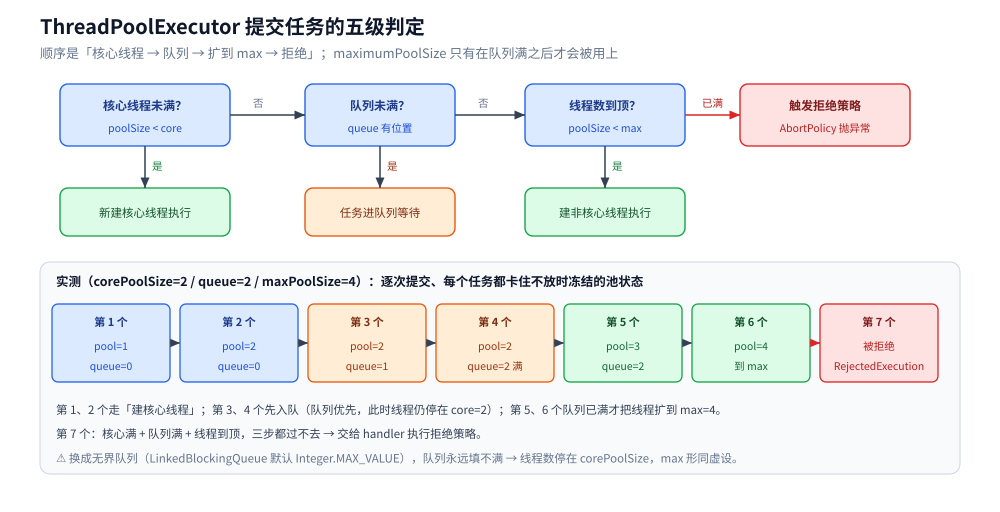
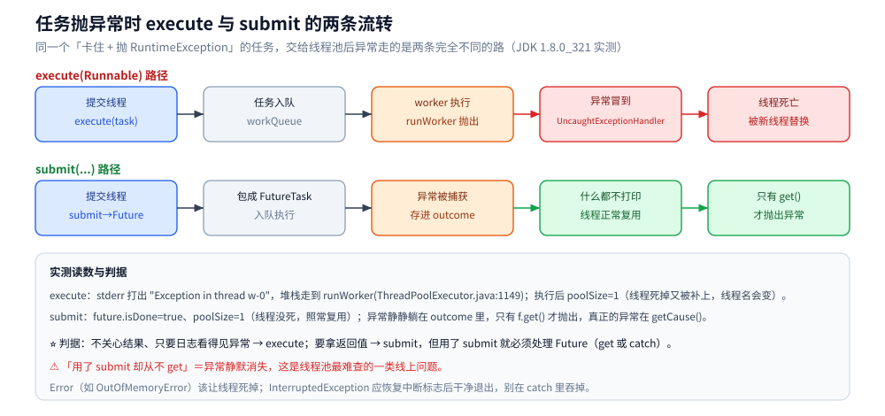
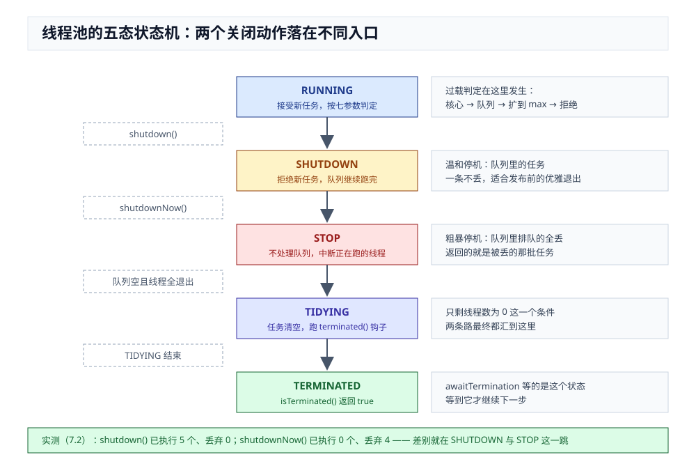

# Java 线程池

> 覆盖：「一个任务一条线程」为什么会把机器拖垮这个起点、`ThreadPoolExecutor` 七个参数各自管什么、任务提交后的真实路径（核心 → 队列 → max → 拒绝）、
> 队列与拒绝策略怎么选、线程数到底该定多少、`Executors` 四个工厂方法为什么不能用于生产、
> 以及 `execute` 与 `submit` 对异常截然不同的处理。
>
> 不覆盖：线程池内部的锁与 `Condition` 见 [锁与AQS.md](锁与AQS.md)；线程的创建成本与超订曲线见 [线程与进程开销.md](线程与进程开销.md)；
> 线程的六个状态与中断语义见 [线程基础与生命周期.md](线程基础与生命周期.md)；可拆分的计算型并行见 [ForkJoin与并行流.md](ForkJoin与并行流.md)；
> Go 侧的同类机制见 [goroutine实战模式.md](../../go/并发编程/goroutine实战模式.md) 的 worker 池。
>
> 内容整理自个人学习笔记，素材见 [素材清单](../../../素材清单.md)。
>
> **实测口径**：本机 JDK 1.8.0_321（Windows / 8 核 CPU），实验源码在 `.workbuddy/tmp/juc_lab/`
> （`ThreadPoolLab.java`、`ThreadPoolPitfallLab.java`）；耗时类读数（4.1）连跑三次取范围，只断言走势；
> 参数与拒绝策略的行为（2.2、3.2、5.1、6.1、7.2、7.3）是确定性读数，可逐字比对。
> **未实测**：容器里 4 vCPU 的 CPU 型线程数曲线未重跑（4.1 的「见顶」结论基于 8 核宿主机）。

---

## 一、从零：为什么不能一个任务一个 `new Thread()`？

**本节要点**：池化省的不是「线程」这个概念，而是三笔账 —— 创建（百微秒级）、驻留（每条一个栈）、以及**没有上限**。

### 1.1 三笔账

| 账 | 本机读数 | 出处 |
|---|---|---|
| 创建 | 平台线程 **132~159 µs/条**（Windows / 8 核）；复用池提交 **2.26 µs/次**（2 万次） | [线程与进程开销.md](线程与进程开销.md) 2.2 |
| 驻留 | 每条线程按 `-Xss` 预留栈，**默认 1 MB**；5000 条 → 虚拟地址 +5899 MB | 同上 1.2 |
| 上限 | 没有上限保护，流量风暴直接 `OutOfMemoryError: unable to create new native thread` | 同上 |

⭐ 第一行就是池化的全部收益：**提交一个任务只要 2.26 µs，比新建一条线程便宜约 60~70 倍**。后两行则决定「池**必须有界**」—— 复用解决了创建成本，但栈是与线程数绑定的，只有限制数量才能压住它。

### 1.2 于是池要回答四个问题

池化不是「复用线程」一句话，而是必须回答四件事，正好对应后文四处：

| 问题 | 旋钮 | 答错的后果 | 位置 |
|---|---|---|---|
| 常驻多少条？ | `corePoolSize` / `maximumPoolSize` | 太小排队、太大把自己的下游打死 | 第四节 |
| 排队排在哪、排多深？ | `workQueue` | 无界队列把 OOM 推后，max 形同虚设 | 第三节 |
| 排不下怎么办？ | `handler` | 静默丢任务，线上查不到 | 第三节、3.2 |
| 怎么知道它过载了？ | `getQueue().size()` + 拒绝计数 | 过载没有信号 | 第七节 |

⚠️ 还有一层不是参数能解决的：**`new Thread()` 本身也没有「任务回归池」的概念** —— 线程跑完就没了，栈、JVM 内部结构全部要重建。`execute` 与 `submit` 的异常差别（第六节）正是「池要不要替你兜住异常」这个问题的两面。

---

## 二、七个参数分别管什么？

**本节要点**：七个参数不是七个独立旋钮，它们**有严格的优先顺序** —— 顺序搞错就会出现「任务已经进队列了，线程却还没扩到最大」的误判。这一节把顺序实测出来。

### 2.1 参数表

```java
new ThreadPoolExecutor(
        corePoolSize,      // ① 常驻的核心线程数
        maximumPoolSize,   // ② 线程数上限
        keepAliveTime,     // ③ 超出核心的那部分线程，空闲多久被回收
        unit,              // ④ ③ 的时间单位
        workQueue,         // ⑤ 任务队列（决定「什么时候才扩线程」）
        threadFactory,     // ⑥ 线程怎么造（名字、优先级、daemon）
        handler);          // ⑦ 队列满 + 线程满时的拒绝策略
```

| 参数 | 作用 | 常见误区 |
|---|---|---|
| `corePoolSize` | 常驻线程数，**默认不会被回收** | 以为「核心线程一定要预先建好」—— 默认是**懒创建**（有任务才建），除非调 `prestartAllCoreThreads()` |
| `maximumPoolSize` | 上限 | 以为「线程数会一直往上长到它」—— 只有**队列满了**才会从 core 扩到 max |
| `keepAliveTime` | 非核心线程空闲回收时间 | 想回收核心线程要额外开 `allowCoreThreadTimeOut(true)` |
| `workQueue` | 暂存任务 | 用无界队列 → `maximumPoolSize` **永远用不上**（队列永远不满） |
| `handler` | 队列满 + 线程满时的兜底 | 默认 `AbortPolicy` 会抛异常，很多人不知道 |

### 2.2 实测：任务提交后走哪条路

这是最容易答错的一段。用 `corePoolSize=2, queue=2, maxPoolSize=4` 逐个提交任务、每个都卡住不放，冻结每个瞬间（`ThreadPoolLab.java` 实验 1）：

```text
== 实验 1：corePoolSize=2, queue=2, maxPoolSize=4，逐个提交并观察 ==
  提交第 1 个  poolSize=1 activeCount=1 corePoolSize=2 largestPoolSize=1 queue=0
        ↑ 预期：1 个 → 起核心线程 1
  提交第 2 个  poolSize=2 activeCount=2 corePoolSize=2 largestPoolSize=2 queue=0
        ↑ 预期：2 个 → 核心线程满
  提交第 3 个  poolSize=2 activeCount=2 corePoolSize=2 largestPoolSize=2 queue=1
        ↑ 预期：3 个 → 进队列（第 1 个排队）
  提交第 4 个  poolSize=2 activeCount=2 corePoolSize=2 largestPoolSize=2 queue=2
        ↑ 预期：4 个 → 进队列（队列满）
  提交第 5 个  poolSize=3 activeCount=3 corePoolSize=2 largestPoolSize=3 queue=2
        ↑ 预期：5 个 → 队列满，扩临时线程到 3
  提交第 6 个  poolSize=4 activeCount=4 corePoolSize=2 largestPoolSize=4 queue=2
        ↑ 预期：6 个 → 扩到 maxPoolSize=4
  提交第 7 个  ❌ 被拒绝（RejectedExecutionException）
        ↑ 预期：7 个 → 核心满 + 队列满 + 线程到顶 → 触发拒绝策略
```

⭐ **顺序是：核心线程 → 队列 → 扩到 max → 拒绝。** 三件反直觉的事：

1. **不是「先把线程扩到 max，再加队列」** —— 恰恰相反，**队列优先**。`maximumPoolSize` 只有在队列满之后才会被用上。
2. **所以「无界队列 + 大 maxPoolSize」等于 max 是废的** —— `LinkedBlockingQueue`（默认容量 `Integer.MAX_VALUE`）永远填不满，线程数就永远停在 `corePoolSize`。很多「我配了 200 个线程但并发上不去」的问题根源在这里。
3. **`largestPoolSize` 是排障的好指标** —— 它记录池曾经达到过的最大线程数。如果它一直等于 `corePoolSize`，说明负载从没让池扩容过；如果等于 `maximumPoolSize`，说明**已经触发过拒绝**了。



**图怎么读**：上半是「核心线程→队列→扩到 max→拒绝」的判定链；下半把实测里每提交一个任务时冻结的池状态按步画出 —— 第 3、4 个任务先入队（线程仍停在 core=2），第 5、6 个队列满了才扩线程，第 7 个才被拒。

---

## 三、队列怎么选？拒绝策略又怎么选？

**本节要点**：队列决定「任务堆积时是变慢还是变多」，拒绝策略决定「堆不下时怎么办」。这两件必须一起定。

### 3.1 三种队列的取舍

| 队列 | 容量 | 效果 | 代价 |
|---|---|---|---|
| `SynchronousQueue` | 0（不存，直接交接） | 任务来了立刻要线程，没有线程就扩 / 拒绝 | 无缓冲，**吞吐靠线程数堆**；`newCachedThreadPool` 用它 |
| `ArrayBlockingQueue` | 固定 | 有界，堆到上限就扩线程、再满就拒绝 | ✅ **生产推荐**：上限明确，压力可见 |
| `LinkedBlockingQueue` | 默认 `Integer.MAX_VALUE` | 几乎无界，任务无限堆积 | ⚠️ **内存涨到 OOM 才报错**，且 max 永远用不上 |
| `PriorityBlockingQueue` | 无界 | 按优先级出队 | 无界 + 优先级反转风险 |
| `DelayQueue` / `DelayedWorkQueue` | 无界 | 定时任务 | 只有 `ScheduledThreadPoolExecutor` 用 |

⭐ **判据**：队列容量就是**你愿意接受的最大积压量**。选有界队列并把它当成一个明确的容量参数（像配连接池一样配它），而不是让内存去兜底。

### 3.2 四种拒绝策略（实测）

同一个池（核心 1 + 队列 1 + max 1），提交 4 个任务，看四种策略的实际表现（`ThreadPoolLab.java` 实验 2）：

```text
== 实验 2：核心 1 + 队列 1 + max 1，提交 4 个任务看四种策略 ==
  AbortPolicy          实际执行 = [T3→抛异常, T4→抛异常, T1@pool-4, T2@pool-4]
  DiscardPolicy        实际执行 = [T1@pool-5, T2@pool-5]
  DiscardOldestPolicy  实际执行 = [T1@pool-6, T4@pool-6]
  CallerRunsPolicy     实际执行 = [T3@main, T1@pool-7, T2@pool-7, T4@pool-7]
```

逐个读：

| 策略 | 行为 | 实测证据 |
|---|---|---|
| `AbortPolicy`（默认） | 抛 `RejectedExecutionException` | T3、T4 都抛了异常，调用方能感知 |
| `DiscardPolicy` | **静默丢弃**，什么都不做 | 只剩 T1、T2 执行，T3/T4 无声消失 ⚠️ 最危险 |
| `DiscardOldestPolicy` | 丢掉**队列里最老**的那个，腾位置给新任务 | 执行的是 T1、**T4** —— T2 被挤掉了 |
| `CallerRunsPolicy` | **让提交任务的线程自己跑** | `T3@main` —— 打印里根本没有 `pool-N`，是主线程亲自执行的 |

⭐ **`CallerRunsPolicy` 是唯一自带背压的**：队列满时提交方被迫亲自执行（变慢），压力自动往上游传，不会丢任务也不会抛异常。代价是**提交方会被阻塞** —— 所以「推送线程 / 请求线程绝对不能阻塞」的场景（见第九节）**不能用它**。

⚠️ **`DiscardPolicy` 和 `DiscardOldestPolicy` 在生产里基本别用** —— 它们把「系统过载」变成了「任务无声消失」，而消息丢失比报错难查得多。要丢也得自己实现 `RejectedExecutionHandler`，**在丢的时候打一条带业务标识的日志 + 计数指标**。

---

## 四、线程数到底该定多少？

**本节要点**：没有万能公式，但有一个**能实测出来的判据** —— 任务类型决定一切。

### 4.1 实测：CPU 型与 IO 型的曲线完全不同

32 个任务，CPU 型每个算 2×10⁷ 次 `sqrt`，IO 型每个 `sleep(100ms)`，各线程数下测总耗时（`ThreadPoolPitfallLab.java` 实验 3，跑 3 次取范围）：

```text
  CPU 核数 = 8，任务数 = 32，每任务：CPU 型算 2e7 次循环 / IO 型 sleep 100ms
  --- CPU 型 ---
    线程数=1   总耗时  6143.6 ms
    线程数=8   总耗时   915.5 ms
    线程数=16  总耗时   912.4 ms
    线程数=32  总耗时   961.1 ms
  --- IO 型 ---
    线程数=1   总耗时  3427.1 ms
    线程数=8   总耗时   417.5 ms
    线程数=16  总耗时   202.0 ms
    线程数=32  总耗时   111.3 ms
```

三次运行的范围与走势：

| 线程数 | CPU 型 | IO 型 |
|---|---|---|
| 1 | 6143 ~ 6175 ms | 3351 ~ 3427 ms |
| 8（=核数） | 915 ~ 950 ms | 416 ~ 432 ms |
| 16（=核数×2） | 877 ~ 930 ms | 201 ~ 213 ms |
| 32（=核数×4） | 888 ~ 961 ms | 111 ~ 116 ms |

- **CPU 型**：1 → 8 提升了约 **6.6 倍**；8 → 16 → 32 **基本持平**（877 ~ 961 ms 区间内抖动）。⚠️ 本机**没有观察到明显变慢**，所以准确的结论是「**超过核数后收益见顶**」，而不是「一定变慢」。
- **IO 型**：随线程数**单调下降**；32 线程时 111 ~ 116 ms，已接近单个 `sleep(100ms)` 的时长 —— 说明 32 个任务**完全并行了**（线程在 sleep 时不占 CPU，加线程就能加并发度）。

### 4.2 由此得到的判据

```text
线程数 ≈ 核数 × (1 + 等待时间 / 计算时间)
```

- **CPU 型**（等待 ≈ 0）→ 线程数 ≈ 核数。再多只是增加上下文切换。
- **IO 型**（等待远大于计算）→ 放大倍数可以很大。上面 sleep 100ms 的任务里，等待/计算接近无穷，所以 32 线程仍在线性收益区间。

⚠️ **两个坑**：

1. **这个公式只能当起点**，真实系统里任务往往是混合的，且依赖下游（DB 连接池、下游 RPC）的容量。**线程池开太大反而会把自己的依赖打死** —— 200 个线程一起去打一个只有 10 个连接的数据库，等于制造排队。
2. **多线程池要分开**：CPU 密集的任务和 IO 密集的任务**别共用同一个池**，否则 IO 任务把线程占满后，CPU 任务连线程都排不上。

---

## 五、`Executors` 的四个工厂方法为什么不能用于生产？

**本节要点**：不是「它们有问题」，而是**它们替你做的默认选择在有界性上是错的**。这一节直接把参数读出来。

### 5.1 实测：四个工厂方法的真实参数

```text
== 实验 1：Executors 工厂方法造出来的池，参数长什么样 ==
  ⚠️ newSingleThreadExecutor() 返回的实际类型 = java.util.concurrent.Executors$FinalizableDelegatedExecutorService
     它是**包装类**，不能直接强转成 ThreadPoolExecutor —— 目的就是防止使用者改大 corePoolSize
     从而破坏「单线程」语义；要用内部参数得反射取。

  newFixedThreadPool(2)      maxPool=2           队列=LinkedBlockingQueue    剩余容量=2147483647
  newSingleThreadExecutor()  maxPool=1           队列=LinkedBlockingQueue    剩余容量=2147483647
  newCachedThreadPool()      maxPool=2147483647  队列=SynchronousQueue       剩余容量=0
  newScheduledThreadPool(2)  maxPool=2147483647  队列=DelayedWorkQueue       剩余容量=2147483647
```

两类风险，全都写在参数里：

| 工厂方法 | 问题 | 参数证据 |
|---|---|---|
| `newFixedThreadPool` | 队列**无界** → 任务堆积到 OOM | 剩余容量 `2147483647` |
| `newSingleThreadExecutor` | 同上 | 剩余容量 `2147483647` |
| `newCachedThreadPool` | 线程数**无上限** → 线程爆炸 | `maxPool=2147483647` |
| `newScheduledThreadPool` | 同上（外加延迟队列无界） | `maxPool=2147483647` |

✅ 生产惯例：**手写 `new ThreadPoolExecutor(...)`**，把「有界队列容量」与「maxPoolSize」显式写出来 —— 这两个数字就是你对过载的态度。

> 💡 顺带一个发现：`newSingleThreadExecutor()` 返回的不是 `ThreadPoolExecutor`，而是一个 `FinalizableDelegatedExecutorService` **包装类**（所以直接强转会 `ClassCastException`）。包一层的目的正是**防止使用者拿到后调 `setCorePoolSize(10)`**，把「单线程」这个语义破坏掉。有意思的是这层保护**只包了构造参数**，并没有禁止 `shutdown`。

---

## 六、`execute` 与 `submit` 的一个致命差别

**本节要点**：两者对「任务抛异常」的处理**完全不同**。用错会导致异常静默消失，这是最难查的一类线上问题。

### 6.1 实测

```text
== 实验 2：任务抛异常时，execute 与 submit 的差别 ==
  初始 poolSize = 0
  --- execute() 提交一个必抛异常的任务 ---
Exception in thread "w-0" java.lang.RuntimeException: execute 里的异常
	at ThreadPoolPitfallLab.lambda$main$1(ThreadPoolPitfallLab.java:74)
	at java.util.concurrent.ThreadPoolExecutor.runWorker(ThreadPoolExecutor.java:1149)
	at java.util.concurrent.ThreadPoolExecutor$Worker.run(ThreadPoolExecutor.java:624)
	at java.lang.Thread.run(Thread.java:750)
  执行后 poolSize = 1（若变了说明线程已死并被替换）
  --- submit() 提交一个必抛异常的任务 ---
  submit 后：future.isDone = true（异常已被 FutureTask 收进 outcome）
  submit 后 poolSize = 1（线程**没死**，照常复用）
  只有 f.get() 才抛出：java.lang.RuntimeException: submit 里的异常
```



图里两条路径在「任务抛异常」这一节点分叉：上面那条冒到 `UncaughtExceptionHandler` 后线程死亡、池再补一条；下面那条被 `FutureTask` 装进 `outcome`，线程毫发无伤地回池复用 —— 而 `outcome` 只有 `get()` 会去取。

对比表：

| | `execute(Runnable)` | `submit(...)` |
|---|---|---|
| 返回值 | `void` | `Future<T>` |
| 任务抛异常 | **冒到线程的 `UncaughtExceptionHandler`**（默认打到 stderr），线程**死亡并被替换** | 被 `FutureTask` **捕获存进 `outcome`**，**什么都不打印**，线程正常复用 |
| 异常怎么拿到 | 日志里直接能看到 | **只有调用 `future.get()` 才会抛** |
| 静默丢失的风险 | 低 | ⚠️ **高**：忘 `get()` 就等于异常消失 |

⭐ **判据**：

1. **不关心结果、只要日志能看见异常** → 用 `execute`（或给 `submit` 的 `Future` 补 `get()`）。
2. **`submit` 之后必须处理 `Future`** —— 要么 `get()`（会抛 `ExecutionException`，真正的异常在 `getCause()`），要么至少 `catch` 住。**「用了 `submit` 却从不 `get`」是线程池最常见的隐性 bug。**
3. 折中做法：给线程工厂挂一个会记录日志的 `UncaughtExceptionHandler`，并把 `submit` 改成 `submit(..., 兜底值)` 或统一包一层 try-catch。

### 6.2 顺带记住的两件事

- **任务抛异常会「消耗」一个线程**：`execute` 抛异常后 worker 死亡，池会补一个新的（所以 `poolSize` 可能看起来没变，但线程名换了）。如果任务异常率很高，等于在**反复重建线程**。
- ⚠️ **`Error`（如 `OutOfMemoryError`）与 `InterruptedException` 要区别对待**：前者通常该让线程死掉，后者应该「恢复中断标志 + 干净退出」，不要在 `catch` 里吞掉。

---

## 七、状态监控与优雅关闭

**本节要点**：线程池是**看不见的**，必须主动暴露指标；关闭时的行为差异也必须清楚。

### 7.1 该盯的六个数

```java
pool.getPoolSize();          // 当前线程数
pool.getActiveCount();       // 正在跑任务的线程数
pool.getQueue().size();      // 排队任务数  ← 最重要的过载信号
pool.getCompletedTaskCount();// 已完成任务总数
pool.getLargestPoolSize();   // 历史最大线程数
pool.getTaskCount();         // 累计提交任务数
```

⭐ 生产上至少要暴露 **`queue.size()`（积压）** 与 **拒绝次数（自己实现的 handler 里 +1）**。前者涨起来就是过载前兆，后者 > 0 就意味着**已经丢过任务或已经报错过** —— 这是两个最该告警的信号。

### 7.2 关闭：`shutdown` 与 `shutdownNow` 的差别（实测）

```text
== 实验 5：shutdown() vs shutdownNow() ==
  shutdown()     已执行 = [T1, T2, T3, T4, T5] 队列里被丢弃 = 0 个  isTerminated=true
  shutdownNow()  已执行 = []               队列里被丢弃 = 4 个  isTerminated=true
```

- **`shutdown()`**：不再接收新任务，**队列里已提交的会全部跑完**（实测 5 个全执行完）→ 温和，适合优雅停机。
- **`shutdownNow()`**：返回**还没跑的任务列表**（实测返回 4 个），并 `interrupt` 正在执行的线程 → 正在跑的那个也停了（实测已执行列表为空）。**但能否真的停下，取决于任务是否响应中断**（`sleep` / `wait` / 阻塞 IO 会响应；死循环里不检查中断标志的代码不会）。

这两个动作的区别，本质上是把池推进到**不同的状态**：



图里唯一的分叉点是 `RUNNING` 的两个出口：`shutdown()` 只把状态改成「不收新任务」，队列照跑；`shutdownNow()` 直接跳到 `STOP`，队列被清空返回、正在跑的线程收中断。**7.2 那两行读数（5 个执行完 vs 0 个执行、丢弃 4 个）就是这一跳的后果。**

⭐ **优雅停机模板**：先 `shutdown()` → `awaitTermination(超时)` → 还没结束再 `shutdownNow()` 兜底。**不要上来就 `shutdownNow()`**，那等于把队列里用户已提交的任务丢掉。

### 7.3 两个顺带的行为（实测）

```text
== 实验 3：固定 1 个核心线程，连续提交 5 个任务 ==
  任务跑在 pool-8    （×5，同一个线程）
  同一个线程跑完 5 个任务 → 线程复用，不是每个任务一个新线程

== 实验 4：运行时改 corePoolSize ==
  提交 1 个任务后：      poolSize=1 activeCount=1 corePoolSize=1 largestPoolSize=1 queue=0
  setCorePoolSize(3) 后： poolSize=1 activeCount=1 corePoolSize=3 largestPoolSize=1 queue=0  ← ⚠️ 只改参数，并不立即新建线程
  再提交 3 个任务后：     poolSize=3 activeCount=3 corePoolSize=3 largestPoolSize=3 queue=1  ← 新核心线程此时才被创建
```

- **线程是复用的**（同一个 `pool-8` 跑完 5 个任务），这正是池化省下的开销。
- **`setCorePoolSize` 只改参数、不立即建线程**（实测改完 `poolSize` 仍是 1，要等新任务进来才补）。做动态调参时**别以为改完立刻生效**，也别靠它应对突发流量。
- 另有一个参数值得知道：**`allowCoreThreadTimeOut(true)` 能让核心线程也超时回收**（实测：`prestartAllCoreThreads()` 建了 2 个，开这个开关 + `keepAliveTime=200ms`，等 600ms 后 `poolSize` 掉到 0）—— 低峰期能省下常驻线程的内存。

---

## 八、应用场景

**本节要点**：线程池的选型只有三个变量 —— 任务是 CPU 型还是 IO 型、队列的容量就是你的积压上限、拒绝策略取决于提交方能不能被阻塞。

| 场景 | 池怎么摆 | 判据 | 细节落在哪 |
|---|---|---|---|
| Web 请求处理 | 有界队列 + `AbortPolicy`，按核数定 core | 请求方可以失败、不能无限排队 | 第三节、4.2 |
| 向连接投递消息（弹幕、推送） | 有界队列 + `offer`，丢弃计数 | 提交方是广播线程，**不能被阻塞** | 第九节 |
| 下游调用的并发上限（DB / RPC） | 池的并发 ≤ 下游连接池容量 | 超出的线程只是在连接池里排队 | 4.2 的坑 1 |
| 定时任务 | `ScheduledThreadPoolExecutor` | 需要延迟 / 周期，`DelayedWorkQueue` | 5.1 的参数表 |
| 短时突发、任务极短 | `newCachedThreadPool` + 上游限流 | 闲时能缩到 0，突发不能无上限 | 3.1、延伸追问 |
| 可递归拆分的计算任务 | `ForkJoinPool` | 任务能拆、能 join | [ForkJoin与并行流.md](ForkJoin与并行流.md) |
| 后台单线程串行消费 | core=max=1 | 顺序性优先，吞吐不重要 | 5.1 的 `newSingleThreadExecutor` 警告 |
| 优雅停机 | `shutdown` → `awaitTermination` → `shutdownNow` | 队列里的任务不能丢 | 7.2 |

⭐ 总纲：**先给队列定容量**（这是你对过载的承诺），**再定线程数**（CPU 型 ≈ 核数，IO 型按等待比放大但别超过下游容量），**最后选拒绝策略**（提交方不能被阻塞时，`CallerRunsPolicy` 先排除）。

---

## 九、具体使用

**本节要点**：同一个「向房间内所有连接投递弹幕」，四步就能把 3.1 的队列、3.2 的拒绝策略、7.1 的指标串起来。

本项目里**真实存在**的 Java 线程池用法在 [Java实现.md](../../../04-架构与系统/系统设计/弹幕系统/Java实现.md)。拿其中的「向房间内所有连接投递弹幕」逐环节拆：

### 9.1 先判断任务是什么类型

投递弹幕是**纯 IO + 网络等待**，计算量近乎为零 —— 按第四节的判据，这属于「等待远大于计算」，线程数可以放大；但**放大线程数解决不了慢客户端的问题**，因为瓶颈在线路而不在 CPU。

### 9.2 用有界队列，且不用 `put`

真实代码里是：

```java
private final ArrayBlockingQueue<Msg> out;
// 投递时用 offer（非阻塞），满了立刻返回 false
```

- **为什么必须有界**：投递速度受客户端读取速度影响，一个卡住的客户端就能让队列无限膨胀。有界队列把「内存无限涨」转换成「明确的拒绝」，把不可控变成可控。
- **为什么是 `offer` 而不是 `put`**：`put` 在队列满时会**阻塞投递线程**，于是一个慢客户端会把整个房间的推送全部拖住。`offer` 立即返回，损失一条弹幕而不影响其他订阅者。

### 9.3 拒绝之后要记账

代码里对丢弃的计数是明确暴露的（[Java实现.md](../../../04-架构与系统/系统设计/弹幕系统/Java实现.md) 第三节的注释写得很清楚：「只报 QPS 等于把『用户看不到弹幕』藏起来」）。这正对应第七节说的 —— **拒绝次数必须成为指标**，否则「静默丢弃」就是 `DiscardPolicy` 的翻版。

### 9.4 把结论套回本节的框架

弹幕投递**没有用 `CallerRunsPolicy`**：虽然它是唯一自带背压的策略，但它的背压方式是**阻塞提交方**，而这里的提交方是房间的广播线程 —— 一旦被阻塞，损失会从「一条弹幕」放大到「整个房间」。**背压只对「提交方能承受变慢」的场景成立**，这是选择拒绝策略时必须先回答的问题。

⭐ 归纳：**队列容量 = 你能接受的积压；拒绝策略 = 过载时的取舍；而「提交方能不能被阻塞」是选拒绝策略的第一判据。**

---

## 延伸追问

- **核心线程数设成 0 会怎样？** → 可以（`corePoolSize=0` 合法），任务来了先入队，再创建线程。但此时 `ArrayBlockingQueue` 满之后的扩容行为与 `SynchronousQueue` 不同，容易出现「明明没任务却没线程」的困惑。**不建议设 0**，核心线程的意义就是「随时待命」。
- **为什么任务已经进队列了，线程却还没扩到 `maximumPoolSize`？** → 因为**顺序就是队列优先**（2.2 实测）。`maximumPoolSize` 只在队列满时才起作用。想让「任务来了立刻扩线程」，就得用 `SynchronousQueue`。
- **`keepAliveTime` 对核心线程无效吗？** → 默认无效（核心线程常驻）。要让核心线程也超时，必须显式 `allowCoreThreadTimeOut(true)` —— 实测这样 `poolSize` 会掉到 0。
- **线程池里的线程抛了异常，池会不会少一个线程？** → 用 `execute` 会（worker 死亡后池会补一个新的，但**线程名会变**）；用 `submit` 不会（异常被 `FutureTask` 接住了，线程继续复用）。这也是排查「线程名频繁变化」的一个线索。
- **`ThreadPoolExecutor` 为什么把预检分成「先核心、再队列、再扩容」三步？** → 设计意图：**优先用少量常驻线程 + 队列吸收突发**，避免为了一时的流量高峰长期持有大量线程（创建与销毁都贵）。代价就是「有界队列填满前不会扩容」这个反直觉行为。
- **`newCachedThreadPool` 到底能不能用？** → 它适合「短时、突发、任务极短」的场景（`SynchronousQueue` + 60 秒回收，闲时可以缩到 0 线程）。风险是**突发时线程数无上限**（`maxPool=Integer.MAX_VALUE`）。用它必须有上游限流保护，否则等于把过载直接变成线程爆炸。
- **`ForkJoinPool` 与 `ThreadPoolExecutor` 有什么区别？** → `ForkJoinPool` 用**工作窃取**（每个线程有自己的双端队列，空闲时去偷别人的任务），适合**可递归拆分的计算型任务**；`ThreadPoolExecutor` 是共享队列 + 阻塞等待，适合**独立的任务**。`parallelStream()` 用的默认就是 `ForkJoinPool.commonPool()`（⚠️ 它默认只有 `核数-1` 个线程，且是**全局共享**的，跑阻塞任务会拖垮整个进程的并行流）。
- **怎么防止线程池把数据库连接池打爆？** → 让**线程池的并发上限 ≤ 下游连接池的容量**。线程池开 200 而连接池只有 10，多出来的 190 个线程只是在连接池的队列里排队 —— 不但没提升吞吐，还多占了线程栈内存。**这是「线程数不是越大越好」在分布式系统里最常见的落地形态。**

## 关联

- [锁与AQS.md](锁与AQS.md) — 同一目录：`ThreadPoolExecutor` 内部用 `ReentrantLock` + 两个 `Condition`（`notEmpty` / `notFull`）实现任务队列的通知，读它的前置
- [并发容器.md](并发容器.md) — 线程池的**工作队列**就是 `BlockingQueue`：九种操作的三态语义直接决定任务堆积时的行为
- [JMM与内存屏障.md](JMM与内存屏障.md) — 任务从提交线程「交接」给工作线程，交接点上依赖 `happens-before` 保证可见性
- [goroutine实战模式.md](../../go/并发编程/goroutine实战模式.md) — Go 侧的 worker 池：`errgroup` 限并发与「令牌要拿在 `go` 之前」，与本文的七参数是两种资源控制思路
- [限流器.md](../../go/并发编程/限流器.md) — 线程池管「同时在跑多少」，限流器管「单位时间放多少」，两者常常要一起上
- [Java实现.md](../../../04-架构与系统/系统设计/弹幕系统/Java实现.md) — 「具体使用」一节的代码出处：`ArrayBlockingQueue` + `offer` 的投递路径
- [goroutine.md](../../go/并发编程/goroutine.md) — Go 侧线程/协程的创建成本（实测亚微秒），对比线程池「复用线程」省下的到底是什么
- [垃圾回收原理与收集器.md](../运行时/垃圾回收原理与收集器.md) — 堆的分代与根集合（线程栈就是根的第一类），线程数上限的内存侧约束
- [运行时数据区与栈帧.md](../运行时/运行时数据区与栈帧.md) — 每个线程一个 JVM 栈，这是「线程不能无限开」的根本原因
> 反向引用（本篇被下列文档引到）：[CompletableFuture与异步编排.md](CompletableFuture与异步编排.md)、[ForkJoin与并行流.md](ForkJoin与并行流.md)、[ThreadLocal与上下文传递.md](ThreadLocal与上下文传递.md)、[死锁与并发缺陷诊断.md](死锁与并发缺陷诊断.md)、[线程与进程开销.md](线程与进程开销.md)、[线程基础与生命周期.md](线程基础与生命周期.md)、[线程间协作与并发工具类.md](线程间协作与并发工具类.md)、[虚拟线程.md](虚拟线程.md)、[JFR与诊断工具.md](../运行时/JFR与诊断工具.md)、[堆外内存与内存映射.md](../运行时/堆外内存与内存映射.md)、[线上问题排查.md](../运行时/线上问题排查.md)、[进程与线程.md](../../../02-计算机基础/linux/进程与线程.md)
